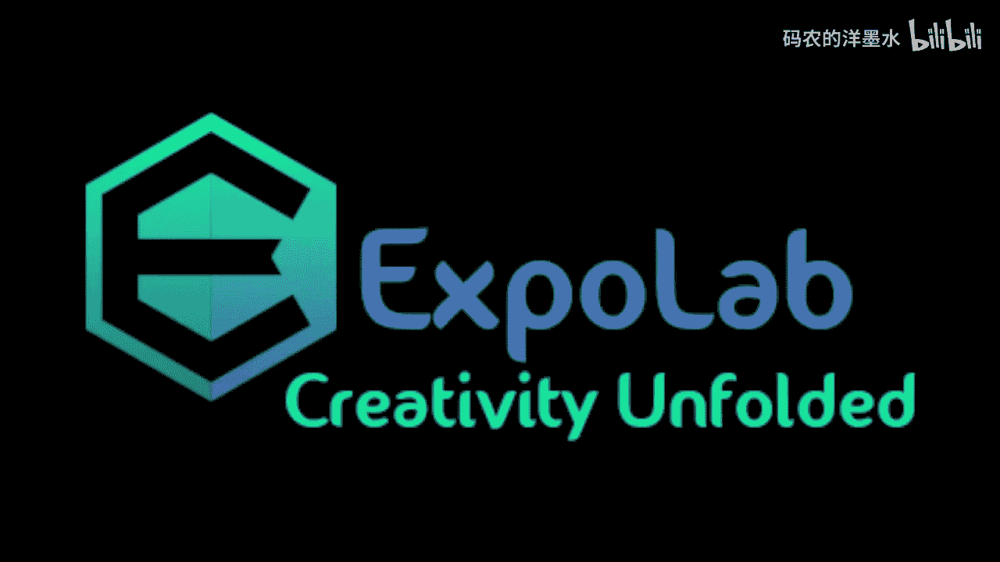
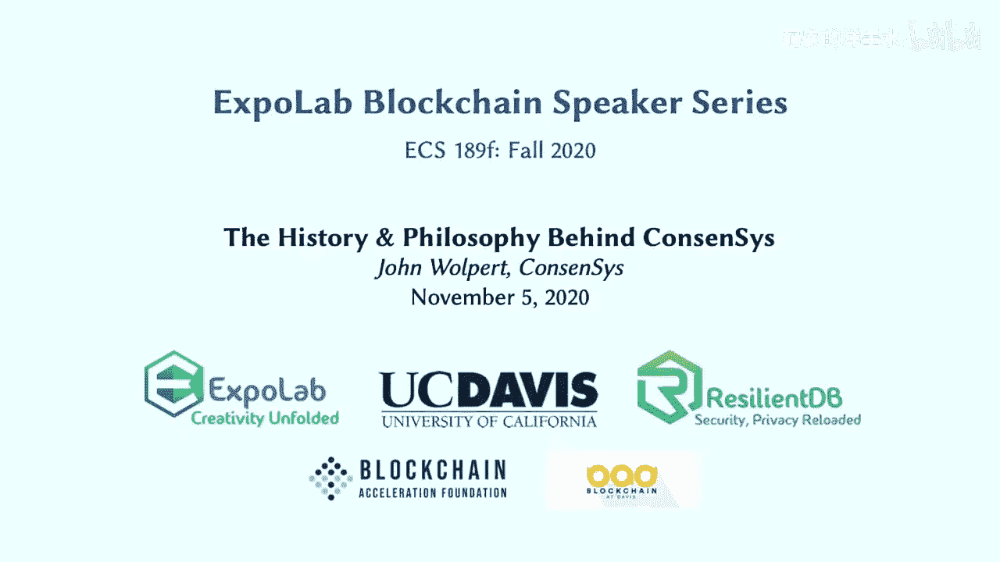
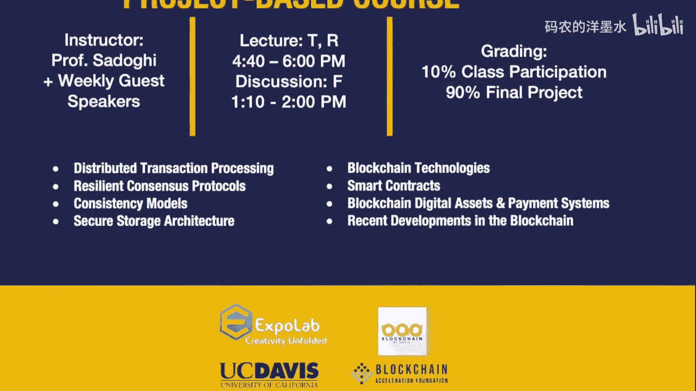

# 【全集】加州大学戴维斯分校 分布式交易与区块链架构 中英字幕 完整课程 p19 Lecture 15 - ConsenSys的发展历程与核心理念 -BV18YFVzME2f_p19-

So today our second speaker of Expo La B speaker Sirius is John Walfordt and he is has a sort of a stellar career has been in the enterprise world and entrepreneurship for the last 30 years currently is one of the senior executive at Consus and previously he。

Actually was the co founding member of。IBM blockchain and in particular， hyperlegger。

 the open sourcing effort of hyperlegger fabric itself。

It's a great pleasure to have John with us today and so without further ado， please take it away。

Well， thanks it's it's great to be。 Well， virtually at Davis。

 I used to spend a lot of time out there。 I was。😊，A lot of my career。

 I was in Berkeley or San Francisco or the South Bay Cupertino。And moved away a bunch of times。

 went to live in Sydney Australia for a while and Germany and。New York and other places。

 but right now we live in Raleigh。North Carolina I was at IBM in California in San Francisco living in Berkeley when I got the call from my favorite old boss Jerry Cuomo who was one of the founders of IBM blockchain and he said hey。

 there's this blockchain thing out there here hey he actually said。

 hey Lewis it's Clark what do you want he said well。

 there's this blockchain thing let's go and figure it out。I said， well。

 give me a shipping crew and I'll go check it out and he said， well， I got two muskets。

 a dog and a canoe。And。And we I said， okay， and so we start investigating blockchain。

And we got lucky。 I mean， it just blew up from there。 The CEO started calling about it。

 and sooner before we knew it。We weren't off on the trail to nowhere we were， you know， founding。

Pioneer cities and stuff and， and。That led to IBM blockchain and hyper ledger fabric。And。

And that's where the story got interesting from there。嗯。So I'm going to be talking about。

The journey from what we thought blockchain was about in 2015 in business。 Now， of course， you know。

 blockchain was， is older than that。 And， in fact， you know。

 the basics of blockchain technology are quite old， as I'm sure all of you know。Um， there's a。

 there's a cat out out that David Chom， who will tell you he invented it back in the 90s and 80s and he's kind of partly right。

With digit cash money do you remember digit cash？Yeah I've heard of it actually so the other interesting thing you pointed out so I was at IBMPJ Watson from 2012 to 2016 and so in the beginning a lot there was a lot of AI hype and but。

I guess just before I was departing IBM and as I said， 2015。

 it really became the blockchain and hyperperlegger was and Yorktown height that was one of the I would say number one topic in 2015 Yeah your old boss was my old boss right and who's now the CEO Yes yes。

 Arvinvinna yeah Krishna came so initially was John Kelly John Kelly was the when I started with John Kelly and then Arvin came and well when I left Arvin was still the the VP and the head of research Do you remember who preceded John Kelly？

No， I don't。Oh yes， yes， yes， yes， oh my gosh， what was Paul's last name and's embarrassing。

He was cool， had a ponytail。Yes。Yeah I liked him a lot anyway。

 so sorry for the old home week there but yeah， no， right， so TJ Watson。

 one of the coolest places around only exceeded by Almaden Research Center。

 which is only exceeded by by Herssley， right？Um，Harsley Research Lab is kind of like u hogwarrts for IBM。

U。Out in England in the south of England。Um， yeah， I really enjoyed being at IBM。

 I was an IBM or three times， u started three companies and a nonprofit。Left IBM came back。

 left IBM came back left。And this last time around， we were building IBM blockchain。

 hyper ledger fabric and the idea behind。This was。That cryptocurrency and blockchain as an application wasn't really the enterprise game。

 nobody you know we didn't expect that any Treasury departments or companies finance departments or governance departments were going to be okay with getting into cryptocurrency now in 2015。

And so we， but we saw the advantages from as distributed systems people， we saw the advantages in。

And the approach， the basics， to primitives。Of blockchain， the infrastructure behind Bitcoin。

And so we ran around saying blockchains not Bitcoin but， you know。

 and people and executives and big companies would start repeating that and suddenly it was safe to talk about blockchain at least。

And then we said， oh， well， why don't we make a blockchain that it doesn't require mining or cryptocur it isn't really about cryptocurrency。

 it's more about data。And then we proceeded to spend a whole bunch of money building what I would call really an overly complicated database that has some real problems with compartmentalization。

So。My own， my own baby， I guess I'm calling ugly here that in that hyper editorure fabric and the other private blockchains。

 enterprise blockchains are really。Shared databases。 And there's nothing wrong with that。

 I like a shared database。 and I like Git。It is a good， a good way of having shared data。But。

 these are also， it turns out interestingly problematic。rightLet me before I go on， let me ask。

Get a sense of the room I mean I haven't really been briefed on whos on the call what are the backgrounds here can you give me a so we have two classes year we have an undergraduate senior undergraduate in introduction to the ledger so over the last Mon so Mon and half you got introduced to permission list Bitcoin Ethereium last few days actually Mohan gave a talk last week Thursday last session Marco from Zurif the col one of the main hyperlegger folks as well so he also gave in depth overview of hyperlegger so I think from the hyperlegger perspective we were in everyone has a good background and the other half of the class is from the graduate course and blockchain again they also been reading core papers from PBFD to bit and so they have。

Sort of a broader understanding of the consensus protocol and it's sort of maybe last class we looked at hot stuff and so they also pretty well versed on core out orically so it's a good crowd I think everybody now at this time really understand the material good that's perfect because i'm going to throw a bomb in the room and wreck everything that you've been learning。

Yeah。😊，Which should be at least interesting， right absolutely。Okay。And so everybody heres technical。

Yes。Yes， everyone's technical， okay， cool。Everybody into distributed systems？呃。

At least as far as the courses they're taking they're in distributed system but they will remain after this course or not will find out but right now yes everybody's distributed system I'll tell you what you're in the right place because distributed systems I mean there's a lot of comp people that don't understand distributed systems。

And that's if you don't understand distributed systems， you don't understand where things are going。

 So and it's hard and， and really hard。 And you know， once you think you've figured it out。

 it's it becomes hard again it's。Distributed systems is， I think one， one famous distributed system。

 the guy said， you know， the first rule of distributed systems is if you can avoid distributed systems。

 do that。Um。But yeah， so we're going to talk about that yeah。

 so hyperlyer fabric I was one of the six people that came up with that and and shaped it into what it is other great folks or Gary Sing and Ben N。

 who's over at State Street now and there's some great work in there what Gary did with also。呃呃。

We would yellen and some other folks who are really just and of course， Jerry Cuomo and others。嗯。

And it sounds like you were talking to the crypto team over in Zurich， which is a great crypto team。

 cryptography team。嗯。So there was great work。 But the whole time we were building fabric。

 Mark Andreesson， you know， the famous guy who built mosaic and how was a V C was laughing at us for building private blockchains。

 And I used to get a little nervous about that。 I'm like， well， he's smarter than I am。

 So what is it， What am I missing here。😊，And I used to call this Andreson's revenge。

 and what I meant by that was。You know。His point was that if you're not doing public。unquote。

 permissionless blockchain。Then you really are just building databases and you should just use databases。

It turns out he was right。You can use a distributed database。

 you can use Cloudant is a good one think kind of Cassandra variant。

And if you want to prevent people from tampering with it or want to be sure that somebody is not。um。

Has not changed the history， know， the accepted history in that ledger in that database。

State hash it periodically。Publish the hashes to the New York Times classifiedified section。

 you've got proof。You know non tampering。Or if you want to go another step down。

 if you want to build something like IBM famously built。Under my watch built two important things。

 one of the guys used to work for me runs this now， the the trade lens project。

 they're tell you about the trade trade lens project with Merriskin。

No bills of waitinging and that sort of thing I'm not familiar Yeah and then food trust。

 the the Walmart thing， I bet they brought that up Yeah food trust I definitely asked to even cover the food trust yeah so there's a guy with my last name Bob Bob yeah。

 Bob Walpert。Oh the lens is up for diamond is that the diamond stuff No that's ever ledger and that was Le yeah yeah。

So and that's a whole different bag of tricks。 but yeah。

 really the motive in those in the early days of hyperlegger and fabric and private blockchain was。

You know， Walmart calls you up and says。Would you like to be on our blockchain？And you say。

 what's a blockchain and they say， well， you know， don't worry about that。

 but we're going to put you on stage in front of 30。

000 people in Vegas with the CEO of IBM and you're going to be you know， and blah， blah。

 blah and by the way， if you want to keep doing business with us， be on our blockchain。And so okay。

 of course， there's lots of companies that had to get on that Walmart blockchain。

 but then if you think about it。If that was if that's the way it's going to go。

 you don't really need blockchain。So what we really did。

 I wrote an article you might read still it's called the value of being stupid about blockchain。

Blockchain kind of as a word unlocked a lot of executives。

 pocketbooks to go explore projects that we could have done 30 years ago。

 but they wouldn't fund them if you called it a database。So and in fact。

 I had more than a few candid conversations with banks and other companies that said， you know。

 I't like， why are you using a blockchain for this and they're like。

 because we've been wanting to do this project forever and the boss won't fund it unless it's called a blockchain。

So there's a lot of shenanigans like that going on。At the end of the day， you know。

 the idea of working together in more of a hyper connecteded world where your systems and my systems have less of a gap between them。

 It's a good idea。 right， If I'm if we're in a supply chain together， it's good to be able to do。

Things， but we kind of， I think most people are missing the mark。 you know。

 what we need is good data hygiene。 What we need is good。

RP robotic process automation and things like that so that we have less error in data entry and all that and people whenever we would go out and say well why are you using blockchain they'd be like well we need better data and we need this and that and I'm like all of that is just doing better database work right it's not really about blockchain your。

Distracting yourself。But， you know， humans are like that。

So we made a lot of money building these fancy， extraordinarily complicated， shared databases。

And I woke up one day and went， wait a minute。say， say you're a company and you have a bunch of private internal information。

 like your supply information， say you're a grower。

And you've got all this data that you really don't want your competitors to know。

And you don't want that data breached， you don't want it out in the open。

Which is what most CEOs worry about when it comes to data security， it's not about tampering。

 it's about breaches， it's about data getting out in the open。

So now you're going to take that data and put it on a shared。Surface， a new threat surface。

Where say you've got 100 companies with a node。That's 100 companies where the stupidest administrator in that consortium is going to give everybody a bad day by getting hacked。

It sounds like a terrible idea， doesn't it？And I'll answer the because we're on Zoom and nobody nobody's going to actually answer。

 Yes， it's a terrible idea。So you know， once the emperor's clothes came off， I started， wait wait。

 wait a， this is not a good idea， blockchains are terrible databases。Mainly because they're bad。

 by definition， they're bad at compartmentalization。So with any normal database。

You have good access controls， right， You know， you can say this record is accessible to this person and under these conditions and and not accessible to this person。

And you can do that across companies。 You can say， well， this company has。You know。

 the access to this table and not that table。And SaS SaS technology with the cloud。

 you can stand one of those up， you can build a consortium， you can hire an administrator。

 which all of these consortia do anyway， even if it's blockchain。And you can say， okay。嗯。

Tell you what all100 of us are in here， we're worried about the administrator that we set up。

 so we'llm secret why don't we just take the root keys and shmre them so that 60% of us have to turn the keys in order to change the system。

Now you've got almost all the benefits of a blockchain without any blockchain at all。

 you can use any database you like mango。And you've got a much more stable， secure， simple。

 less complicated， and complexity is the enemy of security。Hydlogger fabric is enormously complex。

And that worries me。It's normallyly complex because we're trying to use a structure。

We were trying to， we took a structure that liked to do。To destroy compartmentalization。

 that's what it does， its not doesn't like compartmentalization， that's not the tool， it's used。

 it's not a tool for that。And then we tried to make that tool do compartmentalization。

And so you have all these fabric channels and all this mess。

And it turns into a factorial nightmare and any， any。um。

Actual implementation because you have to manage all these channels that don't really talk to each other。

m。So that's my invetive against the thing I built before I moved over a consensus。

Any questions so that's and that's that's really great and also kind of give you a little loss of perspective on Thursday when Mohan gave the talk is he also had the complete opposite view which is good I like this controversial class is that the only real thing is the permission setting so kind of crossing the both put us both in the room together I can take him yeah i'm sure i'm sure well also I think how of a separate we can get having a good insight is good so but。

So but let's kind of maybe break this apart so maybe do go one step farther saying what is a permission blockchain and what is the permission block permission this blockchain in its in its core primitive I mean if either were to kind of try to answer that question is that well in your traditional setting you had a ledger I mean this ledger could go back beyond before banks I mean at some point you trusted somebody to write down who pays who or who owes to whom and you have to keep that ledger safe and so you trusted。

A trustworthy person in your town in your community and well you went to that person to that accountant to keep all the transaction so that's a ledger in the digital age while that ledger JP Morgan hold that ledger city bank hold that ledger all great。

But there's another thing all these banks do and also that guy a thousand0 years ago probably did it too is that while he may also had a save so he also put the actual money that you either other had given him or he needed to keep it safe or gold。

 whatever he also had a safe and again look at banks。

 they also have a safe at least till 1970s I mean as long as I guess there was a backing of the currency with gold at some point there or something in the safe today I'm not sure if there's anything in the safe。

 I think is probably just no no as digital 93% of empty is em is digital already right yeah so there's not much of a back into it。

 but again I think what the Bitcoin did is I mean this is still I think a fascinating idea says okay what on I'm going to maintain this ledger。

 I'm going to maintain this ledger in a democratic way。

 everybody let's pull out their ledger and let's write down。

What we think it's to a factual transaction and if everybody agree on that factual transaction that is written in enough copies。

 then we say， okay， that's a。Sure， and and we we'd be here all night if we wanted to talk about the basics of。

 I'm sure you guys are learning the basics of of how。Yeah， I mean， Paxoss， Byzantine fault tolerance。

 PFT， Round Robin and I helped add on a bit of that。And of course， yeah。Pro of work。

 proof of state blah， blah blah right these all these are all arguments that are good right but yeah Bitcoin wasn't the end of history of history on this subject it was the beginning of history so Ethereum came along and know now there's more how Ethereum2 is coming just about to in December is going to launch Ethereum to phase one so if I kind of continued mean if I just want to say two more things on that so we have this ledger everybody now democratically holding this ledger but again something exciting happened in that ledger in that ledger not only became our vault to put our money in so that ledger itself embeds the money so there's no need to have a vault separately with the ledger so that combined but the other thing that we also did contractual thing that we going to transact with one another the actual the terms and the condition not only the data is there not only the asset is there but the contractual。

The terms of those agreements are also not embedded in this so to me as sort of an abstract model I think that's pretty exciting now if you were to transition into the permission setting you definitely don't have the notion of the asset at least the way that the asset is gets created you can right's why not right there's no reason you can I mean we do today right literally a database entry in your bank is considered an asset。

And and that's， you know， so it's a piece of data， it is an asset， right。

 because we agree that it is。So it doesn't have to be on a blockchain to be an asset。

Or it doesn't it doesn't have to yes， but yeah so more than an asset a way of generation of assets So you need a way of controlling the flow of how money gets generated and printed essentially and you need to build an economy so that if you can do that you can do that on a hyperledger you could you just have to get everybody to agree that it's legit。

You have to get everybody agreed sure you could I mean there are if you we do now right DB2 and Mq and other things running the banking system there you know we've just agreed that those things are legitimate or traditional databases sure so let's give that a granted as well so then under that model why so then。

Isn't any blockchain just another distributor system the distributed it distributed system distributed system so you said something that that really was quite I think I thought was quite interesting the way you put it about democratically held I would I would turn the crank on that one more and say Bitcoin didn't just。

Do Democratic。you know， fall tolerance so you know。

 or Byzantine fault tolerance what it did was it you know。

 and as I said there were there were you in the '90s and even the '80s。

 there were schemes that were quickly shut down by the government to that were， you know。

 like digitc that were were trying to create digital currencies。And there's a long history of this。

The problem was you could shut them down kind of like Napster， right。

 you could find the guy running the server and you could arrest him。Which happened， right？

 What did Bitcoin do， It said it didn't just make it democratically held。

 It also made it unstoppable。You can't find all the servers anymore。They're everywhere。

 and you can't stop them。You'd have to shut the internet downralization yes absolutely mean radical decentralization。

 right so radical yeah。But there is one so that I think that's so and so we always kind of say or always say this is a new call sort of computational paradigm that is decentralized and democratic。

 but with the small caveat， at least when we observe what happens in Bitcoin is that。

The power it's truly held within four to five hands Yeah。

 there's nothing new here in any of this what's new is is a group of people's intention to use what we already had in a certain way。

That was what was radical， you know I've got a pencil， I can patent it。

 I can write some boring things with it， I can write some interesting things with it or I can shove it in your eye and now it's a disruptive technology that's kind of what Bitcoin did they just took traditional distributed systems concepts with a couple of you know novel things and put it together in such a way that in 2008。

 which was an interesting year to do this。And said。We're going to shove this in your eye。

 they became disruptive， but it was its application， its' use， the way it was used。

 the way it was deployed that was interesting。And then folks like me came along and said， hey。

 let's make a database out of that。And that was a bit of， I think， of fool's err。

 and I think a lot of that's going to fall off。Um， the way extranets kind of fell off as a thing。

 you know， towards the end of the90s。So gem is just kind of I mean I really like the I mean the insight the unique insight you have to this。

 but i'm still kind of trying to understand so everything that you're kind of pointing out as sort of interest and sort of exciting and maybe not necessarily。

A new discovery， but it's innovative of using perhaps the existing an old technology package in a much usable form so but all of those seems to apply to hyperleg as well too。

 but you do seem to be on a side that。Sort of the direction that the hyperlegger is going is not going to be the。

It's not the right way well DB2 you know， I'm saying you know you can still sell DB2。

 you can still sell Oracle shared databases or a thing and there's there's some value in it。

 but don't confuse what they are they're shared databases。

And you need to one needs to understand that in a shared database。

Where other people who yout do not work for you have a full note。

Even if you encrypt things on that database。You have other people who don't work for you。

Now with the ability to have no compartmentalization of information and know everything that's on that thing。

And I think as as we wake up to that。 and as we get sober， you're going to see companies go。

 wait a minute。 Do I really want to put all my data on this thing。 No， I really don't。

Watch what happens with food trust。 Bob Wpert， my namesake。

 not related and he was saying to me not that long ago， he said， well。

 we like hyperledger because of the transparency。I said， really， you really want transparency。

 You're dealing with food information， the nation's food information。

 and you work with Department of Home and Defense。 Do you really think that they would be happy if everybody knew all the information that was running around。

 No， they won't。 They wouldn't be happy with that。 They don't want transparency。

 They want the right people to know what they need to know at the right times under the right conditions。

 That's compartmentalization。 You need good access control list。 We've had those for decades。

 Most of my career。😊，Right so policy regulation policy regulation and you don't I mean it's not it's a closed data it's only a selected individual needs to access yeah。

 but blockchain doesn't like that blockchain wants everybody to have it。Everybody。And if you say。

 well， we're going to limit that to just some friends who have nodes。

 Well those friends aren't going to be friends forever， friends tend to become competitors。

 So what happens when the you know， the counterparty in your supply chain suddenly becomes Amazon and they're competing with you。

Do you still want them to have all that data？probably too late by then it's too late right。

 so you know， I think， you know， in a way， we tricked ourselves with block with the word blockchain in the enterprise to do more open things and that's a good thing。

But I think， you know， we also had to trick ourselves， but in doing so。

 a lot of pointy hair managers put the blinders on and didn't realize what they were getting into。

No Cso， no security officer would ever allow sensitive internal information and 80 90% of any company's data is either PII or sensitive under certain conditions they you don't want your competitors to know about your invoices。

Right， to that point to that point， I mean probably even today。

 people don't even like to deploy their data to the cloud on their own instances。

 the instances that they're holding in an open space that there's no isolation around that piece of took us years to get over that right and even now。

 but yeah I mean， I think at this point clouds what turned the worm on clouds was。

TheRealization that when the CIA chooses Amazon because it's more secure than what they can run。

Then you start to go， okay， maybe， maybe they're good at that and maybe they're doing just that and they can do have more resources to be good at security than me。

So that I mean that's what's turning the worm on clouds I think。

 but yeah Sha I have have a question so what do you I think you said。You expect。

You expected interest in it to fall down you referring to the blockchain like what what are you suggesting is going to a lot of interest in private I think yeah I think private private permissioned consortia chains like food trust and。

And trade lens and that sort of thing。They'll have their day， but at the end of the day。

 there have been consortia for things for decades。More than decades， but they're hard。

 They're brittle， and they， they tend to be fraught because companies are filled with humans that。

Tend to change their point of view and suddenly are not as friendly as they used to be。

Consortia are hard to maintain so you can run a consortia on a blockchain。Which is fine。

 but it's not transformative。 It's just the same old thing。

you've just deployed a really complicated database to do it when you could have deployed a simple database to do it。

Okay， so so you think the interest in it is not sustainable due to the lack of compartmentalization and。

Like you said， people don't generally want to put their information out there even if yeah wait wait wait till the first time a consortium blockchain gets hacked。

 somebody's node gets hacked and by the way， the answer to that has been， oh。

 let's put them all on IBM cloud on mainframes and let IBM run all of them。And I'm like， well。

 if you can pass and they call that a bass a blockchain as a service， like if you can basss。

 you could sass。if you've got IBM running all the nodes。

 then all you've really achieved is IBM is charging you。

Multiples of what they would have charged you for the same SAS system。

But now they can charge every peerer， every node when they could have just run it properly as a C implementation if they're running all the nodes who cares。

 I was actually working with a company and this was on Ethereum and they' were like oh yes this was a trade finance company and they had a bunch of banks and they said yes we have a blockchain solution I said really well where are all your nodes Oh。

 they're in our server And I said， well， that's great do any of your banks want their own node and're like w。

 yes they do they all do I said well what's happening with that and they said well the problem is none of them want any of the other banks to have one。

You see the problem。Yeah。Oops， Siri。Problem， check it out。So。I mean。

I kind of understand where you're coming from for most of the point that you're raising and I think they're very interesting。

 but so do you just I guess maybe it just is a simple clarification question。

Those issues that you're raising are they just equally applicable to permissionless you30 on Bitcoin or Okay。

 so that that gets us to the the other side of them glad you asked that question that gets us to the other side of what I've been calling the emperor's closed problem public blockchains have a different problem。

A public blockchain is。I mean， all blockchains are digital nu to colonies。They，They do not like。

they don't， they like transparency。 anything you put on them by definition， all nodes are。

Goon to have to run in one way or the other， even if you have zero knowledge， I mean。

 Z K Z cash is probably the closest thing to。Truly opaque because basically that ledger is just saying somebody gave something to somebody。

 somebody gave something to somebody it's just the sameness forever right and the zero knowledge set effectively makes every transaction look like every other transaction so you're not losing information you can't apply an artificial intelligence or a machine learning algorithm to mine out classifiers and see patterns。

 there is no pattern to see。So that's pretty safe， but in Ethereum。

 you know you could do all sorts of morphological analysis on different kinds of smart contracts and different kinds of activities。

 even Huan distributions and you can you're leaking metadata or trace data or information that you may not want to leak to other people like I could if I had a really good AI I could be mining patterns and go I'm not going to buy into that market right now because there's too much action on and I can tell that I don't know what the activity is but I know that there's more than there was yesterday so you can set up these kinds of games。

 you're leaking information you might not want to leak。When we were working with the DTCC。

 which is pretty important in the US stock system， on fabric。

 they made us effectively turn it into a pretzel to try to make it so that nobody except them had the actual data because that's how stock exchanges work。

You're not supposed to have everybody get all the data， you can do all this front running。So。

um and which is partly why fabric is so complicated because， you know， we're making us do a。

Use a blockchain pattern for something that was simply better served with a database。嗯。

A public blockchain is a digital nudist colony on a public beach。 I mean。

 at least a private blockchain it a newdest colony on a private beach， right， at least you you know。

Um， but in a public blockchain， you know， everybody sees everything all the time and anybody can get access to the ledger and all the events。

And you can start mining that for all sorts of patterns。

So do I really want to run any kind of what kind of transaction would I want to run on that as an enterprise？

Nan。Okay， so that sounds pretty bleak， right， blockchainlockchas dumb in both directions， right。

 I've set up a horrible scenario。 Everybody's depressed。Okay， so here's my best lesson for the night。

A bunch of years ago， I used to work for a company and we had a saying that I think it's changed my life。

 and that is but the butt。It'Sa but it won't work。But it would if。

And if you have a meeting and you say， you know， especially among good scientists and engineers。

 you know， you're doing brainstorming session， it's not that there's no bad ideas。

 there's plenty of bad ideas。Right， but but if you're going to point out that somebody else's idea is a bad idea。

 have the respective。Of saying， but it would work if。

 even if the best you can do is something that's crazy。

 I literally had an experience that was transformative where。We were in a room and somebody said。

 well but I said， well but the butt， you just said that that was a bad idea of this other guys。

Sa what the button he went well， but it would be a good idea if gravity were different and that set off a whole bunch of great ideas that led to a new patent right？

We didn't change gravity， but it just led to new thinking。

 so but the but and so but blockchains or digital news colonies that enterprises can't use， but。

They do look like a message bus。 They look like a good piece of middleware。I can't put data on it。

Not any kind of data that I wouldn't want other people to find out about。

But if I have an Sap system and I've got a record like a purchase order。

And I and you have an oracle system in your company。And I send you that purchase order。

I'd like I need a system integration bus。To be the common frame of reference。

 to tell us that for sure， the record in your database is verifiably identical to the record in my database。

And that we don't have repudiation that you can't say that you didn't get the memo。

And I can't say that that PO has an extra zero in it that you only me。

We know that we verifiably have exactly the same information。

And what we really want is a machine that is as supremely resistant to tampering and and locking you out and getting controlled by a group of people that could do that to you。

As possible， and that is a public blockchain， really just two of them， Bitcoin and Ethereum。

 you want supremely distributed large networks that aren't getting to a vanishing point of probability for getting tampered with。

And if you have that， and it's always on and it doesn't shut down and it can't lock you out。

 That looks like a nice， universal， always on message integration bus to me。 It's middleware。

And when we realize that over here at consensus。We started working on that with companies like Ers and Young。

 Microsoft and others。 And we came up with the the baseline protocol。

 if you I don't know if you can see it， but I've got my。My my magic bus。

 so we've been calling the public blockchain from this perspective。The magic bus。嗯。

So that's that's the。That's the approach to blockchain that I think， for companies。Works。

 then that is you have a record。 I have a record in traditional systems of record。

 We're not going to put that data on any， any other threat surface。

 We're going to leave that data in our respective databases。

 But then we're going to use effectively clever proofs and。$ zero circuits。And messaging。

To and shield contracts and Merrkel trees。In such a way that we can deposit proofs of the of consistency。

Between your record and my record on a record by record basis， so that's atomic。

Comppartmentalization， just one record if I don't have to。Um。

 primary your system to mine or mine to yours or set up， you know。

 MQ or some new common frame of reference that's going to cost us a million bucks to set up for every new partnership。

And then have to run it and then who gets to run it。No。

 we can just use this always on thing called the， the main net or the the public blockchain。

And I think that what and what's interesting about that is it what it is that that it becomes the Internet of value。

 it becomes the。嗯。It becomes an always on internet。For just two really boring things。

Hash management and ordering。And and so， I mean， I don't know a lot of blockchain enthusiasts that would be happy about thinking about their wonderful。

 exciting blockchain technology is yeah， the world's hash manager and ordering service。

But that's exactly what I'm telling you。It sounds boring， but it's transformative because。

Billions and billions and billions of dollars are lost in。

Disputes and errors between my billion dollar system of record and your billion dollar system of record that can today more or less only tell you or me what we think we know and not what our counterparties know。

And so using zero knowledge in a clever way， the baseline protocol， which is now an Oasis standard。

And it is being built into a standard in the Oasis standards open standards body today。

By thousands of people in hundreds of company or dozens of companies， hundreds of companies。

 it's hard to tell now there's so many。嗯。All working together on this standard protocol。

 the standard technique for using a public blockchain in a way that security officers and other。

Cs and Cs and CTtoOs can say， oh yeah， no， that makes sense。 That's not a security risk。

 I'm not putting any information on a blockchain。I'm just using the blockchain in a way that。

Nobody would be able to tell what we're doing。To ensure that I can be sure that if this record is baseline。

Then I know that all the counterparties。That need to have the same information。

 Have it and that they processed it and that they noticed it and that they stored it correctly。

And that we all have the same information。And if any of those get out of sync， we know who's wrong。

Kind of ahort what we've been saying a lot this year after five years of hyperbole about blockchain。

Borring is the new exciting。So baselinelining is a pretty boring way of thinking about blockchains。

But it works。 It's useful。And we can build it and it's already deployable。

So I have a question regarding the public blockchain and the basically the concerns。

One of the things which I' because Ive also had a look at different public blockchains and one of the things I realized the key thing which they require in their model to actually have the system working correctly is a notion of incentives because they allow anyone to participate and if there is a lack of incentive whether it's a proof of stake or proof of work or algorithm and Ethereum of any protocol because the whole idea is they will be getting some sort of incentive which allows them to actually proceed correct because minorrs are rational or stakeholders are rational they would try to create their own profits so how do you avoid or do you also require incentives in consensus or do you avoid having incentives in consensus。

In the baseline protocol， okay， so it's problematic what you're saying is dead on。

And all forms of consensus。Have trade offs right， because yeah I'm sure your guys are good CS majors or students of CS。

 you know that everything in CS in computer science。iss a trade off。YouYou know it's。

 it's like wackammal， you know， you solve one problem， you lose another。

 It's always that way and it will never stop because laws of physics are what there。

So and that's the art， right， the art form is making interesting trade offs。嗯。And I think in a way。

 sometimes the blockchain， mania， even for really smart C， S people there， you know， we forgot that。

 We were like， oh， it gives us everything。 We've got the golden triangle。 no， no， no。

It doesn't work that way， you the closer you get to。嗯。Its your latency， the more you know。

 liveness and safety blah blah， blah， you know， you know， the drill， but it it's。It's。

So I'm not that interested in whether proof of stake or proof of work is。The right way to go。

 what I'm interested in is from the， And if I was doing transactions。

 if I was doing financial transactions on a public blockchain， then all those issues come back up。

 I'm not using it that way。 Baseline doesn't care。 It's using as a bulletin board where I'm just putting keys in a key value look up here。

Right， it's not I'm not doing any anything other than。Using it for ordering and hash management。

 I can put a hash on that blockchain or a proof in a Merrkel tree。

That this data is the same as your data。And then I can use that to say， all right。

 I'm going to enforce that some new work workstep， know some transformation or some addition。

 new new record follows the rules of the previous record。Otherwise。

 its proof cannot be put onto that metal tree。And that's。

That's where it gets interesting because you can use it for flow control。 you can say， well。

 I want all these purchase orders to come in in sequence and not overlap because if they overlap。

 I'm going to double count a rate a discount or something like that so I need to enforce that all the purchase orders against a service agreement come in in sequence and know to calculate from the same base。

 I can write that rule and I can prevent that using a public blockchain as an orderer。As the。

 as the the arbiter of that。None of that has any financial transactions。

And no information is actually put on。That under zero knowledge。

 I don't know if how much guys are getting into zero knowledge proofs or any of that。

 but zero knowledge Zke or snarks is often characterized as I'm going to prove to you that I have a characteristic of a secret without telling you the secret。

We're using zero knowledge in a slightly different way。

 we're saying we're going to prove that we have we both have a shared secret。

And we're going to use this machine。To tell us that we have the same secret without telling that machine anything about our secret。

And that machine is the public blockchain。Now， whether that machine is using proof of stake or proof of work is incidental to that use case。

 as long as it works， it doesn't burn on the planet with energy costs and it's proof against tampering。

So E2 is going to prove of stake。And I am a partisan of Ethereum。

 I will say that I'm a pretty big fan of a Boik in his team。They're unusually mature。

And how they approached this stuff， they did not jump the gun。

 They made a couple of gaffs and they made， you know， I mean。

 I don't think the Ethereum is the world computer。 There is no rerite machine in on the planet that can be the back end for every application simultaneously。

 it just doesn't work。Never will you can have a supremely sharded Cassandra database。

with no consensus algorithm， and it still couldn't handle everybody's reads and write。

 Just the laws of physics break that idea。 Does that make sense to you guys。

I'm seeing some nodding heads， right， So that was never maybe it's not the world's computer。

 maybe it's the world's。State machine for ordering and hash management。I can scale that to the level。

 there's about 10 billion business to business work workflow events a day we estimate。

Globally between companies。So if you assume that every single one of them requires a baseline proof。

That's 10 billion proofs a day。That's 1700 proofs a second。And that's two。

 that's four extra zeros than we can do with Ethereum today。

 I can get two of those zeros in batching。And Eth2 will give me the other two zeros in the efficiency of the next iteration of the theory。

And now I can handle all the transactions in the world。For that。But I'm not using it as a back end。

 I'm not I'm not using it as the database behind my Twitch game。 It will never be good for that。

Right。And also having noisy neighbor problems， right， you know。

 which was proven very handily by crypto kitties。 Nobody wants that to happen。

 Nobody wants crypto kitties to down their enterprise system。By guming up the network。Right。

But if you're just using it as。A second order backend。To your actual back end。

 you've got your traditional database。And you're just trying to make sure that some of the records in that database are verifiably consistent with some of the records at this other guy's database。

I can do that。So I mean， that's a really interesting view。

 essentially building a global clock and the signature， so every global this before that machine。

 I mean， you know， you know， never talk about timing right or locking。But yeah。

 so a global clock every tick of the clock has a signature associated and that signature is signature that has been exchanged for the transaction that they are going for so I think that I mean BF protocols or consistent protocol I mean they are as you said they're nothing but an ordering service and they do create bring that order in a decentralized in the decentralized way that's the purpose so if you could and by the way well if if you could like Eos and others they have you know sort of modified BFT algorithms we had PBFT and there's been some pretty good work around that。

Also， again， Gary Singh， if you ever can have him on the show or on your， you know， he's really good。

 he's done some really interesting work with， you know， just how MBC were。With non determinism。

 I think he ought to get the Turing Award， he's really smart。Yeah。

So mean we've done a lot of work around the PBFT so I mean based on the BFT type of protocol so we have concurrent we have sharded and you're kind of right now picking around 1。

4 million transaction per second with re DB and then you scale it up by pseudo randomly assigning who gets to be in any given round of the Paxos game right something along that line but it's guarded against all the potential Byzantinian all plus the recovery but the general idea of concurrent is exactly that's the idea but the sophisticated recovery to be able to recover if something goes wrong but the other view of this is that essentially you go keep your old traditional databases and we can sort of think of them offchain everybody hold their data there is just just unchaed database or there's unchaed blockchain that it simply gives an order and gives and it's a repository of signatures and the signature of these transactions or whatever。

wa being exchanged among these parties and so now just looking at that entity that maintains these signatures and and also gives the clock and gives the ordering service I mean there could be anything I mean it could be a permission it could be a permission less it could be a consortium it could be a decentralized。

Ethereium decent centralralized Bitcoin or a consortium of hyperlegger or a consortium of Lib or resilient D for whatever that as long as you have some trust or there is some redundancy。

 there is sufficient redundancy in that system that you say okay。

 I can trust that given there is sufficient redundancy and。

And the redundancy of that system sorry just the last thing the redundancy of the system could be then we come to the reward system so what Sw was asking is that the redundancy of the system could be an act of there is an incentive。

 you get a reward， you get something out of it or the incentive of that is that as a society we want to be able to build this concern because we need this ordering service。

 we need this high service isn an essential all of us need high service so why don't we just all put a buck in there to be able to create this high service for the good of everyone。

Absolutely， if we could do that， it'd be terrific。 I mean。

 so what I like about public blockchains is they sort of are running for their own reasons， you know。

 coins and tokens and all that crap。 And so you don't have to incentivize them to exist。

And so there's an article I wrote called it's at the top of my Twitter feed， I can't remember。

A common sense statement for the business main net。So I tend to talk about the main net where yes。

 we're trying to jack that word where， in fact， we're writing a book for O'reilly right now called the main net。

And you know， the idea here is that know， whether it's Ethereum or in the future， something else。

 you know， there needs to be an internet state service。

And that I'll call that the mainnet for the the capital M main net for the capital I internet。

And it's just a state service that， yeah orders and manages hashs， state signature tokens。

 and that's what we used to call tokens with a hash。And。And， you know， pre boring， very low level。

 like the Internet， right， The Internet doesn't do much。 Pass packets around。

Right over and over and over again。 It's not， it's stateless。 and it scales。 It's lovely。

 We all like it， but it doesn't do much。 And that's why it can do。

 it can be so much to so many because it doesn't do much。 The more you do。

 the fewer the the more limited your you become in what you can。

In the the number of contexts that you can serve。So what I like about this is that you're saying。

 yeah， it doesn't do anything but that， it just orders， just manages signatures。

And and by doing that， you say， you， what I think we've been doing wrong for the last five years is expecting too much of blockchain。

We wanted to be the whole thing because it's a shiny new toy we're like， oh。

 let's use it for everything。No。Use it for ordering and hash management and then use databases for everything else。

Don't try to make it be what it isn't。And so when you make it very little。You just use it for that。

Then you can use it for almost anything。嗯。By combining it with other more traditional systems。

So I think that that， you know， that main net can be， yeah。It would if if we could。

 if we're going to have a main net， it needs to have the properties that are required is that it has to be supremely good。

And not being taken over by anybody。And not who could。

Prevent access or tamper with the given history。And you think of things like EOS or other blockchains that are even around Robin。

 know， proof of stake。They're easy to tamper with or comparatively and certainly you can。

 if a group of banks wants to set up a hyperlededger network。

Yeah like like banks never collude right， so you know。

 that they're they're only proof against tampering if there's no reason for all of them not to work not to work together to tamper。

Right so what I like about public blockchains is it really takes it out of human hands。

 but you don't want to put everything into that because you can make mistakes like the Dwhack。

Don't over blow it。 Just do simple things like put hashes into Merkel trees。And that's it。

 just do that， it's actually not that simple， but at least it's straightforward。

And that you might be able to hand over。To this。Humanless machine。

Right don't give but just don't give that machine all your data。Does that make sense？No。

 it makes sense， I mean， it just create an ordering service。

 a secure ordering service and you put your hash there a notary repository note essentially verify the signature。

 give you a timetamp and that's all it is。And then you go about what you were doing and it's like putting that classified ad every time you transact with somebody。

 I guess you can put it into New York Times classified a and I suppose there's enough print of that。

Newspaper one way or another you can sort of trace it。

 but this is a much more manageable and a much more structured way of doing the exact same thing。

Yeah， and it doesn't have to be particularly fast， right， I mean， you're just。

You can wait for these things， so you a big， slow public main net。

Will never be faster than a really jacked up private database。

But it doesn't have to be if you don't use it for that。And it's dumb。

 so it doesn't have to do any sophisticated computation just remembers。

A signature and gives you a time and that's's all that's all it's going to be I mean。

 it it it needs to be have an expressive language behind it like like solidbrity or something like that so that you can handle the the correct way of depositing。

But it doesn't have to be， yeah， it doesn't have to be much more than that。But I mean。

 it sounds like I mean from being just a high service， I mean。

 I mean there's no really use of the solidity or smart contract in this context。

 I mean that can be happened somewhere there are three smart contracts。

But you don't write different ones for，'s just， they're always the same three， right， there's a。

 there's an ordering service or there's a， there's a。There's a shield contract。

 there's a verifier contract and there's a。Or registry， that。我 see。No， that's。

 I think a very exciting， It's pretty interesting。Well。

 if any of the students here are interested in this， there is a summit。On baseline。

Lots of opportunity。 A lot of big companies are going to be there。 A lot of it。 and it's。

 it's an engineering summit。 It's not a work。 It's not a。

It's not a webinar of any kind it's a working session there'll be an education session that will run the entire duration of the two days and you can just drop in and out and if you go to。

I'll put the link。Link to the registration page。No， that would be pretty exciting。

 I think this is a pretty。I mean， the idea since it's very simple。

 but the goal is very simple I think。They make sense。Yeah， Coca Colla is is starting to baseline。

 There's all these companies starting to baseline。 You know， what。

 what we want is a world where where， you know， if you're a purchasing manager and you'd say， yeah。

 send me that purchasing that purchase order， make sure to baseline it。So we kind of verbify it。嗯。

There's a。So that this summit will generate somewhere upwards of eight to 10。

Challenges for getco challenges。That will have money bounties on them。

So if you come to the summit and help design the challenge。

And you can go compete in December for the money。Sounds sounds pretty exciting， definitely。

I will look it up and I will remind that it's coming up。

 it's in like a week or so I just checked Yeah，12 and 13th。 Yeah， so and there's， yeah。

 there's a bunch of tracks and you don't have to be there for the whole time。

 You just kind of pop in。 you'll be able to catch up。

 It'll be live stream so you can go back and look at what's been said before。

 you' there's persistent。Documents and people lots of little breakout rooms so that people can really go along and。

And you know， go in a corner and argue with somebody about， you know。

 how to do zero knowledge this or。Messaging that and're you know。

 really we're we're just building the next level of the roadmap for where baseline landing goes from here。

Now next week we're actually going to go over the by Fidora。

 we're going to look at Ze knowledge proof so that's it's on our。

Sos like a perfect entry today to that topic that is coming up more depth it's great it's a great topic starting to become you know not just crazy math it's starting to become useful as a tool and there's a company in good friends of ours Aztec AZTEC that are worth looking at and Erst and Young's。

You know， if you want jobs at the end of on the other side of this education。

Ern and Young is remarkably have a really good team。R&D team on zero knowledge。Oh。

 that seems pretty exciting。So any other questions？From a。The rest of the audience， this is a pretty。

一 sir听得算。Very next we are thinking rethinking about the same problem I think there's a different there's a different way of abstracting this creating abstraction of this and so this is definitely an interesting one actually Suash and I and one of my other students writing a blockchain book which is I would say one of the very first textbook on its subject and the cover sort of traditional consensus from the ordering I mean ordering is the core topic and then we get into the permission setting Ethereium and Earium 2。

0 and I think we definitely。Just， I think this is an interesting。

 I think a page or two at least to capture up what we talk today as into the book and citing the work of the baselinetime protocol and the consensus。

So I think that's definitely would be。听到。So that's really nice， I'll share a copy with you。

 which should be done by next week。about 2 50 pages oh it's awesome that's great yeah。

 my my buddy Jimmy Ltz Duke University's graduate program of financial engineering。

 I think he'd love to see that book。Sure I absolutely sharing。Yeah。

 and beingina Ramma Murthphy is also a good， a really good educator in at。Buffalo。嗯。

And I bet she'd like to yell yeah， tough fl it at me， I'd love to pass it around。

Absolutely thank you so much so any other questions I mean。This is probably the most unique I think。

 talk that we had there， and we will have this quarter， so。Well， I have an advantage。

 I wrote all the drone all of the propaganda bes that all the other hyper ledger guys had to tell you。

真。Oh， no， just they're just reading off them with a script I wrote for him five years ago。

Well more than a hyperleg I mean we almost have representative from almost every major blockchain player so I think about you know Eman G Seaer would be pretty interesting to have on have you talked to him No how yeah that would be very if you had about 25 representatives I think roughly about 25 different talks somewhere around that Yeah the Ava protocols Avalanche is kind of interesting I mean I worry about a few things about it but it's interesting Yeah people what's from Algnd they're going to be talking week after Avalanche yeah that was on our on our agenda。

 but we just simply kind of。just got corporateera' is interesting educationally I just quibble with them over the fact that they that they patent did their work and didn't open source it so I don't trust it but but it's interesting and academically useful to look at。

No， definitely， I think a lot of interesting work has been coming out of Cornell so。Yeah， for sure。

Well， it's a pleasure to meet all of you guys and I hope I'm on Twitter， J Wbert， JWOLPRT， reach out。

 and if you go to baseline hyphenprotocol。org。And you'll see the slackck invite right there。

 there's like 800 people now or closing in on 800 people in that slack active and they're all really friendly。

Every sort of person。And they will answer your questions。

And they can some a lot of them can hire you。U。Yeah， jump on in and be part of the community。

 we'd love to have you。Again， thank you so much for a wonderful discussion and insight into。Yeah。

 both permission， permission list， I think it was a very nice abstraction of the whole。

The whole field I would say an ordering and high service I think easy to remember and from now everybody asks what is a blockchain and that's for all everyone here it's just an ordering service and I think that really captures it you used to say it's a Tper proof linkless but I think ordering service is even the same way of saying。

Right oh， little known fact， you know， the ordering service and at the center of every。

Of every fabric network right now is。Kafka。Yes， which is not even no longer even PBFT， yes， the kind。

And the reason we did that was we wanted we the original， you know， you know why it's called fabric。

It's called fabric for two reasons。1， I I was calling it fabric because I was trying to position it against being a platform。

 and like， it's not the platform。 It's a fabric。And of course。

 we didn't do that we wound up building a platform， but we wanted it to be， you know。

 we used to say fabric would be successful if you could build Bitcoin or Ethereum in half the time on fabric。

We wanted it to be the foundational layer of all blockchains。That was the idea。

And so we called it a fabric。And Mark Parsingignac， who worked for me who had or controlled the repo。

 just named the Hyologicger fabric Repo fabric。Didn't go through marketing， just called a fabric。

 and it stuck。So the reason you know in this fabric is because an engineer just named the repo fabric。

And truee story。But yeah， and so when we were building the ordering service， we said。

 let's build it on Kaf Kafka because clearly nobody will ever want that。

 but it will it will allow us to stay focused on the integration layer between a consensus algorithm and and the substrate。

And so we'll just use Kafka as the as the sort of the。No op， right？No。

 it's still the thing everybody uses because that's， and that puts the line to the whole thing。

 Nobody cares。Because really， all these people wanted was a fancy database that the boss would pay for。

Yeah， and that has been the thing I mean especially on a blockchain。

 you would think there's some should be some resilience the Byzantine and while the Kafka kind of。诶冇。

It's kind of that's a point at that point of ca yeah， the center of it all。

 it's just crash faultult tolerant， that's all。Yeah。

And that is a problem because most of these there are a lot of these recent papers which have come and they claim this part of the Kafka and saying that hey we are able to handle with to replication just three replicas or we are able to achieve this high performance according to me that is not even the right implementation tests because your system is not cannot handle business fault tolerance and your system you're claiming it can handle blockchain but it is not blockchain you're actually handling just trash falls so yeah that has been a problem which we have。

Said a lot of time the community， but。People just don't care。 That's。 Yeah， no， it's been， Yeah。

 you're exactly right。 And yeah， don't work。 And， and it was partly my fault。

 I was really good at getting people to say blockchain a lot。Yes。And I so yeah， I I， my fault， sorry。

 Yeah， we got a lot of hype around blockchain and people， it's not that people are stupid。

 People aren't stupid。 A person is not stupid。People are busy being smart about something other than what you need them to be smart about。

And that's what's happening right， you know， busy executives trying to run 4 a000 people and not blow at all。

 they don't have time to be smart about blockchain。

And we let them down by selling them a bag of goods。Oh。

 I've heard from a good salesperson that he can sell ice to eskimos， so I guess。

That's also that category。AndWell， it's a pleasure， Mon thanks for giving me the time。啊。

Everybody on the call， I'm looking forward to meeting you all。

It was our pleasure and thank you so much for this insightful and engaging and excellent lecture。

 thank you so much。确实。

