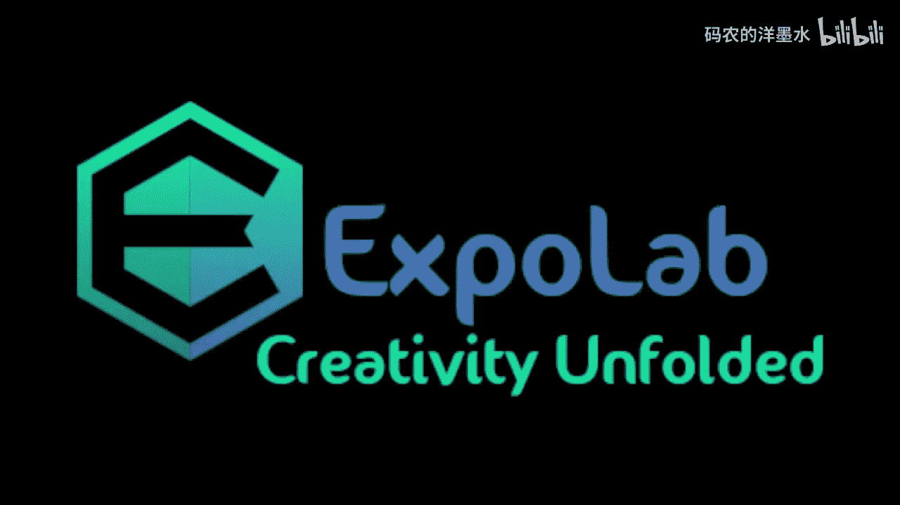
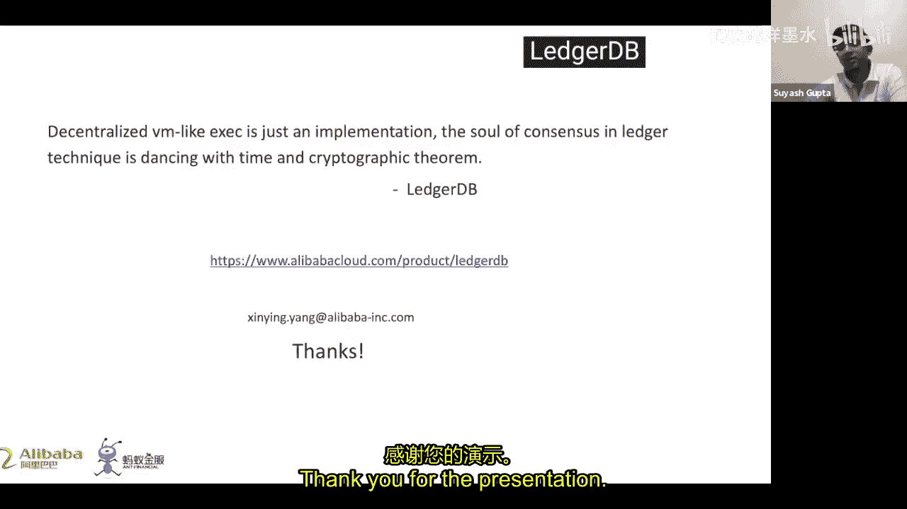
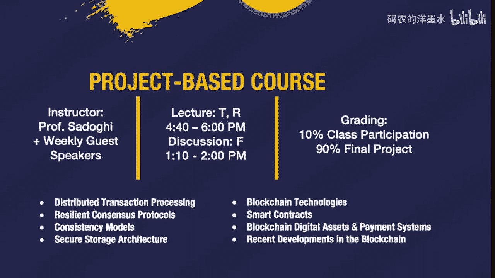

# 【全集】加州大学戴维斯分校 分布式交易与区块链架构 中英字幕 完整课程 p20 Lecture 16 - LedgerDB的核心原理 -BV18YFVzME2f_p20-

Hello everyone， welcome to another great session of our Expo Lab Bin speaker series。

 so today is a great pleasure to have Gary Yang joining us and he' joining us from China and so he is the founder and the chief architect of Leger DV by Alibaba and Financial Group and so he had a very interesting career。

 he was at IBM is even one the China corporate All under 40 which is I think very similar to the Forbe 40 under 40 I think award which is a very prestigious and so we're very excited to have D and so with that please take it away。

诶。So hello everybody。 This is Dery here。 It's a great honor for being invited by Professor Mohamd to share our technology and product。

Nice to meet all of you。 We propose a new term called centralized Leger database for this emerging blockchain。

A database branch and develop Leger D B， which is now available and is supporting global customers on an Alibaba cloud。

嗯。ok。First of all， we still have to interpret some technologies in my presentation。

We are all familiar with our D， O T。 So I'm not going to talk about it much。 C。

 O T is an emergent branch in larger technologies， and we propose。

A new term called a centralized Leger database， C， L D， which belongs to C， L T。

 centralized Leger technology， Leger D B， Amazon Q L D B。

 oracle with a blockchain table and proven D B all belong to this kind of database。 Next。

 we have to differentiate immutability with a temper resistance。

 Imutability is a characteristic a rule， But temper resistance is a systematic capability。

Auditibility is a series of verifications based on prede rules。

 internal audit ensures that an internal。User of the ledger can observe and verify the authenticity of all actions conducted by all other distrusted users。

 For example， a traditional audit table in D BMS S can satisfy an internal audit。

Because DBA can audit all users historical log trials。

An external audit is for an external third party to observe and verify the authenticity of all actions。

So traditional audit table doesn't satisfy this request。

A third party can't the audit log because DA can temper data。 will know that。Okay。

 so in this section， let's go through the history of database word。

 We all know that after court publishlishing the paper of relational data model。

 D BMS S comes to a new era。Traditional OTP， DBMS， like Oracle and DB2 have some functionalities of security and audit。

 like security labels， raw permission， column masks for data privacy and also audit table for auditing。

 but they all have a prerequisite that Dbas are fully trusted。

 meaning that they don't have malicious actions， but in reality。

 DbaA can change a certain transaction log to change a digital history by insertion， updating and de。

They can also fabricate an internal timet within the database。

 so it is very easy for them to be evil， and these kinds of defects obviously make traditional DBMs lack of judicial level credibility。

The same situation happens to cloud D BMS S and traditional naical systems。

We all know that the emergency。The emergence of blockchain has attracted widespread attentions。

 especially for their cryptocurrency prices。Wecom is the first blockchain system by implementing a hash linked transactions method and proof of work consensus paradigm over a public network that anyone can join。

 It is a highly decentralized and widely spread。But it throughput is very low。

 and it has too many replicas。 We all know that for permission blockchains that are claim to use in enterprise collaborative applications。

 we observe that many real applications on permission blockchain don't benefit from the decentralized architecture。

But the blockchain architecture， like multiple pis， consensus， limits its。Throughput， and。

Increase our storage overhead。What is the worse， although its mechanism seems credible。

 but it's a lack of rigorous credibility and audienceibility。We'll talk about this later， so on。

YC LD is important and valuable。 We all know that many application deploy on their blockchain node on a bus blockchain as a service environment maintained by a single service provider like Alibaba cloud of Amazon Aw S。

This forms a。Centralized pra。Rather than a decentralized manner。

 beside this characteristic permission blockchain and current CD systems are also not highly performed with storage overhead and has regulatory issues and limited external auditibility。

Below is a forecast trend data from a getner。From their estimation。

 we can see the they enlarge the replaced。Presented from permission blockchain in to C the system。

From last year's 20% up to a more than 50%。If this really happens。

 that would be a revolution in blockchain applications。In our practice。

 more and more blockchain customers like intellectual property protection。

 data lineage applications and supply chain finance on Alibaba Cloud as switch to our project。ok。

So a largerger D B is a largerger database that provides temporary evidence and non repation features in a centralized manner。

 which realize strong auditability， high performance and data removal。

Let's see the key comparisons between the LegerDB and adult systems。

We can see a Le D B provides the highest performance among these ledger systems regarding external auditibility。

 Le DB can achieve permissionless blockchain like a Phoms credibility。

 We realize credible temp stamp by peging with T SA while fatom use a。诶 bitco诶 one伟 pack。

We pointed out that QDB and fabric are lacker for external auditibility because their threat model makes the consortium or leisureger service provider can fabricate time stand so as to for a different ledger to cheat an external auditor。

 we also support a per an a operations which break traditional blockchain immutability after we investigate real world customer request。

They often wna delete historical data when not affecting reason。Datas are integrated checking。

 This is a motivation of perge， and illegal information should obviously be hidden。

 which is a motivation for orchid。We also support both client and server side。

 non reputation and efficient native lineage insertion， retrieval and。Reraification， okay。

And this lies on。Illustrate how LEDger works。This figure can also be founded on our official website。

 on Alibaba cloud。This workflow depicts a Leger DB signing framework。

 which will also be discussed later。 You can see step  one miss a user request。

 Then step 2 stands for leisureger proxy depatches jump to leisure server。

 Then step 3 is how a leisureger server records data， and then respond back after a signing in step4。

 Step 5 describes how to interact with T SA using a time ledger as a public service。

 This is the chief protocol for external auditability。Okay。

This is our architecture of data and control flow。 A ledger clients mid drop to a large proxy。

 large proxy receive a client request and then dispatch them to their relevant server。

Legiature will then complete the final processing of request and interact with bottom storage layer containing air stream。

 TV store， MPT and HCFS。Astream is our design linear structure panel file system。ok。

This is our operators and main APIs in the LegerDB Append API is used to append user transaction or system generated transaction to letter involving insert transactions set or trusted anchors。

 rule NSA T stamp。Receive API guess are qualified journals from ledger based on JSN Journal number clue。

Trusted anchor and T A times1 can also be a fetch using a relative A。

Vfi interface is used to verify integrity and authenticity of return journals from journal proofs based on journal number or clue。

Create is used to create a new ladderger with initial rules and members。

 Perge removesole journals from ledger and o height journal from the ledger。

 recallco API is used to roll back a pur within a linked time window and delete is used to remove entities in the system。

 such as a ledger row member or clue。We can see the signing workflow on the data structure figure。

This workflow makes a name of client， and L OP can re it at client site。

 a journal is initially parked as a。Payload called a journal data。

 which contains operate related and client related fields。

A request H is a computer based on their entire journal data。 A server site。

 a journal structure is called server journal， GSM。Streing offset。

 server time stamp and execution receipt are all finalized。

The server then calculate the journal hash after a journal is committed。

 the server returns a journal receipt to the client， including the final broadcast。

We implement our three phase transaction management。

The first is an X Q case run on large proxy for better scability。

A transaction enters this phase based on the transaction tag。 The commit phase runs on led server。

 it collects a multiple executive transactions or ring them in a unique global order we call it general sequence number we mentioned before and permit them to the storage system。

 The last index phase is to build indexes for data retrieval and graification。In particular。

 we have three types of indexes here。 They are clue index， BMT accumulator and block information。

Our stronger external auditibility leverages the two way pack protocol involving T S A journals。

T S A stands for a10 stamp authorityity， which provides credible10 stamps。

A T S A journal contains a submitted digest and a credible attemptst sent by T S A。

These journals are entangled between each other to form a time clue。

A letterger digest is firstly submitted and then sent by T SA。

 and T SA journal is then recorded back onto ledger as a T SA journal。

We offer T ledger service that can sustain much higher throughput on Alibaba Cloud。

 A time ledger can be maintained by LP as a shared time notary service for common ledgers。

 It accepts a digest submitted from different lettersgers and interact with T SA。

 It acts as an agent between a common ledgers and T S A。ok。

This lies summarize the multipart signatures that ensures large line repudiation。

 We can see the user sense before it submitted to a larger service。

Nger D B sends the receipt when a respond to user and T S A send on T A journals。Okay。

 let's talk about the variable digital removal。LD B supports several data removal operators demanded by real world customers。

It breaks immutability in conventional blockchain， but still preserves murfability。

 We know that in traditional blockchains。Once the data is written onto later， it can。

 it cannot be deleted or modified， but this leads to a prohibit storage overhead and regulatory issues in real world applications。

Many blockchain users want to clean up historical records to a safe storage perge results this customer request。

App per operation delivers a set of contiguous journals， studying from genesis。

Or latest pseudoogenesisesis to certain specified GSM。This sequco interpret the operation。

 We can see that all journals before per GSN are erased from the letterger。

Another defect is traditional blockchain immutability is the regulatory issue。

Imagine someone upload other people's privacy data without approval like。

Someone's personal I D card information。This should be deleted in real world applications。

 OQU is designed to support this kind of highlighted information hiding。

An all operation converts the original journal to a new one that。Only keeps this metada。

 and retains its digest。From the interpreted S， we can see that on all the payload data are hidden and filled with is a entangled journal JSM。

Haush and paant blanks。ok。We support native lineage by a proposed concept of clue。

 A clue is a user specified label that carries on a business logic for data problems。

Customer can specify certain clue when inserting data by app。

 fetch certain clues fetch certain close record by an。

Clue retrieval and Wifi certain clue by clue verification。

 Here is a merchandise order example of clue users。Order 1，2，3，4，5。

6 is the specified clue ID When customer place the order a journal represents now paid is inserted on ledger after customer paid。

 another journal for this information is recorded。Same thing happened when their merchandises are delivered and received。

 We can see all the corresponding journals for this order can be traced using clue。

We designed an right optimized clue index structure and dedicated a verification protocol combining a clue countermpT for fast clue fetching and verification。

Okay， conventional accumulator calculates root hash for each transaction。

 This makes our CPU cost quite high when data volume is large。

 we designed the batch accumulated algorithm to a calculate a single route hash for a batch of journals or system through put。

We can see that the bigger the batch sizes， the higher throughput it will be。

But to proof granularity will be lower。L DB clue indexes are working as designed for right optimization。

诶。You can see the right O can exceed a million， and CL is also friendly to point read and compared to compared to rocks D。

We can see our experimental data for large DBN to end performance from this slide。

 Leger DB's right and sequential read throughput can reach more than 300000 GPS。

For real world applications， we apply a same neutralarization application on both ledger D B and hyper fabric version 1。

4。 The experiment result shows the ledger D B is 80 times faster than fabric。In real applications。

 there are three styles of user scenarios。 They are monolager， fedated ledger and delegated ledger。

 Monlager is the simplest style in which only one pair exists。 in example for monola。Leger。

 where everyone keeps his own privacy journals without it。Interctions with other。

Ferderrate Leger has more than one participants who had the demand of a mutual audit。

We have a supply chain customer that use a ledger Db to provide temper resistance and mutualation。

 Our related cooperation peers， such as manufacturers， retailers。

 suppliers and warehouses are all satisfied as members who can app their Is， manuscripts。

 invoice copies， Res as journals on ledger。Delegate ledger only interact with a centralized agent who further manages other participants with the demands of mut audit。

A trusted hardware is involved in this solution for dedicated signing。

An NPC system on Alibaba Cloud use this solution to track their mutual data exchange and SQL manipulations。

Details can be found in our paper。Here we compare a fedated ledger with a permission blockchain。

 Leger D B can get a higher performance。lower cost。

 easier usability and better external auditibility in cinema production applications。

The pie figure shows our。Customer application。Distribution percentages until August this year。

I O T data tracing， insurance， supply chain finance， intellectual property， rag tech， retail。

 health care， manufacturing and energy。A real world happening is that more and more permission blockchain customers are moving forward to CD systems。

Okay， welcome to try LeDb on Alibaba Cloud and email me anytime if you have interest in LDb and wanna contact us。

诶 thank you all嘅。Thanks。嗯。Thank you so much， Dar for an excellent overview of insight into Leger DB。

 so I guess do we have any questions。From our audience。From the students。

So I have a question thank you for the presentation how much is the replication how many replicas are there in Leger D in these experiments。

 how many replicas are you using？

Okay， so the replica is says common centralized systems about the replicas。 So yeah。

 and for the public cloud， you know that the the public cloud service the storage service itself has the replica technologies。

 So onto the public cloud we leverage the public cloud storage system technologies。

So so because were talking about blockchain and like is there any consensus protocol being used right now in Le review there is no consensus protocol or is the how are the transactions serialized is there any protocol consensus protocol which is taking care of that？

呃，不是道呃。Sorry I didnt like like in like in other blockchain application。

 there is proof of work of PBFT or proof of stake is there any concerns at protocol here in Leger D？

Yeah， the Le replic protocol is a jet like the ordinary very ordinary data consisting protocol like rustft。

 something like that， yeah。Just keep the the data a consistent。我冇 right。Okay， yeah， that makes。

All right， any other questions？So do you see so maybe kind of I kind of understand the space because we've been so far really focused on the permission list and then last few lecture we had presenter from former IBM or Mohan and then we had Marco from IBM research Zurf they really focus was on a hyperlegger and the permission setting and here at UC Davis the resilient D is also a permission ledger as well too。

 so kind of understanding the dynamics of the two so I mean our focus is exactly what you kind of nailed as well is performances to really to get over hundreds of thousands of transactions。

 something that is not really feasible that the other system that you had also noted in in your presentation so from our perspective so perhaps maybe you can give us maybe a feedback and sort of maybe you can find a commonality from our perspective。

sBe two things in order to scale into hundreds of thousands of transaction actually Suash is one of my senior PhD student is's graduating this year is to look at concurrent consensus as opposed to running a single book consensus。

 what happens if you are able to do panel consensus concurrent consensus there。

 we see we can reach out to。200， 350，000 transaction per second scaling up to 91 or so replicas。

On the other hand， we're looking at sharding there sort of scaling to 500 nodes。

 15 countries globally， and if you have the fully sharded system on a partitionable workload。

 we're sort of peeking together on 1。4 sort of million transaction per second and sort of our some of our recent results how do you see kind of the angel play kind of between leisure D or resilient D or within the centralized ledger versus the permission leisureger like resilient D is。

诶呀啊 so you you mean they。呃。For example， do you see any opportunity， for example。

 some of can do you see any opportunity sort of transferring some of the work that we've done。

 for example， in Brazilsilient Db with it kind of incorporating or integrating it into electric Db or vice versa。

 so how do we kind of do you see。Any sort of transfer of technology between this two space and maybe para just limited to ours other ones that existed like coracle cable。

 for example， or the other technology you kind of noted there be on。呃 and。

I heard the resilient D B before， but I didn't see too much details into that。

 I think for the Leger D B and the。The one direction is。呃。How do we are leverage。

The more and more traditionals are。Centralized systems technologies。And also。

 leverage with the blockchain words characteristics。 This is the most important thing to。

 We all know that。The blockchain is a， the blockchain technology itself is a combinations of a several sphere。

Technologies， yeah， and make up as an initiative thing。 So for the this CD systems。

 I think the most direction is how to leverage both sides and initiate some creative things。

Just like a blockchain， day。Previously see very interesting do you have any kind of estimate of sort of how how fast the CLD market is sort of growing。

 perhaps sort of any sort of projection in your in your view in the coming years， for example。

So you are talking about the about the CDs real customer and applications Yeah so for example。

 I mean as you just I mean Oracle is now into the space， Amazon into this space。

 of course Alibaba and financials in the space so major players are now I guess trying to offer blockchain like technology into their traditional ecosystem traditional centralized traditional。

Databases databases so how do you see kind of do you see new emerging areas for this market do you think is's really going to expand or do you think is's going to be tailored for specific domains sort of what's your feel on yeah I guess on the market on this new emerging area。

So for this question， I think it's。Interesting question。 Yeah。

 and I think it's just like traditional D BMS S。 We all know that when OL TP result transaction system。

 things。 and O results from datanalytic things。 And then the world comes to the more and more data there and we all know that the web data is very large And then comes to the big data technologies and a lot of no sqL。

 So every database technology has its own characteristic and it。呃。Market， right嗯。

And for the permission blockchain and safety systems， I think are they can be a coexist for。

Their own characteristics maybe for a quite long time in the permission blockchain。

 if several participants really want to share each no data and they really do consensus and this application maybe have some real real market value and for the CD system。

 I think for most permission blockchain applications like just a data notization and data lineage and doesn't have the realralized and consensus need。

 So and needs higher throughput， higher high performance。 So for this kind of applications。

 or I think CD will be a better choice for customers like。We all know that's。To store some judicial。

Proofs。Yeah， this is a。Already applied in real world application， We know that in the Internet court。

 We know that。 And for the dental， just as the。Like the like the example I showed in the presentation like the the supply chain。

A selection finance that we record a lot of things when a clue is generated or is a merchandise trees can all be recorded on the CD system。

 yeah。So something like this。 yeah， and healthcare data， yeah。

 manufacturing data and this I O T data。 yeah， we know that I O T data is large。Right。

 if this an L word。Really comes to our reality and the data will be expanded。

 So a C system may be the better choice because one thing if the throughput will be high for the L system。

 throughput will be。 And the other thing is the data is a large that is large。

 So for permission or the blockchain， there are too many data rep there。

 So there will be a not good choice for very large data。

I see very interesting and so the other I mean Alibaba over the last， I guess five or 10 years。

 they have come up with really impressive set of database technology。

 one sort of we kind of followed for a while as well as Ocean Vista and this geoscale transaction models and so forth。

 do you see any kind of the blockchain technology that you've been developing the Leger D。

 do you see ever kind of be integrated or be used in ocean Vista or alike？哦诶新 i。

I think I can't answer this question because this may be relates to the enterprise strategy。Yeah。

 but I think。We can see these CD systems， more and more CD systems happens in in other enterprises。

 We all know that the oracle already have the oracle blockchain table in their newest release。

 so I think this trend， I think this is a trend in all their industry world， I think。

So do we think so？Yeah up that seems like a very plausible and exciting new direction yeah for sure yeah。

Do we have any other questions from dairy， I mean， this is a unique opportunity we can get real interesting insight from Alibaba Leger Db。

Beer ecosystem guess。All right so I guess we're kind of getting close to that 520 mark so I guess we were almost on time to finish as well。

 so again on behalf of Expo Lab and on behalf of UC Davis I really want to appreciate taking the time and so giving us this excellent lecture and introducing Leger DV to everyone so thank you so much。

You're welcome。 Thank you， Mohamd。 And thank you all。 Thank you。

 And we hope we can have a collaborations in the future。 Yeah， yeah， thank you。

 Nice to meet all of you and have a nice day。😊，哎。Thank you so much， thank you。

