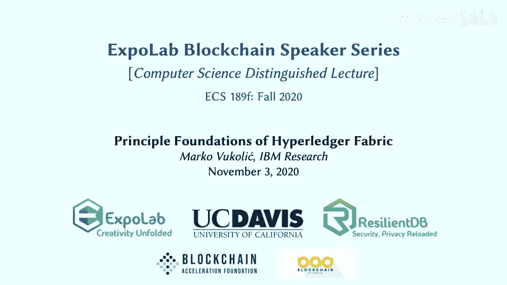
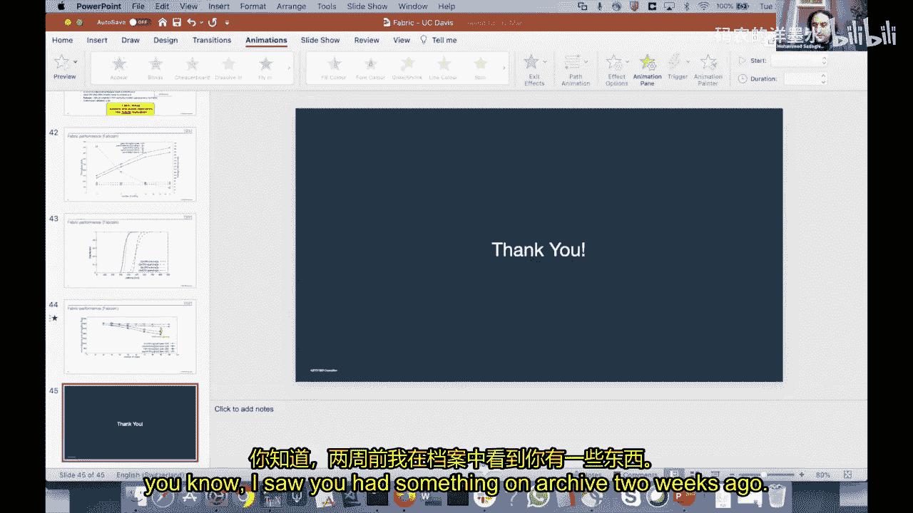
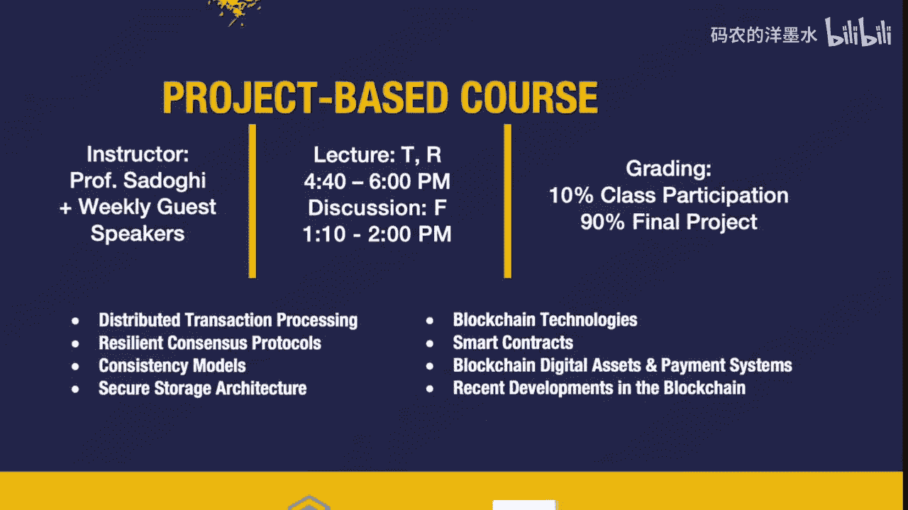

# 【全集】加州大学戴维斯分校 分布式交易与区块链架构 中英字幕 完整课程 p21 Lecture 17 - Fabric的核心原理 -BV18YFVzME2f_p21-

好。好一下。

Hello everyone， it's wonderful to be here today with Marco Vcolic。

 we have another series of our blockchain speaker at Davis and today again is a pleasure to have Marco who is RSM research staff member at IBM's research Zurif and so。

Marco has been one of the key principal research behind hyperlegered fabric and so some of their publications。

 original publication of hyperlegger fabric at Uursis also won the Pat Goldberg memorial Best paper award at IBM and that's a huge accomplishment I mean given myself being at IBM every year IBM from the entire research just chooses one paper and receive this award so it is really a reflection of excellence when it comes to winning that award so we're all excited and thank you again Marco for joining us today and so please take it away。

Thanks， more， yeah， I mean， two other award recipients that year were papers from Nature and science from fundamental sciences and this paper from neurosis。

 sos it's a nice company to be in。So hello everyone， it's a real pleasure to。😊。

To give an invited lecture for UC Davis students。And I'm going to talk about principal foundations of hyperlegger fabric when more invited me。

 he first had the title Principple Foundations of Hyperlegger Without fabric。

 so I wanted to start with basically explaining the difference。

So hyperledger without fabrics or just hyperledger， this is a Linux Foundation project。

 it's a huge project that started in February 2016 and has gained really。

 really large momentum in different industries， I would say since then。

So you see the icons that you see on the screen， there are like over 100， 150 icons。

 basically these are logos of big companies that span technological companies like IBM， Mintel， N。

 Microsoft， etca， they're like tons of blockchain startups， including Interteriium Foundation。

 Interteriium Enterprise Alliance。And many， many others。

 so this is the slide I was describing so basically this is the slide that we use to present the higher pleasure as a project and there are like tons of companies like lots of academic associates。

 you see them here at the basically lower right part of the screen so acadeia associates。

And this is a project that has been gaining a lot of momentum since like slightly less than five years now。

And the number of members is growing， essentially。So not all projects are I'm going to talk about today。

 So what I'm going to talk about today is hypolager fabric。

 but this slide gives you an overview of Hylager projects。

 So Hylager is an umbrella project you see here at the top of this。

Stack on the top of this pyramid and they are like some distributed led project including Bezu theseing alphabetical order Bezu Barrow fabric inindi Iha so tooth a couple of libraries and couple of tools so without going to presentation of all these projects。

Basically， this talk is going to be about Hyleg fabric。

So the goal of Hylegger fabric is actually the first project in all the other schemeM afterwards and essentially it was the first incubating project in Hylegger and first active project since late 2016。

So back in 2016， we had a different architecture than what I'm going to present today。

And essentially， what we did with hyper fabric is we change the presentation。

 we change the architecture blockchains considerably。

 so I'm going to focus on this basically in this talk。

I do have a bunch of slides on the introduction， so just to set the basically set the stage。

So essentially what is high fabric on a really really high level so it's in a recent study by University of Cambridge Center for alternativeternative F。

 this is part of University of Cambridge Business School basically they did the market。

Kind of evaluation and Hylegger fabric as a platform covers almost half of all permission blockchain projects are there across all industries so this is not the industry specific and then the competing projects which are actually so these projects are three Corda and coin sciences multichin are not part of Hy hyperledger umbrella project so it has a fair market share。

 not all of these projects are essentially IBM projects。

 many of them are not because Hylegger fabric because it belongs to Linuxux foundation is committed to basically open source code。

 everything that the project is about is license and party2 license and I will have more about this but basically I'm talking about the softwareer system that has gained a great great momentum and it's basically a goto platform if you consider development of blockchain and distributed leds in a permission setting。

So high of fabric， a bit of history。It's meant to be a general like a framework for developing general purpose blockchain applications。

 So when we discuss like shall we call it a platform or not。

 So for me a platform is something that that basically。

kindind of tends to be a single deployment thing and then you use this platform to deploy other applications on this platform。

 so we choose and then defended with Us reviewers you know 2018 to call it a distributed operating system because it's really meant for multiple deployments。

So there is not a single deployment of Hy fabric unlike Bitcoin or Ethereum or maybe other blockchains that you know。

 but it's basically a。Software that you use to run permission blockchains and then there are tons of applications and deployments and I'm going to mention some of them in the talk today。

The emphasis of the architecture and going this is going to be the part of the technical talk is on consensus modularity on confidentiality of smart construct execution。

 on resiliency， scalability and smart contract programability。

 you will see more details what this means。So as I said。

 Hyloger fabric was part of Hyloger project since 2016。But it followed different architecture。

 we're going to talk about this today as well。But since June 2017， where we1 was released。

 essentially we have this new architecture that's fairly。

 fairly different from what other blockchains do。And this is going to be the essentially the key point of the technical part of my talk。

 and then like later releases that you see highlighted on basically on this slide。

 there are less fundamental changes to the architecture than what we want is。

 but there are some changes that I'm going to cover here and there。

So everything that whole Hy of fabric code is licensed under Apache tool license。

 so even if we have patents there like granted if you use the code with Apache2 license。

And essentially IBM is only one of the main is the main contributor to Hy fabric。

 but there are like over 150 developers from 27 different organizations so the project is really popular on GiHub and because I will give slides eventually to more there are like many hyperlinks and URLs that you can click and basically follow。

Go to the web for more details about the information that's given in the slides。

So IBM Hy fabric powers IBM blockchain， so IBM blockchain products are basically powered by Hyla fabric。

But essentially when our competitors deployed Hylager fabric and this is one of the basic indicators of the success of Hyger fabric because as you see on this slide essentially。

If you deploy。A blockchain on IBM blockchain platform you're not running it on a single cloud。

 I mean this would def defeat the purpose of a blockchain even if it's a permission one。

 So yes I mean we try to have our customers run on on IBM cloud on IBM blockchain but essentially you can run also basically deployments on premises and on Amazon web services on AWS Azure Google Cloud oracle cloud and many others so all of them essentially have some of their template blockchain products around Hy fabric but then。

IBM is one of the rare ones that allows allows easy orchestration across this cloud。

So essentially many different companies adopted it and it's a basically go to projects for developing permission blockchain applications。

This is about use cases right so in blue squares you see different kind of industries that。

That are interested in blockchain use cases and then in this white big white squares such as IibBM food trust or trail lenss。

 you see actually active network right and there are many。

 many different use cases with production networks so one of I'm not going to go into all the details。

Basically， if you go and Google， for example， trade lens and trust your supplier we trade you're going to find more details about those use cases and just going to have briefly to introduce briefly IB and food trust that is an example so this is essentially blockchain network that connects basically food suppliers food producers food suppliers all the way to big food retailers such as Walmart or car for and the likes and essentially what what this blockchain platform does or distributed ledger platform does it allows for provenance tracking of where your food comes from so a simple so there are many benefits from the of the platform so you can basically。

Throughout the whole supply chain of basically。Of food you can track which producer produced the food。

 which basically transportation company took the food and took it later who did the control of quality。

 basically to which Walmar car for。Basically shops it was it was distributed to and so on so basically。

This is a supply chain use case and instead of so what is it changing is before such an application。

 all this information was siloed， for example， Walmart had' database or small producers didn't probably have any or and basically what supply chain companies they have their own databases and here we use blockchain to essentially track the entire food provenance chain from like throughout its lifecycl。

And I do have a small animated demo， it's not a real demo。

 but just to demonstrate like one of the benefits for the user not to the companies necessarily that use these blockchain。

 so basically if this is already being deployed in car forcece or you have a typical package of mesh potato right industrial product and then you have a QR code that a user can scan and basically。

With the app that's connected to IBM blockchain and what happens is that the user apart from what's printed on the packaging of this just sees the basic additional information about this product so it can see like classical information that's included in on the packaging but it can also like find out what is contains so it contains potatoes in this case who produced like which partner actually produced this product when was it fabricated who did the quality control so part of my French here but this is in French since this is taken from Carford and basically similar information。

So this is just as an example so other examples by selected industry they're also on that initial slide that I show but they're also basically summarized here we are not going to talk about all of these like most of these are still in pilots but there are quite a few production networks so one of them is food trust the others are trade liness and we trade and there are like dozens of production networks and there are like more than like several hundreds poOCs that IBM conducts but also other companies such as Accenture and others do with their customers all using hyperleaer fabric。

So the most recent example that I want to highlight， it's a very， very recent one。

 so this is a product that we announced as in response of IBM to COVID 19 cr it's essentially using IBM high fabric instance to deploy a system to essentially mix。

To give the ability to users to present their health status while combining with strong privacy so essentially if you say。

 okay I have this is the use case in which you can present your COVID-19 health status and you use blockchain this raises here all the way but it's not the most important thing is probably in bulk in the last bullet so no health certificate personal identificationi information is ever stored on the blockchain to guarantee GDPR and hypercompliance and then if I just relaxed you a bit then I can explain what it does and what it does is it essentially gives the ability to users to have their COVID-19 tests and overall health statuss accessible on their personal devices think of your mobile smartphones。

But also even piece of paper， even for the users that do not have access to like smartphones。

 use you can basically obtain healthcare credentials that's printed on the paper in the form of a QR code or something。

And these devices or just simple papers， these whole health passport and these health credentials that basically say I did a COVID-19 test just a few days ago and it's fresh so depending on the some policies that I could ci travel policies or restaurant access policies or I don't know hotel access policies。

 I might be able to gain something from actually showing these health credential to to some verifier health credentials are issued by approved these year。

And approved issues are in permission， so this is where we leverage， for example。

 the permission setting of the blockchain are essentially labs。

 hospitals or anyone who can issue health certificates so the where blockchain comes in is that essentially information about approved issues is stored on the blockchain and you can think simply public keys and public certificates corresponding to approved issues these are registered on the blockchain。

And essentially when users present their health credentials in the form of a QR code to verify to obtain some physical access。

 what verifiers do is they can apply the appropriate policy， for example。

 airline or just a hotel chain or whatever like or if you want to enter the country。

 maybe this is the this is the police when you enter some country， basically they use this。

They essentially can verify if the QR code is legitimately and issued by an authorized issue。

By checking the information about the sure stored on the blockchain。

And this is also we can use here blockchain of course you can do this on a database right but you cannot possibly expect that across for example。

 in international travel or similar use cases all countries and all companies all hotel chains or airlines basically of go and access the same database so here the basically the blockchain and this community the ledgers gives us ability to。

To distribute access to the system and basically to interoperate across countries across different jurisdictions and so on so this is interesting use so normally I don't work on use cases but I was actually personally involved in this one and this was just announced two weeks ago and it's Ging as a product mid of November so it's fairly fresh so this is another example of basically blockchain use cases on hyper fabric that's very new。

So。Now I would like to go to technical details， but I would like to use basically this finishes these introductory parts。

 so are there any questions related to what I just presented that I may answer at this point？

So it's it's always you could always use a database so technically whenever you see a blockchain solution you could use a database。

 especially permission blockchain solution right so we can discuss with it the argument holds for Bitcoin like an Ethereum like systems but even there if you could basically make some relations to databases the problem is always like how do you govern this system who is who is holding the database the reliability of the database it's essentially resilience to intrusions and attacks right so as you distribute a system of course。

 for example， in the crash to and model you get some of these benefits but essentially。

Crsh tolerance solutions for database distributions they are used when you have a single administrative domain so essentially a single company you see this a lot in the clouds right so when IBM or Google or any company that has its own cloud deployment essentially has wants to distribute for fault tolerance and resilience they're going to use crash fault tolerance model here we are in blockchain we are essentially in the multiple administrative domain setting so this is where the socal Byzantine fault model makes sense because in Byzantine fault model you're not trusting any single。

basically node in your system， but not because for example， these can be hacked。

 but simply because they belong to administrative by different players in the cases that I'm describing by different organizations。

And essentially they have some value in the system that's not necessarily shared with others right so you don't want to give the administrative rights to a single person and this is where the idea of using not person but organization。

 this is where the idea of using a database for all these use cases fails。

And essentially you can think about blockchain as a distributed database in a sense。

 that gives you the ability to deploy application across multiple administrative domains。

 not trusting any single administrator， maybe not even a bunch of administrator。

 there are certain assumptions。But essentially， for example。

 a majority or two- third majority of nodes needs to follow the protocol and you can tolerate the adversary that basically makes some administrators some organizations called etca fundamental limitations some performance and so on really what we are doing is that building this software that's meant for many。

 many use cases you cannot possibly foresee all so maybe for some use cases this is too much so this is an over you can argue and fine I mean so okay you prove to meet the need for distribution and multiple administrative domains but you might end up having being fine with crash flow tolerant model instead of reason photo and model but we are building a system that we can reuse a course multiple use cases。

And so while you can tailor the particular application distributed application deployed on top of a permission blockchain such as Hylegger fabric in the end if you are in the use cases where you need Byzantinefold tolerance you want to actually use the systems as deployed with such security beneath right so okay for some it will be an overkill but for many others will not and since we want a reusable system on which we can build applications this was our idea how we design hyperlegger fabric and I'm going to talk about more about this later。

I have a quick question so in in this scenario， especially digital health pass I like this idea。

 but so clearly we cannot store user information because of GDPR and privacy concerns but we have so what will be actually storing is some sort of a hash Mer root of the transaction in the blockchain I right because we would need not even not even so in this iteration of the product we don't store anything right so when when the health credential is issued there is no transaction on the blockchain so this is purely between issuer and a user what we store at the moment so actually we store sometimes the information about particular user credential on the blockchain but only when this one is revoked。

So when these for exceptional reasons， we need to revoke the validity and basically to blacklist。

 essentially a health credential at that point， we would write something to blockchain in normal Yeah in normal news。

 but if we do not show the transactions then，Then what are we stored so because blockchain is supposed to be sort of an immutable data structure right which basically ensures that nothing reokes if we are not storing the transactions transaction could be as simple as user asking access for medicine or asking a check result or something we don't store the transaction but we store some sort of a hash if we don't even store a hash of the transaction then what is blockchain providing as a chain what is that chain providing us providing essentially。

Distributed public key infrastructure trusted one， so essentially blockchain contains public certificates of approved issuess。

 this is its main purpose， it contains some other information。

 but its main usage is to be a trusted repository for storing you know。

So basically public key of issues and then when verify verifies the health credential。

 it would go and fetch。The public key of the issue， and basically。

Verify the credential that the user present。So it's kind of it's very simple so the idea is simple but it's powerful and's we really expect that so of course you can you can if you want to play with this。

 you can probably implement this today as a POC in a centralized manner， right？

So what I just said is not too much right so you would have your issue application。

 you would have a centralized database where you actually store public key information about issuess。

 you would have a mobile app where you store health credentials and verify sex as the database to verify this it's fairly simple。

 but then to make this essentially open。To not mandate a single location where this database is stored and for all other reasons that I just discussed in the answer to the previous questions。

 this is where we would like to use a distributed ledger essential。Or a blockchain。And in this case。

 Hyloofa， you can implement this on other systems。But essentially。

 its Hy fabric is built as such that for us to make this a production basically a product took not more than two or three months。

So all the way from the idea to the product that can be GA and this is nice， this is nice。Thank you。

是。Okay very good so let me start since we already have half an hour into into the slot let me start with technical parts so now we dive into as the title of the talk says into the principles of Hylegger fabric so in one slide what I'm going to talk about is if you want to read the details go to the Eurois paper so this is the 2018 Euro paper that presented the architecture that I'm going to talk about it's open access even if of course in UC Davis you have access to ACM Digital library but even if you're at home just click on this it's open access and you can access the paper so there is another parameter that shows basically the traction that the project generated this is like 1300 over 1300 cetations since April 2018 so in two and a half years there are many university courses。

That's teach the principles of Hy fabric， including Perdue and Technon and many others and essentially what what。

I enabled in what's new in one slide in fabric we won for the first time so this is a blockchain system that allows blockchain applications of smart contract to be written in general purpose programming language so for those of you who know Ethereum in Ethereum you code in solidity right so solidity is a domain specific language for coding smart contracts。

And many of basically blockchains that follow Ethereum。

 they followed this idea that you need to have a domain specific language to code smart Cons。

And we decided so one of the basically requirements when we designed Hyger fabric was you know。

 allow。Smart contracts will be programmed in general purpose programming language such as Google or Java。

And as we will see， so this seems easy， but it's actually not so。

What is the main challenge here is called nondeminism。

 which is very much possible in high level languages because of the virtual machine that begs them。

And。Basically， if you don't want to change the language or the virtual machine。

 like Java virtualr Ma or something that runs this code in the end。

 you need to change the architecture of the blockchain。

And I will explain why so this was the first challenge， the first requirement， the first challenge。

Then for many use cases。We want to have tokens and currencies。

 but for many we don't so actually food trust that I described is deployed without deployed without any native cryptocurrency for the moment basically IBM health pass is deployed without cryptocurrencies or without tokens so essentially how do you eliminate。

Token and cryptocurrencies from blockchains and still have a meaningful system。

So this if this question doesn seem doesn't seem to make too much sense， like buried me。

 I will explain like why actually cryptocurrencies in blockchains such as or tokens in blockchain such as Bitcoin and Ethereum my intrinsicn system level。

 essentially feature of the，Of these blockchains and while eliminating them basically produces some issues that we need to solve。

We didn't want to hardcode the disability consensus。

 so the time we started the disability consensus were very， very protocols were very。

 very inefficient。So I'm going to devote a fair amount of the talk to that。And。

This is why at that moment we didn't want to essentially code。

 let's say we picked the best protocol that we had then and basically code the blockchain around。

This is similar so so if you think about proof of work that's used in Bitcoin and later in Ethereum。

 it's very much part of the system it's very difficult to change right so for those of you who follow Ethereum community。

 Ethereum is moving from proof of work to proof of stake since 20160。

It's not easy right so we started from the idea we are going to have this distributed consensus modular and as we progress in research on it we are going to essentially change this engine if you want of a blockchain because distributed consensus protocol over which which is at the heart of any blockchain system is essentially its engine so we didn't want to fix this engine but we wanted to change it as we go。

And the similar goes for network membership services。

 so of course this doesn't exist in permissionless blockchains。

 but it' it's a primary feature of permission blockchains we also have in high fabric modular。

You can change。To this end， basically to satisfy these three。

Requirements we needed to come up with the new architecture。

 so I will say also what is the old architecture， but the new architecture is this execute order validate architecture for blockchain so this is fabric is the first blockchain system that introduce this architecture。

And essentially the last thing we needed to do this with。

Good to excellent performance in a variety of blockchain applications。

So these were the requirements and it was totally not clear how to do it and this talk is basically and Nes' paper is about how we did it and I hope I will convince you that we did an interesting job there。

So I will start from a bit of history right so I will define a blockchain for the purpose of this talk。

And it's going to be in the first place a data structure。So a data structure。

 which is a linked list or a hash chain or whatever you want to call it。

 which contains blocks of transactions， so each blocks contains a list of transactions and then you have a total order of blocks which altogether essentially establishes the total order of transactions。

ThereSo if you have a hash chain there is usually the part of a block is the hash of the preceding block。

 there might be some signatures around depending on the implementation in Bitcoin and others as I will explain in details that based on proof of work there are certain conditions on on what the hash of the block needs to be but we're going to talk about it in the first order of approximation it's really this data structure except that this is not a full explanation if I have this data structure on the laptop to which I'm just talking now instead of in front of the nice audience as you are right I need to talk to my laptop but if I have this only in my laptop this is not a blockchain so what we need。

Is a network of contrasted nodes over which this data structure is replicated？

This is the first order of approximation and essentially this more or less like more or less。

 this data structure needs to be replicated in an identical way across all these nodes。

And this is where we have the first approximation of the blockchain and for the purposes of this talk。

This will be a sufficient definition。So how do we do it？

Basically what are what are blockchain transactions I mentioned that these blocks contain transactions but whether are these blockchain transactions that really depends on the application and the blockchain instance right so in blockchain in Bitcoin these are simple virtual cryptocurrency transfers so each transaction transfers some amount of BTC which is the like notation for Bitcoin from account to account。

And in Ethereum， these transactions do need to be simple nor related to cryptocurrs。

So you can deploy many different disability applications and in case of Ethereum smart contracts or Hylo fabric chain codes as they are called。

 so in Hylo fabric chain codes is basically what you know in Ethereum a smart contract。

This can be essentially any input to a state machine replicated state machine。

So there are some informal definitions from five years ago。

 I don't know if this advanced in the meantime， but basically you can think of a smart contract as an inventory own program with state which runs on replicated shared ledger and this draws a lot of similarities to decades old concept of a replicate state machine and in the first order approximation it's almost the same so like smart you can think of a smart contract as a replicated state machine except。

That you cannot really use basically state machine replication as the concept is known from Lamport in the 70s and countless follow up papers。

 but if。You ask me is this the same， so is all theory about replicd state machine can we just apply to blockchain smart contracts。

 I would say no for the following reason。In the state machine replication approach， you have always。

 regardless of whether you replicate your state machine in a crash fall torrent or Byzantine fall torrent model。

 you have a single trusted application。So single trusted application means that you don't question whether the debt applications。

 the debt application， that state machine that you are replicate is implemented correctly or not it's the only one being replicated and you assume that whoever implemented this did a good job。

In blockchain smart contracts this is not the case。

 so you have an ecosystem now you have a system that's supposed to be running multiple applications at the same time。

And they're implemented by different thirdpart application developers you might charge them by you know running charging Eer for running these smart controls on athere network or not charge him at all in certain cases in Hy fabric。

 but essentially you need to make sure that if somebody codes a rogue application and deploys on your blockchain it doesn't stop others so maybe his application doesn't work。

Or his smart contract doesn't work， or his chain code doesn't work。But others work。Perfectly well。

So there is a fundamental difference if you see。And this has very like a lot of implications on how blockchains are designed。

 and we are going to talk about it in a bit more detail。

So a bit of a blockchain evolution so where we when we designed in 2016 and 17 Hyleg fabric what did we try to how did we try to advance the state of the art so if you think about Bitcoin as a hard coded cryptocurrency applications with rather really limited scripting language to essentially deploy different applications than this cryptocurrency application。

诶。Basically Bitcoin was based on resource intensive proof of work on and it's a permissionless blockchain system。

 so then as you go down what's involved bold is retained。

 what's involved bold is new and what's not involved is basically retained historically from preceding systems。

所以 deium。What it brought what was new with respect to Bitcoin was it was a general purpose blockchain。

So it allowed deploying different applications different from just cryptocurrency application and basically introduced the concept of dis applications or smart contracts。

It came with a domain specific language we already talked about its validity。

 but it retained a native cryptocurrency which is called differently Eer and it retained the proof of work in the resource intensive proof of work Consus and I'm waiting for the day to change this slide but this day never comes。

 right？Because it's。The way basically。🎼So it's kind of not easy to replace proof of work in a way that you would retain all of its good features。

 like there is tons of bad features or proof of work but there are like some really。

 really good features that are difficult to replace。And essentially what we wanted to do。

 and this is involved bold in like next to Hylegger fabric。

 we wanted like Ethereum to have a general purpose blockchain。

But we wanted to call distributed applications in general purpose languages and not in domain specific languages。

And examples are go or Java， right？We also wanted no native cryptocurrency and modular impable consensus as I already discussed this way。

 and because we aimed at blockchain for business use cases。

 we decided that we want and also for efficiency reasons we are going to go with permission blockchain system paradigm。

And the very important thing is one that I already mentioned is that there is no like we design the system without。

Thinking of a single deployment， unlike Bitcoin and Eum， right？

So it was meant to be deployed in different use case。

 basically to have different networks powered by Hy F。

 and we already discussed some implications of this requirement earlier。

Okay so quick history so essentially something about Bitcoin just to set the stage very quickly on one slide how Bitcoin works so usually if I would be seeing you I would be asking how many of you know how Bitcoin works and it works a bit less this question works a bit less interactively in this setting right so I assume that basically a majority would know but I would still repeat it right？

So proof of work block mining is basically。Done by assembling these block of transactions that we already discussed and then computing the root hash of the Merle tree of these transaction hashes that are included in the block。

 there is a pointer to the previous block， so this is a。And there is the third element。

 which is a month。And the whole game that our Bitcoin miner does is to play with the loanss。

In a way that the hasush or basically of。Fromcateation of this ABC is smaller than some difficulties now difficulty is a very small number in a sense that it starts with many。

 many zeros， so as as a shadow of it6 hass actually acting is a pseudo random function。

 the only way or the most efficient way to do this equates with trying nons0 and then nus one and then nus2 and so on。

Until you get basically nus in such a way that the hash is smaller than this difficult。

And this is what spends a lot of power in Bitcoin network。So essentially there is like unexpected。

 it's more than two to the power of 80 hashes that you need to do per block。

And this is basically what waste energy in between。So once the miner is lucky。

 then it gossips the block across the network， yeah， I found it and basically the reward。

 we're not going to talk about Bitcoin rewards， but there is a reward associated with this at least in foreseeable future future and then this block is gossiped。

Across the network when essentially other miners receive this block they have a really simple task to do this is to validate all transactions in the block sequentially this goes pretty fast there are only so many operations so many transactions in the block and so many operations that you need to do so you need to check whether these are valid or not。

And you need to verify the hash of the block。237 in this case it is smaller than the difficulty。

 so for all miners this is a one harsh operation， this is very fast。And if so？

Essentially we are adding the blockchain to the blockchain。

 I am neglecting for timing reasons and whatnot I'm neglecting forks and other things。

So essentially this summarizes the Bitcoin energy consumption right so this is the main problem of Bitcoin this is why we want to change Bitcoin proof of work protocol when we want efficient systems essentially we are spending for one transactions on average what 25 average US households spend in a day。

Talking about energy。I think this actually like puts。

Bitcoin power consumption more in a perspective than 77 terarawaatts a year because this is like difficult to imagine。

 but this one is very easy to picture。We are doing this with seven transactions per second peak theoretical throughput and latency of about one hour because one block is produced every 10 minutes with six block confirmation。

 so for those of you who know Bitcoinco these are familiar numbers。Ethereum works in the same way。

 except that now it does execution of。Iputs to arbitrary distributed applications or smart contracts so basically this is how Ethereium works and i'm starting from the bit slide so this is the slide where we ended with Bitcoin and instead of validating we are now pre executing so the minor pre executing transaction in the block against smart contracts。

And it's doing the same proof of work， nonfin， right？And essentially when。

The block is gossiped across the network， what other miners need to do is now to execute sequentially one transaction transaction by transaction。

 all these transactions against their respective smart contracts。So this might be fast or not。

 it really depends for how because the execution is sequential and it's not simple cryptocurrency transfer。

 it really depends what the transaction。needs so you can imagine like this can be any arbitrary application。

And you need to execute transaction sequentially， you cannot parallellyze easily the execution。

And it really depends for as you know here， the throughput will depend on the latency essentially of the execution of every of the slowest if you want transaction or basically or on the total time that it needs to that a miner needs to execute all this transaction。

 so it's really important that they're not expensive transaction that they're not transactions that run for seconds or minutes or something because this is going to hurt a lot。

 the throughput of the system。So。This type of in the in the context of blockchains that that execute arbitrary smart contracts arbitrary application。

 this architecture is called order execute because like neglecting the pre execution in step one。

 what we are doing is we are agreeing on the order of。Conactions to be included in the blockchain。

 and then we are executing them one by one sequential。So this is the state of the art of blockchain。

 smart contract blockchain design in 2014， introduced by E， so this is order execute architecture。그そ。

Eterum energy consumption is one7 roughly of Bitcoin I check today on this nice link that I have here。

 so there is a slightly better throughput latency is kind of better。

 but not by orders of magnitude only so much。So we are essentially in the same so we are stuck with the same drawbacks as Bitcoin。

 but now we can execute arbitrary smart contracts and this is what is nice about it。Okay， so。

What about permissions blockchain before fabric V1 and this is also like when we started the implementing fabric。

 we also followed this like we didn't immediately come up with a new architecture。

But we use Dis order executive architecture， this is based on classical consensus protocol for permission model and one of the most classical like seminal ones is PBFT by Miguel Castra and Barbara Risco。

 one of the reasons Barbara got her tuuring award was actually this protocol published in talks in 2002 like considerably before Bitcoin year even but like all these BFT consensus protocols that find there real use once whole blockchain industry started right。

Up to that point， there were pretty exotic things I would say。

So how does it work so there is in a network you would elect the leader temporarily。

 the leader would assemble the block of transactions and without any additional computation it would disseminate it to the rest of the network so here I have four nodes。

And essentially， leader would just say， okay， I'm saying that this is the blog that we should add。

And because we don't trust the leader。We to exchange information among all the nodes。

And basically to confirm， and essentially what is exchanged here is a hash of this block to just check whether leader told everyone to include the same block。

And for some reasons， I'm already like debatable on time。

 but it will take me another half an hour to explain to explain to you why they need to do it once more。

So trust me that they need to do it once more。And at this point。

 if two third majority of nodes accepts that essentially confirms that the leaders send them the same block。

 now we could declare that this is the block that we agreed on that we made consensus on and we would add it to our blockchain。

So notice that this is really computationally efficient， there is no calculation of any hashs。

 there is just so you're kind of trading this intensive computation to this intensive network communication so seeN square communication over the n square communication is really about hashhes of the block so it's not that heavyweight。

 the heavyweight step in the PBFT protocol is in bold。

 the first step where the leader disseminates actually the entire block。

Of transactions click internal。But regardless， like without diving into PBFT details。

 we would execute the transactions once we agree on the order and you should already recognize the pattern here。

 this is exactly the same in Ethereum albeit with completely different consensus protocol。

This is the order Excutor architecture， so you use consensus protocol。

 this is a totally different one， but never mind。And then you agree on the order of transactions and then you execute them guess what sequentially again。

So in replicating state machine where this protocol comes from。

 we would do basically what Ethereum kind of took from this replicating state machine concept this is sequential execution。

Thank you。So to summarize the state of the art prior to fabric V1。

foollow order executive architecture， we use some consensus protocol proof of who or Byant inter and consensus toward transactions。

 blocks of transactions and then consequ transactions。And then to execute them one by one sequential。

And this is found in my state machine replication system was my of majority of BFT， Paxos。

 RAF protocols you can go to basically and there is a lot of literature on how to essentially for example。

 execute these contracts execute these inputs to a state machine in parallel and it's difficult even if you have a single state machine it's not a real problem you need to track dependencies and so on。

 we are not talking about that today。Okay so with Hyger fabric we wanted， you know our goals。

 so let's see this is a recap of the like primary goals that we have no native cryptocurrency codis ups in general purpose languages。

 modular applicablegable consensus so we checked all these boxes and this made the paper interesting because doing this is not trivial right so let's see why。

So order execute as is like architectural issues of order execute you need to execute。

Iputs to smart concept sequentially。So why is this an issue， right？

Because long execution and we already discussed this log executions execution later it blocks other smart concernss there is not a single one right so this is this difference with respect to state machine replication if you hit a single application and it takes long to execute where it's your fault right so this is like it's a problem with a developer but now it's not if I'm executing sequentially and some of you coded a nice application that takes one hour to execute one transaction。

And basically， if you code something like an infinite loop or something that loops a lot or something that's inefficient。

 you can easily code this， right？And this could be a denial of service attack actually on the network。

 because your application blocks others。And。For denial N of3 smart contractss。

 if your smart contract language allows for infinite loops and in Go and Java。

 they of course allow infinite loops， this is trivial。You have a problem。We have a real problem。

 right， and it's not clear how to go out in this problem。

So what does Ethereum do right so this is the moment where I would ask the audience but again we are skipping this part。

You're supposed to pay for the computation， like doing long computation is not。

It's not for free right so in Ethereum there is a concept called gas。In which you pay for storage。

 you pay for computation， but let's stick with computation， you pay for every step of computation。

So essentially there is a certain budget and if you want and there is actual limited budget so you cannot run。

 even if you want to pay for infinite loop， you cannot do it。

 there is a limited budget of computation that you can do in a single instruction。

And Ethereum limits and makes you pay for it and now we have an interesting link to basically preventing denial of service smart contracts。

 which is linked to gas and linked to cryptocurrency on the interum platform。

So our idea to remove cryptocurrency is like not going to fly just like that。

I tied to a cryptocur and we cannot really easily do it because we want to get rid of as a cryptopar right so we do we cannot really charge for execution in hypo fat。

No determinism， smart contracts must be deterministic otherwise if we agree on the order of transaction and the transaction says roll a dice。

And we all roll a dice locally because we just agree that on the order of transaction。

 one transaction says rolla dice and then do something。

take a random number generator if it's smaller than one like half 0。5 do something if it's bigger。

 do something else and your state force， of course。

Because some of us will roll basically execute transaction in one way and some will execute in another way。

So this is called nondemins of smart contract execution。What is Ethereum doing with it。

 it's enforcing determinism， so this is where domain specific language in a specific virtual machine called EVM Eium virtual machine comes into the play and forbids nondeterministic execution。

And if you think of high level programming languages as how they are executed on traditional machines。

 they're all like it's very， very easy to call non deterministic code。

So you can of course invoke a random number generator。

 but you can go to system time and look at the current system time to see if some certificate is valid or not and of course like you don't have syn clocks across all instances that you deploy。

And tons of other things in go， you can actually iterate a map and if you iterate a map。

 it's actually implemented on purpose in goal that you get a non deterterministic result。

And we are supposed to code our smart Coning， so that's not going to fly。

At least not without order executive。So we cannot do that。

In order to execute and then confidentiality of execution in what I just described about order execute it's really easy to see that all nodes execute all input to all smart contracts to all these applications and this is not necessarily a good thing right so sometimes we want to restrict the code that is executed and especially in business applications we see this all the time so we needed to do something in hyper fabricical confidentiality of execution。

We discussed this so maybe I don't want to use proof of work。

 maybe I use PBFT but I don't want anymore because there is a nice protocol implemented by someone that they really like I want to change it。

 it shouldn't be hard coded， it should be really mod。And inflexible trust model。

 usually the consensus of trust model。Like pops up the stack and becomes also application trust model and we wanted to decouple these two many consensus is in BF model they come with a two third majority assumption。

 we didn't want that to propagate to the application we want the application to have its own trust model and consensus to have its own trust model if I have time I will spend time on how we implemented this。

So more we are one hour into the talk I think I hear one hour 20 minutes is this correct Yes so but more than welcome to go longer most speakers have gone longer and that's totally fine time pressure so from here I mean for me it's really important to explain the problem and then hopefully I will be able to deliver the high level reasoning about the solution in fairly short amount of time so far it's wonderful I think it's the flow is amazing so far。

So okay， very good， let's。So。Fabric we architecture in one slide， are there any questions， byny。

 maybe this is a good point to take the question。So this is where we。

What we covered so far so basically we cover fabric requirements and I kind of convinced you that order execute was state of the art before fabric are there any questions？

Yes， I have a question， sorry， can you explain how application trust model and the consensus trust model can be different？

😊，I will come to that so I of course have a slide on that so for each of these five points now what we do in the rest of the presentation we basically have a slide on each and every these five five points but I kind of kind of explain you what we did to solve each one of them so I will answer that hopefully later。

Okay， very good so。What we did in one slide。We change disorder order executes to execute order validate。

Okay， so smart contract is executed before ordering。

 which means that you don't order transactions or your transactions。

 you're doing some consensus right， but you're not doing consensus on inputs to the state machine inputs to the smart contracts。

 you're doing the ordering of outputs of execution of smart contracts。

So were executing smart contracts against the current state。Of a blockchain system。

And we are producing version state updates， so we model the state as basically version key value store。

And we are ordering this。Version like the read sets and write sets I'm going to go into more details。

 this is what we are ordering we are ordering the output。Of the execution。And basically。

 then we validate if these are to be applied to the state or not there is a third point。

 so we reverse execute an order， but we have additional step which is validation of。

Of whether actually these。Updates that we just ordered。

State updates that we ordered using consensus can be applied to the state。

For different reasons you should notice that whatever comes after orders should be bliststeringly fast like we cannot have another execution layer。

 the validation should be really something that suggests much much simpler processing than execution。

 so otherwise we go to the same and it should be deterministic and whatnot right？

And we're going to see how we do it。So essentially now your application is split into two components。

There is not a single smart contract or chain code。

 but there is an execution code and there is something called endorsement policy or the validation code。

And as a programmer， you're deploying two things， you're deploying an endorsement policy or the validation code and the chain code or the execution code。

 and now your application is split into two places。

So this is what makes Hyage fabric a bit more difficult to program。

 obviously because we have this code。For two places right you have an endorsement policy and a chain code but you get all these things that we discussed so if it's worth you use Hygeic if it's not worth for you and these basically requirements that we had are not interesting for you。

 you use it here your might be stuck with sequential execution but like there is a different trade of here。

So it's not a silver bullet， but given the requirements， basically this is the architecture that。

We are suggesting that you're using。It's okay。First things first， like how we don't have like unique。

Like monolithic nodes in fabric， so they're split into different roles。

 so there are peers that hold the application state。

So these are the nodes that execute and validate transactions， so essentially peers deal with。

 execute and validate steps。There is an ordering service and this abstracts the consensus layer。

 so ordering services composed of so called ordering service nodes。

That build this blockchain data structures， so these are the ones that assemble the data structure that we discussed in the beginning。

And that ordered them。 So essentially they're totallying。

Don't care about the state so essentially they just take the transaction scene they compose the blocks。

 they output the data structure the total other data structure and they are clients clients appear in Bitcoin and Ethereum these are the those that do not maintain the whole state or participating in consensus but just submit transactions to the system so it's like Bitcoin or Ethereium minor is split in two so there is an ordering service in peers and like the of course we can deploy them on the same VM as different processes fine。

But the distinction is to make the consensus module in the。Okay。

I'm going to explain how this execute order validates architecture through。

How the typical fabric we want transaction flows。So this client submits a transaction。

And a transaction is called a proposal， so it contains a client ID， chain CoL ID。

 so this is my smart contracts ID， transaction payload sometimes then and the client signature。

And this is sent to a subset of peers。So these are peers that are designated in the endorsement policy and these are called endorsing peers。

 so in this case I have reendorsing peers。And the client is sending the transaction to them。

They had their local state， this might be different。So notice that it might be different。

Like not equal across EP1， E2 E3。At that point， we still simulate against the local。

State so each peer simulates locally the transaction execution。

 so it simulates no no the word simulates， so we don't apply it to the state yet。

So we just basically sandbox the transaction we executed and we produced the output。

 so like changes to the state and state is again modeled as a version key value store。

Like what if we would execute this transaction at this point of time。

 what changes would it produce to the state this is executed by each endorser individually and each endorser produces read set and write set as the output as the outcome of the execution。

It sends to the client back this。And now client waits for sufficient number。

Of these messages transaction endorse messages what is sufficient now that's part of your code that goes in the validation code that's basically endorsement dictated by endorsement policy endorsement policy can in this case can be many things it can be all saying that all three endorsers need to execute in the same way transactions for that to pass it can be one out of three。

 it can be two out of three， it can be EP1 or EP2 and EP3 it can be whatever simple program you can come up here so there is a limited number of things that you can express there。

There is an endorse policy and if this sufficient number of messages is collected by the client。

 then the client submits basically this package of messages as a transaction to the ordering service ordering service doesn't care what's inside。

It job is to basically collect this pack into blocks and ship to， you know， it's like a。

It's basically a machine that it's a total order machine。So it does this， it does total ordering。

 it outputs the results， the total order back to endorsing peers。

It has this classical broadcast deliver API， total of broadcast API。

And there is another set of peers right so this is important because not all peers execute transactions that pertain to a single chain code so there are other peers that are in this case for this particular chain code called committing peers so CP4 and CP5 they might be endorsing peers for some other chain code。

But there are not endorses for this chain code that we are seeing on this picture。

They will also get the total order from the ordering services。And basically。

 this is the validation step all。😊，Essentially， I'm replacing this sufficient number of transaction endorsed messages like sufficient enough to satisfy endorsement policy。

And then all notes committing peers and endorsing peers alike。

 they validate the endorsement I guess the endorsement policy。

 so what's endorsement there looking at the endorsement policy and seeing if the client collected sufficient number of signatures from endorsers that satisfy the endorsement policy。

 this is the endorsement policy validation check。This is the first thing。

The second thing is validating the readet versions， readset versions must not have changed。

With respect to the time。Where essentially at the time when these were executed by endorsers。

So those of you who are proficient in disabled computing and concurrency should spot some issues here that we might discuss。

But we'll discuss them later， and then we commit the transaction。

And this is basically your execute order validate right so execution is restricted to a subset of notes call endorseorsing peers。

 they're restricted that they're defined with respect to a certain Jacob with respect to a certain smart concept。

It's a subset of all set of peers， ordering is isolated in a completely different box。

 it's implemented it's here where you see hopefully threads called orders。

 so this is not centralized， but it's actually again distributed consensus implemented over ordering service nodes and validation is done by all peers。

So there is a distinction of channels in Hy fabric which I'm not going to talk about。

 which basically has another dimension to this， so with channels you essentially have like all these what they just described。

 but basically several instances of it。So it's like you wouldn't have all committing peers executive all transactions。

 but you would like share them somehow across channels。

 but we're not discussing this because it's not fundamental and。

He distracts from the main design angle， sharding is not new as a concept。Any questions？Yes。

 I do have a question。 Sorry。 Thank you for nice flow of our failure。

 I have a question about the client in your trust model。

 Are you assuming that the clients are good and they cannot be malicious or fault or making system performing proof。

 I mean， for example， clients and can send transaction to the endorses and keep sending transaction to the endorses and not sending them to the ordering service and making them to be validated Can they interrupt the whole system by just sending the transaction to the endorsers and not sending into the ordering services。

 that's a very good question。 So actually， if they just keep doing that for neglecting the。

Like a denial of service suspect to like huge load to endorsements let's take that apart in the second part of the answer。

 but if they just keep doing that they're not really blocking others right because the simulation so let me remove these boxes the simulation of the readr set means that this state is not applied so basically in your in your attack we just have the execute box and client goes to execute box again and execute box again this doesn't advance the the state of the ledger。

So essentially if somebody else comes and submits basically for the same chain code。

 submits a transaction， gets execution results and basically submits to the ordering service。

 it is going to commit its transaction first because the readet is going to be equal for that good client and the client that you just described is going to execute many transactions with the same readset with essentially the same resetet essentially creating many concurrency conflicts with itself。

So it's hurting itself so now for okay what about the part when there is just denial of service on endorsers well endorsers can unilaterally decide to blacklist without talking to anyone to blacklist certain clients and this is a nice feature of the network so you don't need consensus for that it's another instantiation of nondeterminism for example。

 you decide you endorser for this shame and I run an endorser for this you decide to run。Basically。

To execute to simulate the transactions of a certain client I decide not so this is just another case of nondeterminism it's just like our code said if this client and if this client ID is that and my client Is that then execute or not right so we can still like almost like we execute the same chain code but it's not uniform across almost and this is tolerated by the network it depends on the endorsement policy。

 whether the client like what does it say if the client needs to collect all the signatures to do something then he's in trouble because he won't。

But he might be， it might be just enough that the client。

Collects like one endorsement and that's sufficient for getting through the matter this is sufficient for so so you're saying there should there would be a mechanism in the indoorr that they can block or not choose the transactions of the client to endorse。

This is up to the endorses like in the code we have a limited number of these things right so also there is some rate limit to clients but you could mount。

 for example， distributed denial of service distributed like usually the protection against distributed denial of service or almost orthogonal systems right can like DDs attacks they applied to any almost any distributed system that you can imagine so this should be taken aside there is no intrinsic problem with with the attack that you described when applied to hyperified yes and I have another question sorry if what's the intuition behind the custom endorsers why not all endorse endorse the transaction why don' why shouldn't I why should I need to some endorsers to not endorse in the transaction？

You clearly could like nothing prevents you from saying endorsement policies。

 this set of peers on this channel and well for availability， I wouldn't make up endorsement policy。

 all peers on the channel and you need all signatures from all peers because if one just fails your kind of stuff you could say majority if you want some full tolerance but nothing prevents you from doing that so you can basically have a policy that mandates that every smart contract which is deployed on your network has a majority out of all endorsement policy no problem it's just that for some use cases we don't want that。

 for example you want to restrict there is this requirement that sometimes you want to restrict the execution of a smart contract to a certain subset of and one last question sorry amm asking too much question my last question is when you are saying that the endorses are endorsing the transaction they do all the endorsement on the snapshot of the database am I right if I walk around the。

Snapshot of the database it's not it's not applied to Yes。

 local snapshot of database and the actual validation should happen exactly to the if the data has not changed has not from the endment part then that the transactions would validate and as as finished but if if the ordering parts or the time to。

 for example， clients for some reason waits so much for the getting the endorsing some other transactions happen then validate and change the set of data。

 all the transaction that touch the same thing would get invalidd。

Yes so very that's a great question I hinted at the question during presentation but that's a great question that's possible so basically what the transactions that come out of ordering service may contain valid and invalid transactions for example what you describe is a concurrency issue if we have the transaction that touches the same read set and basically changes changes the same state。

And then readset validation is not going to pass for both transactions that are concurt so we are so this is one of the things that you need to be aware so when you deploy applications most of the time especially if you adopt because the data models that you can adopt。

 they can be like UTXO so now now I'm assuming that I didn't talk about this right but if you think about UTXO data model。

 this is not going to happen because you have us and1 semantics right。So even if it happens。

 it's not supposed to be happening if you use account based models where you basically， for example。

 track like the state of my account by just using add and subtract then you have like then you are in the model where you can actually go and have concurrency issues so you can code around this and this was our first basically assumption but that people will do know in Bitcoin but basically this does create so I will admit so this creates a lot of problems with people who program Hylogerra and they use to program executive order blockchains because this doesn't happen executive order gives you an illusion of a centralized system when you code。

🎼Because it's easy like you do have sequential execution and this is how we usually think。

 well at least at least you know before the now we are more and more as programmers used to think about parallel execution and whatnot right。

 but usually how your brain thinks about execution if this is sequential right？嗯哼。😊。

At least maybe I'm old enough to say this maybe for new generation is not like that I hope it's not right so I really I really hope it's not like that but essentially this is the thing if you're used to sequential programming then it might be difficult to wrap your brain around this kind of programming right and we are recognizing this in a sense that we are。

Now experimenting with this is not in what I'm going to discuss is not in high fabric。

 but basically we are。Exploring the speculative execution instead of simulated execution and this is like you know it from multico speculative execution is basically where you are going to build on execution results but not applied into the state of course。

 but for other transactions that come in here you would speculate like if this transaction would pass through You have tons of other problems there so it's not easy it's not just what I said of course you can come up with many other questions there but we are working on that and we have a project that's addressing this the reason that that I asked that was one of the promises of Hy fabric was to handle nondetermin nondeterminism and this validation phase would invalidate anything that comes with nondeterminism。

Not really not necessarily it really depends， but you're in the probability zone right so it depends how nondeterministic it is if it rolls the diceson and depends on endorsement policy if like there are two outcomes to execution like yes or no and it's random of course endorsement policy might say you need two out of three same answers and there is certain probability that you get it even if the code is nondeterministic so I have a slide on that maybe I can progress and and address this because in the very next slide I actually discuss this so let's take this question for the next slide and do you have any others。

No， sorry no， no， don't be sorry， I mean， these are great questions。저ノド텔ミズ。No。

This simulation is simulating the code in golden and job， and we already discussed this， right？

What happens is summarized here， so in executive order validate。

 if you have known the domestic transaction， so you can of course have it because youre coding。

 especially since you're coding and go。And Java and other languages that allow nondeterminants。

What can happen is that you might not be able as a client to satisfy the endorsement policy。

whichch means that it transfers like if you hear an underdotistic transactions。

 you're still not supposed to code it， but if you do。Your smart contractor。

 your chain code might not be live because client might struggle to get。

To get to satisfy the endorsement policy。So we are transferring the so the fact that nondeistic transactions can happen to the liveness problem not to the safety problem。

 so in order to execute their safety problem we have a state for。

So this is what I have to say about it and that's it so there is no magic right so we cannot suddenly say I of course code nondeistic things that will just go through no it's not like that you shouldn't call nondeistic smart context but if you do you're not harming others who don't do it。

So other smart contracts that for example， are going to read some state and produce some other results like leveraging because of course smart contracts you can share the state so this is one of the points if you just isolate the state and share the state across smart contracts it's not very interesting but of course you can share the state across smart contracts。

So this is the main point of nondeminant right so you are allowing for it。

 but you are transforming it to the liveness issue of the safety issue。Okay。

 sequential execution of smart contracts， now this is interesting。

What we have is a sequential validation of smart contractss and validation is like doing only so much it's verifying whether endorsement policies are satisfied and there is only so many endorsement policies that are satisfied that they are allowed in the system so we don't allow another arbitrary code to be to be essentially executed in the validation code we are experimenting in for example putting the domain specific language for validation of course you cannot like there is no many blockchains since Hyge of fabric are using webassemb for example。

 for in the so in order executing the execute stage so for example we are now in one of the ideas how to extend Hyage fabric we are considering using web assemblymbly to write validation code but for the time being there specific endorsement policies and they are not。

Not deterministic or in the other words， they are deterministic。

And they're very fast to execute because you can only execute so much another what you what other things you execute you validate the readwrite sets。

 whether they're current or not this is also very fast so what we do sequentially and there is like if you have limited things that you can execute that you need to execute sequentially you can actually parallelze them easily right so essentially for example in hypoage fabric what's parallel even in the validation phase is signature verification across endorsement policies that's embarrassingly parallel。

So you only see a sequential point of validation。Hes。Very thing read write sets。

 clear version numbers。And even that， you could paralyze。

 but this is like only you get only so much if you do it and then you didn't do it。

But we did theing imperel validation of signatures of endorsement policies right and then of course I'm talking about sequential execution in the execution stage。

 pre consensus you can do in parallelel whatever you like。Of course。

 across different chain codes you peers can execute in parallel。

 they might not be even the same peers， so it's clear that they execute in parallel。

 but even for the samemi counter， because you simulate chain code and work on a snapshot。

 you execute against the snapshot you can again execute in parallel。

So it's much much more flexible in this sense for the parallelization of smart contract execution。

It's much more easier than in order to order exit。So what about denial denial of service resource exhaustion right so we discussed this as a problem so what if you have this infinitephonite loop go code so these is a very special case。

So in that case。诶。Basically in the end you can transform this to a halting problem like how long will some certain program run and we know things about halting problem。

 but essentially you can again rely on a local policy on an endorser when to abandon the execution so if this looks like too much because we don't have a native cryptocurrency to track。

To charge for the execution， then we need to protect somehow against this denial of service and conceptually。

Because the execution handles nondeterminism， you can have a local policy which decides what shall you execute as an endorser we discuss this for the for the denial of service attacks too many transactions from the same client is the same concept here you can locally decide and what it translates to is another。

Aspect of nondeminism， and we just discussed that we tolerate。So this is the approach right so again。

 if you expected something more there is not much more。

 but this is what we can do without nativeting cryptocurrency。

 without charging people for charging clients for the execution of smart contractss。

 we can do this and it's safe because the concept like the architecture tolerates nonde。

The third bullet was confidentiality of execution and we discussed this a bit and we provide in the architecture that I described so far we provide very basic confidentiality。

 it's not full confidentiality of execution of course it's just some certain sharding of execution because endorsing peers can be declared as a subset。

Of the entire peer set， unlike material， where all。

Pierce essentially execute all smart since then since what is described in your paper we extended this concept in two ways。

 so we experimented with using Intel SGX to basically sandbox the execution。

 this is called fabric private chain called project which is described in an SDS paper done by colleagues from MIM research and not part of that paper。

 but I like the paper and in collaboration with Intel。

And this is available as a Hy labs project we had this pyramid and in one of the previous releases in 1。

4 and there is basically work for specific application now this is not for general purpose applications。

 but for specific applications notably token applications， we have also in fabric V2 alpha。

Support for zero knowledge adjusted transfer。So for this specific class of applications。

 so confidentiality of execution is an important and complex problem。

 so in the architecture that they describe we provide a subset based on sharding execution to certain nodes。

These are called endorsing peers。And then we do these two things and it's an ongoing research and ongoing contributions to fabric code base with respect to this。

Conious modularity now this is one of the things that I don't like still about fabric because it doesn't have the full BFT ordering service。

 all the other part of fabrics are BFT and essentially in production fabric doesn't have a BFT ordering service it was meant to have and even for V0。

5 we had a BFT ordering service based on PBFT。But。This is the basically the history of ordering service it was centralized just for to begin with right when we started deploying we had a centralized ordering service called Fo there was a single process responsible for this。

 this was to develop quick development and testing it it was never meant to use and never used in production。

And then for some time in certain releases of fabric。

 we had a crash fault torrent ordering service based on Apache Kafka。

 which inside relies on Apache zookeeper for Cons and this was the ordering service for fabric。

 this was deprecated since 2。0 when basically ordering service around Ra Cons protocol。

 but this is crash fault torrent was introduced。Renting for torrance is actually my area of research。

 this is what I did PhD on at DPFL back at the time and this is essentially my thing and I really want to push something for Hy fabric that makes sense here。

Now this is not an easy problem because BFT consensus is notorious for not being efficient on on fairly large networks。

 so this was the missing piece and one of the reasons。

We didn't like commit initially on a specific BFT。Instance。

 right BFT protocol to implement we did have in V05 that was following order execute we did have PBFT。

 but then we didn't implement it because we knew that this is not going to fly long term。

And we had a POC， So if if you really want to use in your POC code as。Students could use BFT smart。

 which exists for version 1。3 in fabric or fabric。Integrated in that version of fabric and we had a paper in DSN when University of Lisbon with A I Besani Jo Soza about how to do this。

And it was also later reported to go because the original BFT smart is in Java and then we had a team in IBM implementing BFT smart and Go and this code is also available。

Now what we want to do is to have really， really efficient ordering service protocol that doesn't depend on the leader bottleneck。

 we can discuss this bottleneck， but there is a huge leader bottleneck for example。

 in the PFT protocol that they described， is the dissemination phase when the leader disseminate blocks to wall。

And this is why we recently came up with protocol called Mi BFT。

 which is meant to be the protocol that's going to be integrated in production in fabric and the implementation is in progress。

Its actually in the open I didn't include the link。

 maybe I can fix the link so you can track the implementation progress so we of course have our POC which is used for the paper but for the production we are reimplementing the code from scratch and this is the library that's meant to be used beyond fabric of course also for other projects and the performance of it is nothing which was seen before so essentially here you have just one slide on mere BFT and why we waiteded so much for implementation of BFT ordering service because in yellow you see the performance of classical single either BF such as PBFT where on the Xxes you have the number of nodes and transactions per second that the think and order is basically on the Y axiss。

And these are typical fabric fabric has pretty big transactions， so at least 3。5 kilobs。

 let's keep the discussion why it will take some time。But for this size of transactions， you see the。

 for example， in red the fabric validation bottleneck。

 so if we don't improve on certain like commodity machines right it depends and this is one gigabit network combined wide area。

 you see that the ordering service would become a bottleneck at like 10 nodes， 12 nodes。

It's when the yellow line crosses the red line。And with MeR BFT we are all like this is unprecedented performance and it's based on multiple leader paradigm which actually prevents with multiple leaders it's easy to have multiple leader consensus。

 but it's difficult not to duplicate the messages across leaders。

 duplicated transactions and what me BFT does it uses multiple leaders and not to duplicate doesn't duplicate the messages across multiple leaders it' eliminates duplicates so there is link to archive paper if you're interested it's currently under submission。

 but basically this is the performance that you are getting with PSC。

And you can of course configure it as crashful tolerance。

 so you can replace RAft even in the we had a question like at the beginning of the presentation where you know。

 not all is BFT and fine if you're happy with draftT and many applications are。

 especially if they're run on IBM cloud。On a single cloud， you often don't need BFTM for that。

 you can of course instantiate me BFT as a crashvol to。

 so it actually is going to deprecate throughout。When it's implemented in production。

 so this is why we waited and if you're interested in details about this protocol go to this paper。

 I hope it's published soon。At a ir respectable conference。

So just a kind of quick note on that so I mean the Air BF I think is one of the paper we also have it for our paper reading in the graduate course so it's an important piece of work that we've been kind of following and this is the area that kind of we've been working on as well too to build the concurrent consensus so I think that's definitely。

A very neat。Yeah， yeah， yeah。Very good， so。Last challenge。 So the last bullet and I'm finishing。

 So then I have some so it's 2035。 I will finish by 2040。 So is this okay more。Sure。

 absolutely no it's not 20 or it's like 1140 or time。 so so this is the last thing。

 So how how we configure trust assumptions and by now it should be so how do we decouple consensus trust model from the application trust model and this is。

Basically related to endorsement policy， so endorsement policy we discussed it can be all out of all。

 it can be one out of three， it can be Ali or Bob and Charlie。

And the BF consensus is going to be two third majority assumption， like almost always。

 look there is some flexibility there。If you want to trade safety for livemeness。

 there are different parameters in quorum definitions of a consensus protocol。

 so that's not really always two thirds， but it's like in the first level of approximation。

 it's two third majority。Whereas the application trust model is related to endorsement policy。

And one of the endorsement policy that you could code in fabric and this is like inspired by Bitcoin UTXO right so we can have custom validation policies which just do something that's tailored to certain an application and this is what we did for evaluation and I'm going to briefly go through this because these are all numbers which we did for E paper but at the time。

The performance of fabric was really something that was not seen by other framers even if it's not optimized for performance right so it was meant to be production called from the beginning on a fairly new new architecture so it was not performance first right it was not optimized for performance。

So let me go with so these are typical latencies and latencies are like like this is for the entire flow of Fcoin。

 this is executed on a local area network， so do you see that like 400 milliseconds on local area network is not optimized all the way。

But even if you deploy this on wide area， you would add only so much。

 so we are always talking about seconds latency and not much more even on large scale wide area distributions the throughput。

Is essentially shown here。そ。Actually this also shows throughput on the left hand side。

 we have throughput and then the number of virtual CPUs we played on like what is the what are the characteristics of a VM that we are running on and on the right hand side there is latency so latency is dashed lines are latency and the full lines are throughput lines and then we did the basically。

So you should read the full lines against the left。

🎼Y axis and then you get the 32 VCPUs back at the time these are the virtual machines that we used three years ago you will get throughput of 3500 transactions per second again these are really big transactions right these are fabric size transaction of 3。

5 kilobys and essentially you see where the sofur latency for example this line that goes market squares that reduces with a number of VCPUs this is the effect of parallel validation of signatures that I described like so this is the this is this VSCC check。

Thank。Yeah， how many nodes are you testing in this I think this is the 60 node setup and then for scalability。

 there is this node where this slide where we essentially measure throughput。

And the number of piss here， so for a single data center is fairly flat for the two data center we had some drop in the basically we used two data centers and I0 peers。

 for example here which means like 45 peers per data center and then the ordering service struggles with disseminating the blocks。

To to all nodes， if they're directly connected。And the ordering service。

 So we have something called peer gossip where not all nodes connect to the ordering service。

 which lifts the throughput up。So this is like the evaluation that we did in for Esis paper。

 that's the problem。so this is just an indication of performance。

 I mean there's so so many parameters and this is for Fabcoin as an application as an endorsement policy if you come up with different applications。

 you're going to have different performance numbers if you have like you know 20 endorsers and you have a widely distributed network you will have one performance So it's like it's like it's even worse than with a database right so you have so many Nobs to tune that it's difficult to say this is the performance of fabric right but just if it's a cryptocurrency application which is Fcoin which we used here for as a benchmark there were not established benchmark。

 there is work on separate work on blockchain benchmark since then。

But since we are moving on other things there we don't have really cycles to go and continuously evaluate against these benchmarks。

 there are some other papers that do it。And I think there are some realD papers or some synsymmetric papers that do it。

 but if you Google Hy fabric performance benchmarks。

 I think there'll be a bunch of papers coming up that do a more detailed evaluation of fabric performance。

And that concludes my talk。 I'm sorry for going over time， but I hope you enjoy the presentation。

 I really hope。Oh no wonderful thank you so much it was an excellent presentation also one of the recent work I saw。

Like last week into sharding any kind of any words on that as well too。

 what's the status of that art coming into the fabric potentially or。

Shararding which paper there are quite a there are a few papers of sharding I saw I saw you had something an archive two weeks ago。

Yeah you were okay， okay， so so so this is the this is something that so this is called this is a bit of a change of related to the change of the architecture that we are doing so。

诶。We are changing this soul。This model of where clients send to endorses and endorses back to clients it's a bit rigid so some people don't like it and they want more flexibility in how you so we can call this transaction preparation right and we have a fairly rigid way of how to do things in fabric and we want this to be a bit more flexible。

So there is one aspect of this in that paper and the other aspect of the paper is that if you neglect channels。

 what I talked about channels， there is basically this single so ordering so on a single channel basically all peers get to see all transactions and now we are essentially in that paper we are discussing how to make like islands or shards of transactions dislike channels。

Like the transaction is propagating only to a subset of peers。

 but then there is built in capabilities for cross channeled transactions。

in a privacy preserving way so that it leaks at least the least possible information about involved shards even so like in one implementation it leaks the number of shards but not which shards are involved and there is even an implementation in which you can the version of the protocol in which you could hide even the number of involved shards。

So it's an experimental work， so that is not。That might be coming soon but mid soon。

 so like not before 2022， I would say if it makes it too fabric。嗯。Well。

 I think our research are very nicely aligned， so hopefully we look at some collaboration opportunity。

 I mean we' look at chartarding， were looking at concurrent consensus and all the great topics you kind of covered today so again。

 thank you so much on behalf of Expo Lab and UC Davis for accepting this invited talk and giving such an excellent Thank you thank you more for the opportunity and thank you for accommodating the last moment this alternative。

it means a lot to me not to finish at quarter to 4 a you so much for the great questions Thank you the excellent presentation I really enjoyed it Thank you so much Thank you very much Thank you very much。

😊，Thank you。 Thank you。By。明明白。

