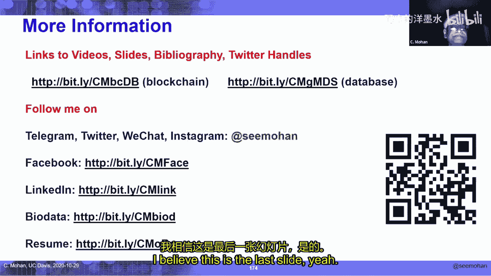
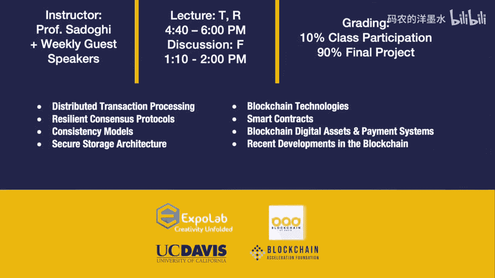

# 【全集】加州大学戴维斯分校 分布式交易与区块链架构 中英字幕 完整课程 p22 Lecture 18 - 许可链的现实意义 -BV18YFVzME2f_p22-

Hello everybody welcome to Expo Lab B speaker series today it's my great pleasure to have Mohan join us and this is also part of the distinguished lecture seriesius at UC Davis on computer science department and so just a few words about Mohan as well of course he's an ACM fellow and IEEE fellow and IBM fellow so you have the he has the fellowship across the board and。

Some of his work， I'm just going to focus on one， the one piece of work。

 the A protocol and that's the foundation of pretty much recovering in any relation or renowned relational database system so the work that he did back in the 90s and in the 80s has become the standard definition of how you do recovery and any system that come out even the recent ones they all rely on the guarantee that the A right ahead login provides so the fundamental to the successive relational system。

And。From my own personal experience I had a pleasure when I was at TJ Watson and Mohan there was at Almedden so he had a lot of interaction。

 he was one of my mentor during my four years at IBM and the one thing that I really learned from him and I think this is really good for the student is that anytime you would go on and says okay I have this great idea he would says well。

What is the effect of this idea on the entire system and he would list all the different components that could be affected some of these components I' never didn't even know exist the let allow knowing there's any implication on it and so he just you give idea he breaks it on into 10000 pieces and he tells you exactly what is going to be the overall effect of it so sort of the lesson is that the idea is good but how does it affect sort of stepping back and be able to understand from the system especially in the system research how does it going to affect the overall system and what I've seen in the last four in the four years that I was IBM。

 nothing will ship out out of the door unless it had the the stamp so unless Mohan stamped it。

 nothing would go out of the door and those stamps would require a lot of meetings and a lot of convincing to do so and it's great it's been sort of a great learning experience。

And each of them felt like a PhD defense and imagine that doing that three times a week and for four years and the learning which you comes out of it is just invaluable so without further todo again it's a great pleasure to have Mohan today with us and so please take it away okay thank you so much for that wonderful introduction and it's great pleasure for me to be able to do this at least although I would have highly preferred being there in person and doing it and it's so sad that even though I live in the Bay Area I haven't been in your campus and their kids。

I've never given a formal talk as far as I can recall in the almost 39 years now I've lived in Silicon Valley。

I was there once for my nie'ces graduation ceremony。

 but one of my IIT classmates is also there fame Dev Wendu。Is my classmate， even from high school。

 believe it or not not just college。In any case， so let me start sharing let's see。

I got out of the sharing mode earlier， okay， so。I think we are okay， right？

I'm going into the yeah okay so this presentation I posted the slides a little while ago and the URL is also here it's in the chat session it's also in my Facebook and linkedin post and all that I。

Gave a version of this talk just about a year ago as the Sigma keynote in Amsterdam so the URL I mean the QR code on the left is the eight page paper that I wrote as part of that keynote and you'll find lots of references there with links to online version of paper and so on so that's this paper and then the video is also there and slides are also available this right side QR code is for this page and sadly I just discovered a few days ago Facebook is stopping supporting what they call the notes feature。

And this is actually a Facebook note when you expand the URL and so in the future after October 31st I can't edit that thing it will still exist but it cannot be edited so I have to now find a new place to host all that and keep continuing to edit but there you'll see lots of you know videos of talks and interviews and all that being linked and so the reason I'm saying all this is because。

If I don't get around to discussing certain things today。

 I'm sure that I won't get around to discussing everything I might have to say if you are interested in you know exploring more some of the things。

 you will find lots of other material that you can go look at via this link。

And also what you will find is that even the presentation material that I posted at this URL。

 it has lot more slides than what I'll actually be showing so if you get the PowerPoint deck。

And you see it in the slideshow mode， you'll see the slides that I'm hoping to show。

But if you go into edit mode， you will see even more slides which are hidden in the version that you will see when you are in the slideshow mode so this is the set of things that I thought broadly speaking i touch upon of course this talk i've given for。

Given in 14 countries in many kinds of venues。So from people who are not even technical people to you know hardcore technical people like you people to some people in between database people non database people computer science non computer science all sorts of people like that。

 so it tries to sort of。Have something in it for everybody but that doesn't mean that it's all too highle there is nitty stuff also so depending on you know what interests you and so on you might want to go dig more into certain aspects and you can do that by looking at the extended version of the slide deck or by going and listening to even my Sigma talk and so on because every time I give the talk even if the slide deck is the same same slides are being shown there's no guarantee that I say exactly the same thing so Ill go off on some topic here deep down in one presentation and do something else in another presentation and so on so as I said in my abstract I'm going to concentrate pretty much only on the permission blockchains。

 but in case somebody is there since this has been announced as a general talk I have lots of problems with the permission less or the public blockchain。

For a variety of reasons， this whole notion of reward and hype about you know we provide trust in a completely trustless environment。

 lots of those things are in my opinion， bogus claims and also the awful performance and also the whole notion of greed that has been introduced by making people have some control over which transactions get included in a block and things like that and also this wasting energy and calling it mining and thinking that that somehow guarantees is a lot of trust and this and that and also you know then generating money by wasting energy。

And making it appear here as if that money， the cryptocurrency by itself has some any value behind it。

Lots of these things have led to illegal activities being promoted the whole notion of people in an anonymous way or pseudo anonymous way。

 being able to willingly come and go into this public blockchain network with nobody knowing at any given time whos around and so on and people hiding behind you know。

These anonymous ways of doing business， but of course。

 you know because it happened about 10 years ago and Bitcoin took off for a variety of reasons。

 not all of which is practical reasons， but more because。

It became like a way to crank out papers or even in Silicon Valley companies and all sorts of shady things have also happened with the notion of ICOs and so on。

But it brought together many ideas， not everything that was done in Bitcoin was completely brand new and there are hidden slides which go into some of those things but。

It also led to you know everything being visible to people and such。

 so it was in many ways counter to the notions like GDPR and such which haveve come into force more recently which try to limit who gets to see what and things like that and also you know all the privacy kinds of things that people should I worried about didn't worry about as much and also protecting intellectual property or even trade secrets or things happening in a business a lot of those things will be better handled in a permission network where。

For a particular purpose， you have a network of people coming together because they have a business reason to be part of that network。

Not just because somebody has some computer power available。

 they're dwiddling their thumb and they want to get involved。

Like as a minor in the case of public blockchain， but here。

It's like traditional workflow management business process that kind of situation where there are different people playing different roles。

 different organizations playing different roles and they have a business purpose which is a business process which involves assets and so in that context people by definition have to reveal their identity and you know based on their role in the organization and so on they'll be permitted to do certain things are not permitted to do certain things and so on this is traditional databases with authentication authorization and that sort of。

Because only the people who have need to be there。Art allowed to be part of the network。

Scalability and all that is improved performance is improved， controlled information sharing happens。

How is the case that。In the public blockchain， because of this game kind of manner in which the decision is made as to who gets to add a new block of transactions to the existing chain of blocks of transactions。

It turns out the proof of work and such permit even more than one person to simultaneously win that competition and as a result there can be what used to be a linear chain suddenly becoming a branch chain and alternate paths coming into the picture and so on。

 but typically in a permission network。They don't permit that and as a result it's more predictable and as a result you don't have the kind of nonsense in the public one which results in 10 minutes and such response times because when there are alternate chains they wait for a bit longer before they declare based on some criteria that the longest chain is considered to a one and the other chains are essentially consisting now of loser transactions so because of such things also that performance sucks not only is it bad like seven transactions per second but even a single transaction outcome might take 10 minutes to be determined and this is that is you know I'm when in traditional transaction processing。

What used to be a subsequent second response kind of requirement 35 years ago and so on has become like now a millisecond kind of requirements。

 so it's in that sense also very counter to what the traditional transaction processing kind of arena has evolved to compared to even when TPC benchmarks and such especially for the oilTP arena got defined 35 years ago and also this notion of you know transaction。

Offering certain fees and that playing a role in which transactions get picked include to be included in a block。

All those sorts of things are completely。Counter to how traditional transaction processing systems based on priorities of。

Users who are issuing transactions and such based on you know scheduling algorithms that have various goals in mind determine at any given time what transactions get processed and so in that sense also I consider these newfangled ways of deciding what transactions should be picked up for quote unquote execution is counter to and also not a in my opinion good way or something that brings some benefits kind of way being done in the public blockchain the other point is that a lot of that proof of work and so on is there because。

You first create a problem and then you bend over backwards to deal with that problem which is you let random people come in without knowing their antecedents and all that and then you say oh shas。

 these guys because we don't know anything about them or know very little about them they might do something really bad and screw us so let's now waste a lot of energy this that and then you know make things become ultra expensive to accomplish。

That notion of people misbehaving is a lot less of a problem in a permission network where people's identities are known and this is like real world right how do you decide you know which plumber to employ in your house you base it on reputations is that what some people have said about this person on Facebook this that。

WithFor companies， you could contact the better business bureau and things like that。

 right so in many such ways。While yeah people can still try to cheat you and things like that。

 it's less of a problem than in a public blockchain。

 so for such reasons also I believe that the over emphasis that's been placed on inventing all sorts of consensus protocols is I think in many ways backing up the wrong tree because you create unnecessary problems for yourself and then you waste a lot of resources and you know reduce throughput and increased response time and such by going with these complicated protocols and I'm a guy who has done a lot of complicated stuff but still I would rather work on things which have some practical value。

That might still be you know requiring solving all sorts of hair problems。

 but just solving hair problems with the end result not being such an exciting practical thing I have a lot of problem with so in that sense。

 I would rather let you think of as I said before。An environment where there is something of great use being。

Um。Put to。With the network you are building and so on so take a practical example like what you see here multiple organizations working together banks and corporate clients and thirdparty services and so on so you have a network that represents this set of entities and what they are doing in a particular context and so the business network connects businesses as well as people I hate this you know normal discussion where they say oh private blockchains are only for the enterprise environment give me a break。

It can involve also you know， be to see even see to C。

 but where people are doing certain playing certain roles。

 there might also be some organizations involved in this mix。

 but it's not like it's only companies dealing with companies。

 it can also be government to citizens kind of environment。So in general。

 what that means is that there are certain assets that are flowing across this network。

 the assets could be。Purely logical items like you know， music recordings or videos or whatever。

 or it could be physical goods that are being exchanged the physical goods could。

Change ownership or could undergo state changes a diamond in its raw form is mined and then you polish it that's a state change and then you split it into smaller diamonds and then you sell this in bulk sell it in retail now ownerships transfers are happening and so on so that transactions that you are performing in such a network are causing these sorts of ownership changes or state changes and the smart contracts are nothing but really at there you know。

Core。Ruleles of engagement amongst the different participants in this kind of a network that are very well spelled out and more rigorous。

Then what traditional business process systems and workflow systems have done where there was a lot more ad hocism。

 different participants had their own programs and databases in which they recorded things and so there was no single source of truth than things like that and so there could be more misunderstandings and all that。

In this context， the ledger is just keeping track of the different transactions that have been executed in a way that it's harder for people to go after the fact change the history。

 but this doesn't mean that the databases that are used in this kind of a context by themselves are up and only database or anything the databases could still be in place update and so on。

 separate from the database which is tracking the states of these assets。

 you have like a traditional recovery log but souped up which is tracking the list of transactions that have been executed and the content of such a ledger。

Would in some ways look like traditional recovery law。

 but in other ways look different and also the manner in which traditionally。

Mohan and the likes of Mohan have dealt with recovery logs they didn't worry about somebody intentionally going on screwing up the log by changing the stuff in a traditional recovery logs were also app only but we didn't worry about misbehavior with respect to that thing being tampered but whereas in this multiparty kind of context。

 even that sort of thing is being done in a way where if people tamper with it can be detected and so on so some of the ideas like。

The blockchain has a data structure。Is what is valuable from the original Bitcoin way of doing things that still is worthy of adoption adaptation and that's exactly what the the。

Permission networks have done by the way i'm going to be mixing up blockchain and distribute ledger and all that for the purpose of this presentation all those nuances are not so important okay but in any case so the blockchain is a shared replicated permission ledger and in order to do all this in a certain careful manner do the bookkeeping and all that in a more rigorous way than what traditional business process systems and workflow systems have done we。

Employ some of the techniques of the original permission， less blockchains。

So another way of saying all this is， if you look at the scenario depicted here。

 on the left side is this chaotic way in which traditional multiparty work has gone on。

where each one uses its own database system and its own separately developed programs。

 or even if they are using packages， they are all using their own ways of leveraging such packages it's sayAP or Db2 or oracle or whatever right or even file systems for that matter and even though everything might be done electronically there's still lots of point point communication and things could still be after the fact changed because other guys don't have visibility into your database or you know the complete state even when you know。

The shipping companies give you a tracking number just because you are able to get at some information from the other guys database。

 don't think that you have complete access to their database so。

If you look at the right hand side way of doing the same thing。

Now it's much more clearly spelled taught as to who the participants are。

 what the rules of engagement are， what the definitions of these blockchain transactions are。

 and in doing all this，The method to the madness is that essentially in the simplest version。

 all the guys have the same database state that is being in a coordinated fashion modified。Okay。

 and this is the reason you can make certain assertions in the right hand side way of doing things。

That you cannot make with the left hand side so efficiencies is improved。

 you can track things in a more rigorous fashion and also you know the usual words you'll hear about in this context。

 authenticity and so on， root cause analysis and all this kind of stuff is far better handled or far more efficiently done effectively done in a less error prone way and things like that。

By the way， if you feel like it you can question me even as I go on so in terms of where we are the way I summarize the state of the blockchain world is that it's as if like we were 35 years ago。

 few relational products that come out but you as the user of the relational products 35 years ago had to fend for yourself with respect to many aspects of how to use those systems effectively and what condition one feature of a system is better to use than another feature for what kind of workload oracle is better than DB2 whereas。

嗯。Something else is better but this other kind of workload and so on。

 also they were hard to use what kind of indexes to define when to use lots of indexes and when not to use lots of indexes OLTP versus all have kind of distinctions。

嗯。Soう。In the interim between 35 years ago and now， as you all know。

 relational database systems they've evolved did in various ways。Functionality improvements。

 triggers and stored procedures and such things， as well as all sorts of database design tools and such I developed。

 So in a similar sense， with respect to。Blockchain systems， there are many systems around。

 but luckily。It's not as bad as the No SQL arena where there are way too many systems because a lot of the work in the blockchain world is being done more enough。

consortium fashion like the Hylog， consortium， the enterprise Ethereium mallayons and so on are three and such。

 because of that there are less number of these systems but。Unfortunately。

 at least in the relational world to begin with all of them try to more or less follow the common conceptual model of relational databases that my colleague at IBM in Almaden came out with CA but the APIs were different。

 begin with Ingress at Berkeley had well as the language whereas my colleagues in Almaden developed SQL。

But。In the context of。The permission blockchains。Not only are the APIs different。

 but even the underlying conceptual models。They are not the same。So there is， you know， scope for。

Improvements in that space also with respect to developing standards and so on。

 but compared to relational databases in the case of blockchain because of various factors including open source this that and the change to world and so on。

Between the time， something was prototyped to when it got deployed not just。

As you know prototype kinds of usage， but actually as。Production level deployment。

 that time period has been much shorter。Okay， so meanwhile， of course。

 as you probably know from Mohammamed's work and so on。

 there are any number of people in various places that have also said， hey。

 though I really need something separate from a database system that incorporates some of the functionality that I've been talking about and that being called the blockchain system。

 Qunai suck into the DBMS itself， some of this newfal technology and enhance the traditional relation databases themselves。

To acquire blockchain like features and so that's also going on and also there are lots of traditional database topics that are being rehashed。

And again， being， in some cases made to appear like there's some brand new ideas。

 including sharding and things like that。Incorporated into blockchain systems as well as things like you know。

Working across multiple blockchains， heterogeneous database integration kinds of ideas or two face commit kind of things that have happened in traditional database systems and also since a lot of the U and Western country people don't pay enough attention to China I want to emphasize that the Chinese guys are extremely active in the blockchain space and then Europe of course has a whole bunch of entities that are putting out reports and so on so I let you go these things。

 the European Union blockchain observatory and forum they produce lots of interesting reports there also attempts to have a partnership across the European Union and some other countries and even develop this European blockchain services infrastructure that will be a EUU wide blockchain backbone that can then be used to implement government related use cases as。

less private enterprise and things like that and then there's a similar thing called the International Association of trustedted blockchain applications so in terms of what I said before from February 2017 just about three and a half years ago production deployments have been going on and every few months you'll see something new happening so even before Hyger fabric reached the 1。

2 status which is more like production red of status it had already been in February 2017 used for a production deployment that was a 0。

6 release of the fabric。But since that time。This concept of blockchain as a service offering has come out。

 which is a variation on infrastructure as a service and so on。

 so IBM offered in its blockchain platform which was originally based on leveraging some of the really fancy features of the mainframe for both performance reasons and fantastic security Re which is a super duper version compared to what Intel has which is called SGX。

 the Se execution on Cla and so on。So since then， of course。

 lots of other companies have gotten into this game。

Almost every one of the big players now has a blockchain as a service offering the one saving grace in all this you know plethora of systems that are around is that Hyger fabric has become extremely popular and almost everybody that offers a best offering definitely supports fabric they might also support something else but no other system is as popular as that meanwhile of course as I said。

 you know some companies have introduced。If not in a multi node kind of environment。

 at least in a single node environment。Daatabase systems with blockchain like features that's。

 for instance， is the case with Amazon with its QLDB and also more recently Oracle has announced something called the blockchain table extension。

In IBM something was prototype but it was never commercialized and also you know the Chinese president himself declared that there should be a national focus on blockchain innovation about a year ago so and also there is also you know there's all sorts of work going on and trying to make smart contracts be portable and also。

Even allow a single transaction to touch multiple blockchain instances。

 so so called blockchain integration， so there are multiple projects under the Hy consortium that are addressing some of these sorts of topics。

So this is the point I made that Hylogger fabric is very popular and there are also many research projects so it's not just commercial kinds of entities that are dealing with Hylogic fabric even at the University of Waterloo there was fast fabric work it was done so I've more recently found out you know many universities across the globe actually doing quite a bit of work with Hyia fabric with respect to standardization。

 I would say it's all still in very preliminary state Mickeymo style progress and there is this document that you can go look at offline they are focusing on things like identity intererability governance and smart contracts and things like that with respect to the whole myths that I've been annoyed about there are many of them all these tall claims about。

Permission list will provide high level of trust in a completely trustless environment and all that a lot of these things are bogus in my opinion。

 because even if you look at Bitcoin itself， what did it do in my opinion zero。

 just sending money Mohan sending Mohammad10 Bitcoinins？

And worrying only about that and nothing else is， in my opinion。

 who cares because I'm sending money to Muhammad presumably because he did something for me。

Good sort services they don't model that aspect so what if I send the money but what he sent me doesn't work as he claimed it will work what am I going to do how do I make sure that you know I don't get ripped off in this scenario so I can go on and on about all this there are many situations where real world information needs to enter the system how can some guy sitting in China the so-called minor validateator transaction where i'm saying the current temperature in Saratoga is such and such and I'm entering that information。

To a large extent in this world， you cannot get away from having identities and having some information about people being able to sue people having some organizations that you can appeal to police courts whatever kinds of entities so this whole notion of you know it's a completely。

Per to peer network with no central authorities， I don't like governments。

 I don't like having to answer anybody， I don't think it's all very practical at all and also this whole notion of oh if you put some information in the blockchain it's going to be there forever whereas is if I put it into a regular database I can yank it out that's all false thinking on chain versus offcha because even in the blockchain remember。

诶。What you put there is there forever and all that。

 but what about traditional databases the log content is there even if you delete an object from the database it's not like it's being vacuum cleaned out of the log the log is no different from the blockchain data structure this whole notion of creating money out of thin air。

That's not based on GDP and goods and services and so on is also something and。You know。

Arbitrarily just speculating on this value with no real world implications is also something that to me is all bogus。

 it's all like pyramid schemes and such and so。I can go on and spend the whole hour or two hours discussing this but I won't do that and also just a quick question Yeah just a quick question so I mean I mean I agree in I mean I'm kind of on the permission side so I agree with most of the criticism but the one thing that I've been recently started to think about is one key difference between the permission and nonpermission is that the actual asset that crypto itself is part of the ledger look at traditional banking I mean we have this conversation earlier today too is that they have the ledger but theva or the safe was outside the ledger I mean in this model the safe is part of the ledger itself and the money that is being generated is might be。

Questionable but that's that itself that the asset to be physically part of the ledger in along with the smart contract or it's not unique to permission but that part seems to be interesting yeah but I still I mean you still need that thing to be recoverable and all that kind of stuff right I mean I still would like in certain scenarios to have something in my hand that's a physical thing I mean。

See， I'm not saying digital currency is bad。 in fact， China， that's what they are doing。

 I'm fine with。What has been called what is it called I'm forgetting the name now。

 the digital versions of fiat currency， there's a term for that。

That is okay what i'm questioning is something that's not backed by fiat currency。

 the fact that it's part of the blockchain itself I don't know why that by itself is a big deal because you know all this currency that's being created。

If。There is nobody guaranteeing anything behind it like you know the US government guaranteeing the IO you know traditional currencies are like IOU there's something like the central bank or whatever that's backing it right even if gold backing is not there as it used to exist there is still。

Some real world entity， which is a reliable entity that honors it。I mean。

 there is no such thing as just because somebody created these bits in the computer in the case of。

 let's say， Bitcoin， that any real world person necessarily needs to honor that thing。

Right and people are creating their own currencies like crazy and by the way。

 this is not like something brand new also in the good old days you know Indias miickey Mouse kingdoms and principalities and other countries such things at their own currency but the world as evolved to a certain state and in the case of Europe even countries got together and created the Europe it's not like they were fools to do all this right that's why if you look at what Paul Krugman said this whole notion of。

Cryptocurrency has set the world back by 300 years and some the Nobel laureate who was an economist also has said similar things more recently so in that sense。

U。You know we have to worry about reliability in many contexts right it's not just money you various other me my degree certificate all sorts of stuff we are all you know with all the fires around we need to definitely of course worry about。

Keeping things in a safe fashion， but that doesn't have to be necessarily。

Something like this blockchain blockchain is not like a panacea for all problems that you might have in the world right there are certain situations where。

Some of its properties。Are so important that you are willing to compromise on some other properties there's later a slide which goes into some of this kind of you know flow chart which you use to decide even between traditional transaction processing way of doing business versus blockchain way of doing for a particular use case that you are trying to implement。

I don't know whether any of this addressed your point or not well yeah there just an open questions I don't think there's any precise answer to it I team just looking at traditional bank I see they had a safe and they had a ledger and go back 2000 years ago somebody right wrote down the transaction and they put a little house or a safe that they could put the actual money in there No no but that's the recent Mohammad I brought up the point about。

That's not even true， this notion of like for instance， a gold。

Real physical gold having to back fiat currency that used to be the case you are maybe too young to even know there was such a thing they gave up that on in the 70s I think but。

And so the point is。Even today with fiat currency， it's not like for all the currency that exists。

 there is definitely a physical form of it， even in the form of coins and notes there's a lot of money that's。

Part of the economy。That's more like bits in the computer and hence my point about。

I'm perfectly fine with。Digital representations of fiat currencies。

 but i'm not convinced at all that you need to cook up these alternatives， of course。

 then people have argued with me， hey， what about airline points and this and that they have a very narrow role。

But they're not like the way in which the cryptocurrencies have been talked about。

Because people do bring up all these other money likeing points in various loyalty programs and so on。

So。So， so。There is a lot of money today， I mean， even when we do funds transfer and all that you think we are really sending physical money no obviously right those are all just。

Transactions that involve。In a more organized fashion。啊。Essentially。

 who owns how much money is being kept track of so it's not like traditional。

Cyntech didn't think about。If you like storing money in computers and dealing with it at that level and not every time。

Dealing with it with physical currency and so on。That would be my way of addressing your point。

Yeah sense anyway， there are lots of problems that have been there with commissionless networks and I didn't even showed this other one which's involved one guy who had an exchange dying and even his wife didn't know what the password was。

People who kept their money there sadly lost all that money just like that and you have no place to go whine about this right so in that sense also by the way this whole business of oh permission less is completely distributed whereas permission is centralizes bogus claim in fact it turns out a lot of the individuals who have cryptocurrency。

They were worried about losing their money because they forgot their private care or whatever。

 so guess what？They stored them in。Exchanges， this is nothing but。A pseudonym four bags。

So much for these guys claiming that they're eliminating middlemen blah， blah。

 blah so so in many such ways， a lot of the claims that have been traditionally made by the permissionless people in some kind of antigoverment and I'm going to be a libertarian and so on have actually all in the practical sense become bogus。

 in fact somebody and even claimed， oh you think everything that happens in Ethereum is all you know done in a completely distributor actually what's his name Bren decides lots of things it's highly centralized。

you know how the system evolve and all this kind of stuff right forking and this and that so people would like to believe that it's actually you know ordinary people determining everything in a collaborative way and all that but as a matter of fact。

 even the bug that was found in Zcash， which they claimed they kept hasush even within the company for nine months before they found a fix for it。

 which could have resulted in all sorts of fake things having been accomplished。

 even history being rewritten and that sort of thing。

Guess what in spite of the fact that it's open source and supposedly you know just because it's open source。

 you know it'll be bug free error free and all that is nonsense so these systems are so complex。

Just because it's a public thing that doesn't necessarily guarantee that they don't have bugs that people still cannot do some hand pan and such so in so many such practical ways。

There is too much of hyped up。Claims that have been made about why permission is so much oh permission less is so much better than permission。

Anyway， getting back to technical things， the point I make is that both in the distributed systems area and database systems area。

 there are many topics。😊，which all have a bearing on what goes on in this blockchain arena and in that sense it's not like the blockchain way of doing business is completely you know brand new technology in every which way and so on it's actually you know how you you know squint your right to see things in a certain way that will let you know that。

I myself worked on many of these things by the way。

 even Byzantine agreement protocol was something I worked on back in '82 my first year at IBM along with the work I did on presumed about Pre commit to face commit protocols in pot C83 I had one paper on the hardcore thing which is the presumed about Pre commit the other paper was how to combine that with Byzantine agreement protocol in order to worry about Byzantine failures so it's not note these two face commit that was our first paper to be covered in the graduate course one of the first one to be wonderful so but I also have worked on workflow management business process management so when I make some of these comments it's not like I'm just biassing my way through these things I have personally worked on many of these topics and so as a result I know how traditional workflow systems worked what they shortcoming way and why in many ways this more organized way of doing。

Things that the blockchain way of doing business。Has brought to。That kind of scenario。

 that is a positive step。But at the same time it still involves certain song and dance with respect to how a transaction gets executed in the blockchain way of doing even in the permission environment。

 which makes it more expensive than traditional you know distributed databases with replication and primary copy approach and all this kind of stuff and so I have some slides later about that but in any case what I wanted to say is that this slide which comes this picture which comes from Benui and their and this colleagues paper in Sigma 2017 you know。

Sort of big picture sense is what the three most important aspects of blockchain system are consensus layer。

 which determines you know in what way transactions get picked up for execution and how they then get incorporated into blocks and how the blocks get added to pre-existing blocks in the blockchain then the other one is the smart contract execution engine。

 there are various you know aspects to this， what language you're allowed to code in what constructs are permissible because certain systems require that the smart contracts be deterministic so you cannot do things like look at current time or look where the moon is and so on because the same。

Contract on behalf of the same transaction might be executed in multiple nodes and if you have any such non deterministic things。

 then these different nodes will get different results and as a result。

If the order of execution of the transactions has been predetermined and then they are all let loose to go execute these transactions。

 they'll wind up with states that are not mutually consistent。

And also the way in which the persistent state is kept track of， which is the data model layer。

 what kind of database system are you allowed to use NosQL relational how reliable it is is it versioned or not and so on and so on so there's lots of things that one can spend time on in discussing something like this to make matters even more exciting there are many other aspects of the architecture of these systems features。

Where there are many different ways in which something could be accomplished and different systems have chosen to go。

Do those things in different ways。 The bottom line is。By the way， for each of these bullets here。

 I can spend you 20 minutes， 30 minutes， whatever discussing the pros and cons of doing it one way versus another and so on。

The bottom line is a lot of the work that has happened。

 especially before quote unquote research type people got involved where it was done primarily by product and people or other you know people who think they know a lot but they don't have enough experience that's one of the problems with this open source business right sorry lots of U I young people but there are a lot of many some things who do a little bit of reading and then they think that you know why waste time reading Mo and Zri's paper or this are that and then they think these are MonggoDB and all there no SQL systems came about right？

They just do some seat of the pan design and they don't describe me in enough detail what they did for other people to stare at them and see whether they missed something the kind of thing that Mo actually said that the pain went through turning to。

 you know， rationalize the design he came up with or one aspect of a system。

 how it interacts with other aspects and all that designed reviews， codeor reviews。

 architecture reviews and so on。And so the point is。

Lots of things have happened while it's good that in a short amount of time many systems got developed。

At the same time， it's also bad because。In the desire to do things fast。

People have not been as rigorous in going through enough of the what it takes to make things work in a reliable way in a long term way rather than just。

 oh， my Silicon Valley guy wants to do aCBC prototype and find some people on some people。

 if you like， into giving him money。Do I the。Do a few more things and then。

Go IPO or find some suckers and some big companies to buy this。You know。

 prototype which does a few things， not necessarily even dealing with all the fringe cases。

 but does the average case。And then let those guys worry about。Doing the real thing later on。

 these guys who did the initial thing last their way to the bank and then IVM which our company acquired this not yet ready for prime time thingy then the Jors and those acquiring companies have to。

Really making it industrial strength and so on or in the case of startups。

The first set of people go away after the handcuffs come off them and they' are able to cash in and then the new set of people will get hired they now have to make sense of。

This's not necessarily well documented code as well as design documents that might have talked about the design in a more or less。

This is how it works， not necessarily rationalizing why that's correct or whatever。

 but at least describing what it does。But which wasn't kept up to date as the design evolved of bugs came to be noticed and such。

So it's in that sense that my point is。There needs to be more rigorous way of looking at these existing systems。

How they do what they do and whether they are correct and do comparisons and all this so a preliminary piece of work was done by the people in N US Bin and others as a follow up to that sigm paper that I refer to before。

 but these are not people who themselves had developed the highger fabric or you know Ethereum or this or that。

 and so they couldn't always。Be able to guess what the original people who did some of those things had in their mind when they did something。

 this is like you know now the Supreme Court people trying to interpret what did the people who framed the Constitution of America 200 plus years ago。

Thought when they did something， when they put in something in the Constitution。

 all those sorts of things you have to go through。I already talked about this blockchain versus recovery log。

 there are some similarities。But there are also differences and so， but to that extent。

You need to think about this because there are any number of people who go say， oh。

 don't put something in the blockchain because if you cannot take it away。

 but stick it into the regular database and then put only the hash into the blockchain。

And they think that， oh because I can delete the object in the database that now makes it disappear and I don't have to worry about GDPR and all this kind of stuff。

 then that's bogus unless you vacuum cleaning the database recovery log in the database context。

 the two are the same and there are people now who are actually worrying about even in the blockchain context。

What might be considered an anathema， which is even。Forgetting stuff in the blockchain。

Data structure because you need to actually worry about things like what happens if。After all。

 these smart contracts are nothing but like traditional application programs。

What if you had a bug in your smart contract which clobbed the state of the assets？

What are you going to do？Traditional database systems had to worry about these sorts of things。

 right， your new version of your app。Had a bug in it。

And so you can't do compensating transactions and all that because you don't even know exactly what the effect of that bug was。

So normally before we install a new release of piece of software。

 you take a backup of the existing state of the database and later on if things crap out。

 you essentially do what's called a point in time recovery。

 you restore the database to that earlier state。Yeah。

 that means that it's as if you have amnesia with respect to all the transactions that got executed since the time you took that back。

And people have asked for that kind of functionality even in the blockchain context。

 or at least for the IBM blockchain as a service offering。

When it comes to going beyond all the you know what idealistic minds might think of and you have to really have systems that work in practice。

 you do have to think about these sorts of things and you can't be so puritanical that oh yeah this history can never be touched and so on you do have to think about a suffix of the blockchain having to be lobbbed off because of these kinds of bug situations and things like that in some ways。

You've already seen these things even in the。quote unquote puritanical sense。

 all this forking and all that when they change the block size and things like that that have happened in the context of Etherum。

 for instance。Replication， I already mentioned that。

Traditional distributed database systems have had replication ideas。

It took a long time for some of these things to get implemented in relational databases。

 but even lotus notes from late 80s even a what I consider to be the world's first semistructured DBMS long before Mongo DB all this had this notion of disconnected operation and being able to do updates while you are disconnected and later on when you reconnect to the server you might discover that in parallel two different people had done conflicting updates and so on so in that kind of scenario we have had various approaches right as to how if you have replicated databases。

Things get done， meaning in one approach， you do the update。

 the whole transaction gets done in the primary copy of the database and then you use the logricks produced in that one place in order to bring other copies up to。

 but this required that these two systems be exactly the same with respect to database system and page sizes and this and that because the recovery log if you want to use it in that fashion needed all that LSN and all this kind of stuff。

The next approach was you want heterogeneity， you know， the primary system might be oracle。

 the copy system is Db2。And so in this kind of scenario you execute the transaction on the primary which produces log recordss。

 but then the log recordss themselves are made use of in order to create higherle statements which then get sent to the other guy in order for him to now from a high level perspective redo those transactions in this fashion you can do subset replication the systems can be different page sizes can be different and so on this is what the IBMQ application product allow you to do but this required some you know interesting things to be done because in the original system things happen in parallel if you do this in a naive way then in order to guarantee that it's all going to result in the same state on the backup you would have to。

You might choose to do things serially every transaction that got done in the primary gets redone in the serialization order on the backup。

 but that would mean that then the backup might not be able to keep up with the primary because the primary is cranking away。

By executing transactions in parallel and so on， so you had to then come up with all ways of all sorts of interesting ways of analyzing the dependencies between transactions and then doing them in a parallel way and things like that while still preserving where it's required serialization of transactions executions。

 but where you can do it。Execute multiple transactions in par on their replica。Then， of course。

You know。Sttroonebreaker goes around sayingMohan is crazy we don't need any of this nonsense。

 I'll just capture the SQL statement on the primary and just reex it on the backup yes what doesn't work he doesn't tell you the full story。

The problem is that if that SQL statement had any kind of nondeminacy constructs。

 as I talked about before， looking at the current time what the weather temperature now is and so on。

You can not just。Take the original statement because then when you reex it on the backup。

 the results may be different and so nondeterminism creates conflicts as well as he also does everything in a serial fashion and so on so that I can spend a lot of time discussing all this。

 but the important point is。The case of blockchain， a lot of these sorts of situations。A handle by。

In some random fashion， in my opinion， an optimized fashion。

 the transaction order is determined upfront and then all the copies effectively execute them in that same order。

Whereas in these other ways of doing it， it's all sorts of。Things like。The locking order。

 this that and priority and all that on the primary that determines in what fashion transactions get interleaed。

And they don't take into account as I said at the very beginning greedy things like who is offering me how much money and I lose that as a way of figuring out which transactions to pick and which transactions might as a result get starved and things like that yeah we do have some priority and all that but at the same time we also have some service level agreements and all that in order to bond the amount of time it might take before a transaction gets executed so there's lots of such comparisons that can be made one of the major architectural differences between。

The more or less permissionless way of doing business versus the way in which starting from version one。

 Hyleric fabric chose to do。The handling of execution of blockchain transactions is what's talked about in this picture。

In the case of。All these other guys， they first through the consensus protocol and all that determine the order of transactions。

That day。Whos do。Pick up for execution。And then in parallel， the different norms execute them。

 and this is why that deterministic aspect of the smart contract becomes important。

And then they update the persistent state。So there is no communication in that middle step。

Between the different participants to make sure that they are all in agreement。

 whereas in the hyper of fabric way of doing it， starting only from version one。

 prior to version one， it also followed the top of model。

They do this initial simulation of transaction execution。

Which results in read and write sets being determined no actual updates are performed。

This is like optimistic concurrency control。During which time it's okay if there is nondeterminism and as a result。

 the results produced are different because at the end of that simulation。

 there is still an opportunity for the client which initiate the transaction to even make use of these different results and decide to take an average。

 take max or insist on them being equal， okay， in any case。Based on this initial simulation。

 if things look good， whatever that means in a particular context， in a particular use case。

 for a particular transaction， meaning blockchain transaction。If things look good。

 then they go through this business of。Either in the case of initial release of fabric a single node which acts as the orderer of the transactions or if you're a little worried about certain aspects in a。

Consensus protocol way determining the order in which these transactions。

 which have gone past the simulation phase， get executed。But the important distinction is that。

Once that order is determined。In the validation step。

You are not actually executing any smart contracts all you are doing is that based on the read and write sets that were produced in the first step step the simulation step you are making sure is the world with respect to and this is like the validation phase in optimistic concurrency control is the world still the same with respect to what was read which was then used to determine what needed to be changed。

If what was read during simulation is still in the same state at the validation step。

 then they declare such transactions。Can succeed now， and then they take the update and dump it。So。

The crucial point is smart contracts don't play a role during the validation is again。

 the original way in which in version one i of fabric things were done。

Since then they have been doing that， but there may be some twists that have come in the more recent past and if the transactions validation succeeds just like in optimistic con control。

 then they go and incorporate the changes that had already been decided during the simulation phase into the persistent state okay。

And all this is described in this 22 author paper for which I have the URL here。

 which was published a couple just a quick question yeah， in terms of the simulation， I mean。

 if the transaction is stillmin non deterterministic， the simulation will not get endorsement。

So you still can't enter the nondeminism no no， all I'm saying is that that's where I gave you a mundane example。

 like if one guy says you know something and the other guy says something else。

Based on what this particular transaction is， what the use case is。

The client might choose to even combine those two pieces of information。

 come up with an average and say， I'm going to now say the right set should be that。See。

' the architecture has all that flexibility。Whether。The Hylo of fabric， lot of the implementations。

Choose to do that or not is different。 but if you look at the if forget know what it's called it's the。

嗯。It's called the。You can basically have a policy to yeah。

 I'm trying to recall what the name of that policy is the endorsement policy。

 the validation policy and so on， those are the ones that determine。

What needs to be satisfied you can even say things like I ask for endorsement from five people。

And Mohammad is such an important guy unless he blesses。A given transaction。And。😊。

Two others blessed the transaction。It cannot be committed。

But Mohammad always has to indoors amongst the remaining four， it's enough if two of them indoors。

So the hyperlegge of fabric functionality allows you to specify such things。

It kind of be actually used in practice so that so that makes sense。

 but do you think it's practical to be able to come up with all these different kind of policy Yeah yeah I believe it is this is no different from you know you might check。

With a bunch of establishments， whether somebody is trustworthy or not， right？

And you say things like， this is no different from in that sense the score that they give you right creditworthiness score。

And what do they do， they go to multiple places， they grab some information。

 all of them might not say this person is the world's most trustworthy person。

 but they are looking for a certain level of feel goodness， right？

It's it's things like that is what I'm saying。I have a question so also hyperlog claim that it's execute order architecture is it actually an execute order architecture because assume we say an endorsement set consists of four people and there are many clients who are sending their。

Smart contracts。And now if we just be careful with terminology。

 many clients are sending transactions， no，'s they're smart contracts to same set of endorsers。

it is don't know okay just from a terminology perspective let's look at this picture smart contracts exist in the endr nodes only right the clients are only submitting transactions I just want you to be clear about。

The mental picture。Sure， so clients are submitting their transactions and。Now。

 these endorsers basically have to find the read and write sets right by simulating。

But they have to do it in some order right I mean no no no no no no。

 no absolutely not like this picture is showing I assume you're looking at the slide。

The transaction is submitted in parallel to。Again， there are various options how many endorsers you choose to use and all that that's not part of the architecture of the system that's all use case defined things okay so there could be 10 endorsers。

This client， for whatever reason。Says I'm going to choose these five endorses of the 10 and submit the transaction to them。

 not all the endorses are necessarily involved。But I'm saying now if this client wants to choose so there are two clients A and B both end up choosing the exact same set of endorsers it is possible right so now both set and they both have this complex transaction it's not just simple transaction where just where you can just find read and write sets it's a complex transaction okay now for a complex transaction you might have to actually sort of start executing it before you can actually find the read and write sets not not not every read write set is discovered at the big name。

No no okay， so so before you go further， I want you to look at this picture。

 so essentially when the smart this is showing what's happening in let's say one endorse or node。

When the smart contract executes， it makes。I hate this is did this。

 but shame on them it chose a dumb key value model get put delete those are the only things that you could do at the beginning okay because they used a dumb。

No SQL key value store so the get calls get sent to the database system， which has the current state。

 right？And the put calls and the delete calls are trapped by the layer above the database system。

Only the get calls get the latest stuff that happens to be in the database at that point。

And any puts are stashed away， which means in particular。

 you don't get to see your own updates during simulation， okay？

So the point is no change is being done。To the ledger database， while。

This smart contract is executing this is all really bad stuff because essentially the layer on top gets。

Share lock on the underlying database as a whole。While it's doing simulation。

 that's sufficient because actual updates are not being sent。

 whereas later on you'll see when the blocks are being processed during validation and then commitment。

 an exclusive lock on the whole database was acquired。So even if two。Simulations go on in parallel。

 they all still see the same state。Yeah and in particular what that means。

 you might be on to something that you're not verbalizing。😀呵。😊。

Take the simplest case where every bloody transaction wants to just increment a counter by one。

 the exact same counter。100 transactions could get submitted in parallel。

They all do their simulation。And then they all send their read set and write set to the orderer and he puts them。

 let's all， let's say in some random order in a new block and sends them， guess what？

Commodies transactions will succeed if at all any succeeds。Only one of them。suchmost。

 even that might not succeed， the very first one also might not succeed because between the time the simulation happened and all these1 hundred guys got sent to the orderer。

 yet another block could have arrived that was in transit or being formed even as these jokers were being simulated。

And that could have already changed that value。So it's believe me。

 when I heard all this and at the beginning， I'm like， what is wrong with these people。

 who are these people， non databaseatabase people doing all this BS and it's crazy the degree of concurrency and all this kind of stuff。

And all because they also used this dumb system which didn't have multi action transactions。

 they couldn't rely on any locking and all that of this you know level DB and all this kind of stuff because they were not full blown acid transaction systems。

 database systems。And so。There's lots of this kind of serialization which in spite of permissioned being better than permissioned less。

Causes。Incredible amount of inefficiency and transactions getting blown away and so on。

So do you still have a question or it makes sense Okay I have a question here sorry you are saying in hyperleg fabric they are getting endorsed after that they get ordered and after that they will get validated you mean if there are hundreds of just inement the same value in the same block。

 one of them at most can succeed cancel and the rest of them get will get invalidd during the validation phase right？

So the assertion is， if you look at this picture， after the ordering service does itss ordering。

 it sends this newly created block to everybody。Enorssing peers as well as this so called committing peer。

 the difference being， by the way， all this was introduced in version one before version one。

 they didn't have these distinctions。The committing PR doesn't even have the smart contract installed in it。

All it's doing is that it's tracking changes to the database state， you might wonder what uses it。

Presumably， you can run analytics over there。And there are other things I can think of。

 but for the time being let me stop with that but。The endorsing peers。

 which might have been involved in the simulation， like what I'm showing here。

They have amnesia once they've done their simulation and sent back the result read and write sets to the client。

They don't have any more any information about the fact that they did the simulation and so on。

 so when the ordering service sends a new block of transactions。

They start from scratch in the sense that they don't have any prior knowledge they might say have seen those transactions are not seen doesn't matter all they do is。

One by one and that's another bad thing right they start from the beginning of the block one at a time they process the transaction i'm like this is nonsense remember I talked about that replication where I said if the replica does serial execution it won't be able to keep up with the primary if its primary was doing things in parallel。

Having done all that kind of work this was all like mind boggingly naive for me but in any case that's what they chose to do I was not in the picture when they were doing all this but but my question is still there my question is that you are saying that transactions can get invalidd because another block come can come during the validation of this block but isn't it that they are every block gets in a completely serial order theyre in the order so the only transaction that can get validated because of the other transaction they should be in the same block。

Invalidation cannot happen because of the previous or the next No， no， no， no， okay。

 then you didn't understand my example I I'm saying these these blocks are getting ordered by the ordering services Yeah。

 yeah yeah， Okay hold off on it let me let me let me say one thing and then you explain Okay once once once block gets ordered and gets validated some of its transaction can get validated all the endorsers will update their snapshots right and they endorses on their new snapshot。

Okay， so that's where there is a slight problem let me just explain what i'm saying when simulation is going on in let's say one endorsing peer。

The state that you are seeing。Might be as of。The eighth block having been processed。

This doesn't mean。At that very moment， the ordering service is not already。Finishing up， producing。

Blolock 9。I said eight right， yeah， this new block9 has been produced。

And the endorsing peer hears about。Nine after it had finished simulating the transaction of interest or the 100 transactions of interest。

And so by that time。These 100 guys go to the ordering service and get into block 10。

And then that block 10 is received by the。All the nodes and they go through validation the current state of those nodes will be as of the end of block9。

 which is different from the state as of the end of block eight in which the simulation got done for those block 1000 guys Yes this could be a case i'm not saying it's always the case right I think Andrew Su。

Another question， can't they optimize all these inefficiencies when they are making the batches can we do the prediction or not okay。

 so this was one of the things that I felt like throwing up I'm like first of all。

 even as you do the ordering of the transactions。Could you please try to do these things in an order that more things could succeed。

 so for instance。Y ago when we did deadlock detection and all that if there is a deadlock and you have a bunch of transactions and one guy needs to be kicked out we don't just randomly pick a guy right we try to minimize the amount of useless work that gets done by picking the transaction which has done the minimal amount of updates and things like that because you are going to roll back right。

There are many things like that that could be done if only the ordering service would pay attention to the readwrite set and things like that and determine dependency between the transactions that it has got in his hands and is' now trying to put them in order。

Mind you， this is not even grade related stuff I'm talking about right you of course have in the permission less one also have other nonsense coming into the picture here I'm saying from a pure performance perspective。

You could even， in fact， in the particular scenarios I told you。

You could even potentially kick out transactions and give the he guess what you are a loser right from the ordering service instead of wasting the time doing the sending of these transactions to the。

Nobs and let them going through all the validation and so on because he could even see by just looking at the read and write sets in the list of transactions he has got in his hand that guess what a lot of these guys are going to be losers but they don't do all that in fact they say wow it's a great thing that the ordering service doesn't pay attention to any of this read and write and so on and。

To some extent， I can understand that too because there are some scenarios where they want to keep all that hidden from the ordering service because it could communicate some。

 you know， secrets and so on and so on， right？But。At this point， and in fact， by the way。

 there are other people who have subsequently come up with all these， in my opinion。

 very obvious kinds of things that should have been done from the beginning。

So even fast fabric does a number of things to improve performance。

Not all of which is like some super duper highly innovative stuff in fact for that reason I don't know if Mohammad was there when what' his name the professor from Water that was at power location。

Lucas。I know， the summer。No no， the one from Waterloo who worked on fast fabric who has moved to Cambridge now anyway forgot it's there in my throat but it's not coming out he said that he had trouble getting his paper published because a lot of people said this is all just engineering。

And he himself was saying it so even though they are valuable in terms of performance improvement。

 it's not like you know some revolutionary new algorithm and all that so for instance he would send to the ordering service only the IDs of the transaction and not the payloads。

All these read rights that we are talking about and then get back the order and then put in the payload apparently in the past with all this use of Kafka and all that。

A lot of stuff got shifted around with no use being made of that。

So even some of the parallelization of processing the transactions。

During the validation and commit phase。More recently， people have worked on。

But how much of that has gotten into the you know mainstream code base of fabric is another discussion。

 but yeah it means for a database person there are way too many obvious inefficiencies that。

What I can consider to be non database people who initially did the work cooked up。

And this goes back to my initial complaint about if people don't do enough homework。

 they start with extremely naive things。And then they try to gradually evolve the system and so on。

 but you might be so unlucky the first version was so stinky。

 you never even get a chance to fix it because nobody bothers with you。So that's the danger of， oh。

 let me quickly produce something I can always fix it up later on blah， blah， blah。

 which is you know， keep it simple and stupid all that kiss principles and such like many people。

Tt as a good way of making quick progress。Doesn't always result in。This is like Windows 3。

1 that Microsoft shipped in the world world as the testing people。

Instead of they themselves doing more testing before putting it out。

 so we've had all these discussions between IBM and other companies we doing。😊，Anyway， go on or yes。

 thank you Okay， anybody else has any questions。There are more papers that you can go and look at that go into more of the nit grty about all this so let's now come to if you think。

What you heard was bad enough let me tell you what more is bad about all this the simulation concept requires the layer between the smart contract and the database state and the state database having to analyzeize Dm scores What do I mean by that remember in this picture I said。

This get calls。Get sent to the DBMS and then the result comes back whereas as a potent and delete kept in the layer above。

 essentially what's going on is that here in order to determine the grid set and the right set。

The guy on top is effectively interpreting these get and put and delete calls it's okay in this dumb scenario right but the minute you start supporting SQL at this level in order for people to be able to do much faner modeling of the assets and so on。

 why should suddenly just because you get into the blockchain world。

 you should drop down from the semantics and the power of SQL way of modeling what you have been doing in your organization with workflow。

 whatever。Come down to this dumb level of get put delete and all this kind of stuff。

So if this becomes SQL， guess what， essentially this layer has to understand SQL semantics。

 not just the parser and so on， but even the semantics， not just the syntax。

And so that's where life gets really messy and that has to do with things like this， right？

There isn't like a clean cut。Oh， this is read statement， that's update statement。

You have mix of read and write， which is like。Update where and then you give a condition or inserts。

With a sub query insert into this table the result of the sub queryry。

 so now you would have to deal with having to split these things meaning。Where I had get before。

Now I have to take that part of the SQL statement。That is doing the read and sh only that into the DBMS。

But anything that actually causes updates， I would have to keep it on top。

But updates could be complicated， right， it could be。Add 10 to the existing value in this column。

Are you going to？Declare as right said that statement。That's a mission or is it the end result？

That you are going to be having so quickly， you can realize that lots of things。

Will get really complicated， especially if the isolation level you want to support consistency。

 read consistency and so on， you want serialerizable execution。

The not found also has to be remembered。See， originally。

 they only remembered what was actually retrieved from the database system。

Because the only call available was get， you couldn't do a range scan originally。So you can only say。

 I have an object ID。Now give me back its value。You couldn't even find out what are all the objects that exist in the database。

 this is kind of crazy， right？But。Anyway。So why I'm saying all that is。

Once you generalize the notion of what you are retrieving and what you are changing。

 possibly and so on。You might have to reexec the query as opposed to just checking whether what you retrieved before is still in the same state。

 which is what。Fabric does。Because it's possible that you originally said show me tell me how many green cars are there and it came back with eight。

Now， if you re executeecute that validation time， it might come back with 10 because in between two new cards got to I added。

And under that condition， also you have to blow away the transaction。

You would have to remember the original query， not just the end result that。

Came to you as part of the read。So you would have to reexecute the query during validation phase。

And so。Now of course， then the question that comes up is what if different people want to use different database systems as the state database。

 one guy wants to just be you know dumb and happy with key value store， another guy wants SQL。

What do you do now， what language primitive are you going to have？

With respect to data manipulation that you are going to permit in that smart contract if it's for the same use case。

嗯嗯。The dumb thing to do would be to treat a relational system like a key value store。

 which means you don't get to benefit from the power of the SQL system。

 but if you permit sQL but you are stuck with。keyey value store then in the layer above the DBMS。

 you're able to compensate for all the missing functionality of the key values。Store。

So in my project that I was doing。Where I was trying to add relational database support to fabric。

 I said my goal is not to。Be able to port the smart contract， which has SQL in it to non SQL systems。

I'll use standard SQL as long as that SQL is supported， one guy could run oracle。

 the other guy could run Db2 and so on as the state database。So this is the work I was referring to。

 so the name of the professor is Ke Sha。You see his name here as the last author though。

This was the fast fabric work done at University of Waterloo。So they did certain things。

 this is where I was saying the list of transactions that are received by the ordering guy。

 it picks out only the transaction sends it to the Kafka。

 which does the ordering of the transactions and then when the list comes back。

It puts those transactions in that order in the new block and then adds the payload。

And produces the block and then sends it to the different people and so on。

And they have also done this parallelization and things like that。嗯。

This is what they call the new peer architecture。And they're also， you know。

 keeping an in memory version of the data in the。嗯。This is known like。

I peer acting like a database system， right？the store below。You understand what I'm saying。

 see this layer， which has the database has its own buffer manager， where things are being cached。

 what that work is saying is that in this layer they're going to cache certain things。

So this is crazy， I mean after a while I said this is nonsense why are we building a database system on top of a database system instead of pushing things like simulation into the DBMS。

 which is what my project was doing at Arton。Let the determination of the read and write sets get pushed into the database。

Okay。😊，Anyway there are lots of use cases， I don't know whether I should spend my time too much hey Muhammad you tell me I have stuff that talks about different kinds of use cases and then I talk about the fact that you know not all use cases should be implemented using blockchain are wrongly used。

Only implemented with traditional transaction processing because each has its own pluses and minuses。

 so you have to look at various requirements that you have in your use case scenario。

 you'll find lots of people producing flow charts like this unfortunately this particular one as a bug and it says if you' are dealing with physical assets you can't use a blockchain and that's bogus okay。

So I suggest maybe another 10 minutes for like some of the more interesting material that you want to cover and maybe like five minutes to kind of close the questions and vision and things like that Okay so this is just talking about the fact that just because you're now going to do things in a blockchain way this doesn't mean you throw away all your existing backend database systems and you might still you know accept orders。

 let's say using the blockchain way of doing business and ship the produce goods using the blockchain way of doing interactions with your other people with other organizations but the actual production of the order goods might still involve communication between the blockchain network and your backend MRP manufacturing resource planning systems SAP this that so there can be triggers that go from one side to the other side and order has come in HR making it and then when the order is prepared。

The material is produced， you send a signal to the blockchain system to say it's ready for shipment and so on。

There can be these sorts of interactions when you have physical goods that are being dealt with then you need a way of recording something about the physical item diamond whatever a bottle of wine in the blockchain how do you now make sure that。

I sent to Muhammad a real diamond and he is a seze ball guy， he' is now trying to tell somebody else。

This is the same diamond Mohan gave me and you know with a markup he wants to get more money。

So just like humans are authenticated with IIS scan this that。

IBM guys cooked up this whole notion of the crypto anchor。

 which is a way of uniquely identifying something， something of a physical nature。

And that is done based on what the item is diamonds have some internal thing thats like an X or fingerprint in the case of cotton you can look at the spectral value in the case of olive oil expensive one。

 you can look at the viscosity and so on so this this thing that you see in this picture is a fancy lens that can be attached to the mobile phone which allows you to measure certain properties。

 physical properties which then can get recorded。Obviously you will do this and this is why I'm saying you can't just say I don't trust anybody the guy who produces the real thing is the one that's going to record this this is like Gucci puddings on 3D logo whatever kind of thing right you do have to have certain level of trust of course over time they are flaky then their reputation goes to dogs and nobody cares about them right they get booted over the network and so on。

I don't know， if I should thank you now or to the wait till the end you any scam that you produced today I was the bad guy and you covered every single possible attack and I was always the bad person in it in the example of。

Hey， only one example I made you about there was a lot more。Every possible scam。

 I think I did it today， but that's good。NoSo there are other situations like you know things like tablets and so on drugs。

 microfluid eggs， all sorts of two technologies used I highly recommend this paper that's referred to crypto anchors in the IBM journal of R&D I don't know if you have it in your list moment it will be a good one to at least briefly talk about in greater detail than I do which which this is the crypto anchors paper at the bottom left corner you have access to the slide so you can look at all this later so in general the point is when it comes to physical goods and such there are ways in which you can tag RFID whatever all those sorts of things you know it turns out none of this is like 100% guarantee but these are deterrens right so it turns out something can be done in a way where if you do an ordinary copy。

Line will look like a continuous line， but if you look at it under this kind of fancy microscope。

 it'll be a discontinu line。So if somebody wants to you know fool you by photocopying the original thing then it can be detected because of this kind of property so there are things like that this just then goes into discussions about you know how you evolved from Bitcoin to Ethereum one of the great things that the Ethereum guys did was introducing the notion of smart contract go from just dealing with this one silly thing called Bitcoin and nothing else to actually doing something of more value but they still had all the bad properties of Bitcoin in terms of proof of work and they introduced additional thing like gas and so on and they introduced their own currency but in my opinion the bigger thing that then happened was the enterprise Ethereum which tried to make it a permissioned one in this context the JP Morgan guys developed quorum as a particular way of introducing a permissioned variation of。

Original Ethereum， but it turns out they didn't know what to do with it after they implemented some internal solutions。

 so more recently consensusens network has brought the rights to that software。

 but the original guy who did this quorum has made all these statements he essentially says you know Ethereum is not going anywhere who cares blah blah I'll let you read all this at your leisure but meanwhile there is the enterprise Ethereum alliance which has come out with client specifications and eyelevel architecture kind of way of trying to let。

Many people implement but the organization itself doesn't implement anything they just come up with specs so the Qrum network I could spend time I don't have the time now as to how within a single network and by the way this happened with fabric also。

If you thought that looking at transactions that are done in the permission less was bad， guess what。

 even in the permission， even within a single network。

People didn't always want every participant in that network to see every transaction so in the case of quorum they have this notion of a public state and then private states the public state is common across all the nodes private state as you see in these colored the blobs are only subset of the node have the private state but unlike in fabric here they have only a single blockchain and a single。

A set of smart contracts and so on。So this is a problem because。

The details of what's in this private state are not described in the blockchain only for the public state that describe all the details in other words。

 if one of the private state databases blows up。You cannot reconstruct its states by merely going through the blockchain。

 which you can do in fabric， for instance， or even here if the public state gets clobbed in one database。

 in one node。So in the case of the private state， the only way to recover this lost thing is to go to some other node。

 which has a copy of it and get it from there。In the case of fabric they never did that you know the way they initialize a node。

 if you add a new node and it state has to be from nothing in it to the latest state that the other guys have to be accomplished I start with the empty state go back to the beginning of the blockchain reexecute all the transaction which is mind boly dumb also right this is not how you initialize a new copy in a distributed database system anyway so there are lots of things I can talk about but the equivalent thing in the case of fabric that was done was within a network you can define the notion of channel then only subsets of the members subset of the members are part of a channel but the way fabric did that starting in version one。

Each。Channel has its own。State database， blockchain and set of smart contracts。

And so they don't have this particular problem that quoorrum has the way they chose to do this subset of the people being aware of certain data and certain transactions。

 okay I talk about you know Hyjabesu， which is a brand new implementation of the original Eththereum client。

 and then I talk about the evolution of fabric， what has happened in version2。

 unlike what I think Mohamd said at the beginning， unfortunately in fabric。

 the smart contracts were not installed in the nodes in a transactional way。

 meaning smart contracts were not part of the blockchain itself。I don't know if you knew this moment。

 I thought you said。Smart contracts were part of the blockchain thats not how fabric did it I think somebody else makes it part of the just like any other data。

 even the code is considered to be part of like the exterior and like so fabric is different in that sense。

 but。You do have to worry about just like you have software evolution。

 you do have to worry about you know in traditional software engineering here you do have to worry about smart contracts evolving for the longest time fabric has supported that notion so simultaneously。

You could have different versions of the smart contract running because they don't bring the world to a silent more state before they install a new version of a smart contract but they ensure that for any given transaction all the notes will execute that transaction using the same version of the hot contract so over time slowly then the old versions transactions will get out and then you can you know ignore any from that point onwards any of you any old versions of that contract from coming into play but they've done more things in version to point or to deal with this evolution I have some comments about Lib which got into a lot of trouble this is a sort of neither here nor their kind of system it's got。

A core network which is done by the members of the Liber Association， which is permissioned。

But the fringe guys， the people who initiate transactions and so on， you are N kind of people。

Those are anonymous， so it's a mix of permission less than permission。

 but they run into all sorts of issues even。I know。Trump peted about。

how dumb an idea Libize and so on so originally they were going to have only their own currency。

 but March of this year they decided the last bullet that theyll also support fiR currency but its future is still shaky because even as they got into some of the discussions many of the original people who said they would be part of it withdrew。

But they claim that this is not as bad as。Traditional cryptocurrencies。

I need to say traditional other cryptocurrencies because they said this this won't be subject to as much of speculation and so on because this cryptocurrency Libra will be backed by some fiat currencies because of the money that the people who are members of the association pay our three quoda was started by a bunch of financial institutions as a result it built into the base system itself。

The conceptual model， certain banking related things， in particular cash contract。

 bond contract and things like that， which is different from the approach that the fabric guys took where they said we'll give you a backbones but extensible way of doing things where I can even plug in different ways of doing things。

Whether it's。嗯。What do you call it these protocols？

Conensus protocols and even database systems and so on so each one has its own classes and minuses right then the and financial guys built a system of their own and they also do certain things like this is a paper that was in VLDB they have this notion that certain contracts and certain data can be public anyone can see within a network but certain contracts as well as data。

need to be handled in a more secretive way， so they talk about executing things in a highly secure way by making use of not just encryption。

 but also leveraging things like trusted execution environment like Intel SGX and things like that。

 interesting stuff。Intel talking of it， it introduced its own variation on blockchains by starting the so called So tooth project under the block Hy umbrella SAP guys said hey we want to be the good guys we want to give you independence from you know getting stuck with any one of these blockchain systems so we will define our own API that's what the central part is and as long as you quote to our API this is like。

In traditional SAP r three， they have that bale out whatever it's called as long as you quote to that。

 you can vly change your mind about what backend blockchain system you want in the case of。SapR3。

 you can use at one time oracle at another time replace that with DV2 and you don't have to change your SAP applications because in the SAP application you use some APIs that SAP provides and then they translate from that to the underlying。

In the case of our three database system， whereas here， they say they'll translate to the underlying。

Blockchain system like fabric or multi China or whatever， but this is not providing。

Access across these guys you are using fabric so all calls got translated to fabric APIpis and then you now replace that with multi chainang then they'll。

Without you changing your smart contracts。Make them go against multicha that's all okay anyway there's all the stuff about smart contracts I already briefly mentioned and then there is this demo which is trying to make your smart contract itself be portable run known Beu fabrics or two and so on and then the integration across different blockchain platforms is this project which is still an incubation which is called cactus which was originally the work of Accenture and Fujitsu they are trying to let you do these sorts of things a single blockchain transaction could go maon with things in multiple blockchain systems。

And then just like you have transaction processing Council which came up with benchmarks in the database space a while ago this project called Callier was started in the Hyologic consortium to come up with similar sorts of benchmarks progress has been slow but they also come up with some tools for people to make use of this is the project I was saying I was doing where I wanted to replace the dumb get put delete interface with fancier things like select insert delete update even called toward procedure and so on that's what。

The project was that I had to abandon because there wasn't enough。

Resources that I got in terms of futuristic thing as I said at the very beginning。

 just like relational systems evolved not only in terms of support for XmL object relational triggers this that referenceential constraints and so on they also evolved with respect to index advisor and partitioning advisor and auto ml and all that now more recently right you don't have to do anything it will figure out when to reop the database and so on there are many。

 many such things that one can work on so my。Pleading to the community at large has been instead of working on some esoteric stuff。

 there are enough things that are still。To be worked on， make permissioned blockchain systems。

Be more usable and all this kind of stuff that you might as well work on。

 which still have lots of interesting conceptual problems of this and even Silicon Valley guys or whoever entrepreneurial types amongst you。

and make money producing the kinds of goods that BMC software and platinum technology and all these companies that were not hardcore database companies。

 but they were tool vendors getting on top of database systems produced and have a galla time over the decades the database space and then there resolve this notion of how do I go from English language contracts which determine you know multiorganization so working together to a more formal looking thing like in the workflow space。

 people use patronrinets to model you know what's going on in a workflow environment in order to prove certain properties？

Around here also those sorts of things are possible and IBM people were working on these things。

 and then you want to translate those you know conceptual models of what the smart contract is doing to actual execut aable code。

There's lot more things about just like you have OLAP versus OLTP in traditional databases。

 even doing analytics on the blockchain data， there are various possibilities。

 just like that world in the database community has evolved from separation between OLAP and OLTP to HTAP。

タブ。Transactal and analytic processing where in the same database。

 you do both kinds of workloads so that the analytics will see the latest and greater state。

Such things are also very relevant in this current。

 so there's no limit to you know what all could be done。That's it。I believe this is the last slide。

 yeah。

All right， wonderful。 Thank you so much。

