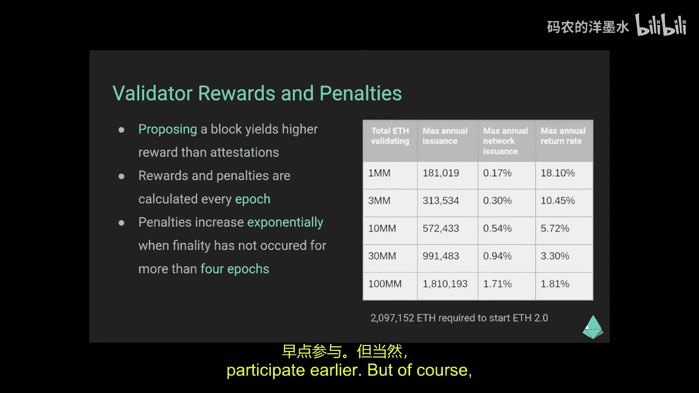
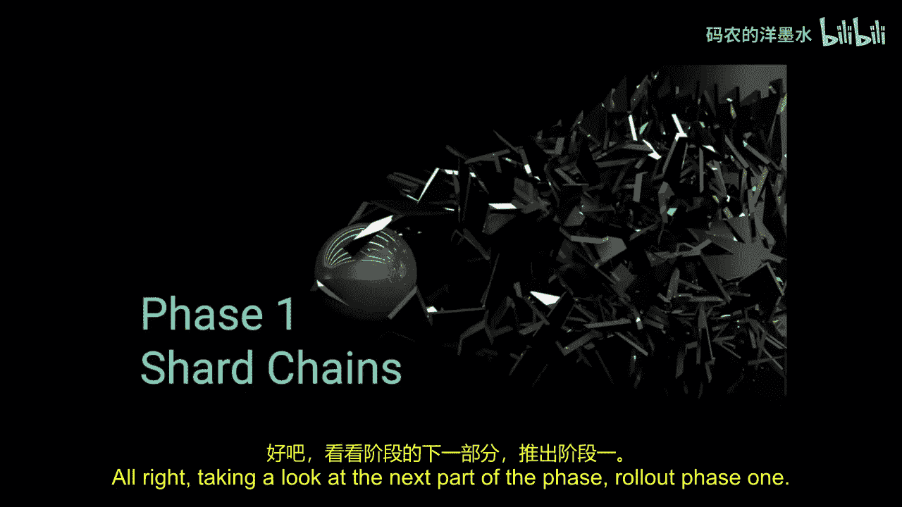
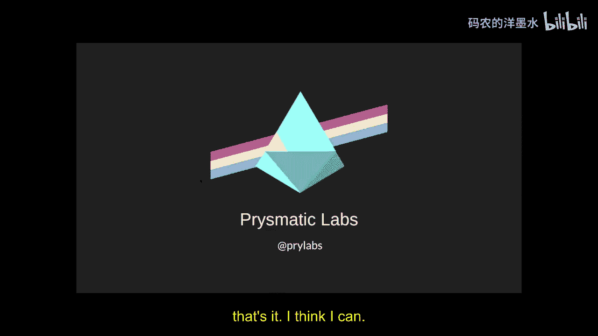
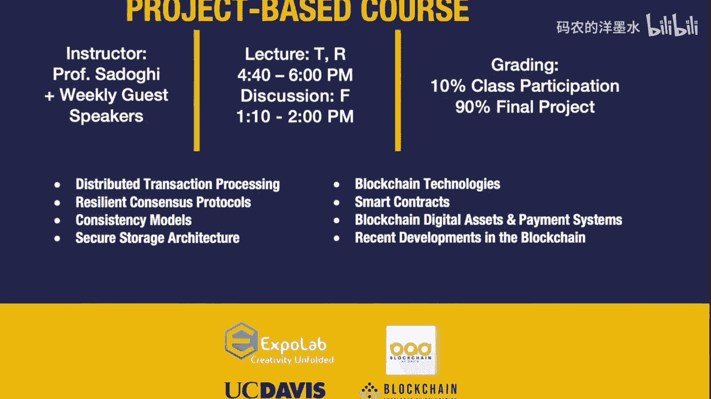

# 【全集】加州大学戴维斯分校 分布式交易与区块链架构 中英字幕 完整课程 p23 Lecture 19 - 以太坊 2.0 -BV18YFVzME2f_p23-

All right， hello everyone， and welcome to another edition of。

Blockchain speakerker series and UC Davis。And so today it's very exciting to have Priston Van Luone from Pririsme Lab and this is a talk that we've all been waiting for all the previous speaker or anytime you talked about Ethereum 2。

0 serenity， proof of stake， they all seen the schedule they all said okay。

 Priston is going to take care of it and so he's also a cofounder of Prirismatic La into the new generation of blockchains and all the exciting stuff around Ethereum。

And especially to your 2。0 so。Thank you so much for joining us today and so with that。

 please take it away。All right， thanks for that intro， yeah。

 I'm person Val co foundunder of Primetic Labs。Career software engineer。

 and we've been working together as a team。For about almost three years now。

 so introducing you to the team， Prirismatic labbs has nine people at the moment。

 and we also assembled organically online， we're not part of the At Foundation directly。

But just a group of。Really interested individuals， some very smart people in this group who've come together and said we want to help scale Ethereum and we want to make it happen。

And through the Ethereum grant team and through open source grant initiatives。

 we've been able to fund this project and really get it going， so let's diveping into it。

Let's start with a very basic like high level of you know what is it theory young one these guys have probably been talking about it a lot over the semester already。

 but let's just dive into like the。The important things you need to know about3 today。

Ethereum is a decentralized world computer， or at least that's the goal or the vision。

It's a blockchain that's been around since。2015 or 2013， some on there don't recall exactly。

So Ethereum is a decentralized world computer， at least that's the goal。

 it's an open source blockchain been around for approximately five years。

 originally created by Vi Boerin and built by a whole group of people all over the world。

 the network itself， it's consisting of thousands of nodes operating in unison to assemble this world computer consisting of a decentralized global virtual machine。

With with this type of system， you can build all types of applications。

 specifically some that are not possible in any other paradigm， for example。

 a decentralized autonomous organization。Being able to launch your own tokens very easily is helpful and then of course you have generalralized decentralized applications。

Oops。So taking a look at the system。At a high level， there's quite a lot of things going on。

 We're not gonna dive too deep into any particular part here， except for the proof of work。

 So if you guys are not familiar with proof of work yet it's， it's the mechanism by which。

The block producers in Ethereum are able to。It's the civil resistance mechanism so that it requires a lot of effort to create a box so not everyone can do it。

 but in exchange for for this service to the network and for securing it。

You're rewarded with B rewards。Now， proof of work is basically running a hash function on the inputs of a block repeatedly until you get a partial hash collision。

That satisfies some level of difficulties， so let's imagine if this proof of work function returned a string of random numbers and letters and we want a string that starts with 10 zeros and these is a 32 league string。

If it has at least 10 zeros and we know we solve the problem。

 we can submit that input and random number to the blockchain and everyone can verify it once。

 so it's a quick way to well， it's not quick， but it's it's a reasonably secure way to advance the network。

Taking a look at a block and how things fit into blocks。Really。

 the important thing you need to know is the block is created with the information about the resulting state after executing this block。

 after executing all the transactions。Which are also included in the block。

 it includes the transaction receipts and。bunchun of metadata that's not as important for what we're talking about。

 It also includes a reference to the previous block。 And that's important。 Otherwise。

 it wouldn't be a blockchain。So what does it mean to scale。

 It doesn't have anything to do with a scale or a loaf of bread that has a dog face on it。

 But it means looking at transaction throughput。 So let's take a look at。

A few examples of transaction throughputs through popular payment processors。

 we have Bitcoin which can operate on about seven transactions per second Ethereum can do 27 transactions per second and Vi can do a super huge number that kind of blows these two things out of the water and if these you know technologies are meant to displace these centralized payment processors they have a long way to go。

 especially since these values I'm presenting to you aren't the theoretical maximum in actuality it's even lower so for Bitcoin。

They're doing about three transactions per second。 Ethereum can do 12。 and the the key here is that。

Tsactions on Ethereum are different size differently。

 So the 27 is based on just simple balance transfers。

 But if you're interacting with Ds or any kind of contract， then you're gonna have more data， so。

You can't fit as main transactions per block and Via reports from a report five years ago or so that they're doing around 1600 transactions per second on average。

 we don't really know what they're doing because it's all internal， but it's a good estimate that。

If if these technologies are meant to displace visa， they have you know， a long way to go。

 even like 100 time scaling would not exceed what Via can do or does do。Taking a look at block times。

 this is something else important。 a block time is is the average like minimum time you need to get your transaction included。

For Bitcoin， that's every 10 minutes a block comes along for Ethereum it's about 14 seconds and for Visa。

 I couldn't really find any reliable information but think about the next time you swipe your card at the terminal at the grocery store or whatever it's about you know three or four seconds So if if we're looking for protocol level scaling in terms of block time and how long the user has to wait for their transaction to be included these numbers are not great you can't stand at the register for 10 minutes waiting for a。

Bitcoin blocked to your mine， and even 14 seconds is too long。嗯。So that's another point of scaling。

Talking about how transactions fit into blocks because this is what the blockchains all about。

 typically a miner is going to choose or block producer is going to choose the highest paying transactions that is each transaction has a fee associated with it that miner or block producer collects the fee as reward for including into a block。

 and this is incentive for you know miners or block producers not to just buy an empty blocks。

Because they could potentially earn even more if they included transactions。嗯。

And the cool thing about Ethereum is that。You can fit as many transactions in a block as the the gas limit of the block will allow。

 for example， here on the right， there's an old block from last year that had 74 transactions in it each with different。

Different levels of gas usage。 And just a reminder if you didn't already。

 gas is the the unit of payment。Or unit of computation cost for running something on Ethereum。

 The minimum gas cost is 21000。To do anything。 And then from there， each。Operation in EVM。

 each op code you execute it costs a little bit of gas， which then you pay in E。嗯。Yep。

 and so miners have the ability to vote on this and change it。

 They can only change it incrementally by a small amount。

 And they don't typically do this unless that there's sort of。Community agreement that， you know。

8 million。G limit is too low， so let's raise it to 10 million。

 and then the miners can coordinate together and vote on that。 raise the gas limit。

Looking at that in history， it's happened quite a few times。 This slide is from 2018。

 and it just in this time， you can see these huge cliff drop offs where the mining community itself has decided to increase or decrease the。

Total gas limit。Per block。 And at the time of the screenshot， it was around 8 million。So。

How do we scale exactly， How do we go fast on a blockchain。嗯。

The important part to consider is that to have a great blockchain。

 you you need to satisfy all three corners of this blockchain blockchain trilima。

 so you want it to be secure， you want it to be decentralized and you want it to be fast and trying to figure out how to increase the scalability and how to go faster without diminishing either of the two properties is tricky。

 so let's dive into a few examples。One idea is。Let's just increase the gas limit by a large amount。

 Earlier， I showed you that block that had 74 transactions because it only had 8 million gas。

 But what if we made it like 80 million gas， I mean， that's a 10 times improvement。But， of course。

 bigger blocks are going to require more computational resources just to process that block。

 This is not particularly focused on miners， but for everyone in the network has to process every block to verify it。

 so。You're requiring that full nodes or operators that are running on the Ethereum network are listening need。

Better hardware now than they did before。 They need more resources。

That increases the barrier entry for a participant on the Ethereum network and therefore makes it less decentralized。

 where now we'll be moving only towards users who can afford more expensive hardware。

So it sounded like a good idea， but。We can see here that it takes away a piece of that trilima that we don't really want to sacrifice。

So another idea is let's just make blocks come around a lot faster。 but it coincides with 10 minutes。

 Ethereum is 14 seconds。What if we made it one second， I mean， that's a 14 times。

Improvement on throughput。But blocks take time to propagate through the network。

 And if that block can't propagate through the whole network in that one second。

You might see another block producer。Maring a competing block at the same time。

 but not building on that。Other blocks。 So you end up having these forking conditions。

 So it it ends up increasing the entropy of the system and not in a good way。

 it just makes it harder to， to be a participant harder to listen and harder to operate。嗯。

More forks make。The blockchain more vulnerable to attacks。

 it can make it so that no one can really catch up to the head of the chain or you know people are confused about what's actually going on longer delays in block confirmations for exchanges。

In general， it's less secure， so this gives up another piece of that triangle。

And looking at it again， it's super important I saw on your syllabus。

 you guys have a whole lesson to this， so that's going to be great。

 It is one of the things we're always thinking about when scaling a blockchain。

So with all that in mind， there are two types of scaling。

 so on the left we have on chain scaling or scaling of the protocol layer。

This is preferred simply because everything runs on the protocol layer， even layer2， however。

 in the instance of Ethereum in particular， this is difficult to implement because it' we already have this blockchain that' that's operating and running so you're kind of trying to change out you know change out the engine on a Formula1 car while it's still racing。

 which is you know something that's really difficult to do。If done correctly。

 this can satisfy the trilemma， you're able to。Design。

 if you're able to design the protocol correctly， you can have a more scalable system without giving up any security or decentralization。

It also benefits layer 2 in the sense that layer 2 is a layer of abstraction on top of layer 1。

 meaning that。Anything you're doing off chain still needs to be committed to the protocol itself。

 to the oncha protocol。Now， looking at the optane stuff。

 you are basically getting throughput by reducing the number of operations that are done on chain。

You're able to implement this pretty easily and independently of the core protocol。 you can also。

Build these types of scaling solutions specific for your needs。

 So you can imagine maybe you have a a decentralized exchange。 and you w to run like。

Your own kind of like lightning network or whatever。

 We're able to facilitate trades really quickly are decentralized way。

 but you still have this operator that will then batch or commit all of those transactions back to the layer one chain and as a participant。

 you can you know， exit that layer two and get your balance back and go somewhere else if you wanted to。

But typically， it's not as secure or decentralized。Typically requires a trusted operator to run it。

So I mean， it's。It's not like a risk of your losing your funds。

 but a risk that at any moment it might start working and then you have to to exit or。

Or it could be censored or whatever。 So it's not a perfect solution。

 but it it does work for a lot of specific scenarios。It it can be a great scaling solution。Alright。

 let's dive into。E2。0。From the words of the creator of Ethereum Viik Puterin。

 he says that Ethereum 2。0 is a big multi multiy long upgrade to massively increase the blockchain scalability。

 or sharding increased security through proof of stake and improve some programmatic technical things that didn't go so well when they first designed it。

In short it's a massive overhaul of everything from the ground up and since it's so big。

 we are doing it in multiple phases and being a programmers for developers we're starting are counting at the number zero and this happens to be the beacon chain。

The beacon chain is arguably the biggest piece of of E2 its。

It's everything to do with proof of stake and the core system， so。It has a lot of responsibilities。

 The beacon chain manages the validator registry， so it manages the balances， rewards。

 exits of all the validators。 You need to have 32 E to join。

And this is done through a deposit contract on E1。 So when you wanted to become a validator。

 you'll send your transaction with。With some metadata and with the value of 32 E。

 and then you are initiated into the registry and the beacon change is responsible for keeping track of that data of who's in the registry。

 who's。Not who's exited and things like that。Now， being a participant in phase 0 or in the beacon chain as a validator。

 you're rewarded with。Eath， so every， every epoch and an epoch is every six and a half minutes or so。

The beacon chain processes all the information and it looks at who participated in that epoch and who didn't。

 if you did participate， you're rewarded a small amount。

 if you didn't participate because you were offline or whatever。

 then you're penalized a small amount， usually equal to the amount you would have been rewarded。

The beacon chain also deals with validator slashing slashing is a big part of a proof of stake it's a way to。

Incentivize validators to behave appropriately as a validator。

 you join with this stake or this collateral or like a bond， if you will。And with that， you say。

 I promise to behave and not act in a malicious manner or try by which trying to confuse blockchain or cause chaos or anything like that which is a very intentional act。

 And if I do that as a validator， my balance will be。Burned， part of it will be burned。

 I will be kicked out of the system， and。Someone else can come in and will。

 the whistle blower for that can earn a reward so。That's kind of the mechanism to keep everyone working。

 The beacon chain also deals with shuffling。 It's our source of entropy。

 It's shuffling around validators is calculated every epoch。

 So you can't know when you're gonna be producing blocks tomorrow or in a week or in a month。

 And the point of that is to diminish。A potential attack where validators can collude。 Let's say， oh。

 I if you're gonna be， I know that you're gonna to be validating at this point in time。

 let's work together to produce this certain state well。

Having a consistent randomness model and then shuffling the validators every epoch makes it impossible to to know more than 12。

13 minutes ahead whether what you're going to be doing。嗯。Finally。

 the important part of the beacon chain is to have finalization。

 One of the weaknesses of Eth1 is that it has a model where basically the longest chain wins and same thing in Bitcoin So if you're able to mine a fork Mar and a fork branch faster than the other chain to which it becomes longer than that one then it's a reorg and a reorganization and everyone switches to to the longer chain and basically all the history of the other chain has been erased from the blockchain because it's been orphaned this is called a 51% attack when you control 51% of the network。

And it， it means that in in E1， your transactions are only probabilistically final。

 They're not truly final by which I， I mean， if I had a supercomputer of some kind and I could go all the way back to the Genis block and mine。

10 million blocks faster than anyone else。 And we exceed the blockchain。

 I could essentially erase all history of Ethereum。

 not to say that anyone would do that because it would be super expensive， but。ItIt's a possibility。

Truof of stake has finalization rules， where it says once。

Once all of the validators have voted enough on this particular state。

 it's you know two thirds of people have voted on it and done so in three epochs in a row。

 then it becomes final， it means no one by the rules of the protocol can build on an older finalized block。

 so it eliminates that possibility of a long reorg， a potentially erasing history。

The mechanism for proof of stake， we use something called Casper。

 which has the friendly finality gadget。 What you need to know about it is that Vos have their balance at stake。

 That's the bond I was telling you about where it holds people accountable。

 I'm not it's much more energy efficient than。Proof of work by comparison。

And it has these finalized checkpoints Another thing that's important here is that to be a block producer in this proof of stake model has a much lower barrier to entry than proof of work to mine a block of proof of work you need an insane amount of computing power usually on the scale of an entire like data center worth or warehouses of AsI or specific hardware to do that which can cost a lot of money here you need a simple 302 E fixed cost to be a block producer。

That's good for decentralization。Now， looking at how to become a validator in phase0。

You send your 32 Eth。嗯。The validators are watching and observing these deposits。And then every。

 I think it's 1 thousand24 blocks or slots。 Rather。

 they vote on the deposits from the recent voting period， and by which by that manner。

 we can still reduce the。The risk of forking in E1 with regards to balances。

 and then once once we've come to consensus on what Eth1 state looks like。

 we can then wait for the next finalized epoC， then then we have a rate limiting mechanism。

 So there's not a lot of surging with validators。It goes into a Q。

Then when it's your turn to the queue， then you become activated。

 the minimum amount of time is just over two hours。

 that's the time how long a voting period lasts plus a finalized depoC and then assuming there's nobody in the queue。

 you will be activated right away。Taking a look at some of the responsibilities to the validator。

 you basically have two roles。 you're either going to be a block producer。

 someone selected to package and create a block is。Very infrequent on an individual basis。

 because there are only， you know， so many blocks per day or per week。

 And there may be millions of validators。 So it's pretty rare that you're gonna be selective to propose the block。

 But in the event that you are， you actually receive a slightly higher reward than。

Than simply voting on the chain。 So voting on the chain is the role of the atester。

 Everyone's going to vote。 Every there is going to vote every epoch。

 And you're selected for a random slot in that epoch。 And basically， you're saying。

This is what I think the head of the chain should be。And you broadcast your vote。

 all these votes are collected and aggregated and if there's a branch with enough votes or enough weight on it that such that two thirds of valators agree that can become finalized。

Atesters are broken up into committees， which are just really just a subset of outators。

In the event that you are selected as a proposer， this is what you have to do。

 you're going to package a block which consists of some metadata at the top。

 so like the slot number reference to the previous block and then resulting state then you have your signature all over everything you also have your Rnda reveal。

 which is your commitment and reveal scheme for the randomness of E2 in phase0 you have E1 data vote。

 what you think is going on Eth1 and then you have all the operations So if there's any e slashing that you're aware of from a whistleblower you can include that you include as many apptests as you can because just like in Eth1 block producers are rewarded based on the objects that include into their blocks so instead of transactions in phase zero we just have appestations in blocks。

Then you have deposits， people voluntarily exiting and then transfers in phase one。

 they're not enabled in phase zero， but there is a space for them in the block so you package us up。

 sign it， broadcast to the whole network and the chain of answers。

Block processing so when that block is received by other nodes。

 they take the pre state or the state that from the parent block， that's this referencing。

 you verify the metadata in the block header， you verify that the Ra has been produced appropriately that it's mixing you know the previous values。

Then you process the data from E1， whether or not we've reached the consensus on that data or not。

 then you process all the transactional objects or slashings atest stations deposits and such。

 then you end up with the post state which should have the same root by that I mean hash tree root as was identified in the block。

And if all that goes well， you verify the block and you know that now you can build on that if you think that's still the head of the chain。

Sometimes you'll get a block that's already orphaned and no one will vote on。

 but you still process it anywayca you're not sure。Or testing。

 So this is what everyone's gonna be doing Most of the time。

 The metadata here is all about Casper votes。 So you're looking at what you think that target。

Target epoch is。 so what was last justified。 And then the source。

 which is what you think of as the head of the chain。 then you have。

Data on the block route and then in future phases you have cross linking。

 so that would be metadata about linking two chains together or data from two chains。Then you also。

Since attestations are so common or ideally common in nature， so。

If the network is operating very efficiently， then everyone's sort of producing the same boats。

 and instead of having all these。Identical attestations。

 we can actually aggregate these and into one and including aggregating their signatures。

 So instead of having 100。Identical atestations we can have one and verify that it was signed by all 100 of those validators。

 so that's pretty neat。Basically， package of attestation， broadcast the network。

 everyone's gonna consider this for justification and finalization。

Taking a look at the rewards penalties。Proposing a block， yield's a slightly high reward。 as I said。

 rewardwards are calculated every epoch。And。An important part of。

Assper and proof of stake is that it's important that we consistently have finality finality means that systems operating in a healthy state。

 We consistently have two thirds or more validators in agreement。But if we don't。

 we need to the system wants to fix that as quickly as possible。

 so the penalties for not participating start to increase and they increase exponentially as time goes on so if a large part of the network is offline。

 they're going to start getting penalized heavily until they get back online。

And looking at this table on the right， we're going to start with about a half a million e to kick off the system or sorry。

 it's too main e to kick off the system。And looking at the issuance rate。For the network in general。

 it's somewhere between。0。3 and 0。17% for the total network。

 but on a personal level you're looking at somewhere between 18% and 10% and as more participants get into the system。

 the individual reward starts to diminish and this just kind of you know is an incentive for early adopters。

 the APR or interest rate that or the earning rate that you get as the valueator is higher if you joined earlier participate earlier。

 but of course there's a higher lockup period and higher risk with that。

Alright， taking a look at the next part of the phase rollout， phase one。

This is when we actually introduce。The the data layer actually bring in the sharding part of E2 in phase zero where it's kind of like a bootstrapping stage where it's just the proof of stake system。

 it's kind of like an incentivized testnet because all you're really doing is agreeing on。

The state itself not really doing much with it willll here in a sharp chain。

 you can add you add data to that to that piece and this is expected to come to consensus on about 10 megabytes per second。

We you're going to have 64 shards just with data only these shards eventually will have the， the。

 the state execution。Aspect in a feature phase where we can actually run。EAs we know it， Ethereum。

 as we know it with contracts and whatnot。But there， that's not to say that phase1 is not entirely。

Just for funler just as some uses for it。 So some use cases might be having a zero knowledge rollup of transactions or even a zero knowledge rollup of rollups kind of batch transactions on there this paradigm works great for any application you can imagine that right once read many times like like a Twitter or a GPG key server or just like web hostsing in general could also be a nice like backup data layer for enterprise blockchains。

In general， really anything small。This would be good use in phase 0， small amounts of data。

Between phase one and phase 2， we sort of injected this new state。Or a new phase call it phase 1。

5 or1 and a half or whatever you want to call it。 And and the idea there is that we want to merge these two blockchains that we're running separately。

 E1 and E2 are sort of running a parallel。 we want to merge them together as quickly as we can。

 So instead of waiting to phase 2， which is another kind of big upgrade。 let's get。

These things merge faster so。Until phase 1。Ethereum today on Mainnet is still going to be the proof of work blockchain and transactions will be processed by miners。

 but in phase 1 and 1。5。Ethereum becomes a shard of E2 and now it's the validators that are processing and transactions instead of the proof work minorrs。

This upgrade or migration or or emergingrg event， it's。supposed to be very seamless， so。

Dap developers or users should not really feel any， any large pain By that。 I mean。

 you don't have to rewrite your contracts or migrate anything。 the virtual machine。That， you know。

 now， will continue to operate as it does just instead of being。

Being secured by proof of work is secured by proof of stake。All right， And then phase 2。

 this is the final big piece of the phase rollout for E2。 it brings in the state execution。

 So actually bringing the， you know， computer part to the decentralized world computer up until this point。

 we had everything else。 we had， you know， the motherboard and the hard drives and。

The power and all this stuff。 But now let's do something meaningful with this data。

We're going to the plan is to at least to take the existing Ethereum virtual machine and replace it with a web assemblymbly based virtual machine with some minor tweaks to it that are specific to Ethereum。

 so we call it EWm， the idea with this is that instead of only having solidity as your smart contract language。

 you could use some existing or more mature language that is able to compile to web assemblymbly。

 so basically anything that is supported by the LLVM compiler。

 which is a lot of languages like Java C++ and all these other ones。So that'll be nice for。

 for developer experience。呃。We also have。Cross shard transactions are part of the scope here。

 So even though that your contract may be in shard 5。

 you can still interact with a contract in shard 6。 And further that example， if shard 5。

 which has its own gas market， you know， each shard has its own gas market。

If the gas fees are too high in shard 5， you're able to move your contract to to a different shard。

 maybe shard 6 and put。A redirect in the previous place。

 So anyone who was interacting with your contract now just interacts with it as a cross contract call。

This is in general what I think E2 becomes most useful to the average developer or average user。

 This has been in research and design。 It it did start some prototyping development in early 2020。

 but it's。It's being built， that's say， it's being built in parallel with the other phases。

 It hasn't been launched yet， obviously， because nothing's been launched yet， but。It's getting close。

 So the timeline for。For phase two， we're thinking sometime late 2021， maybe into 2022。

Following phase one and phase one and a2。So how are we building this。How does。

How does someone get a group of people all across the world who many who have never met or in person to redesign such a system。

And rebuild it from the ground up。嗯。It starts at the research level。

 so the Ethereian Foundation has a dedicated research team led by Viitalik himself and a few other really smart guys and girls。

 they come through with ideas， and then they talk about it either on their forums。

 which is deep research in person or various online channels。

 telegram and Discord are pretty popular。Then they propose changes in an open source a to specification。

 this is on GitHub。Then these spa changes are reviewed by everyone， by other researchers。

 that theirre implementers。Then once we've come to， you know a S stable state。

 we tag a new version of this spec and then implementation teams implement it and come back with feedback typical cycle is is to run the features through on GitHub and have it reviewed by the team。

In our specific。Team， our client prism， we start usually start with a document that's outlining the whole design we then。

Try to break that up into smaller pieces， put that into a tracking issue on Github so that everyone can see sort of the progress of a feature then it's implemented it goes through pull request code review。

 a lot of people on the team involved in code review then we do a lot of testing continuous testing。

Through to canary analysis and unit tests and all this integration testing。

 and then every every week or so we create a new release with the most recent changes from the spec and just in general。

 with feature improvements。Now， let's talk about。Running a validator and perhaps why you should read one。

 This is not investment investment advice。I think running about it is fun。

 but you could lose some or all of your money。 So just。Don't take this as like do it kind of thing。

 But， but look at it， consider it for yourself。 if it's right for you， for your risk tolerance。

 check it out。 There's。It's pretty exciting。 but at the same time， like， you know。

 I can't tell you that it's foolproof it has risk。So important thing to understand is how the prism client is designed。

 We use like a server client architecture where you have a beacon node， which is running。

All of the hard work， doing all the heavy lifting。In phase 0。

 And then you have your validator attached to that。 Now。

 the validator doesn't talk directly to the network。 only the beacon note does。

 but the validator can run multiple keys。So it's not just， you know。In terms of your。

 your computational resources。The amount of hardware you need is the same for 10 viators as it is for 100 or maybe 1000。

 We've run as many as 300000 on one laptop。So。嗯。You should have no problem running multiple on your machine。

 It's important to consider。Looking at the same table we saw before， but but in graph form。

 you can see that the issuance for the network does increase slightly as。

As the total number of validators are introduced and likewise。

 the the annual return rate is diminished。 So if you're one of those， you know， first。嗯。See we need。

 we need just under 17000 to start。 So if you're one of those first 17000 validators right away。

 you're gonna be earning 15% interest or so as more validators join， it goes down slightly。

 But in your first year， you you， you would see somewhere between 15 and 10%。U。Looking at this。

This little image here on the right， if you had put in 32 Eth， which is， you know， one unit to stake。

 it costs about $13000， which is a lot of money but considerably less than what you need in hardware cost for for proof of work。

 plus it's it's a you know， like a refundable deposit。

 So when when youre you are done participating you you can claim back your deposit。

 So it's not it's not a cost。 it's just like a。The only problem with that is there opportunity cost。

 so it's not too bad。And if you don't have $13000， well。

 you can participate in a staking pool where you or some friends and or or strangers online can pull the funds together and operate together or one operator will conduct the validator So there is like kind of a trust there。

 but。It still can make it more possible for。For anyone to validate and then looking at these earnings approximately every month。

 you'll earn 5056 at today's prices。 if you're running one validator and that's。

If you're running on your own hardware at home， that you should still have a pretty considerable。

Profit margin there， you don't need expensive hardware to do this。

 Some people are running with a raspberry pie or an old laptop or even looking on server。

 if people have bought servers from Craigslist that are really old like five or 10 years old for a couple hundred bucks。

 and then they're running it running it off that。 And then on an annual basis。681 at today's prices。

 And of course， everything is based in E。 all your earnings would based in e。

 So if the price of eth went up， then you would， you would naturally be earning more in dollars。嗯。

But things to consider， the costs are relatively low。

 and they do not scale linearly with the number of validators in your operator。 So like I said。

1010 validators versus 100 it's gonna cost you the same in operational cost。

 It's just that upfront deposit。 that's kind of hard to get over。It is a long term commitment。

 so withdrawals and transfers and all that kind of stuff don't become available until later phases。

So you have to be comfortable with putting your collateral there for some unknown amount of time。

 I can tell you， it's gonna be in two years， but it could be delayed for。For whatever reason。

 there's no guarantee， so keep that in mind。Liveness penalties， you。

 you have a risk of losing half your balance。 if you， if you're not participating。

 if you go off line。 But the thing about this is that it takes。

Something like6 or7 years of not participating for you to lose half your balance。 So if。

 if you went away on vacation for a weekend and came back。

 youll find out your computer was off the whole time。 You're gonna be fine。 You know， you just。

 you lost money for three or four days。 but in three or four days time。

 you'll be back to back to where you were and then you just continue going。 So it's not too bad。

The only thing without is that if the whole network is suffering because people are offline。

 then your penalties will be。Will be increased， but that should hopefully never happen in a healthy networks。

 So shouldn't be too much of issue。 the rewards were higher for early adopters。

 And just keep in mind that it's staing is not without risk。

There are ways you can misconfigure or misuse your software to get flashlashed。

 So you kind of have to know what you're doing in the early phase。

 even though there will be guides and things kind of helping you along the way， it's still。

A considerable risk that that you could lose half your balance if， if you're， if you're not。

 if you haven't configured it correctly。So if that sounds interesting to you。

There are ways to try it out today。 We have a test network called Maashsha。

 It's spelled M E D A LL A And are two ways to access this is along URL Mdasha do launchpad A3ium dot org。

 and it has this nice like rhino guy。 you can click that in and and get involved in the test net。

 So this no。Moneyies required to do this。 It's， it's they'll give you some tests either from the faucet or。

 or we a Prirismatic labbs can help you with that。And you could run the software for some time。

 just to kind of see。What your your gains might be like or what your operational costs might be like。

 it's a great time to test that with zero monetary risk to see if it's right for you。And then。

 to recap。A good bit of this information。 through 2。0。

 it introduces proof of stay and blockchain sharding。 It's an entirely new blockchain。

 It's not just a hard fork， like we've seen with a lot of other upgrades。

 It actually runs in parallel。 And then the two blockchains are merge together。

 I don't think this has been done before， at least not on the scale。

 So it's gonna be a really cool thing to see。 This is a phased rollout。

 instead of trying to launch all of this rewrite at once。

 We're gonna do it incrementally in small pieces。This is expected to complete by the end of 2021。

 but I expect that it might be even later due to the unknown unknowns。

Phase zero is ready to test today with Madashsha testnet and it is launching this quarter。 don't。

 I can't tell exactly when because no one's told me， but。It will be soon。

 the deposit contract is supposed to go out in the next two weeks and we've been told that the genesis time or the minimum Genis time。

Will be in 2020， so it is happening。And that's really exciting。

 We've been working on this for two and a half three years， and。

I am very excited and also anxious to get it out there。嗯。Okay， and that's， that's it。

 I think I can get questions。

Okay so so thank you again it's a great talk so thank you so much and I think there were a few questions on the chat folks for asking earlier on and well right now I guess since the audio is working so。

Please， anyone who has any question。Could you go over again how that interest system works。

 Ca I was I was little interested in that。Right， so。The interest works。It's it's based on。

I don't have like the formula off the top of my head。

 but it's a function of how many validators are active in the system and then how you participated。

 so if you voted or were selected to produce a block and completed those activities。

 then when the state processes a full epoch of blocks so every 32 blocks。

 it counts all of those and then increments the balances or decres the balances of validators based on whether or not they participated。

So as the the validator registry or size of the validator registry increases the。

Amount you earn per operation starts to diminish and that's to keep the issuance of the network from from ballooning you know ultimately I think that the we're trying to find the right it's like a piece of game theory right。

 we're trying to find the right incentives to have participation but not to overincentivize so that we're giving up too much issuance through the network that increases inflation and ultimately drives down the value of the currency。

嗯。So that's kind of why there is a diminishing。Isuance rate for the percentage。Okay， I think。

 I think that makes sense。Yeah， and I if I can find it。

 there's like a 100 page report that came out this year about all about the economics of it。

 so if you're interested in that I can find it and then。

Send it to you guys through email or something。Yeah。

 that would be very nice if you can kindly do that。Yeah。

Are there any sort of expected outputput and latency once the new serenity kind of rolls out。

 let's say by 2022， what's the expected kind of， you know you had that chart is Bitcoin is 10 minutes and the 30 or 14 seconds and so what would you expect？

So in。E2， we're reducing the block times to 12 seconds。So that's a small improvement there。

 We're expecting that sense we'll have 64 shards and each shard will be on the same。

Caliber as Ethereum maintenance is today， if not better。

 plus some overhead for cross thinking that with that in mind we'll have 64 times the amount of throughput。

 So whatever if it was 12 transactions per second， it would be something like 75 or。Or more。Oh no。

 wait， 600， 700 and something， right？And what what is the justification of 64， I mean。

 how does the number 64 comes， why not let shud or why not more shuds？Yeah， it's。

 it's a good question。 so it's。I mean， it's just because 64 is a nice multiple of two。

 and with that amount we can ensure that with our current committee sizes， which are， I think 128。

 that we can always crosslink every shard。In every epoch。

 so epoC is 32 slots and with 128 in a committee that means they can crosslink twice that comes out to be 64。

Without it， you might have cross linking taking more than an epoch， which is not very。User friendly。

2行。In more database terms when you also do sharding you also split your data。

 I mean each shard works on a different part of the data is that kind of exploited here as well too and if so then if somebody wants to run a smart contract that hits all these shards what are the sort of effects of that。

Yeah， so the the benefit you get with the with sharding is that or at least in the Ethereium space。

 is that you can， you can co locate your contracts in the same shard。

 so things that frequently interact with each other can。

Have experienced a lower gas feed market because essentially the load is distributed over mini shards。

So if you're， if you're， you know， running your。Dap and then， you know。

 cryptoitties or whatever is popular at the time is blowing up。

 Your app is not necessarily suffering from gas fee increases because it's on it's on a different shard。

嗯。And so， you know， with that in mind， you're able to to， to。Break up your data into pieces that。

You know。Are isolated， in the sense that they， they really only interact with these few contracts。

 And so you serve that benefit of having a lower gas market。

 I believe also that there're therere part of these too。

 what we're looking at is that some shards can have different execution environments。

 So we may have some shards that operate on a different set of rules。

 maybe they're faster for certain purposes or operate differently， so。

You get a little bit more flexibility。 I know that for sure that when Eth1。Becomes a shard。

 it's going to live on those rules using the classic EVM。

But other shards will more than likely use the new EVM。

 which is using the Ethereium Web assembly and would require you know。

 a smart contract rewrite to support this at least at least your smart contract like backend has to be rewritten to conform to。

The new virtual machine。And so how does the， for example， I mean。

 is the user needs to kind of decide that this smart contract is getting too expensive to run here or it takes too long to run here and they switch it around the shards。

 is that something needs to be initiated by the user or is it a platform can adaptively just load balance these shards？

Yes so the protocol does not have any automated load balancing so at this time it would be on the user I do see how we could eventually add it after phase two but I think the long term goal for scaling on Ethereum is we'll get the protocol to this nice level where we have 64 times what we had and then we'll rely more so on layer two things。

 you know a state channels and whatnot to get that increased benefit。

 especially when a lot of the things you see are。highlyighly transactional things like like un swap where you can do all these swaps off chain and commit it periodically maybe every epoch or so where that could be hundreds or thousands of swaps or transactions batched into one。

And you know that's sort of the longer term goal is sort of offload that state but。

He has no automated load bouncing at the protocol level at this time。

seems like a lot of interesting opportunity lies I had in terms of the work of sharding。嗯。

Any other questions？All right， so。I think this is it so thank you so much again once more for for an excellent talk and sort of introducing the serenity and the proof of stake and all the interesting challenges and what to expect in the next few years。

Yeah， of course。 thanks for having me。 It's been great talking to you guys and。😊，Yeah。

 try out each two if you like and we're happy to hear any feedback you can find me online on Twitter。

 Pre_ Vanoon。Or on Discord， you can find us on Prismatic Labs's website。Wonderful， thank you。

