# 【全集】加州大学戴维斯分校 分布式交易与区块链架构 中英字幕 完整课程 p24 Lecture 20 - 去中心化应用(DApp)开发 -BV18YFVzME2f_p24-

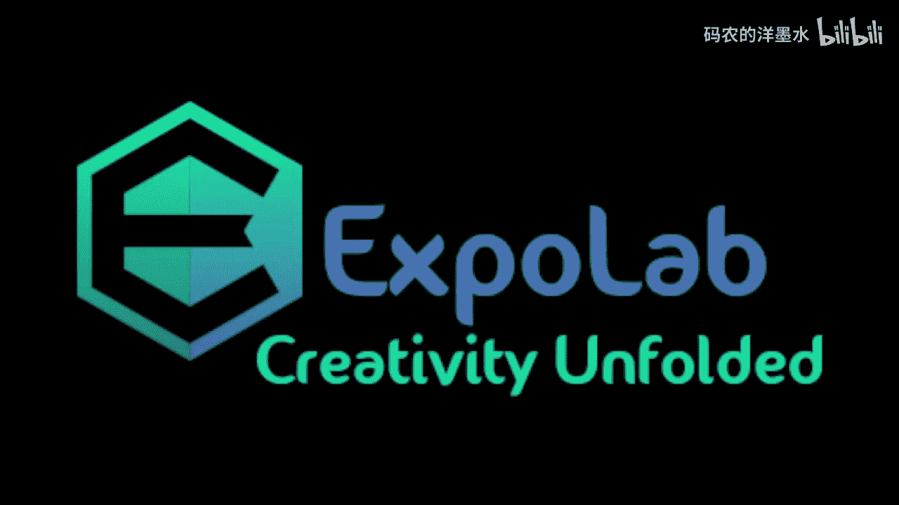

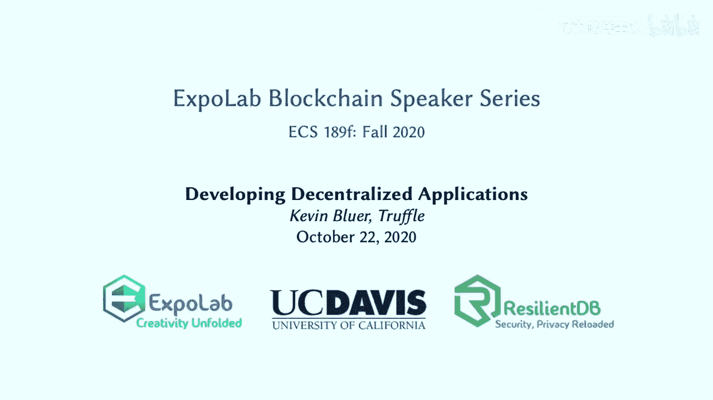

Hello everybody welcome to our Expo La B speaker series today it is my great pleasure to introduce you Kevin Ber from Truffle he is the head of training and engineering ecosystem at Truffle and he has sort of vast experience in this in the software space so he's been for the last 15 years in。

Hardco software company like Microsoft into financial system and even in media so sort of a broad spectrum of expertise that he brings into the blockchain space and he's going to talk about how to build sort of next generation application and decentralized application on blockchain and tru I would say is the prime ecosystem so it's the best platform today to build this application so without far do Kevin again welcome and take it away please yeah now thank you so much for the the intro and yeah's a pleasure to be virtually here by taking in in this course let go ahead and share up my screen or much share the full screen everyone still see and hear me okay。

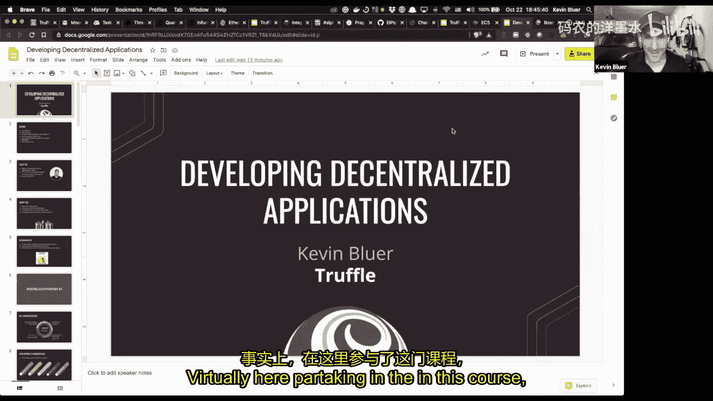

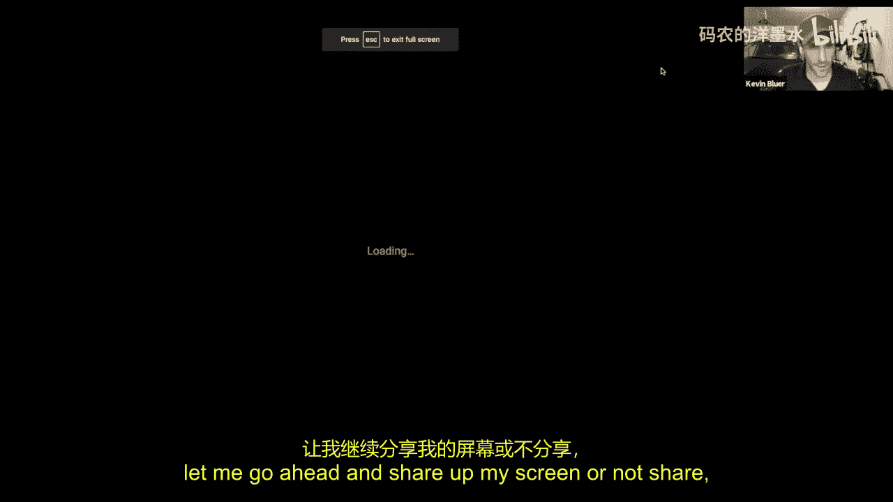

But yeah， awesome。 Yeah， any any kind of。Audio or video issues as we go through just just shout。

 I'll keep an eye on the chat and stuff as well。But yeah， as mentioned。

So the kind of title of this session isDeveloping decentralized applications。As mentioned as well。

 my name is Kevin Ber and I'm with a company called Truffle and I'll kind of unpack oh gosh， sorry。

 my headphone just for one second。😊，Another problem is this is。It's bit slippery。Okay， both yeah。

 let's get back on on it， so yeah I'll be unpacking all of that as as we go through and I'll just make sure he's inroperly。

😊，Cool all right so yeah in terms of agenda for for this session I'll start with a kind of a little bit more of you already kind of gave it。

 but just a kind of brief intro of myself also kind of a brief show of hands i've got some open ended questions we to some questions and you can kind of virtually。

😊，Taurian brought to the chat。Like a Y or an N you know yes or a no or whatever just for some of those questions and that's really just so I get feel or try that out it doesn't work it's fine but it's more just to get a feel of yourselves and your kind of relative experience level and if you have minimal or zero experience in the space other than what you've had in this course so far you know that's totally fine too。

😊，I'll then also briefly mention the goals of this session。

 kind of what we're going to try and done by the end。

And then actually get to kind of the meat of the session， first part we'll look at is。😊。

The paradigm and I know that's kind of this has been covered a little bit。

 I I believe this has been covered kind of thus far in the course。

 but I kind of wanted to look at decentralized apps with apps through a kind of developer lens and you know how that might and that might be a bit different how you' looked at it thus far。

I'll then introduce the Tffle suiteite as Mo mentioned， at the start。

 Tffle Suite is a pretty popular suite of tools for building decentralized applications and Ill go through that mostly pretty much everything you're going to see is open source by something called Tffle teams which I'll show towards the end。

 which is a hosted product what you show the end of that contextual bit with the Tffle suiteite stuff。

 well then just also look at the lifecycl as well of building a decentralized that and also kind of compare and contrast how it's different to building。

 I say kind of more traditional application。That pretty broad term。

 but I guess I mean more traditional kind of centralized application。

 be that like a web application or a mobile app with a。😊。

M of centralized API or whatever so kind of explore the life cycle and again how it's different to something like that and there are parallels too。

And then the kind of final。Third or thereabouts so quarter will be hands on so I kind of more more me hands on showing stuff but as I'll point out when we get to it this I've left slides in there that are more kind of。

walkalk through type slides as well so I'll kind of cross- reference them as I go through some stuff on my screen。

 but it's more designed for you to kind of after today's session if you want to to kind of go through it a bit more methodically as well and then close out with kind of next steps what kind of how you can go deeper in this space know if you're interested and obviously I assume you're interested in the space but specifically go deeper with truffle and so on and then kind of close out with any you know questions you guys might have。

And I guess on that final point about questions definitely feel free to throw them into the chat as we're going through I'll kind of periodically try and check it and you know there's if there's quick answers。

 you know I'll do it in line or kind of clarifications conversely if it's kind of bigger picture questions or kind of off topic questions I'll kind of park those until until the end。

😊，But definitely feel free to throw them in as we're going through。Cool all right， so yeah。

 just briefly about myself， as was mentioned， my role within Long with Trufle， of course。

 it had the role within my role within Trufffle is the head of training and ecosystem engineering reasonably self explanatory。

 I guess the training piece is at least，😊，Ecosystem engineering piece basically means kind of working with。

The ecosystem and kind of partners， you know who are either building using truffle or kind of integrating with truffle or finding ways in which we can kind of find win wins。

 you know， you know， to kind of further the the ecosystem and， you know， just make it you know。

 easier from a developer perspective and， know， more accessible and so on。诶。Continuing about me。

 you know， like it's probably more like's more like it's more than 15 years now to be honest。

 like I try and round it down just so I don't feel feel old。😊，But yeah。

 many years in software development across a number of different paradigms。

 so I've working at the Love。😊，You know， web start applications and mobile applications and so on。😊。

And I just kind of called out here decentralization for the wind just because I'm you know。

 personally you such a kind of fan in Africa for the paradigm， for the space。😊。

as a kind of what I see as a kind of healthy and kind of necessary counterbalance to the kind of inherent centralization we've always had。

😊，Of things。And by the things， I mean， kind of。The systems and the way in which we。

 you know kind of operate and you really I see this。This paradigm as a means of you know。

 kind of swinging the pendulum back to the middle， you know。

 not doesn't mean everything should suddenly become decentralized， but certain things I think。

standand to benefit a lot from that and just kind of give us a healthier sort of lead us to a healthier place I think that's very broad。

 but either， you know takeaway there is I'm a fan of this space as I can perhaps expect。😊，Cool， okay。

 so this is a little experimental as mentioned， you know。

 this is more just so yeah almost like a litmus test of。😊。

Yeah relativeative experience and we don't need to go through all of these formally。

 but I guess if I open up the chat， if I can get this。😊，So if you've got it handy and again。

 don't worry if it's you know。A bit hard or whatever to kind of open up your chat and you know what not but oh gosh。

 I didn't mean into some so the first question was if have who's heard of truffle before and that doesn't you know whether you've used it or not it's totally irrelevant so。

😊，Most people or too， I say most people， two people。Definitely more knows。

Which is as mentioned earlier， only the food。😊，Yep。😊。

Cool okay and then I guess it's the next one what kind of irrelevant used any of the tools in truffle there was a couple of yeses so I guess if you had heard of it I guess。

😊，If you're a yes， okay， so at least Mo's is a yes。And。

I'm guessing the silence on that question is that most people haven't or no one has。

 which is totally again， totally fine。😊，U Metamask， which is a browser based wallet。

 has anyone kind of either heard of or used Metamask before？

There's a question theres sort like from Or， does Brave have it， it doesn't have it built in。

 it does have its own wallet built in to Bra， which actually paradoxically does conflict or it can conflict with if you do install Mes。

 you have to kind of disable Bras wallet but conceptually very similar in the sense it's kind of a。

A wallet that's surfaced through a browser。And the last one and I'm probably assuming other than maybe Mo here。

 who's deployed a smart contract to a public network， be that like a test net。

 if that means anything or main net in the context of athereium。😊，As I kind of expected。

 that's mostly notice， it's not all notice。Cool。seems like perfect quick lecture then there we get oh yes you're going to go unanimous yes by the end and this is this is the first intro to how to build is really the smart contracts and deploying it so it seems to be a perfect time right now Yeah no totally and yeah just to reassure you know if you were knows on all of those that's fine that's kind of as we're just talking about the kind of goal of this session so。

Cool， all right， so yeah just to summarize the goals kind of alluded to this already so I'll go quickly through this。

 but yeah just really a better understand understanding of the paradigm decentralized you know decentralized paradigm through a developer lens。

😊，Appreciation of the life cycle that you know in terms of what it takes to build something。

 you know， in this space and。These are the high level goals。

 at least and just kind of demystification of the tooling and process and so on， you know。

 where you wanting to build something in the future？嗯。All right。

 so kind of stepping back a little bit and just kind of looking at things， you know。

 from a high level， again， just to stress this is going to be， you know。

 it was starting less through a developer lens， but I'll kind of jump。😊。

Into looking at it through a developer lens as we go through this。Firstly。

 exploring some of the characteristics of the decentralized that you know， and or the paradigm。

This this graphic， by the way is kind of contrived。

 it doesn't need to be a flow just wanted to find something that looks nice as opposed to just pure bullets。

 but really staying in the middle you know from a characteristic perspective。😊。

The first and foremost thing I think it brings to bear or the decentralized paradigm brings to bear is facilitating trust between parties where that's kind of deficient。

 either thes zero trust， you know if I'm going to be transacting or doing business or interacting with someone that I either don't know at all or kind of maybe just harshly trust or know in some very loose capacity。

That， you know， if you're to do that in a centralized way， you know， kind of manner。

 you would need an intermediary， typically either a bank or you know。

 broker of some kind or a system of some kind to kind of help。You know。

 bring about trust or kind of make that work。Now， the decentralized paradigm through its characteristics。

 and you've probably explore some of this you know， through the course thus far。

Makes that possible without the need for a kind of intermediary， you know。

 be that a bank or you know whatever you know the context might be。So that's kind of。😊。

I would say first and foremost， what it brings about。

 kind of expanding on that going from the top right clockwise。

 and this is a quote which I really like from at least where I've seen it is on Es Ethereum。org site。

The things that you then start to build， you know， taking advantage of of the trust that you get through the platform or through the。

 you know。The paradigm slash platform is applications that are amongst other things unstoppable and uncensorable。

😊，Because they're decentralized and the things that you build and deploy aren't kind of on a central platform。

 albeit you know heavily kind of redundant if you know if you were to deploy something and put it on like AWS or Azure or whatever can be very incredibly resilient but it's arguably not unstoppable and certainly not sensibleensable you know like a government could put out a mandate or the cloud provider themselves could just take issue with it or whatever and in some cases that's perhaps for the right reasons but could also be for more nefarious reasons but point being know in the kind of centralized world things aren't don't have those inherent characteristics and in the decentralized world they do at least the things that the apps that you build and deploy so really kind of interesting。

From a kind of characteristic point of view。Another one， and again。

 these are kind of a grab bag I should stress， but you know， kind of interrelated。

Is that the things that you deploy， the applications that you deploy can intrinsically store as a kind of feature value。

 which is interesting。Like for example， I can， you know。

 very quickly right now spin up a contract and we'll get to that in a moment essentially an application。

😊，And send money to that contract send you know assets it doesn't by money I mean you know in the case of Ethereum for example。

 you know it's native currency or other types of tokens you know representations of value to that contract and they can be stored there and they can wrap logic around it to kind of you know distribute that to other people or whatever it might be and that's kind of by design that's a feature of the platform and if you try and think of that you know how you would manifest that through。

You know centralized paradigm that you can obviously you need， you know， bank， you know。

 some payment provider to be able to receive payments and。😊。

Other types of things and you need to perhaps be the gatekeeper for that， you know。

 if you were kind of spinning up a platform to you know both receive payments。

 maybe distribute payments or other types of assets， you know doesn't have to be just monetary。

 you know assets。😊，U again， this is something that， you know， is really， really easy， you know。

 relatively speaking on this paradigm because of the characteristics of it。😊，And again。

 that applies in a sense， there's no gatekeepers， there's no middle persons you know kind of facilitating that that is just。

 you know is' brought to bear through the way most platform works。😊。

Kind of continuing clockwise round。😊，Because these things often don't have centralized kind of gatekeepers or administrators or whatever。

It's quite common that when you build them again this will depend that you also build a governance structure around these things as well and that's kind of in keeping with the paradigm you decentralized there is no kind of middle person kind of overseeing things now there may be caveats well there are caveats to that but this is something that's quite common in this space that if you are vested in the success of something that and do you want it to be kind the participants in it to be vested in it and stuff for the kind of greater good it's very common to kind of bake shared governance model where people that have a stake and it get a say in the evolution of it and again that's kind of sounds abstract but it's actually quite real and tangible we can talk about that later at this time and if you think about the kind of counter equivalent let's say Facebook you or I unless you work for Facebook don't really have a say in the way Facebook's going to evolve。

Um at all， you know， so that's kind of an interesting characteristic here。😊，And then lastly。

 and this is kind of seguing us to it starting to get a little more technical is that the things you you know。

 to build， you know these things， you know， these applications or decentralized applications or Ds is through something called smart contracts。

😊，Wwhich may have come up in the course of thus fires and we'll be kind of exploring this quite thoroughly as we go through the session today really starting to explore it because it's a big topic and what smart contracts do is essentially the code to kind of bring to bear you all the things we've talked about to kind of realize these applications and what smart contracts store you know or kind of contain is which I think is quite interesting I think stressing this because it's a good way to start getting your head around it is both the data itself the state essentially data but you'll hear it refer to a state as well and the associated logic or business logic with which to kind of work with that state and update that state like the kind of rules and so on。

😊，So if I was like building like an escrow pla， you know， thing， you know。

 there was going to be some data， you know， the kind of addresses or kind of usernames and addressing you know data on the participants in that escrow。

 you know， exchange and then the associated logic with which to kind of make that you know escrow。😊。

Kind of transaction kind of work and they're all in the same thing， you know。

 they're all in this you know this contract。And again。

 that's kind of different we'll see this you know kind of hands on shortly， but you know。

 it's kind of different to how in which you you know how you would build out a。

And a centralized application again。Cool let me just keep an eye on any questions right think I think that's yeah as I said just to kind of reiterate that so feel free to throw questions as we go through cool so kind of starting to get a little more technical with this some things that you'll need to consider as you sort of。

😊，Perhaps consider building something， you know if you think oh that's interesting I've got an idea for you know an next you know a service。

 you know decentralized Uber or you know。A sort of decentralized banking application or financial services application or whatever might be。

 you know some new things you'll need to consider and by new I mean new if you are coming from the kind of centralized world you know because these things are different they still exist。

 but they're a bit different。😊，So the first one is identity。😊，That again， it's kind of different。诶。

First and foremost it's kind of get you don't really own the identity。😊。

Of a given user its you it's question mark about do you own it。

 you know or who owns it in the sense of you know I'm building a centralized application butsa I'm building a centralized application。

 I brought a database。Within that database， I'm going to maybe have a user's table or collection。

 what you think of a No SQL type， you know store。And I'm going to you know。

 add fields to that and stuff and you know a username field and password hash and you know， whatever。

😊，So you know that data at least I have you know jurisdiction over yes and no with user identity in the concept in this in this world first like you know everything is a bit different so users have their own addresses these account addresses that they you know。

😊，Bring when they interact with your service or kind of intrinsically have I don't get too much into detail now but you know that's that's different because they own and they can get this you know they will be you know signing transactions and all these kinds of things so it's different I mean I don't want to sidetrack myself and go try and go too deep yet。

😊，Next up is just general interactions with your service。So from a user experience or UI perspective。

 you can build web interfaces know to interact with these contracts and they're kind of essentially mapping the fields on the kind of web UI or whatever UI you' kind of to manifest the application to the underlying functions that you're calling but there's another additional things you'll need to consider。

 firstly is that transactions can take a while to propagate through the network for them eventually to be mined and manifest in a block and so on and I think that's been explored a little bit in the course thus far。

So there's a latency there that you'll need to be cognizant of and you know you you know kind of UI will need to handle that you can't it's not going to be as snappy to an end user as you know updating a field and you know on a centralized application there's also again caveats to this point that fees transaction fees for users that they may incur as well you can absorb those and stuff that kind of by default at least users are going to have to pay to update state。

Which is kind of weird at first and that includes state within the within the contracts that you create。

 you know， unless you kind of go through， you know， do decide to absorb them。

 but that's a bit more complicated。😊，And this is kind of by design。😊。

So there's a kind of cost offloaded to the user there governance are I'm just kind of putting these out there kind of brain dump sort of seeds right now so you know we can unpack as we go through this session。

😊，But yeah， next one governance really touched on this a little bit on the previous slide。

 but you know again， that may be something that you bake into the thing that you build， you know。

 and that users have a collective say and perhaps the way in which your service evolves。

Next up is security and it says security slash audits， but just park audits for the moment。

 but just general security because what you build is's potentially you know actual real money or real you know assets of real value you know flowing through your contracts or kind of tied to your contracts or whatever and you know by extension is potentially a lot at stake right so you know security is always important it doesn't mean you know like security is not important you know in building kind of centralized applications it's just that for a few reasons it's more important you know one because your contracts can store value so you know if there are vulnerabilities in your contracts。

Literally you know a hacker could drain it you know or extract it very quickly so that's the consideration and that's kind of why audits was down there just because you need to be more methodical when building something upfront you know you need to kind of consider you know security potentially leverage you know a third party or third party auditor and maybe bug bounties and we'll talk about about this later。

😊，Um， but yeah， that that's definitely， you know， a thing that you need to at least be mindful of。😊。

Yeah， I say sooner with a caveat because of course it is important， you know whatever you're doing。

 but itably potentially as more important just because of certain characteristics as mentioned。😊。

And then lastly， again， when you're developing something a cost of storage， you know。

 so I'll use the term like on chain you know storing things on chain。

 which essentially data that gets， you know， stored as state on a given blockchain。嗯。

Now that is because of the characteristics of blockchains you know comes at a cost because that's being replicated out amongst all the nodes on the network and by design it has a cost typically depending on you know there's different blockchains out there and with different characteristics and so on。

😊，But it's fair to assume that there's always going to be you know someone has to absorb that cost kind of so if you're storing like on Ethereum for example。

 you know large volumes of data is very， very expensive to store so much so you would never really put you know large volumes you know on chain you wouldn't store like reams and reams of you know like text or you know or bigger you know asset you know images or whatnot there are great other choices you know decentralized choices for storing things like that but again I'm putting it out there because you know in the centralized world cost of storage is pretty cheap these days right you know on the store stuff。

you know on an AWSS3 bucket or whatever is so so cheap these days in this paradigm it's not but that's changing as well and that's really interesting you know you might have heard of the IPFS。

And file coin， which is a those on top of IPfs went live this week with their main net。

 which provides a kind of。Incentible， you know， monetization error or payment layer for it anyway anyway。

 the one is I track myself but that's just the thing。

 you know you need to consider and is's a bit different。😊，嗯。Again， inspired by。All right。

 so I think it's two more slides on just kind of the kind of this high level， you know。

 looking at the paradigm through it sort develop a lens and then we'll kind of get into develop a workflow and get hands on。

But the next this slide is really just to kind of。😊。

Visually present how things are a bit different in the kind of centralized world versus this world and I've kind of verbally mentioned this already a couple of times I think so dwell on this too much the really kind of takeaway here is on the left is you know traditional kind of web application where you've got clients。

Interacting with you know， this kind of web server and that could be heavily you know。

 distributed and you know。and kind of large scale and so on。

 but they're typically coming in through this kind of centralized funnel you know and then you know hitting a business logic and you know data is being stored in a database that exists somewhere behind that and by behind that you know they would never touch the database directly that's very abstract in a sort of high level you know conceptual thing you know topology。

And the reason why'm to kind of in probably stay in the obvious。

 I guess you know if you're sort of playing in you know any form of development。

 you know kind of web world these type of stuff you know at all you're kind of familiar with that that topology now how it's kind of different and this you know as I've kind of alluded to in at least an Ethereum and I'll be kind of using that as a kind of baseline but you know this applies to a lot blockchains if not all。

 is that the contracts that you create。😊，Scoore both the business logic as I mentioned and and the data in the same kind of thing。

 you know， and then that's obviously reason we've got kind of another little。啊。

Rectangle behind that is because you know that's then replicated out across all these nodes in you know。

 this gigantic network and every node。Has a copy of this logic and the state as that state evolves or mutates and you know that's where those characteristics that we talked about earlier come from in terms of like resilience you know unstoppable and sensorable and so on because you know this is essentially replicated around the world you know at the point at which you deploy the contract and then subsequently interact with that contract you know by invoking functions you know within the contracts to mutate the state or update the state or data know essentially the database sense why the kind of color similarities between the you know so you can think of that as your database think of that as your kind of middle tier business logic and then。

And I didn't of I kind of jumped over the fact that folks are still interacting with it。😊。

through you know， essentially through similar things， you know， similar interfaces。

 wearable mobile and so on， or there are other alternatives。

 through were essentially just kind of this in the case again in the case of Ethereum， this RPC。

 sense a remote procedurec call kind of，😊，Interface that you know all the nodes expose and you know you can sign a transaction and send it you know in a not dissimilar way to you know things being sent to an API。

 but obviously characteristically at that point onwards it's quite different because that then gets replicated out across a network and so on。

U so again， sort of takeaway here is just to kind of so that initial seed of how it's， you know。

 sort technically。😊，Similar in some senses， you know。

 in terms of logic and data and so on or business logic and data。

 but you know the paradigm being and what it is you know is obviously quite different in terms of what goes on post that or to realize that。

Okay。All right， so that's kind of techie stuff where kind of starting to introduce the technical side of things will be in kind of high level。

😊，Oh was there a question there yeah， can I ask a question can you go back to this slide yeah you said you're using Ethereum as the baseline for most of these apps is that because。

We had a past lecture say that a lot of these kind of centralized apps are being built on Ethereorem。

 is that？Based on speed or something else， whereas， you know。

 why wouldn't use Bitcoin or some other currencies？Yeah， yeah， that's kind of a good question。

 so it's not necessarily us。😊，You said a few kind of points there。

 so I'm just kind of trying to answer it kind of。Appropriately， well， firstly。

 Bitcoin isn't kind of intrinsically programmable in the same way Ethereum is。So。

TheThe sort of flexibility of the things you can do with Bitcoin are way， way more limited， you know。

 you can kind of do very kind of limited sort of transactional type stuff on top of it， but not。

Like this in a real kind of meaningful business logic， you know。

 like what we talk about and talk about here that's you know。And some people love that， you know。

 sort of see Bitcoin in a sort pure sense and sort of see that as the only you know decentralized blockchain that we have and so on and then this is bigger broader philosophical debate。

 which I won't get into now， but I think you know if you do want to build something that you has meaningful business logic has a meaningful application。

 I would say，😊，Um， then you， you really need a kind of second or third generation blockchain。

 you know， the platform。And you， Ethereum。At least in that category has been around the longest。

 I wouldn't say it's characteristic you know it's not that doesn't make it the best because there's there's lots of other blockchains that's starting to get traction now。

So there was one other sort of thing you said as well。

 like I think you said the word like speed it's I don't if you mean speed of development or speed of like the。

Blockchain， you， blockchain big mind or yeah， like the blockchain because isn't Bitcoin like 10 minutes and any Ethereorems like 15 seconds。

Yeah for each block to be mined， yeah and then。But then other blockchains are way faster than that as well。

 because 15 seconds are still quite slow， relatively speaking。😊。

In terms of like transactions per second， you know， aggregate transactions per second and so on。

 I think the of these the kind of broader answer is。😊。

There's lots going on in the space and you know， Ethereum has characteristics that you know favorable。

 and in fact， this slide will kind of start to unpack that a little bit that are favorable to you know certain types of applications and kind of just is say building up to sort of talk about some of those in a moment。

😊，And some of the you know even kind of newer blockchains are starting to emerge and perhaps have you know favorable characteristics for other types of applications that may be just not viable on Ethereum because of the cost of transactions and the relative speed you know again it's faster than Bitcoinin in terms of blocks being mined but it's still in terms of the volume of TPS you transactions perspective it's still really really tiny really really slow so yeah I think that's probably a right answer or that there's's no easy answer I think you know if you had an idea for you know service you want to build。

It would be， you know。Logical to explore the different chains and the kind of relative characteristics that they have that's also changing with Ethereum 2。

0 which is kind of the next wave of Ethereum that's kind ofs still a little way out before it goes you properly live I don't know if this is going yet in the course the beacon chain is kind of going live imminently which but that's that won't allow for contracts to be deployed and so on so that's just more for because it's using a different consensus mechanism and so on but again I'm trying to keep myself focused。

A bit but I think yeah， just to kind of summarize my answer there know kind of broad。

 which is a broad answer is just there's lots going on different chains have different characteristics and you know it'll be incumbent on you to kind of do the research to kind of find what fits best based on what you're trying to solve or trying to build。

😊，对。Yeah， so the E theorem environment is just plays better to developing apps on top of it。

 essentially。Yeah， I would say relative to Bitcoin yes。

 relative to other chains and newer things it depends and Ethereum has a kind of healthy what's called like layer two ecosystem around it and that is essentially know ways of achieving you greater T or greater speed or lower cost for transactions while still kind of using Ethereum as a kind of base layer and again that's a little more kind of intermediate to advanced topic won't go there but again worth looking into like Ethereum layer two or googling that and finding some good articles that kind of frame that because we won't really get time to cover that in any depth during this session。

😊，but I think yeah， again， there's so much going on in this in this ecosystem and you know。

 it's both head spinning and exciting but also kind of。😊，Like good and bad， you know。

 like it bewildering at times and this is someone that operates inre still still really hard to keep up yeah that makes sense thank you yeah sure yeah。

😊，Good question as well so yeah kind of。But kind of built myself up for a little bit of a segue kind of perhaps partly answering that in the context of Ethereum what can you build on top of it and this isn't just you know exclusive to Ethereum at all this is kind of。

😊，On any blockchain and the reason I've called out some specific kind of verticals is。

Because I don't think it's logical to try and build everything that you know we have in the。You know。

 centralized world， just try and build it decently for the sake of it。

 I think when Ethereum and in itself started to kind of。

Gin traction people did that tried to build like social networks and stuff on top of it and I can see the appeal of decentralized social networks but it doesn't really work that well on Ethereum itself because of some of the characteristics because some of the costs and you know the fact that you don't really want to be storing too much data on Ethereum like heavy you know like data so some of the benefits of doing it doing so get lost that said you know Ethereum 2。

0 and or other blockchains you know I think they stand you know decentralized social networks stand to kind of gain or stand to be more viable but what these kind of four kind of buckets here or types of applications。

I things that I really。You know very good fits for Ethereum in and of itself or know equivalence。

As it stands right now， and I'll kind of unpack a few of these in a moment， but that said as well。

 you know why you shouldn't be trying to just blindly build things that are popular in the centralized paradigm on decentralized paradigm。

The decentralized paradigm also bubbles up。The possibility of building things that dont can't meaningfully exist。

😡，On the centralized were in the centralized world so again that sounds abstract I'll try and get to unpack that as we go through some of these。

 but yeah basically it means there's things we perhaps haven't even built yet。

On the decentralized you know decentralized platforms。

 because we haven't really thought of them and because it's yet thought of them and because you wouldn't even be able to logically build that on you know centrally。

 so again。Make sense， but just to kind of look at a couple of these。

Which I think are really great and are gaining a lot of traction if you know have a lot of traction on top of Ethereum specifically。

Firstly， you know， digital assets and then kind of。So you know， you know。

 subsequent exchange of those assets you might heard the term tokens banded around a lot。

 you know so token being essentially you know representation of something of something of value。And。

Like， you know， examples of that being what'， you know， you again。

 you may have heard this in prior sessions like non funungible tokens versus funible tokens。

 you know， non fungible tokens being。Sort of individual representations of things be that like a something like called a crypto kitty if you've heard of that before essentially this kind of card like game where the kitty have value and I think one of the back in the day a few years ago when it kind of bubbled up like the。

😊，The Gen zero， which had you more value because you could use it to breed other kitties sold for like over 10000。

 I kind't of the exact amount 10000 USD ether in the equivalent。😊，But either way。

 that's you know gaining a ton of traction as a thing。

 both for kind of assets that have kind of intrinsic value on chain。

 but also like assets that represent real- worldorld things as well and then this is the medium of you know transfer or exchange of those assets as well be that like representations of like property deeds or art or you know or so on now of course but also things that are intrinsically just you know digital as well like these digital tokenized type of things。

So that's kind of bucket number one and again， to do that centrally， you know。

 with the characteristics that you get from this paradigm will be really hard。Um。

Next one and you may have heard this you know heard of this you know because it's so hot think it's decentralized finance or defI so that is essentially you know as you'd expect kind of just financial services on top of a blockchain but more than just kind of purely like hey。

 I'm you know sort of like sending you you know 5X you know 5V3 5 whatever。😊。

And you would but actually like more sophisticated financial instruments。

 so you know think of all the you know sort of the the real world， you know。

 sort of centralized I don't to mean real world， but like centralized financial service。

 tons of all these exotic like financial instruments。😊。

And we're seeing those bubble up on you know Ethereum is crazy it's really interesting and it's you know the ways in which you know those will be realized you know in the centralized financial services world is so cumbersome relative to this just because it's not intrinsically programmable right like you get services like Str bubbling up which is you know you've been around for a long time now and is awesome but that's just kind of plugging you filling gap glue you know gaps in the way in which centralized finance works and you can it could be any other way because you know it was born out of。

😊，Yes。The transfer of metal and paper to represent currencies and you know it's all centralized on different systems and stuff amazing thing about defis you know through the contracts that you know ring to bear these financial instruments they're intrinsically programmable so I could build something right now that you know when certain things happen I you know conduct a trade on a decentralized exchange and that then in turn does something else and so on。

😊，It's just like building blocks so people often refer to as kind of like kind of money Lego or you know it's really interesting that it's just intrinsically programmable and really you know gaining a ton of buzz and so on right now。

U。Next up is kind of governance and identity， you know， governance in the sense of governing these。

 you know， some of these systems we just talked about， but also just general governance， you know。

 government governing like。Like funds or you know， systems or platforms also like identity。

 which haveve kind of mud together here， you know， you know decentralized representations of your identity you know。

That are intrinsically yours and I'm quite fascinated by that because if you think of your identity as you realize it right now。

 like government issued identity。😊，Then that can be taken away from you， you know？

It's just an entry in either in a filing cabinet or and or you know a system and you know that does happen around the world。

 you know people get displaced I have a question。😊，Yes， yes。 Yeah。

 I was just wondering as someone in the space for so long， how do you feel like。

Maybe not just this country's government but government in general across the world like public government has embraced blockchain or are they in the process of embracing blockchain do you think there's a timeline to that and there was initially a lot of resistance to it。

 at least with like a lot of cryptocurrencies and you know the negative connotation it has when dealing with you know dark finance or stuff like that so how do you see in the future government actually embracing you know embracing it I reflects on that a lot it's a great question。

嗯。Like。I don't know because it's kind of the antithsesis of centralized governments and I'm not bashing just blindly bashing。

 centralized governments， say oh what they are。😊，I don't love the status quo。😊。

Too much and I don't mean that and I'm sort of like。😊，So an anarchistic sense， but just， I think。

I don't know， I'm very torn on it to your point about like and I don't see it kind of logically replacing it because it's so different。

😡，or it serves a kind of different purpose it seems and it seems a mixed bag you know different governments around the world and this is more anecdotal are kind of sort of dabbling in it。

 but I think it's almost at odds with the way they operate。😊。

So I don't know like it's just very interesting。And that's more from a like you know replacing a centralized you know government sort of system that we have so yeah i'm very torn on it like and I have multiple identities issued by multiple governments and。

So so I don't know， like I just kind of my family， you know I've lived in， you know。

 Hong Kong as well and other， you know， spent time in China and。

And broadly China in mainland China and stuff so that。I've explored it a lot， you know。

 just mentally explored it and you know just kind of don't know you know。

 and not just why i'm not conclusive on it and I think in terms of。

I've not concluded my thinking about it if I ever will I'll come back to that I think sees of other points might come up but it's a great question and and I think you know I guess the other kind of part of the question was around just government adoption。

😊，I think like in Thailand they've been kind of dabbling in it a bit and it's certainly the Swiss government has been exploring it。

 you know， I think so。Cantonons， which is kind of the equivalent of like states within Switzerland have kind of used of blockchain for like boating and stuff and you know Switzerland's pretty progressive in terms of their exploration of this piece。

So it it's definitely a mixed bag in terms of kind of adoption and stuff。

 but I would say the in the main governments have been kind of。😊。

Very cagey when it comes to this so anyway kind of longed answer。

 but yeah I understand there is no definitive current answer。

 but yeah thank you for the perspective Yeah no great question as well。😊，嗯。

Cool and then the final kind of bucketet here and there's definitely this wasn't meant to be a definitive list of things。

 by any means was just that you know other ways of operating that again the temptation is that when you start kind of trying to build new ways of pray you just mirror it on the way in which its already always been done。

 either like supply chains or healthcare， you know not necessarily the physical delivery of healthcare but the kind of management of you know perhaps records。

Marketplaces and so on， gaming， et cetera， but I guess as this space is maturing we're seeing things being done sort of natively to this space as well。

That's more of a casual one for like。Just generally doing things differently。Okay。

 so we're doing it on time all right， not too bad I guess so that's kind of yeah that was meant to be that kind of last section just kind of exploring it from a sort of semi technicalchnical perspective both the paradigm and kind of what you can build and you know how it's bit different now what we'll look at is kind of the how using in this case truffle obviously what a little bit biased。

😊，But definitely， even irrespective of that is a very popular suite've been around for a while。😊，嗯。

And then we'll kind of both have a good look at travel and then explore the life cycle in more broader sense。

Cool so it sounded like at the start most folks haven't heard of truffle which is awesome because it will be all brand new and you know kind of be hopefully somewhat enlightening at least but what is truffle as a suite of tools it's really you know in quotes it's a bit cheesy I guess but taking you know making it。

😊，We're helping a developer take an idea for a decentralized application。😊。

I' use the wordd interchangeably， which you might have heard of already。

Um as comfortably as possible， so really is you know you know， you know， in other words。

 you know tools to help you build decentralized applications。😊，As a sweet。Going a little bit deeper。

 it's kind of really a model， you know， when you actually start to use the tools and morell see this and so on2。

 it's a kind of model of you know， the real world kind of blockchains， you know。

 environment from most of construct perspective。You know， for example， we have a tool called Gash。

 which is essentially a local blockchain environment you know that essentially mirrors， you know。

 an Ethereum node。But it just gives you everything you need your fingertips， you know。

 the things like， you know， spins up dummy accounts the thing you would need to actually you know work with。

you know， in the real world， you know， you need an account。

 obviously it loads each of those count with dummy ether。

 it has things like you know Instamind blocks， you know。

 so having to kind of wait for blocks to be mined， which will be the case if you're kind of building against one of the test nets。

 which is another way of like thinking， you know another kind of simulation network that you can build against or like you know staging environment type thing。

And it just kind of guides you through the process， you know and spins up stuff for you。

 you know kind of。😊，When you need it and do certain things when you need it。

Download wise you know whatever lots of downloads w and mostly open source and you know I would have historically said all open source but truffle teams which is a SaS product is currently closed to us we know open source bits of it time but it's close because it's like a hosted SaS product so and it's still in development but I mean it's live but it's still evolving and it's already talked about like maybe opensourcing bits of it as well。

😊，But everything else， truffle itself which you'll see Gash you know etca or all of sort。

 and then just a little screen captured there from our website in terms of folks and companies that are using you know truffle obviously you can see some big names amongst that and then some startups and that lists is way way longer than that of course。

Cool， okay， so next up I just wanted to kind of briefly go through a couple of the tools in the suite。

 as mentioned， it is a bunch of different tools kind of play very nicely together。

The first one being。Trffle itself or truffle CI command line interface if you're not familiar with the acronym it's a bit confusing so just clear that up it's called truffle suite and then one of the tools within this suite is called truffle but there's others that aren't called truffle so just so clear when I say truffle I probably from here on in I'm talking about the truffle command line tool not the whole suite but you know as mentioned there's other tools in this week。

😊，AndRe what CLI， the command line tool does is you know。

 is eating that kind of whole life cycle around building。

A smart everything from kind of initializing a project and we'll see this in a moment through to。😊。

You know， compiling that， which in turn generates you know byte code that gets deployed networks be that either a test net you know just locally I should say or testnet or whatever running tests you know so both the writing and running of tests which you know if you're using kind of like continuous integration or what not you know to make sure that as your code evolves you know inadvertently breaking stuff so we you have a kind of good framework for that debugging as well so we have a debugger baked into truffle and a visual debugger as well in truffle teams which I'll show later。

Where you can kind of step through and you know they kind of。

Debug mechanics you'd expect kind of their my great command to deploy essentially so sending them for deploy in this context so essentially deploy your contracts to a network either Gash。

 you know the local want version， which will look in a moment or you know live ultimately。😊。

segregating to Gaash itself， so that's the the funky name for the kind of local instance of a blockchain so you know primarily built for you know development purposes。

 but as mentioned earlier， kind of has all the core constructs you know the mirror the real world you know so it's you know what you're doing and how you're interacting and using it is going to essentially be exactly the same as you know had you deployed that contract。

Not equivalent code to you know mainNe or the public you know kind of live network but of course you don't want to be doing that straight away because it's not ready yet then it might be our bugs and so on and transacting is going to cost you real ether when it's live on a real network or mainnet whereas it's obviously running it locally either it's all you know fictitious instantly spun up ether。

😊，There's also two flavors or two main flavors of Ganeache one called which is again a little confusing justganache is the Gui based version。

or UI based version that I would highly recommend if you're brand new to you developing on Ethereum or we have support for Corda which is another chain built into Gnahi Y as well。

 but definitely great for beginners because it's so visual and they' just all the kind of pretty hard to see on my screen now but you know all the core things you know just surfaced。

Under the different tabs， know， things like doing your accounts， blocks as their mind。

The transactions that are mined into those are so， you know， corresponding blocks。

 the contracts that have been deployed， any events that are emitted from your contracts。

 and then just kind of broader like logging。And so on and then on the right hand side is essentially the CI equivalent so it's a bit more you know hand you know assuming a bit more knowledge I mean all that same stuff is there you just have to kind of know where to look for it or which command to kind of。

Exece is here。So as goingash at a kind of high level， I've skipped over drizzle。

 which is a front end framework for building the it's a react based framework for building the front end steer of decentralized appss。

We have and we have a long tail of different libraries as well these are i've just called out some of the main ones the drizzle is also you know pretty big one for us but the other kind of newest or latest tool for us is something called Tffle teams and this is really focused on the whole life cycle so although Trufle CI has you know the life cycle for building the contracts itself what it doesn't kind of inherently include is。

😊，From a broader lifecycl perspective， once you've deployed those contracts。

 either to a test net or to live mainnet。Then the subsequent monitoring of those contracts。

 debugging transactions that maybe failed。Invoking functions you know you know in an easy manner now that of course there's other ways you can do that。

 but we have a mechanic in teams for that etctera， so teams is kind of that other and have kind of visual graphic that is not here but you know the whole broader life cycle beyond just truffle you know the contract creation because let's say it's not just about that there's a lot of that goes on once you've deployed a contract you know。

Because in some ways just the beginning。And then kind of who is teams that designed for kind of anyone who might be involved in a project。

 yes of course you know from a technical perspective there's the developers。

 but then there's also kind of the operations side of things， you know just more broad DevOs。

 you know sort of system operations administrators。

 operations managers and so on and also product people。

 you know so if I'm you know if you have a contract you know deffi service that you built。

 you know there's people that are perhaps less technical but that understand you know finteech。

And you know pricing and you know and you know balancing and all those things and you know you might have functions within your contract to address that and they don't you know they don't need to know about the technology per se as long as it works and it's been tested but they you know might be working with the community and kind of you know maintaining the project's health and so on so you know that's also something that we have within teams as well as it kind of more of a first class citizen so it's not just soly addressing technical needs it the kind of。

😊，Everyone who might be involved in decentralized that application。Cool， okay。

 so I'm going to just in the interest of time go through this next section quite quickly just because I want to make sure there's enough time for a little bit of the hands on piece that I wanted to show。

😊，This was the i'll kind of go through a little bit but there's also quite a lot here I know you you have the slides right so you can distribute these slides out after so if you want to go through this more posted I just posted it as well too perfect everything and of course the talk will be posted awesome yeah so I'll kind of skip through this kind of quickly just again in the interest of the time and I don't want to make this sure there's a little bit of Q&A time as well。

So yeah，'ll kind of go through this semi rapidly， but yeah really what we're looking at here is the broader life cycle in the kind of abstract sense。

 at least to start with。😊，Sort of decoupling from the tooling and the build side right yeah for a moment so the first question you would always ask is do you need a blockchain or a ledger of some kind？

😊，You know to solve whatever problem it is you're trying to solve this isn't included here。

 butre included in this slide other than just this visual here but there's you know the answer may be quite sincerely a no right know blockchains don't solve everything it's easy to get quite up in the hype of any new technology when it's in that sort of hyp cycle sense oh my god that's use it know to try and solve everything and of course isn't is always going to work at all and there's great decision trees that are out there to help you decide you need you know is a blockchain going to help know or necessary or feasible so know but once you've gone beyond that stage and say okay yeah some form of blockchain or ledger is going be a valid solution you know valid。

Peace of the solution。And you go， you know， some of these first few steps won't dwell well long because that's more just kind of usual steps。

 you know， any any kind of project， I guess when you took technical undertaking。😊。

Where it's a little different is these steps here， the development we've already touched on at least briefly you know from a truffle perspective。

 you know tooling and so on and obviously going through that process and we'll kind ofpack a few of these at least the slides do but I might skip over them just in the interest of time so yeah you go ahead and develop once you've done your planning and you know design and so on。

We'll talk about that again in a moment， as I said， where it's quite different is you know。

 as we touched on earlier， you know there's a lot more emphasis placed on security and to that end it's quite likely depending on what you're building。

 you may want to consider like an auditor to review your contracts。😊。

Because there's potentially lot at stake， right， you know。

 there potentially real money stored on these things and you know， or sensitive data or， you know。

 just。😊，Major implications if there's vulnerabilities in your contracts and some of those vulabilities can be very subtle as well it's not like you know you might think oh we've tested it it's great but there's some really kind of elaborate ways in which people can attack these things so you know it's not good enough necessarily just you know use some of the common like vulnerability assessment tools that's helpful you want to get into the you know that next level of you know subtlety and so on and that's where in order to can really help with that。

😊，But of course， that costs money， so that's a consideration too。😊，And then it's also， again。

 depending on what you're building。You know， somewhat common to have a bug bounty。

 so you would at this point deploy it to a test net which we talked about which is kind of there's a bunch of them out there。

 they're kind of mirrors of the real world you know main net as it's referred to。

But and then you would issue like a bug bounty， so youd essentially incentives or。You know。

 accomplished white hat or great hackers to try and。You know。

 find these vulnerabilities and what you've done in terms for rewards。

 you know so and there's some platforms that help you kind of broker that。

 you know both the issuance you know putting your stuff out there and kind of connecting people out and there in the community that are very good at this and you know。

 you know granting the associated like rewards if or bounty you know if they find issues。

So these are quite different obviously， you know you don' it's not so common if you're building like a what app or you know so on to do this these stages that doesn't mean they're you know impervious to。

 you know。Problems and stuff， but you can more easily fix them and you know。

 and perhaps you're not going to。Of course no one wants to get hacked。

 but there's maybe less at stake， I don't know， it's a bigger question。So anyway。

 that's a very kind of high level workflow what I had in these slides and I'll probably just skip over as I said is just kind of a sort of unpacking of these three steps so this is something if you wanted to after this session。

😊，Kind of dig in have a look at these slides so firstly why is it a bit more know difficult difficult different to traditional development you know web apps and so so on again first bullet it there is we touched on it more at stake so on but i'll ask if over this emphasis on like in house you know testing and。

😊，and development process and so on， some of the different tools。

 also stressing where you should where possible use frameworks or libraries already out there and again if you've been in a space for a while you would invariably come across something called open Zeepellin which is is open source library of contracts by a company good formerly Zeepellin are're now actually remember themselves as open Zeeppelin and these are just open source contracts that are really heavily used already out there in the ecosystem already audited and essentially crowd。

Hardenened。So anyway just great thing to use or at least use out and they'm not very modularized as well so you can just use bits of these you know things and they're just awesome resources to build upon and that's really still at the development stage and then you know audits you know just kind of。

😊，What they are and you know what you might you know stand gain from them， how long they take。

And the same with bug bounty， so I kind of whip through that quickly just because I want to leave time for this handss on。

 at least a little bit of time。But yeah， you've already got the slides as was mentioned。mYeah。

 you can dig into that if you have time after or a motivation。

Cool so next up I wanted to kind of get a little bit hands on and just kind of not just have this whole kind of lecture or session as slides only I wanted to show some stuff in action so things I wanted to show is kind of just brief I won't do it because everybody got installed but just tell you how to install tffle if you wanted to try this out and show two things time permitting first of one being just a kind of hello world it's more than a hello world but you know。

I think most folks in this course are kind of technically minded conci or engineering or whatnot you know some programming background so this is a kind of hello universe type thing I sometimes refer to these ones as its a bit more than just pure hello world and then also talking about truffle boxes because that's an amazing resource it's something that we have on our sites you know just long tail of different core projects you can use to learn and you uses boilerplates and so on and then also show something called Me again if this time。

So what is the hello world I was showing it's oh sorry talking about。😊。

It's a super simple D to decentralize that and we're going to use truffle to create it that stores just a string you know is simple string of hello world or whatever you want it to be on chain and then the subsequent。

😊，So that's actually the wrong way around getter and so I just kind of threw this in so the subsequent retrieval so you know a little getter function and then also a setter function so you can actually update the string to be either hello world or something else。

😊，And just put three this note in there that kind slide so you've already gone there。

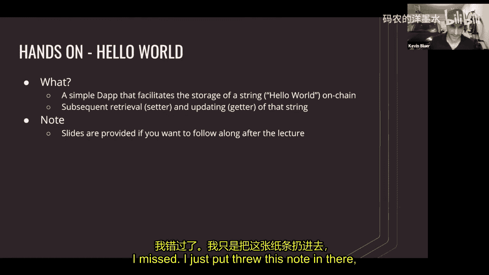

Cool， so yeah， if you haven't got tru install and I'm assuming most people haven't。

 only dependency you need is something called node JS。

 which can you can go toJS org slash downloads or big download button and install it or which I would recommend and you might would be kind of relatively verse in this。

 don't store node first just run install something called NVM。

 whichs kind of bash stuff behind the scenes， which stands for node version manager so install that and if you're on Windows as an equivalent I think know what is called but that allows you to more easily switch between node versions and it actually confuse as you're a local system if you have node installed first。

 not insurmountably so but it just。It's a little bit odd if you install node first， then install MM。

Anyway， if that doesn't make any sense whatsoever， to start with node， go with the latest version。

 we had some issues when the latest version kind of came out compatibility issues with truffle but has been resolved and the kind of long the sort of funky name they have for the latest version node is Ibium。

😊，LTS stands for like long term stability so yeah just go with the latest and then once you've got node installed it also comes with a package manager called NPm and you know so once it's there you can literally just go NPm installed SG which installs it globally。

😊，And by the way there's obviously on the command line and then truffle and then that will some truffle and then you can start working with it and you contest tested it installed correctly by doing truffle version I should just give you the version number of both truffle itself the version of solidity that ship with it which we'll talk about in the moment and I think versions of other things of web3 and so on and if you see like command not found or something that means there was a problemly and truffle didn't install Caat as well with all of this we do have know pretty good docs you know for all these know know installation getting started and so on so you know I'm kind of。

makingking a bunch of assumptions as I go through this I'm going to go quite quickly。

 but if you go to it and I've got at the end of these slides got a link to our website if you want to kind of go to our docs and go through this more methodically。

😊，So as installation， now I'll kind of jump out of slides and I'm going to go kind a quick just of time。

😊，But I had my voice speed up a bit。

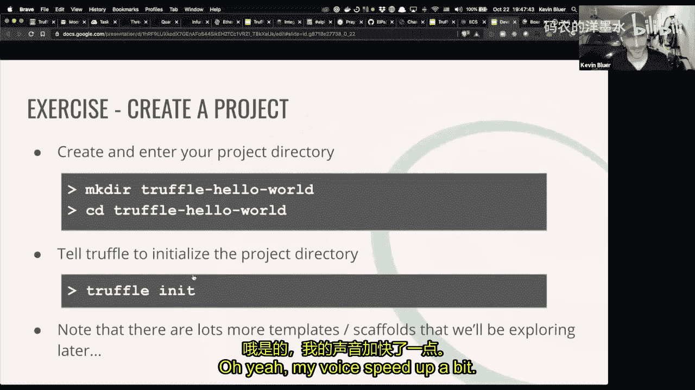

I jump over to my terminal here bump just just a side note I mean if you need a little bit longer that's fine so sure yeah yeah pretty flex got cool yeah yeah no worries yeah no appreciate that yeah so I'll try and come in roughly on time just in case people do need to jump but I'm happy to run over as well or stick around for questions and whatnot so。

Cool， so yeah so obviously in a terminal right now and let me just jump back to the slides to make sure I'm following along what I was good to show。

😊。

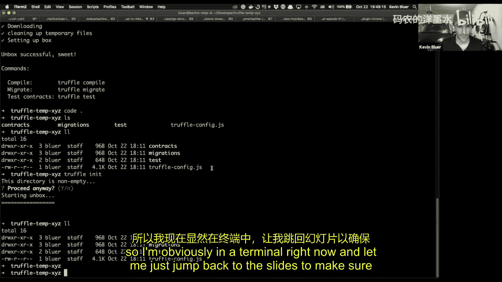

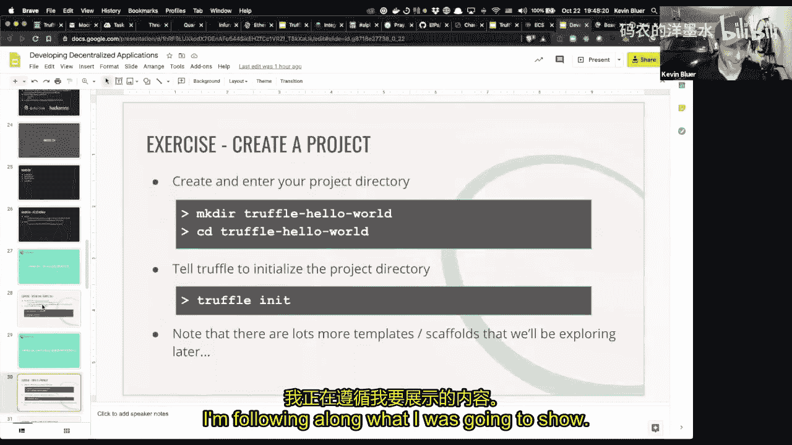

Keep them in the right place there so yeah sove got I've got truffle installed already I'll just go up the directory and then I'll do create a new project empty project I called it UCD。

😊，And then just go into that do you actually just need to start from the directory itself I created a test earlier Okay。

 so now i'm in the in a directory and then assuming you got truffle installed and as mentioned you can do like a truffle version to see。

The version number， you know what version I， I want a weirdly weird brands here。

Nor me shouldn't affect anything so the person thing you can do assuming you're doing everything kind of locally right now and not using a box which we talk about later is do truff in it。

😊，And essentially， that just spins up a empty kind of boilerplate project with a single。Well。

 with no contracts with a caveat， it creates one contract， but that's just。😊。

It was called migrations contract， which kind of keeps track of the version of the project that you've deployed to chain and stuff。

 so they' essentially an empty project。Now what's in this empty project， you know。

 from a directory standpoint？啊。Great four things。This contracts directory where your contracts live。

 the smart contracts we've been talking about are migrations directory where the scripts that you create to deploy the contracts live and their JavaScript files and we'll see all of these briefly in a moment。

 test directory if you're know you should be really writing ideally writing tests you know to test the functionality as you create it or maybe even beforehand if you're using like test driven development write the tests watch them fail and then watch them pass as you implement the functionality。

And then finally a configuration file for the。A bunch of different stuff relative to the project things that the networks you know you want to deploy to the versions of solidity that you want to use solidity。

 by the way， is one of the programming languages you can use to write contracts mentioned it。

As a thing but I't really mentioned what it was we'll see some codes bits of that in a moment。

 so yeah things like the version of solidity or the solidity compiler version specifically and a bunch of other stuff but basically configuration things relative to the project itself I live in that in a while。

😊，So yeah， just doing tough on net spends that up for you。😊。

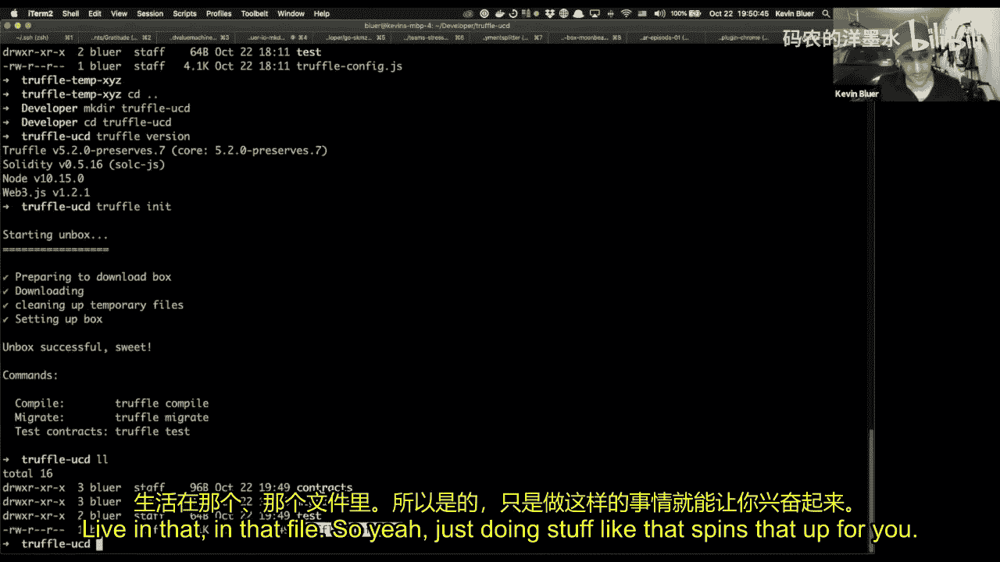

And just so I thought讲 my。prescribed flow here okay yeah so next thing we's going to do is Trufle create contract it's not that i'll be honest it's not that common to do it from Trufle itself it's probably easier just to go into IDE I'll jump into VS code in a moment。

😊。

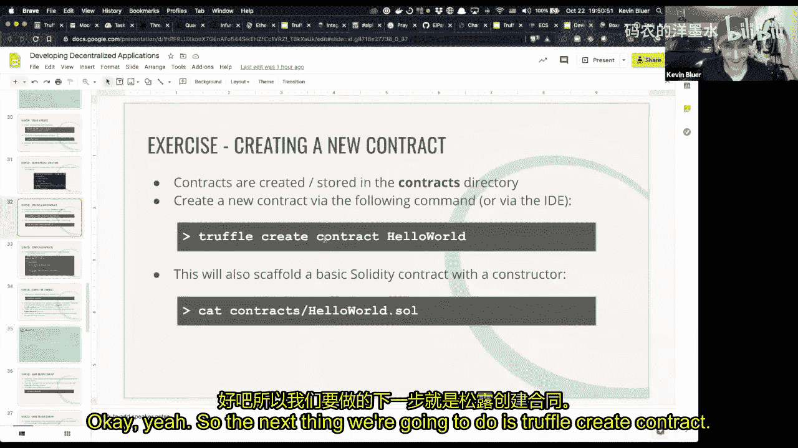

啊。And just you know create a new fall from within there。

 but we do have this you know command just create command to create things like contracts tests and so on and essentially I guess the only value is it will create like。

😊，A stub out contract for you。 So with that， I've opened up visualual Studio code。

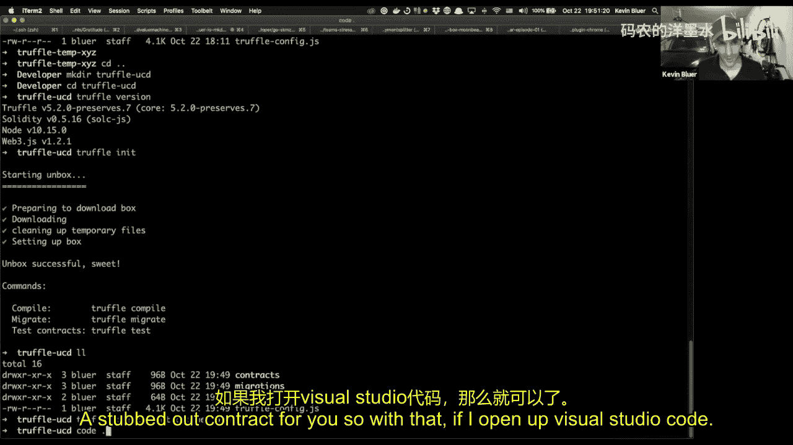

And。see the font's a little bit smaller， I can bump I'll bump that up in a sec。

 but yeah that hello world contract got created there that migrations one that is there out of the box as soon as we do a truffle in hit。

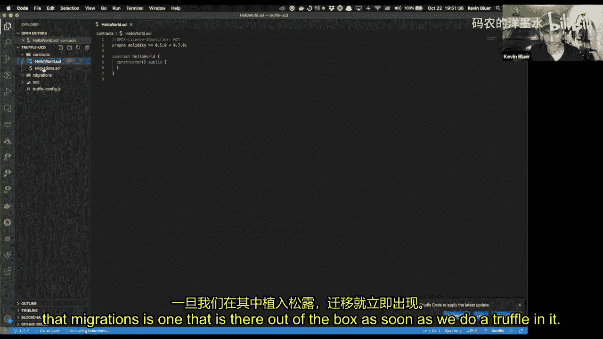

Um， but yeah， that truffle create contract how the world is， you know。

 essentially you create's boilerplate contract for you。

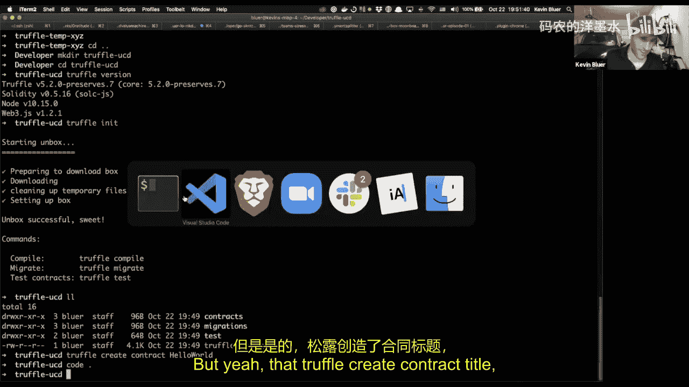

And I'll just paste in this code。And as mentioned， obviously the slides are going to be available but I threw the code for that just up on pasting。

😊。

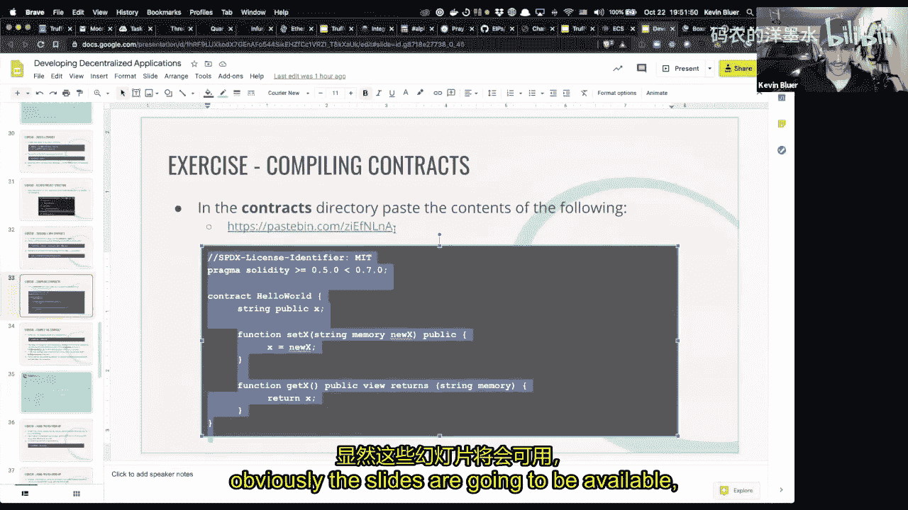

And that's that completely。Formatted in line things get better。

So this is a solidity file and syntactically it looks quite similar to JavaScript if you've got you know for JavaScript there are some key differences as well going into those is kind of beyond the scope way beyond the scope of the amount of minutes that we have remaining。

 but hopefully it kind of makes somewhat visual sense and I'll kind of briefly unpack it as I go through。

 but as you can see here we've got some declaration of state。

 you know this uncha state which is a string publicly visible。😊。

That's kind of nuanced what that means and then it's the variable name is x and then we've got two functions with which to。

Work with。To kind of interact with our contract first one is E Seter as we talked about earlier。

 to actually update the value of this state and obviously you passed in a you know that function receives one argument which is the new value on an update next to and then you have this kind of visibility declaration of the function you know who can do that again。

😊，Detail of that is kind of beyond the scope right now but right now anyone can do that and then we have this get now you don't again there's kind of nuance you can kind of essentially get that value without this explicit getter but you know just for ease of kind of reasoning about it I just kind of put that in there for now but basically that will allow us to update this value and we'll try we'll do this in a moment to have it。

😊，Update Hello world and then this getX will allow us to get the value of that。

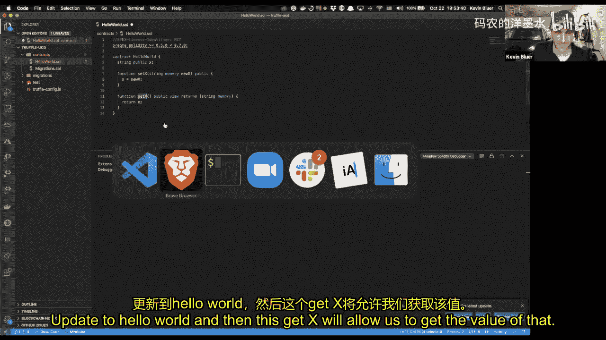

So that's a little b of solidity， again， just to kind of recap what you know that is in the broader sense。

 this is the program in language to create a contract。And。

These functions are means of you know that essentially that business logic if you refer back to what we talked about earlier。

 you know and these these the declarations at the top are essentially declarations of state or data that contain within this contract and if we were if right now we were to deploy this to you know Ethereum main net set this value of X to something that would kind of persist forever ever right you know as long as Ethereum is around。

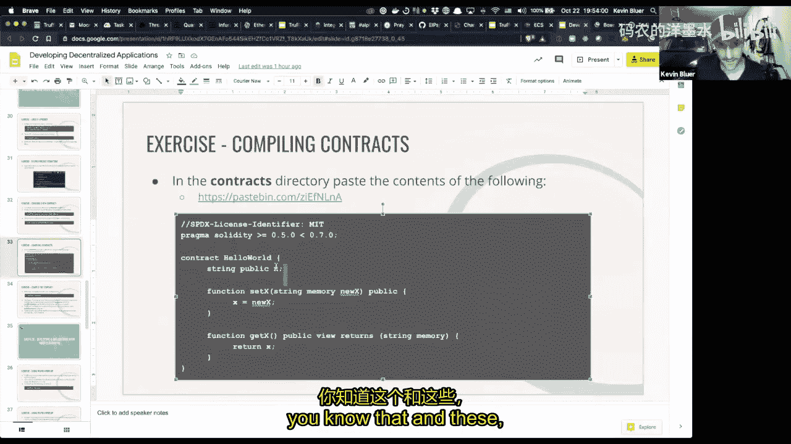

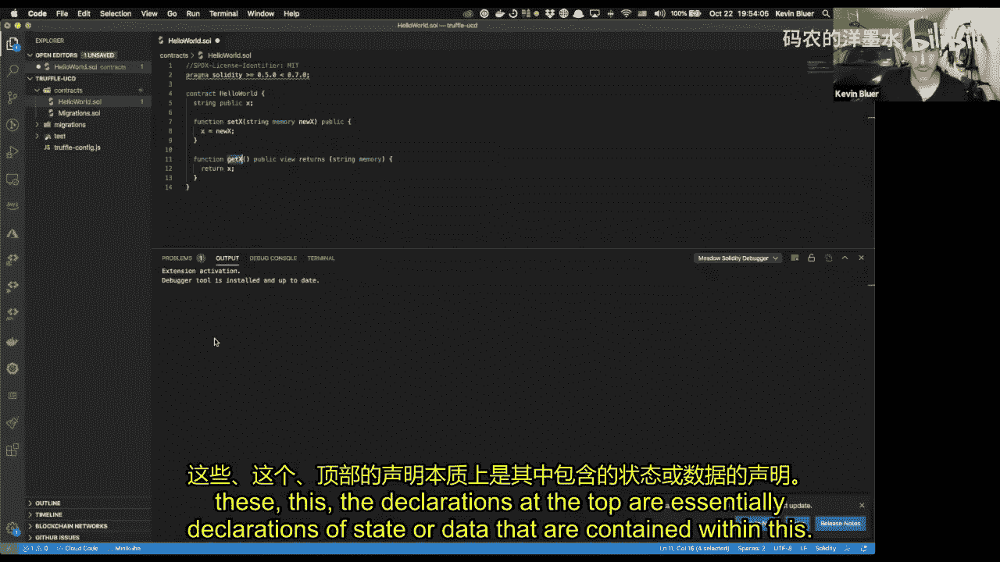

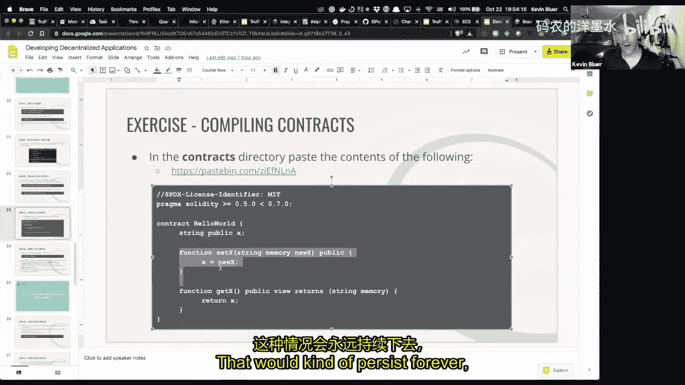

You know， and that value would be of course because we're making a public anyone could do it so we may want to add a kind of some authentication around that you know。

 and there's easy ways you can do that too through a function modifier and so on to check you know only a certain person with a certain address can perhaps update this and so on but you know that it' pretty powerful right you know that would that string would exist literally as long as Ethereum exists。

😊。

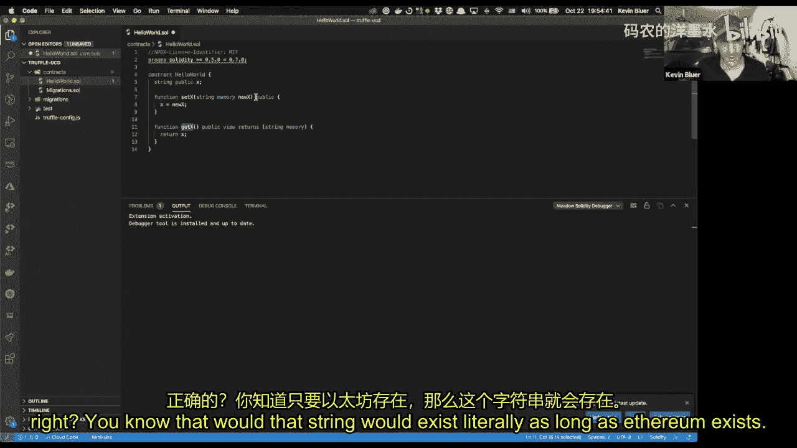

Maybe forever， obviously not forever ever。

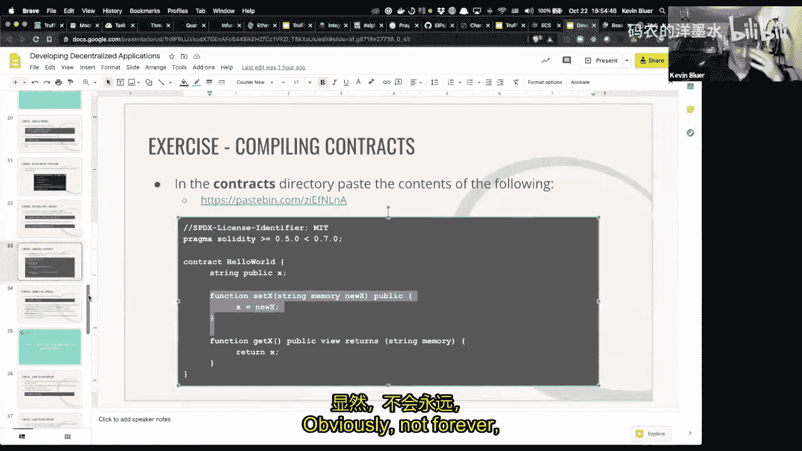

So now we can， I' just do this straight from in here。

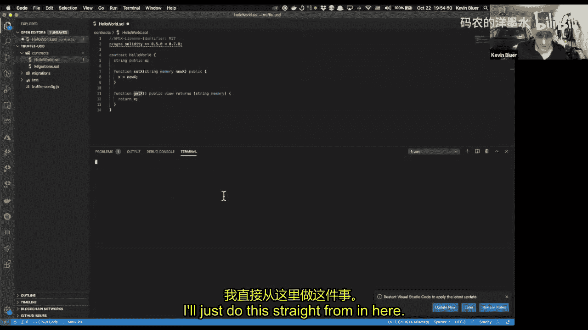

That's should not different。So I'll now go in， or just run a command to compile that compile。嗯。

And we'll see it do some stuff and then like' say this when you deploy contracts to the network。

 it doesn't deploy the solidity directly， there's a compilation step that compiles it down to something called Ethereum bytecode。

 which is just kind of more of a kind of lower level representation of this logic。

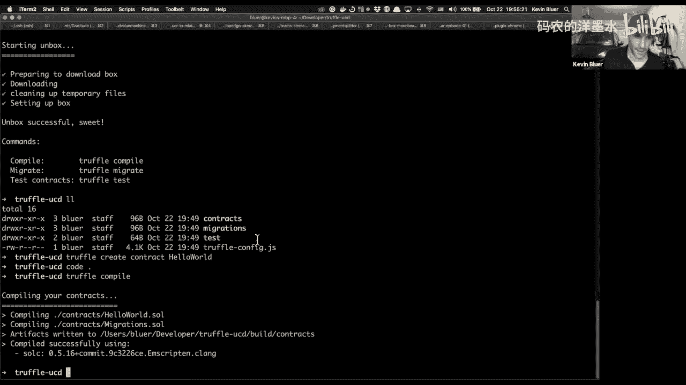

And that's why actually gets deployed to the network。

And I'm going to just keep speeding through this， but definitely fire questions into the chat if they happen and I'll get to them at the end。

 now the way in which we can kind of interact with this and let me just get the this little blob here。

😊。

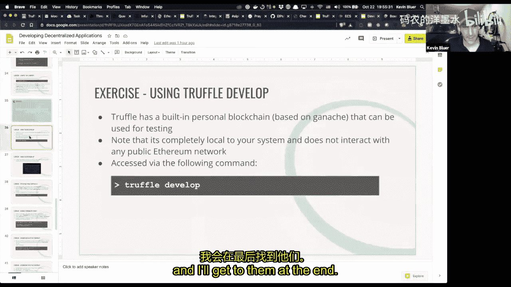

Because this is a little bit disjointed right now。As。A fewew ways。 I'll just do， to deploy。

I'll talk about this retrospectively， let me just go back to the bigger view so now I can do something called Truffle develop。

😊。

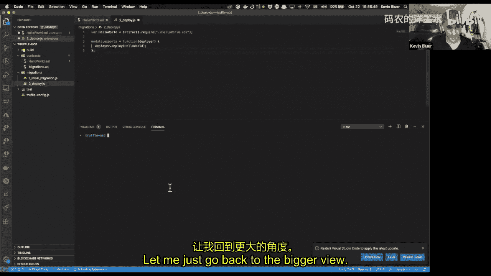

So that's why I just threw in there。Was the migration script to make sure that we deploy this contract to our associated you know a given chain now truffle develop as we'll see in a moment might be a bit slow right now oh gosh it's because I have。

Another instance running， but that's okay。Yeah， normally you'll see a little bit more spit out it's just because I've got another travel instance running I won't worry about stopping that but you'll see like accounts get get spat out and stuff and that's why there was just like delay just because it's actually connected to another。

😊，Gash instance that's running locally remember Gaash is a kind of personal blockchain environment。

 but now what I can do is run the migrate command from here and we can see it put out a bunch of stuff and you can see that it's deployed hello world to my locally running Gaash instance。

And I could very easily you know just with a few extra commands and you know configuration。

 deploy this， you know， use that same command with a different target or different network target。

 deploy this to mainnet you know and that contract is now live on Ethereum and we could then you know have its own contract address essentially something like this and you know I could interact there's obviously you know a little bit more means of things you need to do but you could then interact with it and update that to say hellello world or my name is you know。

😊，X， and that would assist and exist。Forever， as I say。h been kind of a little bit dramatic。

 but yeah， it would， you know， that that would， you know。

 in a simple scenario be a way in which you could do it。😊，And then just to update on that。

 what we can now do is。😊，Just gonna to just go。And then say now like well its setex， yeah。

 to say hello， world， my case。

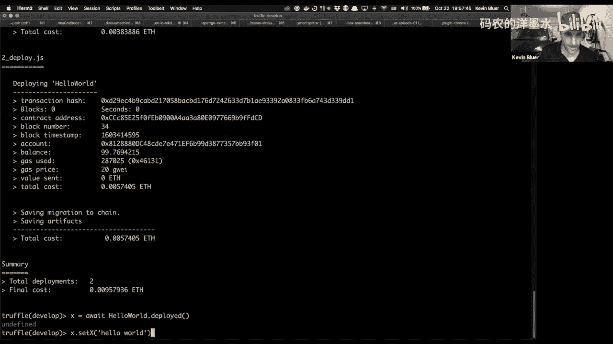

And that worked and what we see when we see a lot green that's usually a good thing and that' it's given us something called the transaction receipt and that's actually been intamind to a block block number 36 the reason that's a little higher is because I've actually got another instance of binash running locally so that I've been doing some work on that that's。

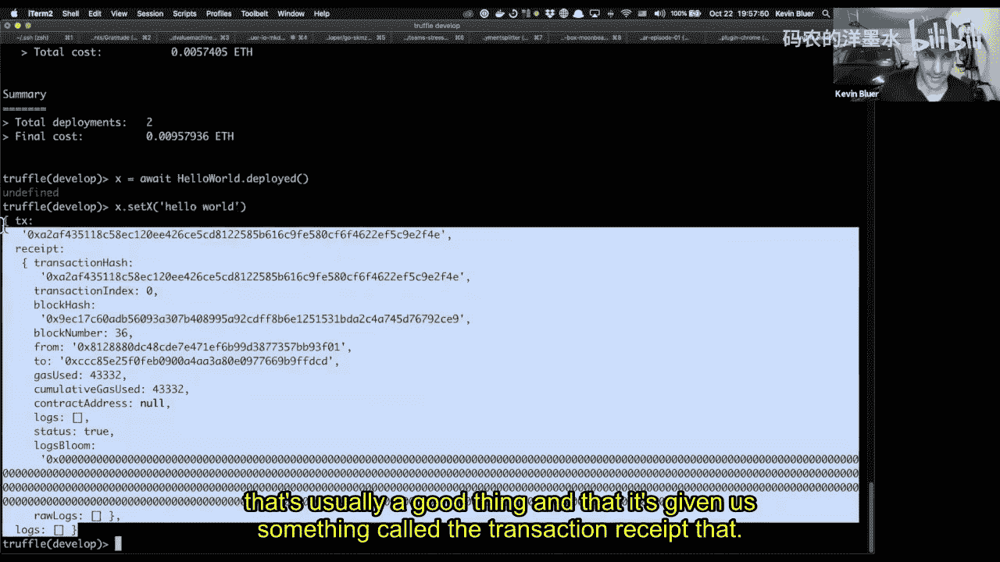

Block number， you know more blocks have been added。

 essentially any transaction the point of being added to a block gets say oh that sorry that's a hash of the block that's the hash of the transaction。

 essentially kind of like you know a unique representation of this transaction。And similar。

 if I need to get this back out so I can now get X look that and get the oil back out so this you know。

😊，Set X implication， which took one parameter of the string that we wanted to set X to contain and would anticipate that state。

And then， you know， so we did we invoked that and then we got that back out as well。

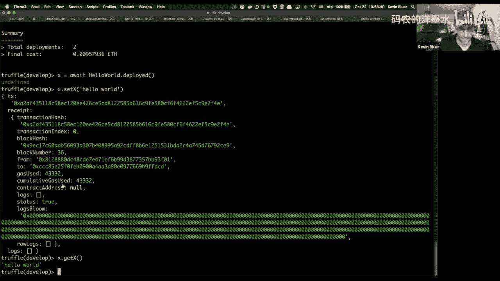

Cool， so that was pretty rapid。Don't worry if you know there was patches in your understanding there kind of would expect there to be。

 to be honest， but you know really the takeaway at this point is just to give you a taste of the workflow involved in building something。

And using truffle at the command line level， as I mentioned earlier， Gaash UI。

 you know again if you are brand new and you didn' want to dip into the development side of things is really nice because it just gives you a lot of these can you would still use the command line。

 but you'd usually be using it in a different way and we have some really good guides on that。

 but the nice thing about Gaash UI is we talked about earlier very visual which definitely makes things easier from the learning standpoint。

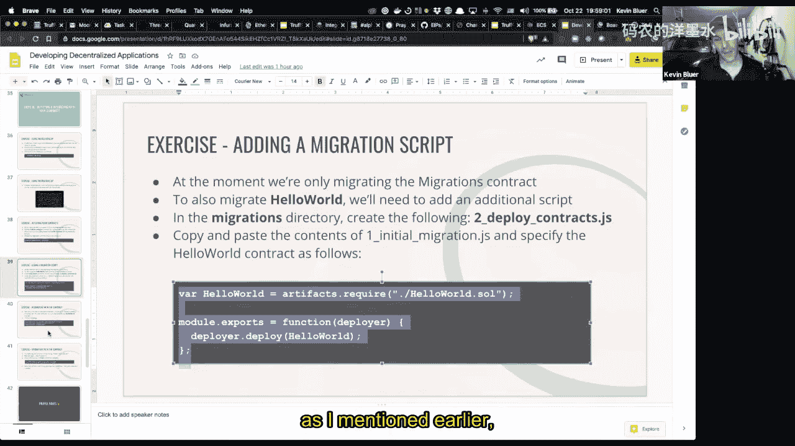

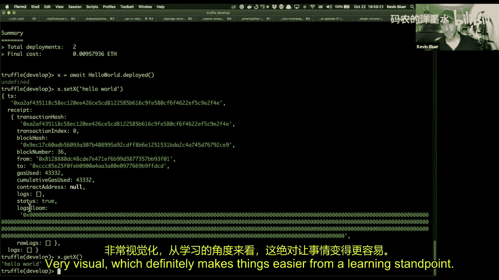

Cool so that was kind of in a very kind of whirlwind sense， just a kind of hello world example。

 two more things I wanted to show we'll try and come in roughly on time。

 maybe go over ever so slightly where truffle boxes and then just give you a taste of truffle teams because again that's really useful。

 very new tool for us but definitely makes you know some of this stuff even easier and you looks at the broader lifecycl as I mentioned earlier。

 but firstly truffle boxes the reason why it's call these app is again from a learning standpoint。

 these are fantastic。😊，What they are is essentially self-contain projects a huge list of them and I've got it open here actually I've pulled open before。

 you can just see here lots of different know Microsoft have put ones in there you know for their Azure chain。

 they kind of more managed blockchain， permissionlessure permission chains， etc。

Abes a new one that just went live if you've been you know looking at like the Dfi space you know may have come across our super cool so we had boxes you know kind of long tail of different projects。

 you know those projects can have different angles like you know lots of different contracts within them and that's you know the angle or building a front end you decentralized that you know web front end。

And complete end to end examples in there as well。And we have a bunch of kind of fo flavors sort types we have official ones that we maintain you know and we have some good tutorials around the official ones and and we update them you know if there's breaking changes within truffle or enableR tools and so on we have partner ones like the Microsoft ones you mentioned and you know so on and then we have this really like kind of long tail of。

Community ones where people out there you know because there's a submission process can just submit to us and we'll just get them listed up there and behind the scene behind the scenes all they are is essentially Gi repo。

And you know with some twists， but everything's stored in and repository。😊。

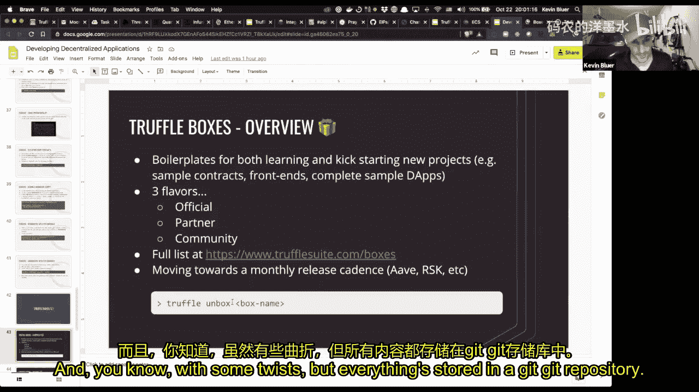

And then the nice thing about how you can then kind of install them is if I just jump out of here you can do tru onbox like and then we have like a reactor it's going to say you know that。

Yeah we're in a directory that's not empty so do we want to still install but like can we have a react box that has a nice front end built with react hack if you're familiar with that and you know again you can just do trufflonbox react and it pulls it down install the dependencies and you know does some setup stuff if needed。

So yeah， really， really cool from a learning standpoint， you know。

 again if you're getting kind of started， or this slide was just on the different some of the different types of themes that we have。

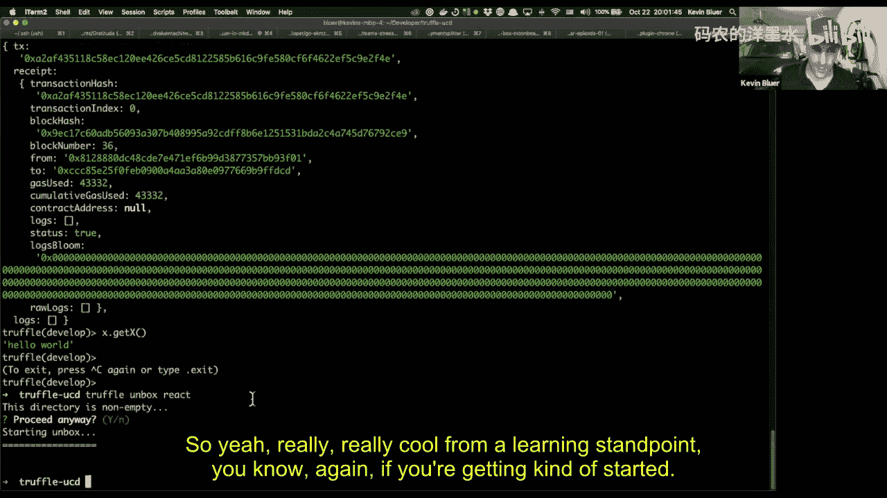

Cool， so last thing I wanted to show kind of from a hands on standpoint was。Based around the box。

 so we have another box， I think the box name is called Mecoin and it's just this really simple kind of token implementation。

😊，Like really badly implemented token to be honest but I just thought I'd show it because it's nice because it's simplified you know implementation of a token and I just wanted to show it in the context of truffle teams so yeah it's if I did I fact I could just see it if I go back up to the top here I think it's right here。

😊。

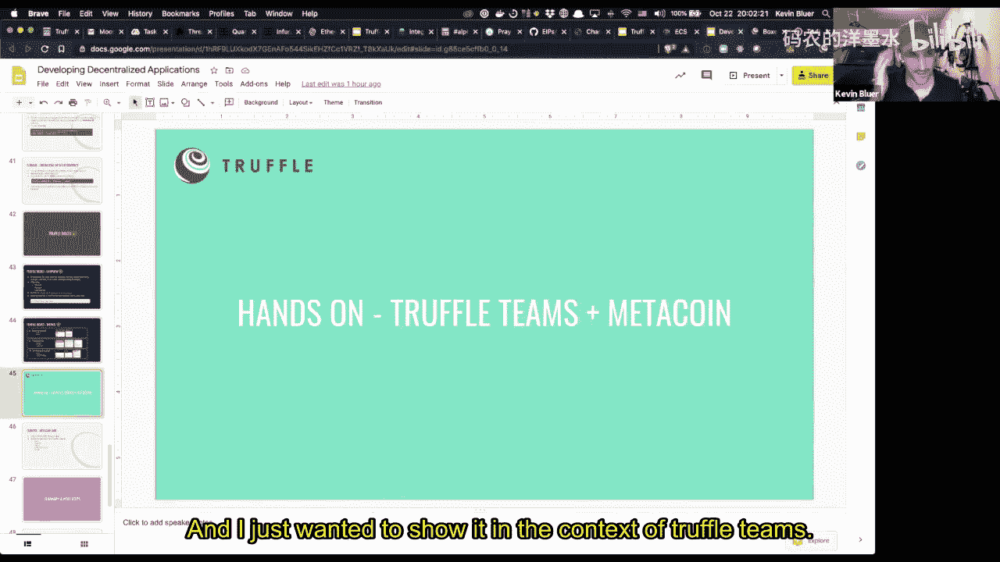

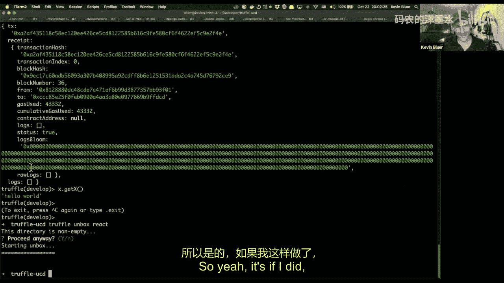

But there， yeah。So this is the box。there isn't even many read， man， it's kind of weird。

If I go into the repo itself。And look at the contracts。

And yeah this is the contract for it so again this is what I mentioned earlier these are really good from a learning standpoint。

 not that this is best practices。😊，So take some of them with a pinch of salt。

 but there are others good genuinely good practice。

 but this one's good because it's simple so if you're trying to start to get to grip with you know solidity syntax and stuff。

 all this does it brings life a token called Mecoin。

 essentially this kind of imaginary coin called Mecoin upon deployment this constructor executes and not only everyone's once so upon deployment the deploy of this contract gets allocated 10。

000 and then there's a few other functions like mainly the ability to send。😊。

Tokens to other people based on their address。And then you're might want to send and then just some kind of get lookups and get it to kind of get at things so yeah it's not and this is really bad practice you wouldn't use this for real world cooking and stuff but you know if that means anything you use something like open Zeline you know for sure。

😊，But this one's simple， so I've already gone ahead and deployed this to travelff teams。U。

And yeah i'll kind of show some stuff here just give you a flavor of truffle teams just quick upfront as well so teamss is a hosted product we kind of it is theres it's premiums and we've modeled it kind of on GiHub so you know there's a lot you can do for free you know and we're not we're not trying to sort of there you you can use it for free but it is a kind of there is a paid tier just like GitHub you know there's a lot you can do。

😊，If you aren't on the paid tier， you all same with will you have a similar model as I say。

The repos are public and there a limited amount you can know if you want private repos and stuff so it's just just to stress know if you kind go in and see oh it's kind of a pricing system you can still do all of the things i'm showing with and in fact my current account that I'm in right now is the free tip so yeah just kind of putting out there if there's any confusion and stuff one of the features which I think you know want to start with briefly which is pretty awesome is this concept of sandbox so we talked about Gnash earlier with being a local instance of an Ethereum blockchain is obviously。

Only runs in a local context on your local computer so that's a one I good why you just developing locally but once you've kind of got to a point that you want to start sharing that project with some folks a sandbox or sandbox is kind of hosted instance of that so that project you could then get folks you know either friends or peers or colleagues or others you know just interacting with it that way and this really we sort of feel this fits in between deploying it to a test net because testnets are a bit slower and have other characteristics you probably still want to take still use in that lifecycl but know sandbox is nice kind of interim step so anyway I've spun one up and I've only got you get one on the free tier。

You can go in and see some of the characteristics of that they the new mononic you know to generate the addresses and so on and then at that point you can deploy projects through it so i've already kind of wired up this project it's got it's got a different name here but like if I under my GiHub repository if I go in and add this takes me over to GiHub to assign which。

Projects I want to add to trile teams and then that will kind of ingest the code。

That goes into that repository and similarly it will do so on every commit to that repository as well。

Going deeper， every commit will trigger a build of that project。And run the tests so you know。

 as you're evolving that project and collaborating on that project with other people。then， you know。

 tests， you know， obviously assuming you've written tests or you know writing tests as that project evolves if someone else inadly breaks something and then that's going to you know causes。

Any number of the tests to fail then you can see that here。

So that is commonly referred to as CI continuous integration。

see the continuous integration continuous delivery or continuous deployment if both of the these apply there。

😊，So now we have the CI service。😊，And then again workflow wise what you can do is you know once you've got a build in there that's passed you can then go ahead and deploy that bill to a sandbox and as you can see everything you know is designed to be visual designed to be kind of easy and then I was just kind of hacking around on this quickly before this session so I just had something in here like you know a build you know sent a commit to that repo and then deployed to the sandbox and don't worry too much about that deployment context。

And yeah the name of the deployment because I've already done this。

 so it's more if you just want to deploy it on an existing。

 you know on top of an existing deployment， that's the context there。So this deployment happened。

 so I deployed that mein contract。😊，To this sandbox is Kash incident， you host Kash incident。

 and I can then click into that。And see the contract addresses so there's both the Mecoin contract address some other projects or other contracts in as well don't worry about those you can then also see is as mentioned both all the transactions of executed against the sandbox。

 but also if you've deployed this I didn't mention this before if I wanted to deploy this to this build to you know if this is ready or ready to be tested I could deploy it to some of the test nets or even main that you know Ethereum push it live。

Any of the networks， you know， you get to see the transactions as well that are executed against that you on any given network。

So what's other thing and I'm super excited to show this feature just because it's one I worked on。😊。

Is this visual debugger as well？And you can see there this that's the same code that we briefly looked at on the GitHub equivalent you know page of it and but this you know is actually now allows us to step through the function that was in both so I did this before this session but if I now step in or into you can see I sent 50 coins because you can see you know the detail here on the right hand side or the decod state to that address so that correspond the receiver address and the amount in this case 50 is being transferred to another address and again the detail doesn't make sense don't worry really the point here is this visual debugger is really nice you know is a way of like。

Kind of both replaying transactions， you know， maybe that have been successful。

 but also if they failed whatever reason， you're like， gosh， you know， that shouldn't have failed。

You can go back in， you know， replay time and actually see what happens， you know。

In the context that we're given you know， that and the subsequent implications of functions。

 you know， theyre kind of execution of business logic， essentially。

So yeah really neat I mean we think I' biased on this one but yeah really kind of neat feature there and we're about to push live as well breakpoints so you know if you've got more because if you have more complex contracts which often they are obviously it what's kind of contrived。

😊，Then typically comprised of multiple files so you then you know see the different tabs and and then you can add you know add in break points and then we have this breakpoint trade on the bottom right and stuff so really and Simptax is right notice is same color。

So that's about to go live。Yeah so really nice way of kind of from a lifecycl perspective as I said。

 you know， kind of keeping on top of things both monitoring what's going on we also have this dashboard where you can see again transaction volumes of stuff so over time this one's just been pushed so obviously there's not much going on。

😊，Um， but you know， tracking the project's kind of evolution and health and being able to kind of interact with it and so on all from within one place。

Cool， so that's kind of what Team is all about there， albeit said very very quickly。

 so I apologize for that。😊，So yeah， we're kind of towards the end。

 so let me just go back to full screen。😊。

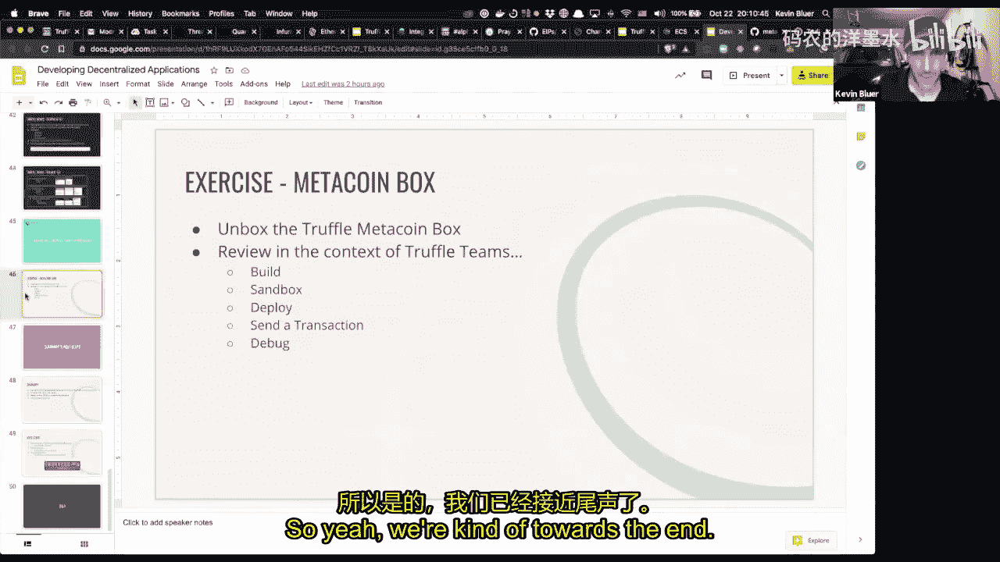

And yes， so summary next steps。

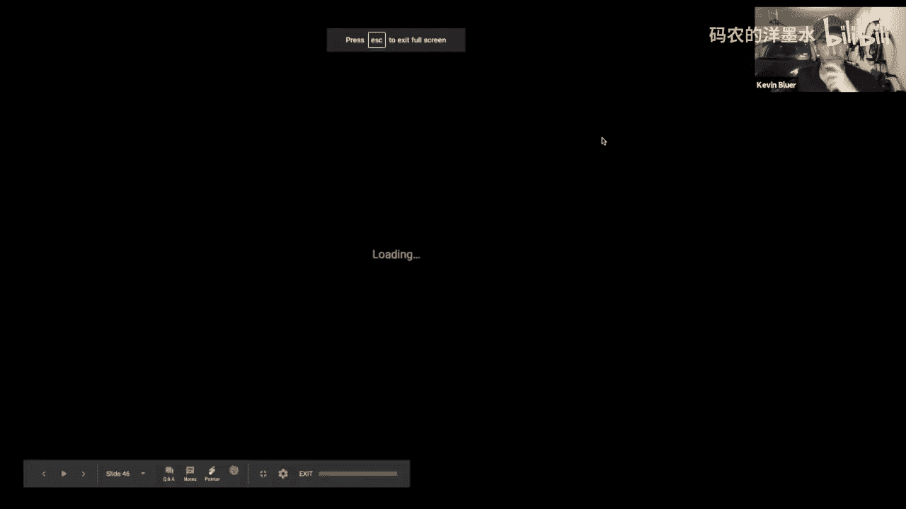

So yeah， just to summarize kind of what we talked about。Firstly， we looked at kind of the paradigm。

 decentralized application paradigm the goal there was to look at it through a developer lens a little more technical and explore out the space and the types of things you can build and so on。

 that we then looked at the truffle suite as a suite of tools with which to build things。

 ideally a good fit the logical fit for would sit on top within this paradigm。

 we albeit very briefly about the lifecycle about how you would using truffle and the associatedci lifecycle and some of the quirks and differences from perhaps other ways in which you might build things or have built things in the past if you developed in other kind of paradigms or other technology stacks。

😊，And then I said， yeah， got a little hands on。😊，It was kind of rushed just because of time you know this isn't too long a session。

 but hopefully the goal there really with that last bit was just to kind of ideally kind of demystify things a little bit you know so if you rather than me just having spent the whole time talking in the abstract。

 oh yeah there's these tools and you can build these things using these tools you know again I didn't really necessarily expect you to oh now I know how to go often and do it all because there's obviously plenty of other detail I gloss over but you hopefully if that worked that last bit it just kind of gave you like okay it's not。

😊，As abstract or as perhaps scary as you might perhaps thought， you know prior to that。

 so that was the kind of goal going with that bit there at the end。Cool， and then finally。

 so next steps。In the you know not for the course as a whole because there's obviously plenty more awesome speakers in the pipeline for you guys but next steps with you truffle and you know developing in this space if that's of interest firstly you know by means get in touch with me there's my email address there you know if you have any questions you know if you are starting to kind of tinker around or play ironically I actually have a link to our docs there I should have that but if you just go to trufflesweet。

com and click on docs you'll see we have like you know。Pretty decent thoughts as I mentioned earlier。

 some patches here and there but we have some really good particularly if you're brand new they they're not bad like this quicks a bunch of quick starts just to help you kind of get started there and you know reasonable coverage of the tools and so on but anyway you know if you get stuck within a thing or you any kind of questions you know etc you know just pingy。

Also， if you're interested in contributing to any of the open source stuff， if you go to GiHub。com。

org on GitthHub isffles or Strfflesweet。And you'll see all of the open source stuff there and if you want to you know explore contributing you know Bams ask me about that personally I'm a a huge fan of open I didn't stress this bit at the start。

 huge fan of open source as a paradigm and the power to both learn and you know further your career。

 you know I think if you are you know if I was a student right now。😊，I would。

Spend time you know trying to contribute to some open source stuff because and there doesn't have to be truffle。

 by the way。Any projects that are of interest particularly in a perhaps career direction you a company you might want to work for and stuff because you'll start to get a flavor of kind of real world development flow and equally it looks awesome on your technical resume you and you could cite in your LinkedIn or paper based resume and stuff like that but it's just a good win across the board and you contributing to IP as well and I make a point of trying like on a monthly basis trying to contribute to a different open source project I don't always get there but I try for all those reasons so and again if if you want to contribute to travel in some capacity and it's not just for like hardcore people we have。

Like do kind of good kind of grooming of our shoes list and we have labeled them like good first issues and stuff and we can help。

 you know， if you wanted to contribute doesn't have to be just like。

 hey yeah work on this crazy hardcore thing and you know leave you you know to go and do it you know we'll work with you so。

AndMost good maintained open source projects will be exactly like that open to newcomers too。

And then the final final thing is we have this conference coming at called Trufflecon as you can see if you can read that it's sixth and seventhth of November to next month is's free well there's you know basically free there's it might have even expired read this like if you wanted to pay is like you get free chocolate tasting or something I don't really quite understand。

 but everything is basically and loads of speakers from across the industry you know so good way even if you just sign up and just know check out a few talks you know totally fine to do that。

So you can register for that troublesweet。com/tfflecon 2020 and in line with pretty much every conference obviously we're doing it virtual this year or remote you know historically this is the third year we're doing it the previous two have been in person but I think obviously through tough circumstance right now this year it's remote as they all are I guess the upside there is is you can attend from wherever you are so there is a good thing to come from it of course so yeah if you're interested in kind of going exploring this space a little deeper than definitely that will be one of a number of ways you can do it。

😊。

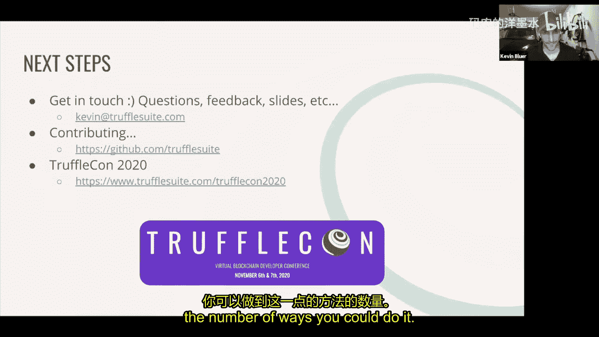

Cool so with that sorry we ran over a little bit but yeah thank you for having me hopefully that was of use hopefully the rest of the course is awesome and I'll leave this slide up as well as a closing one if you're to you know get in touch but yeah i'll kind of wrap up and kind of segue into Q&A if there's any questions I'll just open from the chat there。

😊。

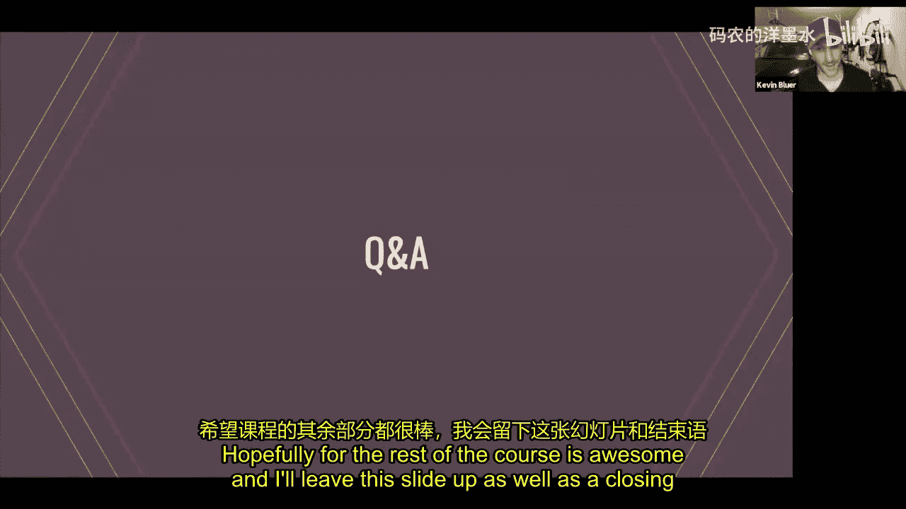

Otherwise if no make good yeah yeah that's that's amazing and I think a lot of useful you really gave us a sense of how the ecosystem worked and I think。

Since we have it recorded， I think students and folks broadly can kind of go step by step by the video and I think they can get really started from building their first app to debugging and deploying it and the entire life cycle so I think yeah that was thank you for really during this whole life cycle for us。

Yeah my pleasure thank you for having me Oh no， it was amazing and so。😊。

I guess you have your email as well so if there are further question I think students can kind of reach out to you of course if there's any question right now。

 please by all means since we have Kevin already on the call I think probably's the best time and I think contributing to GiHub I think that's also an excellent way and we had kind of briefly discuss this early on if there are maybe perhaps few items that you think might be a good starter to for students to kind of tackle on if you pass it on to me or' pass it on to all the students as well too yeah I can sense on yeah that will be my definite pro tip for students to contribute to open source stuff where possible because I think it's yeah and it doesn't have to be like in blockchain stuff but that it could be anything so powerful and more accessible than you think and I can attest to kind of how it might appear。

Like scary and like because I used to feel that way， but you know。

 the more you kind of get involved in projects。And the more， you know。

 and if it's a good well maintainedtained project and most of them are that the maintainers of that are going to be awesome and welcome people to contribute they're not going to be like oh you don't get it all right now like you know like look down on people you know not at all。

 you know we if someone comes to us and they want to contribute。Um。

 and I've had this in courses I've ran where we've kind of made it as a kind of pre， you know。

 sort of a light lightweight requirement to kind of contribute in some capacity。😊。

Um that you know it's awesome you know， and I can attest to all the travelers， you know。

 my colleagues， you know， love it， you know， and if people are brand new it's it's okay。

 it's not like what like they don't all this stuff yet it it's fine know even if it's just updating like readmes or small kind of minor contributions and stuff then u yeah。

Re， really powerful， I'd say。All right， so on behalf of Expo Lab in UC Davisvie。

 I'd like again to thank you once more for this excellent invited talk and。

Thank you so much my pleasure， yeah， thanks again yeah and good luck guys。

 good luck with the chorus and beyond。😊，And feel free to get in touch as well。😊。

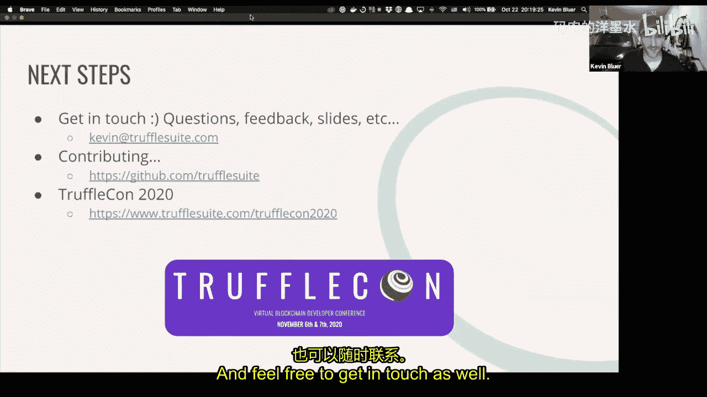

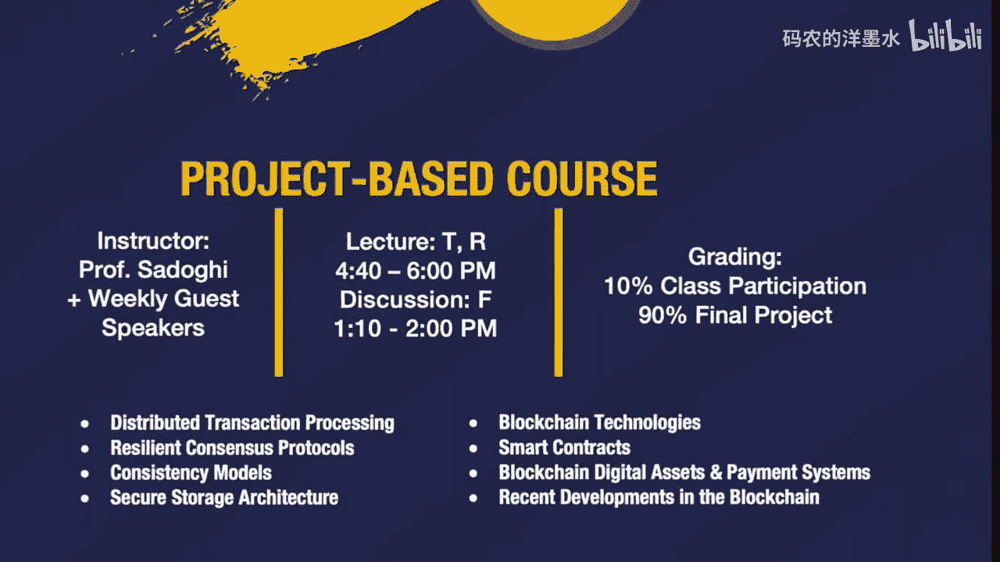