# 【全集】加州大学戴维斯分校 分布式交易与区块链架构 中英字幕 完整课程 p25 Lecture 21 - 去中心化应用(DApp)入门 -BV18YFVzME2f_p25-

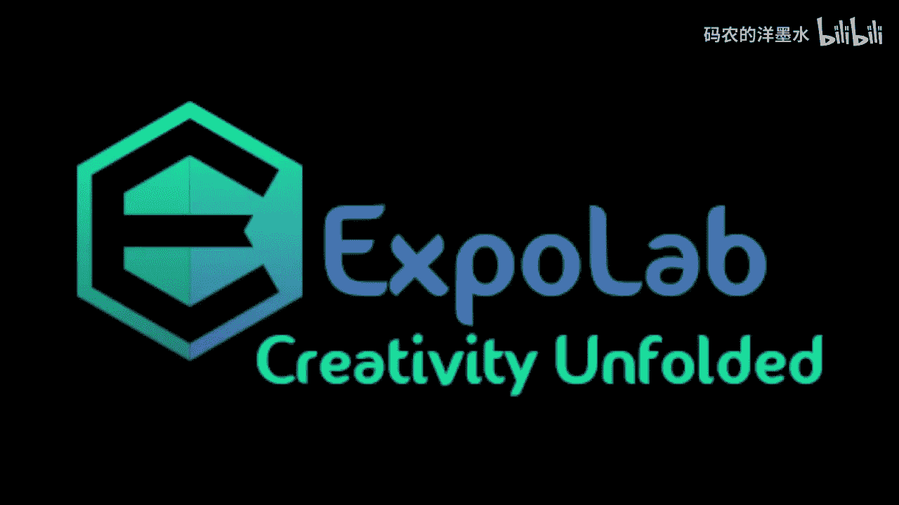

Hello everyone welcome to our B speaker seriesius and'm excited to have Alex Sts joining us and today he's from Ethereum Foundation he had a very nice career trajectory I would say perhaps an unusual one which is probably a good fit for a blockchain as well so he had his degree in chemistry and computational science from Princeton and then from there on he really got into centralized application governance and Ethereum and now he part of the Ethereum Foundation so today he's going to talk about cryp economics and in particular how do you build application in this new exciting era so with that please take it away。

Great， everyone， yeah， definitely I fell down the rabbit hole。Okay， so let's see， so yeah。

 you all have this series on blockchains and you know all these cryptocurrencies and stuff and so today I'm going to talk about one little piece of that which is essentially you might have heard this term das。

These dis applications。So let's see I guess we'll just get into it so I haven't done one of these remotely on zoom so this will probably be far more valuable for you if you ask questions as we go so if something isn't clear just stop me interrupt me the signaling I'm not as sure about I have this chat window here。

I see someone said yes to my earlier question， which is very helpful so maybe。

Ping me in the chat or I think there's like a raise hand feature。

Be attention and i'll try to pay attention yeah and if you miss anything don't worry i'll speak up and also again in the past few sessions it worked well I mean when people just open up their mic and ask and I think having that inform conversation is just perfect so let's make it as much as possible into a real setting that we kind of sitting together or ask questions and get excited and yeah so's。

Great， okay， there's definitely a lot to talk about。😊，So many things to be excited。

 I was like making these slides earlier and I was just like， I hope。

 I hope all of you here you understand， at least I hope that you can sense my excitement and it comes across it by the end。

 you're you're also very interested。😊，And intriguing what's going on。Okay， so who am I。

 there is a nice intro already， I'm Alex Stokes。Ooh， can you see my cursor。

 that would be nice actually。Oh anyway， not important where you can you。Yes。

 we can see it great see Okay， thanks everyone's just responded， this is excellent。Okay。

 so right okay， so did I GiHub Twitter medium handle like pretty much new platform if I have an account I try to grab this handle so if you want to reach out to me that's a great way。

good Freser said yeah research development at the Ethereum Foundation。

 so I'm focused particularly right now on blockchain scalability and I know there's a session later maybe in like a couple20 you probably well I'm actually not sure how much you guys are embedded in this space but。

If you've been following a bit， you've almost certainly heard about this， essentially。

The Ethereum that we're about to look more at now， the ethereum we all know and love doesn't go as fast as we want it to。

 so ideally it would be able to handle many more transactions per second than it does today。

And I'm going to try and leave some time for questions at the end。

And so maybe we'll you know if you want me to talk more about that I can。

 but either way i'll say that for the later later discussion I believe Preston is going to be speaking to you he works on one of the clients so that'll be that'll be great。

Yeah。😊，Anyways， yeah and then also yeah I'm not sure I've had anyone framed as you know I've had an interesting trajectory but that's definitely what has happened I studied chemistry and undergrad pretty much self taught all of my computer and all but just became obsessed with these types of technologies。

😊，And yeah， I've been like full time in the crypto space since 2017 and now it's like all I think about and。

It's great stuff again， I'll try to impress upon you how much potential and opportunity there and you'll hopefully understand why you know。

 I see it in the way that I do。Okay， but， you know， concretely just for today's class， you know。

 what are we trying to do， I hope at the end of this。

 you'll like have some sense of what a is because it's maybe a confusing term。

 especially if you're near to all of this blockchain and crypto and these decentralized ledgers and all this。

U， you know， why are data solidity， what does have to do with this。

 I believe the next session after me。Is was it Kevin， I forget here， but either way。

 Kevin going to talk about， yeah， Kevin's going to talk about truffle right？

Right exactly so one of the truffle team members is going to speak about that and like truffle is a development framework for solidity。

 which again。An hour from now will make a lot more sense to you。Anyways。

 well we'll get to solidity'll just that's one of the goals for the talk and then yeah just generally how does Ethereum fit into all this。

So here's like a brief agenda， will'll start sort of like high level like why does anyone care。

 what is this stuff， what is it。We'll kind of drill a little bit more deeply into okay what are these Ds。

 what are some examples of Ds， we'll look at the EVM and then solidity itself。

 which are sort of you know these are like the technical implementations of these programs on the Ethereum blockchain chain and then if we have time we'll look at some code for different smart contracts and try to get our hands dirty with some of this stuff。

So the first question right like why why the hype like why are you here why does why does anyone care and this is like maybe a little pithy but essentially here's like a nice metaphor for us you know the internet did for information what blockchains may do for value and like arguably already do do which is essentially。

You know， it's like kind of crazy when you think about it that they're just going to let anyone on the internet and then you can now talk to anyone else all over the world。

 right， like as long as you're connected。And you have the right protocols。

 then you can talk and you can exchange information and that's like actually like。

It's like wine blow， at least to me。So similar。With all this crypto stuff we hope to do a similar type of thing with this like abstract notion of value so we have this abstract notion of information where now you know I can send you tweets so I can send you you know messages on whatsapp I can do all this stuff。

Now what we want to do is basically have like some digital notion of value that we can move across the internet and perhaps we'll get into a little about why we can do that before and you know what does so do about this stuff that lets us do it now。

And the way to understand this， again， this is like。

Veryry high level and I imagine you've already covered some of this previously but essentially you know at a high level like we'll talk about what is money and there's like whole history here if you're interested in this stuff I encourage you to dig in。

Basically right you know we can say money is a way to transfer like some some chunks of value so value already is like pretty abstract。

 but it's sort of the thing where you know where you see it。And， you know， basically。

 if I do some work， you know， maybe someone thinks that。

I should be rewarded somehow for that work so now we need a way to like sort of manipulate that value or at least it lets us do more in society if we can so these tokens or these chunks are like things we generally call money and like across history there have been a variety of like instruments or like currencies you know these different instruments of money so some examples or these like cowrie shells which like instead of dollar bills like literally they would trade like shells right like seahells。

Another frameworkix example are these rhstones， so from the Micronesian island of Yp。Basically。

 there are these huge stones like meters across the diameter。But essentially they're like you know。

 you could imagine like one huge stone is maybe like you know $1000 or something like this and then they actually had a very intricate system of debts where they could essentially subdivide and again。

 all sort of like abstractly， they could subdivide the stone and the value attached the stone and they would track。

 you know who in the tribe had which part the vd times and had this whole system again of credit。

 which is like pretty interesting。And then yeah you hear things like people using animal belts sorry animal pelts when they're like wasn't paper currency or these types of things or like people in jails using cigarettes as value so again it's like you have some like scar object and you can use it to represent this this valuable thing and this thing that we all care about which is basically like you know do have I done something and do I think I get a reward。

I just wanted to call this book debt， I believe it was the first 5000 years， David Graber。

 very good book goes into a lot more of this as sort of like an anthropological basis。And yeah。That。

 that's。Huge。Very high level overview of that。USo。Right so we have we've had money as like you know humans for millennia and so now what we want is we want to put it on the internet because everything's moving online you know we do all our shopping online now with the pandemic we're all basically living online for better or worse。

 you know this class isn't in person or now on zoom。but the thing that's tricky is that， you know。

 part of what's been so useful about these digital technologies is that the costs of copying some digital thing。

 you know， like let's say a song as an MP3 or like， you know。

 photo as a JPEG like you can copy these for basically zero， you know， as no cost。

So what that means is that if I were to just make， you know。

 similar to how to have a digital representation of a photo as a JPEG。

 I could try and have a digital dollar as like you know just a blob of data。

 but the problem is that I could turn around and copy your blobs and you know that just we can't build anything we can't implement a thing that gives us the properties of what we want to call money if that's the case。

So we kind of have had a problem。and then。The problem sort of allegedly now is solved by blockchains。

 and this is Bitcoin， of course， is like the first example we have of this。

So blockchain change let implement。You know， something in the digital realm that。

Acts like money or at least we can make it act like money and so now you know they host cryptocurrencies。

 which again are these like representations of value or at least let us you have these representations of value in ways that we couldn't before。

So。Very high level Okay， this is like a ka thing I have。

A way to think about making blockchains is like it proofs and promises so like really proof refers to photography we have like again essentially like very advanced mathematics that say okay to incredibly high probabilities you know this thing won't happen without some very specific conditions right so like you essentially have to like present to proof that like something happened and this lets us。

ReReplate， say property rights or ownership because what it you know， the way this breaks down is。

I have some e on the Ethereum blockchain and is protected by a private key with a you know cryptographic public key and then if I went to send some e to you I have to produce a cryptographic signature so you can think in some sense the cryptography is like protecting you know my digital asset。

And then。There's a lot we want to do that we can't with cryptography because it's I mean effectively it's too expensive but just you know people try to implement these things and basically you know the running times of even the things we can write programs for just like are nonworkable there's a session later on zero knowledge proofs and that one's really interesting and gets into a lot of this but either way there's things that today we can't prove we're working on it and it may better in the future but today too expensive so then we try to close over those bits and sort of when we're designing these systems with incentives this is where game theory comes in so this is why I call it proofs and promises and essentially it's like heres you know if I can't sort of you know。

Guide your behavior with cryptography in this digital realm。

 I then have to like use some other incentive， say an economic incentive to to act a certain way。

And this was basically the breakthrough in Bitcoin it was we've had like cryptographic sort of ownership actually like decades before this。

 there's literature like way diee has his be money and again there's a whole history here。

 not the subject of this talk but。The really cool or sort of key bit about Bitcoin here was that it said hey。

 we're actually going to reward the maintainers of the system in the coin itself and that actually align incentives in this like really interesting way that lets you build you know these systems in a way that they aren't controlled by the third party and the claim then is kind of that you need this aspect of neutrality for something to be money like。

And I'm not going to like。D to all the philosophy here because we could get into it， but either way。

That's what I'll say about that。Okay， but then now we're going to we're going to get a little more concrete now and say。

 Okay， what are these things actually doing， So hopefully you have some sense now of like。

 you know what a blockchain is and。😊，Why we might care about it。

We can again look to our first example， which is Bitcoin， Bitcoin is effectively a shared ledger。

You get this one application that says we have these coins， you know。

 you've seen this like BTC unit basically the Bitcoin blockchain is this ledger and it basically says。

 okay， there's a cryptographic address and this address owns this many coins and there's another address and it owns this mini coins and from there we can say okay。

 I can produce a transaction。And what the transaction can say is let's move this many coins from Alice to Bob so like Alice。

 for example， could say hey， send10 of my Bitcoin here to Bob。

Bob could turn around and say okay I'm going to send four and a half of those Bitcoin to Charlie and in this way you can see how now there's like something that looks like money you could imagine again just like a digital coin or like a piece of gold or something and using this to like you know。

Transact。And economic value。And again， there's a bunch of like incentives and like very interesting game theory that that actually。

Lets us you know have。Faith essentially that the system will be around tomorrow and as much as。

 you know， certain actors in the system or in the network are motivated to maintain this ledger。So。

This was like again， very groundbreaking at the time。

And it turned out that it got a lot of people thinking about， oh， like okay。

 we could actually have these like sort of digital native monies， what more can we do with them？

And again， there's a whole bunch of history here if you want to。

Most of it's probably on like the Bitcoin talk forums， which I'm not sure if those are。

II not actually how active they they are anymore， but you know， five， six years ago， a lot of。

Uppen in there and basically people had these schemes where I was like， okay， Bitcoin， you know。

 like I said， Bitcoin。Sorry。Bitcoin is this this， you know， we have one application。

 which is basically we have a coin。As an abstraction， and we can move coins around。

But what if we want to do something besides move coins or like what if we want to attach additional information to these coins。

 not so much just who is owned like who owns them， but also maybe， you know， who owns them and。

I will pick your property this is where it gets gets tricky because you could actually have any property you know so I even give an example here you could say attach not just you know some value to to this coin but also like a name registry so in the same way like DNS works you could say okay this account。

Owns this coin。And coin now gets a little abstract， but essentially it owns this coin。

 it could also say that this account owns this string， the string could be like google。

com or you know metallicc。if， so it could be these strings and you know where we're going with this is having a system on the Ethereum blockchain like DNS which resolves for those of you that don't know resolving like domain names on the internet to underlyingline IP addresses。

U。And so at the time it was like， okay， we have Bitcoin， which is this sort of one trick pony。

It'd be cool to like have another application like you know this like game service and so how are we going to do that and then there are all these schemes around like like there are schemes called colored coins where basically you could try to attach data and like very sort of clunky ways to particular Bitcoin and then like you could see there's like a metal layer on top of the Bitcoin protocol itself that then has this information and you could try and build clients and do all this。

Basically you know there there is a number of like efforts in the direction like there was a name coin that did exactly this and yeah there was I believe master coin was like the colored coins project either way。

 you know people were trying to do this stuff and they are trying to like build these applications on top of Bitcoin but as we'll get to in a second like。

Part of the reason that Bitcoin is this way is because it's not trying to be， you know。

 this sort of Swissy knife。嗯。And that was actually the original motivation for EthereM was， okay。

 we don't need to have you know， one blockchain per application。

 we should just have one blockchain that can handle all these applications and so what we're getting to is like kind of mechanically how that is carried out and how that happens。

嗯。Yeah so I have this little bullet point in here importantly like everything can talk to each other so that's actually I think a point that's really driving the growth of a lot of this stuff you hear like composability over and over again as being a strength of applications in the ecosystem on top of Ethereum again there's a lecture later I saw the syllabus on defied essentialized finance that we are going to look at a little bit at today i'm sure you'll go into much more depth in that in that talk but either way。

Part of how we get that is because all these different applications can talk to each other and talk to each other like really really cheaply and quickly whereas like you know even today we've had let's say at least 10 years of like blockchain development in terms of like software development and like。

We barely have like very weak bridges between say the Bitcoin blockchain and the Ethereum blockchain and then from there there's like bridges to other chains are like either nonexistent or very very underdeveloped so anyways。

 the point being that it's actually really really helpful and you know we get a lot of utility of the fact that we can collate co locatecate all these applications。

Which brings us to the top， which is Ds， so Ds again decentized application。

Kind of like what I said rather than having to like build your own blockchain you know one blockchain for application we can now reuse a lot of this like shared infrastructure so if you look into this stuff。

 you know like you know the blockchain clients are open source you can go find the Bitcoin core client you can go find you know the go Ethereum the guest client and all of these things you know there's huge code bases like there's been like。

Tons of work that go into them。 There's like very， you know。

Almost black magic networking layer on top of that you then have like those sort of core consensus so then the client has to like get all those messages from the network and figure out like what everyone else thinks right and then you have consensus and then on top of that there's like some notion of network security and basically all of this is either like a huge complexity burden in terms of like development maintenance or it's like actually expensive so an example of security you basically have to expend you know you have a security budget so it's like X amount of dollars are securing you the activity on your network。

And what that means is that if you can reuse this stuff， you definitely should wherever。

And that's what we're seeing on Ethereum is that we can say okay， let's share the networking layer。

 let's share you know sort of this data layer of the actual chain itself and then we have all these applications that sort of sit on top and moreover。

 because they do all share this sort of common substrate they can all talk talk to each other and that actually just like amplifies the space disabilities and so now I say barrier entry is much lower in terms of actual blockchain development in terms of building these applications in this new way and we' like off the races。

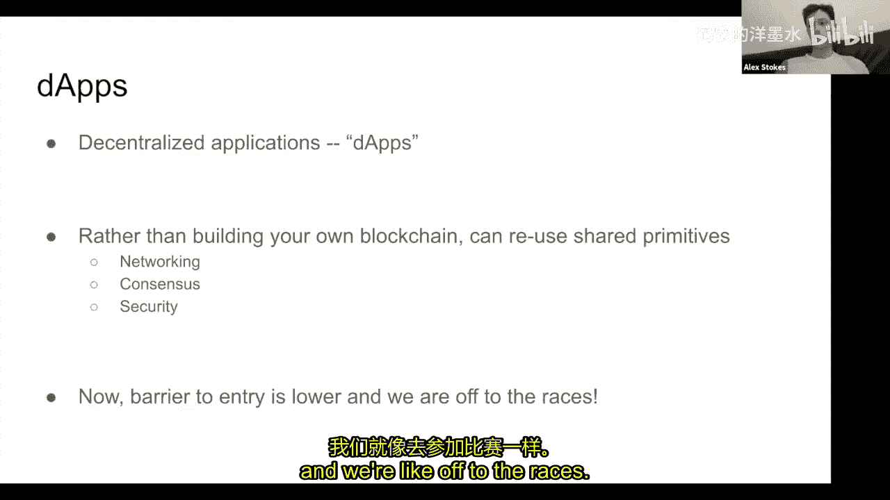

Im going grab a little water， but I have this next slide here， which is。An example。Of。

Let's see what would this be this is essentially like contract interactions so the way to think about this is like different apps you know it like visualizing the ways that different apps can interact with each other。

So you know here are some appss here are like some some of these applications on Ethereum like MakerDll。

 like Gueno swap like compound like auger and we can go into maybe at the end like in more detail about these if you'd like。

 but either way you have all these applications and you see it's like okay。

 there's like so many people that have like taken loans on MakerD and that's all these like this is like it's the biggest bubble here but this constellation of all these little blue dots。

But then what happens is people are then you know they're drawing assets against collateral in these loans right and so now you have the stable coin die and that's what this like little oh wait you can see my cursor Okay so this little。

This。Little constellation of these dots here is like people who are to take dye from their maker do positions and then putting it into compound either to like borrow or supply。

I suppose they're supplying it， but either way， they put it into into this compound market。

And we see here， you know there's all these these you know network connections and things the reason I point the sorry the reason I put this here was to show you with the next slide。

 so this is November 2018 at this point in time it was like defi was like on the horizon。

 it was like something we were talking about but it really hadn't quite been proven out at least in the way that it has now。

Because now you can see。A similar graph and you know from earlier this spring this is just like absolutely explodeed and this is this is I mean I can tell you this is a。

Tiny， tiny fraction of like。The space at DI that's happening on Ethereum today and this isn't even looking at like other other blockchains。

 you know， other decentralized applications， all this stuff。

It's just absolutely exploded and at least in Ethereum's case a lot of this is because of the way it's designed you can have these contracts。

 these Ds that can talk to each other again really easily so then you get this composability almost for free and now you can say okay you know there's a community that's like focused on making a platform to trade these tokens and then now you have other communities that are like letting you like use the tokens as collateral so now you can like draw a alone and then the loan can be used to like you know get leverage as like trading and synthetics such as another exchange and anyway you'll get into more of the details of Efi itself the whole abbdhole into its own。

Very exciting so I forgot to put the in but basically the。

The point I was trying to make here is that you might have seen early images where it's like the early Harnet connecting just like a few universities and like。

 you know what the early 70s or something。And of course， now the internet is just like。

This absurd of string that just bunch of tubes and anyway you'll see stuff in media about this stuff trying to make similar connections that like DI is going to blow up and do a similar thing。

Thosees about all this stuff just to disclaimer right this is all super early experimentalial technology but。

Either way， it's a lot of fun and we'll see where it goes。

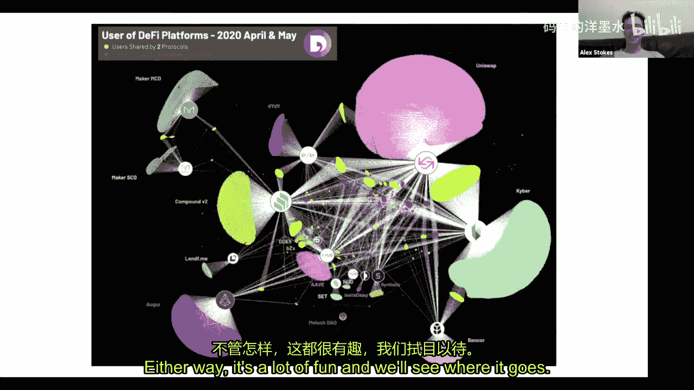

Okay， so。Another analogy to the web today and this is for Ds in particular is like I want to give across this notion rather than think of them as like decentralized applications because its I find that kind of like people up one way to think about them as like sub protocols so you have like。

You have Ethereum right as like this blockchain protocol， then you have sub protocoltos。

 right protocols within the Ethereum protocol and these are the dos。

And again an analogy so we have Twitter Facebook you know pick your pick app today。

 but there are some protocols of like HP right and then HtP in turn is like running on top of TCP and IP protocols and it's just this this layered thing that provides all these you know different layers of the stack and then end up being we'll just slide to say like the Twitter protocol like you know like Gmail is almost its own you know。

Protocol itself that's replicating email either way that hopefully is like a mental model that will help。

This is a bit of an aside。Again because I do have blockchain sc on the mind and it is super early so some of this maybe is like TBD we may not need it it may be super important who knows but essentially we're likely to have layers of the blockchain stack in the same way that we have layers of the internet stack right so and again this is an analogy to TCPI I wonder there we go yeah。

TCPIP。And then like applicationss on top of that right so like you know at the bottom there's like ethernet then like you know IP packets end up inside ethernet Fran TCP on top ofP on top of that so now there there's layers to blockchains and so Bitcoin and Ethereum these are you'll hear the terms like L1 and L2 like layer1 and layer two thrown around。

You can imagine like a layer three， but again we're still working on building out layer two。

 so it's an decided clear that layer one is going to get us what we want so。

That might be getting ahead of ourselves， but either way， if you get stuff， you'll hear layer 12。Um。

 some layer twos you might hear about are like rollups， like optimistic rollups or ZK rollups。

Plasma is another one， state channels。There's a whole zero of like。You know。

 point design space and again， we could chat about that a bit towards the end。

But I was just wanted to mention it just。So you guess your layer two so just a quick question Alex are your layer at three is it more like going to be like a cross chain type of Yeah yeah so again layer layer three is I don't know if anyone even really talks about layer three but the idea would be right so there's like let's say Ethereum is our layer one then we can have like an optimistic roll up that sits on top of Ethereum as the layer two what that means is that you could basically imagine there is another blockchain。

That essentially every so often the state of that blockchain is committed to on L1 on the base layer and then what that means is that all the transactions at L2 don't have to end up on the base chain at L1 and so that's how you get your scalability and then from there you could imagine now we have multiple L2s and then so the big thing here is like we want to actually be able to have the same notion of composibility I've been like harping on。

Between applications and if the way we scale is we put an application。

layer two construction then there's not a direct way for two different L two constructions to talk to each other so then we may want ways to like have them talk to each other and then yeah it's you know cross cross sh crop and these are all kind of getting at the same notion of we have these like distinct systems and there's not a direct way for them to communicate so like how do we do that so yeah but you're right like as an example like。

We can imagine some layer three thing where it's doing some like weird optimistic locking between parts of like deck state on one L2 and to another L2 yeah so at this point this is just like super experimentalal and just kind of。

Gffin but。There's a lot here。 I mean， the point to take away from from this just now is like there's a wide open design space。

 We don't know how this stuff is gonna work because it's so early。 So like。

 if you're interested in this stuff and your're listening， like very much， please， you know。

 get involved。😊，Okay， and just throw this out。Here's when you can see I actually I had to like cram the slide in a bit and of course there's more stuff than this。

 but some example pole of depths。那。So， the。Common example would be like just tokens。

In the same way that like BTC is a token on the Bitcoin blockchain。Now you can have you know。

 pick some token like maybe you want a different issuance schedule than the B the BtT sorry the BTc token provides。

Or you want a you know different like maybe you have something where for every every transfer of this token it actually like sends part of the introduction value as a fee to like a common treasury like there's all sorts of things you could do if you want to have your own semantics around you know these token transfers then it turns out we have a standard for what a token should look like and theRC 20。

And this is just like you know if you have an interface and you know pick your programming language right it's the same idea where it's you have like some behavior and then you have different implementations of the behavior and maybe they're like a little bit different。

 but in the ways in that you care that they're similar right they all conform the interface and so ERRC 20 you'll hear this term thrown all the time because people just love tokens and。

A220 is our token interface on Ethereum。So that's an example another example would be like even just alone and again this touches on some of the Dfi stuff。

 but maker Dao is like probably the。Premier and or the earliest example of this。

 you could think of it as a decentized credit facility。

What that means is that basically I could lock up， say my eF。

 my ether as cloud in the system and then draw debt against this， right， this collateral I've locked。

And it turns out that you know the unit I can draw against my collateral is called die and there's some like fascinating economics and like game theory involved to ensure that the value of one die is like targeting1 and then that leads us to the next category。

 which is stablecoins。So again， it's like if you follow this stuff all。

 you'll see that you know Bitcoin and Ethereum or Ether， I should say they very much have a price。

 but it's all over the place， it's like super volatile because this stuff's early and there's a lot of you speculative activity and all this thing。

So it's really handy is to have。The properties of these programmable currencies。

 but you know you might not want to be exposed to the price volatility of these of these assets。

 so then people have made these derivative constructions， examples being dye from makerd。

Even like USDC and know there's again， a whole industry of stables。Pppping up， but either way。

 the whole point there is that they target， say $1 or you know there there's some fixed peg that they target to not expose the end user of the holder of currency to the price volatility。

Another example would be at a centralized exchange you'll hear DX again this is they gotten really popular especially this year again swap being the premier example this is very much like again like if you go to a stock exchange right like if you have a brokerage account somewhere you could like go and like buy shares of let's say Apple right so then you like trade your dollar for shares in Apple。

Similarly， you have like say die and you know。MKR， which is the governance token to make her doubt and let's say you want to like trade those right so unisof facilitates that trading on chain which is super cool that you can even do Another one would be prediction markets examples are auggar Omen。

Games NftTs， that's short for nonfunggible token， so whereas an ERRC 20 is fungible in the sense that also fungibility in general is like if I give you a dollar。

 you don't really like let's say I have like $4 bills。

And i'm going to give you a dollar you don't care which dollar I give you right because they're fungible meaning they all like$1 is1 if something is non fungible then it adapt does matter so an example can be like。

Tokens that map to like。Well I guess we'll use a crypto example I mean like a big one is like you could have a token that basically maps to a work of arc right so let's say like the Mona Lisa was tokenized on the blockchain。

Then you would basically have you know， smart contract。

 which again we're about to look at and that'll make sense what that means。

 but they'll be you know on the blockchain， there will be a a record of you know。

 these these tokens that map to。This work of art。And then you could imagine fractionalizing the work of art because now instead of just one token maybe there's 10 right so now it's kind of like owning like you know one token is one out of 100 shares in this work of art anyway again there's like more here than i'm going to like have time to talk about in like the next hour or whatever but。

Big stuff。You're in the right place。Oh okay Dos well so this one's actually really interesting a Doo is the decentized autonomous organization。

😊，And the idea is that we essentially want to organize people and our capital on chain。

What this means is you know a very common mode of organizing people today it' society is like a for profit company right it like a Delaware Sea Corp you could say right and then so you have a firm and people come to the firm and they produce work and you know this is how we organize a structures society。

You could basically start to like。Represent these different functions and code and then now you have this thing living on chain that is now like taking contributions of labor or capital。

And again， I'm not going to have time to do it justice。

 but there's like a whole design space here for like sort of novel ways of like organizing religious people across the internet。

Super fascinating stuff。Okay， so we're going to now get into you know very specifically like solidity and。

EVM and some contracts themselves and look at some code。

 I just wanted to stop for a second and just like ask generally if there are any questions so far。

Yeah。Well very fascinating， very exciting， it's it's okay if there aren't but I also yeah。

 I don't see， I don't I don't want to be boring anyone and I can't know 1 ways this is the we never can you explain the quadratic quo？

Sure， I just gloss over that。我事。So this is an example of what I mean when I say that。

We have a chance to experiment with like different ways of organizing you know people in the world。

And here's an example and it'll mix sense what I mean by that so that because that's a pretty abstract statement。

 but what I mean by like yeah so the example here is clubra voting traditionally if you think of like say democracy or like you know anything where we're voting you know we could say okay。

Well here I'll how about we like have this example here so we're all in this class together we could say let's vote on。

What the next lecture should be about right and options everyone gets some tokens and basically you could say one token corresponds to one vote and then you could we could even go further and say oh there's now a smart contract on the blockchain that what you could then say is okay。

You could essentially， you could think of it as like depositing your token in one place or another and in doing so you're you're signaling that you're voting for one lecture over the next。

 right？嗯。So already， here's like a cool example of like something you can imagine。

Qudra voting in particular is actually saying okay。Are there better ways to vote？

With the example I just described。We basically and this is actually a lot of the stuff works today basically say one token on the blockchain so people do actually do this type of voting where it's like you know so an example that I could give is maker do that I just mentioned where it's this whole like you know some people almost call it an centralized bank because basically it's very much like a central bank where they essentially have to like manage you know there's like a debt ceiling and their whole because they're know again their whole mandate。

 which again if you follow this up with the Fed and the central bank it's like an almost has one to one but basically there's a mandate of the maker Doo Doo people who are part of the maker Doo and what they effectively have to do is manage risk of the system such that they maintain the price peg。

Of one die is one dollar。So。Sorry， let me。I realizing I'm just throwing a bunch of stuff at you and if。

This stuff isn't clear it's going to be easy to get lost， but either way。

 the thing for me is I just don't understand how it's quadratic in that kind。we're not there yet。

 yeah， why would you use that term？Yeah yeah， we're not there yet， sorry。

We're voting and then it turns out that if we're voting basically then it turns into what we're going to call up autocracy。

 which is essentially $1 is one vote， which doesn't。You know。

 mesh very well with a lot of people's understanding of how we should be able to express， you know。

 our desires or our preferences。Right so one way to think about mitigating this is a mechanism called quadratic voting where you say。

 okay， rather than it be one token one vote， basically the the votes you get scales quadraically well I should say it takes a quadratic number of tokens to express you know that much voting expression power so to speak so for example。

 rather than。10 tokens means I have 10 votes let's use this square so rather than saying 16 tokens is 16 votes 16 tokens is only four votes and so basically it's scale how much points you have。

You know via how much capital you have lying around and again this is to close the loop this is to try to mitigate this issue where you could have people who maybe have a bunch of these tokens and maybe they're not super active or like super interested in the particular issue。

 but they could still you know come in and like swing the vote the last minute。嗯。

So yeah that's that's what we mean here by quadra is just that there's like this non nonlinear relation between sort of your voting power and like the signal to vote and the point here being that。

Zooming out because I know we got way down in the weeds。

 but zooming out a bit the point here is that。In this example in particular at least what it means is that we can experiment now with these these things that before for either like legal or regulatory or just like you know means of inertia we were not going to be able to really probably ever do right so like for example like well almost never see quadjag voting。

Like at least I don't think ever see quadratic votingted in say like an American election。

 anytime soon， it could be the case that this is like super successful at like mitigating some issue that everyone sees or agrees happens in elections and then maybe it bubbles back out and that's a lot of what I see is really exciting about Tas in particular is this opportunity to experiment with these ways of organization。

That we just， you know。YouRe practically wouldn't be able to otherwise。

Did that answer your question I know I kind of walking up all over the place， Okay cool。You're like。

 that was way too much like I just stop talking。嗯。O。So。We're going to dig into smart contracts。

And okay， so yeah， hopefully now it's like you at least are vaguely interested in like why are we to care about these smart contracts。

 thes and all these things like why it be cool to have a programmable blockchainhe compared to say Bitcoin that is not programmable。

And the way we do that， the way that we do this is when to have。

Some notion of terrain completeness in our blockchain itself。As it turns out。

 the way that you make one of these things， this blockchain， you know。

 we weren't very clever when we name we really just mean the chain of blocks， you have a block。

 the block has one thing it has is a reference to its parent。Via it's hash。

 the block hash that also has like a bunch of transactions and these transactions have a particular order。

And so the idea is that if we start from the Genesis state from the very first， you know。

 we all agreed to some starting state。If we start from that state and we play all transactions in the exact same order。

 then it turns out that because these computations are deterministic we end up with the same state at the end right and this is like you know that's this。

The breadren butter how is blockchains work this is why we like talk so much about consensus is we need to have you know every there has to be a global ordering of transactions on the network right so anything that we see you know this could be like 10 years from now halfway around the world you need some way to figure out the order transactions I view today you need to have the exact same order because then。

Then we can agree and we can actually have like actual shared space， shared ledger。

to give you like sort of an everyday example it's like just look at your bank account statement this is what they do it's just a list of transactions you make you start with your beginning balance you you know sum all the debits and take away all the credits and you haven't any balance and this is the same thing。

Let's see， okay， and so then like I'm kind of getting out with Bitcoin。

 so in particular the Bitcoin computer， there's a virtual machine embedded it to the Bitcoin client。

I'm assuming most of you know what a virtual machine is。

Essentially the idea is we like emulate a computer so there's like these low level instructions that say hey。

 you know， take this number and add this number， take this number and subtract this number and do all that stuff。

And that's how you sort of express the effects that you want。诶。In your virtual machine so。Either way。

 Bitcoin has one of these it's called script， it's actually like relatively simple again because it's kind of by design。

 women it did not be that complex。It's a stack based language。

You've studied virtual machines that means something to you just refers to like memory organization basically。

And again， the only thing you can really say with script is you know verify the scriptptographic proof that you own these coins and then if so。

 you can basically move them to another address right and then the way the Bitcoin actually works is transactions are just like these again their chains of these these commands of here are some coins move them to like the next address。

 here are some coins move them to the next address and you just do this you know forever and ever。

There are there is support for multi signatures built into script and so what that is is rather than just requiring。

Me to say yes I own these coins and I move them over here you require multiple parties to sign off and there's a number of reasons you might want this so like it could be handy if you like let's say you want to have like a trust of bitins on chain and you have like multiple parties that are like governing these coins right you might want to say have three out of。

Seven of your board members like sign off on something before you like move some funds。

And you can do some very basic computation， but like you know， for example。

 a big thing you can't do is like write a general for loop， you can't say okay。

 for every address in this transaction。Do do some computation and again。

 this is by design I think this。Yeah， well so here's an example we'll get you in a second。

 but it was by design because。The claim was essentially the more general thing that Ethereum does is actually like less secure or at least it's harder to get right and so the thinking with Bitcoin was you know let's do one thing very well and that's what we're going to do there's actually sort of like greater space for a attacks to be carried out if we have this like more general turncomp bi。

And here's like an example of script you know， you can look at it from different ways。

 but basically you know there's like the raw sort of encoding of the bytes。

 the bytes are you know the byte codes of the VM。Which， by the way， if。

That's unfamiliar terminology like speak up or signal somehow and I can explain more otherwise i'll just assume you know i'm talking about but basically。

There's these like core instructions that tell the Bitcoin computer like what to do next。

And an example here is this is like a very standard Bitcoin transaction。

 which basically just says verify that。So the way it works is you basically have your public key that is put on Sha or in the transaction。

 it verifies that the public key hashes to this pub key hash。

 which is actually how Bitcoin addresses are。You then verify that it's equal and then you actually check the signature and we can work through this setup up by step if you want it's not super relevant other than the fact that it basically just does what I said which it checks that the addresses match and then also that there's a valid signature and so what that means is person who did on these coins。

 in fact signed off on the fact that they want them to be spent。Yeah。

 and kind of it and that already you can see that。😊，We can't quite say that much。This page here。

 the Bitcoin Wiki for Scs goes into a lot more detail that's where this example came from and I'll point you there if you want to want to see more。

好。I just excellent。Sorry。😔，能。No， maybe that doesn't matter。You can still see the slides， right？

Yeah we can use yeah all right， yeah it just it like to the full screen I wasn't sure if I mess something up so。

Like I said， Bitcoin is simple on purpose again the rationale is kind of it's easier to secure something that's less complex there's like less tax service。

 all these things。U， you don't want to like pay for the capacity budget right if you can get around it。

And that being said。Like I alluded to in the beginning。

 there are all these thoughts and ideas around these like more advanced applications that did more than just like a simple to transfer and so that's where you know the idea for Ethereum was born。

So again。I had one question so these you said before something about having multiple people sign off and then having those the Bitcoinins being paid out。

 what actually does a sign off look like in Bitcoin script？Like how would would somebody。

 how would somebody sign off？Right so。

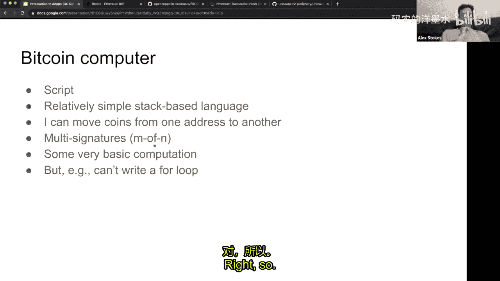

If I'm lucky， you can still see my screen， right？Can you see they going to the wiki page here， yeah。

 I can see。Okay， cool。I think it's in here， multi seg。好，你边来。Anyway， leave。

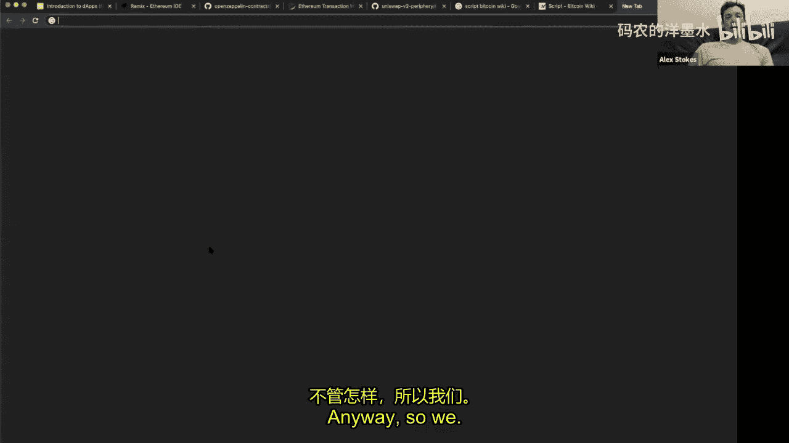

The way that this works is it goes。One by one， oh hear it。

 let me just oh this isn't what I thought it was。So I believe the way it works is that how it would look is that so the way that Bitcoin transactions are generally structured which is actually a little bit different from Ethereum。

 but the way that it would generally work is that let's say we want to do two of three multi sg meaning you want。

Rather than just one signature to move the coins， you now need two out of any three or any two out of three possible signatures to actually move the coins so then what it would look like is the coins would be moved into an address I'll use the word encumbrance。

 but basically like the way that you then can move the coins is you have to have a two or three proof。

And the naive way to do this is you say， okay。The way it looks sort of。

 are you familiar with what at UTxO？No， sorry I'm muted no nos that's no no it's all good I just want to calibrate before I。

😊，Grow off in a rabbit hole。 So the way it would look is that。Essentially， there is。

Let's say a reference， I mean people talk about it being a puzzle basically how it would look is that you could go on chain at any point in time and you would see that this multit has been set up and like the things you could take away from just seeing that public data like on the chain at that point in time would be there are three addresses。

And you know some other script that says you know this is a multisig and then the way that you would spin the coins to answer your question is you would then later have another transaction that says。

 hey， I want to spin these coins， here's two of these addresses and then the way that I believe it works is that and this is what I was trying to look up here on the scriptweki but either way I believe the way it works is it actually just goes one by one and says okay for the first address。

 check the signature against each each pair， each one of the pair。If you that doesn't fail。

 okay go to the next one in the set look and check the signatures that are provided if that fails go to the next one and then eventually you'll do this like pairwise thing until you find to that match if the transaction will succeed and then you can move ahead。

Does that make sense？Yeah， I think I have a general idea。 Okay， so you could。😊。

I think you could imagine like a more like sophisticated multisG operation but then you'd basically have to I mean the way Bitcoin would work is you essentially have to big that into like the client itself whereas like in Ethereum you could like you have the ability to just like express that more directly without having to change the underlying protocol and one reason this you might care about this is it' actually very hard to change the Bitcoin protocol some would go so far as to say that you can't really do it anymore there's this whole notion of like protocol osification which again we're not going to go into right now basically。

It turns out that。You may not want to change Bitcoin and you can claim that that's good for its security right if it doesn't change。

And so because of that， then there are many people with many vested interests making sure that you can't change the protocol。

 which is fine if Bitcoin does like if Bitcoin works for you， then that's fine right。

There are a lot of other applications besides Bitcoin that we could imagine and this is kind of where Ethereum again stepped in was saying hey。

 what about all this other stuff we should actually just make a sort of base protocol that can do the generic thing and do it well and then people can safely build all these applications on top。

Was that helpful Yeah， oh yeah， definitely， definitely thank you。Of course， yeah。

 any other questions？So， sorry， I'm kind of new to this as well。

 So my understanding is that Bitcoin didn't originally have didn't have these， essentially these。

 I guess， let's call them spark contracts， these scripts。

 how how does that get added into Bitcoin afterwards。

How does that process work because it seems weird to me that you could do that to a ledger that's supposed to be。

Right， so like basically， how would you extend the Bitcoin protocol with new stuff？

That's the question。Yes， specifically， I'm interested in this particular case of these scripts。Sure。

 yeah， so okay， first thing， don't worry if you're new because literally everyone is new。诶。

Im the experts in this space and they've been studying this stuff for like at most 10。

 maybe 15 years if you want to even go before like stuff we'd actually call crypto so like。

Every woman is new， we're like all learning together。

 so don't let that stop you from like asking a question or like trying to figure out what's going on。

Unfortunately this stuff is also all very complicated。

 so there are definitely like many questions to ask。Aside。mOkay， so。If I'm hearing you correctly。

 the first thing is that so this actually is the way the Bitcoin works is that everything is is like a statement in the script。

 this language so。Even just like the， I mean， this is what I was trying to get at with this example of that。

Even something as simple as just moving one Bitcoin from me to you。

You write it in script and so every operation on the Bitcoin blockchaincha is done via script。嗯。

That being said， again， there's a very narrow set of op codes or sort of semantics operations。

 things you can do with script and that actually limits the expressiveness if we wanted to extend it。

We would have to essentially， in Bitcoinquiin's case， coordinate what's called a hard fork。

What this means is that there are a set of rules in in the Bitcoin clients right so I mean if you think about it like the Bitcoin client itss only purpose is to like operationalize this fact that we've all agreed to a certain set of rules right like you can honestly ignore the software there's there's a shared contract that like we all believe in this value thing and then the fact that this value can be transferred and like you know there's the semantics attached to it like this is thing we've all agreed to do。

After the fact， we've decided to write it and sort of encode it in software。And that's the artifact。

 but the high level thing is that there's just these abstract set of rules right so the way it works is because consensus is so critical if you want different rules。

 at least rules that are inconsistent with previous rules。

 you have to basically write a new client that is incompatible with the existing network。

And the reason it's a fork is because you could think again of this channel blocks。See。

 I don't have a nice setup like if this are like at a whiteboard， I could actually draw this out。

And I think some people do this tablets and things， but anyway。

 there's a chain of blocks and then you could just literally imagine we have shared rules up until like this block at this height and then you could add a block here with the old rule set。

 but you could also add another block over here with the new rule set and then basically build a for profit of here。

Um， and that that's what happens， I mean， there have been many forks in Bitcoin's history。UhYeah。

 and like again， this is like a whole different talk， but basically，um。

 you know one example would be。Bitcoin workinging into Bitcoin cash。Right。

 this is I believe in 2017 yeah， where essentially there is a huge debate over the block size so I mentioned right that blocks are these these links together bits of blocks。

The blocks are you know you can serialize the blocks as as these bys right and so then the question is like okay。

 how many bytes， how big should the blocks be？And the reason this is important is because if you have bigger blocks。

 you can fit in more transactions and you can fit in more transactions per over unit time right then you could theoretically scale the blockchain because again。

 more transactions per second。to give you a point of reference。

 like Bitcoin point today is maybe around 10 transaction per second， Bitcoin Ethereum， you know。

 roughly order magnitude。10 transactions per second。

 something like the visa payment network is processing like 10。

000 transactions per second I think it they can peak up to like hundreds of thousands of transactions per second right so。

Orders and magnitude difference and if we expect to build you know competitive payment networks at these base layers。

 then we're going to like need to do something and probably something drastic， right？

Just because the differential is just so great， but one thing we can imagine doing is making really big blocks so right now a point block is cap at one megabyte。

诶。Essentially， I think technically， it could be like your megabytes now。

But as counted as one megabyte。Again， that's a whole different conversation but。

The point being is there is a huge debate， everyone was on Twitter arguing about this for like months because the reason we care is because the bigger the blocks are。

The harder they are to process。 And so again， we have very strong norms in this community around like crypto in general that we want。

 you know， we don't want to exclude。Certain people from like participating in that right if they choose to。

And this gets into this notion of decentralization where the more people you have contributing to network work。

 the actual more resilient it is， right， because you don't have these like singular points of failure。

To give you an example， you can imagine like you know there's some legal action against Vi and they're taken down and then suddenly like this whole payments network that you know we may use right to like or better examples like Venmo like I can send you money on Venmo but then like let's say for some reason there's like legal action against Venmo and they're taken down and suddenly like I can't do this。

 right？It'd be very nice if we have institutions like this that could like last。

As long as we want and aren't really subject to these sorts of pressures and the way that we achieve this is we had a decentization and having these like really strong diverse networks。

So it's very important。To close the loop， it's very important to have you know。

 blocks of a certain size， you don't want huge blocks because that means that only specialized actors you can like either afford or have the ability to put lots of capital into specialized hardware for processing bigger blocks。

You know， can do this。So。Sorry， US belt works， so basically。Yeah。

 there is a whole thing about about block size you'd have to you have to change the protocol and like in Bitcoin's case it's very hard to do for Ethereum I would say maybe we're a little more friendly to Forks but that's more just because it's like hey there's like very specific things we need to do to like change how the protocol works and it's usually pretty clear that they're like net wins for everyone and so then we can like pull them off but then even still it's like。

We at this point probably get like one hard fork a year and like。

There's just like so much work that goes on behind the scenes and like actually pulling that off。

 you know，um just because like it may sound simple。

 but it's actually really complicated because in part because it's like。

You can't just like go to one you know， central actor and be like hey， update your software。

 you just have people all over the world running this stuff and like you have to hope that they hear about it and agree and can actually you know deploy these changes。

And also if I were to just add one side comment is that in Bitcoinin nothing has changed so the original language as we can say more or less is the exact same thing so now if you want to be able to support more interesting application as Alex was describing you got to go to layer2 because in layer2 you have a lot more so you can pretty much do anything you want in layer2 but in Ethereum from the start they had this smart contract so they had this twouring completete language。

 they weren't limited to this unspent transaction model so the limitation of the Bitcoincoin doesn't really exist in Ethereum by design from day one pretty much。

Exactly， yeah， so we， you know， we wanted。There are other parts of the protocol you could like imagine you went to change。

 but you know。This was apparently an important one was to have the ability for the sort of end user or the developer to be able to specialize the blockchain software in this way and so here we are so okay I'm I'm happy to field more questions。

Where maybe。Some well， we should keep moving， I suppose there'll be time at the end for more questions。

 but now we're going to look at the EVM。Wwhich is you know in the way that we were just kind of discussing the Bitcoin computer。

 you know， we could talk about the Ethereum computer and whereas like there is a Bitcoin VM script。

 but it's kind of like it's not necessarily a very direct thing that was again kind of。

TheThe bread butter of Ethereum was to have this like during complete VM so you see it a lot more you know front center and this is the EVM。

 the Ethereum virtual machine。Okay， EVM， again， like a super high level。

 it's a stack based VM also like script， but then there's also like there's so there's an ephemeral memory meaning that during the transaction。

 there's like memory like you'd have RAM on your computer。

 there's like memory sitting there for sort of smart contract execution。

Very helpful also is that there's persistence memory so like you can imagine there's like your hard disk on your computer we have that basically every contract has its own local storage or private storage is it to say private because again everything is public unchain which i'm sure you guys have touched that touched on that somewhere else。

 but。The key bit is that it's not just that， you know， you can have these like sort of。

 we could call them pure functions or like just pure computations where here's some inputs and map just and outputs。

 you can actually now have like state stateful execution。

And think the whole point here being without getting into too many specific details is just that we can now have these like very rich applications on chain and it lets us you know implement these。

Applications right that we may want that either weren't possible， I mean yeah。

 they just weren't possible for so。嗯。😊，VVM has rich memory。

Is the point there it has again these op codes， these like sort of very small operations for things like basic arithmetics so like adding subtracting division multiplication you know bit shifting if you need to do that logic so like you know like logical and like a bullolean control flow so like if some values to a false go over here go over here in terms of execution。

And again， if you've studied， you know， this stuff， you'll see this is very much just like。

 you know how we think about building computers today。

Like general purpose computers right so yeah like。We are an EVM， we've done this on Ethereum。

 and that's great。If you have a transaction on Ethereum essentially there's two types。

 so the first one is you can almost imagine it's like hard coded into the computer and it's like transferring E whereas like a Bitcoin you're pretty much you know transferring BTC we now have ether transfers and。

The way to think about is that again they're kind of hard coded as a social case of like， okay。

 here's an account and this account has some ether and then I could actually smooth ether。Separately。

 I can have a transaction goes to a different account that has some stored byte code。

 which we'll get to in a second， but essentially it's stored you know there's there's code that's already been deployed onto the blockchain and I can interact with it by calling it as a transaction so I can say rare than send E from you know Alice to Bob I can say send E from Alice to。

Insert smart contract address and we'll go look at that and it'll make more sense in a second。

But for now to stay with me and what happens in that case is that。

If there does happen to be byte code there， the B code is loaded that's actually executed against your transaction input。

 so very much just like a computer would do。And this is how you get this like smart contract thing。

If you have studied databases at all， there's this notion of less storage programs。

 which is like I think very analogous to my understanding or basically like you actually like。

Send some code into like your Postgres database and so you could call it to execute against like inputs and store data and stuff very similar idea here where you can deploy some bycode onto the blockchain it's stored forever you anyone can then call it and you know handed tokens handed ether like whatever they want to do whatever you and then the contract you know written into the EVN bycode is like the functionality of the contract so it could be like block up my coins for 400 blocks it could be trade my tokens for these tokens over here I mean again like the sky is the limit and'。

Just at the very beginning of trying to understand like what all is possible with this stuff。

Um and when people say like call a contract， this is what we mean it's sending a transaction to one of these deployed units of code。

 the code then executes with transaction as input and does some stuff。

Okay let me look one second well okay we'll just push ahead so I was going to jump to there's this handy website called bether scan where basically it like kind of is like a way to view the blockchain and we could like see a little bit more concrete some of the things i'm saying but just stick with me for like really one more slide and then we'll get to something that's a little less dense I think。

Okay， so。We now have this like super general like。You know。

 computation context on the blockchain like that's awesome。诶。

Are there any problems and like you know， I kind of alluded to it earlier where with Bitcoin the issues are you know。

 there is an explicit design choice against this because you know， of security concerns。

And to give you an example， let's say now we do have this like terrain complete blockchain where anyone all over the world can like deploy arbitrary code and then do arbitrary things with it something I could do is like let's say you're humming along like processing blocks。

 everyone's like sending transactions and trading tokens and then you know everyone's having fun。

And then suddenly like I broadcast a transaction that executes like an infinite loop right because again。

 I told you like this is a generic computer So one thing I could do is just say you know。For。

 you know。Forever while this thing is true and this thing can be set to true such that this always executes。

 right， do some stuff。😊，And what that would mean is that every  noded in the network would like get to that transaction they would start to process the transaction and they would never leave the loop right so that obviously then is terrible because it basically just halts the whole network right so we can do that and the way that we get around that is we have to extend our computation model with not just like here's this turning complete you know environment you now have you know we could think of it as like meered computation。

Where you basically have to pay for what you use， which makes sense。

The units of this consumption are called gas， you'll hear that if you're in the theory of it all。

And the way it works is that basically every byte code that you execute has some gas cost。

I'll skip ahead because I think this might help so here's an example here of like some bike codes。

You know， this is like。You know so this is like a hex encoding of like what would be in the transaction。

 And here's the link if you want to look at this later。

 I'm not sure what this does or if it's like super。They might just be more of an example。

 but either way， you know， it's like。When the EVM goes to interpret， you know value byte 34。

 it executes the call value op code and what that means here in particular is tell me for this transaction was any ether sent。

 right？And that could be like no ether， it could be like I mean pick your value right so its just telling me if there's ether attached。

The next one is like， so this is like again， this gets to like the low level nature of this environment。

 dupe one is saying basically like duplicate the top stack item。

And again this gets down just like the very low level mechanics of the EVM itself， you know。

 generally in the high level languages that you're used to like say Python like you're not thinking about this type of stuff and that's because you know you're targeting a higher level and solidity we're getting to is that higher level language that we have but again we're still at the lower level the EVM。

I should have said this the way that you can think about this is like as assembly。

 so like if you are familiar with like assembly programming。

 say like X8 sticks right on like your laptop， the EVM is like the version of assembly that's executed on chain。

And like at super low level， like you usually really wouldn't be writing in this manually。

But it's ultimately what's executed at the bottom of it all。So either way。

 the reason I skipped ahead was because again I wanted to point out each op code and so each op code here right has some gas value attached and then what that means is like you know let's say it's 5。

 10，5，5，5， 10， 25 right you basically for every executed op code you sum up all the gas and you'll get like 25。

000 gas then what's happened what happens beforehand is you commit to a gas price in the transaction。

And we'll look at a transaction in a second to make that more concrete。

 but basically you commit to a gas price， you multiply how much gas you use by the gas price。

 which could be like， you know， 10 to the minus nine ether。Per gas。

It would be like a somewhat reasonable gas price and in that basically is an amount of ether that you have to pay to have your transaction included and this is the transaction fee。

Maybe do this now just to give you a rough sense of like there's actually a gas market right it's like people use this stuff actually and so。

These are actually relatively low right now， like over the summer， for example。

 like these were up so okay， there's a gigaway， which is a unit of ether。啊。

The way that a dollar is divided into cents。A Bitcoin is divided into Saosshi and ether is divided into wayi。

For the reasons that we have one way is 10 to the minus 18 ether right or like 10 to the 18 way is one e。

So this gigaway would be10 to the nine way so basically it's a very very small amount of ether right so let's say if I have。

500，000 gas。Well， we'll just tell you right， it's for 500，000 gas。And let's say we do 40 gigaway per。

Gss， so that many。几个位。And then five by 10 to night， is this going to work？Okay。

 I should not have done that live anyway。We can circle back to that。

 but the point being is that there's a fee and yeah。

 yes this is what I was talking about is the guess here's a guest schedule so again it's like here are these app codes right that we saw。

😊。

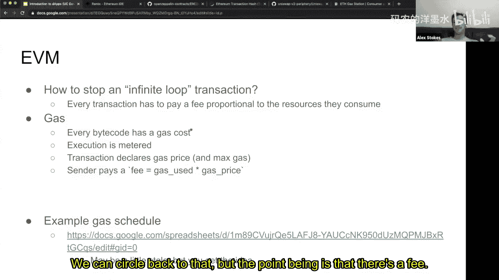

And ultimately they end up costing some gas so like if I execute the ad op code。

 which is like adding two editorgers together inside the EVM， I'm going to pay three gas。

So hopefully that makes sense。That might have been a lot。And one second。

 someone was asking for this link。Lu， I will have the slide shared with everyone， so。

I think they can okay， yeah yeah， the the slides should come out yeah they'll be。Bub ground。

I just lost the chat。😔，Okay。Either way， okay， so we have gas as like a way to meter resources and that's because otherwise right。

 there's like obvious ways to attack the network。Okay， and then here's bycode， you know。

 here's EBM bycode and things that it does。Okay， so I realized I just probably threw a lot of jar at you and。

Probably it was too much but。I want to now look at， for example， an actual e transaction that I just。

 you know， this is hours ago that I found and you can kind of see。

Some of the stuff I'm talking about so。好啊答案。Not that either， I'll just click link。Okay。

 so here's what I found this was what two and a half hours ago。And it was basically an E transaction。

Not to a smart contract， but just an E transfer。They might not be super clear。

 but basically be there would be bycode attached if it were the other type of transaction。

And we can see it's like you know the transaction says transfer 9。

8 eF from you know this address here to this next address and someone has gone and like figured out that this is actually an address belonging to this exchange so this is like someone withdrawing ether from an exchange so like I could go and like let's say I want to like buy some me one way I could do that is I go and deposit my dollars into some exchange like。

I've never used crypto。com， but let's say crypto。com， I trade。

Whatever the E price says $368 for one e and then I were like one of which all my e， right？诶。

Here's the gas I was talking about。Oh that's interesting。So， a。Simple E transfer。

 So just moving E is the cheapest it's the lowest amount of gas that you can。

Sort of do in terms of transactions on the network and so that's 21。

000 there's like no matter that the transaction， there's this base cost of 21，000。

They set a gas limit for much higher， which is a little weird but。You can do that。

Does that correspond to an opP code because I see one GTX costs 21，000 gas？Is that this？

Does that correspond， sorry I I'm just confused。No， yeah let's clarify so。哎。

It doesn't I wouldn't say it corresponds to off code what it means is that so okay。

 this isn't a great example because。啊。And this is what I meant earlier when I said that the E transfers are like kind of hardcoded into the protocol。

 you can imagine therere being EVM bytecode to do these things。

 but because this is such a common like special case of like moving the base currency that it's it's basically hardcoded in and it's like it lives outside the EVM within the client okay I see yeah but still so this is when you when you make it you know whoever made this transaction。

They did say they specified from， they specified to how much value， like in this case。

 how much ether went in， there was the transaction fee which they ended up setting via the gas price。

 so they pick the gas price because you could again。

 because there's like essentially an auction for blocks space。

This gas price moves all over the place， they picked that gas price of 29 gigaway and。

Because this was a simple E transfer it used this much gas。

 So what that meant then is that they paid this much gas times this price right。

 and then that's how you get to this transaction fee。Does that make sense？Yeah， I think so。Okay。

 yeah just multiing gas used by the gas price。Um， and then you get you end up with like units of away。

 which again， is just like a denomination of ether。Um so。I realize I'm running a little bit behind。

 but to give you a little while here， let me see it's okay if you run over a little bit。

 that's fine we typically do。Okay， good。So。Let's see what's fine here。Because yeah。

 no I want to give you intuition for， well， okay， yeah， that's where we're going next。

This is a simple Eth transfer was the first one， and then now this is the other type of transaction that is a smart contract interaction。

And again， what this means is that what we're doing is we are someone has deployed some EVN bycode at this address。

In fact。For this transaction and it turns out this is for this protocol called Ave which is essentially so it says lending pool this is if you've heard of compound or also a little bit like makerdoub but basically it's like a money market and so what that means is basically if I have some extra capital lying around like let's say I have a bunch of dollars I could like lend them out to someone like let's say I have more dollars that I need I could put them in this market and then someone who needs them for some amount of time they could actually borrow them from me right and there's an interest rate right so I get some some yield for like providing this resource and then you know they're consuming the resource and then there's again you compensation for that fact。

But either way。Ave is this money market protocol and。

I've not looked at the obvious smart contracts we could I was actually going to have us go look at unS in a second。

 but either way like the point being actually what happens if we go here so now this is the this is either skin by the way so it's it's a you know it's again。

Very popular block Expr for Ethereum。 And you can see there's all these transactions。

 These are all pending because people want to do things against Ave like。

know basically borrow or supply assets。嗯。But。Okay， so just because you asked in particular。

 here's like。Okay。诶。Apologies if this isn't very helpful， but it's kind of what you asked。

 which is I want to see the bike code for the transaction and so or for the contract。

So there was a transaction right this is where we started here on this page someone howeverever to for a blah。

 blah， blah， whoever this is right they broadcasted the transaction that was to this address and it just happens that this address if we click on it is a contract which means that it has by code stored on chain and we can go look at the bycode again because it's a contract it's indexed here。

And it turns out that actually because this is actually a very popular contract。

 they've actually gone and like linked the source code。

 the solidity source code which again we're going to get to in just a second but anyways what happens is the solidity source code is compiled down to EM Btecode that we were just talking about and basically this is this is this thing I have highlighted here again this is a hex encoding right so it's just like a bunch of base 16 numbers for like the code。

Um， so just like you could like compile a see program and you to get that out some binary。

 this is the same thing for the UBM。Yeah， so like you said before the in this is just a program and the input is the transaction that or the the Ethereum that they sent right right so。

There's a few subtleties that I'm probably going to gloss over because I don't think they're that helpful for this。

 but basically。This vb is executed and produces the contract code and then what happens is when this transaction is executed。

It includes actually we can see， okay， so what it does is basically say。The way I would do this。

 like if I wrote it manually， I would say。I want to， okay， so I say it's from me。To this contract。

I want to include zero E。I went to set a gas price of 27 gig away。And there's some input data。

 right there's some some there's like a transaction payload attached。And。不屎。

You know one way to look at it is like this so it's literally just that these bytes right it's just an he of these bytes it turns out that there's like a sort of convention that we all use that solidity uses at least in terms of how you interpret those bytes and so what happens is that。

Okay， so the way it works is that。Sorry， I've jump it around， but basically you go。

 if you went to call， say。对。Well， I'm not going find it。Here， let's say I want to call。

Get token distributor I basically hash this function signature and take the first four bytes and that is what we're going call a method ID and so basically what that means is you take that you basically you literally are just like type this you hash it you take the first four bytes that's what this says you then encode the parameters to this thing in a certain way and then that's how you end up building this transaction data right so you see here the first four bytes here are let's see1。

 two，3。This basically then what happens is this is executed in the context of the contract， it says。

 okay， I'm going to dispatch on these first four bytes and then basically it's a pointer into the compiled code。

It's then going to know how to read off these arguments。And then it's going to execute and。

I jumped ahead a bit， so let's go take a step back and look at solidity a little more closely and I think what I said will make more sense to everyone。

Because yeah， otherwise I'll get ahead of myself and maybe perhaps just a high level just。

What the flow is when did the contract went on the chain， what does it mean to invoke that contract。

 What does it mean to send those parameters and sure。

 just aed flow that would Yeah so the way that this will work。The way that this would have happened。

 I mean again it's all public so we can look， but basically Ave like you know the Ave team wrote these contracts and again a lot of this is like like well known library code。

That everyone uses a big bit that I'm probably not going to have time to get into is like smart contract security the takeaway is that it's very important and it's really hard to do。

But basically there's some like very well audited code here so you know why not reuse it and essentially you write these contracts okay so you see there's actually a good bit of source code here but this is like implementing the Ave protocol。

So you write the contracts， you would compile them down to EBM and then。I might have to。

Let's see oh here it is so what happened was someone else。

 you know allegedly the Ave creators right they basically made this contract via this transaction。

And so we can see that。AndI mean， they'll be in here，冇。Cer。But that is not the right transaction。

Either way， they the person who made this contract deployed。

Well they broadcasted might be a little more precise they broadcasted a transaction with this as the data right so as whereas before you know this was our data to execute this borrow function。

We wrote this is the payload。Whoever deployed the contract wrote this whole thing as a payload and that's because this is actually executed and then the thing that's returned from this is the code that's stored on chain。

And then that happens。Okay， so。So the thing that I'm coming back to here so this this should be the transaction that deployed it。

 but I'm a little confused。Because this is the same， oh， I see， Okay， so this is actually。Okay。

 that's confusing。诶。What it's saying here is basically that， you know some property was， oh wait。

Okay， I think this is what I was looking for it was just， I think there was a type of indirect。So。

The person who deployed the A contracts was effectively using this address。

And now this makes more sense because it's a contract creation。And again， like I said。

 the payload is like this huge blob because that's the source code for the contract， right？

And you can see that you know it took a bunch of gas， 1。5 million gas， which is like actually a lot。

 they pay 15 gigaways， so actually it was not expensive to deploy deployloy， which is good。But yeah。

 so they deployed this contract and then as of block。You know，9。24 million that。I all right yeah， 9。

24 million， this is just been living on the endthereium blockchain。Sometime much， much later。

 block one， what is this 11 million？Yeah， so  two million blocks later。

 you know roughly someone came in they decided they wanted to borrow 20，000 of TUSD。

 which is just another stableco and so the way that they did that is they you know issued this transaction that worked against that smart contract。

Is that helpful， did I confuse more than otherwise？No， no no， I team was really good。

 I just wanted to kind of everybody hear that broader context in case they're not familiar with it。

 but I think that was excellent。Okay， great。So。We might be able to skip some of these slides。

Again like I said I got a little ahead of myself， I got excited。

 but it basically so EVM is like very low level right so like to give you a very painful example。

 like none of us would want to sit and like write this bikecode right like you wouldn want to sit and like write these bits somewhere like that it would just be silly。

😊，You know I know I know people who have done it I mentioned security something you can do is use this technique called formal verification where basically what you want to do is。

Write mathematical proofs and then show a correspondence between properties of the proofs and theorems about you know the context with the actual bikecode and so you can you know apply a formal verification against the solidity source it turns out then there could be like bugs in the compiler that like are not good and so you if you really want to be service secure you actually do formal verification against the bytecode itself。

And so like for example， we've done that with the deposit contract。

 which is like a really key piece of the e2 infrastructure you can ask Pre about that。

 but anyway it's。I just， yeah， it's。A very， very detailed undertaking to。

To do this and anyway no the point being is that no one wants to write this by hand and so what you do is what we do you know in any other programming context right you write a higher level language so for example you don't want to write like again until you want to write like python right because it's you know if you don't have to care about these details then like let the computer you know pick them for you so that's the idea here is that there's a few different high level languages that target EVM。

The one that pretty much everyone uses is solidity。U and that's going to walk through some code now。

 so you know solidity was kind of meant to be like an analog or like familiar thing to C+ plus to like JavaScript Java。

 you know that family of things。Uh， you know， here's a syntax for like making a contract contract with name C。

Sort of you can， if you're again familiar with Python， let's say it's like you get the class C。

You have a function function is named F， and it takes two integers， A and B。

They return an integer public and view， these are modifiers about sort of permissions to this function。

 which we can go into if you'd like， but essentially。Sorry， they're here。

and then this function is pretty simple， it just says return a times the value of B plus 42。Plus。

 the block timetamp。 And this is kind of like a magic variable。 But the idea is。

Every block has a timetamp。So that's you know where these timests are coming from here， let's see。

Yeah。Here's a block。This person， you know， well， and again there's like a nice UI for Ether scan that basically there there's a UniX timest written into the block and so you could actually reference that at runtime via this block。

timetamp syntax。And so well， anyway。There's a number of reasons you could use a timestamp here it's just kind of a toy example and again this came from the solidity docs。

They're very good if you want to。L your sleeves and start writing smart contracts。Read the docs。

Maybe that's not that helpful， but useful if you sit down and read them。So here's an example C。诶。

As in the contract C。And okay so now we'll move to a slightly more complicated example and this is using this remix IDE this is actually something maintained by a team at the Ethereum Foundation and it's basically a solidity compiler and like this whole runtime inside the browser right so that's pretty handy it's like written ja script so it's here in the browser ready for us to use。

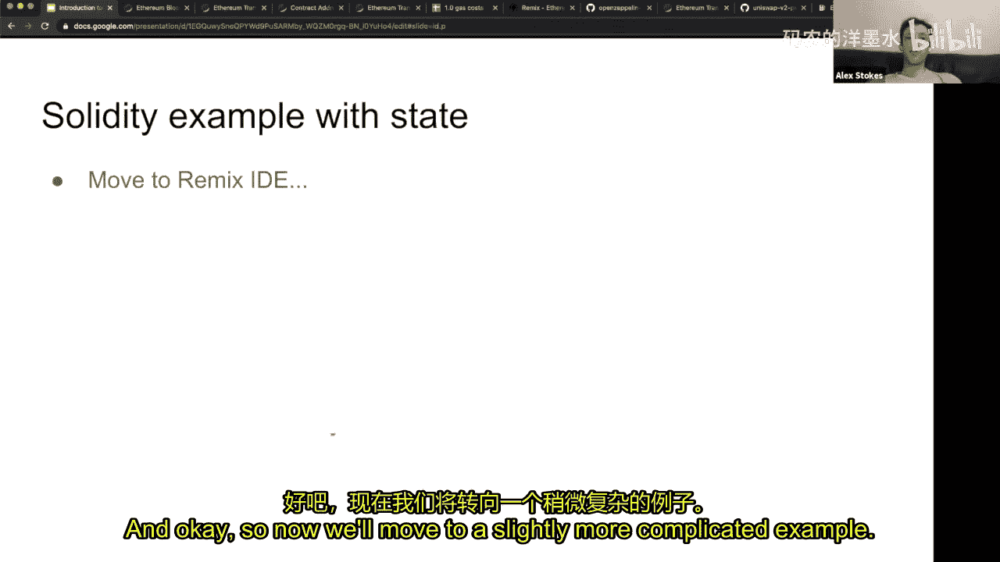

是。Toss us together， you know， just before this call， but essentially you know I。We have a contract。

We can store this variable X and i'll talk in a second about the fact that this is well maybe i'll talk now so essentially this x is the fact that this is here you know you might if you see this in like。

Again， let's say Python or Java， like this is called like a class variable or something like that。

Here what it means is that。When we deploy this contract to the Ethereum blockchain。

 there's going to be reserved a spot for it in the state for this variable x。

 so that will mean that you can basically say given the Ethereum state。

 go to a particular address and it's going to have this byte code。

 it will also have a commitment to the state of this instance of this contract。

 which will contain you know a space for this integer variable X。

And what that means then is that now we have these functions to set x and get x and again they're really simple。

 just write or read the value of x。And but what this would actually mean is that if you wanted to。

 you could then turn around， you make your own transaction but， you know。

 inform and function it looks exactly like this， you go and write your own transaction。

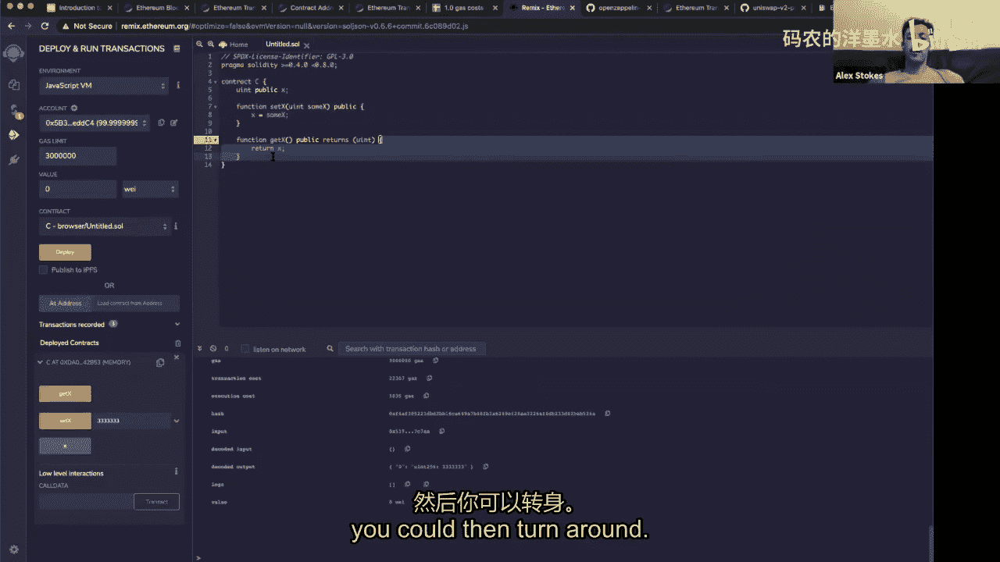

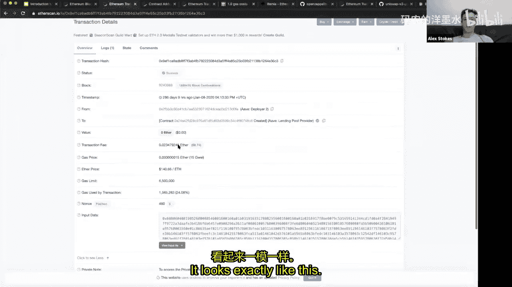

And you could， for example， call set X and you would say， okay。

 you know I take the function signature and I hash it and that gives me this method ID and then I like encode the value X that I want to write and then I broadcast the transaction that's then executed by the HVM which says okay。

 I need to go read the contract， read the contract state。

 I see then that it you sets this value to X which is the storage into memory this essentially all boils down to over here what we're going to call S load。

Which is storage load and that's because there's a chat。Okay。

 so someone asked do we need to buy the gas with the Fiat currency and so you can only pay for gas with ether。

嗯。Sorry that was a distraction I got sidetracked but essentially you can only pay with ether and yeah you can't you can't say like use dollars to supply for gas you could trade your dollars for ether right and you have E to pay for gas but basically gas has to be paid in E。

Back to the smart contract， sorry， I just got to start another question back to the smart contract right。

 you would。Do your S load to。Well， actually sorry， it would be a store， I told you the wrong one。

Where is a store？Oh see， I think this is a little outdated anyways there's an S there's basically an op code direct to the state。

The reason I point this out is that like if you ask you know today what's the the bottleneck to Ethereum it's actually the the size of the state and so it's like。

Something we all as developers in Ethereum， worry about a lot either way。Read and read to the state。

And。OK。So。With remix you can actually deploy the contract it's like an emulation of what would happened on the blockchain so we're going to do that so redeploy the contract we see now it' deployed here。

 we can say set X so let's set it to like 234 I don't know what types of numbers。And then we see， oh。

 like actually， there is a transaction， right this is。Okay， this is very tiny。That's a little better。

Um but basically， you know， just like we saw in ether scan right there's a transaction hash。

 it was from some address we made up in the browser right over here you can see there's just like this is again a test environment。

And we call the C contract， the method set X。With the value that is down below， you know。

 we set a gas limit， it costs 41，000 gas to execute， oh no sorry。

Oh interesting okay so the total cost was 4100 see this is like some debug information。

 but either way the input is here and the output we get back。Actually。

 might not be anything because we do not return anything， but what we can do is we can say get x。

And we have another execution， and it turns out that we get back our value。Okay。

Did that mix sense everyone Sorry I know I jumped around a little bit no no no。

 I think that was excellent。 That was the first hand on。

 I guess using the the I as well so no that was perfectly yeah yeah， yeah remix。 Yeah。

 this is handy I've actually like。Like developed the bug contracts in here a lot of so like a。

 you know， and you'll probably get a sense of more of this next session。😊，Well， maybe not。

 but either way a lot of the tooling around this stuff because again it's also new is like very immature and so。

You know， you might not have like the nice fancy tools you're used to and say like JavaScript land or like something like this。

But yeah， I've like I've literally like sat here and like tried to like debug contracts just because it's like a handy sort of compiled debug sort of execute loop。

Outside of what I may have had otherwise。

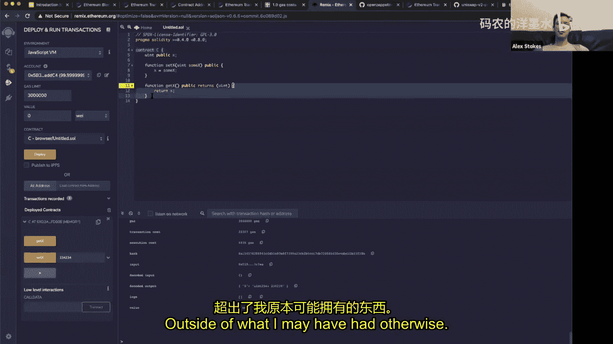

So okay so so I think as I mean this has been just superbly exciting and I mean I wish I we could just spend a few more hours talking about it and just an excellent speaker as well but maybe we can so maybe in the next two three minutes we can wrap up you had some really important points on the security let's kind of touch upon the security points that you have I think that would be a really nice conclusion。

Yep so I will yeah and let's just zoom through the rest of what I had we made it most of the way there I hope this is helpful everyone basically I was then going to look at eRC20 contract and yeah the almost certainly you'll get these slides I mean i'll go post them online after so。

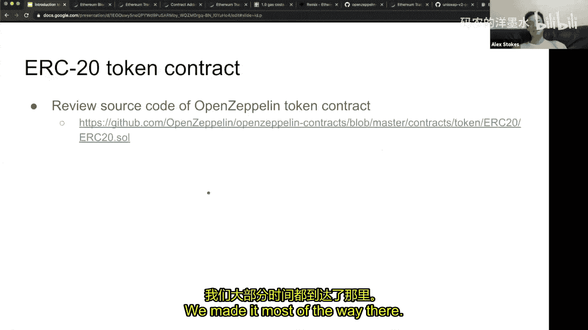

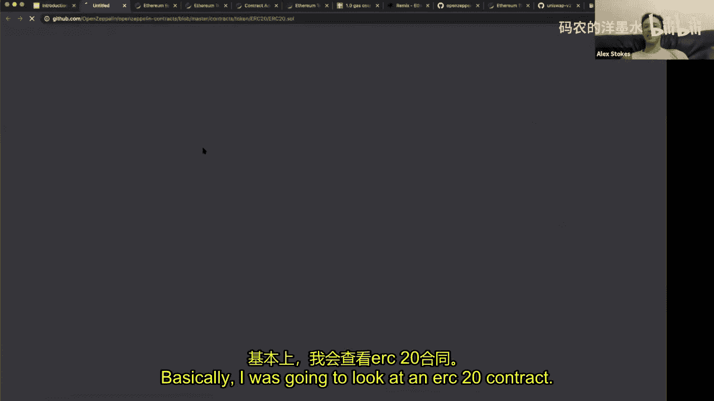

You'll be able to find them this was like because again you'll hear ERRC 20 like people are all about the tokens so I was going to walk through like actual token implementation and so just really quickly you see here's a sality contract you know we're going to call it an the ERRC 20 and this happens to be the interface right that the token you know this contract implements this token interface there's like some private variables which basically maintain balances of the token。

And you know， just to give you a really brief example， okay， so you know。

 you could say what's my balance， you know what's like the balance of this address for this token and you literally just like look it up in this map that we have you could say transfer。

 which calls to this helper function under bar transfer。

Whi is here right and it basically says I mean the important bits are really as simple as this is you say okay the cinder's balances sorry the cinder's balance is going to be less what they had and the recipient's balance will be more than what they had right by the amount and if you think about it。

Again， we're going to have to blow through this， but basically it you know。

It's moving numbers around on a spreadsheet at the end of the day， as they say。

 and now we haveterping contracts。Okay， so again， obviously we didn't go fast enough。

 but I was going to look then at unIWp which is a centralized exchange。

 I'll just let you dig into this at your own preference。Security， security， security。

 so like I was saying。Everything is super immature。Again， like this is， you know。

This is actual value like people， you know we've made these systems， they seem secure enough。

 they are secure enough that people here， let's just go take a peek。

People are willing to put you know billions of dollars。

 you know into these networks so you know just kind of roughly looking at market cap you know。

 the market cap in Ethereum is like what 42 billion so people trust the network enough to like。

Well and this is only the ether market cap right so anyways the value hosted by this thing is like actually like it's ridiculous。

😊，And so what that means though is that there's real value at stake right it's like I could put my life savings into some random smart contract and again I didn't quite get to like a more like I was gonna look at unisO because it's like here's just a quick peek it's like you know very you can see there's a lot more going on and there's you know gets to be a lot of code and so now you have like the problems you usually have with software。

Which is that it gets too complex， too fast。And inevitably bugs fall out right and so the thing is though now it's not that just like oh like my my。

Food delivery app is going to bring me tacos instead of， you know。

 curry what's going to happen is that I'm going to lose like my life savings So again。

 hopefully I've。😊，Transmitted some of the excitement to the space and like。You know， you see。

 at least you at least may vaguely understand that there's actually something really like novel and interesting here。

But。I do want to hammer home this point that like this is actual value people are putting the real like actual you know harder earned dollars into this stuff and it's easy to lose it'll probably always be this case just because like bugs happen。

But even just given where we are today we don't have like for example。

 in traditional finance you would have like insurance and like you know facilities like this to like hedge some of the risk we basically have none of that in and defy example and so like there just isn't there's not a backstop right it's the Wild West and it's super exciting but that means that there's a lot of risk and moreover that you are very directly taking on that risk so the point is。

Be careful， definitely be careful， read the code of the contracts that you see。

Testing testing testing， we'll come back to this。Again， very exciting， but I risk。

I mentioned formal verification and like audits and again there's like you know things that we do to try to make sure that you have。

Secure contracts， but yess。You know， bugs happen and it's early days。So yeah。

 I was going to walk through the Dowhawk and like kind of how this would work。

 but again we're out of time， it's here in the slides。

I mean i'm happy to like chat individually if anyone wants to so keep that in mind yeah we might be out of time for questions。

 but again here's my Twitter handle like feel free to DMm me like。I'm here Al right， Alex。

 thank you so much。 that was a amazing talk and yeah。

 just thank you so much and I'll definitely get the recording and posted on the website along the website along the。

😊，The slides and of course your contact and finish you didn't have any question will definitely direct it towards you。

 but again on the behalf of the whole class UC Davis I think thank you so much for coming and attending and it was really nice thank you so much。

Great， yeah， I can help and hopefully all of you got something out of my rambling and my ranting。

 a lot of cool stuff going on so。😊，Yeah。😊，Thank you so much all right， thank you very much everybody。

 thank you。😊。

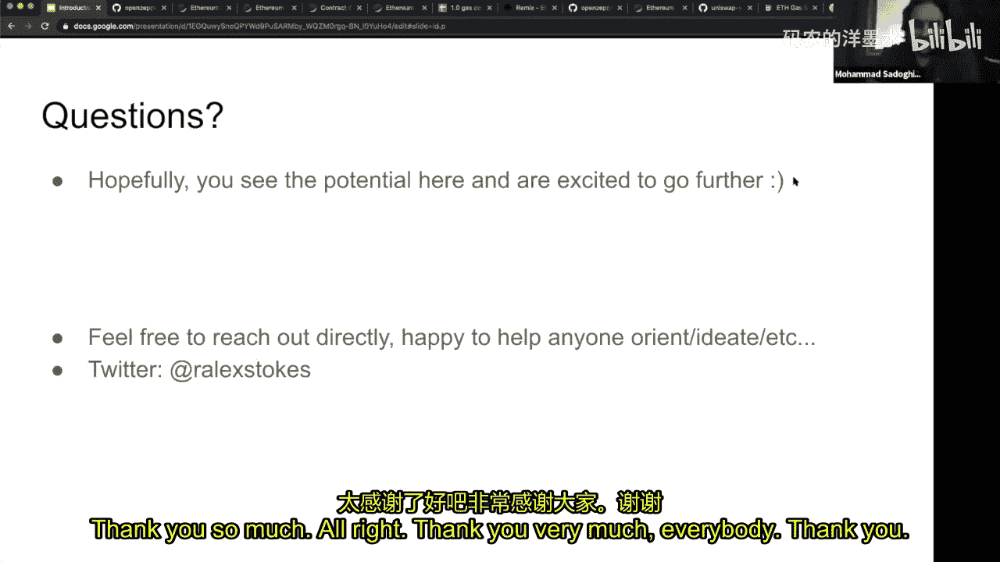

はい。

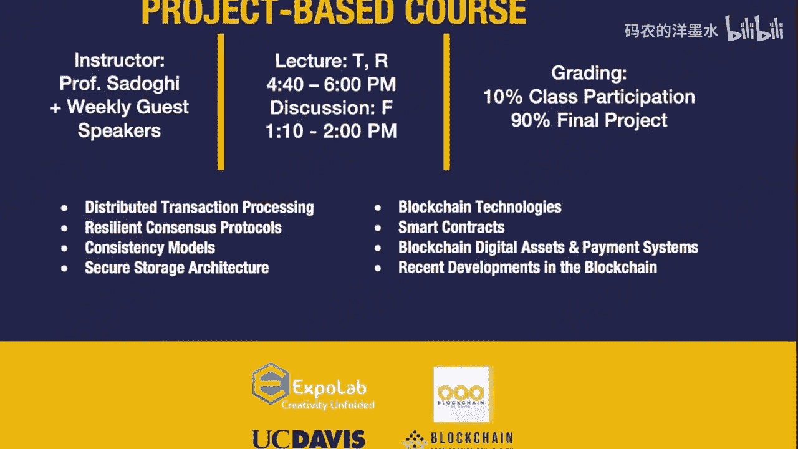