# 【全集】加州大学戴维斯分校 分布式交易与区块链架构 中英字幕 完整课程 p26 Lecture 22 - 基于比特币的创新 -BV18YFVzME2f_p26-

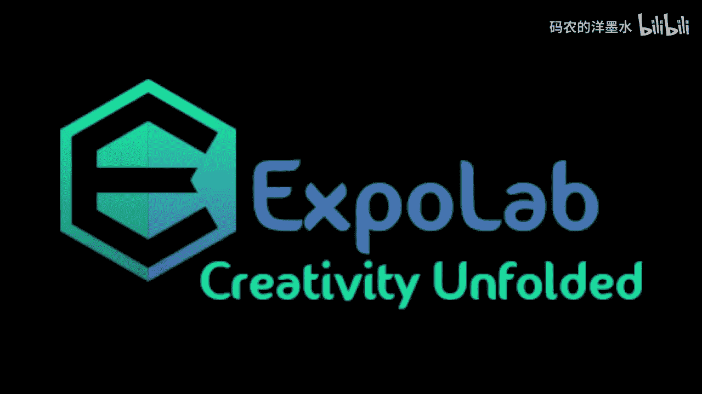

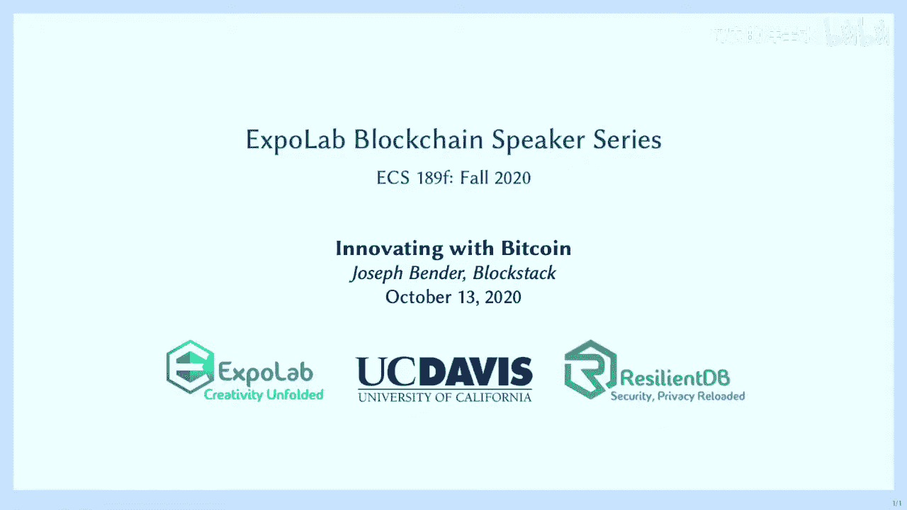

Hello everyone welcome to our blockchain speaker series and very excited to have Joe Bender joining us today and he's going to talk about innovating the Bitcoin and Joe has a very exciting career I think he started at Pittsburgh and then around 2016 he joined。

The financial center of， New York City and since then he's been an evangelist of blockchain and has been done very exciting work at Jo consensusensus now he has moved on and now he's part of the Bstock team and he's going to be talking about all the exciting stuff and in the field on Bitcoin so with that take it away please。

Thank you very much， Mo。 Hey， everyone。 I'm Joe Bennder。 It's so awesome to be here。 Yeah。

 I guess we can just dive right in。 I'm just， I'm so happy to see you all。

 You got such a big class here。 It's a blockchain course。 The syllabus looks great。

 You guys had some great speakers already and very privileged to be here。 Let's dive right in。

 Woful to have you。 Wonder to have you。😊，Okay my name is Joe Bennder as I said' developer evangelist at Bstack currently so when I think about the crypto space youve got to put a lot of focus on Bitcoin Ethereum and like think about the moves that they're making and the development processes of those so really glad you guys had these foundations already。

😊，And like Mueb said， Muibeb Ali is the CEO of Blockdack， she's super smart dude。

 went to Princeton and has been in the blockchain space forever。Google had the slogan。

 Don't be evil a long time ago。 Don't be evil。 Don't be evil。 And Muib was like。

 no company on the Internet should have so much power that they get to debate if they should be evil today or not。

 And that's so true， like。G does not use the don't be evil slogan anymore because they're kind of evil now where they foreshadowing。

 yes they were， yes they were Pri。And we at Devcon。

 one of the biggest like Ethereum conferences every year。

 Blocksack slapped a big billboard right outside the conference venue that said can't be evil。

 It was like a huge marketing stunt and a lot of fun。

 But it was just showing kind of the difference between。😊。

Being such in control of the technology that you personally can decide if you'd like to be evil or benevolent as your tech God and Blockstack was kind of taking jobs with like we build technology so we don't even have the chance to be evil if we wanted to like we can't harvest your data and sell it to advertisers if we want to so that's kind of our buzzworthy slogan that I like。

You guys are in a blockchain class I'm going to tear through this blockchain basic stuff because I'm sure you already know but blockchain is synonymous a lot with web3 web 3。

0 let's take a look at the top Google search results for web3 okay what do we got here web 3。

0 it seems to be connecting multiple devices Okay that makes sense no wait web3s looking at a tablet with。

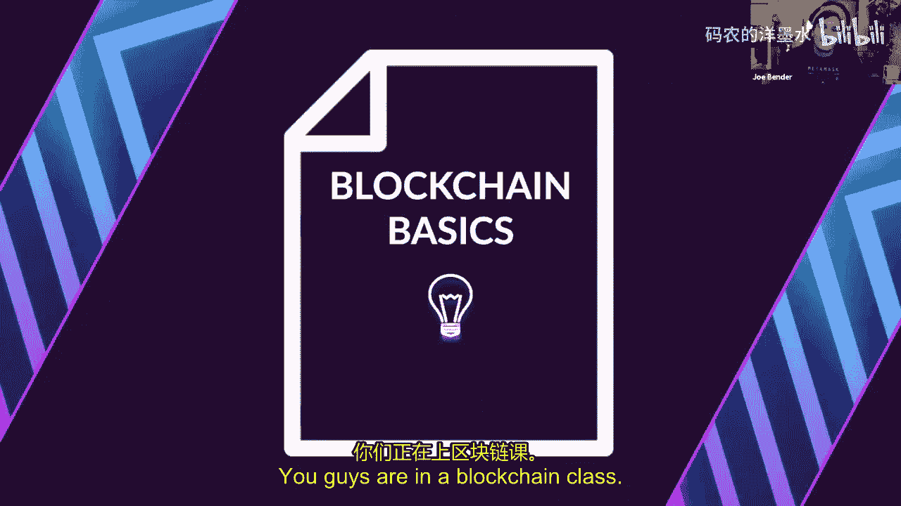

Bunch of like plasma rays Wait no web3 is a brain and a robot with your eyes。

 maybe biocomp nobody knows what web3 is it's like a super buzz ready term that's been labeled with blockchain a lot。

 but it's got a super amorphous definition and when it comes down to it web3 is like the liberation of。

The web from corporations and states and centralized entities。

The Internet started as a dope idea like it was decentralized early on the ARPnet like when it was sound in the military it was just made of nodes and it was super bare bones core protocol and one thing I always referenced in talking about blockchain is people are always like oh my gosh the first decentralized infrastructure were here we made it I was like downloading limeme wire songs back in middle school like if you ever use limemewire or Kazza or napapster way way back in the day those was our decentralized protocols。

 that's the dot torrent protocol that can't be shut down you can cut you can shut down the company Aaries or Utorent or some of these clients that use the dotent protocol but you can't shut down the corebased level protocol because it's decentralized and upelleed by a network of nodes and that's kind of what I think about with with Bitcoin and Ethereum and all these decentralized networks。

 they are a protocol and they live in the wild and。

Couldn't be shut down if a government even tried I mean they could go house to house and try to find all the nodes but good luck with that so the internet started as pretty decentralized but you see up there Google Facebook and Apple they got their telescope there's suss in the situation out they know what's about to go down and they're about to take all power for themselves。

It's a nice little diagram I like and I found it on the internet and Btack was in it so you got to use it like I said internet started I was just like a wires and network anet all the good stuff started the military GPS internet microwaves I think like all that good stuff。

😊，Then it transitioned to one web 1。0 which was static only you know you're going to pets。

com and looking at leashes or yahoo and checking your mail or wow these are some old school websites I actually still have my American online I have an AOL email address I literally do because my mom was die hard Aol so now I kind of keep it as like my spam account。

Yeah， so it was just like here's an image Look at it and react to it Web 2。

0 is kind of what we're in right now and it was much more read write bi directionional here's a photo people respond to it and comment on it or remix it or I mean all the sites you guys use are in there you know Reddit it's a very communal thing Airbnb changing the realty industry Payal changing the payment industry all that good stuff。

 So what I think web3 is is instead of just like。Read， write and visual and text and image and video。

You're adding a native value into the internet and I think that's when people have their like blockchain aha moments is when you realize like to get value into the internet now you have to use Paypal or use a credit card or literally type your credit card into the web browser like and。

Or you stripe or something like that。 There's no native。

Value in the internet and that's what blockchain brought a network decentralized network with native value baked into it and that value is denominated in cryptocurrency yeah I don't know like how much experimentation you guys have done with blockchain yet you got that Ethereum run down hopefully you've messed around with some Ethereum dabs maybe crypto kitties or something like that。

But there are all， there are all those das up there， decentral land， you know， a multiverse and。

And prediction markets betting on the election with crypto or I used to play Bjack I lost way too many ether when Ether was like $10 by playing this game called blockjack which is just blackjack with crypto and it's super simple but it's mindbing that you're like doing it in a completely decentralized fashion No company is like taking a percentage the online gambling industry is one of those ones that's just like absolutely brutalized by fees and like shadiness。

 you're not sure if it's actually fair not and half the time you can't even pull your money out of the platform。

 you're just like playing a little sandbox Yeah so we're really trying to get control and authority away from these massive conglomerates and companies like these companies four times a year have investors meetings where they go in and then the investors look at them and they're like。

 hey， how are you doing everything in your power to make as much money as possible from your users Facebook doesn't care about you。

All those other websites， other websites Spotify doesn't care about giving you the best listening experience。

 they just want you to subscribe as many people to the plan as possible so web3 when you hear web 3。

0 shove all the buzzworthiness out and just think giving power back to the people taking all the information out of these silos and these big scary warehouses at Google and putting them into decentralized networks。

😊。

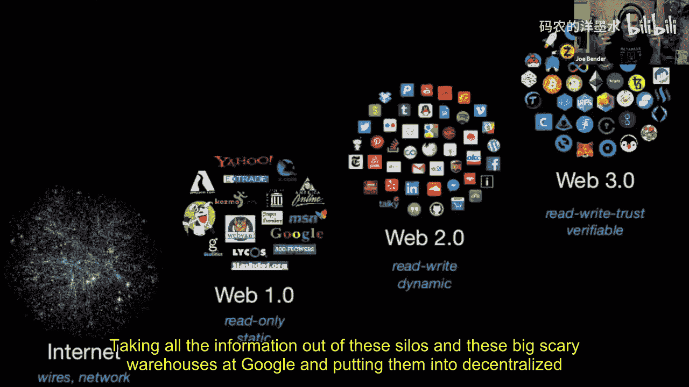

I mentioned Coinbase because Coinbase was like the black swan event for breaking onto the mainstream I think crypto wouldn't be where it was today without Coinbase it was kind of the first ubiquitous mobile wallet where people could just enter a credit card and now I have Bitcoin and before it was excruciatingly difficult you'd have to。

Go to a website and make sure it's secure and set up a wallet and all of these kind of convoluted steps you had to hold your own keys and your own private keys and coininbase kind of obfuscated so much of the crazy complexity of crypto and that's a huge theme and a lot of stuff that i'll be talking about today of just。

How much do we shove blockchain down people's throat how much do we try to hide it and just be like this is new technology like just trust us it works just like the internet When you use a website you don't really know how TCIP works。

 you don't know how like packets are being sent you just hit refresh the website and the website loads so right now blockchains that like this this weird limbo of like how much do we educate users about blockchain or how much do we just try to hide it and make it work and we're just trying to gauge like how much the mainstream public values decentralization and values privacy I know like early on Ethereum just went so hard on like。

Total education total control of the user and it was extremely daunting people didn't want to hold their own private keys。

 people didn't want to remember 12 word seed phrases。

 they just wanted to buy Bitcoin with a credit card。

 which is why coininbase just took off Brian armsmstrong and his team are doing good things。Yeah。

Also metaamask， like my shirt， if you've used Ethereum at all。

 Me maskask is like an in browser wallet just allows you to like interact with interact with a bunch of das。

 kind of made the DAP ecosystem took off， you guys might have learned about this a little bit with John Long last week。

😊，Coin based Me masss， as you can see， just really sexy UIs there， you know。

 just begging you to pour your US dollars in the crypto。They both。

 you can see like Madmas like throwing hex data at you and like what are all these ones and zeros and coininbase is like look at this Bitcoin Saturn and like just the differences between the two。

UI and UX is so critical to like always be paying attention to in crypto。

Coinbase reached 30 million users so fasci it made or headspin password login Coinbase has your private key which is kind of like obfuscating the crypto you can buy crypto directly within the app they're also implementing like more complex things than just holding your crypto like staking a lot of these protocols have staking mechanisms you guys might know about proof of work and proof of stake like two types of consensus mechanisms Coinbase is allowing people to participate in that sta mechanisms directly within the app and then there's different verification levels your phone number personal info verify with the photo ID。

And。Coinbase is good and Coinbase is cool for breaking on the mainstream。

 but if anyone's ever tried to like get crypto ASap。

They'll realize that Coinbase might not be the best because it takes like a couple days to approve your bank account maybe a couple days to get your crypto and process the payment and everything it's still an extremely centralized way to interact with crypto and it's kind of like a bandai blockchain like makes a lot of sacrifices to break into the mainstream like get normal people using it and I think that Coinbase is a necessary bandailash evillash bridge to the mainstream Meask just crossed like1 million extension downloads password login but the user controls the seed phrase so you can like migrate that wallet around you can't buy crypto directly in it like shoots you out to something else and you can choose between Tenet or local and they have a mobile app Dap browser since this is a Bitcoin presentation try to stay away from like Ds and and Me maskask but my Ethereum。

Blood pumping through my veins forces me to mention it。

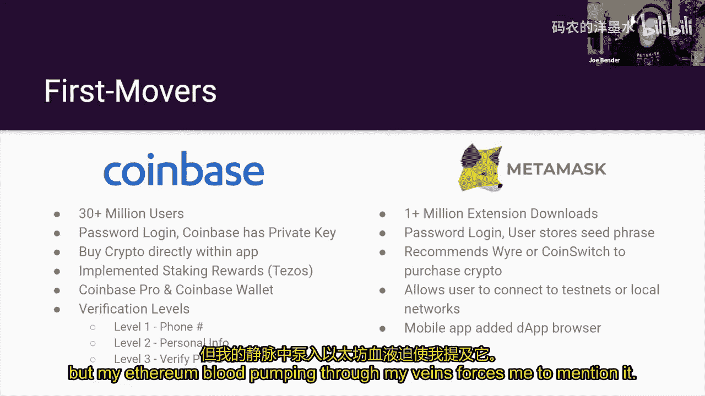

I talked a lot about user experience there's a myriad of ways people have tried to dress up crypto quality of life and just like make it easy you can see there's a secret key。

 some people like even further manipulate a private key into just like a four phrase key or something there's a straight up private key which is derived from your public address like that's the core your private and public key that is like the base layer control of your wallet you can see coininbase is just like we're just going back to email and password it's super easy keep me signed in on this computer like keep all of my crypto available for anyone who opens my computer and then Meam ask is doing like the seed phrase thing where you get a 124 pass phrase a little less unmanageable than a private key but still kind of intense and secure。

Wait， what's the difference between a secret key and a private key？

Yeah so secret key like Btack does that we have like secret keys it's just like how you're doing that like Shaw 256 manipulation to get from like the public to the private key you just do another different type of hash a less secure hash than like Sha 256 but it's just like adding another relational random phrase that can be derived from your public key so it's a little less unwieldy than a。

32 digit hexadecimal string it like might be able to be remembered by memory yeah some some apps have implemented that B stackack uses like a secret key it's a little less unmanageable than a long than a long code just like a different hash。

Yeah， that's a really good question though， and I see it around and it like makes sense in B s implementation。

 but。Sometimes I see it like being used to just like add an extra。

 sometimes unnecessary level of security。Also， yeah， like everyone chime in with questions and stuff。

um discussion， all that jazz more exciting when people chime in。

Networks and nodes so is a rail boring slide Yeah， you guys know nodes are participants in the network network is made up of nodes in blockchain you have like full nodes master nodes light nodes mine super nodes just different iterations of similar things depending on how much data it has there's light nodes which kind of like just plug in the network so you can send a transaction and then there's full nodes which have the entire history of the blockchain all of the ledger stored kind of the immutable single source of truth and then you have all these other crazy things master nodes is like the node that starts it with the Genesis block and miners are nodes that are also helping to secure the network by participating in consensus and these are all crazy words and sounds super technical but most of the time it's just like downloading particular software to your machine that's going connect the network。

😊，Yeah on Block stackack you just run a line in the terminal and the command line and your node gets connected nodes are building blocks of the blockchain blockchains are blocks of data data is stored in those nodes all nodes in the blockchain are connected to each other there constantly exchanging information so it can stay up to date the most recent chain tip the most current chain tip that's the one that all the miners are pi onto and trying to mine the next block for。

Play the same slide twice。Enter Bitcoin look at this glistening high definition physical Bitcoin just so you all know there's no such thing as physical Bitcoin it doesn't exist there's no such thing as any physical crypto do I still have like my physical Bitcoin up there somewhere I used to have like fakes。

Bitcoin is the original launched in the3 of January 2009， and that's your birthday。

 That's my girlfriend's birthday。 This is the raw hexadecimal version of the Bitcoin Genesis block and I love to talk about this because it's like the conception of all this badass cipherpunk stuff that has happened in the last 10 years and the more I'm in blockchain the more I am just like marveled at Saoshi and the way it all went down yeah January 3。

 he was like let's do this and made the Genesis block of the Bitcoin blockchain you can see on the right there in the hexadecimal is encoded this newspaper cover。

 and this is the newspaper cover， I think it's the London Times and the headline that day was Chancellor on the brink of second bailout for bankss anyone knows 2009 if anyone seeing what's the movie inside job is the documentary。

 the big short。If anyone seen the big short or lived through that time， financial crisis was crazy。

 the United States banks screwed the entire world because of their greed。😊，And malice， oh。

 I still get my Jimmys rustled by it every day thinking about it。 Yeah。

 the American banking system just like forsook the American people forsook a word and there was a massive mortgage crisis they were just given out loans to anyone to buy a house。

 the housing market like looked like the best it had ever been。

 but it was standing on toothpicks and it all came crashing down and it was the banker's faults in the loanmaker's faults and the rating agency's faults。

 the big behemoth conglomerate illuminati evil banking system finally collapsed and it kind of destroyed the world。

 but was a little bit gratifying to see them like。😊，Reap what they sewed。

But then government stepped in and fixed everything with a magic fairy oneand that printed a bunch of money。

 I think it was like 700 billion in the US or something a bailout。

And just the fact that the Bitcoin blockchain was launched in that。Tact full moment。And this。

 like who even maybe he woke up and saw this this title， I was when I put this slide together。

 I was thinking like， did he plan this like？Weeks in advance or was the morning was he like oh yeah i'm encoding this in the Genesis block and this right here is just what it's all about it's about liberating power back from states and corporations and conglomerates that have a fiduciary duty to their investors to make money。

😊，Yeah， banks， banks care about making money。Not keeping your money safe or enriching your life So this was it this is the beginning of the all of it all the whole blockchain movement。

Launched on wow it's like the same same slide。 it was the first widespread implementation。

 Like there was some， I think like it was I forget what was Bitcoin before Bitcoin like weird。

 weird like 90s names that you don't want to know。 But Bitcoin was the first one that like made it broke onto the mainstream got some attention gained a network effect。

 I will talk about Bitcoinin's network effect till my deathbed just because it's the king of the hill。

 It's the incumbent。 It's gonna be so hard for anyone to topple that top spot。

 current market cap over 200。Billion dollars USD Trust me。

 I was on the Ethereum train for a long time just dying in for the flippan if anyone's like an Ethereum had the flippan when Ethereum would finally flip Bitcoin。

So long ways off people Bitcoin just is the only household name。

 you see graffiti on it with QR codes asking for Bitcoin。

 you hear it name dropped in Silicon Valley what were we we were just watching him maybe save yourselves that was really good where they mentioned Bitcoin it's everywhere and if you went up to someone on the street and said you know what Bitcoin is they'd be like oh yeah if you said you know what Ethereum is they probably wouldn't so just that's kind of like Btack's mission tying a little into the later stuff like and my personal journey was like very tied to this where just realized like wait Bitcoin is not going anywhere we should like do cool stuff with it because Ethereum is doing cool stuff with their crypto。

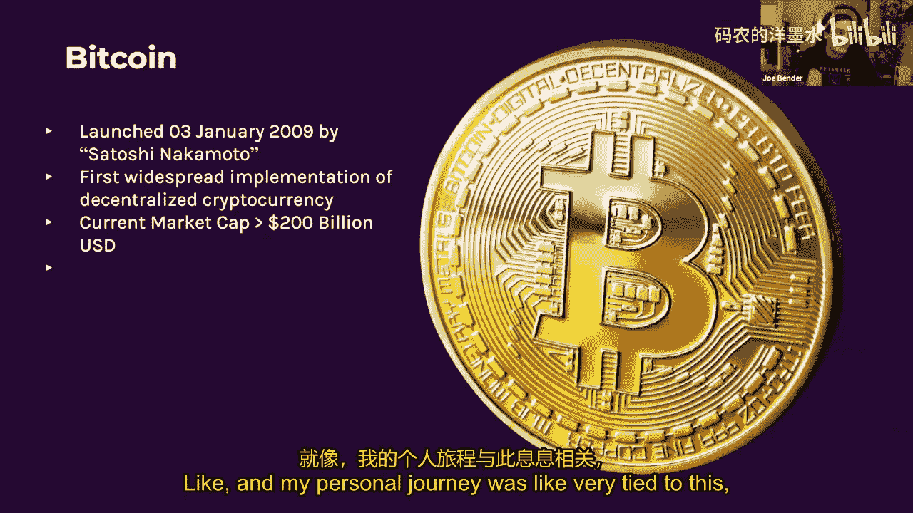

This is what i'm talking about Bitcoin's just always been king of the hill here the market cap dominance is through the roof there was one point here during the peak of crypto in July 2017 when it got real close real close consensus was super high。

😊，But it just didnt didn't go that way because of the network effect of Bitcoin of the people opening Coinbase。

 the 14 year olds like getting their parents' credit card and buying Bitcoin in Coinbase because they heard about it on TikTok that's false as TikTok didn't exist back then。

 but you get what I'm trying to say。Lightning that rain Oh no there are three that are fairly high in that。

 Yeah， yeah， I I have definitely been ignoring the other ones Ripple。 And， I mean。

 let me pull up like coin market cut。 We can do these things。 Oh gosh， maybe not。

 my screen sharing is paused。Oh I'm screen sharing in I forgot I was in chromrome yeah let me let me I like this I like this exercise There are a lot of crypos and it's funny because like so many of the ones in the top 100 are ERRC 20 tokens and based on Ethereum。

😊，So Ethereum most definitely has a massive capitalization on。The D market and the Dfi market yeah。

 ripple and there's a lot of stablecoins tether and USDc coin basis stableco there's Bitcoin cash and Bitcoinco Sv I will stand here on my hill and say don't touch trash fault forks don't touch Bitcoinco Sv don't touch Bitcoin cash don't touch Ethereum cash classic I even forget what's called at this point because it's so irrelevant those are just like diehard maximist forks don't waste your money people I have a question when you when you brought up Ethereum classic from what I understand I don't know like too much about you know cryptocurrencies but I thought that if the blockchain is like change it kind of tains the whole you know the whole idea behind it and I thought Ethereum cash because when I was reading about that I thought Ethereum cash which is like the classic one that has the chain that hasn't been changed whent that。

Be the more attractive one， like long term。That is a school of thought。

 most definitely fantastic question， oh my gosh， we're really getting the philosophy of crypto I'm sweating over here it's so exciting。

Yes， blockchains are supposed to be immutable absolutely immutable you hit the Genis block it's going you can't do anything to stop it and that's one of the benefits of them that's the whole benefit of them and that's what Bitcoin maximalist will die in a hill saying Bitcoin has like never been forked well therefore it's didn't like overtake the main Bitcoin chain and immutability is critical because the states and governments and corporations are the ones that are like messing with the money and the money supply so the fact that blockchains are immutable are their number one benefit。

So。In 2017， there was something called the DoO， the DoO was basically like the first DAP。

 the first like massive crazy implementation of an application on crypto that wasn't just hold your crypto or transferred to someone else。

ADoo is a decentralized autonomous organization okay I'm going to tear through all this It's basically like a bunch of people put their crypto into a company and the company is a machine it's a company run by machine it lives on the blockchain so a bunch of people put money into a Doo and then that Do and the people that put money and can vote to disperse that money to various things so there's a lot of like capital raise Dos and Ethereum where there's Mo Doo or mecartel Doo where they raise a bunch of crypto from people and then project supply for grants and they can like receive funding or capital or grants through the Doo so the DoO was the original like massive project on Ethereum they got a butload of money in it and then it had a massive critical security vulnerability and it started to get funds drained out of it in minutes it was going like crazy a couple of my friends were in crypto during it and said they were losing so much money and it was craziest night there  four am am calling each other and freaking out。

So what happened after the Dow， it lost so much money。

 I forget how much like 40 million or something。They decided to roll back the Ethereum blockchain to before the Dowha like it never happened。

To give all the people back money who had lost their crypto。

That was a very sensitive decision and event。 And that is what caused Ethereum classic to happen。

 So all the people who were like。😊，The Doo that was horrible and we lost a lot of money， listen。

 let's just like hit the rewind button， go right back before the Dao and redo that stayed at the main Ethereum chain。

There were other people who were disgruntled and said exactly what you just said say， hey。

 wait a minute， blockchains are supposed to be completely immutable。 It's completely technology。

 How are we going inject this human aspect to it because Viik。

 the founder of Ethereum basically just stood up and was like listen。

 we have to do this and he just called all the exchanges said halt Ethereum trading called all of the clients pary and get。

 all of the software that allows you connect to Ethereum said we got to roll back the chain and they did they rolled back the chain to before the Dow hack and there were a lot of people just like I don't know who said that I think akich。

partdon me。Who said this is。Bllshit this isn't blockchain and that is why Ethereum classic still exists so people that still believe in the immutability of blockchain just didn't follow that new chain tip that pretended like the Dow never happened and just continued that blockchain that the Doo hack did happen on and now there are two parallel Ethereum chains there's Ethereum and then there's Ethereum classic and the Ethereum classic the Dow hack still happened on it。

Now， your guess is as good as mine， probably a decent amount of like die hard people that were like。

I think blockchain should be immutable so I'm going to stay with Ethereum classic。

 but there's also a lot of shadiness that people think that a lot of the nodes and diehars on Ethereum classic benefited from the Dow hack in some way and maybe received some of those stolen funds and it's a similar thing with Bitcoin and Bitcoin SB and Bitcoin cash but less security vulnerabilities in big hacks and more just differences of ideologies and the protocol。

Mechanism changing block sizes or certain like amount of megabytes in a block honestly like I don't even fully understand it because it's like hardcore protocol level technical stuff and there were just ideological differences in the Bitcoin community and that's why all these other Bitcoin chains popped up because when the decision was made to modify the original blockchain there's always going to be a subset of people that say this is bullshit let's stay with the same Jane so that's why you get those forks if you asked me personally I think that rolling the Dow hackck back was a fantastic idea it was the first large Ethereum application it had so much money of it it was really the first D and it crashed and burned we see Ethereum classic really struggling right now with with transaction throughput and market cap and who knows maybe that would have happened to Ethereum if we didn't roll the Dowback because a lot of people lost money a lot of people lost。

incident and the fact it was vitalic， the founder of Ethereum coming out。

 he's a really reputable kid， he doesn't seem malicious， I like vitalik he came out。

 he had a bunch of connections in Ethereum and said。

I think for the benefit of the technology we should roll this back and it happened now what I just said is shady the fact that one person went no guys like we're going roll this back like trust me I'm in charge and we should listen and a lot of people hate Ethereum for that and think vitalik is an authoritarian and and think that it's super centralized。

Always going to have different ideological differences in crypto and that's the beauty of it is that it's。

Crypto found a way to bring people together by making them selfish Everyone in crypto is looking out for themselves note miners are trying to miners are securing the network。

 but they're trying to mine a block and get the block reward crypto and blockchain is beautiful because it it fixed the tragedy of the comments because it made people。

Contribute to the whole by being selfish which is just genius I love me and blockchain great question and there are there are other people who would stand there and say Ethereum is trash and Ethereum classic is the Og because we didn't have any robacks and we're still a real blockchain you see Roger ver like freaking out about Bitcoin cash and。

😊，Who else all those like shady shady maximalist that were like supporting Bitcoin cash and SD you're always going find someone that will support any different chain and like believe in it。

 So whatever you just got to do your own research and and come up with your own。

Morals and values when it comes to blockchain。

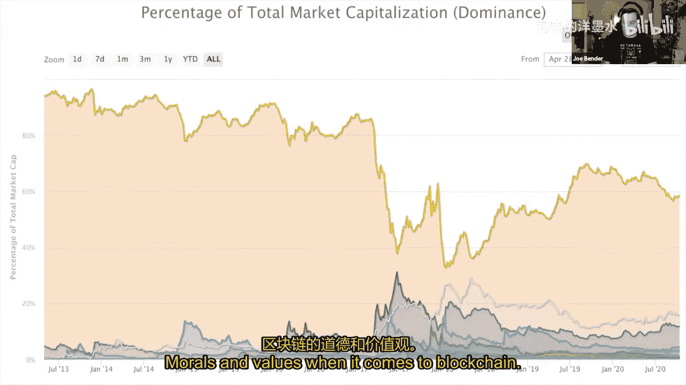

I'm going dive into a lightning network a little bit here honestly i'm not super well versed on lightning network because I was like in the trenches of the Ethereum land at a consensus for the last three years。

 but the coolest thing about lightning network is that it is kind of a deffi application it's adding a layer to onto Bitcoin and adding more extended functionality than just the base layer of holding Bitcoin。

 sending Bitcoin store value digital gold。You are all is there it was a scalability solution scalability if you've heard about it before it's like number one thing in blockchain it's whatever's freaking out about it's what Ethereum's freaking out about right now with their transition to E2。

0 transaction through put block sizes all that stuff is all about scalability and this was a scalability solution for Bitcoin wow I don't even know what it is anymore I think Bitcoin's like。

😊，What are their block times like 12 minutes or something who knows Vi does 27。

000 transactions per minute and blockchain has to get up there if it's ever going to compete with these centralized payment networks。

W time is it 820？How long do I add till nine？Before that， you guys went out early。

 should I try to go fast。Yeah we have till6 o'clock which would be your 9 pm Okay perfect we're on pace here was white paper written by Joseph Poone and Thaus dja in 2015 Joseph Poon was also very involved in thetherean community and like optimistic rollups and and state channels way back in the day sharding Joseph Poon was really the sharding so the transactions are sent over a payment of over a network of micropay channel channels a layer two built on top of Bitcoin so it moves small and frequent transactions offcha people always say like one day you'll be able to buy coffee with Bitcoin like right now that's just not viable because you'd have to pay taxes on it and you'd have to send a transaction to the blockchain and like all this crazy stuff so we're trying to find ways to like make simple blockchain transactions。

Easy seamless off chain not taking up a bunch of transaction throughput on the network so what this is is it's it uses the native smart contracting language of Bitcoin which is not as expressive as like solidity on Ethereum it's not a full smart contract programming language。

But it allows you to do some things and it creates a two party ledger entry in Bitcoin that kind of marks the beginning of a state channel you both commit a certain amount of Bitcoin and it creates a side state channel。

It's bidirectional So we got a good friend Bob and Alice here。

 Bob and Alice open a lightning network channel on Bitcoin。

 they both like commit three Bitcoin and then let's say they're going on vacation and Bob pays Alice for beer and beer pays Bob and you guys get what I' trying to say you do a bunch of different transactions and those are not oncha Those are done in the lightning channel so they're not taking up Bitcoin transaction throughput there's no fees it's much faster and then let's say they're driving on the way back home they're all done。

 Bob's about to drop Alice off and then they're like okay we're done paying each other for the weekend So they close their lightning network channel and then that final balance between the two is what gets reported back onto the blockchain So instead of them doing a Bitcoin a main Bitcoin blockchain transaction for every single purchase that weekend they're just opening a lightning network channel it's allowing them much faster transaction throughput so then。

All that's on the Bitcoin blockchain is。Bob and Alice committed three Bitcoin each。

 And then at the end of the weekend。 it says， actually。

 Bob has two Bitcoin Ana Alice has four because let's say Alice paid for more that weekend。

 So she need to be compensated more excusee me。 So what you mean is that this this thing you you just talk about is kind of like a branch in Github。

 right， And what they do is like a merge。Yeah， absolutely okay yeah so it's like merging to master you are like taking a fork of that and absolutely Github is a great way to think about about wow GiHub's great metaphor for state channels and micropayment channels very smart Yeah so until it is ready you know you don't merge code to master midway through you wait until it's all tested you wait until it's audited by your coworkers everything and then once it's all done merge it back to master and then that is what is on the public ledger。

😊，Good metaphor the channel closes another question as well to Joe so maybe if you want to kind of say few words about the layer to and what are the layer means in case that yeah absolutely so layer we want。

Layer1 is always the core consensus protocol layer of the blockchain So if you are sending a transaction on Bitcoin。

 sending a transaction on Ethereum， a base layer transaction that is like a layer1 when you are holding crypto in your wallet when you have Bitcoin in a Bitcoin wallet that is being held by the network on layer one in in a native wallet address。

 the Bitcoin network is just made up of addresses and in that address is the value layer two is when you're building on top of that core protocol。

 it's not necessarily sending a bunch of transaction or interacting with stuff all the times it's an extended functionality from the original protocol and nine tabs out of a 10 it's an attempt to add scalability to be able to do more without taking up as much energy from the network theres this is just one layer2。

on Bitcoin it's one of the only layer two solutions i'm really aware of I know there's a million layer two solutions on Ethereum right now just trying to get the transaction through put up because with all the adapts and and defi stuff going on the Ethereum network has been crazy clogged there has never been more of a need for layer two solutions yeah so it's just the next echelon up the next tier up from the core protocol and it most of the time it's allowing you to more flexibility you can add。

More expressive programming languages we think of。Plockstock， in a sense。

 is kind of like a layer to extendability of Bitcoin。 It's a good question though， did I answer。Yeah。

 awareness， so do you envision other layers？Yeah， that's a good question I'm about to get a little pessimistic here actually with comparing lightning network to Dfi you guys might have heard about all the Dfi craziness last week from Ethereum Dfi is decentralized finance it's just like allowing you to do more stuff with your crypto then just hold it or send transactions I think like the first well I said the first Dfi was kind of like the Doo hack on Ethereum the other big next Dfi event was maker Doo which was kind of hilarious because so many people were like crypto rich and cash poor。

😊，And they wanted a way to lock up their crypto and get fiat and MakerDow allowed you to do that you would lock up Ethereum and then you would receive die in return and die was a stablecoin pegged one to one to the US dollar so it was much less volatile stablecoins if you don't know what they are they crypto tied to the US dollar one to one and it's because they kind of arose because people were freaking out about volatility in crypto and the massive price swings were really discouraging retail investors and normal consumers all the way back up Makerdow was allowing you to receive those stablecoins for locking up your ether and then you convert the stablecoins to US dollars and the next thing you know you just got a fiat loan from your crypto that was kind of where Dfi blew up Lightning network is in a sense a like layer two defi solution it's allowing you to do faster transaction through but but honestly I kind of reign online。

Networks parade a little bit because it has not been as promising as a lot of bitiners thought it was going to be when Ds and stuff were really taking off on Ethereum。

 Bitcoininers would always champion lightning network is like you guys have Dfi but we have lightning network but there's really only $12 million locked in it right now compared to the $12 billion in the Dfi world which is why it's like critical to give people ways to use their Bitcoin and why like Btack is focused on Bitcoin because we think Bitcoin has been neglected and all the fun。

 we want kittens and all these like lately all these like meme coins have popped up on Ethereum like sushi swap or yam token like yield farming Ethereum and Dfi is weird right now but it's really exciting and cool because there's so much experimentation and like。

The reason I'm in crypto the reason I'm in blockchain is because I genuinely think it is on the crest of the crashing wave of technology like it is the front lines if I was live in the 90s I would have been messing around with the internet because I care a lot about technology and where it's going and what it's enabling society to do and I genuinely think that crypto is the front lines of futurism right now so I want to see people doing cool stuff with Bitcoin I want to see the people doing cool stuff with Ethereum just the nature of my experience from the industry。

 I'm pretty coin agnostic at this point I just want to see decentralization work and really take off yeah' just question so in terms of kind of the last word you actually mentioned decentralization is this lightning network and def kind of going against that decentralization by creating the island of this currency and sort of getting it out of the chain and perhaps I no longer part of the block。

When you get into that yeah absolutely it's diversifying a lot of like people's portfolios and it's no longer like centralized in a particular network and also it's it's almost like securing networks even more because a lot of DI applications you lock up your crypto and I mean you see here this is。

This isn't like the worth of the Dfi market。 This is how much crypto is locked in the Dfi market right now。

 doing stuff， yielding returns or or。Giving you a CDP or something like that。

 There is $12 billion locked in the network right now and that takes it off the table， you know。

 and the supply and demand in crypto is like people are so die hard about supply and demand because。

It's what currency is all about I mean since the dawn of T they were using sticks and bundles of fish and then once they found metal they were using metal and then once they could turn it into plastic they made credit cards like it's all just about supply and demand and what we're using to represent currency so the reason going back to the earlier statement that immutability is so critical is because。

That's why people think Bitcoinin's gonna to be like worth $100000 one day because looking at the US government right now。

 just continuing to print money， you look in Venezuela they're buying loafs of bread with billiondo bills or something the way states throughout time have continued to like manipulate the money supply and use it to like benefit the rich in corporations the fact that there's a currency that has a like fixed supply and cannot be messed with by anyone is outrageous and is why people think it's going to be so successful because fast forward into the dystopian future。

 we got a real good look at dystopia this year you need stuff to be out of out of government's hands and that's why supply is so huge so sorry I like to ramp like go a lot of tangent so all the way back to kind of kind of back to that question so that when you put the money whether it's in the licensingning that's you put。

Dy the internal transaction that is happening， they're not really being reflected on the main chain。

 are they？This is true， this chart is only public lightning network transactions。

 I personally don't know the proportion of private to public lightning network transactions。

 but when maybe that means that those channels are like still open but it is aware of the balances of people's wallets and addresses once the state channel is closed so yeah this is only the public lightning network I'm not aware of how many like private transactions there are there are a couple teams working on lightning networks right now。

 projects super near and dear to our heart lightning labs and Elizabeth Stark they are working on lightning network as well as blockstream there are teams pushing the technology forward and I'm hoping that it gets a bunch more value locked and gets used much more because it would drastically increase the throughput of Bitcoin allow us to do a lot more transactions and just make it more usable in general。

Okay， I'm going to dive into blockstock a little bit。Yeah。

 we're building the tools for the user owned internet like I said it's all about giving control back to the user we want the internet to be owned by the user not by Tim Cook or Jeff Bezos。

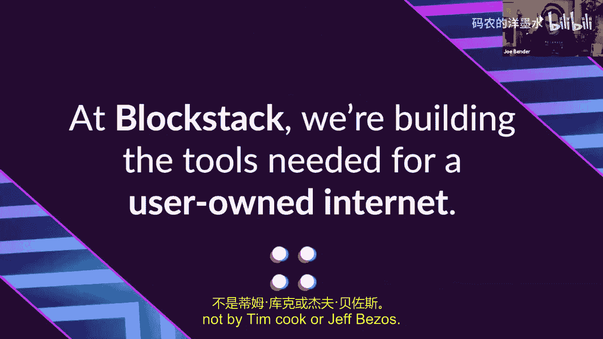

a lots of words on the slide Everything we do is open source we're just trying to get from like centralized traditional web to decentralized application and we're doing that by building software and tools to do that and making a decentralized computing network we believe blockchain technology is going to。

😊，Empower developers and return digital rights to consumers。Um。Okay。

 so I want to talk a little bit about Stas 2。0。 This is where the innovation in Bitcoin comes in Blockt's been around for about like five or six years now。

 Muib is like a freak and was at at Princeton six years ago， just like。Crazy， smart。

 looking at all the different protocols， looking at Bitcoin。

 so many projects sprung up and were like。We went a blockchain。

Now what do we do with it just like blockchain was such a buzzword there for a while and so many projects just sprung up with with a head full esteem and didn't really like think about the the philosophy of what they were doing Manid sat back looked at a bunch of other protocols。

 looked at consensus mechanisms and finally came up with Stas 2。0 we had Stas 1。0 back in the day。

 but it was all about authentication and selfsoverign identity all it really was was you had a blockt ID and then you used that to like log into Ds Stas 2。

0 is changing the game。So we think Web3 now you guys know what Web3 means will introduce true internet ownership like we're staking the house on this thesis that it's coming。

 it's going to introduce better privacy and autonomy for users and it's going to be anchored to Bitcoin it took me a long time to like wrap my head around this because I was so entrenched in the Etherean community but as I elaborated on like we just got to make Bitcoin more usable。

 more exciting， more stuff to do with it it's not going anywhere it is so secure like we mentioned earlier the immutability of it。

 the fact that it didn't have a vitalic coming in rolling back the chain it really is the purest crypto in the game so we believe stacks 2。

 oh represents like a blueprint by which web3 can emerge and scale but still be anchored to Bitcoin。

Designed with security scalability and speed in mind that is the trilemma。

 If you guys have heard about the blockchain trilemma。

 it's a triangle and at the three points are security scalability and speed and。😊。

People always say that you can't get one of those two of those things without sacrificing the third。

 So like if you're on this part of the triangle and you're getting security and scalability。

 you're going to sacrifice speed and it makes sense， you know。

Ethereum right now or Bitcoin has unparalleled security， it is super secure and it's pretty scalable。

 but it can be a little slow Ethereum's a little faster but a lot less secure has had a lot more vulnerabilities because of the smart contract programming language and isn't very scalable in its current form。

You guys get it every single blockchain or protocol you're going to come across is lying on a dot somewhere in this triangle and we think we found a good little combination of three in there。

So just yeah， so this， I think wonderful， can you get a little bit more depth on the proof of transfer or something you' going to talk about。

 oh yeah going into it right now。Yeah， these are the three cool things about Sta 2。0。

 the totally like innovative novel stuff that we're pulling off proof of transfer is a totally novel consensus mechanism that leverages Bitcoin to secure a completely new independent network and it's not possible with proof of work or proof of stake。

😊，Proof of work。Is。What Bitcoin and Ethereum are currently running on their consensus mechanism。

 it's when miners are competing to solve a cryptographic puzzle it's a crazy game it's crazy race where all these miners are trying their hardest expending all their GPU power there's warehouses over in Russia full of GPUs trying to solve these problems it's just a cryptographic hash super difficult to solve and and that is proof of work it expends a lot of electricity and it requires very specialized hardware。

 there are these things called Asics that came out which were GPUs created just for the purpose of mining cryptocurrency。

 no gaming in mind， no stringing video these GPUs are just to be inserted into a massive server rack into mine cryptocurrency。

Proof of work is cool and it found a way to solve the three generals problem or whatever the paradox where three generals are around a city and they're deciding when to attack how do you all attack at the same time that's like a metaphor used for blockchain a lot how do all the nodes agree on the same state how do all of the participants in the network agree on the most recent block blockchain and that is where mining comes in either're trying to solve a computational problem to lead the next block and then all the miners hop on that block that's a mouth proof of stake which Ethereum is transitioning to with E2 and there's a bunch of other proof of stake blockchains I'm going put my foot in my mouth I think like Teszos is a little proof of stakey either like a combination of the two。

Proof of stake instead of expending electricity and burning computational power to secure the network you're locking up your cryptocurrency we talked a lot about locking up crypto with Dfi and lightning so with when Ethereum transitions to a proof of stake you will lock up 32 ether to become a validator and it's kind of signaling that you have skin in the game you're committing 328 and you care about the network and upholding it and you are here as a validator to process transactions and keep things going。

Um， so whereas in proof of work， the incentive to mine is getting that mining reward or transaction fees improve proof of a stake。

 the incentive is to like earn a return a yield on your u on your locked。Crypto。Then Stas 1。

0 started out we were on the right path with something called proof of burn and it was where miners。

 instead of burning computational power or locking up crypto。

 they were burning Bitcoin to signal their commitment。

 they would send Bitcoin to an invalid address like a 0 x00000 just an invalid address that nobody had the keys to do you could never get the Bitcoin out of and that was how they signaled their participation in Stas 1。

0 network it was proof of burn mining and you would receive stacks for burning your Bitcoin。

Now that might seem counterintuitive， but it's never good to burn value。

 but you received different value in the form of stacks。

 but we like Bitcoin at Btack and we didn't want to be burning it so we created something called proof of transfer。

Similar to proof of burn where you're still sending Bitcoin somewhere to compete to Min a block。

 but instead you are sending it to stackers， the next item there is stacking and it's a novel value transfer mechanism where stackholders can earn Bitcoin for actively participating in consensus。

What does this mean This means that stackers， people that have stacks tokens are locking up their stacks on chain much like Ethereum validators will lock up Ether in E2。

0 and it's upholding the network it's adding security it's adding value and we think they should be compensated for that participation that is where the Bitcoin is going that the miners are transferring proof of transfer miners are transferring Bitcoin to try to compete to mine a block the more Bitcoin you commit the higher proportion chance you have of leading the block and receiving the block reward and then the VRf the verifiable random function that's kind of like the brain of the consensus mechanism that allows randomness and random choosing of reward recipients and miners that takes the Bitcoin that the miners committed and disperses it to those stackers that were。

ocking of stacks and upholding the network and that beautiful interplay between Bitcoin and stacks and miners and stackers is what keeps the network going and what it's all about what this whole presentation has been about There is no protocol that uses Bitcoin。

😊，As an extension of security， Muique Sappak and was like。

 Bitcoin's already burned in all that energy has all of that market cab。

 Why would we forsake that and just go to start an entirely new chain and have to do proof of work all over again。

 So Stas 2。0 and proof of transfer is a way that other protocols can anchor into Bitcoin And yeah。

 scalability。 transaction through But all that good stuff that you want。

 that is lacking in Bitcoin can be available on the stacks network。

 And any other network could plug into Bitcoin just as this is happening。

Now the biggest most important part of Sta 2。0 just so just one so can you think of the stack 2。

0 is also same as the layer 2。0 is another way it's almost like a lightning network on its own is that。

The way of thinking about it。Yeah， I think that's fair to say it's like layer 2。

I was about to say like a lot of layer two solutions don't have their own token but that's false some some definitely do I guess it's like weird for me to call it layer two because I'm so used to like layer two being referenced on like other chains but hell yeah this is a way that you can build on top of Bitcoin and I think because you're not like actively using the Bitcoin scripting language to like build new stuff on Bitcoin I think like that would be like pure layer2 we're more so just using the Bitcoin blockchain for transactions and using the Bitcoin currency to power the network so Bitcoin blocks and Stas blocks are in lockstep so we there's a hash to the stacks block in all of the Bitcoin transactions that like anchor the stacks blockchain to Bitcoin but what allows。

For the increased transaction through but it X has micro blocks in between all of the main blocks that allow for exponentially more transaction throughput and scalability and you can do all of the transactions needed for all of these Ds and deI applications and stuff which is what brings me to my next point。

 sorry just just one second go for it。I， I got a question on。

 what do you mean by lockup that you previously mentioned。

 Because like when you lock and lock up your crypto。

 which means your crypto is not gonna to be usable anymore。 So how does that。

 How does this process creates more value。 I'm a little bit confused。嗯。

ItIt keeps value locked in the network， so it's like you look at the lightning network and how much value is locked in it or define how much value is locked in it。

 It's just a badge of legitimacy and how how many people are using it and how useful people think it is and reward cycles are pretty short they're like a week long or something on Stas 2。

0 I know like one second so I'm still confused like what's the incentive of locking up your cryptocurrency to receive the Bitcoin from the stacks miners so you are locking up your stacks for a reward cycle that's say it's like a week or something you lock up your stacks and then you receive the Bitcoin that the miners are committing to mine So they're not burning electricity to compete to mine they're sending Bitcoin to the mothership in Stas 2。

0 and then that mothership is sending。That Bitcoin to the stackers and so they are receiving like Bitcoin interest on their stocks bank account so can I understand it as a way to like。

Keep people stuck in this cryptocurrency。I think it's less like because you get interest right。

 if you keep your cryptocurrency in there and just lock it up。

 you you receive money basically so which means it will give the people incentive to invest Yeah more Yeah it's an incentivization mechanism actually and if like I said earlier。

 blockchain is all about being selfish and trying to manipulate people's selfishness into good stuff and game theory if you guys like aren't reading up on game theory and gam notification right now。

😊，Oh my gosh， if I had a nickel for every time I consensus someone said change the incentives。

 change the world。 like the world is one big game game theory。

 it's all about aligning incentives and and making。😊。

makingking people incentivize to perform certain actions and yeah sure if there is an incentive for people to to receive Bitcoin by locking up their stacks。

 maybe they don't need their stacks for a while yeah that's definitely an incentive and we kind of think of like Stas 2。

0 as an incentive to Bitcoininers in general you know Bitcoininers have been sitting on the sideline as like a bunch of cool experimentation has been happening and all these other chains Bitcoin doesn't have any like cool Ds right now。

 they don't have ways to lock up Bitcoin and receive fiat all those like crazy deffi applications so we think that this is a way to like incentivize people to use their Bitcoin and and commit Bitcoin to mine on this network and that's why we hope that the price of both Bitcoin and stacks will appreciate as well as the value of the network and yeah that's a good。

Hopefully I answered to thatW， so how are the miners getting like reimbursed in this kind of a sense or why what's the reason why the miners would？

daers are getting what the miners are taking the miners are receiving if you win the block and you lead the block then you receive the block reward just like any other blockchain in Bitcoin and Ethereum both work today because they are on proof of work and when a miner wins the block they receive a reward you know there's the having every couple years with the block reward goes down and it will ask them tote over X number of years。

And yeah I think Ethereian just went from like5 to 2。

5 a little while back yeah so the miners receive stacks and also transaction fees so as the network grows as it gains a network effect there's more transaction throughput the miners will receive those fees and I mean you guys are asking all the right questions always always second guess everything always be Byzantine in 2020 and make sure the incentives are there for you you know don't jump into anything just because it looks like a new F crypto you got to is this valuable to me and we believe that trust me it took me a while to be like wait why would people want to give away Bitcoin to receive random stacks token but it all makes sense you know we're cultivating a new more expressive network than Bitcoin but it still tied to the security of Bitcoin and we think we have a really good use case for like bringing the expressive programming。

🎼like solidity or taps and Dfi while still interacting with Bitcoin land and using that so kind of going back to the original question。

 so if lockstep you are with the chain that the Bitcoin chain and so for every block that it gets created in the stack stacks also one block is created on Bitcoin is that correct？

Yeah but there's a one to one Yeah there's a bunch of microblocks in between stack blocks though and it's almost like a so for a second if you kind of put let's say for once second put the microblock aside so we have for one block in stack we have one block in bit so that we go step by step there might be some microblock between the two blocks in the stack which are not reflected on Bitcoin but like put them aside for one second so then in terms of the reward system so on the Bitcoin chain while the reward is explained already is incorporated on whoever wins that block whoever mine wins that block but on this stack what we have is。

You have， I guess， pseudo miners or a second level mine who they're not really mining instead。

 they have locked up their coins。And based on the proportion they have law， they get some reward。

 but where is that reward coming from？Who pays that reward is that part of the reward that was received in the bit or that is that rewards just generated the stacking rewards is generated from the miners that are committing Bitcoin。

 So it's kind of like。It's like a triple flow here miners commit Bitcoin to compete to lead a block that Bitcoin goes to the stackers because the stackers are locking up their stacks and the miners are also receiving stacks from the block rewards or transaction fees。

But so for example， let's say generation of one block on Bitcoin is $5 or five Bitcoin。

And so the miner gets $5 and there was some transaction， there was $1 transaction。

 it was $5 to minor。 there was $1 for the transaction fee， so the minor person X got $6。And so， now。

How much money is on the for the stack， the stack block that was generated and where does that money come from。

 Where does that reward coming from， is it coming from that $6 pad or。

Or is some other way it's being generated？Lo me a little bit there。A minor。

The miner creates a block and the reward for the block is you get five bitscoin。

And there's a one bitco of transaction fee reward just a。Basic bitin。

Reward system is this in the Bitcoin blockchain or the stock blockchain in the Bitcoin blockchain。

 okay。But then you said you are aligning your stack blockchain to the bitin。Yes。

 and for every blocks that created in the stack there's also correspond to a block into the Bitcoin yes yeah。

You can I I brought up this image just because it illustrates like the stacks blocks。

 the main anchored blocks are tied one to one with the Bitcoin blockchain。

 but there are all these microblock streams in between that let's put the microblock on a side okay yeah。

Okay， so now so you have so that's a perfect figure so now on the bottom you have your bit so let's say you are on the first one on the first block that was created on Bitcoinin which also corresponds one to one with STX your block on the stack the reward on the bit was $6$5 just bit $1 transaction fee$6 let's say No how much is the reward for STX and then where is that reward coming from is that a portion of the $6 that was created No now it's like a completely independent。

Ecosystem happening on the stacks blockchain， all of the Bitcoin on the stacks blockchain like isn't tied into the consensus mechanism of the Bitcoin blockchain it's just Bitcoin that the miners had on hand in their balances that they are choosing to inject into the stacks 2。

0 blockchain。So basically just the creation of the stacks is just being recorded on the blockchain along with other transactions that has nothing to do with this stacks。

Yeah， and the fact that we are leveraging like the native cryptocurrency of that protocol is like and how that is a core fuel for the consensus mechanism is in a sense how we extend the security of Bitcoin yes so you have your own coin within your own layers so there's yeah your own coin and that coin is kind of being generated with a proof of stake style because you pulled in resources and you get some reward for those pulleded resources but then you're also I guess as your figure showed you also anchored into the blockchain some record of all the transaction that is happening or all the block creation in your stack is being documented in a trailhead of Bitcoin as well yep absolutely and there's a bunch of like other crazy technical stuff that my engineers will be able to say more like you can you can。

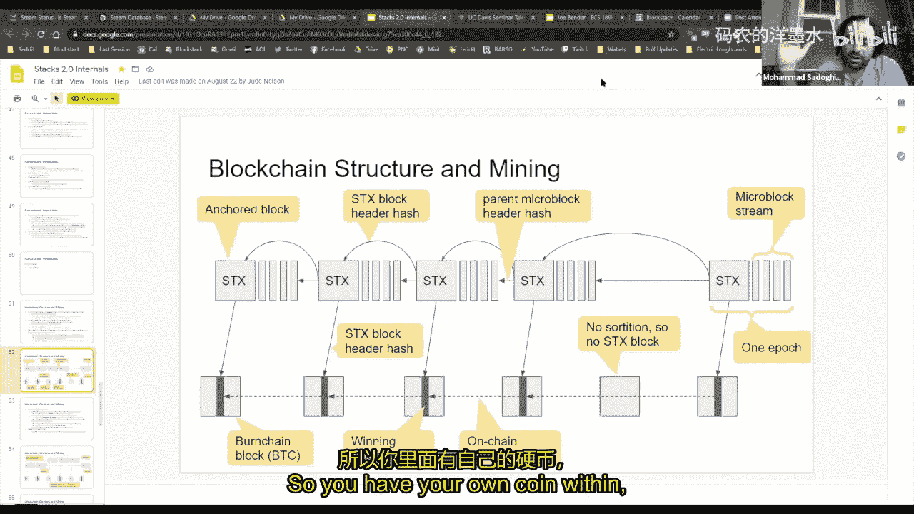

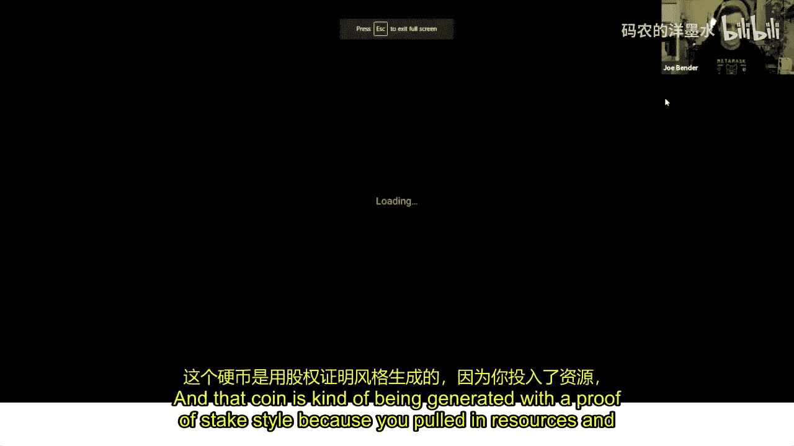

Signal participation in stacking or mining， like even if the stacks nodes were even if your stacks node was down。

 there would be a way for you to send a Bitcoin transaction purely on the Bitcoin blockchain and it would be able to trigger an event on the Stas 2。

0 blockchain， just an interesting interplay like between protocols and interoperability that like really hasn't been seen before in Bitcoin。

Okay， wow， we're really we're landing the plane here。

 Sorry I've been playing a lot of Microsoft flight simulator。Smart contracts are great。

 you guys know about them。 just like code that lives in the blockchain allows you to do stuff。

 And I'll kind of end with this in that Sta 2。0 have smart contracts boom like that's the mic drop in that you can now have smart contracts that are existing in the same ecosystem as Bitcoin。

 And we think that's pretty huge smart contracts are what really add the zest to the blockchain allow you to create Nfts digital digital collectibles。

 those doOs， decentralized organizations that people can contribute money to business model templates like subscriptions to newsletters all sorts of stuff you can do with with smart contracts。

 Yeah， let me see where we're at here。😊，嗯。😊，Yeah， look。

 there's some blockchain stuff in here look at all that numbers。Yeah。

 we're down to really the final minute here。 So I'll just say。Yeah。

 we got a bunch of crap going on right now。 Staax 2。

0 is on the horizon where we're in the testnet right now。

 we're in a bunch of different phases of our testnet we just launched cryrypon which brought proof of transfer proof of transfer just went live and it wasn't for a long time we were still using proof of burn we just flipped the switch on proof of transfer we're starting to see our community come up with all these cool stacking tools and proof of transfer mining tools and personally has like someone who's been in the blockchain space for a long time like I think our project is awesome and has a lot of ambition。

 a lot of smart people， holy heck， I'm like so outclassed by all the Ivy League people at my company and we really have a great vision and we're trying to make it happen check out our discor a lot of happiness in there we got a forum we just got new dark mode docs you know you're check out the docs just because they're dark mode and biggest thing is we got two hackathtons right now if you guys want to check them out over on devpost just search like blocks。

post or something or maybe I'll throw a link in here and you guys can can get access to the presentation。

 but we're doing hacktacks which is totally focused on proof of transfer mining and stacking。

 building tools to make it much much easier than like messing around on the command line or hoping for a day where you can just be like yes stack my stacks tokens and forget about it and just received my Bitcoin rewards and then hack Dfi for anyone who has messed around with solidity on Ethereum and made a smart contract we are just like dying for eager smart contract devs like yourselves just like young people that are excited about the technology hell yes hadn hackDfi is all about making Defi applications with smart contracts。

Always a lot of stuff going on on Btland。 We're legit。 We're the only ever SEC Reg A offering。

 We're like the only crypto that's cool with the SEC。

 Muieve is just like tight with all of the luminati of like Brian Armstrong and Elizabeth Stark and Ryan Shaa and all these like big reputable names of the industry。

 So I'm really excited to see if we make waves this fall with Staax 2。0 launch and everything。

 And if one day in the future， people are using Dfi and das and das with Bitcoin on Staax 2。0。😊。

He'll be happy man， He'll be smiling。mProvoking questions for you to， oh oh no。

 I got this like Chrome extension where if I hover over an image it like magnifies it it's like really nice nine times out of 10 but really bad sometimes here's some questions think about in your free time。

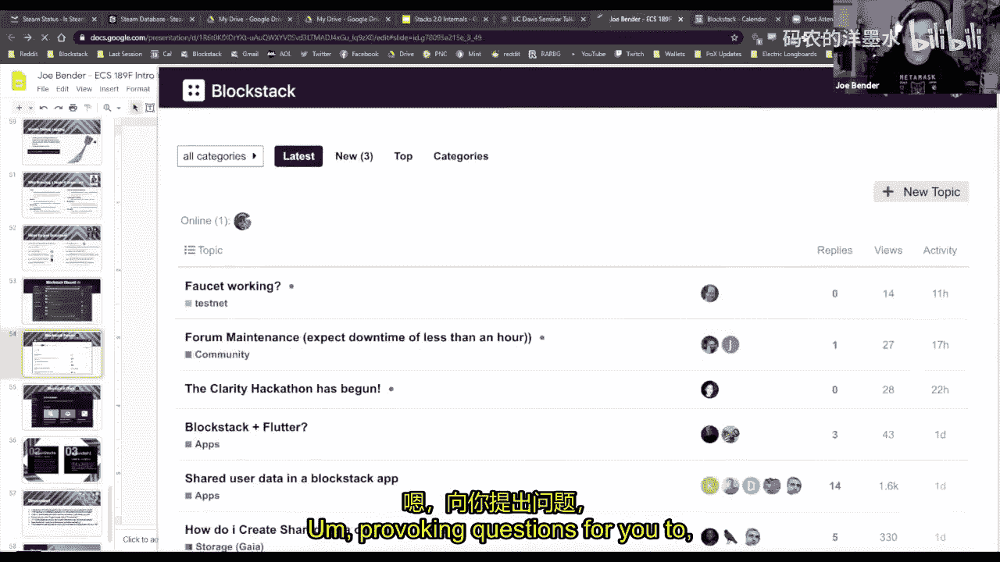

And that's all I got for you people。 There's no way I'm going to keep you past6 o'clock because I used to bolt out of my night classes so fast。

 Holyly heck still blown away by the questions that I received and the interest in this course cannot thank you enough professor for having me just looking at your syllabus。

 If I could go back and just have。Two hours a day where I'm sitting back and getting blockchain information spoon fed to me。

 oh you guys are so lucky but take that out of the classroom and really get into crypto land just start messing around with all the applications start to hold crypto I'm not telling this isn't financial advice but skin in the game is huge you know even if you get one sat one little Saoshi there's I wouldn't expect anyone to go out and get a full Bitcoin nowadays but。

just participate in the ecosystem， play around with apps， get coininbase。

 mess around with some of the stuff on there， do your own research。

 read white papers and there's so many good podcasts and newsletters and whatnot you guys are out there near Silicon Valley you're in another hotbed New York and and your area over there are kind of the two crypto motherships right now Probably a lot of cool companies hoverring around you and oh my gosh people are hungry for blockchain devs in blockchain marketers and crypto people get brush up and you got careers waiting for you on silver platters I'm telling you。

I got a job in the middle of the pandemic。I got hired on April 13th people as the like $20 million unemployment report came out。

Really respect you guys for messing around with blockchain and taking this class and thanks for having me professorsor you got anything else any any we could do a short short queue no it's wonderful thank you so much so I guess for my own benefits to kind of summarize understand sort of the key insight of the block the block stack is。

So it allows you to un Bitcoin。Add this layer to and anchor any protocol of your choice when there's a proof of stake or proof of。

You any proof of X， and then you can generate a coin。

 you can use your own protocol and it allows you to do arbitrary programs like smart contracts。

And you still slide it into the bit itself I'd say the like too long didn't read or explain like I'm five that is like。

Trying to bring that expressive functionality that has really taken off on other chains。

 the smart contracts， the more dynamic programming languages and finding a way to plug that into Bitcoin it's not layer one。

 it's not on Bitcoin I'm not saying smart contracts on Bitcoin but the fact that we are using Bitcoin every Ethereum project in Dfi project is la to Bitcoin like no one wants to touch Bitcoin and I think that's just a foolish decision because Bitcoin is far and away what people are holding in the world right now what Uncle Fred is talking about at Thanksgiving you know so yes we stacks 2。

0 and block stock is kind of offering up the blueprint and the technology totally open source to be able to extend and anchor into Bitcoin a little bit。

All right， thank you so much， it was a great talk and if there's no other questions let's。

Join me and thank our speaker for a great inspiring talk and yeah real super quick Dogecoin is like awesome because it's literally just like a mean like it didn't have any like actual value it was just what people thought it was which just demonstrated that like digital assets are real and people can assign value to them where I would recommend you buy crypto as beginner Coinbase Coinbase is safe they hold your private keys just make sure you remember your username and password if you get a large amount of crypto at some point I would recommend you。

Getting self-soverign with it getting a hardware wallet which kind of like is an external device that holds your private keys the one thing people say with Coinbase is that you can get your phone number port someone can call your phone company and say hi I'm Joe Bennder like I lost my phone just like give me a new one or something and then they like get into your coininbase and drain your account so if you're like holding large amounts in coininbase call your phone provider and be like do not port my phone if someone calls you and ask you to do it yeah Coinbase I think that's all the questions I got hddle don't let your meansme be dreams people don't。

All right it sounds good so as part of the course you're not advocating buying any coins so that's your personal choice oh yeah personal choices oh yeah I just just never investment advice so not offering investment my suspicion not onm gambling which is bit so no blockja for you kids no no late night crypto gambling。

So all right， okay， thank you so much thank you so much for having me， this is an absolute blast。

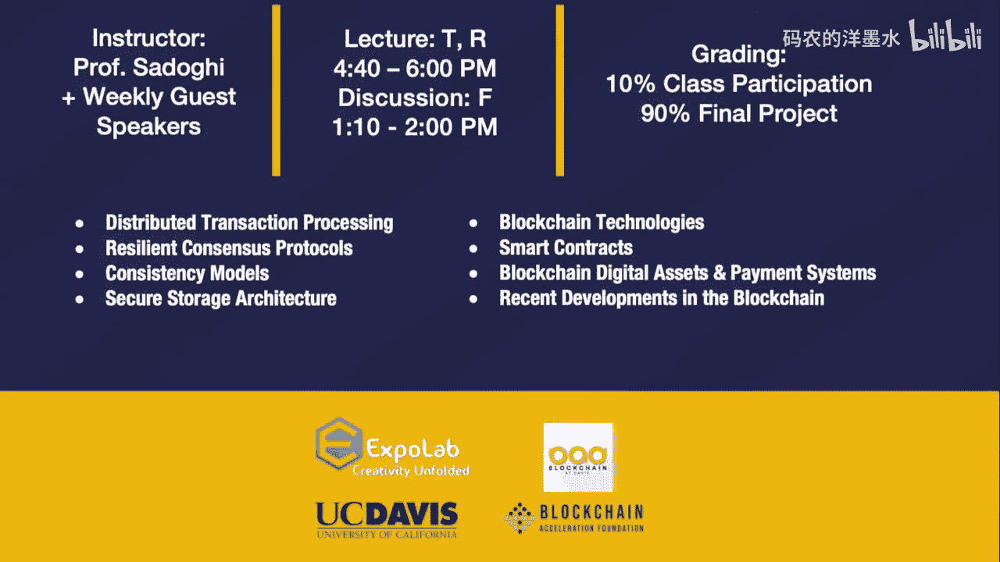