# 【全集】加州大学戴维斯分校 分布式交易与区块链架构 中英字幕 完整课程 p27 Lecture 23 - ResilientDB实操教程 -BV18YFVzME2f_p27-

Hello everybody， it's a great pleasure to have one of my senior PhD students Saj Ranaama to give us a resilient DB hands on tutorial。

 Brazilsilian DB， as I' mentioned previously is blockchain fabric that has been developed in house at UC Davis for the past three years。

Overall， about 10 students have been working on a core graduate student and undergraduate student have been working on this platform the last three years and of course there's about over 100 students that have used the platform for courses such as 265 and。

This quarter hopefully some of our 189 students will also be benefiting from this platform so without further ado so Sancho please take it away and give us a solid walkthrough of what this resilience to be all about thank you。

So hi， everyone。 can you see my screen。Hello， I'm Sajad， a PhD student at UC Davis as you know。

 and I'm working with Professor Sadoy today I'll be explaining resilient TB how it's working and how to start coding with resilient TB。

This tutorial I think would have a three part， the first part is the introduction。

 the second part would be how to run resilient DB with Docker。

 the third part would be how to run resilient Db and Google Cloud。

And add minor adjustment to the code and explaining what are the different parts of the code as you can see a resilient B is the website you can go to this website we have。

Open source Github version of it。 you can go here and just clone the code。

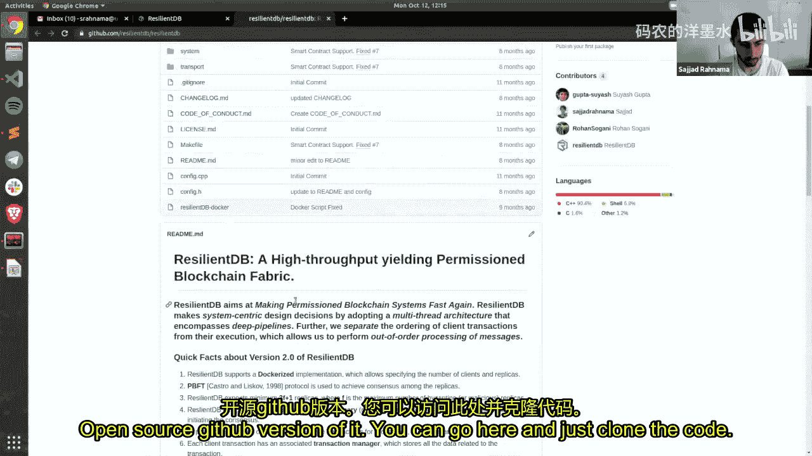

And can you。Clearly， see my terminal。Is it visible？Okay。I have resilient D here。

 we have a directory structure， as you can see here， the same thing here。

 I've cloned the vanillaular version of it。嗯。The first thing I want to say about re sorry so there's a comment saying if we can make the font a little of it bigger。

Please send see now。Not。Maybe just slightly bigger。I think that would be。Yes什么。Okay。

 the code has been written in C plus mainly C+ we have。

For dependency that we are using cryptop plus+ boost J and nano message nano messages for soet programming we completely delegated the。

TheTCP transportation level to the auto message library。

 it has the library for pairing the nodes in network and just give them a byte array to send and receive the rest is。

The responsibility of transport layer of resilient Db to create messages to。

Compress messages with the bioariesaries and all those stuff。

You do not need to make or install all these。Depenencies。

 they are all have been made and they are all zipped or。Tre， you can just unt them。

 I'll be explaining how to just unt them in few minutes。So the first thing is that。

Resilient Db is a distributed code you need to have different machines to use it。

 whether you need to have different virtual machines， different actual machines。

 or the easiest way to run it on the single machine is to use Docker。

Because usually people not do not have access to the cloud to different machines we have provided。

Dcker version of it， so there's an a script here which you give the number of node and clients you want to run。

 it will create Docker compos file it will create the containers for you and it will run the resilient D After that I will be explaining how to run on different Docker Docker containers individually。

The first thing I want to talk about is the config file。We have a conflictt that H5 that is。

Quite big， the most of parameters here you do not need to worry about I was I am just going to explain。

Very。A fewew of them， the first thing is node count how many node do you want to be in the system。

 the next thing would be the client node， how many clients do you want to be in the system。

I as I will be explaining later， the resilient Db is a completely pipeline。Fabric。

 it means that in order to process messages and sending all those things to different nodes。

 we have a very complex pipeline， which have a different thread for input trade， for output threads。

 for doing the actual consensus for。Processing the batching of client requests and all those things the number of threads that you can。

 can you see my carsor。Yeah， so。And here is the number of。

Treads you specify for your pipeline these are a little bit more complex you need to you do not need to touch them once you want to start working with them and。

不是。The an important one left is。How many minutes do you want system to be run。

 how much v up time do you want system to have and what protocol do you want to use right now the only protocol that has been open source is PFD I'll be explaining what is PFD practical horizontal infall tolerance and how it's workflow。

And。And the default version and the default setting is PBFD the diseaseivevan hot stuff。

 all those others are not published yet， but we are going to publish them soon。

 so the only choice that you right now have is PBFD。And this parameters is for this the rest is。

All other parameters you do not need to worry about。So first thing to run。

 we have a resilient Db Docker scriptor in order to run resilient Db Docker。

 you need to have a Docker engine on your machine， so if I do Docker P。嗯。

So my docker is running and working， my docker engine because Dcker P is Docker client。

 so when I do Docker P it means that Docker engine is working and it is saying that there is no container here。

そ呃。We have a resilient DVD document command。So it's saying that in order to use a resilient D here。

 you need to specify the number of client and the number of replicas。

 I will be doing seven rep for example， six replicas and for example， four clients。

So what's happening in this script this script is just a shell script。 It will。

Gets your parameters from here， it will create the config file that was there。

 it will create that file with your specified parameters。

 then it will create a Docker compost file creating 10 container based on the number of clients and what you have a specified it will create S1 to S6 and C1 to S2 C4 it will create 10。

嗯嗯。10 darkcker container。 And then it will。Randdos container fetch those Is because in order to not a message to communicate and send message to the other node they need to have a specific IP IP address for them so it will extract all the IP addresses that Daer will give you by itself。

 it will sort them。In order to run resilient Db， you need a if config file that TX that DSscript will be creating for you if confit that TxT file is a file that you need to put your IP addresses in it once it extract the IP addresses from the Docker engine it will create this file and after that it will try to install dependencies installing dependencies is just onring or onziping all the files in the depth folder it's very straightforward you do not need to worry about and after that it will start making resilient D will do the make clean command and make resilient D as you can see the resilient D is being made and after that it needs to。

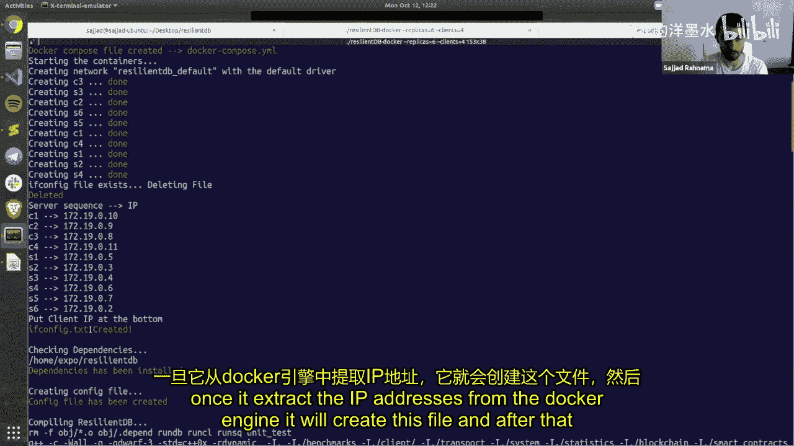

Distribute the binary file that has been made to different node different node different aer containers。

 but in order to make that easy， we have shared a folder between those doer containers and put the run two binary files run Db and run seal in that directory so every container。

Can have access to this and after that it will run run Db on the yes， go ahead。

Anybody has a question。You can just unmute your cell phone。Ask good question if you want。No question。

 It's okay。So as you remember in config file datat we have two minutes of runtime and one minute of Vmap right now the first one minutes would be Vmp and the second two minutes would be actual consensus being done and measuring the throughput and latency while it's running I'm going to talk a little about PFD and how PFD works。

So I explained how to run the resilient Dbdocker command。And what is dark here。

 I will be explaining the pipeline later on。But first we need to go to the PBFD PBFD the first practical Byzantine fault torant protocol。

 it is a per blockchain consensus protocol， it is communication based and it has two round of Sd communication and one round of。

Linear communication， as you can see in this workflow。

 I will be explaining that if you have if you have a tree replicas， if you have four node in PBFD。

We usually assign one of them as primary in resilient Db the first one is always primary as a default。

 but in case of multiple primary it will be changed。

 but right now the primary is always the first one we have clients clients will create requests as you can see T they will send that to your request to the primary。

Primary will create pre Pre messages。And broadcast it to the all notes in the。In the network。

And after that everybody will create prepare message prepare prepare messages and send to everybody so we have everybody to everybody communication in the prepare phase and after everybody gets to。

😊，A sufficient amount of prepare message， they will start sending commit messages to everybody and after everybody receive sufficient amount of commit messages。

 they will execute the transaction and send the reply back to the client in order to understand this workflow you need to read the PBFD paper I don't want to go over it and explain how PFD exactly work。

 but the the。Listing gave me to know is that the PBFD has a tree round。

 the first prepare round is the linear tool round of Equa communication and the client response。

The thing that is being run right now on the resilient DB is justice clients are creating requests。

 sending those requests to the primary， primary creating prepre messages， sending to everybody。

 everybody after receiving prere messages， creating pre messages， send to everybody and after that。

Sending commit message to everybody and after receiving sufficient amount of commit messages。

 they will execute the transaction add it to the chain and send the reply back to the client。

Any questions could the primary also be Byzantine Bnie chance now Yes， yes， yes。

 primary can be Byzantine。 We have a view change protocol to replace the primary。

 but all those things is next level we don't want to talk about that because they would it would make it a little bit complex。

 but yeah in resilient D， we have a view change protocol implemented that can replace primary in case that primary is Byzantine or fault or crashed or empty。

Wait， so what's the difference between the primary and the replica again。

 can you explain that primary primary is a leader， primary is。

A person who needs to sequence the transaction and lead the consensus protocol in PBFD。

So every client request goes through primary primary assign a sequence number to it and then send everybody so people can can have a can have a sequence of transaction ordered set of transaction the primary is kind of order if you know the taxes the primary is kind of lead order。

Why do you need a separation between the client and the primary though？

So let me just interject here Sarah so I don't want to carry away so the notion of the primary here is the same as the coordinator we talked about in 2 PC this paper is going to be covered in full and later this quarter so and there has a lot of interesting question but I think if you start talking about the protocol then we're not going to have time to actually talking about yeah but this is going to be covered again this is number one this is the most important protocol I think that youre all going to be learning this course and hyperperledger uses it there's other platform who uses it so we will definitely spend good amount of time on the protocol later。

So any other questions？Sorry， I'm from E S 189 F with little knowledge about PBFT。

 Can you explain what is Byzantine replica。A a Byzantine replica is a malicious replica that can act as a malicious note and it can prevent sending message。

Sending different message to， different people， it's kind of a faulty note。Okay， great。 Thank you。

It would have a mandate to。Behavior， random behavior， it can act。I want。嗯。Yes。

 any other questions here？So the v rule in the code will be going through the client。

And reach the process execute transactions。 So we'll going to we' going to see how the client will send will create those clients request in the system。

 how they will send it to the primary， how primary create。Those prepare messages and the voteflow。

So if you want to implement your own protocols， you need to just change this workflow， for example。

 if your protocol that you want to implement says that the client needs to send the client's request to everybody you go there you find where the client is sending the request to the primary and you change that part and make it to send to everybody and if for example in your protocol that prepare stage is linear。

 you do not need to send to everybody， you just go there and change the destination and make a minor adjustment to make your own protocol。

So if I go here， Okay， so the resilient D has been run successfully。 And after that。

 we have a script to。😊。

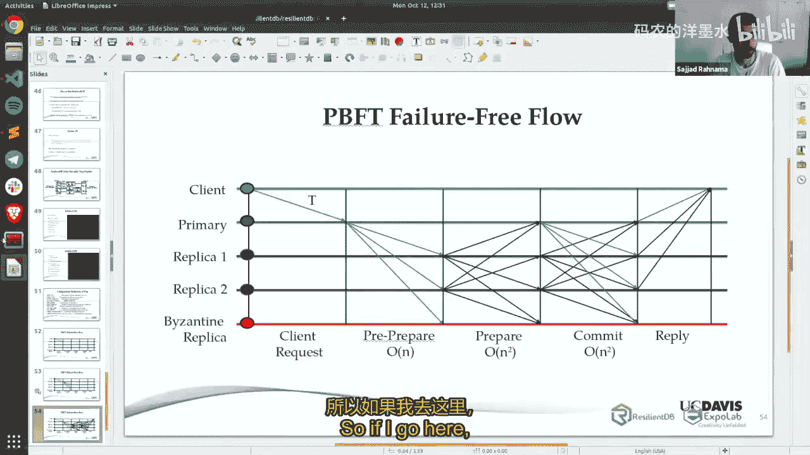

Yeah there are the results from the Docker machines and give you a summary here and you can see we have nine node and the first thing is throughput as you can see we have the throughput of 7 almost 17k in six note and the throughput of 1700 1700 transaction per second in our fork lines。

Here are the latency numbers， they are all。The different files in different document containers。

 but the script has gathered them and showing you the summary There is the idleness of threads of pipeline I will be explaining how pipeline words but the amount of idness that the worker that the threads have means how much you are exploiting your computation power in all notes for example。

 the first one is worker thread， the last one is checkpointing thread and the execution thread and all different right now you do not need to worry about these thing just the throughput and latency and so6 through9 referring to the client nodes are they referring to Yeah6 to6 through9 referring to the clients the first six one are the replicas the last for one。

Are the clients， So the sum of throughput of clients would be a throughput of node here。

Is that clear， yeah。Okay。So here yeah so。This way of running resilient DB is just for demo you cannot do anything by running the resilient Db Docker script so if you run it in this way。

 you cannot change anything， you cannot monitor anything。

 you will just having the system run and receiving the results finally。

The one way of doing it with the Docker is to run yourself on the individual machine。So。

I have different terminals here。To run it on different node each。one by one。

 this approach is just for development If you want to develop on resilient DB。

 you might need to run it on different node and see the results and everything online。

I don't think you can see very good， but I try to make them。

And just a kind of a note to just even the impracticality of it so some of the latest deployment that Sajot has done。

 which are I think by far the most exciting and I think no one in academic or even industry have reached the scale that we're talking about here。

 over 500 machines replicas globally across all continents。

 many different countries and still getting transactions of a million per second。Very interesting。

 I think there are many interesting deployment that we can do and just that all goes through due to the efficiency of resilient D itss fronttime its pipeline。

 the conpher that we've been developing over the years。

 so I think there's a lot of exciting stuff for anybody who really wants to join。This journey。

So as you can see， I have， I think six terminal on the left side and。😊，I right。 How many young，2，3，4。

5，6， Yeah， I have 10 terminals here。 I will be so here all of these terminals are the machines that have been running docker in order to go to those containers。

 you need to do command docker ex the docker the command Docker ex will execute command inside your docker container。

 as you can see， I'm running bash and I'm giving it an I flag that means I need an interactive bash inside that container。

 So I will be running S 1 here。 Ill be running S 2 here。 S 3 S 4 S 5 S 6。It would be C 1， C 2。

 C 3 and C 4。 I have all the machines there。 So if you can see after this part。

 after this part is being is done the。Two binary file will be present here。

 as you can see run DB and run here the run Db is the binary file that you need to run on your replicas and the run seal is the binary that you need to run on your clients。

And in order to specify which machines I am running， you need to pass a parameter to， for example。

 this machine is S1， I would be running。A replica， so it would be run Db， as you can see。

And in order to give it that you are the first node， there would be a。A parametermeter of N ID。

 I will be giving N ID 0 to it。So it will as you can see here is how Brazilian DB is exactly being run here is the config file parameters that being said that you have set in the config file here is the IP address of different node that it has and creating the sockets for them and after that binding the sockets to different port of different machines based on how many input and output thread you have。

And after that， it will initializing the message queues， transaction pools。

 the transaction table pools and all those。Souff and after that， it will be creating the。Fac。

Symsymmetric。symmetric signing。Ks for the different para node， for example。

 if I am a node number one， I need to have a key with if I want to dosymmetric encryption I need to have key with everyone in the system so I will be creating the smic key with all of these nodes and transferring definitely those keys with all those nodes and after that it will be sending the initton message the inton message is supposed to make the initialization of the protocol they will send inton message to everybody once I receive anyton message from everybody it means that everybody is online and everybody can start running the。

System and as we can see， it is waitingading to receive get any done messages， as we can see。

 it has sent the any done message to everybody， but it hasn't received anything yet。

 So it will be waitinging to receive any done message And after everybody received any done message from everybody It will start running the flow of protocol code。

 But again， you do not need to worry about these part part all has been done。

 you need to just change the workflow if you want to implement something in resilient D in a easy way。

 So I will be running run D0 on this machine。Bron D1 on this machine。To one this machine。

T this machine。So here should Iran run Cs。So。As you can see they will receive the initton message here it is received it has received in itton message from everybody from everybody after that they will start running the actual consensus as you can see after they receive in itton。

 the threads， the worker threads， the input threads。

 the output thread will be a start being run and yes。

 we have stats we have a stats layer that gathers everything is happening in the。😊。

In the fabric and shows you every 10 second and as you can see every 10 seconds we have an update here with all parameters for first 60 seconds it is Varma there will be no measurement and the results would not change everything is zero as you can see the throughput is zero the transaction count zero everything is zero because it's Varma Varmap is supposed to fill all those cus field is supposed to fill the pipelines everything to make sure everything is in the same as to start measuring everything。

And as you can see yes， for the first。6 second。Nothing will be happening， but。After that。

 in June the start。As you can see here。Yes， here is 60 and the truthput starts getting。Valed。

This is no number 0， so it is the primary。As you can see the throughput is rising。

 The throughput right now in the resilient D is accumulative， so you cannot it will be increasing。

 I will be changing it to the。No， I cumulative and。No anacmulative version later on。

 but right now you will be seeing arriving in throughput as you can see the throughput is being increased the transaction count is here how many milliseconds for QA time and all these parameters right now you do not need to worry about it。

So after， I think two minutes it will be done and the script that was running Brazilian DdaA was supposed to gather all these files。

 every node has its own。Results， that group was gathering these things and just printing you out the trueput。

 the latency in the client and the memory usage。And of course， id time of four car threats。

So as you can see it's just it' just showing you the trueput and latency now I'm going to walk through the code and show how make an adjustment and how see the results of what's happening。

In the running time。So， I would be。Its stopping then。And I will go the code。Is the size O。

We cannot see the chat。 if anybody cannot see the。そう。So you can see。

 So this was the conflict file I was talking about。

You can so right now from now on if you want to change something you do not need to run resilient Dca command because that was just a demo for the first time do run that because it will be unring and unzippping the dependencies for you and it will make easier for you to do so from now on you won't be running those that comment if you want to develop something or resilient D so you can directly just change these numbers and just compile compile the code and run in those different terminal that you previously had So just kind of a note if you have any questions sort of ask if you hear a that you're not familiar with and that's I think expected so just ask especially now that we are kind of beginning to go into more detail I think now it's a good time so and if you need to go over and over the hour mark that's fine we can continue the meeting。

But again， it's important to ask any questions any any question that you have so that。

Later you can actually take this tutorial and help you to get started。Anybody any questions？Nothing。

So， I think。I can't continue if at any point of time， you had a question， just stop me and。

Ask your question。🎼So we have the directorial structure here right now in order to make make it simple for you。

 you do not need to worry about these benchmark blockchain dashboard。

 D depths a scripts a statistics and a smart contract folder the only folders you need to worry you need to take a look at it is a system。

And client father。For the rest is not just right now， your concerned。

 the most important part of the consensus is happening in the system。And decline client folder。Very。

也是。So we as you remember， we have a run TV and run seal。

 each of those files have their own main file again。You again。

 you do not need to change those main file， but I just gonna explain there is a main file for the crime that is doing all the initialization。

 all the things that you were seeing in the。Lock file off each the client node。

 creating the workloads and initializing the message queuees， initializing the network。

Creating keys and all of those stuff is happening after the all the initializing being happened。

 the client thread would be wrong you。The client T is in system folder。The。

I'm starting from client because the workflow of PBFD was starting from the client client was the one that was initiating the workflow。

 creating client request and send it to the primary。And you can see client the client trade is here。

 There are a couple of。Functions， you need to look at the most important one is the run function。诶。

Theron function is a while true loop that is just sending creating client request。

 sending it to the primary， waiting it for a response， creating a client request。

 sending it to the primary， waiting for the response from the node and creating these things again。

So as we can see， we have a while true called while simulation is done just to a heartbeat progress is stats。

find。I don't want to go very in detail you can find and understand it yourself i'm just trying to explain it a little bit abstract not go deep into the code in this part client will find who is the primary right now in the PBFD primary。

primarymary is tied to the view each view has its own primary and when we are saying next note idea is get view it means who is the primary right now it will find the primary who is the primary。

 it will create batch request。B request in resilient Db is。Is the same as pre pre request？

PDFD allows you to batch the client request in order to make consensus make consensus fast so the clients will batch the request。

 for example， it will gather hundreds requests together and send them as one request to the primary so as we can see here is looping over the batch size and creating。

Coed query and adding them to the batch request， as you can see。

 once it reached to the number of batch side， it will sign the message with the key of。

Primary and it will create a vector called destination。

 puts the destination number in need and put the message in the message queue the message queue is responsible to provide these messages to the output T and output thread will send these messages to the destination node based on the vector called test that we are providing to the message queue and after that it will do the same again and again。

Okay。This is the。Wild true loop that is happening while simulation or the。Codyズ being床。

So here is the client。Once client sends everything to the primary。

 now we're going to see what's happening in each replica。

The whole process of replica is a all true that is waitinging for the message from different node and act on those messages for example。

 every node is vading is waitingading to receive a message once it receive the message it will process that message so if we have a different message types that I will be explaining there you can see all those message types but they will receive a message and based on what type of is that message they will do something。

This process is happening in two function in worker thread file。Worker thread is where the。Each note。

Is doing something。Well we have a lot of functions。

And kind of so again intuition is that when we think of either two PC that we talked about or the PPFC protocolacle that we talked about there are different phases。

 so that means whether you're a replica or the primary you kind have an event based mechanisms so you kind of wait for messages once you get your client message or once you get your prepare message then you move on on that flow and you can get the messages out of order so handles all the out of order processing of those messages but again。

At every phase you constantlyate a message， you get another message， you act upon it。

 you either start a message could mean a new consensus or a message could be from one of the previous from the previous consensus that is still ongoing so it advances one of those spaces that we talk to us so we start with a preprepare and then we go to prepare and then we go to commit and then informing the client。

So at any point in time， you could be in one of those phases for many parallel consensus or that are kind of happening at the same time because again。

 we're not processing one client batch at a time， we start one client batch and while we're finishing the processing above we start another and there is like in flight or in transitioning batches that are happening in place。

 of course when the time of the execution comess， even if you，Process these consensus out of order。

 the execution still ensures you get a serial order execution at the end。

The serialization does happen and every batch that comes to every batch of client messages that comes to the primary primary tags it as a sequence number as essentially a timestamp to it and by adding that timestamp by adding that sequence number it situates it or it orders it with respect to the previous and future batch of transaction and now using that sequence number and that timestamp each replica as they getting these messages out of order they can connect the docs together and they figure okay。

 this is。relates to part of that round of consensus and when we get that message。

 it progresses at that particular round。So。Again， if that's helpful。Anybody。

 any questions up to here？So guys， I know this is a huge code base and understanding it would be difficult。

 but if you want to work on readily in DB， the best way is to trace what's happening with the workflow of PPFD if you want to understand it。

 go from client， find what's happening after a client sends the message。

 what happens to that message， what will be happening to the response of that message and tracing the workflow would make you easier just don't start and if you want to work on readily D。

 don't start reading each function trying to understand what that function is。

And again it's an incremental process so it's not a process that you can just look at it overnight okay understand the entire platform。

 it's something step by step adding print statement adding sort of traces to you start gradually learning and again since we're working in groups and you can not only collaborate between with members within' your group or across the groups and slacklas and all of that so thats so that could。

That will give you the additional help and also。When to also add this， the code is complex。

 but if you compare it to hyper ledger， for example， or more mature sort of product。

 which have hundreds of people have been working on it。

Or maybe thousands of developers have been working on it still the code is much。

 much simpler in terms of its size and its complexity because it doesn't have all the dozen and thiss。

 for example， IBM， DV2 code base。I mean numbers goes around anywhere from 10 millions lines of code to even larger and again millions lines of code again you find it in in sort of well established databases in well established operatingri system so it's important to be able to deal with a large code base and understand it and this is in comparison I think is' still consider I would say the research prototype so it's much simpler is's more modular it's much more simpler to digest and of course you have a lot of tutorials around the two in addition to what we're offering today so I think that might be。

Good stepping stone in order to get into the building engines and sophisticated software open source。

 I think this is a good step。 This is a good entry。 there is a there is a learning curve， but。

This is something that you need to master and this is something that you need to learn of how to digest and parse and read code because that's going to be an essential skill set whether you're undergraduate or a graduate and you're planning to go work in a research lab orre planning to work in a software company these are important skills to develop and honestly the only really way of doing it is you just take an open source project and。

Take the challenge and you kind of experimental all aspect of a read of a print statement so you have to develop what's best worked for you in order to recode and understand code。

So let's continue as you remember when we want when we want to understand the client。

 we went to the run function the round function is the main loop of each node that is being So the client was running the client thread round function here。

 all replicas are running work thread round function。 So as you can see again。

 this round function is also while through on the。On the whole code。

 what it's just doing loop on the message queue and try to deque message from the message queue from the verQ。

 sorry from the once input threadread receive messages from the network。

 they will put all those messages in VQ so all nodes will be waiting for a ver queue to have messages and if it can get something from verQ。

 it will do some initialization and then process messages。

So the processes like this the node will wait for work queue to receive a message once it receive the message it will process that message and as you can see the process function is just a switchcase on different message type if message type is a key exchange we call process key exchange if it's a client batch we we will call the process client batch function and as you can see based on the message type it will call the different functions to process different message again so again that's sorry so again that's the part that it grabs which phases of consensus for which round is doing and so that make the the regression that I was referring to so that's the essential piece that I is covering sort of connecting the dots。

If you are if in your portal， you want to create new message， you want to add something new。

 you can just create your own message that I will be explaining in the transport folder and in the worker thread you need to just add a case here based on your message type and write your own process message type。

So one more thing let's so Sa one more thing so again。

 so now so why is this important is that if you're building a PbF protocol and you have an optimized version that you need to drop one message type well we know where to go or you have a new protocol that has。

Slightly different phases from PBFD so again we can look at PBFD okay so this is the phases and I need to perhaps drop this particular phase。

 drop this particular message tab and introduce a new message tab that is perhaps a variation of the one that PBF has maybe it doesn't have the quadratic communication that we talked about maybe has a linear communication but again if you follow the process。

 the workflow of the PBFD which really captures the entire consensus and all the optimization and the runtime and the pipeline and everything that the resilient D offers that allows us not only to optimize for example PBFD itself but use the PBFD as a basis。

For implementing new protocol and that's what we' kind of been doing so the dozen protocol that we have all of them is based on this sort of what the Sajo is referring to so they're all going to be variation adaptation and sort of plug and play of different component but that's the flow that's the basis those are the necessary sort of steps。

So okay， I'm going to go to the process client batch。 The first step is processing client batchge。

 if you remember this part， then the client sends the message the primary primary is the only one who is receiving the client batch the client batches is the same as client request at this part the process client batch will be called in the primary mode。

 And as you can see here， we are going to。

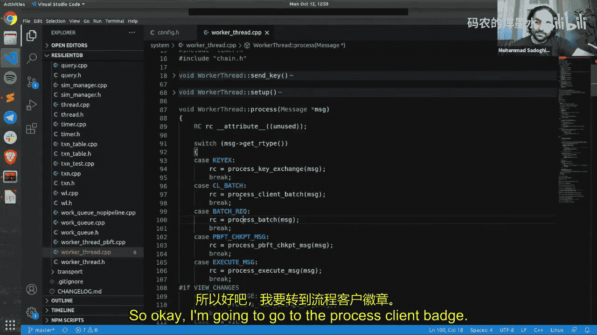

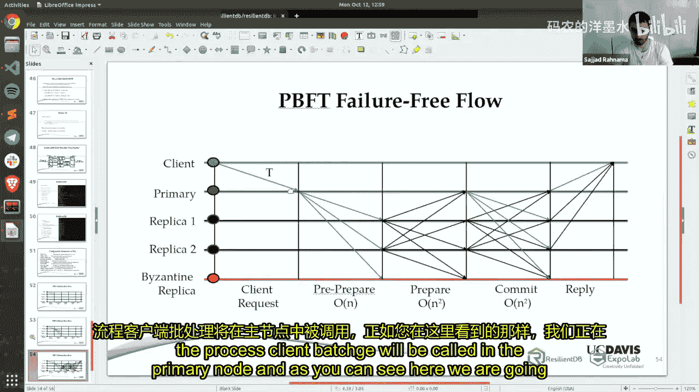

Here and we will be just printing out。对对。Primary had received。A client query badge。

 I will be compiling the code and running and see who is receiving what from which message。

 I'm just confirming whether just the primary is receiving the client badge or everybody is receiving client by just to see what's happening here。

So， I have changed this。아 can see 알。Me。😔，うん。So once it gets finished， we can now。Ron。The in this。

As you can see after I compiled the code， I didn't move runDV and run seal anywhere because all of the containers S1 through C4 are shading this directory。

 all of them their working directory is the same directory so the runDB and run seal will be available for everyone。

Not so。I think I have changed the conflict file。If you had six million， then how many clients。区皮。

No forklift。Sorry， my bad guys。Then I changed the printed statement on that file。

 I also changed the number of nodes in the。ComThe number of clients in the conflict fashion。

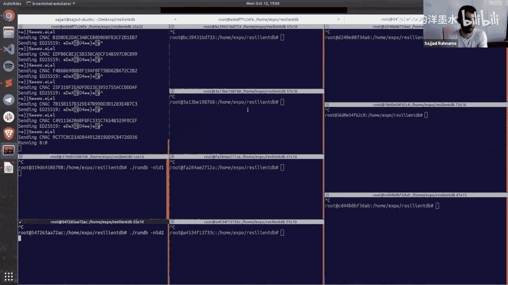

As you can see， the only one is receiving client queryriba is the first note。Which means the primary。

And as you can see， we have two batchching threads I will be explaining later who is processing these client batch thread one and thread we have two threads just working on the client request because they are huge and they are。

The the processing of them creating transaction managers takes time。 and as we can see。

 they are receiving from different clients client number9， number7， number8。

 number6 and different clients and nobody else is receiving anything from the from the clients So the workflow right now。

I the first system。The next step after I will be showing you how this client query the processing will be working。

 The first step is to validating message checking that that that it's been signed by the client who is claiming that sending message and validating the。

Signature and if it's right， it will call create and send batch request batch request as I explained before is the same as prepare message because we are doing batchging in PBFD the name of the message the first client request and client PD prepare message are different they are client client batch and batch request client client batch is the client request。

Bch request is pre prepare message in the PBf batch request is this part prepre。

 The primary will create and send batch requests at this part in processing clients request。

 So when it's trying to。

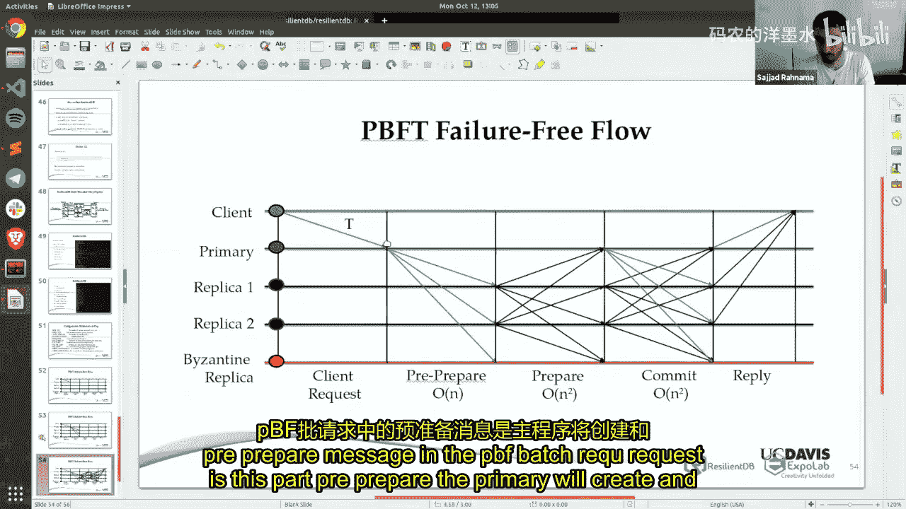

Creating batch requests and sending to everyone。As you can see， it will loop over the batch side。

 it will create transaction manager for each request that client has sent because finally this node as a primary itself needs to have the chain。

 it needs to have the transaction manager for all the requests and finally execute those after the consensus is is done。

So it will doing initializing the transaction managers here， as you can see。

 initializing transaction managers based on the client query set， creating the digests。

 as you can see， it is creating and string from all the messages inside the batch and finally creating。

Hash from those from data string and call it a digest of message if you read the PfD paper primary needs to add a digest to the each client's request and include it in the preP repair message and after that it will。

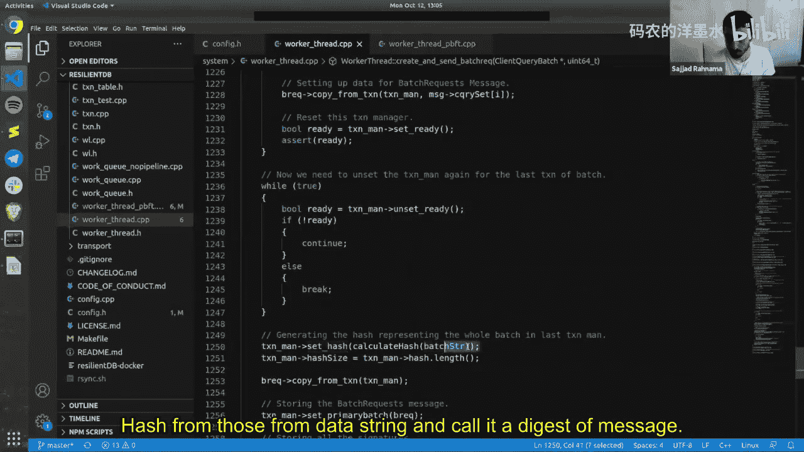

After that， after it creates that batch request， B rate minus batch request。

 it will sign that batch request and this function would create a vector containing all node and just passing it to the message queue so it will create transaction managers create a vector of destination and gave it to the message queue so message queue will do this part message queue will give that message to output thread an output threadread will send those messages to everybody here。

After everybody receive pre message， they should send prepare message to everybody。

 So what's happening in the other note after node receive。

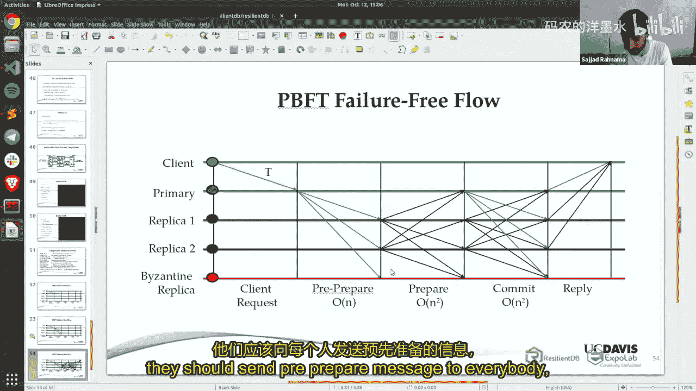

Let me go to the。Process function。

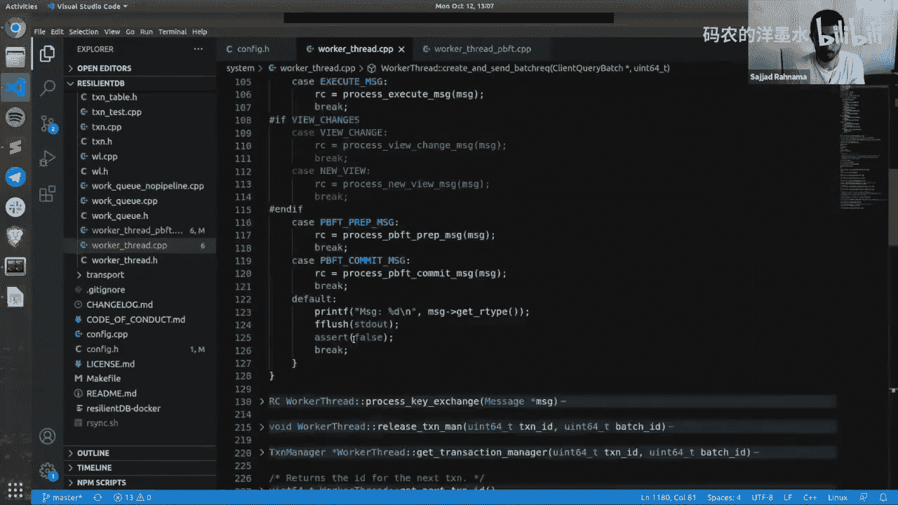

Here， once and note receive。Batch requests， it will run process batch process batch function。

 the process batch function。I a game。On comments， these two lines。

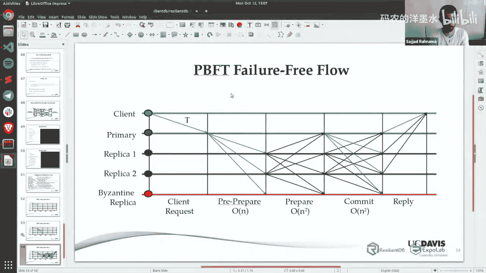

They can runで。

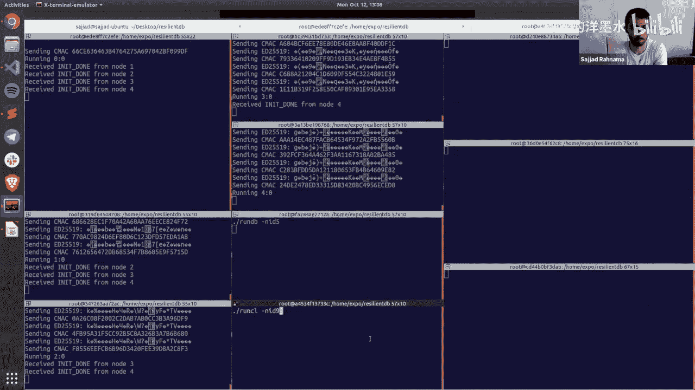

And as you can see， all of notes are receiving batch request from the prim。As you can see here。

 they all have a transaction ID。Here。Last last two digit is the the the batch size and the first digits are the transaction ID。

 for example， there is 0，2，3，4，1，6，7， and they are receiving。嗯。Out of order。

 because the consensus can happen out of order。And after they they will receive the batteryqui。

 they will do this process again and again， will after they receive batteryqui。

 they will create prepare message， send those prepare message to the other node other node process。

Process PBFD Pre message and after that in this function they will create commit messages they will send commit messages once they receive commit message they will process PBFD commit message after they receive enough sufficient number of commit messages they will create an execute message execute messages and internal message they will pass it to the execution threat execution thread will execute and create client response and send a response back to the client and once client receive that it will increment the number of transaction in flights and send a new client request with a primary and this look goes on and on until it finish the simulation I'm not going to go over the commit Pre execution because they are same as batch request and client request that I was explaining So yes I think that's it if anybody has any question on this part Can you just repeat your whole summary that you。

right now real quick I just it was kind of fast。 So yes。

 yes see the process is like if the clients and the client start sending client requests。

 it will it will create client query batch messages。

 send it to the primary as they print out the process client batch in the primary as client query batch in the primary after primary receive client query batch。

 it will create batch requests batch requests， send it to everybody as they can send the workflow of PFD send a batch requests to everybody once everybody receive batch request。

 they will call process batch function on that message。Processing that message。

It's just creating prepare message and send it to everybody else。

 as you can see in the flow of Pro code。And after that。

 everybody will be receiving prepare message once they receive enough sufficient number of prepare message。

 they will start sending commit message。 Once everybody receive commit message， they will。

Call process PBFD commit function in that function。

 they will start counting the number of commit message they are receiving once they receive sufficient number of commit messages。

 they will。Execute the transaction， and create。Client's response and send the client's response back to the client。

 and this process will happen again and again until the simulation will stop。Well。

 it's not simulation is the actual thing is happening until the experiment is done。

It's called the actual。But again， the the one that I'm showing you is on the one machine，1，6，1，6，1。

8 core machine is running 10 node each of those 10 node has 10 thread。

 So the number that you are looking at in the throughput are not the actual numbers because we are。

Running all of these machines on the same machine once you dedicate one， for example。

 30 to core or 16 core machine to every of these nodes。

 the numbers would be the actual numbers that the resilient Db can scale up to that number。So。

Any other questions？ Can you go back to the terminal， I think for some reason。

 some of the threads on some of the nodes。 So on the thread in the like middle， right。

 is there any reason why that shows a 0。So I I which one。These are not。So no， oh， that thread 0。

 Okay， I didn't explain these part。 I'm glad you asked here。😊。

So here is the pipeline of resilient Db as you can see these batch creation threads are thread number one and two in the default setting。

 so the batch creations are in the primary number one and to who are processing client query batch and creating batch requests。

But in the non primary replicas the work here T zero is processing batch requests。

 so when you are seeing T zero it means that trade number zero is processing batch requests so in the non primary note the one who is processing actual batch requests。

Our trade number zero in all， why am I not reaching that？Here， the thread number0 is processing。

 So this is the formation of pipeline in non primarymary nodes。

 that thread number0 is processing process bad and in the primary thread number one and two are processing client querys So kind of go back essentially if you can please go back to the previous to the slide so so the runtime architecture that we have is a multi threadreaded and that pipeline pipeline in the sense that operation happened in order and it' multi threadreaded is that it's not at a single thread iss just doing all the tasks。

 So we have you can configure。 So there's a couple of threads that just looks at the input during the messages we have a couple of thread that package and messages that send up where needs to be sent now within it there's again。

 a whole bunch of other threads that are being used there are threads that create these batch batch of transaction there are thread that deals with。

Doing the different phases of PBFD those are the worker thread sequencing and so forth。

 there are threads that in the background they do the recovery and checkpoint to ensure the recovery can be done faster and they again a set of dedicated thread that once the consensus is done they actually go ahead and execute so and they execute is another set of threads that we have so it's a。

highly parallel runtime environment is a highly multithreaded so in some of our setting we allocate 16 or 30 to physical thread each to each node so we can do these in sort of the highly efficient and highly parallel way of handling these requests。

 so that's kind of another connection point to what those each thread means。And we do have a lot of。

 so we look at the throughput， we look at the number of messages being processed。

 we look at the id type， we look at every thread we really do when we do an analysis to say why this consensus is doing better than the other we come back to these wrong time so we figure out where is the bottleneck where in what part of the pipeline is in that we are bottleneckking the worker。

 we bottleneck is execute and so we identify those and then we also we adjust those number of threads in order to ensure that we get to almost the steady state and we into our almost optimal state of execution。

And it does give you that re does give you that flexibility to really allow you to configure and adjust all of these parameters。

Theses around 10 parameters。I guess in more advanced，The more advanced type of topics。

Thank youSo what's yeah， that's that excellent question。 So so perhaps I think maybe。

Going to the Github at some point forking good and everybody try to just try it themselves as well on so do you have anything else before you go to that stage No professor okay yeah so maybe I think this is kind of now making even a little bit more hands on we all do this together and so。

And this is hopefully there are not too many issues。

 especially since so many of people are going to believe at the same time。I mean。

 we've done it enough times， hopefully it's now it's。F reliable and stable。

 but it would be good that we all kind of tried right now and。And if you face anything。

 it's excellent time to just quickly be able to address it。

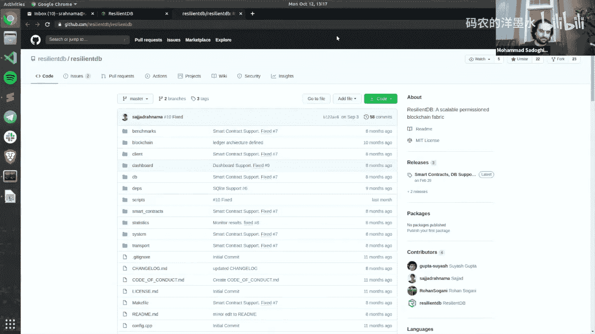

So， does this end up simulating like Byzantine nodes or？

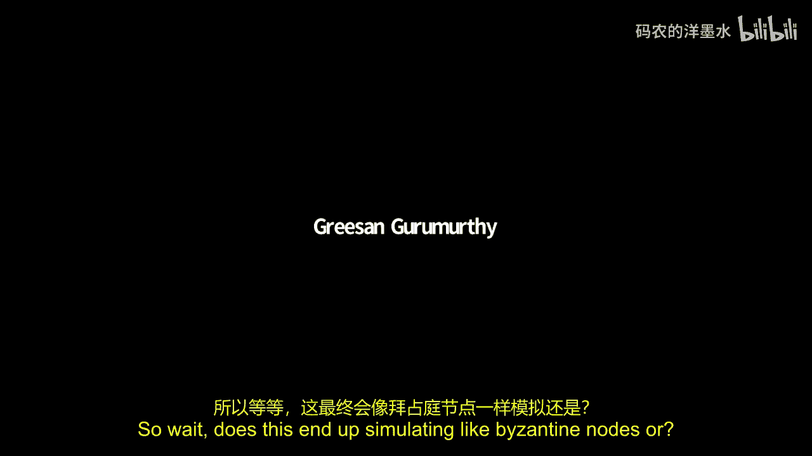

Yeah， so we do have yeah。 So we do have also the， the， the ability to。

Have the behavior of Byzantine node and the Byzantine node for example what they could do they just don't send the messages or they send the wrong messages or they ignore they only maybe send messages to only subset of replica or they don't respond to the client so all of those comes to the experimentation and so we do study those behaviors and yeah so that's important yeah。

So I think maybe Sa， if you want to also maybe share your screen to walk through the process of forking the Ripo and getting it and maybe all those steps that would be nice to I think。

90 kidss。For。The fourth thing is just so first， I guess， well， I mean， I mean。

 tell people how to get everyone how to get here。 So so okay， the first thing is resilient D dot com。

 if you can go to the resilient DB dot com， we have everything here。

 we have the publications that we have done on the resilient D here。

 We have a lot of publication on it。And actually good conferences。

 we have the timeline that what we have reached throughout the time and what we are planning to reach in the timeline。

 if we can contribute to any part of this， we would be more than happy to have you on the board。

But yeah， the code is on Github there's link all over the website to the Github you can go to the Github and I think the last version has been updated on September 3d you can fork this or clone it or whatever you want and I have explained what you need to do。

 but theyre also again's let's kind of do this step by step so let's start with fork so everybody do a fork and then you walk through once you have it fork and what's the next step how do you run it。

 let's kind of do that very slowly together I think。And today's recording will， yeah。

 I will post this recording after yes， thank you。That question。Okay。😔，So once you fork this。

You will have it on your。诶。Under your own account。And after that。

 you just need to do the clone through the SSH。

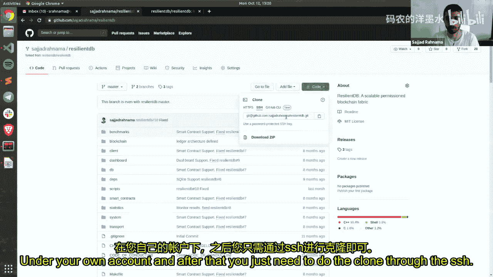

Can you see my screen definitely you can see。You do the kit clone， it will be your account name。

Myine ishan will for yours definitive with be once you clone it you have everything here。

 you can create your own branch in your own fork and once you want to contribute you just create a pull request from your fork to the resilient dividend we will。

有结风三到。So before moving on， so Sa， let's make sure we all on the same step。

 so can you share the link on the child and let's kind of see the step you've done as everybody else has done Do need questions so we can do this a step by step all of us together。

So the， the link would be with your name。 Once you for kit。 the， yeah。

 the resilient D would be Github resilient D resilient D wants you4 it。 This would be。Okay， so again。

 so let's do the fork steps again， step by step， let's do the for step that allow some time for everybody do the fork and then we go through the next step。

Okay， so I guess first I。Everyone can go through the resilient Db GithHub page， do the for。

 let's give a minute to everybody to do that and then what's the next step so let's do that step by step。

Then it would be something like this。That。Account in bracket would be your Gi top account， I D。

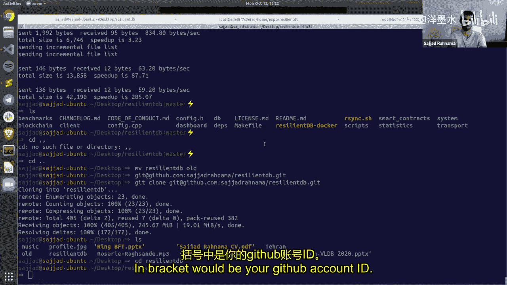

Okay， so I guess the fourth step everything probably is done。

 those who want to do it right now and so what's next？

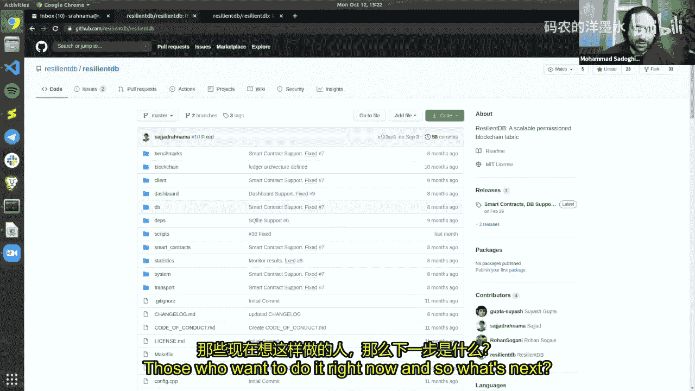

So you just clone the quote with this comment。 did clone。I have put it in the。Chat。

 can you see the chat？This screen， I'm showing you。Yes， we can。After doing the clone。

 you will have the directory here。As you can see。And for example， I want to do a change。

System worker， T， P， B，FD。I want to do these printed statements。😔，吔钱心天。After you change something。

You can commit those things and create a pull request that we can add to the actual repository that we have and the process of that would be after you clone it。

 you change something， you need to do Git a command， for example。

 for the thing that you have changed right now I change workcut at PBFD I change those printer statement。

 do not that's just a simple example， not the actual thing I'mm saying once you change something and you won not publish。

The。A actualctua re D did the processes like this， you change something， you add those things。

And after that， it will be。Green kit。Com me dash。St。And after that， you。Push those changes。

 I'm not going to push right now。You pushed your own master。 And after that， you will be。

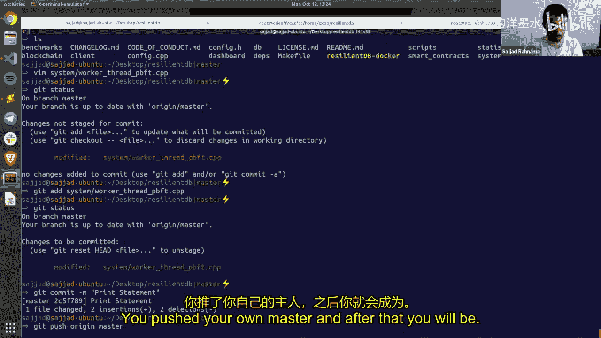

Going to your repository。And create a pull request from here。 right now， I don't have anything。

 you will。Do your changes， you create， create pull request from here。嗯。

When you do the pull request to the resilient DB， the actual resilient Db will merge that to the master branch。

So I have a question， I tried to make the project and it's saying that there's a dependency of X E D255。

The first， the the your first run was with Docker or not because I when I was explaining the my first run was through the Docker。

 So when I went through the Docker， the Docker unted all these files here。

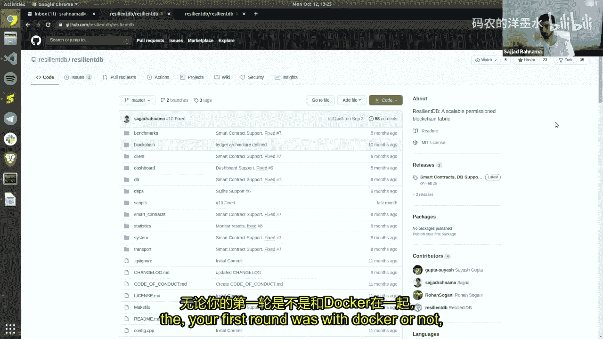

And as you can see， there are， there are a couple of T and zip files here。 Oh Okay， I see， I see。

 The doctorcker script did that for me。 If you didn't do that therere just on these file to these。

 to these folders。If you do these the depend， you would not have a problem just。Onpack these6。

Any other questions？So perhaps I guess maybe the next step also running it。There right。

The running was the same。Yeah， so now yes， but for folks who are doing it right now so we can take them step by step。

what's the next command they need to run。 So we do one more round。

 And then we can I team bring it to closure。Should I run with the resilient D command or here？

Maybe do away the Docker comment， but let's kind of make it step by step。

 make it this is the oneny law project that I have cloned。Okay。Just just change the work through P。

 BFD and oncom those too long。And if you run this command。Do game。Again。

 now we' been running it on Dockers so there's six replicas and from clients on the code that was just checked out and from Git。

So while this compilation is happening， again， if anybody has any question about the steps。

So once you have it up and running， then I think can now start experimenting and。

Traccing good and getting into all the details。The compil is completed now。

Starting about the nose and that so。I have a question my son silly。 so we need to get。Docker first。

 right？Yeah does Docker have something like a GUI， like， like winget。Yes， I think。

 but you don't need to。The only things you need from not that familiar or comfortable with using terminal。

 so yeah， maybe I do I。Yeah， there are a couple of twoIs for Docker， but yeah， for this purpose。

 you do not need to do anything with Docker， you just need to Docker be up and running。

Did I answer your question。Oh， yeah， thank you。没得。So how long is the run side right now is it2 as you can see。

 I came here and in this first node and just tailed the first node results。

This is what's happening in the first note。Even if you are running with the。Dact your command。

 all those results would be go to the result folder there that I have。Gander， and just tell the。

Number 0。Because we have printed out the client qua bed。

 you can see the printing for client quarry bags。And right now。We have， an， I think，4。

Before0 more second。Wait， so what exactly is Docker and how does that help in this scenario？

Thank you for your question。 The point is that in order to have a distributed code running。

 you need different notes。 You need a specific IP address for each note。 Okay。

 you cannot run all of them with localized。 if you are doing。Your owns。

You need to have different machines。The docker will give you different machines with different I P address。

 on the same machine。So now in the dark you have different IP addresses that you can look at them as a completely separate machines and you can initiate a circuitet with them and send a message to them。

O。So the code is distributed， you need to have， for example。

 at least four machines to run PBFD and one client at least five machines in order to have five。

 you cannot have five different IP addresses on your system。

 you cannot run all of them with same IP addresses， 127001。Because it would interfere， for example。

 how can you send a message to note number three if all of them have the same IP address？

You can do with these different port， but that's not something implemented in resilient D。

Because that's not useful at all。To have it on one machine and the Docker implementation is just the purpose is to give you a little bit of area to develop something on one machine。

Once you develop on deckcker， once you go to the actual system。

 usually some bugs comes up because when everything is faster and pipeline。

 race condition all those stuff happen and then you can you also need2 debug on the。

An actual environment， but the doctorer is just for development purposes， not the wrong purpose。

Did I answer your question，说。There's also one comment on the chat as Sa， if you can look at。Sure。

So I suggested you to。我。I think your problem is something with your G++ compiler。

 if you can take a look at it offline。But oh， the question。

 are you compiling it in your machine or from inside the docker。

 You need to compile it from the inside the docker。 If you remember， I didn't compile it here。

 I did the Docker exact。This one and here make clean。Make dash J2， for example。

 you should not come see here is inside the bucketet。 as you can see， this is inside the duet。

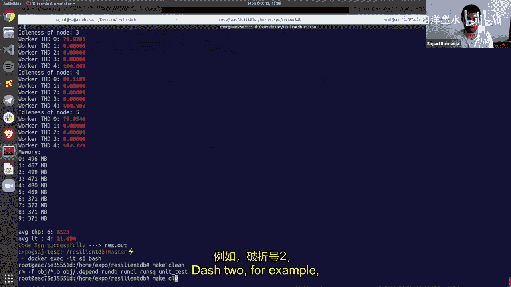

I should not compile it from the outside。I have a question。

 Just want to make sure that after I fork the code from from Github and I if I want to change something and and push it。

 push it to Github， it won't change the original code you guys have right if it won't Okay， great。

 Good to hear that I won't mess things up。 Well you can let you do not have access。Yeah， thank you。

 sure。Yeah， so anytime that you' kind of doing because you for this how you have your own copy。

 you can experiment with it and whenever you're ready， you can always actually send your code。

 push it to the main repository， but there is some sort of checks and balances that happens there you make the request。

 things will be reviewed and so that we have a whole pipeline for once you get to that stage to push the code into the main public repository。

Yeah， I was worried about I would't mess things up in a master branch， so I don't want to do that。

Thanks。Any other questions？Alright， that was an excellent tutorial。 Great job。 Sajo。

 Thank you so much。 And we will have， I mean， this has been recorded and we will have it on the website as well。

 too。

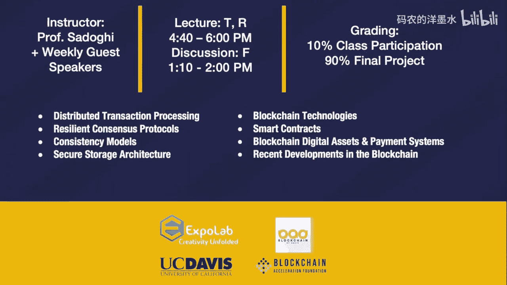