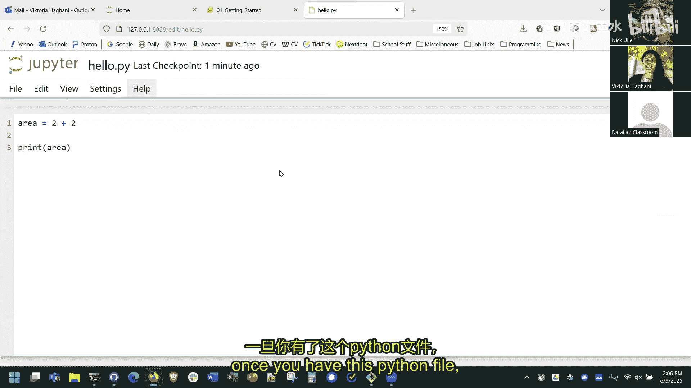
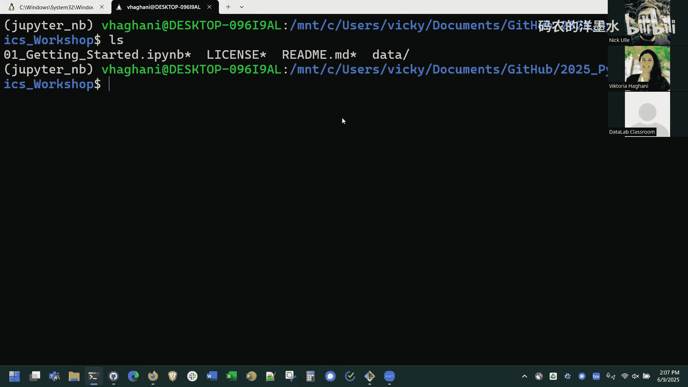
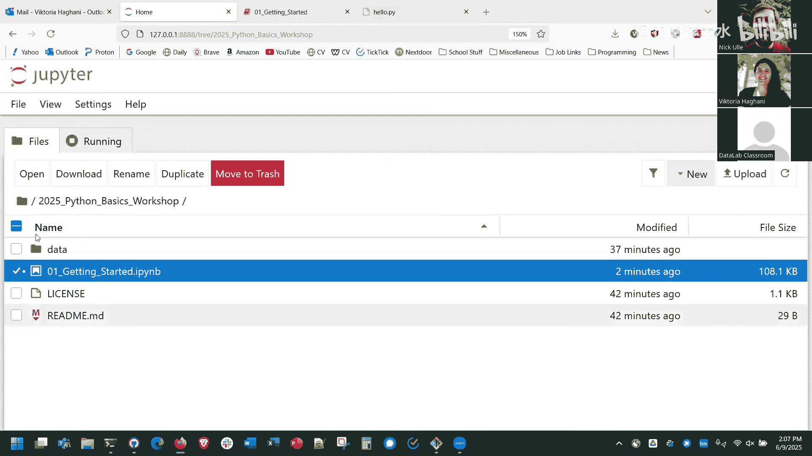
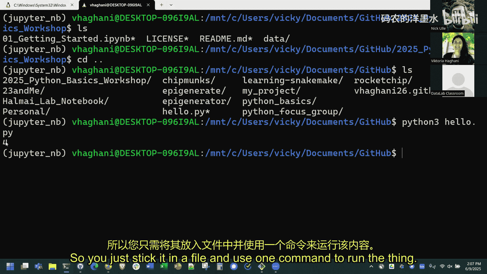
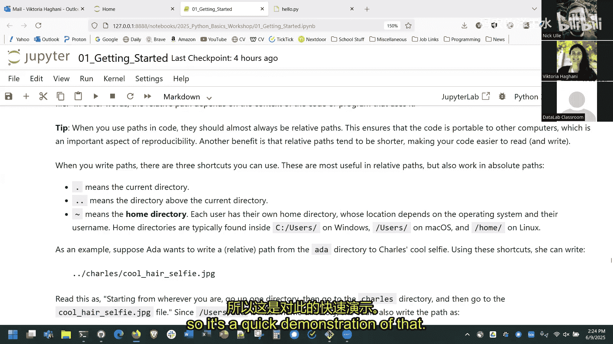
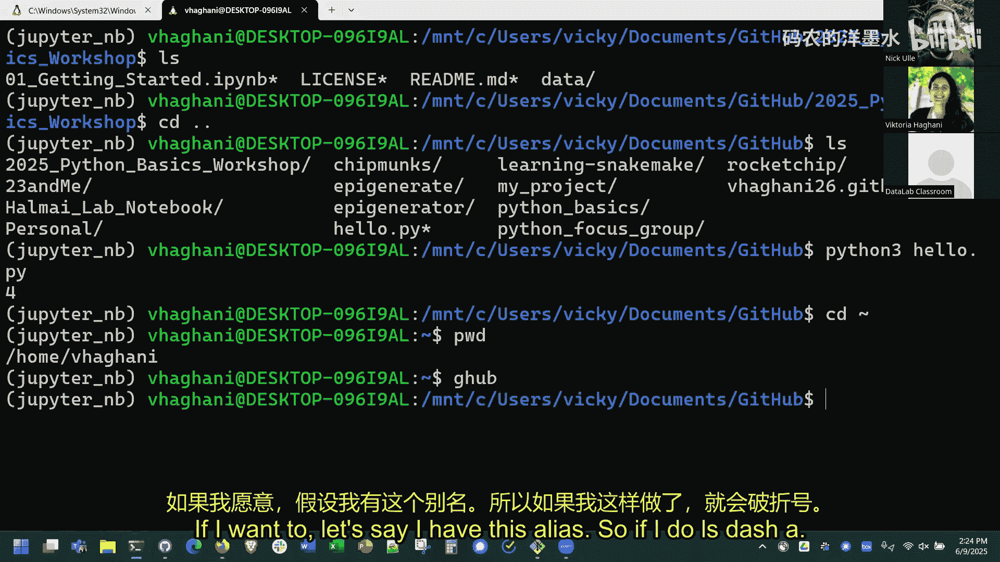
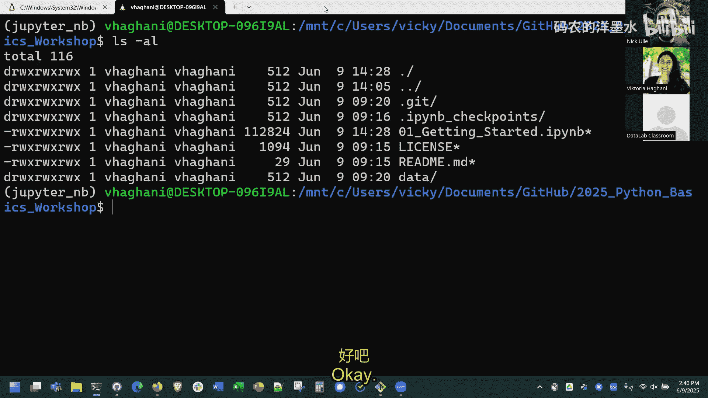
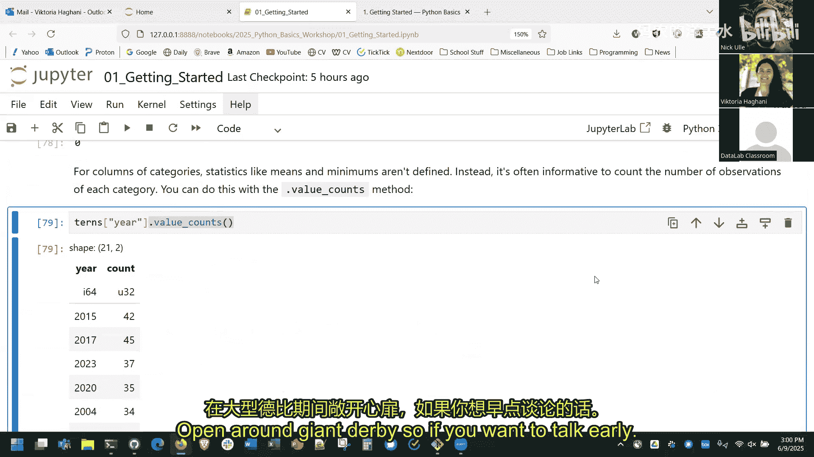

# 001：Python入门与基础语法


## 概述

在本节课中，我们将学习Python编程语言的基础知识。课程目标是让你能够在Python控制台和Jupyter Lab中运行代码，创建变量，调用函数，以及保存和运行代码文件。我们还将学习如何与文件系统交互，并最终能够执行文件中的代码。

## 为什么选择Python？

上一节我们介绍了课程目标，本节中我们来看看为什么在众多编程语言中选择Python。

首先，Python代码具有可复现性。如果你将数据文件和代码分享给他人，他们理论上可以运行完全相同的代码，复现你的所有结果。这在协作环境和共享项目中至关重要。

其次，可复现的代码能够自动化分析中的重复任务。例如，在处理大量原始序列文件时，使用Python可以避免手动重复操作。

另一个好处是可以在不同分析之间复用代码。如果你为一个项目编写了代码，在另一个类似项目中可以轻松复制粘贴使用。

此外，你可以将你认为有用的代码打包，并在更广泛的范围内分发。例如，我们今天使用的Jupyter Lab就是由他人编写并发布的。

Python是一种通用语言，适用于化学、遗传学、人类学、社会学等多个学科领域。

它之所以如此流行，是因为其语法比其他一些语言更易于阅读，几乎就像用简单的英语编写代码一样直观。

Python是交互式的，有许多在线调试器可以逐行描述你的操作。由于它在众多领域中被广泛使用，有大量可供参考和使用的直接、明确的代码。

因为使用广泛，当你运行Python时，有大量的函数和包可以使用。虽然R语言也很有用，但Python确实是一种非常强大的语言，如果你选择深入学习Python，你的数据分析体验将会很愉快。

## Python数据科学包简介

上一节我们讨论了选择Python的原因，本节中我们将介绍一些用于数据科学的核心包。

Python有大量可用的包。仅PyPI上就发布了超过60万个包。对于数据科学，有许多工具可供选择，具体取决于你的工作内容。

以下是一些对数据分析有帮助的包：

*   **NumPy**： 提供N维数组（如向量和矩阵）和一系列数学函数，帮助你以数据框的形式处理数据。它是使用最广泛的包之一。
*   **Pandas**： 用于处理数据框，可以读取CSV文件，帮助你很好地操作数据。它可以将数据集（如字典）转换为CSV格式保存。但Pandas在处理大型数据框时 notoriously 内存效率不高。
*   **Polars**： 与Pandas非常相似，但效率更高，可以快速处理非常大的数据集。我们今天将主要使用Polars。
*   **DuckDB** 和 **Ibis**： 它们在底层使用SQL（结构化查询语言），如果你处理类似数据库的数据（而不仅仅是CSV文件）会很有帮助。

除了数据处理包，我们还将使用以下包：

*   **Jupyter**： 提供交互式运行的笔记本风格界面，可以混合代码和文本。
*   **SciPy**： 提供许多数学函数。
*   **Matplotlib**： 创建图形、绘图和可视化的常用包。
*   **Statsmodels** 和 **scikit-learn**： 用于机器学习和统计的包。

请注意，这并非详尽列表，只是为了让你意识到，无论你做什么，很可能都有一个对应的包。

## 设置与Jupyter Lab界面

上一节我们介绍了核心的数据科学包，本节中我们来看看如何设置环境并启动Jupyter Lab。

首先，请确保你已经按照指引运行了Pixi初始化，并安装了Jupyter、NumPy和Polars。

有多种方式可以运行Python代码：可以在控制台运行，可以在终端运行脚本，也可以在Jupyter中运行。Jupyter Lab界面非常友好，因为它提供了一个集成开发环境（IDE），这有助于使你的代码更易于理解。你可以编写代码、添加文本部分、插入图片，将代码和你想要运行的内容很好地结合在一起。

接下来，我们将打开Jupyter Lab。在命令行（Windows用户使用Git Bash）中运行以下命令：

```bash
pixi run jupyter lab
```

运行后，应该会弹出一个链接。将该URL复制并粘贴到浏览器中，即可打开Jupyter Lab界面。

在界面中，你应该能看到一个部分，在“Console”下有一个写着“Python 3”的选项。点击它，会为你打开一个Python控制台。

## Python控制台基础操作

上一节我们打开了Jupyter Lab，本节中我们将在Python控制台中开始实际操作。

在控制台底部，你会看到一组方括号，这称为提示符。在Jupyter中，提示符是一对方括号，它会根据括号内的数字告诉你之前是否运行过代码。如果括号是空的，则表示尚未运行任何代码。

现在，让我们输入 `2 + 2`，然后按住 `Shift` 键并按下 `Enter` 键。你应该会看到输出结果。这表明它运行了你给出的代码。

再试试 `3 - 1`，然后按 `Shift + Enter`。

现在，你应该看到提示符括号的颜色发生了变化。一种颜色显示你输入的内容，另一种颜色显示返回的结果。一种代表你提示的代码，另一种是你运行代码的返回值。这就是你与Python提示符交互、输入Python代码的方式。

正如你所注意到的，我们使用了加号和减号。Python的好处在于它很直观。很多操作符都和我们想的一样：加法用加号，减法用减号。但也有一些特殊的，比如乘法用星号 `*`，除法用正斜杠 `/`。Python已经内置了许多基本的数学函数。如果你想求幂，可以使用两个星号 `**`。例如，`2 ** 2` 会计算2的2次方。

这些都是与数字交互的方式，在你开始处理和数据操作时非常重要。

我们还可以赋值并进行更复杂的表达式运算。例如，假设我们要计算三角形的面积。公式是 `1/2 * 底 * 高`。假设底为3，高为4。你可以输入 `1/2 * 3 * 4`，它会给出输出结果，告诉我们这个三角形的面积是6。

Python的优点是你可以用多种方式编写计算过程，其中有些方式更符合惯例。例如，计算 `1/2 * 3 * 4`，你也可以写成 `3 * 4 / 2`。

你还记得运算顺序吗？是的，这里使用PEMDAS（括号、指数、乘、除、加、减），和你做代数时完全一样。如果你想用括号明确指定运算顺序，它会先计算括号内的内容。例如，如果我们改变括号的位置，可能会得到不同的结果。因此，始终要确保你计算的是你期望的结果。你可以通过尝试一些数字来验证。

正如我提到的，人们在运行Python代码时有一些惯例，其中之一就是使用空格，这样代码看起来更清晰。比较一下有空格和没空格的代码，有空格的那个更容易阅读。当数字、字母和符号混杂在一起时，很快就会变得难以理解。因此，在元素之间添加空格非常有帮助。

你应该像写文本一样编写代码，把它组织得整洁美观。好的代码就是整洁的代码。

## 变量与命名

上一节我们进行了基础运算，本节中我们来看看如何存储和重用计算结果。

如果我们想存储某些内容，比如我们如何处理这些数字？我们可以直接输入它们，但它们只存在于那个实例中。

在Python中，我们有称为变量的命名值。这很像数学中的变量，可以代表你分配给它的任何东西，包括整个数据框、列表、字典、单词、数字等。我们可以将任何我们想要的东西赋值给一个变量。

但变量的命名需要遵循一些小的规则。

一般来说，变量名可以由字母、下划线和数字的任意组合构成，但不能以数字开头。例如，`geese_top_50`、`dogs_and_nine`（nine拼写出来）都是完全没问题的变量名。像 `goose space teeth` 这样的名字会被解释为两个不同的项，所以变量名中不要有空格。`tropical.dot.fish` 在Python中，点号通常表示调用函数或方法，所以也不要这样用。`9lives` 会让Python认为你在谈论数字，所以以数字开头会让它很困惑。通常，你应该使用描述性的单词或单词组合，如果想分隔单词，惯例是使用下划线。

例如，我可以把三角形的面积赋值给一个变量。我可以称它为 `area`，`area_of_triangle`，或者任何我想要的名称，但为了简单起见，我称它为 `area`。我将这个三角形的面积赋值给变量 `area`。

运行 `area = 3 * 4 / 2`。注意，现在没有输出。为什么现在没有输出？因为没有输出是因为我们只告诉Python将一个变量设置为某个值。我们没有告诉它对变量做任何其他事情，除了赋值。变量的赋值是通过等号 `=` 进行的。惯例通常是先写变量名，然后是等号，再是你想赋给它的值。

一般来说，如果你使用变量，建议遵循风格指南，使用小写字母。当你使用大量大写字母时，在Python中通常代表其他东西，比如全局变量或常量（不应该改变的值）。所以，如果一个变量在任何时候都可能改变，你应该使用小写字母。这不是特别严格的规定，但这是Python通用风格指南的建议。

在上面，我们分配了变量，`area` 等于 `3 * 4 / 2`。但现在，当我们直接输入变量名时，它会打印出该值，因为我们将该值存储在了变量中。继续打印出变量，你应该会看到它输出了我们赋给它的方程式的计算结果。

那么，使用变量的目的是什么？为什么我们需要它们，而不是在需要计算时直接进行计算？

原因之一是它使我们的代码更具可重用性。通过采用变量并在此命名，如果我只是写 `area = 3 * 4 / 2` 而没有解释，你不知道我在指什么。但是，如果我分配变量，比如 `base = 3`，`height = 4`，`area = base * height / 2`，这使我们的代码更具描述性，也意味着我们可以更轻松地更改代码中的变量，这非常有帮助。例如，如果我将代码分享给某人，而他们的文件名与我的略有不同，如果我将该文件名存储在顶部的变量中并只使用该变量，他们只需要更改一行。否则，他们必须遍历脚本并更改每一个出现的地方。因此，变量对于组织良好、可重用的代码非常有用。

这里我们将 `base` 赋值为3，`height` 赋值为4，`area` 等于这个方程 `base * height / 2`。注意，这些颜色也略有不同，`base` 是黑色的，`2` 是绿色的，这是因为它们是不同的数据类型。Python知道当你说 `base` 时，你实际上指的是这个变量，而当你说 `2` 时，你只是在使用一个数字。

这就是为什么拥有描述性代码非常好。这也是为什么在Jupyter中运行代码比仅在控制台中运行更好的原因。这称为语法高亮，它根据代码的不同部分进行着色。

现在我们已经分配了变量，我们可以运行 `area`，看到它为我们计算结果。

假设我们想把高度改为10。我们不需要重新输入整个表达式，只需更改这一个变量。我们可以重新运行我们的小段代码，现在它重新计算了面积。这是一个使代码可重用的好例子。

一般来说，当你分配变量时，你希望名称具有描述性。我几乎可以把任何变量命名为任何我想要的东西。我可以把它命名为 `asdf`。但是，如果我把我的代码分享给你，你看了可能会想，这是什么？因此，拥有描述性的变量名非常有帮助，因为它使查看他人的代码更容易，而且根据经验，当你未来的自己查看你的代码时，也会更容易理解。我曾经有过看着旧代码想，我到底在做什么的时候。所以，拥有描述性的代码非常有帮助。因此，在编码时，请始终记住，你自己和其他人将来可能会查看它。

## 数据类型：字符串与布尔值

上一节我们介绍了变量，本节中我们来看看变量可以存储哪些类型的数据。

Python有许多不同的数据类型，其中最常用的一种，尤其是在数据框中，称为字符串。

字符串是任何一段字面文本。任何在单引号或双引号内的内容都被视为字符串。例如，输入 `'hi'` 或 `"hi"`，无论是单引号还是双引号，都应该可以工作，但你不能混合使用两者。例如，`'hi"` 会让它有点困惑。它会知道这是一个字符串，但会提示字符串未正确终止。

我们可以使用单引号或双引号。我们可以添加感叹号。我们甚至可以使用数字。例如，如果我们输入 `"1" + "1"`，如果你在数字周围加上引号，它会认为它是一个字符，不会将其解释为数字。所以你会认为一加一等于二，但它所做的只是将两个东西粘在一起，字面意思上的粘在一起，因为它将数据类型解释为字符，即字符串，而不是整数。

数据类型非常重要，因为假设你正在处理一个数据框，其中有几列，在第一千列的地方，数据类型实际上是字符串而不是整数，而你并不知道。现在你试图执行数学函数，它会向你抛出错误，因为它说我不能把这些东西加在一起，或者我不能除这些东西，我不知道你在说什么。因此，了解你正在处理的不同数据类型非常有帮助。这也是为什么我们编写代码时使用的符号（语法）有非常具体的规则。这就是为什么字符串用引号表示。所以，任何时候你在Python中看到引号，你就知道那是一个字符串。

除了那些数学运算符，还有一些逻辑运算符，比如小于、大于、小于等于，所有这些都相当直观，直到等于和不等于，它们有点特别。

在Python中，当你给变量赋值时，你使用一个等号 `=`。所以，如果你想表示某物等于某物，如果你使用一个等号，你所做的只是赋值。因此，在Python中，如果你想问某物是否等于某物，你实际上需要两个紧挨着的等号 `==`，这些是比较运算符。如果你想表示不等于，通常“不”用感叹号表示，所以你会写 `!=`，表示不等于。

我们可以这样使用，比如 `1.5 < 3`，这会告诉我们这个表达式为真。我们可以说 `'a' > 'b'`，它会说假。有趣的是，我相信在Python中，字母数字字符根据它们的ASCII值被分配了一个数值，这就是为什么 `'a'` 不大于 `'b'`，即使它们是字母。这也是另一个例子，说明了解你正在处理的数据类型非常重要，这是你应该注意的事情，因为即使你使用了比较运算符，但你的数据是字符串，你实际上可能会得到一个你不期望的输出。因此，你总是要检查你的代码，确保它做了你认为它应该做的事情。

这是一个使用等于运算符的例子，`3 == 3.14`，它会告诉我们这是假，这符合我们的预期。你也可以对字符串进行这种操作。所以，如果你想检查字符串的身份是否相同，如果字符串彼此相等，它将返回真或假。

这些真和假的值称为布尔值，它们有几种不同的表示方式。你可以用单词 `True` 和 `False` 表示，也可以用 `1` 和 `0` 表示。这回到了真值表的概念，其中1代表真，0代表假。布尔值只是一个真或假的值，当你尝试处理数据时，这将非常重要，因为你可以以不同的方式对数据进行子集划分，并说如果满足这个条件，就对它做这个操作。例如，假设我正在处理对数变换，我不想计算0的对数。我可以说如果这个等于0，就不要把它包含在计算中。因此，它允许你评估条件是真还是假，并据此进行处理。这让你可以剖析和处理你的数据。

布尔值除了在你的条件之后打印出来，你也可以直接打印它们。所以你可以说 `True == True`。如果你想评估 `True == False`，它们不相等，所以它会告诉你 `True` 不等于 `False`，这个表达式是假的。

另一件事是Python实际上支持链式比较。如果我们赋值 `x = 1.5`，我们可以说 `1 < x and x < 2`，如果我们输入这个，这是真的。这种表示法实际上称为语法糖，它基本上是一个快捷方式，试图将两个不同的短语结合起来。它把 `1 < x` 和 `x < 2` 合并成一个更简单的表达式，但当我们评估这个时，这也是真的。

你可以在这里使用不同的逻辑运算符。所以，快速尝试一下，写一些表达式，看看它是输出真还是假。也许试试不等于、等于、小于等于，看看程序的行为是什么样的。

需要注意的是，当你使用这种简写表示法时，Python在幕后插入了一个 `and`，所以它说这是一个条件，这是另一个单独的条件。

这涉及到整个概率情况，比如“与”和“或”，条件一与条件二，或者条件一或条件二。这些条件运算符或比较运算符基本上就是这些有趣的方式，你可以比较数据中的不同事物。更重要的是你理解如何使用这些符号处理数据，而不是知道这被称为运算符。如果你在阅读某些内容时知道这个很好，但如果你感到不知所措，只需专注于理解如何使用实际的代码本身。

## 函数与参数

上一节我们讨论了逻辑运算，本节中我们来看看函数。

函数是Python的特性。人们引入了函数，这些是执行操作的代码段。你可以把函数想象成一台机器：你给它一个输入，它会给你一个输出。你给它的那些输入通常称为参数，你给它一个参数，它返回给你的输出称为返回值。

每当你执行一个函数时，这称为调用函数。例如，我们可以说我们将调用 `round` 函数。让我们试试这个，输入 `round(2.7)`，看看它做了什么。

你应该会看到，仅仅通过输入 `round` 并给它一些数字，它会四舍五入到最接近的整数。这是因为很多时候函数实际上有隐藏的默认设置。

对于 `round` 函数，实际上有一个可选参数，表示你想四舍五入到多少位小数。如果你不提供这个参数，它会默认选择最接近的整数，但我们实际上可以提供这个参数并改变它。所以，重新运行你刚才运行的内容，但现在添加另一个参数，你放置它的位置很重要。也许试试像 `1` 或 `2`，然后运行看看，你的输出现在应该看起来有点不同。

在这些函数中，正如我提到的，你输入的部分称为参数。但它们也有默认值。正如我提到的，默认的四舍五入是最接近的整数，但你可以将其更改为你想要的任何值。这些位置之所以特别重要，假设我们给它一个数字。让我们实际调换一下顺序，看看会发生什么。如果我们输入 `round(1, 8.153)`，它会报错，说这个对象（这是一个浮点数）不能被解释为整数。它之所以报错，是因为描述的位置对函数来说非常关键。函数的编写方式是，你给它的第一个东西被分配给一个名为 `number` 的底层变量（这是参数），第二个位置被分配为你想要四舍五入到的小数位数。

所以，如果我们把 `ndigits` 放在这里，这是函数固有的。它将能够为我们四舍五入。我们可以指定。只要我们保留位置，我们可以删除这个，这不会改变你的答案。我们可以显式地定义它们，所以我们可以说我们的数字是 `8.153`，位数等于 `1`。它会进行计算。

我提到这些位置很重要，但注意这里我实际上调换了 `ndigits` 参数和 `number` 的位置。但这次，它没有像之前那样报错。那是因为这次我们非常明确地告诉了它参数是什么。我们告诉它 `1` 应该代表 `ndigits`，`8.153` 应该代表 `number`。

稍后我们会更多地讨论如何确定这些参数是什么，但对于每个函数，都有一种方法可以看到输入是什么以及这些东西叫什么。是的，谢谢。正如黑板上写的，你可以输入 `help()` 然后加上函数名，它实际上会告诉你那些东西，我们稍后会更详细地探讨。



但这会给你一些关于它期望什么输入的想法，它也可以给你一些关于你可能期望什么输出的信息，这取决于函数。





这里我想演示一下，我提到对于这个参数，`round` 函数的一个参数是 `number`，所以如果我们在函数外部定义 `number`，然后尝试运行它，它会告诉我们参数 `number` 缺失，这是因为这些变量只存在于该函数的上下文中。所以，即使我们在代码的其他地方说 `ndigits`，它也不会工作。我们可以通过直接说 `number` 作为变量来规避这个问题。所以，如果我们赋值 `4.755` 给变量 `number`，然后我们给它这个变量，这个变量代表 `4.755`。如果是这种情况，那么这将起作用，因为这背后实际上有意义。我们可以继续运行那个。



你也可以写得更明确，所以我们可以使用那种表示法，我们精确地分配变量名是什么，变量，然后我们也可以运行那个。

花大约30秒时间，尝试一些参数。`number` 和 `ndigits` 是两个参数，所以稍微尝试一下，也许调换一下顺序，看看你的输出是什么。

## 对象、方法与属性

上一节我们介绍了函数，本节中我们来看看Python中对象、方法和属性的概念。

函数是代码中非常非常有用的方面。一般来说，我们导入的很多模块都有函数，这就是我们导入它们的原因。我们试图使用别人编写的函数供自己使用。`round` 函数已经是Python的一部分。我们可以调用许多其他不同的函数，其中很多函数与对象和属性的概念有关。

Python将数据表示为对象，我们讨论过的所有东西——数字、字符串、函数——实际上都只是Python的对象。属性是附加到另一个对象上的对象。这就像是说，对于三角形，底和高可能是一个属性。这个想法只是说对象有特定的特征，但这些对象本身也是对象，这听起来有点复杂，但当我们向你展示它是如何工作时，会变得容易一些。

这里我们有一个字符串，`"snakes everywhere!"`，注意它根本没有大写。这个字符串是一个对象，字符串有一个属性。当属性是一个函数时，我们称之为方法。所以字符串有一个名为 `capitalize` 的方法。当我们把它附加到字符串的末尾时，它将执行那个函数。所以，如果我们有 `"snakes everywhere!"` 小写，然后我们将其大写，现在我们看到它实际上使我们的字符串首字母大写。所以 `"snakes"` 中的 `"s"` 现在是大写的。

如果你想查看附加到对象的所有属性的列表，你实际上可以检查那是什么。这有点回到我认为Nick提到的内容，你可以在环境中检查变量。但这里我说 `"hi"`，这是一个字符串。让我们检查与字符串相关的属性。如果我们看到它以两个下划线开头，这对Python来说是必要的，但对我们来说不是那么重要。其他没有那两个下划线的东西，这些是有用的信息，以及我们可以调用的函数或方法或属性。`capitalize` 会将我们正在处理的内容大写。`isalpha`、`isdigit`、`isdecimal`、`isnumeric`，所有这些都是我们可以调用或执行以尝试处理对象的函数或方法。所有这些都是特定于字符串的。例如，`lower` 使所有内容小写。所以，你实际上可以探索与这些对象相关的不同类型的属性。

假设我们确实想使用 `lower`。我们执行一个新函数或执行一个新方法的方式是，我们可以给它一个字符串。所以，继续用大写字母输入你的名字，然后在末尾加上 `.lower()`。那个 `.lower()` 应该有括号，因为这是我们正在调用的方法或函数。然后看看它输出什么。你应该看到我们已经将这个方法应用到了我们给它的数据或对象上，所以我们现在已经能够操作这个对象了。

是的，有很多文档，通常这可能有点让人不知所措。但我发现有帮助的是，在这里逐个案例地进行。如果我正在处理一个字符串，我想，哦，我需要这个大写，我有时会直接谷歌搜索“如何使这个大写”。它会告诉我函数名，会说，哦，使用 `.upper()` 或 `.capitalize()`，取决于你想要什么。这非常有帮助，因为并非所有事情都超级直接。实际上，谷歌可以是你学习编码时最好的朋友，只需搜索“如何做这件事”，然后在末尾加上“Python”，你通常会得到一些非常有用的东西。我们稍后会更多地讨论这个。

## 代码注释

上一节我们介绍了对象的方法，本节中我们来看看如何通过注释使代码更清晰。

正如我提到的，拥有整洁的代码非常有帮助，但并非所有代码都容易阅读，所以我们可以做的是在代码中添加注释，使我们的代码更具信息性。

注释是你添加的内容，它以井号 `#` 开头。看看现在这一切是如何高亮显示为绿色的。当我运行它时，什么也没有发生。这里甚至没有输出。发生这种情况是因为注释是Python固有的部分，你可以在代码中添加一些信息性的片段。例如，我可以说 `# 这个变量代表我的宠物`，然后我说 `pet = "Shadow"`。现在，当有人看这个时，我把这段代码给了别人。他们看了看，哦，好的。所以这就是这个变量应该代表什么。或者如果我有一个晦涩的函数，比如 `base * height / 2 * 10`，我不知道这到底是什么，我们可以继续解释这是什么。所以，通过向代码添加注释，你让自己、未来的自己以及查看你代码的其他人更容易理解代码在做什么，而Python只是忽略它。如果你在这里前面放任何东西，Python都会忽略它。

让我们做这个计算，`random_expression = 5 * 19 + 3`，然后打印 `random_expression`，这样我们可以看到那个值，我们得到98。但是，如果我把井号放在这里，看，现在它把这一部分注释掉了，我重新运行它。它完全忽略了那个 `+ 3`。它现在表现得好像它不存在一样。所以，任何时候你以井号开头，它会注释掉该行的其余部分。所以，你可以把它放在行的末尾作为注释，也可以让它单独成行。但是，该行之后出现的任何内容都不会被运行。

是的，这些就是注释，如果你查看别人分发或编写的代码，看到一大堆这样的小注释，这真的很常见。人们会像这样写：这是我在这里做的，这是我在这里做的，它们的范围从极其信息丰富到有点有趣，取决于谁写的代码。

## 使用帮助与排查错误

上一节我们介绍了注释，本节中我们来看看如何获取帮助以及如何处理代码中的错误。

我已经演示过这个了，但很多时候，当你开始学习如何编码时，真的很难，你会有点不知所措，因为你甚至不知道从哪里开始。你不知道需要什么工具，你不知道如何格式化，甚至不知道如何读入你需要读入的内容。

所以，最好的做法是，首先，如果你遇到麻烦，就查一下。网上有很多全面的教程，会向你展示非常基础的东西，比如“如何在Python中读入CSV？”

但也有内置的帮助函数，所以如果你在使用一个函数，你实际上可以检查它在说什么。例如，如果我们输入 `help(round)`，它会告诉我们 `round` 接受两个数字，`number` 和 `ndigits`，这回到了我们所说的，你可以定义 `number=某个值` 和 `ndigits=某个值`。这里显示的是，`ndigits` 的默认值是 `None`。



所以，如果你在处理某些东西时遇到麻烦，你实际上可以通过在Python控制台中运行 `help` 来检查函数在做什么。每当你尝试运行某些东西，但不确定它需要什么输入、默认值是什么，或者是否需要更多参数时，这真的很有帮助，因为有时我运行的东西有，比如说，三个参数，而我只给了它两个。它会告诉我缺少一个参数。我就想，缺什么？然后我去查看帮助函数，哦，我忘了指定，比如，我希望这个输出的格式。



这对于获得你需要的帮助和更深入地理解你正在运行的东西真的很有帮助。

你也可以对操作符这样做。我们可以输入 `help("+")` 并运行。它会输出这个非常庞大的表达式解释，包含各种信息，如果你想了解更多，了解这些会很有帮助。我不会读给你听，但这对你询问帮助的内容进行了非常详细的说明。需要注意的是，如果你使用的不是字母数字（我认为只是字母），如果是像加号、减号这样的符号，你需要在它周围加上引号，否则Python会认为你试图做某事，并会给你一个错误。例如，如果我运行 `help(abs)`，它说返回参数的绝对值，所以我可以不加打印或不加引号地输入这个。对于正斜杠 `/`，如果我运行 `help("/")`，它会说恰好接受一个参数。当我尝试处理这个时，我不……它只是一个提示。

是的，如果函数只是字母，你可以直接写名字，它会按原样执行。所以我们看到，尽管一个在引号里，一个不在，但我们得到了相同的输出。

如果你使用函数的在线文档，请确保你查看的版本与你安装的版本相同。我记得有一次，我因为试图使用一个叫做f-string的东西而挣扎，你不需要知道那是什么意思，但我没有意识到我落后于它被发明和纳入的Python版本一个版本，我当时想，为什么这不起作用？直到最后我意识到是版本问题。这就是为什么，如果你查看函数版本，这也是为什么提到检查版本，它可能是一个过时的版本，或者版本之类的东西。版本是一件大事，即使它似乎漂浮在背景中。版本是那些真正影响你编码和工作能力的事情之一。所以，如果你查找文档，请确保它与你正在使用的版本相关。通常，这表现为所谓的已弃用函数。你会尝试运行某些东西，它就像，哦，这个函数已弃用，这意味着它不再能够使用了，不再支持了，然后你很难过，因为你必须阅读新的文档。是的，所以只需确保版本匹配。

现在，我们将介绍当出现问题时该怎么办。我喜欢告诉实验室里的一些人的一个笑话是，如果我第一次运行所有东西都正常，我就不会有工作了。所以，迟早，可能今天，可能每次你编码时，你都会遇到某种错误。这可能是任何情况，从语法错误（因为你忘了在某个东西后面加逗号，忘了关闭括号），到你不小心删掉了一行并移动了它，以至于你在第一次调用变量之后才给它赋值，诸如此类的事情，遇到错误真的很常见。大多数时候，Python会打印出一些信息性的错误。例如，看看我能不能搞砸一些东西。是的，无效语法，所以我们知道这与语法有关，这意味着像我们的括号、逗号之类的，引号，这些是我们正在寻找的问题。

通常，当你阅读错误时，它会很有帮助，不幸的是，它并不总是超级有帮助，因为有时它会给你一个行号，有时它只会对你大喊大叫。在这种情况下，只需检查你的代码，检查它提到的任何行，有时它就像第173行无效语法，然后你去看，哦，我忘了一个括号，你加上你的括号，然后收工。另一件事是，如果你真的很难找到错误在哪里，一次运行一行代码，直到找到导致问题的原因，你可以通过注释掉大块代码来缩小范围，然后说，好吧，这就是问题所在。

网上还有其他资源，比如Stack Overflow，这是一个人们常去提问的网站。我认为，如果你更偏向生物学，有像Biostars这样的网站，它提供很多生物包的支持。在阅读器中，有一个关于如何提出好问题的链接。一般来说，你总是想加上你正在使用的语言，所以你会说“Python中的这个错误”，你几乎要逐字地写出它给你的错误，比如语法错误之类的。如果你不知道错误是什么，比如有一次我得到一个奇怪的数字错误，比如错误9372，我想我不知道那是什么，所以我查了一下，就像，哦，你内存不足，它杀死了你的工作。就像，好的。所以，一定要知道，如果你遇到错误，这不是你的问题，这是一个非常常见的问题。所以，只需继续学习如何正确地进行故障排除，查找你正在运行的内容的文档，查找代码，确保使用论坛。我的意思是，ChatGPT，如果那是你的方式，那可以帮助解决一些语法错误。

但很多时候，编程最难的部分就是试图进行故障排除，一旦你缩小了导致问题的原因，你可能会意识到修复起来并没有那么糟糕。

## 运行Python脚本文件

上一节我们讨论了错误排查，本节中我们来看看如何创建和运行Python脚本文件。

现在我们已经一直在控制台中摆弄了，我们将让你打开一个Python文件并运行一个文件。

你要做的是转到文件，在你的笔记本中点击“新建”，然后选择“Python文件”。这应该会打开一个文件，这应该是某种未命名的Python文件，你可以直接叫它 `hello.py`。然后输入 `area = 2 + 2`，然后 `print(area)`。确保保存那个文件。

此时，我相信你应该有多个标签页打开，一个是你有Python控制台的地方，一个是你有文件的地方。让我看看。我稍等一下测试这个，因为我用的是Jupyter Notebook而不是Jupyter Lab。每个人都创建文件了吗？好的。


你们有一个和我稍微不同的屏幕，你应该能够转到那个Jupyter Lab屏幕，那里写着控制台。由于某些原因，我们无法打开控制台。嗯。没关系。为了简单和节省时间，我们将跳过运行它，但一般来说，一旦你有了这个Python文件，我只需在我的终端中打开它来展示那会是什么样子。

我会输入像 `python3` 这样的东西。我的意思是。滚动。不，好的，那看起来很奇怪。所以 `python3`，然后是我要运行的任何文件。如果你在Pixi中运行，我相信你可以说 `pixi run python`，然后你会说像 `python3` 和你的文件名。这是保存。这是一个有趣的故障排除，我不知道为什么我的文件没有保存。嗯。哦，它回到了一个目录。好的，所以现在我们会说像 `python3 hello.py` 这样的东西，它会打印出我们的面积是4。这只是一个演示，因为很多时候你要运行的东西可能非常非常长，你不会想一行一行地运行，所以你只需把它放在文件中，使用一个命令来运行这个东西，这有点复杂，所以如果你没弄明白也不要担心，这只是为了展示运行Python有不同的方式，你可以运行脚本本身。



## 导入模块

上一节我们运行了脚本文件，本节中我们来看看如何导入和使用外部模块。

当我们谈论导入模块时。你知道我们安装了pandas、Polars、NumPy，这些都是模块。这些都是别人编写的软件，本质上是由别人编写的Python文件，里面定义了函数。所以当你安装它时，你是在下载他们的代码。当你说导入像NumPy这样的东西时，你实际上是在读入他们的代码，以便你可以使用他们编写的东西。

就像我把它做成一个函数一样，我实际上可以从我的文件中导入 `area` 并使用那个函数，所以将Python代码保存在文件中真的很有用。你可以有很长的代码，可以轻松地分享代码，所以如果你试图编写脚本之类的东西，这真的很好。

如果你有经常重用的代码，这也很好。例如，如果我经常处理FASTA文件（这些文件有一些序列名和DNA序列），如果我做很多这方面的工作，也许有一个函数 `read_fasta` 会很有帮助，因为我可以读入它并轻松地分离我需要的序列。所以，如果你有很多经常做的事情，手头有这些东西真的很有帮助。

当你导入一个模块时，实际上非常简单，假设你已经安装了它。既然我们确实使用Pixi安装了，你只需要说 `import`，然后是你导入的东西的名称。每个人都应该安装了NumPy，所以让我们继续尝试运行 `import numpy`。

现在你所做的是保存了NumPy的代码，无论谁写了这个包，你已经读入了他们的代码，并且能够访问他们编写的函数。所以现在我们有了NumPy，如果我们想使用函数，是的，那是在控制台或文件中。是的，文件只是为了演示一种不同的使用Python的方式。

是的，所以在控制台中，继续导入NumPy。如果你想从NumPy读入一个函数，你必须指定该函数来自NumPy，所以你会说 `numpy.round`，因为这是一个属性。所以 `numpy.round(3.3)`，意识到它返回3，但它也告诉你比普通 `round` 函数多一点的信息，因为它不是普通的 `round` 函数。它是NumPy中某人编写的不同函数。

有很多包，包名有非常常见的惯例，NumPy实际上是其中之一。所以很多时候，当你阅读某些东西时，NumPy被导入为叫做 `np` 的东西。想象一下，你正在运行大量使用NumPy的代码，你每次尝试调用函数时都想输入 `numpy` 吗？不，过一段时间后，这有点令人望而生畏。所以NumPy有更短的常规名称，是 `np`。所以通常，如果有人运行像 `np.round` 这样的东西，那意味着他们实际上在使用NumPy。这是惯例，通常你可以在网上找到。有几个包这是常见的。我提到过用于处理数据框的pandas，pandas是另一个你会说像 `import pandas as pd` 这样的东西，这样你就不必每次使用它时都输入pandas。

所以你可以写 `import numpy as np`。然后运行 `np.round` 并给它一个数字。注意，当我们用NumPy运行它时，我们得到了相同的输出，因为我们刚刚告诉Python `np` 实际上代表NumPy模块。

你可能会想，为什么有两个 `round` 函数，为什么我需要这个函数？让我们演示一下。是的，你说 `np` 只是一个惯例，但我可以选择任何首字母吗？或者它可以是，所以我可以导入，我可以说 `as asdf`，然后把它当作 `asdf` 使用，但通常有惯例的原因是，如果我编写我的代码并分享给你，你可以看到我是否使用了NumPy，因为任何使用它的人通常都使用那种表示法，所以它只是让分享更容易。

好的，所以这里有一个演示。当我们使用内置的 `round` 函数将 `4.755` 四舍五入到2位小数时，它给我们 `4.75`，但当我们使用NumPy的 `round` 函数处理 `4.755` 时，它实际上给我们 `4.76`。所以你使用什么很重要，包与包之间有一些细微的差别。这就是为什么阅读函数文档很重要，因为你需要理解你究竟在运行什么，以及它的行为是什么，因为如果你期望当这个四舍五入时，它会是 `4.76`，但你使用了这个版本的函数，它没有做你期望它做的事情。

它们期望的行为或方式，就像有人在计算机上工作一样。不同的算法会产生这些不同的舍入结果。实际上，根据文档，iPhone 1 由 iPhone 驱动的实际上在大多数情况下应该更准确，但速度较慢。所以在这种情况下，NumPy 给了我们实际上会做的结果。是的，如果你需要像非常精确的舍入，有特殊的舍入方式。

是的，所以注意 `round` 与 `numpy.round` 是不同的函数，所以你必须指定你使用的是哪个函数，以及你使用的是从导入的模块中使用的函数，还是只是使用Python内置的函数。

## Jupyter Notebook 基础

上一节我们导入了外部模块，本节中我们来看看Jupyter Notebook的基本操作。

Jupyter Notebook 是我在这里运行的美丽的东西，我混合了文本、代码和图片。所以它比仅仅一个文件或脚本或只是一个控制台更全面，更有组织。

Jupyter本身代表Julia、Python、TeX和R，所以它像一个混合起来的缩写。Julia是另一种编程语言，R是一种编程语言。

我们将继续让你们创建一个笔记本，这样你们就可以开始尝试运行一些东西。



所以