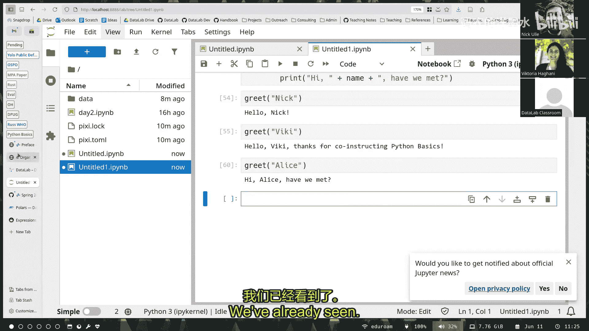
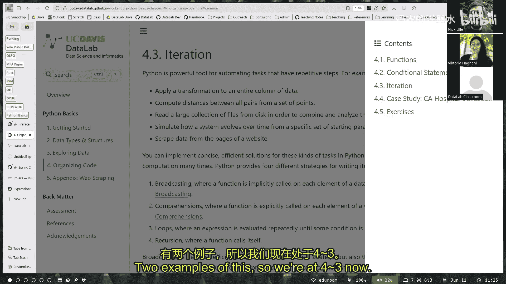
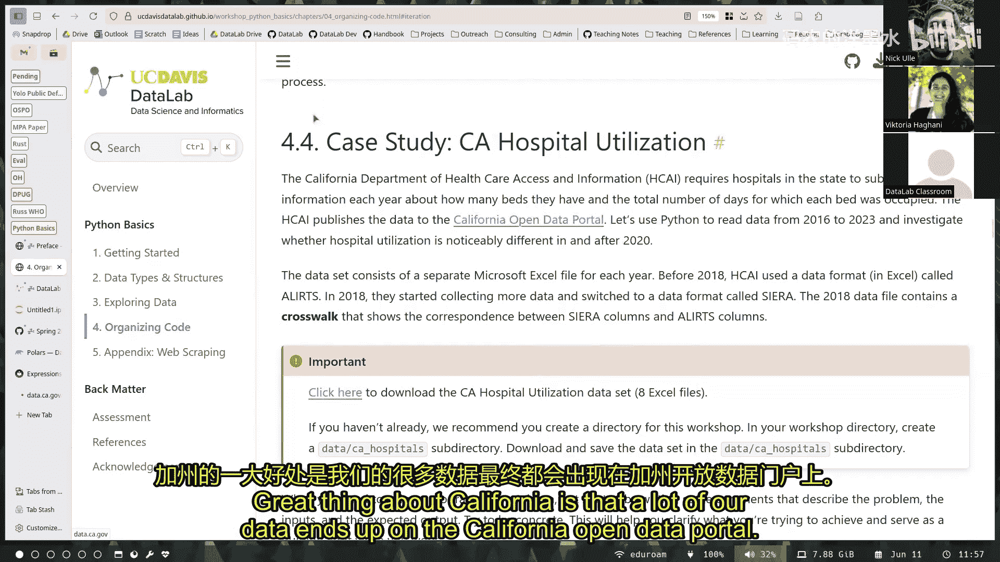
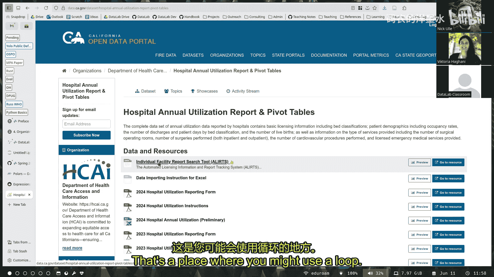
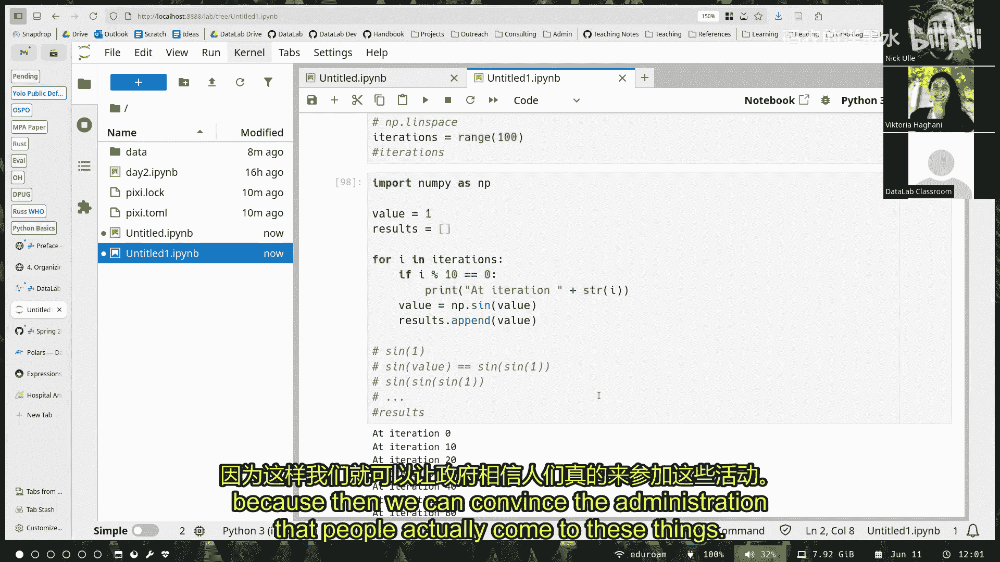

# 004：代码组织、函数与迭代

在本节课中，我们将要学习如何组织代码以提高效率和可读性。主要内容包括：深入理解Polars的延迟计算机制、如何编写自定义函数、使用条件语句（if）控制程序流程，以及通过迭代（循环）自动化重复性任务。这些技能是编写高效、可维护数据分析代码的基础。

---

## Polars表达式：延迟计算

上一节我们介绍了Polars的基本操作，本节中我们来看看Polars一个核心概念：表达式和延迟计算。这有助于理解为何有时需要使用 `pl.col()`。

在Polars中，`pl.col()` 用于创建一个**表达式**，它描述了你想要对数据进行的计算，但并不会立即执行。计算只有在表达式被用于 `select()` 或 `with_columns()` 等方法时才会发生。

**代码示例：**
```python
import polars as pl

# 加载数据
turns = pl.read_csv('turns_data.csv')

# 创建一个表达式：计算 ‘total_nests’ 列的均值
mean_expr = pl.col('total_nests').mean()
# 此时 mean_expr 只是一个表达式对象，并未计算

# 在 select 中使用表达式，此时才进行计算
result1 = turns.select(mean_expr)
print(result1)

# 对数据子集使用同一个表达式
result2 = turns.filter(pl.col('year') == 2020).select(mean_expr)
print(result2)
```

这种方式的好处是：
1.  **代码复用**：可以预先定义复杂的计算逻辑，然后应用到不同的数据子集上。
2.  **避免错误**：确保对多个数据集或子集执行完全相同的计算，避免因复制粘贴导致的笔误。
3.  **性能优化**：Polars可以优化整个表达式链的执行计划。

与之相对，如果提前计算出一个具体的值（如 `turns['total_nests'].mean()`），那么这个值就是一个固定的数字，不会随数据子集的变化而改变。

---

## 编写自定义函数

当你发现某段代码需要重复使用时，就应该考虑将其封装成函数。这能减少错误，并使代码更易于维护和测试。

### 函数基础

一个简单的函数包含以下部分：`def` 关键字、函数名、参数、冒号以及缩进的函数体。使用 `return` 语句返回结果。

**代码示例：创建一个判断数值是否为负的函数**
```python
def is_negative(x):
    """
    判断输入值是否为负数。
    参数:
        x: 数值
    返回:
        bool: 如果x为负则返回True，否则返回False
    """
    result = x < 0
    return result

# 测试函数
print(is_negative(-5))  # 输出: True
print(is_negative(3))   # 输出: False
print(is_negative(0))   # 输出: False
```

### 编写更实用的函数

让我们编写一个更实用的函数，用于获取一个序列中最大的N个值。

**代码示例：获取序列中最大的N个值**
```python
def top_values(data, n=3):
    """
    返回序列中最大的n个值。
    参数:
        data: 列表或Polars Series
        n: 要返回的最大值的数量，默认为3
    返回:
        Polars Series: 包含最大n个值的Series
    """
    # 将输入转换为Polars Series以确保方法可用
    s = pl.Series(data)
    # 降序排序并取前n个
    result = s.sort(descending=True).head(n)
    return result

# 测试函数
test_data = [1, -1, 7, 2, 0]
print(top_values(test_data))      # 输出: shape: (3,)
                                  # Series: '' [i64]
                                  # [
                                  #     7
                                  #     2
                                  #     1
                                  # ]
print(top_values(test_data, n=2)) # 输出前2个最大值
```

**编写函数的建议步骤：**
1.  先用简单的测试数据写出能工作的代码。
2.  确定哪些部分会随着调用而改变，将它们设为函数的参数。
3.  用 `def` 关键字定义函数，将代码放入函数体，并用 `return` 返回结果。
4.  使用不同的输入测试函数。

---

## 使用条件语句（if）

程序常常需要根据不同的条件执行不同的操作。在Python中，我们使用 `if`、`elif` 和 `else` 语句来实现条件分支。

**代码示例：一个简单的问候函数**
```python
def greet(name):
    """
    根据不同的名字返回特定的问候语。
    """
    if name == "Vicky":
        print("Hello Vicky! Thanks for co-instructing.")
    elif name == "Tim":
        print("Hi Tim! Thanks for coming.")
    else:
        print(f"Hi {name}, have we met?")





# 测试函数
greet("Vicky")  # 输出: Hello Vicky! Thanks for co-instructing.
greet("Alice")  # 输出: Hi Alice, have we met?
greet("Tim")    # 输出: Hi Tim! Thanks for coming.
```

**关键点：**
*   `if`/`elif` 后面的条件必须能计算为 `True` 或 `False`。
*   缩进定义了属于每个条件分支的代码块。
*   `else` 是可选的，用于处理所有未匹配的情况。
*   应谨慎使用条件语句，因为过多的分支会使代码复杂。有时使用字典映射或 `match` 语句（Python 3.10+）可能是更清晰的选择。

---

## 迭代：自动化重复任务

迭代是编程的核心，用于对一系列元素执行相同或类似的操作。Python提供了多种迭代方式，在灵活性和效率之间各有权衡。

### 迭代方式概览

以下是几种常见的迭代方式，从最简洁高效到最灵活：

1.  **广播（Broadcasting）**：直接对整个Series进行操作。最简洁、最快，但要求操作是Polars支持的内置向量化操作。
    ```python
    s = pl.Series([1, 2, 7])
    result = s - 10  # 广播：每个元素减10
    ```

2.  **列表推导式（List Comprehension）**：对可迭代对象（如列表）中的每个元素应用表达式。比广播灵活，可以调用任何Python函数。
    ```python
    my_list = [1, 2, 7]
    result = [x - 10 for x in my_list]
    ```

3.  **循环（Loops）**：使用 `for` 循环。最灵活，可以在循环体内执行任意多行代码，尤其适用于前后迭代相互依赖的情况（如时间序列模拟）。
    ```python
    results = []
    for x in [1, 2, 7]:
        new_value = x - 10
        # 这里可以添加更复杂的逻辑
        results.append(new_value)
    ```

**选择建议**：优先选择能满足需求的最简单、最高效的方式。如果广播可行，就用广播；如果不行，尝试列表推导式；只有当迭代步骤复杂或相互依赖时，才使用 `for` 循环。

### 循环实战：模拟迭代计算

以下是一个使用 `for` 循环的典型场景：每次计算都依赖于前一次的结果。

**代码示例：重复计算正弦值**
```python
import numpy as np
import polars as pl

# 初始化
value = 1.0
iterations = 100
results = []  # 用于存储每次迭代的结果
iteration_numbers = list(range(iterations))  # 迭代次数列表

for i in iteration_numbers:
    value = np.sin(value)  # 计算当前值的正弦，并作为下一次的输入
    results.append(value)

# 将结果转换为DataFrame以便分析或绘图
df_sim = pl.DataFrame({
    "iteration": iteration_numbers,
    "result": results
})
print(df_sim.head())
# 输出示例:
# shape: (5, 2)
# ┌───────────┬──────────┐
# │ iteration ┆ result   │
# │ ---       ┆ ---      │
# │ i64       ┆ f64      │
# ╞═══════════╪══════════╡
# │ 0         ┆ 0.841471 │
# │ 1         ┆ 0.745624 │
# │ 2         ┆ 0.67843  │
# │ 3         ┆ 0.627572 │
# │ 4         ┆ 0.587181 │
# └───────────┴──────────┘
```

### 案例预告：合并多个数据文件

一个常见的循环应用场景是处理多个结构相似的数据文件。例如，加州医院床位利用率数据每年一个独立文件。我们可以：
1.  编写一个函数 `clean_hospital_data(filepath)`，用于读取并清洗单个文件。
2.  使用 `for` 循环遍历所有年份的文件路径列表。
3.  在循环中调用清洗函数，并将结果收集到一个列表中。
4.  最后将所有年份的数据合并成一个大的DataFrame。

这避免了为每个文件重复编写几乎相同的代码，极大地提高了效率和代码的健壮性。

---



## 总结



本节课中我们一起学习了组织Python代码的核心技能。
*   我们深入了解了**Polars的表达式和延迟计算**机制，明白了 `pl.col()` 在构建可复用计算逻辑中的作用。
*   我们学会了如何**编写自定义函数**来封装重复代码，使程序更模块化、更易调试。
*   我们掌握了使用 **`if` 条件语句**来控制程序流程，根据不同条件执行不同操作。
*   我们探讨了多种**迭代方法**（广播、列表推导式、循环），理解了它们在不同场景下的适用性，并特别练习了在迭代步骤相互依赖时如何使用 `for` 循环。



掌握这些概念将使你能够编写出更清晰、更高效、更易于维护的数据分析脚本。在接下来的案例研究中，我们将综合运用这些技能来解决一个实际的数据处理问题。