# 007：Jupyter与AWS入门 🚀

在本节课中，我们将学习如何结合使用Jupyter Notebook与亚马逊云服务（AWS）进行数据分析。我们将了解AWS的核心概念，并通过实际操作，学习如何在云端启动Jupyter Notebook、创建存储空间、配置网络环境以及启动计算实例。

---

## 概述

大家好，我是Pamela Reynolds，加州大学戴维斯分校数据科学与信息学实验室的副主任。我们的实验室致力于促进数据科学方法、技术和最佳实践的应用，以增强加州大学戴维斯分校及更广泛社区的研究与学习。我们提供研究服务、培训活动（如今天的研讨会）以及社区建设支持，以提升数据科学能力。

今天的研讨会将介绍使用亚马逊云服务（AWS）进行云计算的基础知识。我们将学习AWS的基础设施和服务，并探讨在该平台上进行研究的适用场景。在贯穿全天的动手实验环节中，我们将启动一个SageMaker上的Jupyter Notebook，并使用API来启动一个应用程序。我们还将讨论如何获取更多学习资源。

---

## AWS简介与安全

上一节我们概述了课程内容，本节中我们来看看AWS的基本概念及其安全模型。

AWS是一个功能广泛的平台，它允许用户无需管理办公室内的物理服务器或计算集群。研究人员可以利用它进行跨平台协作、共享数据和基础设施，使用自动化工具重现研究工作流，并利用其先进的分析和机器学习工具。此外，AWS通常能提供比大多数校园环境更高的安全性。

AWS拥有一个全球网络，包含24个地理区域和多个可用区。一个**区域**是一组地理位置相近的数据中心集合，而一个**可用区**则是区域内相互隔离、具备独立基础设施（如不同电网）的数据中心。这种设计确保了高可用性和数据冗余。

AWS提供从基础架构服务到机器学习工具在内的广泛功能。对于初学者，AWS的规模可能令人望而生畏，解决方案架构师的角色就是帮助用户梳理这个过程。

### 安全责任共担模型

在AWS中，安全是共同责任。AWS负责**云本身的安全**，包括物理设施、底层计算、存储和网络基础设施。而用户（客户）则负责**云内部内容的安全**，包括自身的数据、访问控制、在实例上安装的软件以及数据加密。

仅仅使用AWS并不意味着默认安全，用户有责任确保其数据和应用的安全。因此，许多校园都构建了安全研究环境，为校园用户提供额外的安全层。

AWS在不同层级提供服务：
*   **基础设施即服务（IaaS）**：例如Amazon EC2。AWS管理物理设备和虚拟化层，用户负责操作系统、应用及网络安全配置。
*   **容器服务**：例如Amazon ECS/EKS。AWS管理更多的控制平面组件。
*   **无服务器计算**：例如AWS Lambda。AWS管理几乎所有底层资源，用户只需关注代码。

使用无服务器组件的一大优势是，用户无需维护和管理不擅长的软硬件，可以将精力集中在研究代码本身。

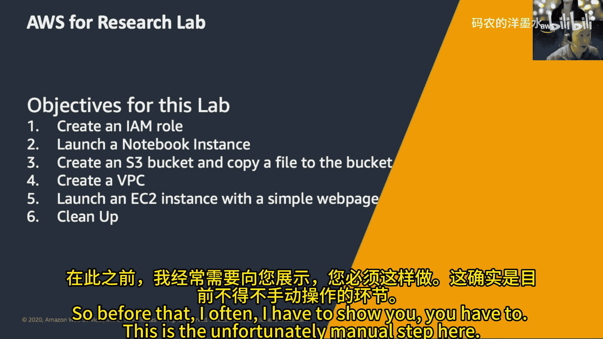

AWS符合众多联邦和非联邦合规标准。如果研究工作涉及受控非密信息（CUI）、个人身份信息（PII）或HIPAA等规范的数据，AWS提供了相应的支持环境。

用户始终拥有自己的数据主权。数据存储在用户选择的特定地理区域内，不会自动跨境传输。用户可以加密、移动或删除自己的数据。即使是AWS的解决方案架构师也无法访问用户账户内的数据。

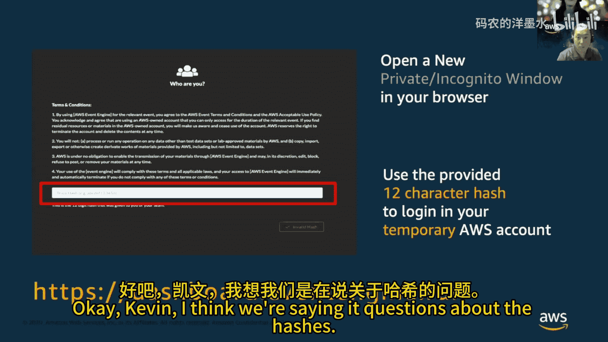

---

## 基础设施即代码与可重复性

上一节我们介绍了AWS的安全模型，本节中我们来看看如何利用自动化提升研究的可重复性。

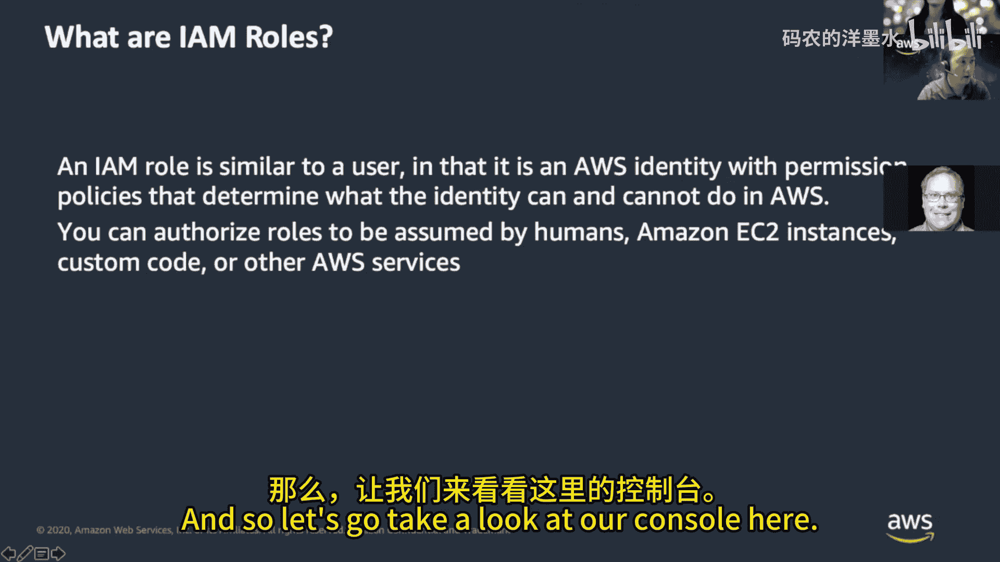

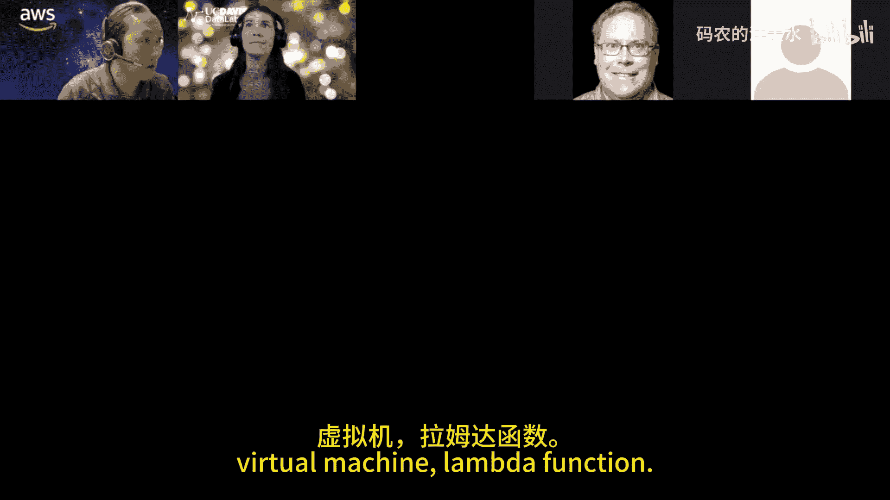

可重复性是当前研究领域的重点。通过代码自动化部署基础设施，比手动操作更可靠、更可审计。**基础设施即代码**的理念允许用户：
1.  重复部署相同的环境。
2.  与他人共享整个研究基础设施，使他人能够复现相同的计算或模型。
3.  在不需要时销毁资源以控制成本，并在需要时随时重建。

---

## 动手实验：启动Jupyter Notebook并创建IAM角色

理论部分告一段落，现在让我们开始动手实验。实验将通过您的浏览器完成，您将获得临时账户凭证。

以下是实验的主要步骤：
1.  创建IAM角色。
2.  启动Jupyter Notebook实例。
3.  创建S3存储桶并复制文件。
4.  创建网络环境（VPC）。
5.  启动EC2计算实例。
6.  （可选）清理所有资源。

### 步骤1：访问控制台与创建IAM角色

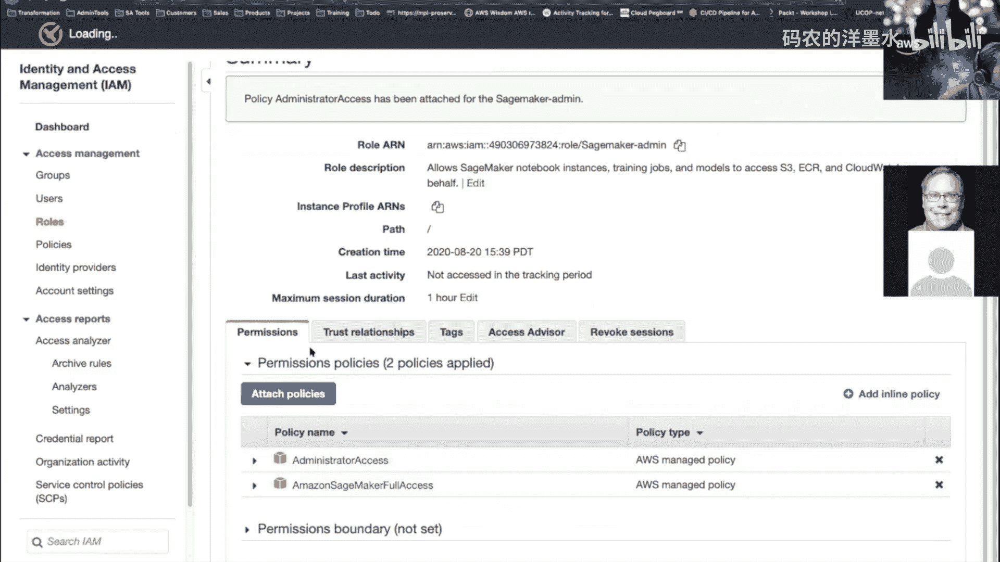

首先，我们需要了解身份与访问管理（IAM）。IAM是用于控制AWS环境内访问权限的系统。它管理谁可以在什么条件下对什么资源执行什么操作。

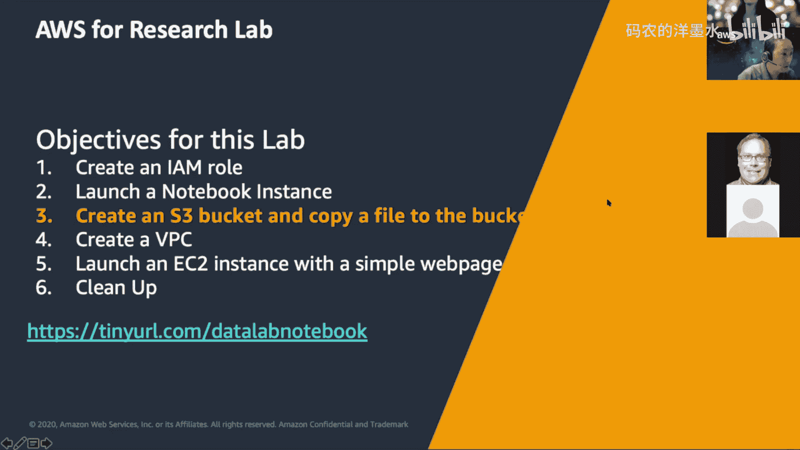

在IAM中：
*   **用户**：代表个人或应用程序，拥有独立的凭证。
*   **策略**：定义允许或拒绝的**操作**（Action）和**资源**（Resource）。
*   **角色**：一种可被AWS服务（如SageMaker Notebook）代入的身份，允许该服务代表您调用AWS API。

我们需要为即将创建的Jupyter Notebook赋予一个角色，使其有权代表我们执行操作。

以下是操作步骤：
1.  登录AWS管理控制台。
2.  在服务搜索栏中输入 **IAM** 并进入IAM控制台。
3.  在左侧导航栏点击“角色”，然后点击“创建角色”。
4.  选择“AWS服务”作为可信实体类型，并在用例中查找并选择 **SageMaker**。
5.  点击“下一步”，直到权限策略页面。此时可以先不附加策略，点击“下一步”。
6.  为角色命名（例如 `SageMakerAdminRole`），然后点击“创建角色”。
7.  角色创建后，在角色列表中点击其名称进入详情页。
8.  点击“添加权限” -> “附加策略”。
9.  搜索并选择 **AdministratorAccess**（管理员访问）策略，然后点击“附加策略”。

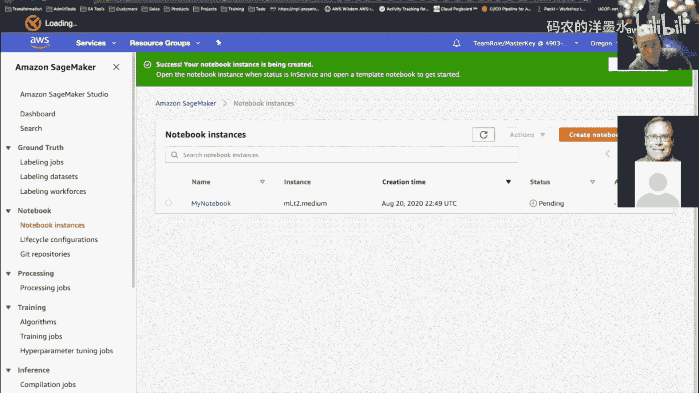

> **注意**：在生产环境中，授予管理员权限可能过于宽松。应根据最小权限原则，只授予必要的权限。本实验为简化操作使用了该策略。

---

## 动手实验：启动SageMaker Notebook实例

上一节我们创建了IAM角色，本节我们将使用它来启动一个Jupyter Notebook环境。

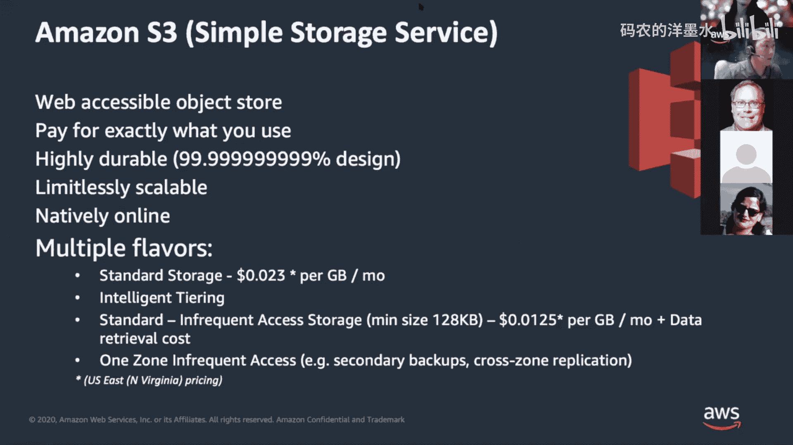

AWS提供广泛的机器学习服务栈，其中**Amazon SageMaker**是一项完全托管的机器学习服务。它涵盖了从数据准备、模型训练、调优到部署的整个流程。今天，我们将使用它的**Notebook实例**功能，快速获得一个预配置的Jupyter Notebook环境。

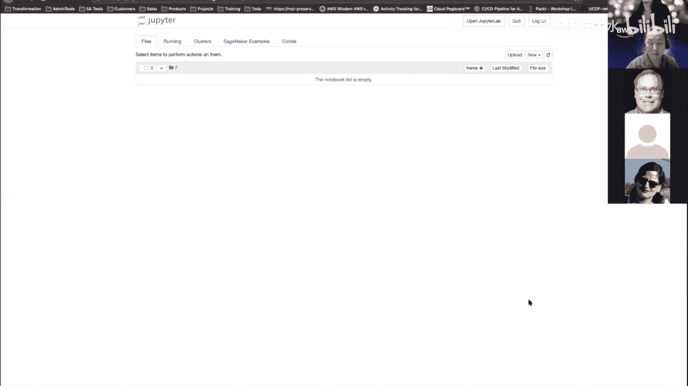

以下是操作步骤：
1.  在AWS控制台服务搜索栏中输入 **SageMaker** 并进入。
2.  在左侧导航栏点击“Notebook实例”。
3.  点击“创建Notebook实例”。
4.  为实例命名（例如 `MyFirstNotebook`）。
5.  在“IAM角色”下拉菜单中，选择刚才创建的 `SageMakerAdminRole`。
6.  其他设置保持默认，点击页面底部的“创建Notebook实例”。

实例创建需要几分钟时间。状态变为 **InService** 即表示就绪。

在等待期间，请下载本次实验将要使用的Jupyter Notebook文件。您无需在本地打开它，稍后我们将把它上传到云端Notebook中。

---

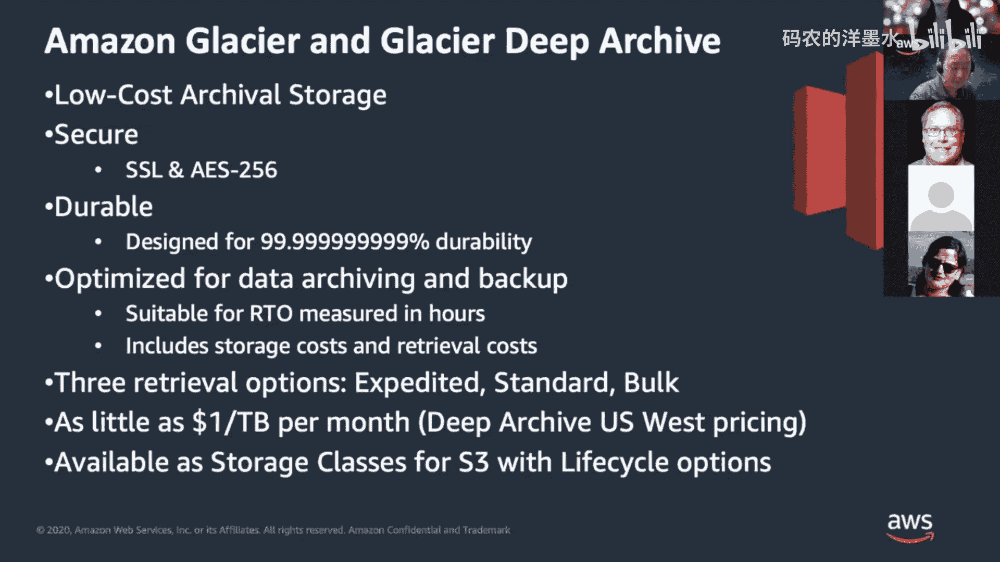

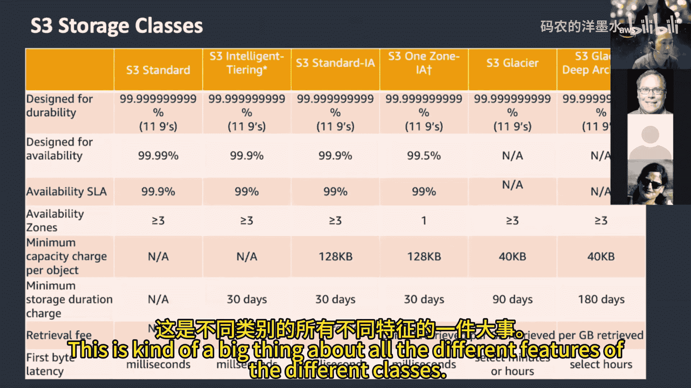

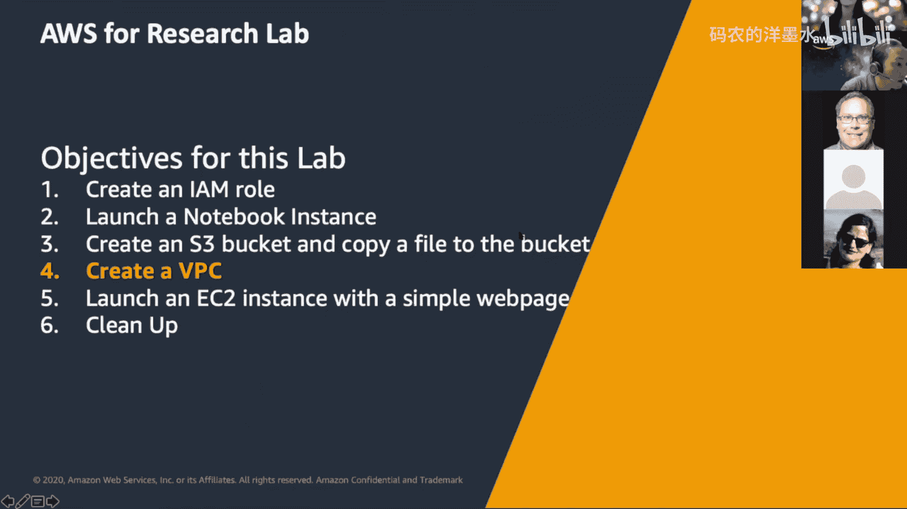

## 核心服务介绍：Amazon S3 存储

在Notebook实例启动的同时，我们来了解第一个核心AWS服务：Amazon S3。

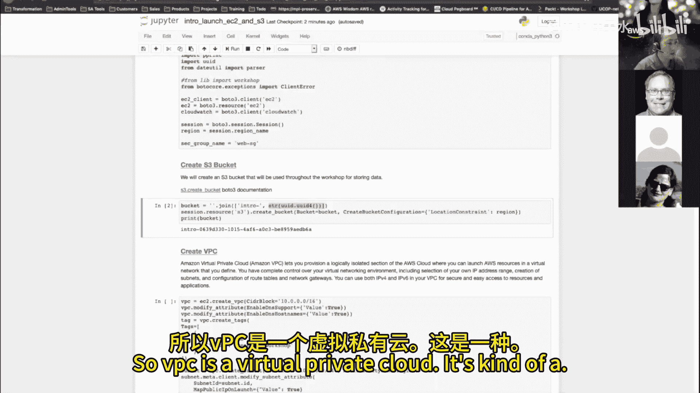

**Amazon S3（简单存储服务）** 是一个可扩展的、高耐久性的对象存储服务。它提供11个9（99.999999999%）的数据持久性。

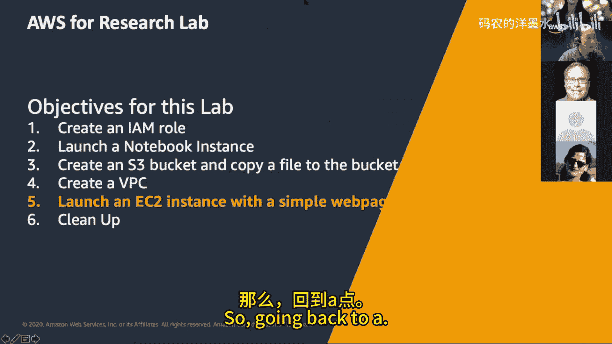

S3的特点包括：
*   **存储类别**：提供从频繁访问（标准）到长期归档（如S3 Glacier Deep Archive，每TB每月约1美元）的多级存储选项，用户可根据数据访问模式选择以优化成本。
*   **性能与权限**：支持并行读写，性能高。可以通过IAM策略精细控制桶（Bucket）和对象（Object）级别的访问权限。
*   **其他功能**：支持数据加密、静态网站托管、生命周期策略（自动将旧数据转移到更便宜的存储层）等。
*   **数据分析**：可与 **Amazon Athena** 服务结合，使用标准SQL直接查询存储在S3中的CSV、JSON等格式的数据，无需加载到数据库中。

对于需要长期保存但很少访问的研究数据，S3 Glacier Deep Archive等归档存储类别是一个极具成本效益的选择。

---

## 动手实验：在Notebook中操作AWS服务

现在，我们的SageMaker Notebook实例应该已经准备就绪。

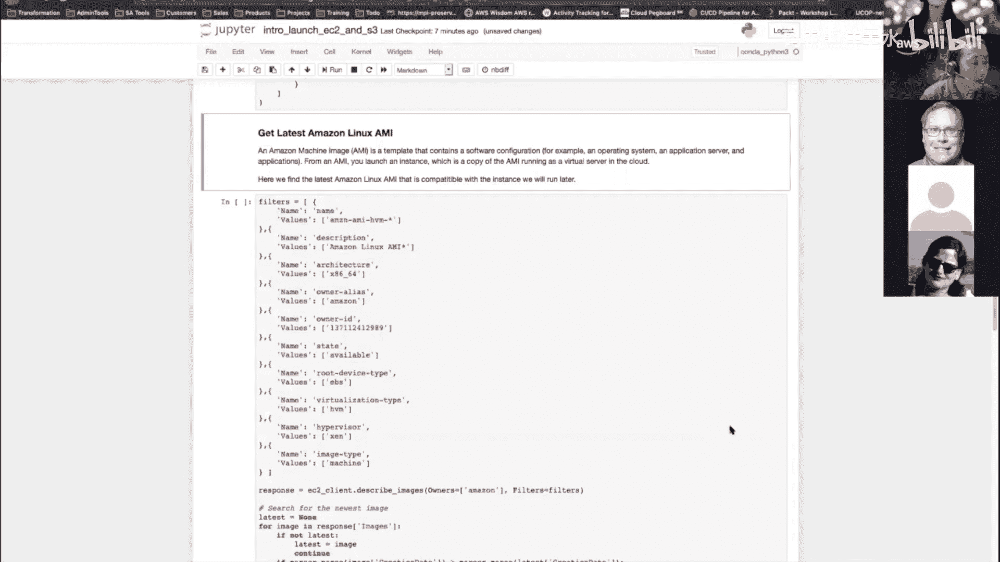

1.  在SageMaker控制台的“Notebook实例”页面，找到状态为 **InService** 的实例，点击“打开Jupyter”。
2.  在打开的JupyterLab界面中，点击“上传”按钮，选择之前下载的笔记本文件（例如 `datascience-lab.ipynb`）。
3.  上传完成后，点击该文件打开它。

这个笔记本的目标不是进行复杂的计算，而是演示如何使用Python代码（通过`boto3`库）调用AWS API来创建和管理云资源。我们将通过运行其中的代码单元来完成实验。

### 创建S3存储桶

在笔记本中找到创建S3存储桶的代码单元并运行。这段代码会生成一个全局唯一的桶名（因为S3桶名必须在所有AWS账户中唯一），并创建它。

### 创建虚拟私有云（VPC）

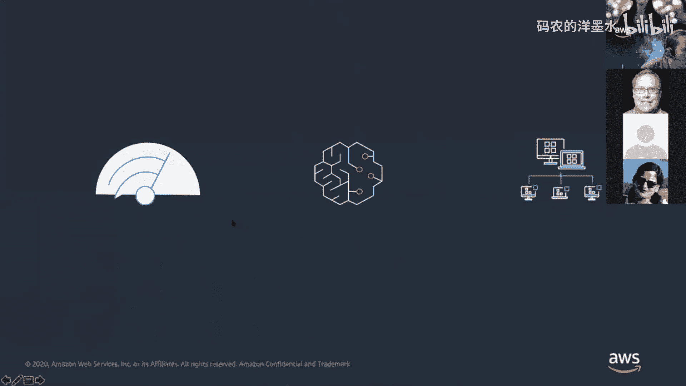

接下来，我们创建网络环境。**Amazon VPC（虚拟私有云）** 允许您在AWS中预配置一个逻辑隔离的虚拟网络。

在笔记本中运行创建VPC的代码单元。这段代码将：
*   创建一个VPC。
*   在指定可用区内创建子网（Subnet）。
*   配置路由表（Route Table）以引导网络流量。

通过代码创建这些基础设施的好处是**可重复和可共享**。您可以将这段代码分享给合作者，他们能在自己的账户中一键部署完全相同的网络环境。

### 创建安全组并启动EC2实例

最后，我们将启动一个虚拟服务器。**Amazon EC2（弹性计算云）** 是AWS的核心计算服务。

在启动实例前，需要配置**安全组**，它充当虚拟防火墙，控制进出实例的网络流量。我们将创建允许HTTP（端口80）和HTTPS（端口443）流量的规则。

笔记本中的代码将：
1.  查找最新的Amazon Linux 2系统镜像（AMI）。
2.  编写一个用户数据脚本（`user_data`），用于在实例启动时自动安装一个简单的Web服务器。
3.  调用EC2 API，使用指定的AMI、实例类型（如 `t2.micro`）、用户数据脚本、子网和安全组来启动一台实例。
4.  等待实例进入运行状态，并输出其公共IP地址。

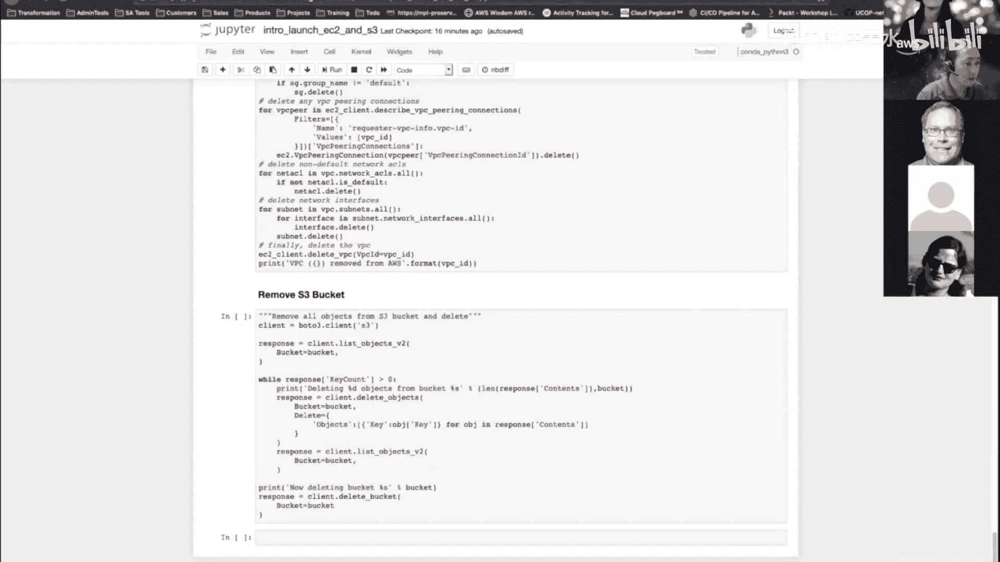

运行这些代码单元后，您就成功在AWS云端部署了一个完整的、可访问的Web服务器。您可以随时在EC2控制台查看和管理运行的实例。

### 资源清理

实验结束后，运行笔记本末尾的“清理”代码单元非常重要。该代码会删除本次实验创建的所有资源（S3桶、EC2实例、VPC等），避免产生不必要的费用。

> **重要提示**：AWS按实际使用量计费。不使用资源时，请务必将其停止或删除。

---

## 基础设施即代码工具对比

上一节我们通过Python脚本完成了资源创建，本节我们来对比不同的基础设施管理方式。

1.  **手动控制台操作**：通过Web界面点击完成。简单直观，但难以重复、易出错、效率低。
2.  **脚本化（使用SDK，如boto3）**：如我们刚才所做的。使用Python等编程语言调用API。灵活、可编程、易于集成到现有工作流中。
3.  **声明式模板（如AWS CloudFormation, Terraform）**：使用YAML或JSON等模板文件描述您想要的最终资源状态，由引擎负责创建和管理。易于共享和版本控制，但模板语法可能较复杂，且缺乏编程逻辑。
4.  **AWS Cloud Development Kit (CDK)**：使用熟悉的编程语言（Python, TypeScript等）来定义云资源。它提供了高级别的抽象组件，使得像创建VPC这样的复杂操作只需几行代码。CDK在后台会生成CloudFormation模板，结合了编程的灵活性和声明式管理的便利性。

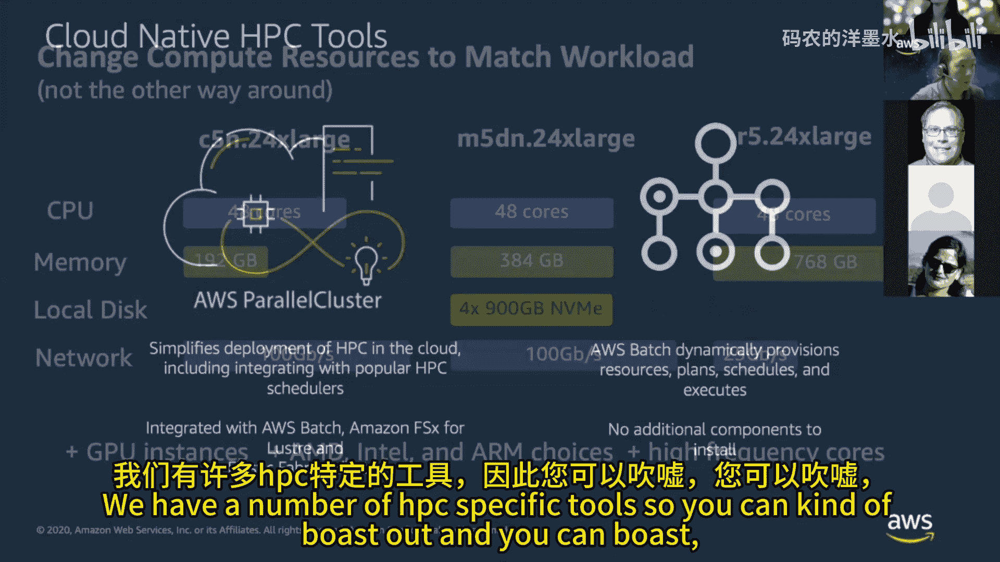

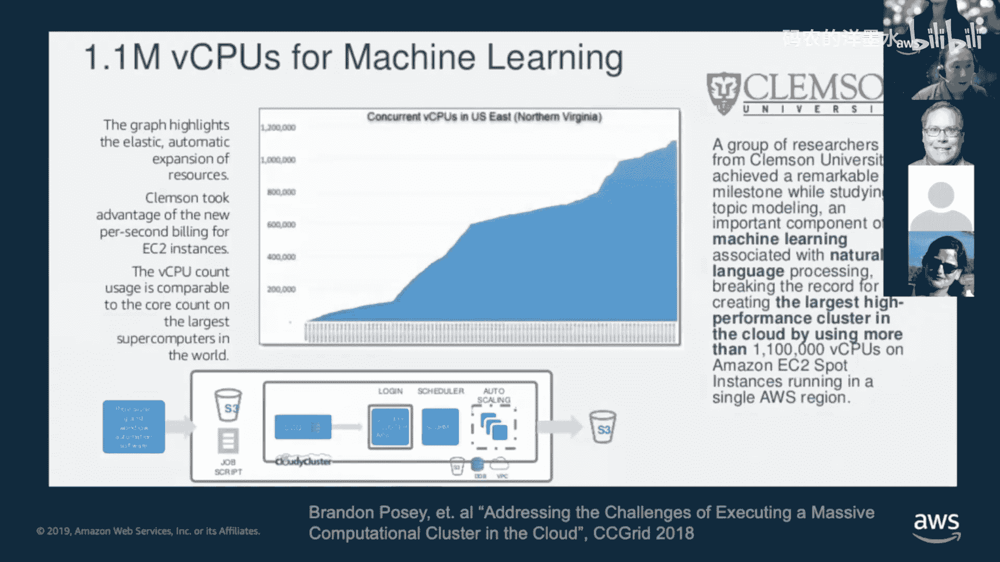

选择哪种工具取决于您的具体需求、团队技能和项目复杂度。

---

## AWS在研究中的适用场景

了解技术细节后，我们来看看AWS在学术研究中的典型应用场景。

1.  **扩展计算容量**：
    *   当本地电脑、实验室服务器或校园HPC集群的计算能力不足时。
    *   可以快速获取特定配置（如大内存、多GPU）的实例，使计算资源匹配研究任务需求，而非让任务适应现有资源。
    *   可以通过如Slurm等工具，将本地HPC集群无缝扩展到AWS，形成混合云，按需使用海量计算资源。

2.  **使用托管式AI/ML与分析服务**：
    *   **Amazon SageMaker**：托管整个机器学习生命周期，无需手动搭建和管理集群。
    *   **AI服务**：直接使用预训练的模型，无需机器学习专业知识。例如：
        *   **Rekognition**：图像和视频分析（物体识别、人脸检测）。
        *   **Transcribe**：将音频转换为文本。
        *   **Textract**：从扫描文档或图像中提取文本和结构化数据。
    *   **分析服务**：如**Amazon Athena**，可直接用SQL查询S3中的数据文件，快速分析海量半结构化数据。

3.  **数据就近处理**：
    *   当研究数据已存储在AWS（例如，从公共数据集注册表下载）或合作方使用AWS时，可以将计算任务直接部署到数据所在区域，避免耗时且昂贵的大规模数据传输。

---

## 后续学习资源与支持

课程接近尾声，本节将为您提供继续探索AWS的路径和资源。

*   **UC Davis Aggie Cloud**：由校园IT中心运营，提供集中账单和用校园CAS单点登录，并享有约11%的服务折扣。
*   **NIH STRIDES计划**：为NIH资助的研究人员提供AWS积分折扣，并专注于构建可共享的大型数据集。
*   **NSF CloudBank**：为获得NSF云资源分配的研究人员提供资金管理和支持服务。
*   **AWS Research & Technical Teams**：专门面向研究人员的支持页面，包含快速入门、培训路径和博客。
*   **AWS开放数据注册表**：托管众多公开可用的数据集，存储和下载均免费。欢迎贡献数据集。
*   **AWS Educate**：面向学生、教职员工的计划，提供自定进度的学习内容、每年$100的AWS积分以及职业资源。
*   **AWS云积分研究计划**：如果您有明确的研究项目，可以申请AWS积分资助。
*   **全球数据出口费用豁免**：对于符合条件的学术研究，AWS可以豁免数据传出到互联网的费用。
*   **更多动手实验**：GitHub上提供了涵盖数据分析、TensorFlow、批处理（HPC）等主题的更多Jupyter Notebook教程。

---

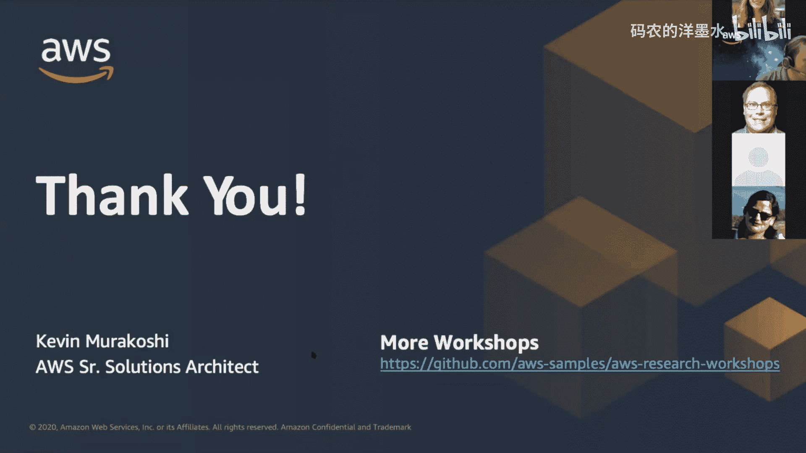

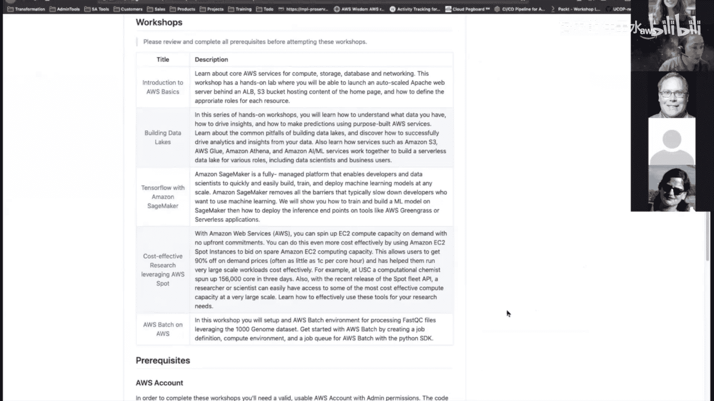

## 总结

在本节课中，我们一起学习了：
1.  AWS云计算平台的基本概念、全球架构和安全责任共担模型。
2.  **基础设施即代码**对于研究可重复性的重要性。
3.  如何通过**IAM角色**管理访问权限。
4.  如何使用**Amazon SageMaker**快速启动托管的Jupyter Notebook环境。
5.  核心AWS服务：对象存储服务 **Amazon S3**、虚拟网络 **Amazon VPC**、计算服务 **Amazon EC2** 的基本用途。
6.  如何通过Python脚本（`boto3`）自动化创建和管理这些云资源。
7.  AWS在学术研究中的多种适用场景，包括计算扩展、托管AI/ML服务和数据就近处理。
8.  为UC Davis师生提供的多种AWS学习资源、支持计划和积分申请途径。

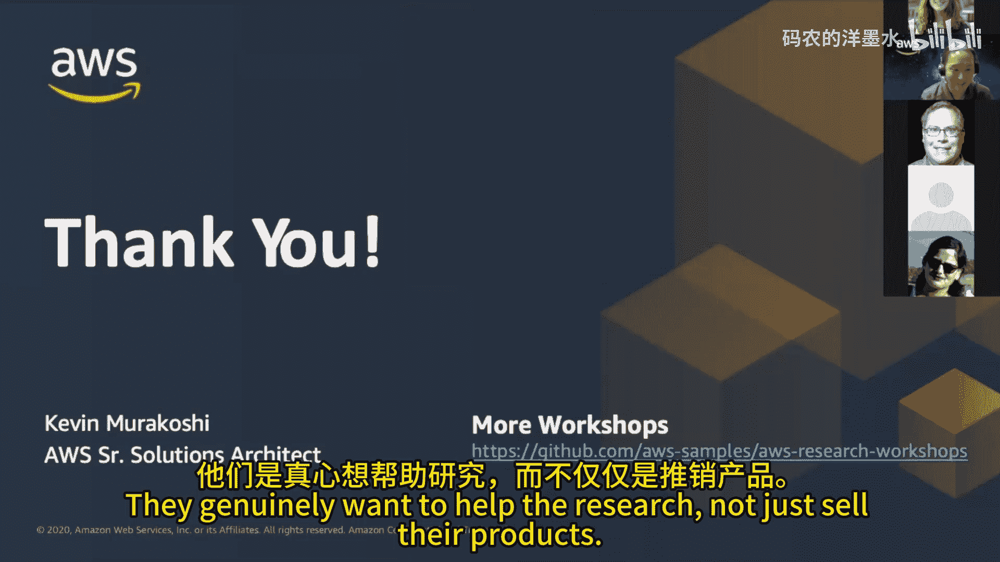

希望本教程能帮助您开始利用云计算的强大能力，更高效地开展数据科学研究。