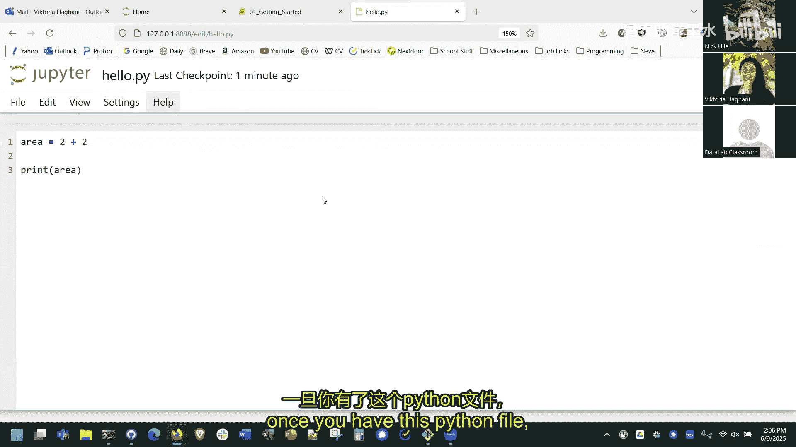
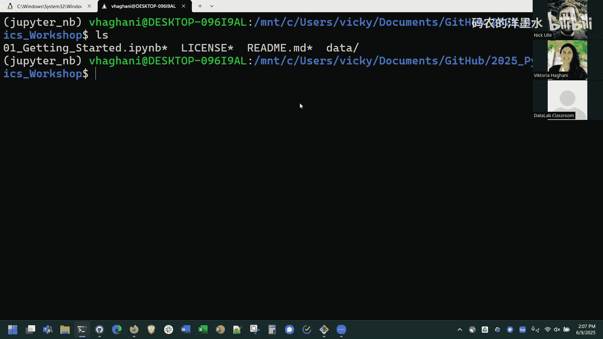
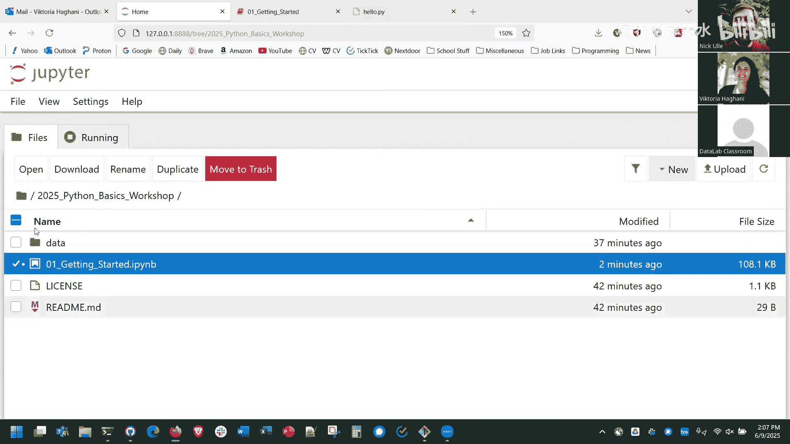
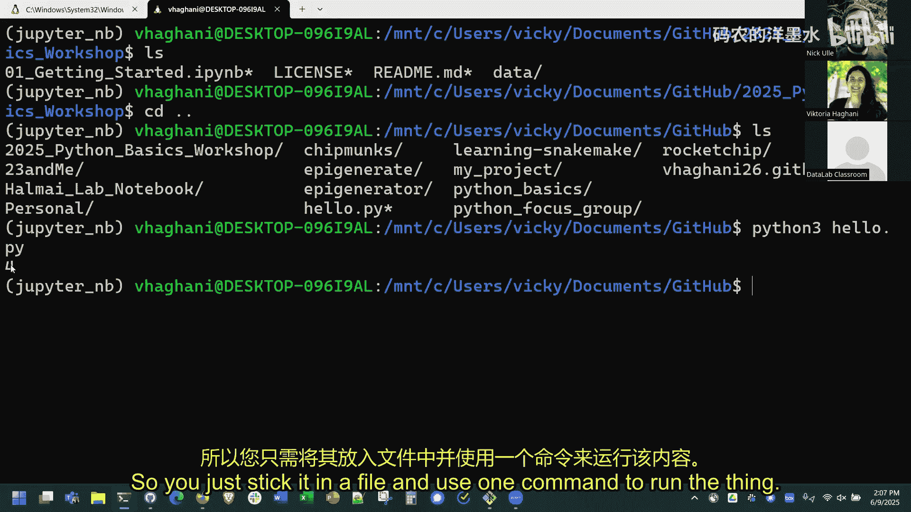
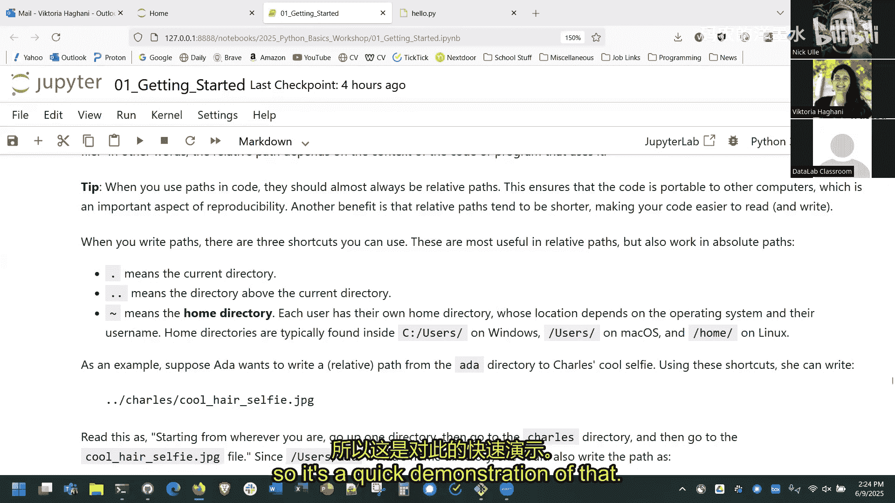
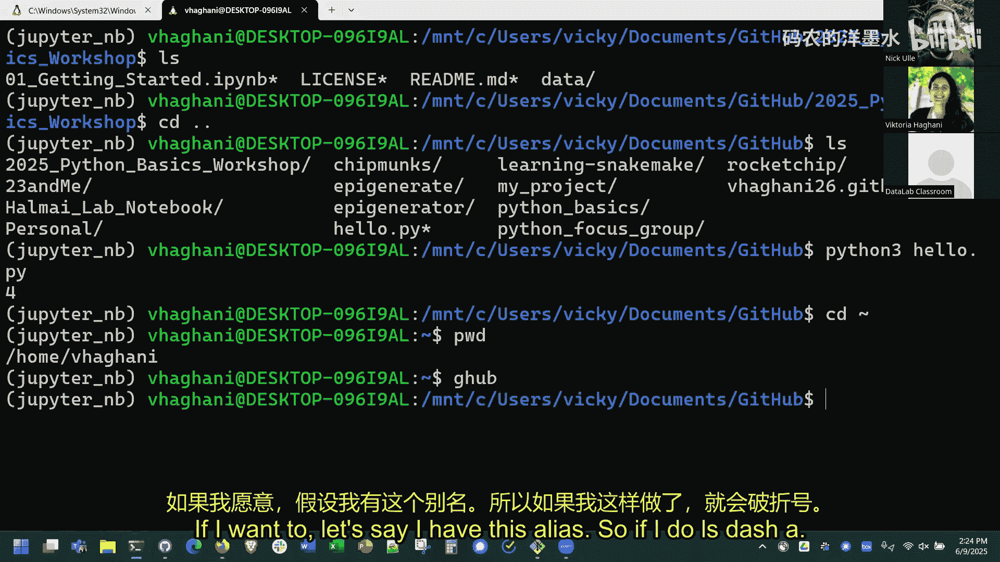
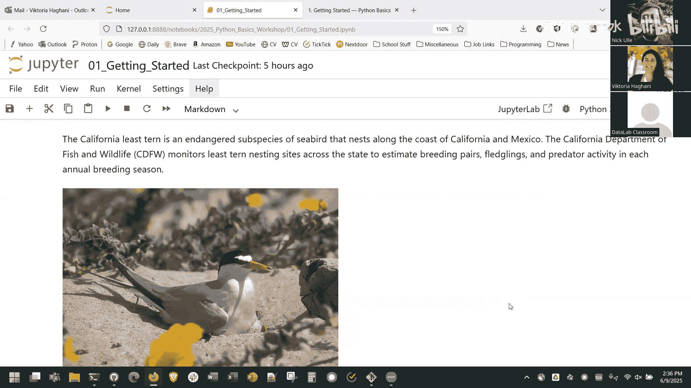
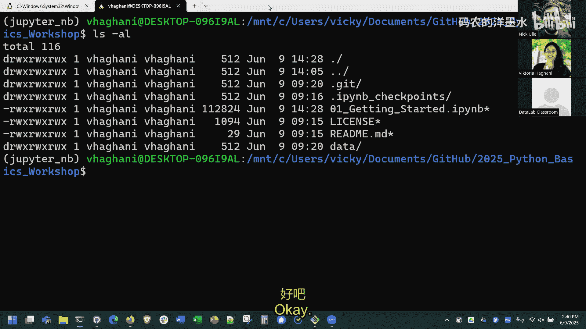
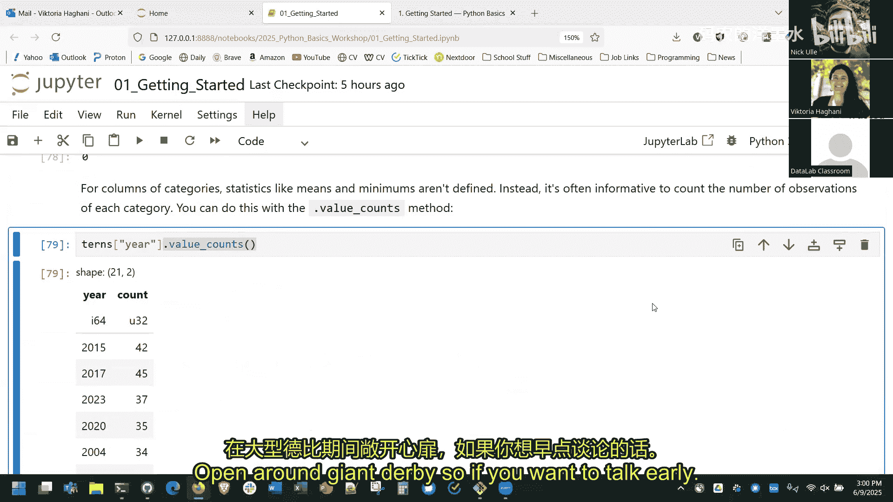

# 【全集】加州大学戴维斯分校 Python数据分析入门 中英字幕 1080P p01 Lecture 1 - Python入门与基础语法 -BV1AK6vBqEei_p1-

Okay。All right， so Nick did a really great introduction regarding Pixie and kind of how to set up our virtual environment so that we can get ready to jump in and actually start coding Python so this is going to be now our actual introduction to the Python language so we're hoping that after this specific lesson you're going to be able to run code in a Python console you're going to be able to do so in Jupyter lab you're going to be able to do some various things like creating variables calling functions saving and running your code and files。

😊，Be able to work through your file system and be able to get you to a point that you can actually execute code in your files。

So。Why Python of all things There's multiple languages R C plus plus some of you mentioned like what is it a mat Matlab Matlab so why Python well first of all。

 the code that you write is reproducible with Python so you can actually share it with somebody else if they run the same input So if I give you a data file and give you my code you should be theoretically able to run exactly what I ran and be able to replicate all of my results So this is really helpful because if you're working in any sort of collaborative environment and any sort of shared project doing this is really instrumental。

And on top of that， the reason it's kind of reproducible is let's say you're creating a figure on Microsoft Excel。

 you're sitting there highlighting the data cells， clicking to adjust parameters。

 going into the graph settings to add axes， this is not something that can be easily reproduced unless you document your steps fully。

 whereas in Python you actually have a full documentation of everything that's been done so it's a lot easier to reproduce what you're doing。

Another advantage of writing code that's reproducible is that you're able to actually automate repetitive tasks in an analysis。

 so there's been a lot of times at least in my work which is focused on genetics where I have like100 raw sequence files and I'm doing the same thing over and over for every file I don't want to do that myself so i'm able to use Python to automate those tasks。

And another benefit is you can actually recycle code between analyses so if I'm running an analysis for one project and I need to do something similar or even the same thing。

 I can just kind of copy and paste my code because it's reproducible so this makes it really easy to be able to learn and write code that's actually useful for yourself and others。

So another thing and this goes back to the Pixie situation is you can also package code that you think could be useful in a broader spectrum and distribute that code so like we're using Jupiter today。

 somebody actually wrote and made Jupiter and pushed Jupiter out so that we can use it altogether so there's a lot of packages that are made public that we have access to and that we can use that code from。

😊，So one of the nice things about Python is it's a general purpose language so there's probably people from all sorts of disciplines here。

 the people who started the Davis Python Use group were based in chemistry， I'm genetics。

 previous workshops have had people from like anthropology and sociology。

 so there's so many different disciplines that are able to use Python effectively for their work。

And one of the reasons that it is so popular is just because it has way easier to read syntax compared to some of the other languages。

 so if anyone's seen like C++ versus Python Python is a lot more intuitive。

 it's almost written like you would code in plain English。😊，It's interactive。

 there's a lot of online debuggs that describe what you're doing line by line because it's shared across so many cultures。

 there's also very straight and explicit code for you to reference and to use。

And because it's so broadly used， there are so many functions and packages that you can use when you run Python so these are just some of the many ways that we recommend Python being useful to you and why we choose Python R is also similarly useful so no shade to anyone using R。

 but I think Python really is a very powerful language and if you choose to kind of dive into Python you're going to be having a good time with your data analysis。

So as I mentioned， there's like 600 some000 packages that are published on PP alone for Python so with regards to the actual packages you want to use for data science。

 there are so many things and this can be taking kind of case by case based on what you're working with but there's also broader tools that you can use so Nick walked us through some of those things this morning but I'm going to share just a few things that are helpful for data analysis so earlier we installed nuumpy nuumppyI helps provide ndiional arrays so these are like vectors and matrices and they have a collection of mathematical functions so it helps you kind of wrangle your data in the form of a data frame you can mess around with the data perform operations on your data and it's actually one of the most used packages。

And generally in data science， a lot of the data is package as a data frame so this is typically like you you have some columns with some stuff in it。

 some rows with your stuff in it and it's like this little table of information that you have and I'm sure regardless of what discipline you're in you've probably in some capacity worked with a data frame like that you got your columns with your variables and you got some stuff that you're working with。

So a lot of these packages revolve around working with data frames So one of the packages that's really commonly used and one of the oldest ones actually is pandas。

 So pandas is used for similar to Ny like wrangling your data frames。

 it can read in CSV files help you manipulate what you're working with really nicely it can transform a data set like a dictionary which if you don't know what that means it's fine。

 but it can take like a dictionary format and transfer into a CSv for you to save it。

 So it's really helpful， but one of the problems with pandas is that it is notoriously not memory efficient when it comes to working with data frames that are large。

 So this is where polars comes in and we're actually gonna be focusing on using polars today for working with some data So polar is very similar to pandas except it's just more efficient so you can work with really large data sets and it works relatively quickly。

There's also some other packages so there's things like DDB and Ibis which kind of under the hood use SQL or structured query language。

 so these are really helpful for if you're working with something similar to a database as opposed to just like a CSV file so there's all sorts of things that you can work with depending on what you're doing。

So today we're going to be focusing mostly on using polars because it just is more efficient than pandas。

 it's kind of like the new and up and coming pandas。

And among the other packages that we're gonna to be using。

 and these are some of the things that Nick helped us install was Jupiter Spi Maplotlibb stats models。

syit learn and anyone who's done Python can probably like these packages probably sound familiar because these are very commonly used ones So Jupiter。

 this is actually the interface that I'm working on now This is kind of a notebook style and allows you to run code interactively and mix in a bunch of stuff。

 Sippi does a lot of mathematical functions Maplotlib is one of the go tos if you're trying to create a figure like any sort of plot any visualization generally uses like mapplotlib as one of the most common packages。

And then for a little bit more of like the machine learning and stats stuff you have stats models and psyit learn so just a note this is not meant to be an exhaustive list。

 this is just intended to make you aware that no matter what you're doing there's probably a package for it and if there's not great one but generally you have a lot of options with what you're doing and what packages are available to you to install and use for your own work。

So I believe everyone has run the setup already。 so just to confirm everyone has run the Pixie initialization has Jupiter Ny Pols。

All right。So for the next section， we'll focus a little bit about the Jupiter lab interface。

 so notice up here we had run Pixie a Jupiter。So there's a ton of different ways that you can actually run Python code。

 you can run it using your console， you can run it in a script at the terminal。

 you can run it in Jupiter， so there's a lot of ways that you can interact with this language。

 but the Jupyter La interface is just really nice because it has an integrated development environment or an IDE。

 this is a common acronym used when describing like an interface that you work with。

And it really helps make your code comprehensive so you can write code， you can write sections。

 this in itself is a Jupiter notebook， so like I have sections with text。

 I have pictures so it just really brings things together nicely with the code that you want to run。

So what we're going to start doing is actually opening Jupipyter notebook first I'm going to give you a brief tour of kind of what you expect to see when you open it。

 but there's some different sections and it's okay if you have some different sections in your specific pane because you may not have all the same things installed。

 but there should be a notebook option for Python， a console option for Python and some other stuff that you can mess with and it should show the directory which you are working in which is where all your stuff is。

So we're going to start by opening the Python console。

 So what you're going to do is go to the command line if you're using Windows。

 this is on Git bash and you're going to run， I think it's Pixie run Jupiter La。So this command here。

 you're going to run Pixie run Jupiter Lab and it should open that screen that I just shared with you。

And if anyone is having any issues， go ahead and flag a little of this here。

 and Nick is walking around the room。So Pixie run Jupiter Lab。

I believe this should pop up a link it should pop up a like yeah like it should pop up some link that you will put in your browser and it will open this interface for you so whatever it says it should pop up and say copy and paste this。

Let me see if I can find mine。好，可。Yeah， so it should look something like this。

 copy and paste one of these URLs， and then you copy and paste the URL into your browser and it will open the interface。

So everyone who is open to interface should see something that looks like this。

It looks like people are still typing some stuff， so we'll give it a minute。It's been awesome。没成工。

没有不。你 sweet三。嗯，这。你 actually是。It's。申平。そう。我们共想。系要出。我是都工作啦呢有新呢。You see a lot of screens with this？即诶。

Imm try。嗯ん。Okay， so it looks like most people have gotten the screen open so what we're going to do is in your screen you should see a small part under console that says Python3 and this will be it should say like i Pper underneath。

Go ahead and click that and it should open a console， a little Python console for you。

So you're going to click。This Python console here。Sorry for。Yeah， let me try。No。

 it is just making the interface。嗯。It's there on the cheaper view。你食眼吗。No。

 I just wants to make my life difficult。Soloria， yes。

 is the think of we going right now is a different Sc called and。

So this technically is an IDE I believe yeah so this is an IDE there's different ways that you can do it so you can install I think if you install Python from the website it comes with its own IDE Jupiter provides one it's just some sort of interface for you to interact with。

BB Ed is a text editor， so if you write a Python script you can edit the script in BB edit。

 but if you're trying to run the Python script you're still going to have to interact with the console。

I can write it and write it。嗯。All right so。Now you should have a screen it should say something about python the version number that you're using and should give you a little place to start typing some things so maybe can I get some thumbs up everyone seeing the little python all right perfect。

So at the bottom of the console you should see this little set of brackets so this is called the prompt and depending on what you're running the prompt will change depending on the system so when you are running it on your terminal there might have been like a dollar sign or a percent sign that's your prompt that's where it's telling you to start typing things in Jupiter the prompt is a set of brackets and it will tell you whether you've run the code before or not based on what's in the brackets so if it's just empty brackets like you'll see then it means that no code has been run yet。

So what we're going to do is go ahead and type two plus2。And then hold down shift and click enter。

So you should have。Why didn't my thing scroll all the way？You should have。

I'm going to refresh this really quick， it is being weird。嗯。So again， in order for something to run。

 you're going to click shift and En。Okay， so now you should see that it has output a result。

 this means that it ran the code that you gave it So now let's try something else we'll say three minus one this time and shift enter。

嗯。😊，Yes好。So what you should see now is those brackets where it was prompting you there should be some different colors one is going to show where you typed what you typed and the other will show the result that it's returning to you so one of those represents the code that you prompted and the other is the return value of what you have run so this is how you're going to be typing some Python code is you're going to be interacting with this Python prompt。

So as you noticed we just ran something with an addition sign subtraction sign。

 The nice thing about Python is as I mentioned， it's kind of intuitive So a lot of the things that we see here just how we would think of it if we're trying to add we use a plus sign if we want to subtract we use a minus sign。

 but there are some funky things like if you're gonna multiply you would use an asterisk if you want to divide you use the forward slash So there's a bunch of different basic functions for mathematics already kind of built into Python if you want to raise an exponent you can do two little asterisk so you can play around like if you want to do like two to the power of two you would do two。

2 little asterisks。 and then two。 so we can do something like。2。As two。

 and this should compute the power。So these are all ways that you can interact with the different numbers and this is going to be really important as you're starting to work with data and manipulate your data。

But we can also assign and do more complicated expressions as well。

 so let's say that we want to compute the area of a triangle。

The formula for computing area is half times the base times height。

 So let's say you have a base of three and a height of4。 So you can say half times the base。

 which is three times 4， which is the height。And you can read this and it will give you your output。

 so it's telling us the area of this triangle is six。😊。

But the nice thing about Python is you can write whatever you're computing in so many different ways。

 and there are some more conventional ways than others。

 So let's say we're doing half times three times4。 You can also do three times four divided by two。😊。

So how many of you remember Pennth？Yes， so this uses Pmdas， where it goes in order of parentheses。

 exponents， multiplication， division， addition subtraction。

 So exactly how it was executed when you were doing algebra。 It's the same weight here。

 So if you want to specify things with parentheses， it will do the things in parentheses first。

 So if we hypothetically change this to have parentheses instead of 6。 Oh no。

 that actually worked out。😊，But it gives us it would give us a different result。

 depending on how we structure our expression。 So you always want to make sure that whatever your computing is what you would expect it to be。

 So just take always take a moment to make sure that what you're running is what you expect and you can do this by playing around with some of the numbers as well。

 So as I mentioned， there are some conventions that people follow when running Python code and one of them is just to use spaces so that it's easier to look at。

 So looking at something like this versus this。The one with the spaces is just a little easier on the eyes。

 it's a little easier to read when it's all kind of jumbled up。

 it becomes really quickly overwhelming when you have this mix of numbers and letters and symbols。

 so just having spaces between things is really helpful。

So you want to kind of write like you would write text， just organize it nicely。

 Or code is good code。So we mentioned playing around with some of the numbers。

 but what if we want to store something like how do we work with these numbers。

 they like we can type them as is but they only existed in that instance。

So in Python we have these named values called variables。

 and it's really similar to math where a variable can represent anything that you assign it to。

 so this can include like an entire data frame lists， dictionaries， words， numbers。

 so we can assign anything we want to a variable。The thing is there are a few small rules for what we need to follow for variable nating conventions。

So generally for a naming convention， a variable can have any combination of letters underscores and numbers with the exception of it cannot start with a number。

 so something like geese top 50 dogs and nine lies with nine spelled out those are all perfectly fine variable names。

 so something like goose space teeth， this is interpreted as two different items so that's you don't want to space in your variable names。

Tropical dot fish in Python a dot represents calling potentially a function or method。

 so we don't want to do that。And nine makes Python think that you're talking about numbers so it gets really confused when you start it with the number so generally you want to have it as some sort of descriptive word or word combination and if you want to space the convention is typically to use an underscore。

So here I can say area， I can say area of triangle， I can call it whatever I want。

 but I'm going to keep it simple and call it area， so I'm going to assign the area of this triangle to the variable area。

So I'm going to run it。And notice that there's no output。Why is there no output now？

So there's no output now because all we told Python to do is set a variable equal to something。

 We didn't tell it to do anything with the variable other than assign a variable。

 and the assignment of the variable happens with the equal sign。

 So by saying you always start it by saying the variable name equals and then whatever you want to set it equal to。

So that is the convention that's typically used and generally speaking is recommended if you're working with variables to stick to lowercase letters based on the style guide because when you use a bunch of uppercase letters this typically represents something else in Python I think it's usually like global variables if unless constants shouldn be changing Yeah so things that you shouldn't be changing So if it's a variable that any point changes you should be using like lowercase letters not super picky but this is like what the general style guide for Python recommends。

So up here， we assigned our variable， we said area is equal to three times four divided by two。

But now， when we actually just put the variable name。

 it prints out the value because we stored that value in the variable。

 So go ahead and print out the variable。 And you should see that it's actually spitting out the equation that we assigned it。

 And if you haven't assigned it yet， just go ahead and assign it something and see what happens。

 Just give it some numbers。P it yes， what's the request if you write print here。Nothing， well。

 their print is more explicit。 I， I don't know why。

 but I've noticed if I don't always print something in a loop， for example， if I just put the name。

 it won't print， print just tells it explicitly to print。 There might be a reason for that。

 but I there it is putting just the variables prevention of interactive Python。

 and this is Juter replicating interactive pyon print is the more correct way to do it because it will always print。

 This is just a shell。Like basically skipping steps and being like， oh， yeah， sure。

 I know what you mean， I'm gonna print it。 But if you remember in the context too much。

 it will stop working。 So print will always work。 Yes。

 influence sometimes give you slightly different because print printing for the laser for the And this is。

ing for a programmer to be， so this this is where we're talking about the print function。

 which I'll get to in a little bit。嗯。So yeah， so I introduced variables。

 but what's the purpose of variables， like why do we need them is there a benefit to using them as opposed to just doing our calculation if we need a calculation。

Well， one other the reasons is it makes our code more reusable by adopting our variables and naming it here。

 if I just have area equals。3 times 4 divided by 2。 If I gave that to you with no explanation。

 you don't know what I'm referring to。 But if I assign variables。

 say base equals3 height equals4 area equals base times height divided by 2。

 This makes our code more descriptive， and it also means that we can more easily change the variables in our code。

 which is really helpful。 So let's say I'm sharing a code with some or code with somebody。

 and they have a slightly different file name than I have。

 If I store that file name in a variable at the top and just use the variable。

 all they have to do is change one line。 Otherwise。

 they have to go through the script and change every single place that it is。

 So variables just are really nice for having organized pretty reusable code。😊。

So here we are going to assign base to three， height to4， and area is equal to this equation。

 base times height divided by2。And notice that these are also slightly different colors so see base is in black and2 is in green that's because those are different data types。

 so Python knows that when you're saying base you're actually referring to this variable and when you're saying two you're just using a number。

So this is why it's really nice to have descriptive code。

 And this is also why it's nice to run something in Jupiter as opposed to just at the console。

 So this is called syntax highlighting， where it shows you the different parts of your code and colors it accordingly。

😊，So now that we have assigned our variables， we can run area and we can see that it computes for us。

So let's say that we want to change the height to 10。 instead of having to redo the whole expression。

 we just change the one variable。We can rerun our little segment and now it recomputes the area。

 so this is a good example of taking something and making it reusable。So yeah， generally。

 when you're assigning your variables， you just want the names to be descriptive。

 I could name any variable just about anything I want。 I could name As S D F if I wanted to。

 But if I shared my code with you and you looked at it， you could think， what is this。

 So it's just really helpful to have descriptive variable names。

 because it just makes looking at somebody else's code and also speaking from experience when your future self looks at your code。

 it will make more sense to you。 There have been times that I have looked at old code and be like。

 what on earth was I doing。 So having the descriptive code is just really helpful。

 So always just keep in mind when you're coding that yourself and other people might take a look at it in the future。

So we talked about variables now we're going to actually get into the things that variables store yes sorry so the someones come from our space noticed with the creation of variables there's not like a space where it was all of the variables you created so Jupiter has I believe that there's like a plugin of something that you can display currently like assigned environment which you're doing interactive。

Yeah， my default Python doesn't do that。 And actually， my default art doesn't do that。

 That's the thing that our studio does。 So Okay， you just kind of Python our studio。

 you can make it happen。 You have to dig for think one of these optionsmus respond of all the variables you can the。

不话被嗯。Like just here。Actually on but don't keep it a bit weird L。

So if Py defines lot variables they use internally。

 which under in front of them but they also seems like equation and then you assign value the value doesn't what you're talking about correct so in order to recompute area because area is calling on the variables that have been signed So if you update those variables but you don't update area it's not going to be updated So you need to rerun the base height and the area equation in order to redo the code。

Yes。Yes嗯。you can label and put some description of the data。

 but like I come from R and State I guess。你三看你别知不吧。

Thereear will be right now these are such simple data types that there's no original attributes yet then can also there's like ways to like print out what something is like you can use the type function when you get to data frames and stuff he'll start adding like labels to your data。

 but right now it's like a number the ability to be found。Yeah。So we've introduced variables。

 variables are just a way for us to store information， but now what are we storing？

So Python has a number of different data types and one of the ones that is most commonly used。

 especially in data frames is called a string。So a string is just any piece of literal text。

 So anything that is inside either single quotation marks or double quotation marks is considered a string。

 So if you type high。With a quotation marks， whether it's single or double， it should work。

 except you can't mix the two。 So I can't have a situation where I say single quotation。

 high double quotation。 It gets a little confused。 And it does know that it's a string。

 It says it's unterinated string。But yeah， we can do it single quotes。 We can do double quotes。

 We can add like an exclamation mark。 We can even do numbers。 So if we do a number。1 plus one。

 for example， if you put quotation marks around the one， it thinks that it is a character。

 It does not interpret it as a number。 So you would think that one plus one is equal to 2。

 but instead what it does is just stick the two things together like literally just stick them together because it's interpreting the data type as a character。

 a string rather than an integer。So data types are really important because let's say you were working in a data frame and you had a few columns。

1 thousand columns down where the data type was actually a string instead of an integer。

 and you didn't know that。 So now you're trying to perform mathematical functions and it's throwing an error at you because it's saying I can't add these things together or I can't divide these things。

 I don't know what you're talking about。 So just being aware of the different data types you're working with it is really helpful。

 And this is why there's also very specific syntax syntax referring to like the notation we use when we're writing the code。

 So this is why strings are represented with the quotation marks。

 So anytime you see the quotation marks in Python， you know that that is a string。

So in addition to those like mathematic operators， there's also some logic operators so that you have like the less than greater than less than or equal to and all of these are pretty descriptive up until the equal and not equal to。

 which are a little funky so。In Python， when you're assigning a variable。

 you assign it with an equal sign。 So if you wanted to note that something is equal to something。

 if you use an equal sign， all you're doing is assigning a variable。 So in Python。

 if you want to ask if something is equal to something you actually need two equal signs right after the other。

 these are the comparison operators and if you want to say not equal to generally the not is represented with an exclamation mark so you'd have not equal。

 So like the exclamation and then equal so it's not equal to。

So there's a few ways that you can work with this， we can say something like 1。5 is less than three。

And this tells us that that expression is true。We can say a is greater than B and it says false and the fun thing is I believe in Python characters are like alphanumeric characters are assigned of value like based on their ASI2 values So a is technically represented underneath as some numeric value。

 which is why it's not greater than B even though they're letters and that's also another demonstration of why knowing the data type that you're working with is really important that's something that you should be aware of because even if you do something like comparison operator。

 but your data is strings， you might actually get an output you're not expecting So you always want to kind of go through your code and make sure it's doing what you think you it's doing。

😊，So this is an example of using the equal to， so this is going to say it's true or false if three is equal to 3。

14。So it tells us this is false， which is what we would expect。

 And you can do this for strings as well。 So if you want to check if the identity of the string is true。

 if the strings are equal to each other， it will return a true or false。

So these true and false values are called Boolean values。

 and they're represented a few different ways。 You can represent them as the words true and false。

 and you can also represent them as a0 and1。 So these are like going back to the idea of truth tables where one represents true zero represents false。

 So a boolean is just a true or false value and this is going to be really important when you're trying to work with data because you can subset your data in different ways and say if this condition is met with the data。

 do this thing to it。 So like， let's say I'm working with log transformations。

 I don't want to compute the log of0。 So I can say if this is equal to0。

 don't include this in the calculation。 So it allows you to evaluate whether a condition is true or false and kind of mess with it accordingly。

 So it lets you dissect and work with your data nicely。

So the Boolean values on top of being printed out after your condition。

 you can also just print them as is so you can say true is equal to true。

 if you want to evaluate if true is equal to false， they're not。

 So it tells you that true is not equal to false。 That phrase is false。

So another thing is Python actually supports chain comparisons， so if we assign x as 1。5。

We can say one is less than x and x is less than 2。 and if we probably type this， this is true。

So this notation is actually called syntactic sugar。

 it's basically a shortcut so it's trying to combine two different phrases。

 it's taking one is less than x and X is less than two and combining it into one simpler expression。

 but when we evaluate this this is also true。So you can use different logic operators here。

 so go ahead and try really quick， write some expressions and see if it writes true or false。

 maybe try not equals to or equals to or less than or equal to and just kind of see what the behavior is for the program。

不说。It way that make could probe a little bit more readable but it also starts to break down you're working with data frames as we're going to see later on。

 so use it where you can， but when you're working on data frame remember that you might not be able to do this。

说四川话。妈这个有分的是一产应该。嗯。关了。2。谢是。😊，So just a quick note， when you do this kind of shortened notation。

 Python is inserting an and behind the scenes， so it's saying this is one condition and this is a separate condition。

So this plays a little on that whole probability situation where it's like and versus or where it's like condition one and condition2 or condition one or condition2 So this is kind of what these conditional operators or comparison operators are playing it there's logic operators and comparison operators which are basically these fun ways that you can just compare different things in your data and it's more important that you understand how you work with the data using these symbols rather than knowing that this is called an operator it's like that's nice to know if you're reading something but if you're feeling overwhelmed just focus on understanding how you can work with the actual code itself。

So moving forward we're going to talk a little bit about functions so I don't know your name。

 but you mentioned the print function so with functions these are all features of Python so people introduce functions and these are segments of code that do things so you can think of a function kind of like a machine you will give it an input and it will give you an output so those inputs that you are giving it are typically called argument so you are giving it an argument and what it is returning to you that output is called the return value。

So whenever you execute a function， this is called calling a function。

 so you can say we're going to call the round function。So round， let's go ahead and try this out。

 so we'll say round and then give it some number to round two and see what it does。

So you should see that by just saying round and giving it some numbers。

 it's going to round to the nearest integer。And this is because a lot of times functions actually have default things that are hidden in it。

So for the round function， there's actually an optional argument that says how many decimal places you want to round to If you don't give it that argument。

 it will select a default as being the nearest integer but we can actually give it that argument and change it so we can say rerun the same thing you ran。

 but now add another argument and the position that you put it in is important。

 so maybe try like one or two and try running that and see that your output should look a little different now。

So in these functions， as I mentioned， these pieces that you're inputting are called arguments and。

So they're called arguments。But there's also the default。 So as I mentioned。

 the default rounding is the nearest integer， but you can change it to whatever you want。

 And the reason that these positions specifically are important。

 let's say that we're giving it a number。 Let's， let's actually switch the order of this and see what happens。

 So if we say round。One and then 8。153。It gets mad at us and it says that this object。

 this is called a float。 It cannot be interpreted as an integer。 It gets upset。

 So the reason it gets upset at us is because the position that is described is very integral to the function。

 So the function is written so that the first thing that you are giving it is assigned to an underlying variable called number that's the argument and the second position is assigned as the number of decimal digits that you want around to。

So if we put end digits here， that's inherent to the function。It will be able to round it for us。

We can specify。 We can remove this as long as we preserve the position。

And that will not change your answer。We can define them explicitly， so we can say our number is 8。

153， the number of digits is equal to one。And it will do our computing。

So I mentioned that these positions are important， but notice here that I actually switch the end digits argument and the number。

But this time， it didn't throw up an air like it did before。

And that's because this time we told it very explicitly what argument it is。

 so we're telling it that the one is supposed to represent n digits and 8。

153 is supposed to represent number。Now we'll get a little bit into how we determine what these arguments are later。

 but there is a way for every function that you can see what the inputs are and what those things are called。

Ah， yes， thank you。Li with Drew on the board， you can put help and then the name of the function and it will actually tell you those things and get we'll explore that in some more detail。

But that's going to give you some ideas of what inputs it's expecting。

 and it can also give you some information about what outputs you might be expecting as well。

 so it depends on the function。So here I want to demonstrate， I mentioned that for this argument。

 one of the arguments for the round function is number。

 so if we define number outside of the function and then try to run it。

It's going to tell us that argument is the argument number is missing and this is because these variables only exist in the context of that function。

 So even if we say end digits somewhere else in the code。

 it's not going to work we can circumvent that by just saying number as the variable。

 So if we assigned 4。755 as the number the variable number。😡，And then we give it the variable。

 This variable represents 4。755。 So if that's the case。

 then this will work because this actually has a meaning behind it。So we can go ahead and run that。

So you can also write it more explicitly so we can use that notation where we assign exactly what the variable name is。

 the variable， and then we can run that too。So go ahead and take about 30 seconds。

 play around with some of the arguments so the number its number and end digits are the two arguments。

 so play around a little bit， maybe switch the order of things and see what your outputs are。对。好。

Okay。Al right， so functions are really， really useful aspects of code General speaking。

 a lot of the modules that we import have functions in them。

 and that's the reason we're importing them。 We're trying to take a function somebody else has written and we're using it for ourselves。

 So the round function is already part of Python There's other different functions that we can call on and a lot of these functions are related to the idea of objects and attributes。

 which I think somebody had asked about not too long ago。

So Python represents data as objects and all of the things that we've talked about numbers， strings。

 functions， all of these are actually just objects for Python and an attribute is an object that's attached to another object。

 So it's saying like。For triangle base and height might be an attribute， for instance。

 the idea is just that there's characteristics specific to an object。

 but those objects are also objects in themselves， which sounds a little complicated。

 but it gets a little easier as we show you how that works。So here we have a string。

 and it says snakes everywhere with an exclamation mark。 and notice that it's not capitalized at all。

 So this string is an object and the string has an attribute。 And when an attribute is a function。

 we call this a method。 So the string has a method called capitalize。

 So when we attach this at the end of our string， it's going to execute that function。

 So if we have snakes everywhere lowercase， and we capitalize it。

 now we see that it actually makes our string capital。 So the snakes。

 the S and snakes is now capital。😊，So if you want a list of all the attributes that are attached to an object。

 you can actually check what that is。 And this kind of goes back to， I think。

 what Nick was mentioning， where you can check the variables in your environment。

 But here I'm saying this is high。 So this is a string。

 Let's check the attributes related to a string。So if we see that it starts with an underscore the two underscores。

 this is necessary for Python to know not so much for us。

 but the other stuff that doesn't have those two underscores。

 these are helpful information and functions or methods or attributes that we can call on So capitalize will capitalize the whatever we're working with。

s is all numb is alpha is digit is decimal is numeric。

 So there's all of these things that are functions that we can call or methods that we can execute to try to mess around with the object。

 So all of these are specific to strings So lower， for example， makes everything lowercase。

 So you can actually explore the different types of attributes associated with these objects。

So let's say we do want to use lower。The way that we would do a new function。Or execute a new method。

We can give it a string， so go ahead and put your name in capital letters。

And then add a dot lower at the end。And that dot lower should have the parentheses because this is a method or a function that we're calling。

And then see what it outputs。So you should see that we've applied this method to the data or the object that we have given it。

 so we have been able to manipulate the object now。So yeah， there's a lot of documentation。

 and oftentimes this can be a little overwhelming。 But what I find helps is going kind of a case by case basis here。

 If I'm working with a string and I'm like， oh， I need this to be capital。

 I'll just sometimes Google， how do I make this capital。 And it'll tell me the function name。

 It'll say， oh， use dot upper or dot capitalize depending on what you want。

 So this is really helpful because not everything's gonna be super straightforward。 And really。

 Google can be your best friend if you're trying to learn how to code， just looking up。

 how do I do this thing and then add in Python at the end。

 and you'll usually get some pretty helpful stuff。 And we'll go into a little more of that later。😊。

But I do want to touch on comments。So as I mentioned， having pretty code is super super helpful。

 but not all code is really easily readable， so what we can do is add comments into our code so that our code is actually more informative。

😊，So a comment is something that you add in and it starts with a pound symbol。

And see how this is all highlighted green now。 And when I run it， nothing happens。

 There's not even an output here。 So the reason that happens is because comments are an inherent part of Python。

 where you can add little informative pieces in your code。 so I can say。嗯。

This variable represents my pet， and I can say。Pet equals shadow。And now。

 when somebody looks at this， I give this code to somebody else。 They look and go， oh， okay。

 So this is what this variable is supposed to represent。 Or if I have some obscure function。

 let's say。Base times high divided by two times10 I don't know whatever the whatever the heck this is。

 we can go ahead and actually explain what this is。

 So this function or this expression calculates dot dot dot like whatever。

 So by adding comments to your code， you make it easy for yourself。

 your future self other people looking at your code to understand what the code is doing and Python just ignores it like if you put anything in front of here Python will ignore it。

 so let's let's do this calculation will say。Random expression。Equals。Five times 19。Plus three。

And we'll print the random expression so we can see what that value is， so we get 98。

But if I put that pound symbol here。See， now it's kind of commenting this piece out and I rerun it。

It's completely ignoring that plus 3。 It's just acting like it doesn't exist now。

 So any time you start， it will comment out the rest of the line that it's on。

 So you can either have it at the end of your line for a comment or you can have it just on its own line。

 But whatever comes after for the rest of that line is not going to be run。So yeah。

 these are comments and it's really common especially if you're looking at code that other people have distributed or written。

 that you're going to see a bunch of these little comments。

 people will be like this is what I'm doing here， this is what I'm doing here and they range anywhere from extremely informative to kind of amusing depending on who wrote the code。

So yeah。WellI've already demonstrated this actually。

 but a lot of times when you're starting to learn how to code。

 it's really hard you get a little overwhelmed because you don't even know where to start。

 You don't know what tools you need， You don't know how to format or even read in what you need to read in。

So the best thing to do is， first of all， just look it up if you're having trouble。

 there's so many comprehensive tutorials online that will show you very basic things like how do I read in a CSV in Python？

But there's also built in help function so that if you're using a function。

 you can actually check what it's saying。 So like， if we do help round。

It tells us round takes two numbers， it takes number and end digits。

 and this goes back to what we were saying where you can define number equals whatever and n digits equals whatever。

And what's showing here is that it's the default value for end digits is none。

 So if you're having trouble with something， you can actually check what the function is doing by just running help inside the Python console。

 And this is really helpful anytime you're trying to run something And you're not sure what inputs it needs。

 what the defaults are if it requires more arguments because sometimes I've run something that had。

 let's say three arguments。 and I only gave it too。 And it tells me there's a missing argument。

 And I'm like， what's missing。 So I get to go， look at the help function and go， oh。

 I forgot to specify like。The output that I want this to be in。

So this is really helpful for just being able to get the help you need and understand what you're running a little more。

So you can also do this， excuse me。You can also do this for the operators that we talked about so we can say plus。

And run help。 And it will output this very giant expression explanation of all sorts of information that if you wanted to understand more about it would be helpful to know。

 I'm not going to read it to you， but。😊，This will go into really good detail about what you're asking for help with and it's important to note that if you're using anything that's not alpha nu I think just alphabetical if it's like a plus minus whatever you need to put quotes around it otherwise Python is going think you're trying to do something and it will give you an error so like。

嗯。If I run。Help。Abs。It saysRe the absolute value of an argument。

 so I can put this without print or without quotation marks。Whats up。嗯。The forward slash。

What does it mean？Yes。对。O。surprised if it's a whole over earlier religion。Okay。

it says takes exactly one argument when I try to mess with this I don it's just a ghost。

Parting the stack of broad us meant to indicate that the the arguments that arguments don't actually got means okay。

Co。不。So yeah， you can if the function is just letters。

 you can go ahead and just write the name directly and it will execute it as is so we see that these despite the fact that one is in quotations and one is not。

 we get the same output。So if you do use online documentation for functions。

 just make sure that what you're looking at is the same version for what you have installed。

 So I remember one time fighting one time because I was trying to use something called an F string。

 which you don't need to know what that means but I didn't realize I was one version of Python behind when it was invented and incorporated and I was like why is this not working until eventually I realized it was a version thing So this is why like if you're looking at a function version and this is also why mention like check the version it might be an outdated version or something versions are kind of a big deal。

 even though it seems like it's kind of floating in the background versions are one of those things that really impact your ability to code and work。

 So if you're looking up documentation， just make sure it's relevant to the version you're working with and oftentimes this is manifested as something called the deprecated function So you'll try to run something and it's like oh this function is deprecated which means it no longer is able to be used anymore like don't support anymore and then you get sad because you。

To read the new documentation。Yeah， so just make sure the version matches。And。

Now we'll cover when something goes wrong。 One of the jokes I like to tell some people in my lab is I wouldn't have a job if everything worked the first time I ran it。

 So sooner or later， probably today， probably every time you code。

 you're going to have some sort of errors。 This can be anything from syntax error because you forgot to put a comma after something。

 you forgot to close your parentheses， this can be you accidentally cut a line out and moved it so that you assigned the variable after you called it for the first time。

 like stuff like that， where it's really common that you run into errors。 Most of the time。

 Python will print some sort of error that's informative。 So like let's see if I can。

Mess with something。Yeah， so invalid syntax， so we know that there's something syntax related。

 which means like our parentheses， commass， something of the sort quotation marks。

 those are the issues we're looking for。So oftentimes it's gonna to be really helpful when you read your error。

 unfortunately it's not always super helpful becauses sometimes it'll give you a line number。

 sometimes it'll just yell at you in cases like this， just kind of go through your code。

 check whatever line it's talking about， sometimes it's like line。

 whatever like 173 invalid syntax and then you go and you're like oh。

 I forgot a parenthey and you add your parenthes see and and call it a day。U the other thing is。

 if you're really having trouble finding where the error is。

 run your code one line at a time until you find what is causing your issues and you can narrow down by commenting in and out chunks of your code and be like。

 okay， this is the problem child right here。There's also other resources online。

 so there's stack overflow where it's a really common website that people go to to ask questions。

 I think if you're more biology oriented， there's like biostar that does a lot of like the biological package support。

There's in the reader， there's a link to how to ask a good question General。

 you always want to put like whatever language you're working in。

 so you'll say like this error in Python， you want to have like almost verbatim the error that it's giving you like syntax error or whatever if you don't know what an error is like I think one time I got some weird numerical error like error 9372 and I'm like I don't know what that is so I just looked it up and it was like oh you ran out of memory and it killed your job' like okay so definitely just know that if you're running into errors it is not a you issue it's a very common issue so just go ahead and learn how to troubleshoot properly go ahead and look up the documentation for what you're running lookup code make sure to use forums。

I mean， chat GT， if that's your flow， like that that can help with some syntax errors here and there。

But a lot of times the hardest part of programming is just trying to troubleshoot and once you narrow down what's causing the issue。

 you're probably going to realize it wasn't that bad to fix。

So now that we've been kind of messing around in the console。

 we're actually going to have you open a Python file and run a file。

So what you're going to do is go to file。Up here in your notebook and saying new。

And then Python file。あ。So this should open a file， this should be some sort of untitled Python file。

 you can just call it hello。And say。Sorry， how did that I just clicked on the name up here。

So just clicking on the name of the file itself， I think there's also a way you can rename it。

Right here in file。熄呢个。嗯。Okay， so we'll do。Area equals2 plus 2 and then print area。

And then make sure to save that。So at this point I believe you should have multiple tabs open。

 you should have one where you have your Python console， one where you have your file。Let me see。嗯。

I one second attest this because I'm using I open Jupiter notebook instead of Jupiter La。

 has everyone made the file？Okay。So you guys have a slightly different screen than me。

 you should be able to go to that Jupiter lab screen where it says console。

We can't open a console for some reason。嗯。没。😔，Okay as we'll skip the running it for simplicity and time's sake。

 but generally speaking， once you have this Python file。

 I'll just open it in my terminal to show what that would look like。

Okay， so I would just type something like Python three。I mean。Scroll in。No， okay。

 that just looks weird。So Python 3。And then whatever file I'm running if you're running it in Pixie。

 I believe you can say Pixie you run Python and then youd say like Python3 and then the name of your file。

This saving。This is a fun troubleshooting， I don't know why my file is not saving。嗯。

Oh， it's back a directory。Okay， so now we'd say something like Python3， Hello dot Pi。

 and it prints our area as four。So this is just a demonstration because a lot of times what you're going to be running might be really really long。

 you're not going to want to run that line by line。

 so you just stick it in the file and use one command to run the thing and it's a little complicated so don't worry if you didn't get that it's just to show that there's different ways that you can run Python you can run the script itself。

So。When we talk about importing modules。You know how we installed， we installed like pandas， Pols。

 Numpy， Those are all modules。 Those are software that other people have written and these are files essentially Python files that somebody else wrote with defined functions inside them。

 So when you install it， you're downloading their code。 And when you say import something like NumpI。

 you're actually reading in their code so that you can use the stuff that they've written。

So what we've done like if I made this as a function。

 I could actually import area from my file and use that function so saving Python code and files is really useful in that way you can have really long code you can share the code easily so it is really nice if you're trying to write scripts and things like that。

And it's also nice if you have code that you reuse frequently。

 so like if I work frequently with FAFA files which are like files that have some sequence name and DNA sequence in it。

 if I do a lot of work with that maybe having a function read FAFA would be helpful because and I can read it in and separate the sequence that I need really easily so if you have stuff that you do a lot it's really helpful to have those things handy。

So when you're importing a module， it's actually quite simple assuming you have already installed it and since we did use Pixie to install。

 you just have to say import and then the name of what you're importing so everyone should have NI installed so let's go ahead and try to run import Numpy。

So now what you have done is save the code from NumpI， whoever wrote this package。

 you've read in their code and you're able to access the functions that they wrote。So now we have nu。

 if we want to use the functions， yes， that's in or file the console。Yeah。

 the file is just to demonstrate kind of a different way you can work with Python。

Yeah so in the console go ahead and import Numpy， so if you want to read in a function from Numpy。

 you would have to specify the function as being from Numpy so you'd sayumpy dot round because this is an attribute。

So Numpy dot round 3。3 and realize it's returning3。

 but it's also telling you a little more information than just the normal round function。

 because it's not the normal round function。 It's a different function written by somebody in Numpy。

So there's a lot of packages where there's very common conventions that get used for package names and Ny is actually one of them。

 So a lot of times when you're reading something， Numpy gets imported as something called NP。

 So imagine you're running a lot of code with Numpy Do you want to type Numpy every single time that you're trying to call a function No it gets a little daunting after a while。

 So there's shorter conventional names that are used for Numpy it's N。

 So oftentimes if somebody runs something like Np dot round。

 that means they're actually using Numpy So this is conventional and oftentimes you can find it just online there's a few packages where this is common。

 I mentioned pandas for working with data frames earlier。

 pandas is another one of those you'd say something like import pandas as Pd so that you're not typing pandas every time you use it。

So you can write import NumpI as NP。And then run NP。round and then give it a number。

And notice we get the same output as when we ran it with Numpy because we have just told Python that NP is actually standing for the NumpI module。

嗯。So and you might be thinking why are there two round functions， why do I need this function？

Let's demonstrate this。Yes you said NP is just a convention but that can we any initial you choose or is that it can be so I can import I can say as ASDF and then use it as ASDF but the reason there's generally conventions is because if I write my code and share it with you you can see if I've used Nmp because anyone who uses it usually uses that notation so it just makes it easier to share。

The meeting owl is yelling at me。Okay。The work time years sure。啊等京。谁。一。不。Okay。

 so here's a demonstration when we say round 4。755 to 2 digits using the built in round function。

 it gives us 4。75 but when we use NI's round function for 4。755 it actually gives us 4。

76 so it does matter what you're using there are some slight differences from package package。

 this is why reading the function documentation is important because you need to understand what exactly are you running and what is the behavior doing because if you're expecting that when this rounds that it's going to be 4。

76 but you use this version of the function that's not what it's not doing what you expect it to do。

They expectant be behavior or how as someone members work on computers。

Different algorithms produce these different mounting results。 And actually。

 according to the documentation， the iPhone 1 by iPhone driven is actually supposed to be more accurate in most cases。

 buts slow So in this case， number by gives us the result that we would actually do。啊。Yeah。

 if you need like really my precision rounding there special husband。是。Yeah。

 so notice that the round versus nupyy dot round like the NP dot round these are different functions。

 so you have to specify which function you're using and if you're using it from a module you imported or if you're just using a function built into python。

So now we're going to talk a little bit about Jupiter notebooks。

 So Jupiter notebook is this beautiful thing that I'm running here。

 where I have a mixture of text and code and pictures。

 So it's a little more comprehensive than just like a file or like a script or just a console。

 It's a little more organized。😊，So Jupiter itself stands for Jupiter or Julia Python text and R so it's like a kind of smooush together acronym Julia is another programming language R is a programming language。

So we're going to go ahead and actually make you guys a notebook so you can start trying to run some stuff。

So go， I believe you're going to go to file。New and then notebook。Mmm。

So everyone should open a notebook and it will prompt you to select a kernel。

 the kernel is just asking what software to use so are you using like R or Python because I also run R and Jupyter notebooks sometimes so specifying between the two is a little important。

So you'll specify that you want to use Python and it should open a screen like this where you have an untitled notebook and it just has this little block of stuff for you to click in。

So once you have this， we're going to try adding a cell， so o。

So you can add there should be a little plus button。

 So if you add plus this will default to giving you a code cell。

 which means it's expecting you to put Python code。

 So go ahead and create a code cell and put two plus two。And enter it and see what happens。

So just make one cell and put， it can be any mathematic expression you want it to be。All right。

 and once you have made a code cell， we're going to actually add a text cell because notice that I have this text here。

And it's also working nicely with my code。So to do that， you're going to click to add a new cell。

And once you have your new cell， there should be an option here that says code。

You're going to pull it down and tell it to use mark down。So markeddown is kind of like a。

 I don't know。 like a basic text language。 it's able to read in text and use very basic syntax to make it look a little different。

 So if I want to type， this is a bold item in order to bold something， I would put like two。

Ass on either side of it， and it bolds。 And then when I click enter， it renders it for me。

 So this is really commonly used for coding documentation because it can present code really nicely。

 You can incorporate images， you can format your text nicely， you can format equations。

 It's not strictly necessary to know all this for the sake of this workshop。

 But I wanted to show you because a lot of times if you're running Jupiter notebook。

 it's nice to have your text explaining what's going on in major steps。

 or maybe if you did something leading into the script you're running。

 you can explain all of that kind of in paragraph form。😊。

And I think there's in the reader an explanation of markdown。

 if not you can just look up like markdown commands。

 there's a few different formats like GitthHub uses one markdown。

Version I think hack and D uses another， but it's all just very basic like text rendering it's like Microsoft Word except you have to give it symbols to bold things。

来。So it's the same way you run the code， you click shift and En。So you should click shift enter。

 I think you could also use like control enter depending on your computer。7。Thank you。不好意。

organize I don't know like an R and you can make like I don't know if that's not that same organizing and I think Yeah so I think they call it R markdown yeah R markdown so it's it's still the same thing but it can render R code as well so there's similar notation。

 I think for like commentss heading it uses like the heading one two and three levels for yeah same thing the same thing pretty much I think the number of like pound symbols yeah。

Yes， I was going to say it's my markdown is essentially entirely synactically similar across all its flavors a small specific version so guess has died a couple of times to get titled and sub titled okay。

Okay， so now we're going to talk a little bit about the file tree this is kind of an essential thing in programming so anytime you're working on reading in data or something of the sort you need to understand how your file system is organized。

So oftentimes it's organized this it's called the tree。These are directories。

 So directory is a fancied word for just a folder。 So， you know。

 when you open your file finder and you're clicking through folders。

 when you click on something and it opens， it's taking you to that subdirecty， so。

If you are on your computer， you have multiple users， let's say Ada and Charles。

 if you want to access cats。csv， you have to give it the right path to that file。

 So that would look like starting from the base， a slash， then you go into users， another slash。Eda。

 another slash and cats。 csv， so that would look something like。This。So this is the file path。

So you have the slash users s Ada cats。csv。So anytime you have that slash it's usually indicative of some sort of directory。

 so that's how you know something is a folder and usually anytime a file ends with a dot something that's called the file extension。

 so here we see that this dot CSV is a CSV file， which stands for comma separated value which we'll touch on in a moment。

But yeah， so this is the path to that file。 And there's two different kinds of paths。

 One of them is called the absolute path。 and the absolute path is the full like from the beginning of your computer system all the way to where you're at now。

 And there's also a relative path。 So if you're working， let's say in this analysisip notebook。

 So this is a Jupiter notebook and you're trying to read in cats do csv Since they're in the same directory。

 the relative path is just cats do csv because it searches in its own directory and say。

 oh I found it。😊，So generally， relative paths for coding are recommended because if I wanted to share my script with Liliith。

 if I put user slash Vicki and then sent that to Lilith， she doesn't have a user slash Vicki。

So so if I say data/cats。csv and then I give Lilith a data directory with a CSv file in it and she wants to run my code。

 she can do that。So you usually want to be aware of the file tree and this is one of the most confusing things I know like when Nick was talking earlier we were kind of navigating using like the CD to change the directory go up and down one there's some different notations and it's also a little bit operator or。

Operating system specific。😊，So if you have Windows。

 a lot of times the slashes are actually backwards for Windows paths as opposed to forward for Python。

 Python knows what you're talking about for the most part， so it's okay。

 but there's some languages where this makes a big difference and that's also why like installing software on Windows and Macs are different because the file systems are different。

But yeah so you want to make sure that you know what directory you were in so when we created that Pixie I think like my project directory。

 we are in that directory， that's where we're creating our stuff now So if you're trying to find it in the file system as long as you know where you save that you can open it in your file finder。

 you can add files you can manipulate read and files。

So this is really important because we're going to start reading in data files。

I touched a little on relative paths already。So as a quick tip。

 there are some very common path notations。Just one single dot represents your current working directory。

So if I'm doing something in Python and I want to specify a path and it just says dot。

 that means like wherever I'm at now is what I'm talking about。

Dot dot represents the directory above where you're at now。

 so and a little tilda represents the home directory。 So it's a quick demonstration of that。

If I do CD with the little squiggly line， that means change directory， the squiggly line means home。

So now notice that path changed and if I do print my working directory。I'm in home Vi Haganni。

If I want to， let's say， I have this alias， so if I do LS A。

This is my current directory。 This is the previous directory。 So if I say C， D dot。

 my directory did not change because I basically told it to change to my current directory。

 and I'm already there。 But if I want to go back a directory， I can say C， D dot dot。

 And now notice I went back from Gitthubs up once the document。So there's different levels of things。

 so you always want to just be aware， sorry this。Oh， yes。There we go。So yeah。

 the CD dot is current directory， dot dot is back one directory。

 So this is one of the hardest parts I think of trying to navigate at the terminal is trying to just get used to the directory structure。

 trying to remember where all your stuff is organized and why being organized is important。

So there's a few ways in Python that you can actually understand your directories。

 so you can say import OS。I think OS is operating system， operating system。

This is a very commonly used python package and it has a bunch of functions related to paths so you can say import OS and this is a built in Python library so all of you should be able to import OS right now。

And then you can put OS。gecwd with parentheses and this means get current working directory。

So if I run this， oh。If I run this it tells me the current working directory that I'm in so it tells me I'm in my mounted C drive which is really typical for any Windows user this is where your stuff is I'm under my own user in my documents section in GiHub in 2025 Python basics workshop that is where my stuff is right now。

So everyone， go ahead and print your current working directory。Where simplicity。

 we're not going to run the change directory step because I don't want to have to navigate getting you all back。

 but if you wanted to change your directory at the command line or in your Python script。

 you can run OS。chD， which means change directory。Even though this is possible it's usually not good practice to do so what you what is just generally recommended is that you use the relative path to the file you're working with。

 So instead of changing your directory to go back one to read in a file just read in the file using the file path So if it's back a directory you can use dot dot slash and then wherever it's at but you don't want to really change your directory too much because you can really easily end up in the wrong place and then your script is not doing what it's supposed to。

But there's also some really helpful functions too that OS has so you can say listD and this will list everything that's in your directory so if you do OS。

listD and then everyone should be able to I think run the slash home so it's quotation marks a slash home and then another forward slash。

So if you run that， you should be able to get a bunch of stuff that's in your current working directory and this should probably include like your pixie。

t Tail files and if you created the script earlier， maybe your script。

So this will tell you the files that you have and this is really helpful because let's say I have 10 files that I want to manipulate。

 I can just read them all in from here and say if this file ends in this extension。

 do this thing to my file， so it helps with automation and reading and and interacting with Python and your file system。

So when you're reading in a file， you want to just be aware of the file extension because the file extension tells you some information about the file and the type of data stored in the files。

 So there's things like comma separated values， CVs， Tsvs， which are tab separated Excel files。

 And depending on the data type， it the way that it's organized as different。 So， for example。

 if you want a Json file， that's not tabular。 So you have to have special libraries and modules loaded to be able to work with that。

But tabular data refers to anything where you have columns and rows with data in it and so for the sake of this workshop we're actually going to be working with tabular data and this is probably some of the most common data that you'll work with even in R anyone who uses R already knows that when you're working with data it's probably in the form of a data frame which is common。

So comma separated value， which is one maybe that in TSVs are some of the most common for storing tabular data。

 CSV files stand for comma separated， which means it just separatesof。

It just separates everything by commas。 So these are the headings， the fruit， quantity and price。

 These are like the column heading names。 and then it has all your variables。

 and it's just separated with commas。 So then when you read it in。

 Python knows that it's a comma separated value。 So anytime there's a comma。

 it separates out into its own column。 So this is how we handle the data。F fact。

 Thomas sub values are just Excel documents without all the fancy exs。

 so it's literally the same you can import a CSD into Excel and it will read it as a spreadsheet That's correct。

I've made the mistake before of putting things with commas in a CSV file and that was not a fun day。

All right， so what we're going to do now is actually download and work with some data。

 so in the reader there should be a part that says click here to download。And you should be taken。

Sorry my laptop was like five years old and is having a hard time right now。

It's not letting me download， but I think I downloaded it earlier to account for that。Oops。Okay。

So yeah， what you're going to do is create a directory structure where you have a new folder where you're at called data and in the data directory。

 you're going to download that file。 So this is in the reader。And it should be a data set， I think。

 a link to a box CSV file。So you're going to download that data set。And again。

 you don't have to put it in a data subdirecty， but it's just good practice when you're working on a project to separate out what you're working with because if I'm trying to generate figures from raw data and there's intermediate scripts and files and I share that with Lilith and she runs the script and all of it's in the same directory it's gonna to look like a hot mess。

 So generally having subdirecties to organize your stuff is really helpful because it makes it more readable。

 it makes it easier to understand easier to interpret and it's just a little easier to go through when you're trying to find your results。

SoI'm 24 setting up this directory or like go through our terminal and all that or can you just make another product you can you can either use your file finder or you can use the terminal if you're at the terminal you would just make sure you're in your project directory and then do MKD which stands for make directory and then data and then just click enter and that will make a directory called data。

一三个两个。It should be in the reader so the workshop Python basics reader。系的。

But basically include the Pix workshop one that you yeah。

 so so in the Pixie workshop make a data folder and then put the data in the data folder Okay not correct。

New show innovator rent the file as well people are having some fighting It's shortly after the picture of the turn。

Yeah， let me。Let me load that。经常是。Can just taken the notes something。

So it should be in this little tab in the reader that says important， click here to download。Yes。

 and it should be under section 1。7。Gly 1。7。1。哎，嗯。you saying that's in the beginning its at the top of the how you said you't read might have set for previous project it would be OS C and then you would put the directory you want in the quot in the practice thing。

Would you like。Okay， so you should all be getting the data downloaded。

 it should be in a data directory with Pixie。嗯。啊，听懂。Yes。

So wherever your Pixy directory is or I have have an exceed workshop directory my project。

So it should be in my basically because the data address should be in the same place as where your file so your file and data should be to divorce you're。

Okay。

This appears to be。S director so should looks something like this I have my stuff named differently because i'm teaching but this should be your python notebook and you should have a subdirecty called data at the same level。

哦Yeah， don't。so here's another fundamental。欢简是差不多的。

you can check this at the terminal or you can look at your file finder so if you saved it like in your documents section you can look at your file。

对跟据。Thank。Yeah。I have a lot of questions， people saying that when they're running their Jupiter notebook。

 they can't type anything。You will have to open a new window。

 so don't close that one because that's running your server for Jupiter。

 just open a new terminal if you want to do anything on the terminal that will help if you want to navigate your file system and create a directory。

😡，どうですか。What second it depends on your operating system like for me on Windows I just click a new tab on the top other times you can like right click or like option click and it'll say like open new window。

Okay，还。So。All right， I see less red sticky notes or pink sticky notes。

 so I think that means people have the data downloaded。Okay。

I'm going to assume everyone has the data downloaded then if you're still having trouble。

 Nick and Lilith are walking around and they could take a look and help out。Yeah。

So I'm going to give it some brief background the California turn is an endangered subspecies of seabird it nests along the coast of California and Mexico and the California Department of Fish and wildlifelife monitors the least turn nesting sites across the state to estimate breeding pairs。

 fledglings and predator activity in each annual breeding season。

 so this is actual data from the CDFW。😊，So now that you have your data。

 there's there's some description in the reader about what each row represents if you want to mess with it a little。

But we're going to go ahead and actually read it in so。

You remember I was saying that when you import a module， there are certain conventions people follow。

For polars， it's conventional to say import polars as PL。

So then what we do is we say PL dot read CSV。 So what that means is we're using the function read CSV from PL。

 which is Pols， and we're giving it the argument which is our CSV。

 So we're saying read in this CSV file in data the data directory called 2000 to 2023 California lease Turn dot CSV。

And assign that to a variable。 You will be using this variable。

 So I suggest saying turns because you can easily follow along if that's the case。

 but you can name it whatever you want。 General， it's a good practice to just make it informative。

 So you know what you're working with。So import polarers as PL and then read your CSV file in。

So if it doesn't throw up an error， that means that you successfully read it in and there might be some issues。

 so please make sure that when you're reading it in， it's not yelling at you about anything。到。行。啊。嗯。

How。你た什来。咁。啊，真的。Okay。没有。Yeahそ。doing。三。And。Let try。Yeah那他说我们法院年了。C now trying just part。

Okay I think that covers everyone having the data， so I'm going to go ahead and move forward a little bit。

So。I mentioned earlier that for objects， there's usually attributes or methods that apply to the object。

 So we have assigned the variable turns to our entire data frame。

 So what that means is we can now apply those methods to the variable。

 So if we have turns as our data frame， we can use this function and dot head。And call it。

 And now we should actually print out the first 10 or so lines of the data frame。

 So if you run turns gott head with parentheses， you should see the top of your data frame。

What is head is a function that just shows the top。

 so it actually works in UniX2 to put head head means like the front or the top part of the file。

And because because computer scientists have a weird sense of humor。

 you can also do tail and tail is the last part of the file。

But we want to make sure so once you run the turns do head。

 it should show a little bit of your data frame you should be able to scroll a little and kind of see the data you're working with Sometimes if the data frame is particularly large it does like kind of summarize it and have like dot dot dot in the middle which means it's just cutting out some of the column so that you can see it So if that happens。

 don't think your data is compromised， it just means that it's a big file。

So on top of head you can also check the type so remember where I was saying earlier that it's really important to check the type of data you're working with so this type function just lets you put any object in it and it'll tell you what the function is So if I say type turns it tells me that this is a polar's data frame so that tells me the type of the object that i'm working with。

So type and then turns。嗯。So as long as it's telling you， you were able to print out the head。

 the top 10 lines or so of the file。 you were able to check the type。 Now。

 we'll mess around with that tail function。 So head shows by default fault。 the first 10 lines。

 Ta shows the last 10 lines。😊，So if you run turns。 tail， it should show you the end of it。

 and I think for those of you who do R， I think there's very similar function notation with polars from what I've noticed is there's a lot of overlap with how the functions and data framework。

Works essentially。So you can do tail， and you can also give it an argument。

 And the argument is the number of lines you want to display。

 So let's say I actually only want five lines。 I can say turns dot head and give it my argument because it defaults to 10。

 but let's say I don't want 10。 I just want 5。It'll only show me those first five now。

 so it shows me a little less so this might be helpful if let's say I'm working with data and I'm just like。

 oh， I forgot what the column names are， I want to see what like values this has。

 I just need a quick glimpse at it so it just gives me a quick glimpse at my data and make sure everything looks correct。

So another way to get an idea of what your data looks like without having to go through all the columns is by using the shape attribute。

So notice that this time， instead of having parentheses。

 there's no parentheses because the parentheses are typically used when I think you're trying to compute something。

 but since we're not actually computing anything， it's just kind of showing us the data。

We don't have to put any parentheses， so we say turns dot shape and it tells us the dimensions of our data set。

 so we see it is a pretty big data set。So this allows us， let's say if i'm reading in data。

 I want to make sure that I didn't accidentally read in the wrong number of rows or that it's not skipping things accidentally。

 this is just a sanity check to make sure my data is doing what it's it's expected to do I believe it depends on how it's written so I think if you set the headers equal to true it doesn't count it。

 but if you don't it does。So it depends on the reading。Yes。So yeah， there's other functions too。

 So on top of like head tail shape， you can just look at the columns。

 So let's say you're trying to do mathematical operations between columns and I'm like。

 I just need to know the column name I don't need to print it。 I don't want to scroll through it。

 I just need to know what the column names are。 I can use turns dot columns and it'll tell me all of the names of the columns。

嗯。So this is helpful for， let's say I wanted to subset my data。

 say anything from this year or above or this year below。

 it allows me to use and access those columns。And this can be done a little more directly。

 we'll get there shortly。Let me make sure everyone's， I don't on the same page。等下嗯。You。对帮他们。你觉得他们。

Okay。So yeah there's we can take a look at the columns and get 90 of our data anyone who's used R who's done like there's like the STR like the structure function there's turns dot glimpse which does almost the exact same thing it shows you the names of your columns it shows your rows your columns it shows the name of the columns the data type that is stored in that column so here we have 64 bit integer here we have a string。

So it shows you all of this data and kind of gives you a quick idea So let's say'm like I want to make sure that I like this data or this row is actually an integer or this column so I'm like oh yes。

 this is an integer column it's not a string so this is a really quick way with a glimpse which I think is really cutely names like taking a glimpse at your data you can take a glimpse at your data and it'll tell you all basic information about it without like blowing up the print out for your screen。

对。So in addition to glimpse， there's also describe which gives like some basic statistics。

 I believe about your。What is it about the data frame so yeah， this is a statistical summary。

This can be helpful。 These are all just basic ways that you can interact with the object。

 There's some stuff that we're gonna do after this and particularly tomorrow that's going to be more helpful working with the data。

 But right now is more of a focus on just let's get our environment set up。

 let's get the data downloaded。 Let's look at it and make sure it looks like what we expect it to look like。

So if we wanted to access the data。Let's say we wanted to look at the total nest column and only that column。

 We can actually index that so we can say turns and then put a bracket and say total nest。

 And this has to be spelled exactly the way the column is， including being k sensitive。 Otherwise。

 it's not going to know what you're talking about。So this gives us the column of total nests。

 and it tells us there's 791 rows。 And you can see that little dot dot do that kind of summarizes and squishes our data together。

啊。So there's a number of statistical tests and things that are included in polars。

 So these are a lot of similar to those basic functions that we talked about earlier。

 but on a bigger scale because most of the time you're not like adding one value to another you're working on the scale of a big data frame So sometimes you want to compute statistics So let's say we want to understand the average of the total nests made by turns So if we do turns。

We have selected for the column。And then apply the dot mean。😡，Function。

 so we're calling the function now。So what this means is we're taking the object。

 indexing it to select for the column of interest， and then applying a function to that column of interest。

So we're calculating the mean for the total nest for turns。

And there's other things you can do as well， like minimum。

 this tells you the minimum in the data set was zero nests。

Unfortunatelyfortunate that they're endangered yes。

 you to calculate and round that number to the second say。Ps dollars less到 million dollars。

Round you would kind of flank the whole thing I believe So I think it'd be like round and then this would this in would be the input to that function so youd do round and then two。

 let's say。It's zero， so it's not rounding anything。虽然后。The就是从。Pro。

So you could do something like that so this is saving your input in a variable the other one you can just put it directly and it just depends this is typically the easier on the eyes way to do it。

Yeah， and then you can also try to count the values I think this is very histogram like where you can just see the count of every single year so it's like 42 and 2015。

 45 and 2017， which is actually really helpful because if you are making a histogram of something this gives you the input perfectly and that's actually a very common use case in my experience for working with data frames。

So the idea is you have your data frame if you want to select the data you usually index to whatever column or data you're working with and if you want to apply to function to that you just kind of tag that onto the end and if you want to read more about those functions then you can look at the Polar's documentation。

 but we're going to be exploring a lot more with Pols for the workshop。So for the most part。

 that's what we have for today。 We just wanted to get everyone on the same page with software。

 We wanted to get data installed or downloaded。There are some exercises I know we're about to hit time。

 so there's some exercises at the end of the reader so if anyone's interested in either staying or exploring at home later today there's some basic things talking about escape sequences and strings so this is like adding blank new lines to strings there's some stuff to play around with your working directory。

And also just play around a little with the the read CSV function and looking at the data itself。

 So I encourage you to just take a little bit of time not too long。

 but just a little time to play around a little with the data， look at it。

 go through some of the material we went through today and make sure that it all makes sense to you。

All right， thanks to everybody for coming for the first day of this tomorrow we will give up where we left off we'll learn more ways to work with data frames in the first session and then do some visualization in the second sessions always this this turns data set so we're going to see a lot more about to do stuff if there will be lunch tomorrow right that San to come back。

bs there just reader and open around93 if you want early。

