# 【全集】加州大学戴维斯分校 Python数据分析入门 中英字幕 1080P p02 Lecture 2 - 数据结构与控制流 -BV1AK6vBqEei_p2-

Recording again。

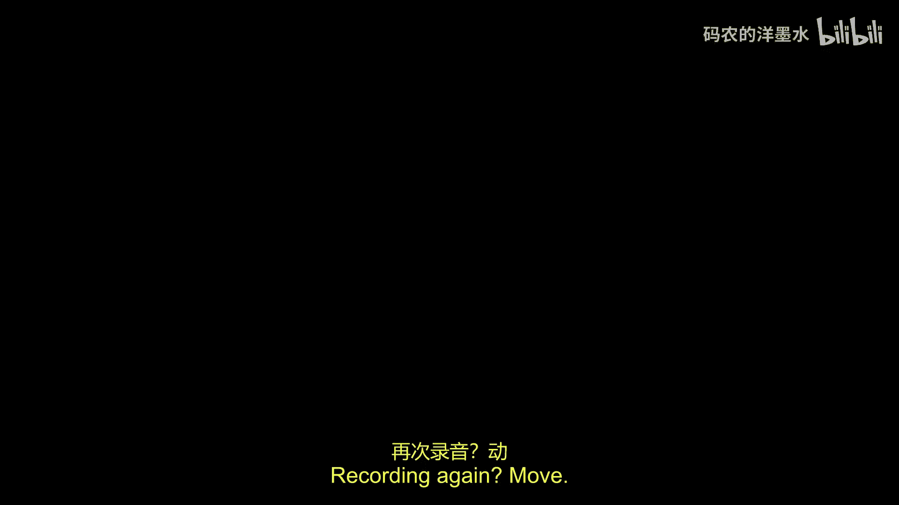

Yes。I think that's worth thinking so we are going to pick up more or less where we left off last time with the same data set so for anyone that forgot or wasn't here we're using the data from section 1。

7。1 of the reader you can get it by downloading it。

From the link to get right in which box and the reader link is the second link over on the board there。

So that's where you get the data as far as where I've actually put the data on my computer that's what I want to show you okay so let's see so we've got a project directory that we made yesterday this is also part of the very first session in the morning we set up the Pixie。

 log file thenixie or Pixie。tmmal file and Pixie do log file。

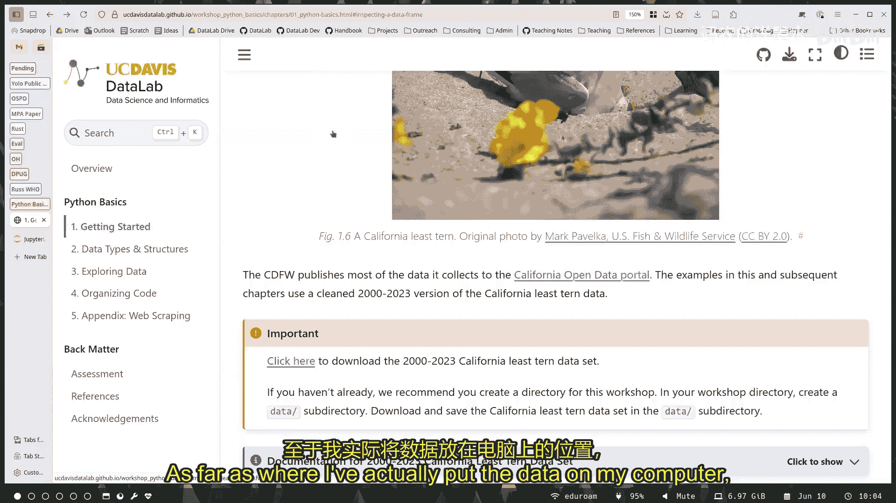

What the normal file look like， like just to remind you that the things you're going to need for this session。

 Pyth， Jupiter， plot9 pullers and un。Okay， so we went through installing those yesterday。

 there's information in the reader if you didn't catch it so you can go back and find those sections。

But that's what we're using today。And nothing extra besides that and then I've launched a Jupiter notebook here again。

 which again the command for that was Pixie run Jupiter。Lb。And I already read that。

 so I'm not going to run it again， but that's what you need to run to launch the Jupyter notebook in case you forgot。

And you need to do that in the directory where you've got your pixie stuff。嗯。

If anybody has trouble with getting Jupiter started or finding the data set or anything else。

 put up a red sticky or raise your hand and we will come and help。I think。Yeah， week。啊。

These one of the if you put or they'll come around。Okay so。Okay。Okay， yeah。

 so we've got Colton as well， so if you need help， we will we will have someone come and help you。

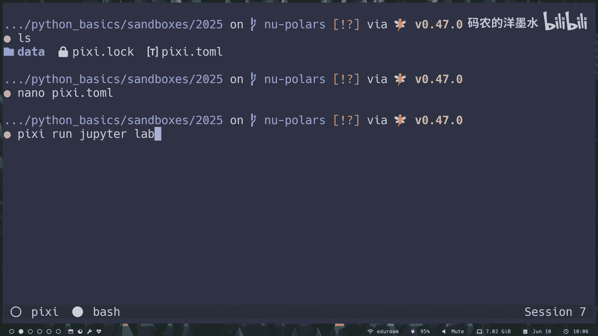

So to get us started to make sure everybody， I want to make sure everybody is able to actually launch the Jupiter notebook。

 you should see something like this， you might have a notebook open， that's okay。

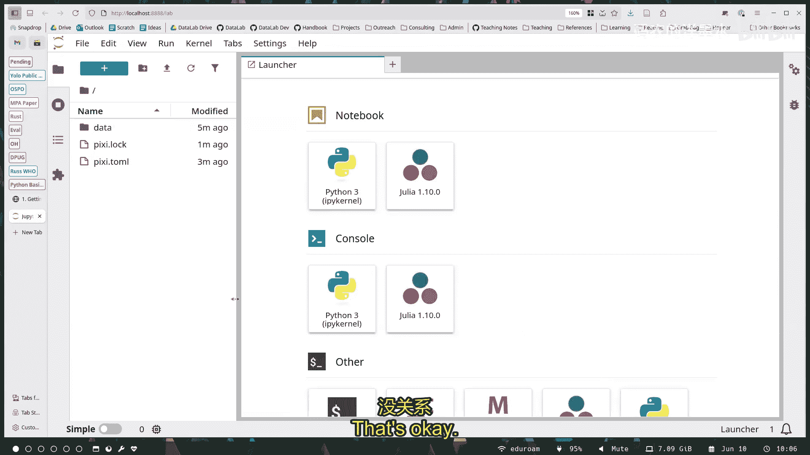

But this is what we're trying to get to。And that's the command。喂。不好。对都说。嗯。

Give us just a minute or two to get this sort of just just launch nuclear lab right now once you're there you're good。

If you don't already have it from yesterday， then yeah， yeah yeah。Okay， for two ways。of。s doing。系话。

It actually acting my the yesterday energy。So for the officer I say kid have a drug with it。

I'What happened between yesterday and today。A to your approaching of age。工对。整个手。我消唔咗，消食唔多啊嗰啲啊。

win space and you make that space。系有冇咩。There's。っ願。'm talking。So at this point。

 I'm going to assume you've either been able to open Jupiter lab or you have somebody helping you because right now all we should be at is this screen。

 okay。

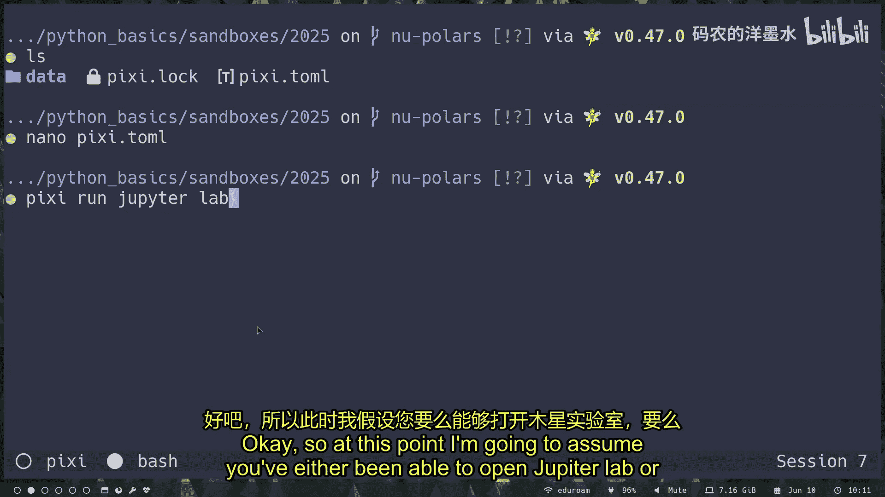

I'm going to go ahead and open a new Jupiter notebook。

 we're going to use a new notebook for today so that everyone can follow along。

And we're going to start we're going to work with the turns data set again today。

 so I'm going to go ahead and start by loading that and i'm going to show you how to do that。First。

 we're going to import polars as P again。嗯。You're going to need polars to load the data set right that's our our tool for loading data frames and working with data frames。

And then once we've got polars the data itself is a CSV， so again P。

read CSsv and then there's kind of a trick to getting the path right if you're having trouble getting paths right。

You have auto completions when you're working in the Jupiter notebook as well， so right now。

 if we look at what our directory layout is like。And Jupiter kind of shows this to you right so if your directory layout is like what we set up yesterday you should have a notebook called untitled but IP and D that's the notebook we're editing right now and then you should also have a folder called data right？

And that's the data folder we set up the other day yesterday。

 and inside of there there should be the least turns data， right？Okay。

 this is what we set up yesterday， so what we're going to do。We know it's in the data folder。

 so first we're just going to type data just the letter D even and we're going to hit tab。😡，喂。😊。

And you should see the data directory listed there。Okay。

If you don't or if you if it some I know some people capitalize the neo data。

 so it's is case sensitive， so if you capitalize D data you need to capitalize it in the path too。

But if you don't see that half， put up a red sticky。That。

Then we're going to autocomplete that right data， and then we're going to hit tab again。

And I think this is where it's actually more important because this file name is a little bit tricky to type。

So it will autocomple the file path。As well。Barry。So this is a way you can make sure that you're not getting typos in your path。

When you're when you're trying to type this because I'm seeing a lot of people that are having trouble just。

Being able to type out the path。Veryness。So again。Type a quote。It's tab。

Or type the D that could make it a little bit easier？And then data。And then hit tab。It to have。

The path。Drick。嗯。Hello。This is how you want to get the path set up below your data， right？

And if you've tried this and you're still having a problem loading the data。

 then put up a red sticky and someone will come and help you。

But this is how you're going to get that happen in there。

And I'm going to da this into a variable because we want to actually be able to use this data。Okay。

嗯ふ。😊，They'd be able to load it like this， I know I think yesterday there were a few people that mentioned they were having。

Having problems where it was not correctly detecting the data type of one of the columns if you've run into an error。

 one thing you can try is can set infer schema length to 500 and this basically says look at more rows to figure out what the data is it can sometimes fix problems yes。

all functions we not use a dot and if theyve had multiple or words in that function name we can underscore that it's typically an underscore yeah so so this is a convention in Python that if you're writing the name of a function or a variable then you use lowercase and underscore。

There's other kinds of things objects like like the data frame， for example。

 if you wanted to write the name of a data frame because it's a data type instead of a function you would write that with title case and no spaces and that's just the convention and python there's a there's a whole。

Style guide， which maybe is worth mentioning。Since it's relevant to the question so if you go to Pe8。

org PP8。org this is the official python style guide that's recommended by the developers and creators of Pythons pretty much everybody in the Python community uses this I don't recommend you read it right now but like take a look at this later on because this is advice for how you should write your code in terms of how to name things how to organize things that can be very helpful to make sure that your code is readable to other people programming this python。

Ex and parts of it maybe won't make sense until we've gotten through more of the material。

 so that's why I say don't read it right now， but sort of keep it in your back pocket。Okay。So again。

For some reason， you're not able to read the do that without the in first mean opinion。

 and you can try adding that。I think that's something some versions of polars have troubled and then let's look at the data with turns。

Got head back on the screen and get this out of the way。Okay。

 so pretty much the same as what we saw yesterday。Okay。嗯。

Vicy showed a few different ways to actually summarize this data yesterday。

 but one that I really want to focus on， and I don't remember if we actually talked about it yesterday is turns dot glimpse。

 So this is a。A way to get a summary of the structure of a data frame。

Make sure the code is all three so this gives us a summary of the structure of the data frame and if you're an R user this probably looks familiar if you've ever used the STR function in r that's what this is based on this is meant to just give you a summary。

Of the structure of the data。 So what we've got here， we've got the number of rows。

 the number of columns。 And me see if I can make this a little bit larger for everybody。Okay。

The number of rows， the number of columns and then we've got each column name with a dollar sign in front of it and the dollar sign is kind of like an artifact of how this is done in art doesn't the dollar sign doesn't mean anything for five one。

But column names so there's a column called gear and then something about the data title we're going to talk about more in a minute and then examples of the values and you've got column column column to like computer site name site name 2013 2018 right so you can see a summary of all of your data。

I think there's a question， yes。Can I scroll up， yes， what am I scrolling up to okay？啊。我的。No。

 only polars itself。And so the command again， was just the turn see talk pointss。那。

Okay so this is a good way to get a quick summary of your data so you can see what's going on this is usually the first thing I do when I load data for I look at this because this this tells me okay what are the columns what are what what's in the columns does the thing in the column actually match up with what I think that variable is right？

The other thing it's telling us about is the data types， right。The idea here is that。

Whatever kind of data we have， we can categorize it and that can help us reason about what to do with that data。

 okay。😡，I think about this from the approach of a statistician because I did my PhD in statistics。

 then in statistics in data analysis。Go to the section of the chapter that's relevant to this。

So we're going to go to 2。1。In statistics in data science we tend to have two really broad categories for types of data so we have numeric data and categorical data right numeric data is numbers categorical data is categories like red green blue or low medium high okay things they could be ordered。

 they don't have to be ordered so it could be like genres of music right there's no ordering to genres of music or it could be something that' that's actually ordered like low medium high right and we have different names for different like subcategories so like we say that if there's no ordering we call the categories nominal if there is ordering all the categories ornal if for numbers if we have integer numbers like one。

 two，3， four， five we call those discrete values if we have decimal numbers we call that continuous right so this is the way that sort of statisticians and data scientists tend to see the world。

There's other data types too， so this is not like an exhaustive list of possible data types you could have like network data or something right or an image。

😡，And in some cases you can sort of treat one data type as another data type if you do the right things。

 but usually you want to kind of think about what the data types are because that helps you figure out what methods you're going to use right how to approach this data if I wanted to build a model for some continuous data I might do something completely different than what I would do if I wanted to build a model for some categorical data。

Or even if I just wanted to analyze those things， even if I wasn't building a model。

My approaches are going to be different。So it's useful to think about types in the context of like doing statistics and data analysis。

 but it's also useful to think about types in the context of programming because when we're programming。

 we've got all these different functions that we can apply to our data right and the data type。

 that the type of data that we have determines what functions actually make sense。Okay。

So like just to look at this for a minute in the actual notebook， if I can get back to it。

It probably makes sense to all of us to say something like one plus one， right？

What if I say one plus？Hi， does this make sense？Yes or no， maybe。Right not without more context。

 right？We need。You could maybe come up with some way that this might make sense like maybe if you programmed a lot before you think okay well the one should become part of a string and then we should dip a string one high Okay but Python Python that says no that that doesn't make sense okay I don't know what to do with that you're going to have to be more。

More specific and it clinically says like。There's a type area right it says you can't add an inch with what Ples an integer to an SDR which is what P calls a string text right we learned about strings yesterday。

Okay， so it says there' there's no way to do this and the problem is the types。

So being aware of the types in your data can help you avoid errors and figure out also what you can actually do with your data。

嗯。That's why I'm talking about this otherwise relatively dry aspect of Python。对。

So let's go back to the reader for a second。A bunch of different built in data types that you can work with in Python so there's true and false values Booleions。

's there's integers， there's floating point numbers that's decimal numbers if you haven't heard the term floating point before floating point just should mean real numbers。

 decimal numbers needed there's complex numbers and in Python you write complex numbers with a J rather than an I so depending on where you learned about complex numbers if you learned about complex numbers。

You might be used to writing it with an I or a J， but。Python uses a J。嗯。

And then there's all those strengths which we already saw， right？

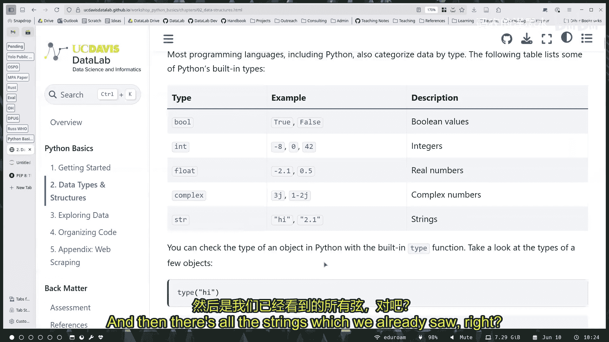

You can use the function type but check。

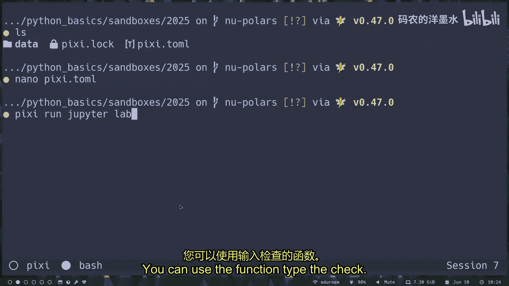

What type of data you have so if we look at the types of four it's an integer type of 4。

0 at the float。From the decimal point， Python can tell。

 we mean this is actually a floating point number if we look at type of I string， right？Okay。

I think yesterday Vicki showed if we look at the type of turns。

OkayIt's got a long name for the type of the important part if the part of the。

 which is it's a data frame and the rest is just telling us where this data frame type is defined in polars。

 which is not so important。So we can look at the types of different objects that we have and we're also getting that information when we look at gls。

嗯。So it's telling us some information about the types。

 it's telling us you can see STR so there's some polls that are strings。

But where they contain strings and then there's also I64 and this is for now just think of this means an integer I'll say more about than 64 if they're more。

Okay， but that make that kind of makes sense right like years or integers generally right and the names of the the different sites where they reported the number of turns is。

Strerings， right？And you can kind of look through this so we've got strings i've got more integers so a bunch more integers and also there's this app 64 f you can think about this as a floatat so a decimal number and again I'll come back to the 64 you can see these look like decimal numbers so that looks okay。

嗯。And so on right so's no so that's like all of the types that we've got in this data frame strings。

 two different kinds of numbers okay。But we want to do type of terms just regular terms if you want to find the type of。

One in the variant was of insideci terms United use quotes。

Not quotes so so there's a few different ways you could do this one one is you could use glimpse if you just want to see the types right it's showing us but if you needed a list of the types for some reason and this is jumping ahead a little bit。

 but if you say turns。 D types。This gives us a list of the types。I。

If you want to know the type of one variable， so let's look at that turns， let's look at year。嗯。

The person， let's just look at this， okay？Looks pretty much。

We would expect from what we saw in glimpse I think like yeah yeah so you need to put quotes around the yes yeah sorry I was not understanding what you were asking。

Okay， yes no。嗯是。Okay， yes question。I just notice then later once we were try to。

If you try and select。You're talking about this line that's I want that's also not what I want if you do that。

I'm not sure I understand the question。Okay so。Okay。

 so we' we've sort of seen that there's different data types if we look at this column that we've got here。

 let's let's look at what the type of this individual column is because now we've we've extracted a single column。

Okay。And see， I'm going try to sort of follow along with the reader okay。

So let's look at the type of turns。We record year。Okay， if you look at this。

This is no longer a data framing kind you can kind of see that。

By looking at it data frames typically have multiple columns we've only got one column here so we're getting something different and in this case what Pollar calls this is a series if you've worked with R you can think of a series as being like a vector I'm going to say a lot more about series in a moment。

 but before I do that I want to look at some behavior of types before we actually like dig into what a series is。

Great。😊，So。We saw a few different types already， so we saw， for example， the floating point numbers。

And we saw integers。And we saw that you can't do things like add one to a string。Right。

Just recapping where we are， but Python will let you do things that that。

There's some kind of reasonable way to make sense of what should happen so if I say  one plus 1。

5 you can probably guess that this is an integer and this is a floating flight right we run type you could run type on one and on 1。

5 to check that but those are so those are different types。

 but it makes sense hopefully to add these two things right we can all probably think of what the answer to this is。

And Python will let us do that so it's doing some automatic conversion of types for us， right？

This is a floating point number so what it's doing it's turning the integer into a floating point number and then it's adding the two together and gives us a floating point number right this is what we would expect and hope that it would do I think because we want to be able to do math and it would be really annoying if we got a type error every time we tried to add an integer to a floating point number or something like that。

So it is going to do some like limited form of automatic conversion generally where it would make sense mathematically。

喂。But it's not going to do things like turn your string into a number or automatically turn your number into a string。

 you're going to have to be more explicit if you want to do that。

Okay one that I think we have in the reader that is maybe a little bit surprising to people。

 especially if you haven't done a lot of programming before， is that we can do this。对。

So true is one of our boolean values， our true and false values， but in most programming languages。

 they just treat true like it's a one and false like it's a zero。

So that's exactly what's happening here and that's what Python does Okay so this is this is one that could maybe be a gotcha if you don't have a lot of experience programming already R does something like this too if you've used R。

But true is one that will' automatically。So。If you want to explicitly convert something。

You can use a function that's got the same name as that data type。Right。

 so maybe I've got the number。Six。RightAnd if I check the type of six。It's an end。

 but if I really want that to be a floating point number for some reason， I can put floatloat。

Around it。OkayAnd it gives me quote， okay。And just to show what that looks like without type around it。

you can see it dis back right so I can convert that way。

 you can also do more interesting things like if I have a string with the number 67。

and I try to convert it to an integer， I can do that and Python will do that conversion now if I try to convert a string that doesn't really make sense as an integer。

 then I get an error message。So you can only convert something to integer if it actually can be represented as an integer。

嗯。With maybe one exception， if I say give me the integer version of 6。7。

 it just give me six and it's just chopping off all the decimal points right so it just gives me the integer part of that number。

😡，来。So you can also do things like that。嗯。😊，So if you want to do some kind of explicit conversion to a different type。

 like maybe if I go back to my my example like。I wanted to maybe make a stream here。

 maybe my intention。My goal here。Is to make the string。One high， right。

 maybe that's what I was hoping would happen when I when I tried this。嗯，系。

That doesn't work because of the types， but what I could do is I could fix the types。

 I could say force the one to become a string， and now Iython will actually let me add those strings together because there's a meaningful interpretation of that。

That's one what you think。Combining a bunch of strings is by making sure they actually are strings and then using plus。

Okay。😊，Any questions？This is how you're going to convert data types。Yes。

 when I come to pretty false bit this one like everything of setting to you capitalizeize the tea。

 yes， did you put it in your box？I talked with them about。Yeah。

 so that's actually another important point。So。I just really want to emphasize that like things like quotes matter so like if we put type of true in quotes。

 that's a string because we put quotes around it， whereas type of。Throughe。Without quotes。

 that's a boolean value。Okay， the same if we if we do this with a number， if we say type of。one。

It's a string because we put quotes around， okay？So whether or not you have quotes around something matters and Python is a little bit more picky about this than are。

 I think are at least it used to have a thing where it would， if you had the word true in quotes。

 it would convert it to an actual true value in some cases。Which is great for causing bugs。So。

We a negativeIt does not。 So that's that's a good question too you can use single or double quotes。

 The only time that that could matter is if you need to put a quote in the string。

 So if you if you wanted to write a string like。They said。And then in quote something like hello。

 okay， you need to use the other kind of quote from whatever you're using on the the outside。

 so if I wanted single quotes on the inside then I' would need double inside。So if I could right。

Hello right and that's that's completely fine， but if I want to double quotes on the inside I would just need to switch that around so I could say they said。

Hello， right， that's also okay。And if you need both kinds of quotes in the string。

 there are ways to do that， but I can get into the details of that right now。

You can Google it if you want to know how to do that， okay。

So we've seen the basic data types now I want to talk about。

Something that's sort of related to where we're trying to get to。 So again， we looked at this。

 this turns。Gear column and we saw that it was a series and we're going to talk about series more in a minute。

 but first I want to look at a simpler data type。Wwhich is a list and this is a data type that's built into Python right so it gives us something called a list and the idea of a list is that we can put values into it。

 we can use it like a container it's like a box we can put stuff into okay and sort of following that metaphor the way we're going to make a list is with square bracket so I think box right。

So if we wanted to make a list of some numbers， we could say five， six， seven。

 and you're just putting commas between the things that are in the list。And so in this case。

 our list has five， six and seven。Okay， if we run that。If ifon printed something out。

 it doesn't give us an error message that's good Okay， if we check the type of this thing。

Tells us this is a list。Okay built into Python， you don't need polars or anything else to be able to make lists。

A list can hold any kind of data and they don't all have to be the same so you can have things like a number and then a string and then maybe let's put a function right if you can even put a function in a list。

The way the function gets bridge is a little bit weird。

You can put anything in a list you can even put other lists in a list so we could have a list that's maybe got。

This list contains a list。And then it actually has another list。With one and three in it。

Here there's two elements that need the， and then there's the other this， inner this。喂。Question yes。

All function for getting released sub data time like me。I mean， the type of something。

 it's just type。for the data frame。That is D types and we're going to talk about that in a minute again。

 so we'll come back to that。Okay。This is our list。嗯。

So these lists are really useful because they keep track of the order of the elements and you can store whatever kind of data you want in them。

You can think about again， like this is the first element。

 the second element if we want to get elements out of this thing。

 we can do something that we've sort of already seen right we we with our data frame when we wanted to get columns out we use square brackets。

That's the Python indexing operator。 that's how you get elements out of a container。

 a data frame is another kind of container。 a list is also a kind of container。

 So if we want to get elements out of our list， we're going to use square graphics to get the elements out as well and so。

First thing I'm going to do， I'm going to make this list actually I have a name。

 so I'm going to call this list X。对。So way that way we can actually refer to the list。

And I'm going to still print out X so that we can see what's in it and then if I want to get。

The first element I'm going to put X and then a square bracket and then the elements don't have names in this case when we're working with the data frame we could get the column by its name。

 but there's no names on the elements of the list so instead we have to use the position。

And in Python， the positions start from zero， which if you're an our programmer or if you're not a programmer in the past。

 this might seem crazy if you're a mathematician or a computer scientist it might seem less crazy。

 okay but we're going to start the positions from zero because this makes a lot of computing algorithms a lot nicer to implement。

That's that's really the only reason and there's some programming languages that start from zero like Python there's some that start from one like R Okay it just depends on on the sort of preferences of the。

The original implementers， the developers of the。In Python， everything starts from zero， so zero。

 the element at position zero， that's the first element。

Yes question square brackets the double indexing of development of the declared so depending on how you use the square graphics they could mean indexing or making a list right the key with indexing is that there's always some kind of word or name in front of the square brackets when we're making a list。

 there's nothing in front。maybe like it equals， but that's clearly we're not。

 we can't indexs right spell。Yeah。Yes， is there a way to like be mirrorless alternatively。

 like some like。李清吗。long function so there are if you have some data that's in a container already there's other ways to make a list so like one thing we could do we we saw how to change the types of things by using the name of the type and so you can do that with list as well if we say list of something that's got a bunch of elements and we might be able to turn it into a list so for example we know that the the year column。

Bs。Here we know that this year column is kind of like a list， it's not a bunch of elements。

 so would it would make sense to be able to turn this into a list and sure enough if we actually run that and if I go back to where the code actually is so everybody can see it。

Then you can see this turns into a really long list， but it is a list。はい。

So this is one other way you could get of this。嗯。But if you're just making a list from scratch。

 you're going to use the for of recordss。test I or either does it change the actual data frame or is it just the representation right now so it's leaving the data frame alone。

 but it's it's yeah it's just changing this result for。Okay。

m I'm going to comment this line out just because it is really long and I don't want to have to scroll through it every time right。

I'll leave it in there in case people want to see it。 Okay， so again。

 if we want to get elements of a list， we can use square brackets with a number right we can also。

 for example， get the。Second element of the list， which is another list。

Right you can chain these things together so like maybe I want the the second element of the list which is this and then I want to get the first element of that。

Right so I can say something like that and then I get back。Just that right。

 and maybe just to make that a little bit clearer， let me do this。

So I'll put this back to so everybody can see exactly what's going on here。对。

RightSo we get the first element of our outer list and that's another list and we get the。

the second element of our editorer， and it's another list and it first element of that。Yesす。

So you can chain this stuff together。嗯。however many times you need to， you can also。

Use a built in function to check how long a list is。

 so the lend function gives you the length of the list。In this case， our list has two elements。

That was hopefully not a surprise。You can make an empty list so if we。That square bracket。

 that's an empty list。你跟。是。Check that out it has length zero that's perfectly okay。嗯。Another example。

 so we talked about list and like the list function casting things to list。

 another example of something that's actually a container。

 although you might not think about it as a container is a straight straight is a container for characters so if you use if you use list。

On the string， you end up with a list that's got each character is a separate element。哎。

And actually this if you' like really thinking about all the stuff I've said about containers and and indexing。

 you might also think， well， okay， if I can do that， can I do this？你这。嗯。

A string is just a container for characters。哎。嗯。All right。

 so that's lists I'm telling you about list because lists are kind of the fundamental data structure in Python If you're going to do things in Python you're going to end up using lists almost anything you do you're going to run into a list So that's why we're talking about it it's also a nice sort of setup for the polar series that we're trying to get to So now that you've seen a list。

When we look at this series， it actually has a lot in common with a list， okay， like a list。

It's got a bunch of elements。And the elements are in some kind of order。

 and if we wanted to get the elements out， we could use square brackets。哎。So far。

 very similar to a list okay。There's a really crucial difference here， though。

 which is that unlike a list。Our year column or really any column， any series。

Has just one data type for the elements you can see like visually all the elements are integers。

 you can see it tells us when we print that they're integers it says I 64。

Which is how it indicates integers。Then we can also look at if we look at dot D types that tells us these are integers。

 and this is an attributed polar's object。It tells us what is the data type what is the type of elements and we need that because if we just use type of。

Earns。You。that just tells us it's a series， but it doesn't tell us what the element types are。

 so the D types or D type is telling us what the element type is。Another way we could get at this。

 we could look at turns year。B breath at zero and put all of that and type。Right， and we can see， oh。

 yeah， it seems a picture。就。This and the de type are both different ways of looking at what are the element types。

喂。Why。One other thing I want to talk about that I think I'm going to give the example using lists。

 even though I've started talking about series， there's something you need to be aware of with lists。

So let's look at our list again that we have。诶。😊，Okay so there's there's our our list we'll come back to series in a moment。

 they also have this behavior though， let's say we make another like like what seems like a copy maybe。

 especially if you're coming from R so we'll say Y is going to be equal to X。

they look the same yeah y and x they have the same data now let's change an element of x and the way you would change an element of x if we wanted to change the first element。

 we use our indexing。Operator like before that's how you say I want to select the first element right but then to to change something you do it the same way you would change a variable you use assignment。

Okay， so you say equals and then maybe we're going to change the first element to just being less du。

对。it says change the first element of ten。And if we look at x。Fair enough， forre selling a big bump。

Right， I said now this is how you can use。The indexing operator to do assignment。

 you can also do this with a series， you can change the elements of a series the exact same way。

Maybe we'll look at that in a second。If we look at why。Why has also changed？OkayIf you're an R user。

 this might be surprising or shocking。嗯。But the way that Python deals with containers and any kind of object that can hold data in it。

 data frame， series， lists， other things that we're going to see later on， if you assign like this。

 it's making a reference， not a copy。Okay， so it's saying that somewhere in your computer's memory。

 we have this this data that's in the sense right you can think of x as being like an arrow that points at about so maybe I can。

Yes。Hello。So somewhere in the computer's memory， we've got this list and imagine your computer's memory being like a bunch of boxes right that's how we're going to abstract this and there's a spot in memory where we've got this list contains a list。

よし。过了喂。And then there's a spot in the memory where youve got。

Other listing sort of atracting away a lot of details here might but you can think about like this essentially and we're saying when we saying x equal to this。

was saying that is going to point at that okay， then when we say why is equal the ask we say why it's also going to point to that。

That this reference you make and so then if we change the first element。ねと。No XM。哎。

Sometimes this is not what you want， sometimes you don't have call it。没个。But if you want to copy。

 you have to be explicit about that with pipeline。In our， it happens all happen。你前身分。

In quite on it does not so if we wanted a copy， let let's try this again so there's our x let's say y is equal to x dot copy。

Okay， and actually just just to make sure that we see that it's it looks the same。O。

Now we can see they look the same again， now let's change the first element of x again this time we'll go to 15。

喂。X is now 15 is its first element， and if we look at y。 it stayed that's1。Okay。

 so if you want to make a copy of the data structure generally the way you're going to do it is dot copy for a few data structures。

 especially in polars。You sometimes use doc clone instead。喂。But that's how you make copies of things。

Well， this is for priority shower container that the present name was would be the purpose of。

So for example， let's say you have a data set and you load up your data set and you want to transform it one way for one of your models and transform it a different way for your other model。

 you might want to make a copy of that data sets。系成 good。

So the simple equal to the reference that's because it's faster so if you don't need a copy。

 it is much， much faster to do assignment that way than to make a copy in memory anytime your computer has to go and actually put data in memory that's going to be relatively slow。

So Python does this for performance reasons that's part of it。

 you don't really unless you need a copy then you shouldn't make copies Im need a。It is weird。

 but they're going Canada everything。Now， so I think this is a big gotcha for our users because if youve programmed an art for a while。

 you get used to the idea that whenever you do assignment， you're getting a copy in Python。

 you have to be explicit if you want that。嗯Yeah。The copy is an attribute of the list and select。

And most data plants have this containers， at least， yes， essentially copy。Plus before wrap。

It depends Yeah， it depends。It depends on the it's like down to the individual package and data type level。

Pollers is more consistent about this than some other packages。

 pandas is famously inconsistent about this。Even the pandas developers can't explain to you when something is going to make a coffee versus when it's not there's there's an error that' it's kind of infamous as part of why we're using polars because it doesn't have things like that。

You can look in the documentation， I think that's the。My suggestion。

 there is also one other thing you can do if you want to see something a copy of something else。嗯。

If you use， the is。He word right do use is key word this is checking to see are these the exact same thing in membrane So if I say is x y let's let's look at this a little more carefully so we'll say let's look at X。

let's look at y and we're going to make y be equal to x。Again。And now if I say x is y。That's true。

 or we could do Y is x， the order doesn't。Okay， so this is saying these are the same thing they refer to the same thing now if I say y is equal to a copy of x。

Then I say x is。喂。No longer the same thing。Okay so if you really need to know if something is this。

Referring to the same object you think these is。对。But this is not something I think you'll need to do often if at all。

 yes， my。What the second example you spending you made it。

So I mean technically they are just saying so they're the same in terms of the data in them。

 but they're different places in your computer's memory so you can think about it as not found a second so our reference base is this。

Our coffee case is。We've got still a few boxes， right？

But now X is point to this one and then you've got another set。Now here， it also happens to。

twiceToday you referred to different places on。What do you do creates totally standards。

And you want to use folders。You can convert between data types， so you have to check。

And anytime you use anyone's code， you have to trust that they know what they're doing if they have code that uses Pols to do something and it returns a Pol's data frame。

 you can convert that to a pandas data frame， you don't have to worry about the details of what's going on inside their code。

是对。The same way that we've been converting stuff already use the name of the data type。

 so for polars， if you wanted to convert to a data frame P。 data frame。

And then whatever whatever you want to convert goes in there。Just like when we use list。

That' something。对。So you would put your pandas data frame。Inside right。It's just casting。

Like like we've seen before things then you would need to go the other way around and you would need to go PD data frame。

Puller' data has to back。So what they're doing in their code。

 it doesn't care about what you do after that。And likewise， anything you do after that。

 if you have code later on that is using Canis again。

 as long as you're giving them a data frame is the input。

 it doesn't care what you did to get to that data frame。

both we have to load again there's any to load for those if you're using code because panits you refer to with PD and folderers you refer to with F and these these are like there's different types as well like if you look at the type of a pandas data frame it's pandas dot something dot something dot data frame。

Yeah。Yes， yeah question I' more along the same line so I understand might be just that the but like you were saying。

 if I want to call on a certain functioning it did right in front any of these polar areas that and conveys。

You're saying I don't have to go through and convert everything and say like you know like this is totally different so if you're different functions and whatnot that if you're trying to use a function that someone has written for pandas depending on how they've done it if it really is just for pandas。

 then you would have to convert your data to which is。

So this so it's one extra function call if they have sort of been smart about this and they've used something to deal with all the different data frames packages because polars and pans are not the only two there's like five or six others。

There are tools， other packages like there's a package called Mar walls。

This lets people write functions that work with any kind of data frame。

Okay and they just deal with whatever data frame type you give them invisibly so that whoever's using the function doesn't have to think about that。

I mean a lot of the like really popular packages already use this。

 so like when we're going to do plotting， all of the plotting functions we're using。

 they were originally designed for pandas but they all just work with puller's data and you don't have to do anything because they use this library。

Okay。In we're that we are going to get to plotting after lunch。Okay。So we've seen references。

Another thing I want to look at。It has to do with lists。

Sometimes you're going to want to do things to the element of a list individually。

 so let's make a list one， two， three。Seventh and nice。Let's put a negative number in there。

And maybe not not have it lean in order。2。We'll call this ones z。Okay。No。

Maybe we want to do something like。Where are the elements of the list？Right。So。We want to do that。

Does anybody know what the squaring operator is or the exponent operator is in Python。

 did we talk about this？Two asterisk， yes， so we wanted to square something。

Or raise something to a power to the？So we can't just。Apply that。So the whole list。

 that does not work in a tight error。Okay we need to be more explicit that we mean square each other and this is another thing that maybe comes as a surprise to an R user。

So what we can do to square each element。We're going to write it in something that's sort of like mathematical notations。

 so we're going to say X。Squared or x in z。Okay。对对。What is the saying so you take the elements of z。

 I'm going to call each one x， and then I'm going to square each one。We get点意思。

That makes sense to everybody， other questions about what's happening here？Yes， in the bracket。

 it's not referring to the X list that we were reported earlier。Right， it's is this is referring to。

A certain element of settlement and this yeah putting it in the brackets and using this for in syntax is what's letting them know is a and it doesn't have to be called X here we could have called it element or something。

Right。It will change their religion。Well then is like yeah。

 so if we look they the eight or regular have to be set well except except for here separate。Yeah。

 so it doesn't hurt your original X either。So you can you can do something like this and you can put any kind of expression you want here。

We could， for example， just。Get back the same elements and there are situations for this school off'll show ones in the moment we could maybe convert all of them to strings right we can call a function Okay we could do something where we're not even using the elements。

F okay， we just want a lump of pillows the same length。

Right so you can put any kind of python expression here on the left side of clip。Yes。

Where the bed by any my those closed？They exist in any variable or they don't exist in any variable。

 they' just they're just getting created as we go through the elementss。Okay， so I said I would show。

And I'm just going to shorten this to Alt or alt in the I said I would show where you might want to do this and the reason you might want to do this is because there's more to this synt。

 you can also do some filtering here you can say if。

And then you can have some kind of condition on the elements。

So maybe we only want to get the elements that are positive right， so if I say if Z is greater。

Right right greater greater than zero。And what did I break or sorry， if L is greater than zero。嗯毕。对。

😊，So then we can filter out the elements， right， we can say only give me the positive elements。

That's how you can do that。And you can also use any kind of condition。

 anything that evaluates the true rep pulse。Yeah。Yes。

 these are absolutelyly they're just they're not what would have they're just showing you the result yes and so if we wanted to save this。

 we need to save it into a variable people yeah。能咪见。ItすかYes yes。嗯。Is that far enough？

SoHow did you define Z？So Z was defined。And let me， yeah， that yes。

 that's informed me put that on the screen。Okay， so this。This syntax。

 this is called a comprehension or a list comprehension。

 and I will'll see other examples of this later on。

 but this is a way you can do things two elements of the list， yes。

Right like or else in the and then on the next so or else in the yes so yes。

 this is getting the something we're going to talk about tomorrow or loops you can do this the downside of this is that。

When we use the comprehension syntax， we get back a list， when we use the loop。

 it's not giving us back any data， we have to sort of explicitly create a list again。

 just a little bit more annoying if all you want to do is change the elements of the list。Yes， yes。嗯。

I don't think so because the if is saying whether or not you keep the element。So I don't I don't。

 it wouldn't really make sense to have an else because it's not else do something else。

 it's just like if this is true， keep the element if it's not true， throw the element away。Yeah。

 we could do that let me make that a new example rather than getting this one。

So we could say alt for alt in the if Lt and then to figure out if it's divisible by two one way we can do this is with the modulus operator so percent this is remainder division。

So divide by two and it has to be equal to zero and we might need to put some parentheses in there I can't remember。

Okay， yeah， that was fine。 so we say divide by two and then the remainder should be zero。

Oh that's what we're doing here and you could do the same thing with three。嗯。I could say three。

 if you want both， you could say。And。😊，Have a condition as。And actually。

 I think we want ore here because we want either one built。And two equal to zero。Right。M。

Soy either it has to be divible way three or divible way。嗯。

So you can use and and or if you want to apply multiple conditions。Again。

 we're sort of foreshadowing something we're going to talk about later。对。So。

Is comprehension syntax really useful to know if you want to change the elements of a list？嗯。

Right now I want to go back to the series that we were looking at。So let's。Okay。

 let's look at a different series， yeah。Which possible so you have an executive so in that case I mean how would it know which list you are referring to if you want to so it's going right right right so let's make a。

嗯。Great， so' got a list of three lists。And then let's print it out。喂。

And then let's write some kind of comprehension on this。so that。

Unsurprising we give us back the same thing， but let's look at maybe an example that kind of shows what's going on say。

 we look at the length and let's。Let's make the list a little bit different too。

 so if this is actually interesting。嗯。So this is still defininging element by element。

 we know we've got nested lists so what was the first element of list of lists well lists with one element that you could figure that out by looking at。

The indexing。If it's not clear from。With looking at the definition of the wood。All。

 so that's the first E。And then the second E is this and the third E。Is this。But it doesn't。

Care that these are lists， it doesn't look inside these lists， it just looks at the。系我度。嗯，系。

You could use this to do something like。Maybe you want to get the first element of every list in a list of lists。

This says get me the first element of all of those lists that are on the inside。That's okay。

 as long as theyll have a first element。If we try to get the second element。

 that doesn't work because the first list't doesn't have a second element。Right。

 which there no second element， but this this this。Yes。😊。

different thing you go like the original example is that we square everything the list did that for a list of lists well it doesn't it wouldn't work because we saw that it doesn't really make sense to square a list at least to pipe on that the things that can be different for a list of lists the things you can do always depend on the types you have and that's why we talked about the types at the beginning if I mean you saw you you can't apply like。

If you have numbers， if you don't have numbers， you can't use athletic options。Okay。So let's look at。

A series of against。We're going to talk about a little bit more about series。

We've got this site name series， this one has string elements if we go and get one of the elements。

Okay it was back a string if we try to assign something to one of the elements and it's probably going to regret this later。

 but。Turns。Site name。Look at that now。嗯。Actually， that wait a enough。Oh， okay。

That was not what I was expecting。Okay。So it doesn't let us do that I'm going to see if I can。Well。

 not that。Okay， so oh， I see what。Okay。Anybody else。We'll see what' happens。Mhm。hel。S mean。

I tried to， yeah， but it didn' didn't take， was anybody see why？Well。

 it's not because of this string that they good guess， though。

That's in the right area of what I was trying to show。诶你嘢来。不是。

We're getting a call that's the trouble。Right， so when we actually access so。

If you're unsure does Fullers give you a copy when you grab a column it gives you a copy right this is we're getting a copy so we we change。

The elements in our copy and then we go and get a new copy and of course it doesn't change in the new copy we。

这是 copy。So if we wanted to actually。Make this stick， we could say。Ss equals turns。Site name。

Sites zero equals 10。Now let's look at sites。嗯。Now we're not getting a copy the second line where' we're looking at the thing that we changed so now we can actually see that it changed。

该不是。So more about references， right？In this case， we're getting a copy probably。嗯。

The other thing I wanted to point out here is it。The1 got turned into a string。Yeah。Unlike the list。

 the series， all the elements have to be the same data type， so it automatically tries to convert。

Okay， it knows that it's data type originally was strings。

 so it sees the1 says I have to be a string to。对。Now you can make your own series if you want。

With the feel serious function and the way you're going to do this is you're just going to castle this。

So PL series one， two， three。Get a series and it figures out the element type automatically so you can see I've put a bunch of integers in there so that used an integer type。

If you mix types。Then depending on what what you've mixed together， you might get a series。

 you might get an error， so like if I say hi one， two， see what this does。是。

Right so we get an error message because it complains that。You're trying to make a series。

 a series is supposed to have elements that are all the same type。Yeah， and clearly。

The elements here are not all the same type。Good。So in a series。

 the elements have to be the same data type， yes。Yes， I think that's it's like a vector， not， really。

You can think of a for our users， a series is like a vector list is like a list。M us。对。

So the elements have to be the same type now we know how to make a series。

 we know that they have to be the same type。嗯。Sometimes you might see people。

Write the series function like this or the series data type like this where they they put a name as the first argument。

 So this is the name of the series。 This is the the recommended。Way to make a series。

 but in practice， I almost never do this。The series series have names or can have names。

And if you think about what these are for they're generally columns of a data frame so it would make sense that they would have names because the columns have names that's that's why this feature is there。

 but if I'm just like doing an experiment on a series by itself to figure out how some function works I don't usually bother putting a name on it。

Yes， so quote the the name with a series of it the first stars in there do you like high some pools like to sign it or do now so well for one thing to be careful of this is not creating a variable called high so if I。

There's there's no variable called high still， this is just property of the series itself。Okay。

 if I wanted this to be a variable called high， I would still have to use。

So even equal feel that series where the reason is still have to assign and that's first argument。

If if you want to have that name and you can you can check the name of a series if we just call this x。

 if you want to know what is the name of a series dot name。

 you can also assign to that name if you want to change the name later on。可意。

So that's that's how you get the name of a series and if we look at something like turns year dot name。

You can see it's got the name of the column， right？

So that's the main purpose of this is if you want to have named columns。

That's why you mean serious as we mate。Well， that's why you would put a need suit so that you could have any any problems。

Serious the purpose the reason you would use a series is because they're really nice for doing math and other operations that you want to do on things that are all the same data types so。

That's a good question， so let's look at。Like that's probably what I should have led with。

 so let's look at。This series one two three all numbers right we saw before that if we wanted to change these numbers mathematically somehow with a list we had to write a list comprehension。

 but if you're an our user you know that in R you can do stuff like this。

Or to go back to my example that I had before look like this。

And it turns out that just works for a series they don't have to write a list it's in like the language of our series are vectorized。

 we don't call that call it that in Python， we call it broadcasting。

I don't know why everyone comes up with their own term for everything， okay。

 but in Python this is called Broading。对。The squaring operation gets applied to each element。Yeah。

Very much like when we did the list operation before。

 but this is actually being done in a way that's much more efficient and faster。

So if you're going to do a bunch of math， you want to use series or a related data structure called an N array which we might see yes that is not the original series it does not so the original series stays as it was。

Because we' we didn't do any assignment。Computed something。对。

So you can do all kinds of math if you have a series of numbers， it can be integers。

 they can be decimal numbers floating point， you can do any kind of math if you。

If you see later on that data Lab is doing our intermediate Python workshop。

 we show how you can do transformations to strings in our intermediate Python workshop if you have a series of strings。

 you can transform the entire series very efficiently。嗯。

But that's kind of the point of series is that you can do things like this very easily。Okay yes。さで我。

X D X letter。So something like this。But if we do this， we'll overwrite our original X， but yes。

 that will work。 So our original X is now gone and now we've just got the squared version。喂。So。

That's broadcasting and I want to see there's anything else I want to say about this。Blodcasting。

Okay， so let me talk about that。You can also use- so let's look at this。

We're going to import another packet， we're going to import numpI as NP P nuumpy is full of mathematical functions。

That's what it's really good at doing math。So if you want to do math on your。Series of numbers。

 you can also use nu so if I did something like NP。 log if I want to get the logarithm of x。

I can do that， there's also NP dot sign NP dot cosine。哦。没。

And all of the other mathematical functions you probably met in a math class somewhat。

NumpP provides all the kind of math support you might want and if you can't find the function you're looking for in Numpy。

 there's another package called scipi that has even more stuff to do math with。

But nuy covers most of the basics。And you can just use these things on a series。

They get element by element results， they get broadcast to each element。对。So if you're an R user。

 hopefully this looks familiar， it's a lot like how you would do the same things in R。

Except you have to add an NP doc in them doing those functions。喂。Not every function broadcast。

 so if we use something like NP。 sum， this is a function that computes the sum of something this。

 see， what are we missing here？I should compute the sum， I'm not sure why it's not actually。

 let's see。Gary's got an unexpected to and I assumes that some not going to respect to re argument access really。

Right is。Sure。So I think occasionally you might let's。Look at this too。

This is actually catching me by surprise occasionally。You might run into。

Incompatibilities between packages， I think this is a bug most likely。

But I think I from the error message， I think I kind of have a sense of what is causing the book but。

This should work。There might even be a a bug on the issue trackor already。Yeah。

 it's complaining that it's it's。So not guy wants to treat this series like it's a multidimensional thing like it's got two or three dimensions and polar doesn't know anything about that that's I think fundamentally what's going wrong here。

But。ThereFor a lot of these sort of simple functions。

 there's also a method that you can use and that will work because that is part of Bulls。

And I think this hopefully will get fixed soon。No。There are other functions。

 let's see if we can get this to cooperate with。Okay。

 so it doesn't like any of the aggregation functions， I guess。嗯。Okay， news to me but。You can use。

The polars versions of all of these。 So instead of this， we can say hey。It was like。F you。Okay。

You want the mean of a series？O。And then for the things that broadcast， you can just use NPP dot。嗯。

You can also broadcast across multiple columns， so if I do something like turns then I try to get maybe the total nests。

The total number of nests at each site。And maybe I want to know how many birds there are at each site relative to total nests。

 so I say turns。呢 p。Max PP max is the maximum reporting number agreed。Okay if even number of birds。

 the maximum reporting in birds， this is the focus。

so then we can get an estimate like how roughly how many nest are there perver and see it's about one for most of these we could summarize this better by taking means or things like that。

 but the point i'm trying to illustrate here is that you can。

Do these operations on multiple columns at once as long as they're the same length。Okay。

 and this goes element by element。Okay。😊，Any questions？About how broadcasting works， yes。

 see on screen and then the same。Sorry if one of those is what is not。No。

 I am saying one of the very screen。 I need people go the same didnt for error or。Sorry。

 I'm not understanding it if it's， you mean like it at the scalealar？Yeah。

 so all of the biggests out here in NA。oh， I'd see so you mean if there's other data types。Yes。

 so it depends on what you're doing。Let's look at a smaller example just to make this easier。嗯。

So we have a series of。One， two， three。If we wanted to say divide this by a series of strings。

 then yes， we get an error message。So it complains that it doesn't support division or series between a string and an interteger。

We also get an error if we try to use different lengths。And actually， it looks like in that era。

 it's just trying to convert。Left hand side to a string before it does the operation and then it still fails。

嗯。ButThe other thing， if we have different lengths。

 so four and fives we get an error and tells us we can't do everything can with different lengths right so you need to have appropriate data types and appropriate lengths。

For us to work。嗯。So in some of the data that we have not that we can。make。

So we'll talk about that more in a minute and we'll come back to that because that's yeah。Okay。

 any other questions about this about broadcasting？O嗯。So I want to move on。

 I want to briefly mention that in the reader we saw there's a list of the built in data type。

 there's also a list in the reader。In section。呃。Section 2。3。2。

 there's a list of the polarlars data types。So Pols has its own data types that are roughly equivalent to the Python data types。

 part of the reason they do this， like you might say why do they make it so complicated。

 why do they use their own set of data types， it's because they want to be able to support data types that don't exist。

In regular Python， like categorical data。OkayIf we want to represent categories。

 we could use strings to do that， but there's more efficient ways to represent categories and so polar has its own much more efficient lower memory usage type to represent categories it also in polars you can specify the amount of memory that you're going to use for。

The different numeric data types so I said I explained what these numbers are after in and float that's telling you how much memory is being used to represent that number it's specifically telling you in bits ones in zeros how many bits we're using for each number so this is an eight is saying we're going to have an integer and we're going to use eight bits。

8 zeros or ones to represent it 16 zeros or one， 72 and so and more zeros and ones。

 the more digits you use the more bits you use to represent the number。The larger the number can be。

Okay。嗯。And specifically， let's look at an example。Of this。We say hail that series。

And I'm going to have to well， okay， let's do this we're going to make a series that's going to have the element 255 in it。

And we're going to say D type equal to P。t int。eight。See if it's okay， yeah。Not 255。

 we're going to do one，2，7。There we go。Okay。But we're using eight bits with。In eight。

 then we can't represent 255 because that's too large the range for eight bits that can only represent numbers between negative 128 and 127。

Often。对。😊，So this is my in8， I'm going to call it that。嗯。

Right and you need to be somewhat aware of what data types you're using and how much memory you're using because。

If you。Exceed。The range with whatever storage you're using。It'll get unexpected results。对。

It wraps around。Yeah I said that this int a。No it is。Po。

In8 and hold numbers from negative 128 to 127。So if we add one to that。

 it wraps around and we end up back at negative 128。

Which is probably not what you would want if you assist your program。Yeah。So。

One thing to notice those， like I'm explicitly setting this to be an in and in most cases。

 you're not going to use in。 you're going to use a much， much much larger data type。

 So if we go and look at。What does the default just take away the D type？

Okay you can see it gives us i64 and64 the range for that is much much much larger and I think I might have it in the reader I don't remember it offhand。

It's in the trillions or clillions。Oh well we can also do let's see do I say it and you yes okay there it is so this is the the smallest number the largest number that you can represent within the in64。

嗯。It's going to meet most of your needs unless you're working with really large numbers。系。

So the default is in 64， you should just use the default。

 but you should be aware that there is this slate。Way to control how much memory you're using if you know you're only using small integers。

 then you might use a smaller data type if your program is short for memory if you're not running out of memory just use in 64 just like it's fine。

Okay。But if you ever have a problem where you're running out of memory then you can start thinking about what these bit sizes are。

Potentially use less memory。That makes sense for everybody， this is in section。2。3。2。

If you want to read about this or see more about this。对。😊，All right。So。We've。

Talked about series a whole bunch。So we've now talked about how to do different broadcasting we've talked about。

How to deal with different data types I one other thing I want to mention is that categorical type。

So if we want to deal with something that's categorical。 So if we look at our turns data again。

 let's go back to actually。Looking at the whole data frame。Whether or not something is categorical。

I think the main way to think about this is is it useful for grouping your data and that's how I tend to think about it。

So。First of all， most of the time numbers are not going to be useful as categories。

 especially decimal numbers right because they're generally going to be unique if you make a group of like weights or heights or something you're going to get like one observation in each group it's not very helpful if you use some kind of unique identifier sometimes that can be helpful sometimes it can't like site name we have to check are there multiple instances of each site in the data set if if there are then that might be a good grouping variable if there're not then it's not helpful as a grouping variable。

嗯。You can see that there's multiple instances of beer and there are more years in where to tell you that or to check。

So that， for example， might be useful as a category， so if we look at。Turns。And remember we can get。

All the unique counts of the unique values with value counts we saw this yesterday。

So you can see there's about 30 to 40 of each year。

That we have in this data set so this could potentially be a good grouping variable a good category right so we could treat this as a category or not it's also a number so we might want to treat it as a number and that's what's happening right now right now it's an I64。

Okay so you'd have to think about how am I going to do my analysis later on。

 do I want this to be a number or a category you might do something where you're using it like a number for a while and then you convert to a category later on。

Marking or converting the data types that are actually categories to category to the categorical data type is useful because it will help with things like modeling and plots because a lot of these functions understand that if you give them a categorical data type。

 they need to do something different than if you give them a number。Okay， so that's why you just。

Like thinking about what is categorical matters and let's look at the site。

Name as well just to see because again， this site name is useful as a grouping variable as a category。

If there's enough of them in each group and it looks like there are like we're getting more than one。

 there's a few that are really small but。This could potentially be useful for grouping， right。

 because it's we've got at least more than one in most of these。So if we wanted to convert this。Into。

Categorical variable。We could do turns。Site name。Not cast。P L dot。Porical。Okay。嗯。😊。

You might wonder why are we not writing it？The way that we saw how to do a cast before。

 why are we not writing it like this？可以。This is how we saw even casting before。

 but the reason we're not writing it like this is if we're not converting the series to categorical。

 we're converting the elements cities。We're changing the data type of the elements。

Not the whole series， the series is still a series。😡，对。So we need to do something different。

 you can't convert the whole series of categorical things just stuff like the invalid value or probably error message。

Instead， we're going to cast the elements and I going to cast the elements you use dots and you can convert to other data types this way too。

wanted to if we had some floating point numbers， we want to make them integers。

 we could use PL or we could use dot cas and P do in or just the in。对。

And you can see that it gives us staff a series of category appointment。

This is how you can convert to categorical。Youve got categorical data and this is a good idea to do when you're at the beginning of your analysis。

 when you're doing your like sort of data cleaning and figuring out what your data set has in it。

Like if you notice， oh， I've got these columns and I'm pretty sure I'm going to use them for grouping。

 convert them to categorical。你们。And it'll save you headaches later on。嗯。Itll also save you memory。

 so if you're working with a large data set， this will make your code use less memory and potentially run faster to me。

But that this likely。Because his space I just your hand so deep calls I'm not sure with this python but like group so you yeah without so you can group by on a string and that will work it will use more memory but if you do something like make a plot。

Specifically on something like the years。If you make a plot on the years。

 if you want them to be treated as numbers， then you want to leave that data as the integer data type that it is。

 but if you want them to be treated like categories you're going to need to convert it first because otherwise the plotting function will treat them like numbers but then that would be sense right I feel like I don't understand。

So， this is。So this is doing two things fully you one is it's more efficient。

 it's making your code use less memory， the other is to remind you that this is a category。

 not a unique identifier。So it's it's。LikeI'm encouraging you all to think about what your data types are in in your data set and even if it's a string which you could use in something like a group by function。

 market is a category if you know you're going to use it as a category。Yeah， please。I不是。

So you can set the order of the categories， see the polar's documentation if you want to do that i'm not going to go into the details of how to do that right now for the sake of time。

But you can set order if you want， I think， I think the default is either。

I don't know what the default is， but it's either going to be first thing it sees that order or it'll be alphabetical of one of those。

No。Okay， yes。Thanks for we didn't save it， so we didn't assign it back into the data frame so if you if you wanted to make this stick a do turns site。

Yes。Okay。Okay， so that's。Categoorical data。嗯。I briefly want to mention there's a few other data types in Python。

We're going to jump to。2。4。

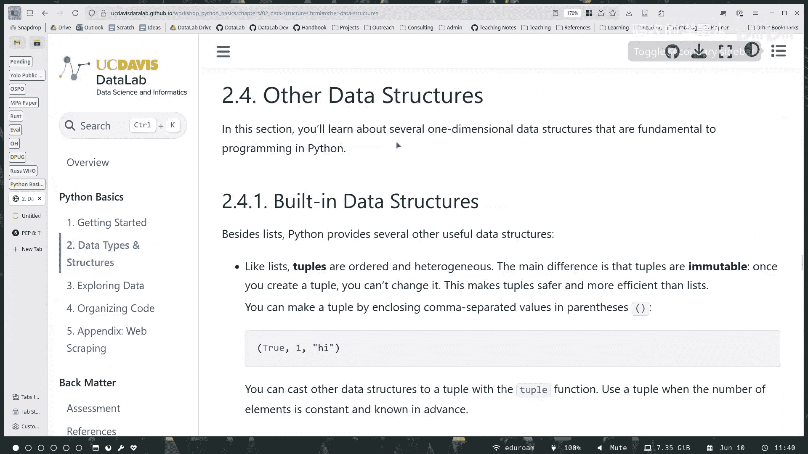

对。嗯。A lot of these are， well， some of these are going to be familiar from what we saw about lists。

 So there's， there's a data type called tuples。 You make tuples with。

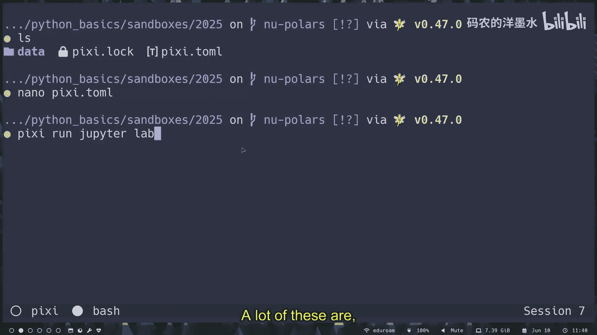

For emheses instead of square brackets。It's a lot like a list。

 you get elements the same way as a list， you create it almost the same way as a list it's a so of square brackets。

 it can have a mix of different data types just like a list。

The important difference is you cannot change the elements of a tuole， so if I say x is one， two。

And I try to change the first element。And I get nervous。Good。

These are probably not something you're going to be creating a lot。On your own。

 you're probably not going to be creating a parenthees notation。

But they're useful in certain cases that we're going to see later on and being aware that they're a different data type is。

But so just like know that。You can also look at the type of these if you want to see。

If you wanted to convert， you can use the list function to make a list out of one of these。

You need to be able to change the elements。So just be aware that that's there。

 that's kind of all I want to say about that。The reason for this。

 if you're wondering like why have these two different data types， tuples are more efficient。Okay。

 that's。The main reason they can also help prevent bugs if you know that something its elements shouldn't change。

You can use a tuple and then you'll get an error message if somebody tries to change the elements。

嗯 okay。We've got tuples， another one that built into Python sets， so if I make a set。

 this is like a mathematical sets， I use curly braces， just like in the math notation。

 you get the unique elements。So it makes some mathematical set。Okay。

Any questions about that one this you can also have different elements in sets。That's totally fine。嗯。

Des have nice set operations so you can do things like unions and intersections。

 see the Python documentation or the reader if you want examples of that。Okay。

 so we've seen twofolds， we've seen sets， we've seen lists。

 these are all built into Python one more if you， if you want to have。

Like E and value pairs so if you want to have names and values that are associated with those names you can use what's called a dictionary and you write that with curly braces as well。

 but the way you write it is a little bit different。

So if I wanted to have an element that's called high。I would write the name of the element。

 the Poland and then the value of the element。And then maybe another element called gay。

Can you write it like this。This gives us a dictionary。

 we can look up values in a dictionary by their name， so if we call this X。It's say X。Ae。

So you need to be able to get things by name， then this is the way you can do it。If you're an R user。

 you can use lists for this in R。So Python actually splits these two different functionalities of like having elements that are in an order and having elements that have names that you've got lists in Python and dictionaries。

And those are both sort of fulfilled by just the list type in a if they' in R usually。嗯。

If you look at the type of this thing。That's what Python calls a dictionary calls it diic。嗯。

So this is really useful if you need to sort of keep track of the relationship between two different things。

明。嗯。So those are data types to be aware of we're not going to use them a ton today。

 we might use them a little more tomorrow but。W you be aware that those exist because you will run into them at some point there's also something called nupy arrays which is sort of the N version of a series and they work a lot like a series so i'm not going to give a bunch of examples if you want to look in the reader to see like more details about that you can but i'm not going to go into the details of that today。

嗯。Okay。So。Moving right along， let's talk about。

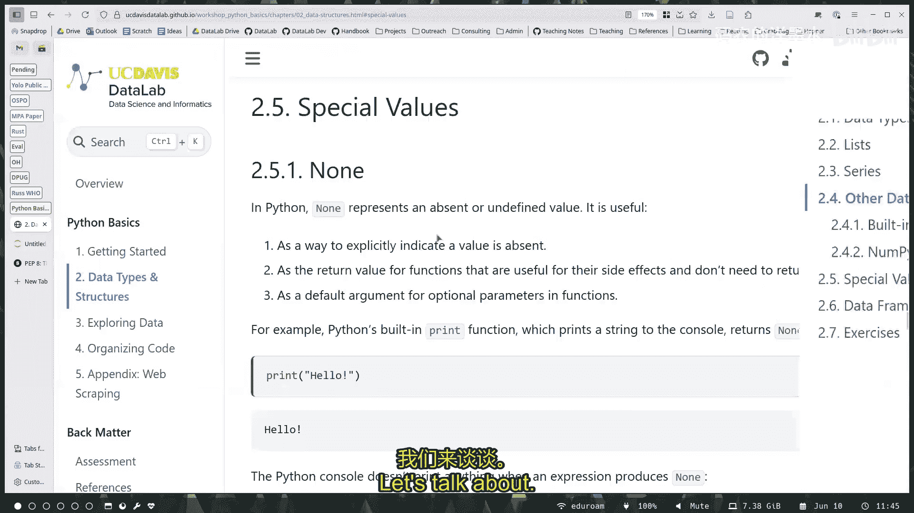

Some special values in Python。You， some values that not where I want to be so values that don't quite behave like。

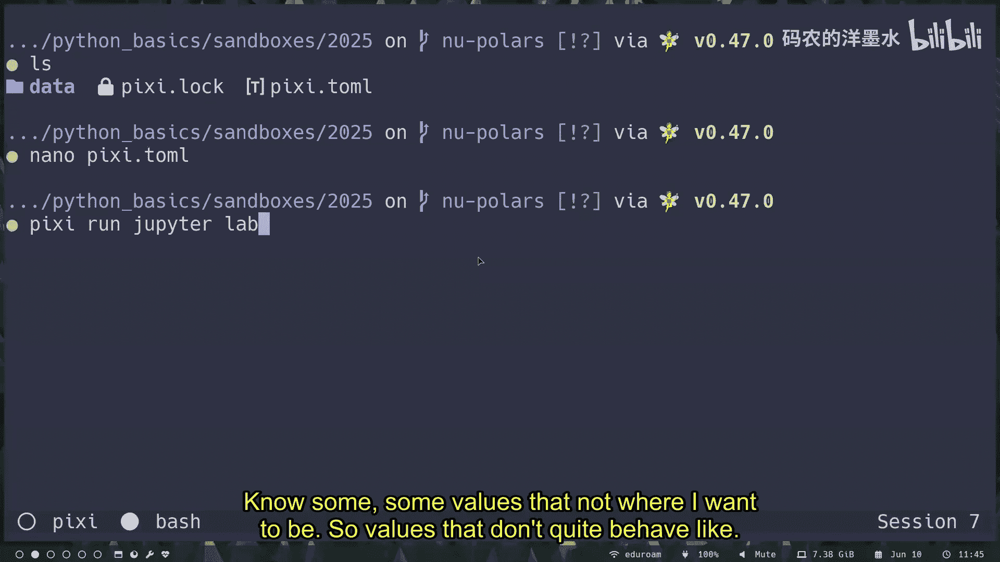

Other values， the first one we're going to look at is called none。It held special business。系为咯。

The nun value sort of represents the absence of a result， if you've used R。

 this is the equivalent of null and R。This is often the result of a function that sort of does some computing but doesn't actually produce an answer。

 so for example， a function that you might use that doesn't produce an answer is print right print we use print because we want it to print something out。

On the command line or on in our notebook， but it's not actually returning anything if we say ay fulls print of high。

Okay， then we try to look at x， nothing there right if we look at the type of x。

 tells us its the nun type because it turns out that we got a nun。

From print right to print it's we use it for its side effect right and there's other functions like this too that you just use for a side effect and they potentially return。

哎。So the nu sort of represents the absence of a value。Is it something it's like null in R。

 but there is no null in Python so in Python none that's that's our。

Or it's like nuL in other languages too， so if you use other programming languages。

 it's similar to Nll there as well。Okay。The default in Python。

 if you have a function that returns the nun。Or a command expression that returns a none it doesn't thislateating。

 so that's why when we。When we just type our X， it doesn't show anything in the same if we。

That doesn't show anything okay。嗯。The nonen is sort of unique value in memory。

 so if you want to check if something is none， you can actually use is none。对。In most cases。

 you can also do this， but。The recommended way to do it is。

The byython documentation they don't know exactly why they recommend that。

 but that's what they recommend。嗯。Okay。So that's the nun value you might run into it occasionally。

Think。I also want to talk about。Something else that we have in our turns data set so let's see if we look at turns let's look at the the first few rows of turns and i'm going。

Briefly make this a little bit smaller so that I can sort of see what's going on here。Okay。

 and we're going to。Go down the columns for a bit until we get to non fd eggs so we're going to look at the non fd eggs following you can look down this following you can see there's some numbers in here is supposed to be the number of eggs。

 I believe that that died somehow but not due to predation。对有。You can see there's nollles。系い。

So this is our missing data type in polars if you're an R user， think of this as the N value。Okay。

 null is the NA value to the lower case。This only exists as part of polars。

 okay it's not built into Python， it's only part of polars。

 but you'll see it in series and data frames， you won't see it outside of those。嗯。

If we try and get one of these elements， so like if we try to get maybe。

This element is the nonbed eggs som and it's in row two， it looks like。

So let's try and get that So if we say turns square bracket。

 another way we can use this indexing operator， we can say a row number。

And then the name of a column。What the comma in betweens？

It should be familiar if you're an our user and see what did I。I think I went oh， I went one too far。

 so row two should be。So you can see nothing gets printed out。

 the nule is getting automatically converted to a nun when we try to extract it this way。

And you can actually check。可个。This thing。嗯不懂。是。Right。

So when you see these nules in a data frame that's telling you that there's missing data generally the reason for that missing data well it depends on your data source。

 so you have to go and look at the documentation for your data and figure out why is the data missing is it something that they just didn't record was there some kind of data entry error you can also sometimes need maybe look at your code to make sure that you're not converting it to a nule somehow。

 but it's。You have to figure it out from the data there's not anything you can do in Python to tell you why it's missing。

It the property of the data。对。All right， so that's the null value， the missing value。嗯。

You can so let's maybe look at one more thing about this。So if you make a series。With a nun in it。

They that gets converted to a null automatically， but same as when we tried to access a null。

 it got converted back to a nun。So if you want to insert Knows into your data for some reason。

 then this is how you would do it you use up。嗯。If you try to do math？On the missing guard。

Get back in the same value。M this should be familiar if you're an art user。嗯。

The idea here is that we don't know what the value of null is， it's an unknown missing value。

 so we can't know what the result of adding one to it would be。Right。No。So these missing values。

 they're contagious， they sort of spread as you do different mathematical operations。嗯。嗯嗯。

we're on track Okay， so there's also special values for infinity and for something called not a number let's look at one of those so if I do P that series。

嗯。Let's do 10。Theided by zero。嗯。This gives us infinity。

The idea here is that as we divide by something smaller and smaller and smaller。

 our result is getting bigger and bigger and bigger if you imagine what that looks like as you provide a term offinity get lots to go all the way to zero then to get the result that looks like infinity。

没以。嗯。Likewise， if we try to。嗯。Divide zero by zero。That's just not defined。

 so we get this NAN value which means not a number。

It's mathematically undefined results and you'll get this from doing things like dividing zero by zero or trying to compute the log of a negative number or other things like that。

But it just not， they won't have a mathematical definition。嗯。So。

Just be aware that these things exist there are functions and methods and polars that you can use to detect these things。

 there's things like isO and is NAN if you want to check for these things there's some examples of that in the reader if you want to see what that means。

But those are our four special data types in Pythons， so we've got infinity， not a number。

 null and none。Okay， any questions？Okay。So in our last。Seven minutes or so。We' are going to look at。

A little bit more about looking with data frame we're going to see more of this in the next session because you're also going to need to do some of this stuff to make plots and keep aggregates of stuff as we sort of explore the data。

 but we're now we're going to turn to focusing on the data on the data frame that we loaded。

So the first thing we're going to do， we're going to look at another way to。Select columns。嗯。

And so if we want to select a column we already saw one way we can do this。

It can do square brackets and that gives us a column that gives us just one column if we want to select more than one column。

 then instead what we can do is turns dot select。对， and then。

Maybe we want two columns so we say here and site name。对。

That's how we could get multiple columns you can also use this with just one if if you want so like you could select this way when you use the dot select you're getting back a data frame even if you only select one column so if you need a data frame instead of a series。

 this is one way you could do it。对。嗯。See letll make sure I don't drift too far from the notes。没。对。So。

There's another way that you can do this as well。Let's just look at this so we can say turns。 select。

And then you can use this special function P。com， and I'm going to show why you would want to do this in a moment。

 but you can also select the columns by putting them in this P。call function。LetSee。

 what did I break？So。Yeah， they see it， thanks you。对。on the screen。

So you can also select things this way， let's just look at the head of this so that you're not getting such a huge output。

热。And the reason you might want to do things this way is because this will let you do all kinds of manipulations to the columns like maybe we want to do addition to the column or we want to divide something divide the column by something so for example。

 if I want to divide year by 10 and also get back site name I can just put that in there if I try to do this with the version we saw before where we're just using strings without P。

 callll that won't work it'll say what do you mean dividing a string by 10 right？完来了。

But we can do this and then we can do operations on our columns Okay so that's why you would want to view this field all and in fact。

 if we know that we're only going to be doing something to year。You could just leave appeal。

 callll off of site name， we just want site name but we don't actually need to transform it somehow。

You can see that。Sa ourselves thank you。So this P。com lets us make what's called a Pol's expression。

 and that's a way that you can do computing on the columns。Okay。No。

And you're always going to be using this PL dot call inside of either select or another function。

 another method。Very similar to select called with columns turns。 with。Plums。

And the way with columns works the inputs are the same right you put names of columns or operations on columns so like we could just grab this。

inputs are the same， but the output's going to be a little bit different because what this does instead of giving us back just the columns we selected。

 it gives us back the columns we selected in in amidst all of the other columns。

So if you want to say transform a column， but keep the rest of the data， you can use this。

And in fact， if we're not going to do anything to site name， we're not going to transform it somehow。

 we would probably not even want to up that。I' just saying。

 give me back the data frame where we've taken the year column and divided it by 10。

But keep the rest of the data frame intact。Okay。Does that make sense the difference between these two。

 select when you just want to get specific set of columns with columns when you want to transform those columns within the context of the whole data frame？

Yes， and this case we don't have to convert anything you do not because yeah。

 so this is this is basically letting you access the series inside the data what this P that Paul is doing to us Okay so everything in the conference is already as a yes not only right yes we've got it exactly right。

And you can do multiple transformations to things here。

 so maybe I also want to do something to the total nest variable so OL what call。この？Yes。Its three。

 right？You can you can have as many transformations as youd want general you want to if you're going to do a bunch of transformations。

 it's a good idea to put them all in one call because pullers will run them in parallel if you do that。

嗯。So that's how you can use this。We'll say more about this after lunch。

 but I think we're at a point where we need to stop so i'm going to go ahead and stop here question yeah。

bs it's just showing you the results if you wanted to save the result you'd have to use assignment you know。

Okay， and we will break for lunch is I think the food is here no okay yeah so the food is here。

 we will eat lunch and then we will come back to looking at more data and data visualization stuff。对。

对。So we're going to start the recording from this point。

So we are talking about how to filter rows and if you want to filter out some of the rows in your your data frame。

 then you use this filter method and the way this works you again are going to。

Name some kind of column。 So like P dot call。 let's maybe get all of the the rows where there were less than 10 nests。

 Okay， so we'll say P dot call total。Nests。Less than10。And this is just saying。

 give me back all the rows。All the roads were the total number of mess with them。Good。

we can sort of scroll and see what we've got here and unfortunately I can't keep the code on the screen when I scroll and I'm to try to go over to total nests。

If I can find it there it is， okay， yeah， so you can see we've got totalness3 totalness5 total。嗯。

So this is how you can filter out roads and you can sort of use a mix of these things like we could filter and then we could add a dot select here if we wanted to select some columns after that。

That's an efficient way to do things if you chain things together like dot filter。

 do select and then some more commands， pullers will try to figure out the most efficient way to compute that result。

Mom。She。Okay， so this is this is how you would do filtering you can combine conditions when you're filtering so if you wanted to to combine。

Another condition instead of using Pythons built in and and or。When you're using polars。

 you have to use either a vertical bar。我我。Or an ampersand for now。

And this is down to a limitation of Python that there's no way for polars to define what and and or should be doing if they're in parentheses。

And so instead they use the and and the vertical bar。And so if I wanted to have another condition。

 I could say P。com。Maybe we want。Let's see。Let's look at the data again for a second。

Maybe we want the number of fledglings to be greater than five。

So we'll say FL max the maximum budget link that we're seeing。

 we want that to be greater than five and we might need to put parentheses around this。

 let'ss see yeah so if you get an error most likely you're missing some parentheses when you're using filter。

Let's put some parentheses around this。So parentheses are under our two conditions。

 and then we get back a result。This is how you can filter out。

You can combine as many conditions as you want with handle vertical bark。嗯。Okay。😊。

This is how you would get subsets of the rows。Any questions about this about how filtering works？

Okay。😊，And I think' that's where I will hand it over to Vicky yes。So。Yes。嗯。

So this was this one or earlier。嗯。Yes。Its new local state brain。No， I don't think so。

 not not through Jupiter La。There might be an extension that lets you do this。

 so people write extensions for Jupiter Lab and so someone may have made an extension that does that。

 but I don't think there's anything built in。One thing， I guess， sort of。

Something that might come up。If you。Have a really large data frame like this Dicky was saying yesterday it completeates the output so it doesn't show you all of the rows and all of the columns like you get these dot dot dots and if you want to see more of the data frame you can tell pulls that you want more of the data frame to be displayed so you can say P。

 config I believe it's TBL。Rose。And this is the number of rows that are going to get printed so if I say I want to print 1000 rows and then I say turns。

I's going to take it second and then now we get a print out of the entire data set because there's only 790 rows in this data set and you can do something similar for the columns because it also will truncate the columns if you have a lot of columns so you can say TL alls and set that to whatever。

The numberumb of columns you actually want to see。I will just least I have done something like this before and accidentally craft my notebook because yeah。

 if you try to print out a million rows， you're probably going to brush the notebook。好ello。Yes。H。

Mhmm。And I think yellow about call leader2。Make sure that you've got parentheses around everything that would be my first suggestion。

Because typically， if it's complaining that the truth value is ambiguous。

 what's happening is that you're often if you're missing parentheses around part of the expression。嗯。

If I can make it do this if I take away enough parentheses。Yeah yeah， so。

When you get this kind of error， that's this truth value is ambiguous error。

 the problem is that in Python's order of operations， it's trying to do 10 and whatever this is。

 imagine。It doesn't know what that means。Of。So what we want is we want it to be compute this and compute this and then compute it。

系。So we have to put parentheses around each part， each condition。If you're combining things with an。

 there's actually another way you can do this， you can also just use a comma stuff you。

You have several conditions that you want to apply with and， you can just put colon that also works。

You're using or， you have to explicitly and write the vertical book。The vertical bar。

 so you would have to if I wanted to do either of these instead of both at the same time。

 then I I need to put parentheses around everything against。No。嗯。Any other questions？Okay， and。

If you can take over， and will get out of the way。And we stop sharing the screen。😔，Oh let me。Yes。

Have to have that screen connected to stop sharing， I think。But is only gets continue student used。

Good， there we go。

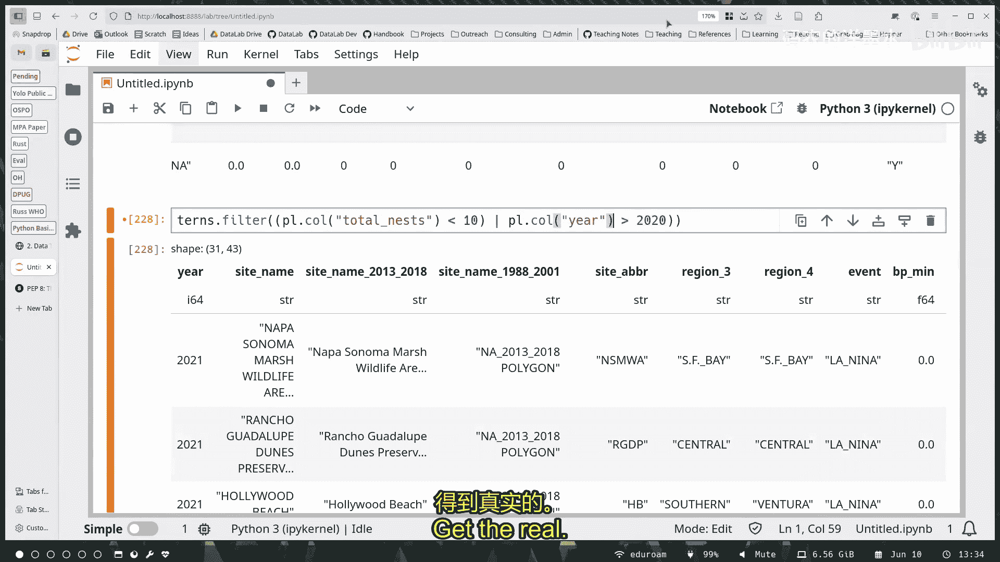

Stopshot。