# Python数据分析入门：2：数据结构与控制流


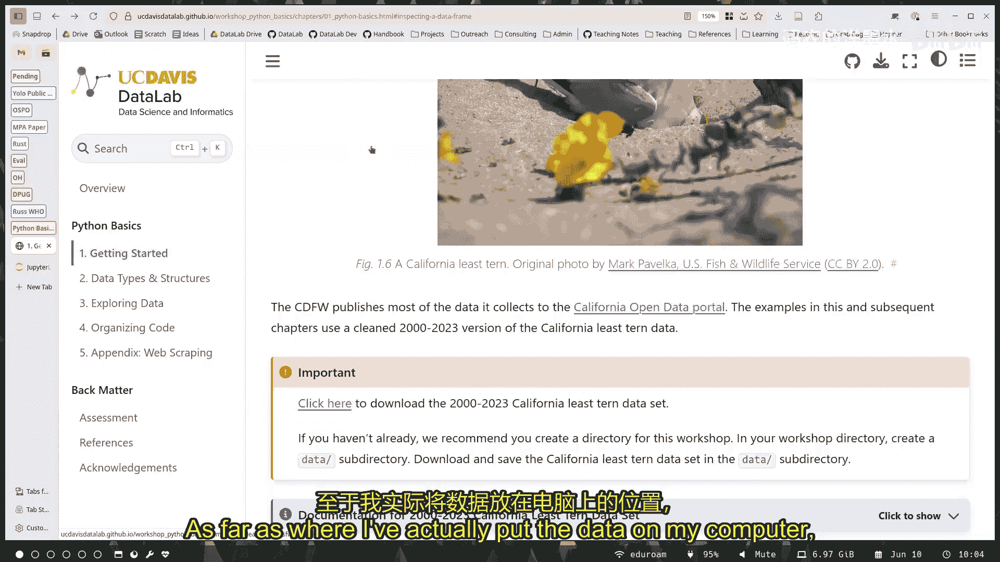

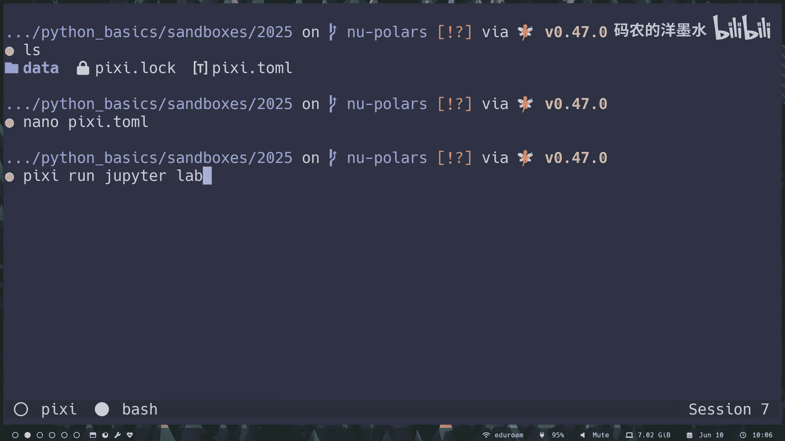

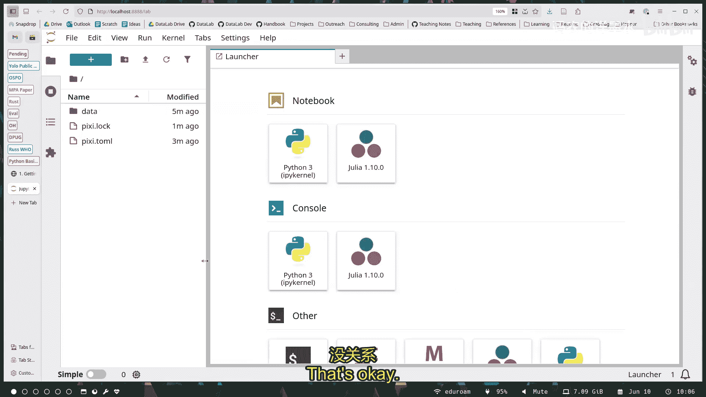

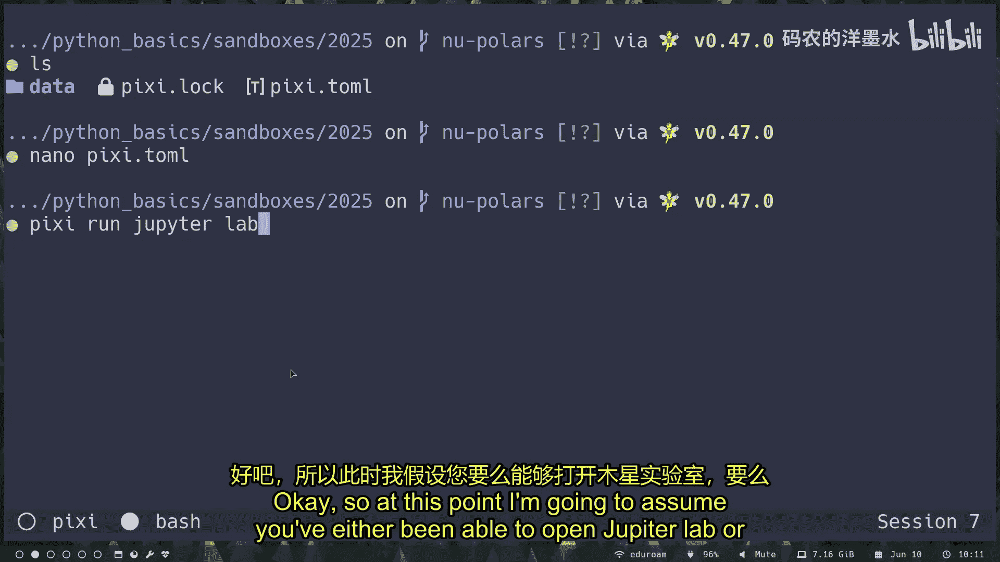

在本节课中，我们将学习Python中的核心数据结构（如列表、元组、字典、集合）以及Polars库中的Series和DataFrame。理解这些数据类型及其操作是进行有效数据分析的基础。我们还将探讨Python中的特殊值（如None、NaN）和基本的数据筛选方法。

## 概述

上一节我们介绍了如何设置环境并加载数据。本节中，我们将深入探讨Python和Polars中的数据结构，理解数据类型的转换，并学习如何对数据进行基本的筛选操作。

## 数据类型的重要性

在统计学和数据分析中，我们通常将数据分为两大类：**数值型数据**和**分类型数据**。数值型数据可以是离散的（如整数）或连续的（如小数）。分类型数据可以是无序的（名义变量）或有序的（序数变量）。

在编程中，数据类型决定了我们可以对数据执行哪些操作。例如，尝试将数字与字符串相加会导致错误。

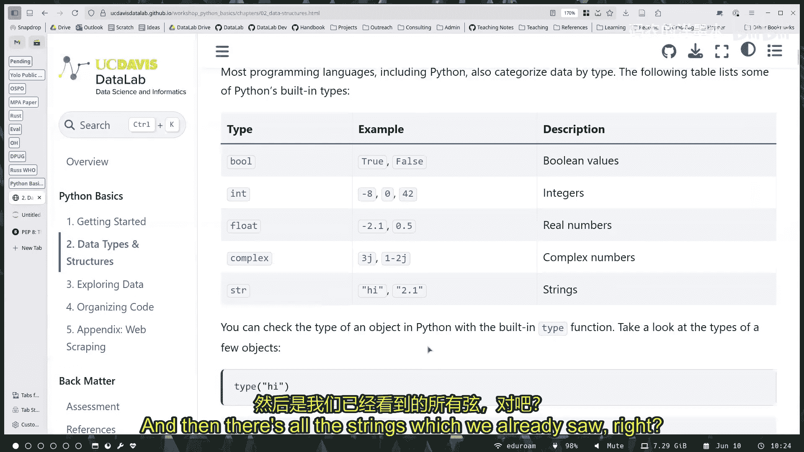

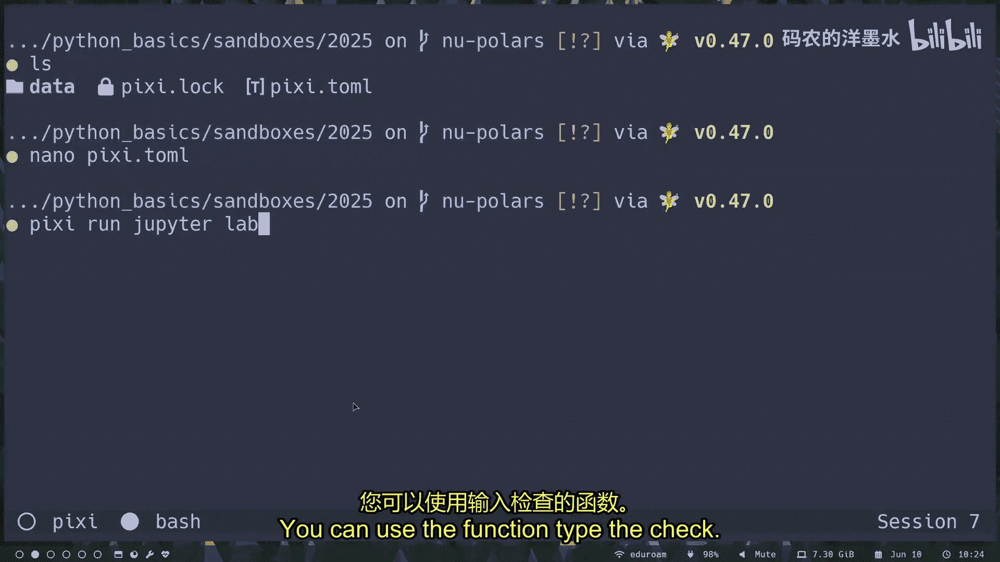

```python
# 这将导致TypeError
1 + "hi"
```

我们可以使用 `type()` 函数来检查任何对象的类型。

```python
type(4)    # <class 'int'>
type(4.0)  # <class 'float'>
type("hi") # <class 'str'>
```

## Python内置数据类型

Python提供了多种内置数据类型来存储和操作数据。

### 列表

列表是一种有序的容器，可以存储任意类型的元素，使用方括号 `[]` 创建。

```python
my_list = [5, 6, 7]
type(my_list) # <class 'list'>
```

以下是列表的一些基本操作：
*   **获取元素**：使用索引，索引从0开始。
    ```python
    my_list[0] # 获取第一个元素，结果为 5
    ```
*   **获取长度**：使用 `len()` 函数。
    ```python
    len(my_list) # 结果为 3
    ```
*   **修改元素**：通过索引进行赋值。
    ```python
    my_list[0] = 10
    ```
*   **列表推导式**：一种简洁地创建或转换列表的方法。
    ```python
    squared = [x**2 for x in my_list]
    filtered = [x for x in my_list if x > 6]
    ```

**重要提示**：在Python中，简单的赋值 (`y = x`) 创建的是对原始列表的**引用**，而不是副本。修改 `x` 也会影响 `y`。如果需要独立的副本，请使用 `.copy()` 方法。

```python
x = [1, 2, 3]
y = x       # y 是 x 的引用
z = x.copy() # z 是 x 的副本
x[0] = 99
print(y) # [99, 2, 3]
print(z) # [1, 2, 3]
```

### 元组、集合与字典

除了列表，Python还有其他有用的容器类型：
*   **元组**：使用圆括号 `()` 创建。与列表类似，但**元素不可更改**（不可变）。通常用于表示固定的一组值。
    ```python
    my_tuple = (1, 2, "a")
    ```
*   **集合**：使用花括号 `{}` 创建，存储**唯一、无序**的元素。支持集合运算（如并集、交集）。
    ```python
    my_set = {1, 2, 2, 3} # 结果为 {1, 2, 3}
    ```
*   **字典**：使用花括号 `{}` 创建，存储**键值对**。通过键来访问对应的值。
    ```python
    my_dict = {"name": "Alice", "age": 30}
    my_dict["name"] # 结果为 'Alice'
    ```

## Polars 中的 Series

在Polars中，`Series` 是一个核心数据结构，可以看作是一个带标签的一维数组。它类似于Python的列表，但**所有元素必须是相同的数据类型**，并且支持高效的向量化操作（广播）。

从DataFrame中获取一列，就得到一个Series。

```python
import polars as pl
turns = pl.read_csv("data/least_terns.csv")
year_series = turns["year"]
type(year_series) # <class 'polars.series.series.Series'>
```

以下是Series的一些关键特性：
*   **数据类型**：使用 `.dtype` 属性查看。
    ```python
    year_series.dtype # Int64
    ```
*   **广播**：数学运算会自动应用于每个元素，无需循环。
    ```python
    squared_series = year_series ** 2
    ```
*   **创建Series**：使用 `pl.Series()` 函数。
    ```python
    new_series = pl.Series("my_numbers", [1, 2, 3])
    ```

### Polars 数据类型

Polars定义了自己的数据类型（如 `pl.Int64`, `pl.Float64`, `pl.Utf8` 等），以优化内存使用和性能。例如，`Int8` 使用8位存储，范围是-128到127。默认的整数类型 `Int64` 范围大得多，通常足够使用。

将数据转换为正确的类型（特别是分类数据）是数据分析的重要步骤。

```python
# 将字符串列转换为分类类型，可以节省内存并提高分组操作效率
turns = turns.with_columns(pl.col("site_name").cast(pl.Categorical))
```

## 特殊值

在数据分析中，我们需要处理一些特殊值。

*   **None**：Python内置的空值，表示“无”或“空”。常用于函数无返回值时。
    ```python
    result = print("Hello") # print函数返回None
    ```
*   **null (Polars)**：在Polars中表示**缺失数据**，类似于R中的 `NA`。出现在DataFrame或Series中。
    ```python
    # 假设 ‘non_fd_eggs’ 列有缺失值
    missing_val = turns["non_fd_eggs"][2] # 可能得到 None
    ```
*   **NaN (Not a Number)**：表示未定义的数学运算结果，如 `0.0 / 0.0`。
*   **Inf (Infinity)**：表示无穷大，如 `10.0 / 0.0`。

这些值具有传播性，任何涉及它们的运算结果通常也是特殊值。

## 数据筛选与选择

现在，让我们应用这些概念来处理我们的数据框。

### 选择列

使用 `.select()` 方法选择特定的列。返回结果是一个新的DataFrame。

```python
# 选择单列或多列
selected = turns.select("year")
selected_multi = turns.select("year", "site_name")
```

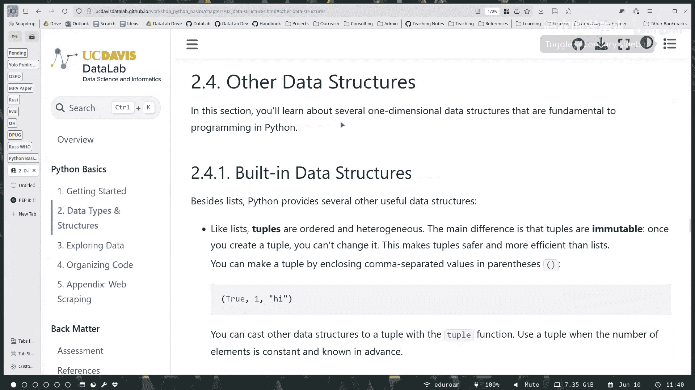

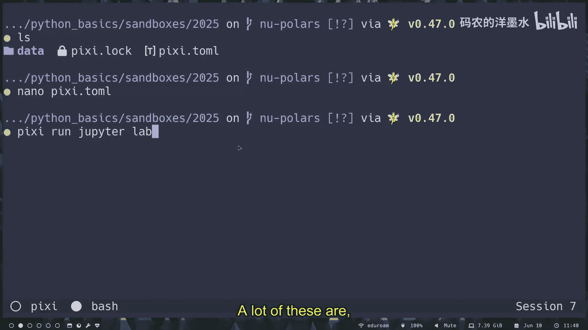

要在选择列的同时对其进行计算，需要使用 `pl.col()` 创建表达式。

```python
# 对‘year’列进行计算，并选择‘site_name’列
transformed = turns.select(
    (pl.col("year") / 10),
    pl.col("site_name")
)
```

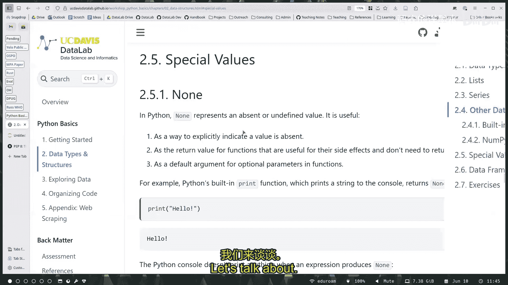

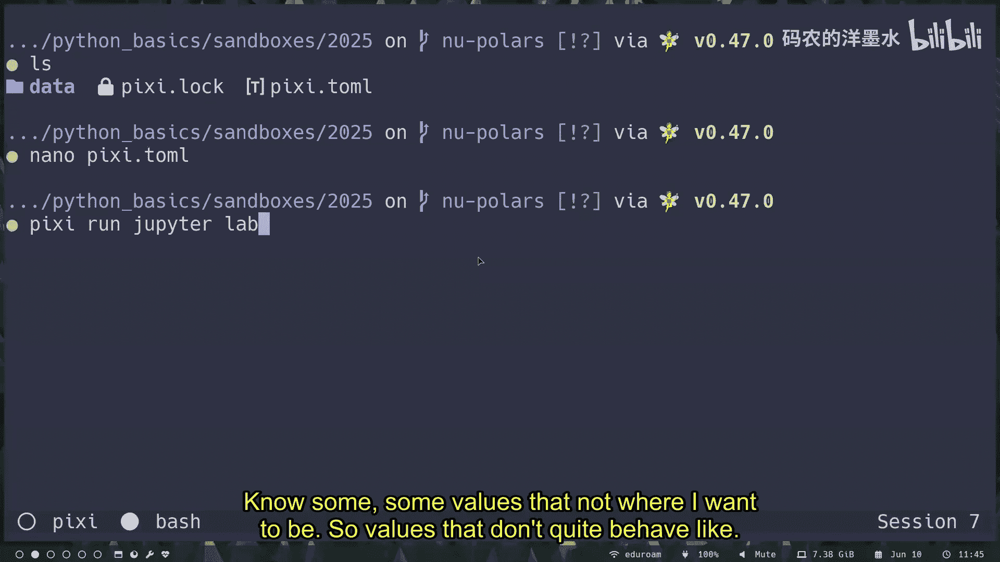

### 添加或转换列

使用 `.with_columns()` 方法。它在保留所有原有列的同时，添加新的列或替换已有的列。

```python
# 创建新列‘year_decade’，并保留所有其他列
turns_with_new_col = turns.with_columns(
    (pl.col("year") / 10).alias("year_decade")
)
```

### 筛选行

使用 `.filter()` 方法，根据条件筛选行。组合条件时，使用 `&` 表示“且”，`|` 表示“或”。

```python
# 筛选 total_nests 小于10 且 fl_max 大于5 的行
filtered_data = turns.filter(
    (pl.col("total_nests") < 10) & (pl.col("fl_max") > 5)
)
```

可以链式调用这些方法，Polars会优化执行顺序。

```python
result = (turns
          .filter(pl.col("year") > 2010)
          .select("site_name", "total_nests")
          .with_columns((pl.col("total_nests") * 2).alias("double_nests"))
         )
```

## 总结

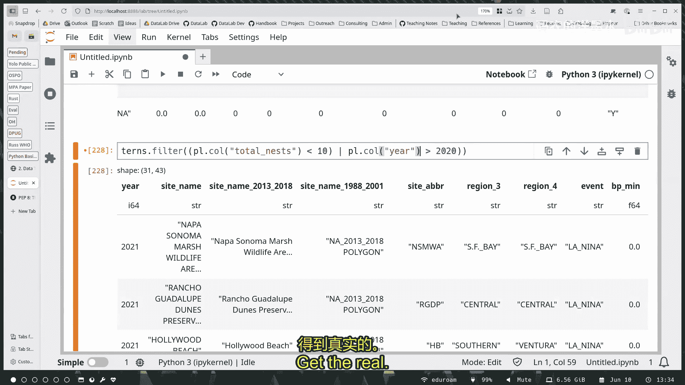

本节课我们一起学习了Python和Polars中的核心数据结构。我们了解了列表、元组、字典、集合等Python内置类型的特性和用法，重点掌握了Polars中Series和DataFrame的创建、类型转换以及基本的列选择与行筛选操作。理解数据类型和这些基本操作是构建复杂数据分析流程的基石。下一节中，我们将利用这些知识进行数据可视化。