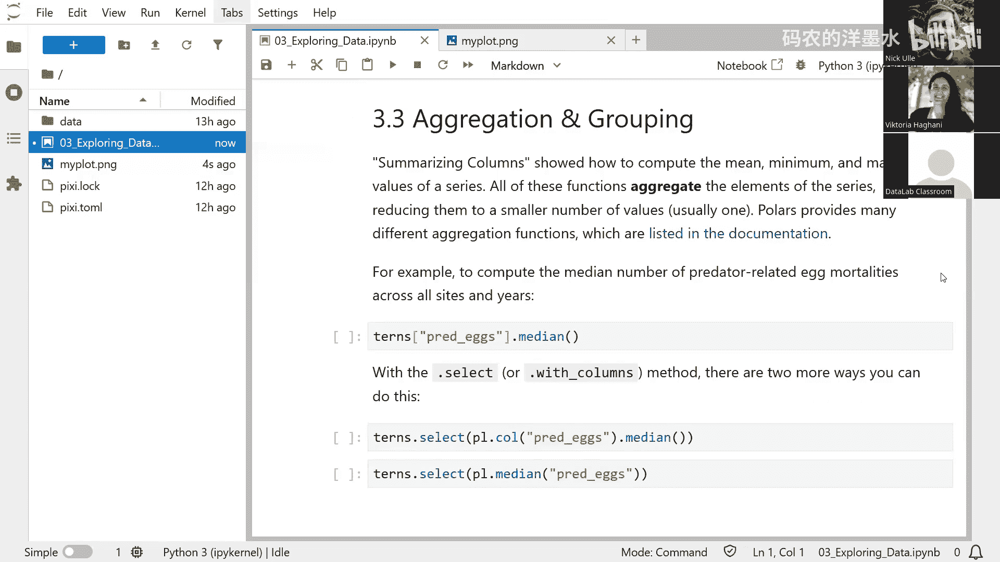
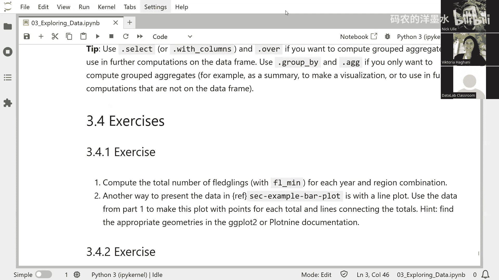

# 【全集】加州大学戴维斯分校 Python数据分析入门 中英字幕 1080P p03 Lecture 3 - pandas入门与表格数据处理 -BV1AK6vBqEei_p3-

そ。

Place the put in， but yes。嗯。Okay。对。All。Let me plug in my old it means that。All right。

So I know we have some users in R here but I quickly want to see has anyone ever seen a paper you've just looked at some sort of scientific paper and seen some of the figures and been like that is a complicated figure how do they even make that Yeah yeah so it's really common and any situation where you're working to write a paper you want to be able to visualize your data and the visualization aspect is really important you want to create things that are meaningful clear to understand so that if you're sharing that visualization for publication or in a lab meeting presentation at a conference all of those things are actually informative and they're helpful visualizations that aid in what you're trying to present。

So my focus for this session is going to be a lot on the visual aspect of working with the data now that we've been able to select the data。

So one of the things for some of the goals for the lesson。

 we want you to be able to list and describe some of the popular visualization packages。

 actually prepare your data for the visualization step， describe the grammar of graphics。

 which our users might be familiar with。And then use the grammar of graphics to produce a plot so our goal is just to take all of this information and make really nice plots out of our data。

So in terms of visualization packages， depending on what language you're using。

 depending on what data you're working with， there are so many different packages that you can use for visualization and there's really no right or wrong。

 it's whatever works for you and is conducive to making a plot that looks good for you。

But among some of these examples are a mapplotlib。 So a Maplotlib is a super popular library and Python from visual station。

 It's on the more basic side， but it is very flexible。

 So you can do all sorts of things with Matplotlib。

 And oftentimes if you're going through a Python visualization tutorial。

 it's probably using mapplotlib。😊，But it's probably not your primary if you're trying to create something complicated。

 so there's some other stuff that we're going to be using in particular today we're going to be using plot nine。

So plot9 for those who use R have you ever used G plot Yeah。

 so plot 9 is basically a Python wrapper for G plot like same syntax， but we get to run it in Python。

 so that's going make it a little easier if you've already worked with G plot and underneath it's just kind of working with that G plot grammar of graphics。

 which I will explain what that means。Another visualization you can use is seaborn so seaborn makes some pretty heat maps。

 there's also other ways that you can do that， but generally there's all sorts of packages polarers plot nine map plot lib。

Generally， whatever works for you and what you can use consistently to make plots that you can make nicely。

So in terms of grammar of graphics。Because plot nine， which is what we're using today。

 is a clone of G plot。I want to quickly mention the GG in GG plot is grammar of graphics and the idea is that visualizations are built up in layers。

 so your plot is layered so that essentially every plot has at least three layers。

 The first one is your data layer so it needs to know what data you're plotting。

The second is the geometry。 So this is the actual visual aspect。

 How are you displaying the data physically in this plot like are you doing a line。

 are you doing a bar plot like what type of plot are you working with and then there's the aesthetic So this is making your plot pretty What colors might you be using how do you want to display things in your plot And so there's definitely some overlap here that we'll get into but there's some layers in the plot and we kind of have to build up these layers when we're trying to visualize。

So there are some optional layers and this entirely depends on what you're trying to do。

 So some of those plots you see in those papers that are super complicated might be adding annotations where it's not really mapped to data。

 but they're trying to create like colorful blocks or something on the outside of the plot or squares around certain things there's all sorts of layers that you can add into your plots for visualization purposes。

 But ultimately the goal is that when you're creating a visual you're not adding stuff that's not helpful to the plot。

 you're keeping it simple but informative and you want somebody to be able to look at it and take away information from it without having to explain in like three paragraphs what's going on。

 So being able to do these meaningful visualizations is a super important skill。

So first we're going to start by importing plot9， so I believe we installed plot 9 yesterday during Pixie installation。

 so go ahead and try running from plot9 import GG plot。

So in Python you can actually import the entire module or you can import certain functions from within a module。

 so in this case instead of saying import plot 9 we're saying from plot9 importggpl and what this means is instead of writing P。

ggplot every time we want to run something so essentially yeah rather than writing like plot 9。

ggpl you're able to just run Gplot as the function itself。So。😊。

Another way that you can do this in addition to just importing G plot from plot9 is you can also just say from plot 9。

 import the wild card， which is everything。So a quick note of caution on this or plot 9 specifically。

 it is designed to be imported this way。 You usually should not do it this way because when you're doing import everything。

 any variables that they have named in their module that they created are now overr whatever you have in your code。

 So if you happen to have a function or a variable of a name and they also had one in their code。

 it's overr what you're doing。 So generally you're not supposed to do that but this package was written with this intention。

 So just that allows us to use functions in G plot like we're actually using G plot。

 So it's okay in this case， but typically you'd want to do something like this where you're either importing things directly or importing the module。

 but you usually wouldn't say from plot 9 import everything。

So everyone should at this point have plot9 imported。

So I also want to mention briefly plotting in Jupiter。

 So I know yesterday I talked about why Jupiter is really powerful so a lot of times having an interactive interface when you're working with code is helpful so I spend a lot of time rather than just running things that are computing in the background I spend a lot of time interacting with data a lot of my time being like okay one of my previous students and labmates is here and remembers I spent four days making a heat map one time like it just takes a lot of time playing around and every time you change a line you want to look at the figure again and when you're doing that at the command line it's kind of hard to want to open a script。

 edit one line， close it， run it， open up your visual so having something like Jupiter is just helpful because you can display all of it in the notebook with you and you could just run it interactively。

So we can in cases like if you're using matplotlib set parameters for the default size in Jupiter so matplotlib is a super popular package to use so quickly just want to make sure。

There's going to be some kind of complicated code we're going to be running in this section。

 so I encourage you if you haven't already to open the reader because it'll be easier to copy and paste with the syntax from the reader。

 but I'm going to go ahead and break down what every line means It's just going to be a little easier compared to typing everything so that you can listen and understand what's going on。

But in this case， yeah， so we've import imported plot9 as P9。

 so this time we're going to actually import it as P9 so that you can use the same functions I'm using。

And import Matplotlib。piplot as PLT。And then this parameter here is setting a specific figure size so that whenever we make a figure and are printing it in Jupiter。

 it's a standard size。 So this is nice because you there's times where I've tried to generate a plot and all my axes are messed up。

 It's trying to force it into like a specific window size and Jupiter。

 So this just helps us adjust so that we set our parameters at its commandline or at the notebook。

Yes， similar to the second line where we are only importing one function from macro could be also done in for plot9。

 so something like in both。Block9 yes， and we ran that earlier， that's totally fine。Yeah，Yeah。

 numbers in thats door。Import plot 9 dot Gz block。I'm last back through。

It might work if it's an attribute， but I think in order for you to access the attributes。

 you might have to import it first so then it can see the attributes so I think you might have to specify I mean you can try it and see but I'm not sure if itll work。

So yeah this is setting the parameters for our visualization as we move forward。

So now that we kind of have our packages imported， we have our parameter set to go。

 we're going to actually start to get to plotting。So the first layer that we're going talk about is the actual data layer so the data layer is taking whatever data you have and usually you're going to have it in some sort of data frame and you're going to use that to make your plot So a quick note about something called tidy data so typically when you have a data frame you want to have it in a tidy format and what that means is that each variable or feature is in its own column each corresponds to a single observation and each value has its own cell so you don't have a bunch of stuff stuck in one like Excel cell for example。

 So the reason that this is necessary for the sake of coding is because these rules help us make sure that data frames are really easy to read and access but also index so Nick was mentioning when you're working with data frames it's almost like a list and you're trying to access those elements So if you have a bunch of stuff kind of stuck together it's gonna to make it。

realal bad time when you're trying to plot。So being able to have nice。

 clean data is really important。And there's a whole bunch of documentation online about what it means to have tidy data。

So I believe the reader actually has a little link as well， so you can also look at that。But we。

 for the sake of this workshop have already made the data tidy so you don't have to worry about that today。

 just keep that in mind for when you're collecting your own data in the future。

But in order to set up our first layer， what we're going to do is run GG plot turns and turns our object that we read in from the CSV。

 so go ahead and run that。And what you should see is this beautiful， empty plot。

 And that's because we haven't added anything other than the data to it。 So remember。

 I said that we're going to build this plot up in layers。 So we have only added a data later。

 but we haven't added geometry。 So we haven't told it what to visualize or how to visualize it。😊。

So we still need to build up moving forward。So here you should have a nice empty square。

So this is our data layer。 Now we're going to move on to the geometry layer。嗯。十。You。

So the geometry layer， or it looks like there's a few questions。

 we'll take a pause here if there's any questions that might be helpful for everyone。Yeah。

 it's just going back a minute when importing bought nine， okay， so we imported。

GP plot and plot nine and later on we imported plot9 as he9 so why do we have those suit lines why not just import these plot9 as he9 and then that carries with the you absolutely can it's I wanted to demonstrate different ways you can import and what implications there are associated with importing yeah。

T got there， so I had from nine and。Theres anything else that we have to say I think you maybe that and then this section where it says Mattpllib as PLT。

Yeah，Okay。Is it onearrowarrowarrow Okay， I think that's， I had that issue as well。 We actually had。

 I didn't know if that was like a meat issue。 So it might be maybe a Windows thing Okay。

 so if that's the case， that's actually why I have this here。

 we're gonna need to go into Pixie and add pi arrow So everybody at this point。

 is that the error you're happy。 Okay， so at this point， we're gonna take a step back。Everyone。

 go to your command line where you have Pixie and remember don't exit out the Jupiter one because that's going to kill your notebook。

 just open a new command line and navigate to the directory that you have Pixie in。And remember。

 as a brief reminder， C equals change directory。嗯。LS。Lists directory contents。嗯。And PwD。

Prince working directory。So you want to go to the directory using CD that you have all your Pixie stuff in and wherever you have your Pixie。

tel file， which you can check that it's there using Ls。

 get to your Pixie Tmel file and then run Pixie a Pi arrow。

I found't you pray directly and speed my woman。毛中哪啥。たま前半まブらし。咁条片啦呢你。嗯，那师知道。嗯，应该是这个。

You have to do this in the command line so open whatever console you're using the terminal and remember。

 don't close out the one that you open Jupiter in just open a new window for your terminal。

And then sorry， when you do this in terminal， you know to refresh something in order for it to recognize it。

 No， I think once once you have run this and it shows that it's installed。

 if you rerun that command it should work or you need to import it。啊，嗯。Yes， I'll say no more。Whats。

That as you thought it yeah， so here when you're importing， final listen。

Just saying no like let's try this one again so you should empty it。re well。

 it's in my main directory that includes celebration，So。And also I get okay，'ll this thank。

' for protection really I'm noticing that for some people who've already installed pi arrows。

 even when they're trying to import it saying it's still not found， restart the kernel。

 you can do so by coming up to this kernel tab。And restart kernel。

 You will have to read in your data again So that line that says like turns P L dot read C SV。

 and you're going to need to import your modules again。

 But that should register that you have pi arrow installed。嗯。啊。You think你 should right right。いや。哦。

啊Maybe上 check。嗯。です。Yeah。very。then different important just like about that add like the new and important it looks like。

then I'll think about for a second I don't know how you。即啲理。All right。

 so I think we're all up to speed enough。😊，So just to confirm。

 everyone should be at a point where now if you run the。Gi plot turns， it gives you this empty plot。

This is a foundation for everything we're doing moving forward。

 so I need to make sure that everyone has a blank plot。Okay。Yes。

 to the and show that line where you will set the size on the target Yeah。

 so it's just a parameter here。We didn't I don't think it's strictly necessary it's more of an optional thing it's just so that if you want to see it a certain size in your screen it'll do that。

It won't break your computer， we're not working with big data now。O。So we have our turns data set。

 So now circling back to grammar of graphics。 So we have different layers that we need to build our plot。

 This is loading our data layer， but we haven't added any instructions for how to visualize the data or even what part of the data to visualize。

 We have just passed in an object to it for visualization purposes。

 So this is why we get a blank plot。 It's like， I don't know what you want me to do。

 I did what you did。 I created an object with the data。😊，But we need to give them more instructions。

So moving on to the next layer for geometry， the geometry layer actually tells us what kind of plot we're making。

 so are we making a bar plot， a line plot， a scatter plot， how are we visualizing this data？

So this is really similar to like outright just G G plot notation。

 however you want to visualize it starts with Gm underscore something。 So if it's a bar plot。

 it's Gm underscore bar in this case， since what we're going to try to visualize is an X axis y axis one variable on each side and plot some stuff intersecting。

 so for our purposes， a bar or not a bar plot， a scatter plot is appropriate。

So we're just going to have this point here。So Gem underscore point。

 this tells us that we're going to have a scatter plot because it's going to plot little points for us。

嗯。So in Ggi plot or I guess in plot nine here， anytime you're trying to add a layer。

 you quite literally add the layer， so we have our data layer， which is Ggi plot turns。

And then we add Ge underscore point， so we've now told it。

 take turns and add a data layer or add a geometry layer。Now， as you see。

 this is going to throw up some issues for us and going back to the areas are typically really informative。

And if we scroll down to that error message， it says Jang underscore point requires the following missing aesthetics。

 X and Y。 So that makes sense， right， We're trying to make a scatter plot。

 but I didn't tell it what to put in the scatter plot。 I just gave it a full data frame。

 So it's telling us， I don't know what you're talking about Vicki。

 I need to give me some X and Y axes here。 So we're going to go ahead and do that。

So you can add multiple geometries and we'll kind of touch on that a little later。

 but for now we're just going to focus on building up our plot layer by layer。系。

How different error that what is your error。Okay。That error makes a lot of sense， but I don't know。

It might be one of the imports。嗯。We did。bs嗯。Mo graphics， plot9。

Does it tell you that there's a package it's related to does it say like or does it just say it's not found？

Okay。ま大丈。わさね。After。Do you still have the code saved that we ran before because we have like various import lines I don't know it which exactly maybe try running like from plot9 import G G plot from plot9 import star。

 maybe just try importing some more stuff and different notations。Okay， yeah。

 try maybe doing from Flt9 importm star。Yeah for this line， so this is what we should be importing。

So now that you've restarted your， restarted your kernel basically erases everything you've done。

 so you need to reimport and reload all your variables into the environment。

Different ways to fight is helpful， but its yeah， yeah， so when we if we just import plot。

Yeah so I think I think so， So I think by doing front plot 9 import star I believe that's sounds supposed to be that makes。

 everyone import'm for plot 9。tryingello're。Like point is not found。doing to fixing。Okay。

 good errors， all right。I will talk about that I think in literally the next step up if you want to fix it now。

 just put parentheses around the whole box the the parenthe however you want。

Yes one thanks very welcome。Okay， so you should have imported plot 9 is star Now that should be fixing whatever issues we're having with geo point not found。

So now you should be able to run your G G plot turns and get a blank plot。And then at the next one。

 when we add G underscore point， you should get an error。

 but this time it should be the error that says。Gome point requires the missing aesthetics We're。

 okay， I'm seeing some nods。Dang， this is recreating an error， okay。Alright， so yeah， at this point。

 just to recap since there's being some disconnect here layer one was our data layered。

 Now we're adding our geometry layer。 But for geometry， if we're making a scatter plot。

 we need to tell it our X and Y axes。 That's why it's yelling at us。

 It's saying I don't know what you're talking about because I don't have X or Y axes。

 You gave me a whole data frame。😊，So we're going to actually have to build this up with another layer in mind to kind of correspond to the geometry layer。

So this is called our aesthetics layer， so the aesthetics layer kind of bridges the gap between your data and your geometry layer。

 so this helps map the features in your data like the actual features in the data， the columns。

 the variables you're using to the geometric aspect it bridges the gap between data and making your data look cool。

So usually what you do is have this aesthetic function where you have aesthetic equals some sort of feature。

So what we're going do is since it was yelling at us about having an X and Y。

 we do have to give it an X and Y。 And a quick note here。

 But you see how I'm putting parentheses at the beginning and end of this。

 all that means is that I can separate this stuff on different lines and it's not going to yell at me。

 So this helps me separate it out。 So if you want to do this。

 you can say it allows you to kind of comment on each line， whatever we're doing。

So that's all that parentheesis does because otherwise， if you don't have it on the same line。

 it's going to say it's going to yell at you for something。So putting those parentheses。

observation and because we're plotting two variables BPp min and total nests it's taking the BPp min value and the total nest value in the same row because that's a paired set and plotting the intersection of that so that's what's being plotted here and that's kind of the importance of having your data organized nicely too。

So you might be looking at this and say， all right， we did color as event and shape as event。

 which looks a little bit redundant， but just to quickly highlight if somebody is colorblind and they're looking at this and all you did was color。

 it might not be very easily distinguishable， so having the shapes here even though it might seem redundant is helpful because now you have two ways that you can look at the data and parse it out just looking at it。

So at this point now we're just messing around with making our plot look pretty。

 So we've given it some color。 we've given it some labels。

But now let's say have you ever seen those plots where some of those points are labeled at different parts。

 we can go ahead and add labels。So if we want to add labels。

 let's say for every single one of these points， we want to see what year that point corresponds to。

 And maybe this isn't for publication purposes。 but maybe you're looking at this and going。

 this is really an outlier。 What date， Like， where is this from。

 So what we can do is in our aesthetic layer。 You should have the X and Y， the color and event。

 We're going add a label called year。And remember that all of these labels that we're using in the aesthetic layer are coming directly from our data frame。

 because we're telling it to use the turns data frame。All of these are parts of our data frame。

 These are the column names。So we're going to call a label as a year。And if we want to add a label。

 we also have to add a geometry element that matches the aesthetic that tells it that they're also going to be text on the plot。

 so because we're adding a text layer with the labels。

 we also have a geometry text layer that we need to add to make that work as well。

So once you've added your label and your geometry text layer。Once you click En。

You should now see a hot mess of a plot with labels all over it。So as I mentioned。

 this is probably not published quality。 This is not what you're going to put in a manuscript。

 but what we've now learned is looking at this outlier here。 That's from 2017。

 So if I want to go in my data frame， I can kind of find where this data is from。

 We know now that this was a neutral climate event that took place in 2017。

 We roughly know the number of total nests compared to the breeding pairs。

 So we can go ahead and go into our data frame and find this。

 And this is really helpful in terms of just the interactive portion of coding because maybe there's something wrong and you want to investigate why this point is sticking out。

 But this allows you to have your labels。 And if your， if your plot's a little less dense than this。

 those labels might be helpful， we just have a lot of data right now。So even if hypothetically。

 we made the points smaller， it's still so dense that it might be a little overwhelming。

 So we're going to backtrack and actually remove the labels again。So。

Let me make sure I'm not skip ahead。Oh， one more note before we actually undo that。

 So here we still have the color and the shape as an event and we have labels。

 but we can also change some stuff around a little。 So let's say instead we want to move the color。

 the aesthetic section of the color to the text。 What that's doing is labeling the the text itself as the color。

So wherever that went。So now notice， because our points。

 we move the aesthetic for the color as event out of the geometry point and put it specifically to the text。

 that's only now applying to text。 So to explain that a little simpler。

 when you have something in the aesthetic function itself， it applies to the whole plot。

 If you want to adjust aesthetics for only a portion of the plot。

 you have to apply it to whatever geometry layer you're trying to mess with。So in this case。

 we used to have color。In the aesthetics。 So it affects the whole plot。

 which is why the whole plot and points are all colorful。

 But once we move the color into only the text， now， only our text labels are colorful。

 and notice that the points are actually all black now。

So our color has changed to a different geometry point。

 so this is the interaction between your aesthetic and geometry layer at play here so if you're going to add aesthetics that you want to apply to the whole plot you have to put it in the aesthetics function and not in the geometry function。

 but if you're trying to mess with just a portion of the plot you have to account for that during your plotting。

Yes， I don't know I can't know the showing up on here but under the legend where event it looks like it so makes it a black point and yeah and then the color is yeah so the fun thing here。

You might not be able to tell those are all small little letter A's they're a little tiny letter as here。

 So there's like a little tiny red A B or A A and A， but red， green and blue。

 And this is also because you have two different layers you have the event that represents the the shape of the dot。

 but you also have event represent color， but we added a layer to geometry or the geometry point layer doesn't have the text label corresponding the color but we put the text label as color for the event。

 So they're now like overlaping in a funky way Okay so this is like two different geometry layers interacting with each other which is why。

😊，There's colors corresponding to the event， but also point shapes corresponding to the event and now our plot looks awful full play。

Just to demonstrate how these different things are working with each other。Okay。

 so let's scroll down。So we're going to yeah now we're going to kind of backtrack and remove that text label stuff。

 so now you should re be able to remove the year and the GM underscore text part。

So what we still have is our data layer， we have some basic aesthetics of the X and y as the BPP min in total nests。

And we have the shape as an event。So let's say that we want to make all of the points blue。

 So we are going to say in our geoion point， make the color equal to blue。

So now we have some different shapes， and that's because we have told it in the aesthetic layer that the shape should match the event。

 So all the shapes are corresponding to the different events in our legend。 But now for our color。

 we told it to make all of the points blue。 So that's exactly what it's doing。

So one of the jokes that I really hate because it's too true is when you're trying to make something and it's doing something you're not expecting it to。

 there's this joke that's like your computer's doing it exact exactly what you told it to do。

 which is very frustrating when you're not when you're having a disconnect with your computer so sometimes you'll be messing around you're like it's not doing the thing I want it to do but you're the one telling it to do what it's doing。

So this is an example where like just having something in a different area might really impact how your code works。

 so in this case we have the color blue in the geometry point。

 but let's say we want that in the aesthetic layer we put color blue in the aesthetic layer。

Now it's going to yell at us。So the difference is we wanted the blue only to apply to the points。

 so we had to put it in the point layer of the geometry， not in the aesthetic layer。

 so this should give us an error something along the lines of could not evaluate color mapping blue it's like I don't know what you want me to turn blue。

So where you put that stuff really matters the difference between putting color equals blue in the aesthetic layer and color equals blue in the geometry layer made the difference between having a plot and not having a plot so even those little minor differences make a big difference in terms of your plotting。

So what can the setting later be assigned to a specific variable well？

Yeah so if you're assigning the color to a specific variable it's kind of grouping by that variable so that can work there's there's a lot more complicated ways you can do this。

 you can use like custom color palettes R has some native color palettes and I think this would have similar native color palettes that we'll kind of mess with。

Moving forward。Okay， so we had the basic components of our plot already， but as I mentioned。

 we look at this and there's some aesthetic issues here。 Like， you know， you look at a publication。

 you might see black grid lines。 You don't see this weird gray grid in the background。

 There's all sorts of functional things like that that can take the difference between just being a plot and being a pretty plot。

 So these are the optional layers that we're going start getting into。

So one of them is the scales layer。 So the scales layer controls the axis， the title。

 the axis labels and scales。 So as it stands now， our access labels are like Bp min or something like that。

 But that's not really informative。 If I just printed that graph and showed you the graph and said。

 could you explain this to me， you have no idea what Bp Min means blood pressure。

 bird reading pairs like， you don't know。 So whenever you're trying to create a visualization。

 You want it to be informative。 So the way that you can do this is actually add your scale labels。

 So we have our data。😊，Our aesthetics。 And mind you， in the aesthetics layer。

 We have the color and shape set back to event。 So we're kind of undoing some of the mess we made。

 We're going back to a pretty plot。We have our point layer and now we're just going to add some labels。

 so the labels should match whatever aesthetic elements you have。

 so x is BPP min we're going to call this minimum reported breeding pairs。Why is total nests。

 we're just going to capitalize it， take out the underscore， call it total nests。

Your color and shape our event remember they're going to be overlaid so we're just going to call them the same thing we're going to call our legend climate event in capital letters。

And we're going to assign a title to our plot。 You always want to assign a title so you can tell what you're looking at。

So we're going to say California least turns breeding pairs versus nests。

 So what this should do is now take our plot and add some beautiful labels to it。

 So now we have our title。 We have California least turns， breeding pairs versus nest。

 We have the total nests on the Y axis， minimum hoarded breeding pairs。

 and now climate event as our legend。 So this has taken it from transforming our column names as all of our labels to actually having really nice axis labels。

😊，So again， just to reiterate， usually the labels pair with the aesthetics。

 So whatever things you have going on in your aesthetics， if you want to label those。

 you would have them in the label function。 So X Y， X， Y， color shape。

 color shape and then title yes。好了。It's kind of random the weird in Python and just computing in general there's no true such thing as random but there's like a default color scheme that a lot of things use there are ways that you can change the colors to custom color palettes which is a little more complicated but there are ways to do that。

Yeah so this is just whatever all we told it to do is I want you to give a different color based on the climate event and it's like all right here's different colors so thats that's all I did for us for now。

嗯。All right， so now let's say you have lab meeting coming up， your boss wants to see your data。

 you want to put this in your PowerPoint。How do you save it right now， it's in a Jupiter notebook。

Well， similar to the notation we've been using in Python， we have to assign this to an object。

 So you take that whole thing， all your plot information that was in parentheses。

 and you assign it to an object。 So we're going to say。

 set all of that equal to this thing called plot。And now we're going to save it。

 so there's a function G save。So the function takes in two arguments。Ploot。

 which is the object that we're saving。 So we said， save this object plot。

And call it my plot dot PNG。 So now you should be able to run that。And it might take a second。

But you should now have something called my plot PNG on the side here。 So if you open this。

You should now have a save plot， and this is an image file。

 So now you can have this image that's outside of your Jupipyter notebook。

 It's an actual save file now。嗯嗯嗯。嗯。Okay。And can understand data there's azillion package out there to it seems like a lot of coding when you can take your data and it into a graphic program so questions forever 0 seconds so there's a few different things right you can go into Excel。

 put your X and Y in two different columns and create a line graph or something or create a scatter if you want to add access labels。

 you want to graph I mean' no program30 seconds questions always bug and。Yeah。

 I think in a similar vein， anything where it's kind of point and click。

 it's not exactly reproducible right If I gave you a copy and paste of this code in the CSB file and said run it。

 you can make exactly that No， it's the same way Yeah。

 but would you have to configure the graphs any people in 10 different data you got so much。

That's what taught us to see what David put all of those stars on your flat。

I think there's layers to this。 So I know that this seems complicated。

 but in part it's because we are visualizing very simple data right now。

 if we want to like there are some really complicated visualizations that can be made doing this。

 you can add so many elements and divisions and groups to your data So that you have a multi Yeah you dimensional data multi Also。

the advantage of using this is that it's programmatically accessible within pipeline workflow snake making on clusters。

 what have you requires no other dependencies than what's already available in the most common by that its package managers。

 distribution its system line it's reproduce every system。 So you actual works better by means。

 the use of this is it's a lot app and it's a bunch of there that if it's like too much don't how usual right。

Yeah for example data about to would prefer type make happen so as soon as you're more than just like XY axis if you're trying to mess around with a ton of stuff it is more helpful I think to be able to mess with it in a way that's kind of modular where you can take away elements and subset exactly how you want to it's flexible and that you're not messing around trying to click and find the right setting or something like that。

 but whatever works works like it's as Li said like one of the nice things you didn't have to pay for anything we installed today so this is very accessible for somebody who wants to do it。

So yeah。program that automateates a lot of this for you。

 That program necessarily has to make assumptions what you're doing and lump because you're not specifying that。

 right， That's how it's automated。 And so those assumptions match your workflow， that's great。

 And you should use it， But as soon as they told that might be very painful， which I the got control。

 Yeah， and an example， I was running chippsse data， which is like this genomic workflow。

 And there was something that I ran where output of graph。 And my boss was like， oh。

 can you just change the access on this。 And I was like。

I don't know how to do that because it's automatically output from this program。

 So I had to be able to figure out how to read in the data and adjust and do everything myself。

 So it is just nice because you have a degree of control over it because you're doing it from scratch。

 you're building it from the ground up yes。😊，你呢。Like with this we we're still using a level of abstraction where we're being able to say points on the plot and you can actually go to a lower level full of abstraction where you're just like drawing and it is more you can do that you need to but generally that's not right so yes it's like a matters what level of abstraction is right higher the abstraction is more assumptions Yeah okay so everyone has my plot do PG yes okay。

So that's a good example of one type of geometry。 so that was a scatter plot。

 but bar plots are also pretty common， so what if we want to look at a bar plot。

So similar to GMO underscore point， all we have to do here is GMM underscore bar and that corresponds to a bar plot geometry。

So here we have our data layer。For our aesthetic layer。

 we're going to make a few changes because we're going to look at some different stuff now。

 So here we're going to say on the X axis， let's actually put year。

And let's for the actual count layer to see what we're going to put against the bar plot。

 let's put the weight。And let's separate that by region。 So let's see if we put fill region 3。

 what's going to happen。SoNow we have this stacked bar plot and to go into what's going on here。

 so that x axis is our year， so here we should see the year that our data is from。

That y axis is the minimum fledglings。 So we have the total minimum fledglings per year in one bar。

 And this is the total count。 But we actually separated that by region because we want to see。

By region， where are these sleddgings coming from？Just to be super clear here， weve changed。

We're using why to wait because the default behavior of this bar line is to count up your observations and put that on the axis。

And so we don't want it to count up， we want to add up the total of pledgeed lengths。

 so we say here's the weight for pins but every row where it sees every row that it sees it says。

 okay， I'm going to take this and I'll look for pledgeleded linkss and I'm going to add that as part of the weights for my final chemical biases。

If we just said why wasn wouldn't know that we want to have those things across the。Thank you。

 So yeah， so there's some minor changes here and I guess going back to the question about why not something like prism there's a really nice beautiful stacked bar plot in all of three lines of code So now it becomes increasingly complicated。

A very complicated graph。 but it's really not too long now that we kind of understand how to work with these components。

 So it does offer a lot of flexibility in that way。But now we're going to go back to the plot itself。

 So remember yesterday I was saying you always want to make sure that your code is doing what you think it's doing and you should actually look at your data like try to read your data and see what's going on。

Notice here there is nothing from Arizona， Central or Kings。That might stick up as a red flag。

 You might be like， well， how is it in the data frame if it's not having anything associated with it？

 So this is a good red flag for you to go open the data frame， Ki of inspect， be like。

 is this what you expect based on your data， Is there anything that looks different from what you would expect。

 And if so， why So just being mindful of things like that as you're visualizing。

 It's really easy to let's say， accidentally switch a variable or call something the wrong thing and graph something you're not expecting to graph。

 So always just kind of check your data。Okay， I think this is the point that Nick was saying where we use weight instead of why。

And。So bar plots do have an exception for this stat's later， so as Nick mentioned。

 like instead of summing up or counting the total for that category。

 it does things a little different behind the scenes。So let's run。

So if we do y instead of weight as the minimum fledglings， but then we put stat equals identity。

We should see something similar here we have the minimum fledglings versus the count and。

See there's some stuff going on you should know when you're plotting something what you're actually working with。

 so just read the documentation for what you're visualizing and make sure that when you're visualizing it makes sense for what you're trying to do there's different dimensions of data that you're going to work with and I'll touch a little on that later maybe tomorrow but for now let's go back to that whole Arizona central king situation。

嗯3。唔纱屌。Yes。So going back to that whole Arizona Central Kings thing is missing。

 you show this to your PI and they say this is going in the paper， get rid of this。

 why is that there you're like okay how do I get rid of that then？Well。

 what we can do actually is say we only want to keep terms， so we're going to create a Python list。

Called terms to keep。And we're going to give it only the terms that we want to keep。 So SF Bay。

 Central and Southern。Because for some reason， I think actually Arizona。

 Kings and I think Sacramento are missing from here。Yeah。

So what we're doing now that we have our list of terms to keep。

We're going to create a new object called turns or turns underscore filtered。

And with this new object， we're going to filter our data。

 So we're going to use the turns underscore or turns dot filter and inside that filter function。

We're going to select four columns， where the value in。

Or the row values in column region3 matches or is in the terms to keep list。

So in a little different terms， we're saying， let's filter it so that the only things we're keeping。

In the column region three match these terms， so we're kind of filtering down our data to show something a little different。

So now that we're filtering our data。We'll go ahead and graph that So here。

We have our turns filtered because now our data has changed instead of using turns。

 we're using turns underscore filtered。We have our year for the X axis weight is the minimum fledglings since it's a grouped or stacked bar plot。

 we're using Reg three as our fill for the groups。We have our Geome bar layer。

And quickly we'll touch on this label so we're going to give it a title California least turns fledgelings。

 the X axis we're going to call year the Y axis we'll call minimum reported fledglings。

 we're going to call the fill aesthetic region and capital letters and we're also going to have this scale fill CMM D and I think this allows you to fill based on categorical or discrete data。

哦，肯定是明天嗯。Color maps that you can use see map space for color map there would there's many different ones and he bought one if you have that in。

Okay。So if we run this one。Now we see instead of that kind of。Green， blue， purple color scheme。

 We're looking at like dark blue turquoise and yellow。 So we've now changed the colors。

This color map is supposed to be sexually nerve warm。

 so the brightness level of the current color is saying。

Re color line to postcode was the readless one present。One for us to be other transparencys。你就用个嗯哼。

I think there's also several there's several artrc packages and Python packages that are colorblind friendly so they'll give you color schemes that are colorblind friendly when you're plotting and I think there's also websites so let's say you've created something outside of coding you can actually paste your plot and it'll render it for different versions of colorblindness so that you can make sure that whoever's looking at your plot can actually read your plot。

Most we also use and friendly existing。哦，我意思嗯。Okay。

So yeah there's some documentation here for different colors that you can look into so again like there's so many different color schemes you can do custom color schemes it's really flexiblebie。

Interesting。That sounds amusing， but I feel like I'd get yelled at if I did that。Okay。So yeah。

 now kind of going to the visualization design。Whatever type of visualization you're doing for your data should actually be appropriate for what you're trying to visualize。

 So if you only have one category of data， you can't have something with an X and y axis it's not going to work so you need to be kind of mindful of the different features you're trying to plot how those features work Are they categorical are they numeric how do those features interact with each other and there are different kinds of plots that you can use depending on what you're trying to visualize So in this case。

 you can do like a dot plot if you have two features， but if you only have one feature。

 you can't really do a dot plot because there's no intersection between an X and Y but you can do something like a box plot or a histogram because you still have one dimension。

So depending on what types of features you're including in your plot。

 just being mindful as you're visualizing that there's a good way to visualize。

 like good visualization is a skill that's hard to develop。

 but really powerful once you have developed it。And depending on the number of features you want to add。

 you can start messing a little with your geometry， your aesthetics， you can change the point shape。

 the line shape， you can add multiple lines have different colors of lines have dashed versus dotted versus straight lines so there's all sorts of things that you can do as you visualize and it's very powerful but just know that there's a lot of ways you can build up your plot to include multiple categories of data in a way that's still kind of digestible for people。

So generally speaking， theres some rules for good practice。

 And I'm going to make you all follow them from this point forward。 So if you have a plot。

 always add a title and access labels。 you never want to look at a plot and see just variable names on the plot sides。

 you want to have something that's informative。 So whoever is looking at it knows what they're looking at。

 these should be actually descriptive variables。 And if they are in some sort of unit like height。

 make sure to include the unit in parentheses。 So when you're looking at the axis。

 you know how it scales， or sometimes if I'm seeing decimals on the side， I'm like。

 is this a frequency or is this actually a decimal point in the data。

 Like I'd want to know what I'm looking at。🤧。The other thing is。

 please don't forget that there's many people who are color blind。

 So the more accessible we make our graphs， the better it doesn't it doesn't hurt if you just make colors a little bit different。

 It takes roughly the same amount of effort， depending on the color map you're using。

 and it makes sure that whoever's looking at it can look at your graph and interpret it。

Whenever you're making a plot， also add a legend， you always want to add a legend and this is especially helpful as you get into more complicated plots because you want to know what shapes you're looking at。

 maybe if you're looking at a dot plot you have different dot sizes and dot shapes and you want to know how to interpret those things and having a nicest think legend on the side is really helpful for this。

And if if you can， you should always kind of write a caption。

 there's some ways you can do this in the plot directly。

 whether it's like a subtitle with some more information about exactly what data set you're working with or something。

 but just write a few sentences out about the plot。

 so that way when you're looking at it or sharing it， somebody knows what they're looking at。

And if you're doing something that's a side by side plot。

 so let's say I'm plotting frequencies in one data versus another。Use the same Y axis scale。

 because otherwise， when you're visually looking， like people tend to be visual。

 if you see a bar that's this big and a bar that's this big， you're like， this one's bigger。

 But if the scales are different， it could be that the smaller one is bigger。 So people are visual。

 They like to see things that are easy or easy to compare。

 And that's kind of the point of visualization instead of just descriptive data， like a table。

So those are all things that we should take into consideration。嗯。Nickick。

 do you think we should save this for tomorrow or should we go ahead and give it a try？话思。

Do you want to keep going today or do we want， we thought you've seen another damage。

you want people saying tomorrow that is what we will do one thing we'll add about applying stuff and also writing code in general。

 you should remember if this isn't iterative process it's a drafting process we all I think generally learn this when we learn how to write like you write in a drafting process well when you write code is the same way you have to write some code。

 try it see if it works， edit it maybe it'll work better edit it again eventually you get to what you want and the same with thinking high quality plots you're just trying to make a plot so you can get an idea of something you can bang something out that's really simple like we saw at the beginning that doesn't have any labels and stuff and that's fine but if you want to make like a publication quality plot plot it's a drafting process you might have to try several different plot types you might have to try different variables different scales in the access and so I don't feel like you're wasting time if you're going through that drafting process because it's part process so want to say that。

Sometimes people feel like， oh， I just need to know the right command then I will get my thought that I need。

 but it's a drafting process to some writing with writing code。

Okay so we will be back there tomorrow to finish up this section with a little bit more about how to do like aggregation and grouping on data frame and then whatever time you have left。

 I will use to go through an example of some ways that you can organize your code and a little case study of like actually putting it onto this stuff into practice to see like like how do we actually work on a project now that we want to all this stuff。

Work through that。

So for this section。Let me make sure I'm not muted so over the section that Nick is going to be teaching。

 there's going to be something called fastastic cell that we're going to need to install。

 So if everyone wants to start going to the directory on their terminal where they have their Pixie do T and go ahead and install this。

That would be great。你到了你给。Be of the president this。

Lets basically it's just a dependency for folderers that can be needed by some of the stuff it it going done we need to install it So you know how we've been going to like the Pixie about the director got installing so just get to that directory and then you're going to run the Pixie a itself。

The installation is always the honest part it was telling us or in the thing of where are you。

Sos if you were to restart your kernel， this is really all you need to write just and then that。你。

我哋因我 o 嗯。They mean that at the same time， right。嗯。Oh， I see。呢字我。

now so I can do that without it yelling at me。Yeah I know this feels I was playing around with it the night before to really like that。

😊，你个分自先。对。嗯嗯。No， but I think if itt more small material useless。啊我。でこさ戻て。该。没得 one。啊，啱差嗰到。

Your north then that last。There is a way to data lab has workshop across audience for Yes。

 so girl to understand。But I will share the the is。

just vote to where yourix Pixie domo file is as a console and then installed。分想会。す違。就是问还是。有下分。

我家还穿一送1岁老人。他怎。Anybody without impression on this whole。The secondary primarily。programた啊。not。Okay。

 so I'm going to check in with everyone。 Has everyone been able to get plastic cell installed。😊，Yes。

 yes， okay， that was smoother than yesterday I'm proud of you you are very nice， okay。😊。

So as a quick note， I'm going to go ahead and just write this on the board and。有。不。Yeah。

 if you're just coming in， go ahead and try to install face cell。

 this is going to be important for when Nick takes over。So now moving forward。

 let's get our data loaded in， I don't know if anyone has started this yet。

 but we'll go ahead the only thing we need for this short section since this is whatever we didn't finish yesterday。

We're just going to import polars and then our data with and assign it to turns。

 whatever variable you want to assign it to， but just make sure that you're aware of the object name you are assigning it to。

So let's go ahead and import and read our CSV。And just another kind of touch on absolute versus relative paths。

This is a relative path because it doesn't have my entire computer system listed here。

And that's because in the same directory， meaning the same folder that our notebook is in。

 I have a data directory。 So if you imagine that the notebook is like a person in the room。

 it looks around the room for the data directory。 But if I have this data directory in another folder based or in another place basically what's happening is it's trying to find something in the room when it's on another for。

 for instance， So you want it to be either in the same directory so it's easier to find or you need to tell it exactly what room to go to。

All right。So I think everyone has their data loaded。So for this section。

 we're going to talk a little bit about aggregation and grouping。

 So we've done some nice visualization。 We've learned how to select some columns。

 but a lot of times you want to summarize some of your data in meaningful ways。

 So let's say that you have a bunch of trials of things or you have a really long data set 10000 lines worth of data。

 You can't realistically work with all that data in a meaningful way。

 So you want to have some way to condense or summarize that information using maybe some sort of statistics。

 And this is kind of where aggregate functions become really important。

 aggregate functions just condense some of the data down。

So let's say if we wanted to compute the number of predator related egg mortalities。

 we can say turns。We can select our column for predatory eggs。And we can compute the median。

So if we go ahead and run this。It's telling us that the median predator related eggmortalities across all sites and years is 6。

5， Rip turns。So。We have multiple ways that we can do this and Nick showed a little bit of how you can accomplish the same thing with multiple functions if I were to give you all a task in Python and tell you to do it。

 we can potentially all have the same outcome and have completely different ways of having achieved it and that's kind of characteristic of Python that's generally why there's style guides。

 but even within packages， there's different ways you can accomplish things。

So in addition to just taking the column directly and computing the median。

 we can also use the select function， so we can say turns dot select。In parentheses。

 select the column that we're interested in， so this is the predatory eggs and then calculate the median for predatory eggs。

So this and this will accomplish essentially the same thing， except because we used select here。

 it returns it as a series rather than just a single value。But we still get the same information。

 we still know that the median is about 6。5 predator related egg deaths。Oh is what。Thank。要。

So it really depends on what you're trying to accomplish if you're just trying to store the value or see at quick glance。

 this might be easier， but there's also things if we'll start getting to some more complicated code shortly showing how having these different methods can be helpful so this is this is nice and simple to look at but this might be a little more functional if you're trying to select multiple columns or start looking at things in groups so there's different ways yeah。

可这第。You know， 64， maybe you can very easily compute the medians for a whole bunch of problems systems。

So the second one is do moreplex computer function。

I have a rise at once with very different two million， but I if there's only two million money that。

啊。Or also， if you wanted to meet the need and the needs to deliver goal in the full of theacy。Yeah。

 so there's different ways of selecting data and having the flexibility of knowing what these functions does just allows you to use things into the ways that you need them so it's just providing you a tool set so you know how you can use some of these things。

So this here is also a slightly different way to do this。 so we have turns dot select。

And instead of having P。 callll， we just actually call the median directly and then give it the column we're computing the median for。

So here we see we get the same answer as above and it's because we're using select it's still returning it as a series rather than a direct value。

 So all three of these are different ways that you can do this and just being familiar with what notation works for you and what makes sense for you is totally fine。

 but just be aware that there are other ways to do it and some of these ways might be more helpful downstream for some more complicated things。

Oh， this is where Ns floatat 64 comes in handy。 so if we wanted to select multiple columns。

 let's say that we want to take all float columns， but we want to exclude specifically the column year and compute the median for all of those columns we can do that so we're basically subsetting our data saying only take the float 64 column exclude year and compute the median for those columns。

So this will give us BP min and BP Max and compute the median for these columns。

So this allows us to play around with our data and subset it in different ways。

 so for those of you who might be familiar with R one of the nice things with R is you can subset things really nice and easily and work with smaller data sets and aggregate functions and grouping things like this can help with stuff like that so this is just different ways you can manipulate and work with your data。

This sometimes you don't want to calculate the median of every column。

 but there might be multiple columns that you're calculating statistics score。So。

That's nice we can't calculate mean media and things like that。

 but oftentimes summarizing all of it in one small group doesn't really make sense。

 so a lot of times you have multiple variables in your experiment。

 you have different things you're trying to group together so saying that these 6。

5 is the median predatory egg death gives us only information about every single situation in the table We don't know how it's stratifies by year。

 we don't know how it varies by region， we just have one value representing the entire data set。

So this is where grouping starts coming in handy so anytime you have some sort of categorical data。

 meaning a data set where you can create discrete categories。

We're able to use the group by function to summarize the data in different ways。

 So if we say turns dot group by region 3， what that's doing is saying we're going to take and separate out the data into groups by region 3。

😊，And we're going to calculate the total nests， the median of the total nests for those regions。

 So instead of getting just the number of total nests。

 it's actually going to separate out by region now。So this is giving us the median。Per region。

 So this is a little more powerful because if we just calculate the median of the total nests。

 it's not really giving us information that's very useful or descriptive。 whereasas now we can say。

 oh， we see that Southern California has a higher median of total nests compared to Sacramento。

 So this is where it starts becoming a little more powerful。

Let's see and similar to the select function， this dot ag function just supports computing across multiple columns。

 so this just enables us if we wanted to include more columns or stratify things a little more it's just a powerful function compared to that simple one at the beginning where we just take the column directly。

Yes Emma'm few steps back that like a data reading issue oh it's a little I'm curious and maybe you said this and I would trying of figure it's fine when you're just trying to find the median of that bread eggs variable and there's multiple ways to use that so left so you're ising the series what's the are there like benefits or dropbacks to either one of these forms or like are they accomplishing different things is like Python processing it different ways like what's the difference between those two or are they just equivalent and having to do this。

I believe Nick， correct me if I'm wrong， but I think if you're using the dot column method。

 you're able to select more columns。吃饭不。好 right。Any of them you saw here days stood wildfire matching and you could choose how matching because it makes some things。

I could also compute more than just the put a solve in the variable else dimensions of some problems or some problems in terms of how it's actually being computed。

 you could also do that like if you want to compute multiple and you could just have multiple lines going could compute all those things。

 but pullers will do it more efficiently if you putting all the select statement what it will do is run those things in barrel so if you're not past four floor on the core you around like four or eight of those things in time。

And those options are little the appeal。co。Yeah， okay， with select。WellAnd also sort of big problems。

 you say problems anywhere reduce。我是 thinking you。So going back to theg aggregate command。

 the group bar aggregate， how come the aggregate commands needs a peer do call before calling total nests。

 but groupby doesn't need peer call。So I think for the dot ag it's specifically to do computing for each of these columns Yeah。

 you're going to do some kind of computing on the call and in this case that we're doing about on the column then you need to be the scale a call because just the screen total nest it doesn't have a thought we even that would。

嗯。Yes sorry this is also going back up to the select functions I wasn't getting it to work with for it says turns bracket red edge it would only work if I just use regular parentheses but then the output isn't the same so i'm not quite sure。

LikeIt might be a data reader thing。Insent。it turn。Yes。We still got it打。go forward， okay。嗯。2。

So yeah getting back down to the grouping So this does make it easier just to interpret the data because you're able to combine different categories so that when you're looking at your variables。

 you can stratify by whatever variables you're interested in So for example。

 in a genetics context this could be helpful if I'm trying to see if gene expression is different because I don't want to just say here's all the expression of genes。

 I want to group different variables together So maybe I have some male and female mice I want to separate by sex if I also have within males and females。

 a wild type and a mutant now I have wild type male wild type female mutant male mutant female So this group by starts becoming really really helpful because you can kind of group your data in different ways based on whatever conditions you're trying to examine。

 coming from a genetics background I have mostly biological examples but with this with this data set。

 for example， the California fish wildlife stuff。We're stratifying by region by year by site。

 so there's all sorts of other variables that might be helpful to stratify whatever you're working with i'm sure there's many different fields here so try to think maybe of some examples for how your experiment has different variables you can group together and how this might be helpful。

😊，So in addition to grouping， if we want to Nick mention by using the PL。 column and the aggregate。

 we can actually support multiple different columns and different types of calculations。

So let's say in addition to calculating the median。

 we also want to find the maximum value for that column。

So let's actually do this for multiple columns and see how this works。

So we're going to take two columns。Total nests and maximum breeding pairs。

And we're going to see how that stratifies by region。 So we're going to group by region 3。

Because we are computing across multiple columns， we're going to use our dot ag。

And then for each of these lines， we're doing a different calculation。 So it's kind of complicated。

 But here we're saying P dot call calls， this is our variable。

 So what we're saying is select these two columns here。Compute the median of this。Now。

 if anyone remembers yesterday， when Nick was trying to do some calculations for two columns。

 it started yelling at him and telling him that there's duplicate column outputs。

 and he showed that we can assign an alias。 so we can assign a key to it。

 We can assign any sort of name to the function。 But in polars。

 you can actually do this with a function called dot name。

So what we can do is say on top of this column name， add a suffix that says underscore median。

 so this helps add a new column so that we can read our data。

 So let's just run this to demonstrate what that looks like。So we have total nests。

 but now we have total nests underscore median as one of our columns。

So when we say PL dot calls median， we have chosen to calculate the median for both of these two columns。

And assign a suffix to both of those columns that says underscore median。

 So now we have total nests underscore median and Bp max underscore median。

 So we've done a calculation for both of these columns and renamed the column with a suffix。

And so one of the nice things with the dot a is we can do multiple calculations。

 so now we also want to see in addition to the median we want to calculate the maximum。

So in addition to this line where we calculate the median， now we're switching out median for max。

 we're just applyinging a different method， so we're calculating maximum still on those same columns。

And now， instead of adding a median suffix， we are going to add a Mac suffix。

So there we go now we have total nests underscore max and BPp max underscore max， yes。In this table。

 include also the original。Like numbers that we used to complete those results factss and columns with the original numbers to that outcome。

So I think one of the complicated parts about this is this is an aggregate function。

 So the normal so notice the shape here says6 by 5。

 So this condenses your data down I will touch on a method shortly on if you wanted to keep the original values how we can do that but yeah。

 in this case it these are aggregates so it condenses your data So instead of saying yeah。哦。Yeah。

Yeah， so great question， we will get there。Is there a little bit of columns that we can have in the system for ethnic groupi or living？

I don't believe there is if we wanted to add another group。我们。

I'm not familiar enough with the column name。It's like site year， okay？Okay。

 so now this is grouping by region by year。 So now notice that you have individual region and year combinations。

 so you can group by different like multiple variables。

 but I don't think there's a limit as to how many things you can compute。

 I think it's just any any time you want to do another computation， you just add it。不。

All select in there， so I think if you put like field about fall and then。

At CoVt PO category or or something that can potentially improve on all the categories。

So I don't know why you want to do that oh。Yeah so this is just an example we added a year so that now we're finding unique combinations of both region and year so this goes back to the example with the mice that I gave where it's like maybe this is sex and mutation status so now you have different combinations。

Okay。So theres some aggregate functions where it makes sense to not want to see a bunch of duplicate regions。

 And in the case of this data set， there's only one climate event per year。

 So if we were to look at the whole data set every time you have， let's say， something like 2010。

 it's Laniina or whatever。So we don't need to see every single one of the columns to look at that data。

 We just want to see the first instance that that combination happens。

 So there's actually this method that we can apply called first。

 So let's say we do take those columns year and event。

So we want to see what climate event is associated with one year。So we're going to group by。

 and this is what you are asking about。 We can group by multiple columns。

 so we'll say group by these columns。And take only the first instance。

So we're going to select those columns， group by those columns， and then sort them。

When we look at this output。That sorting the columns organizes this in pretty numerical order for us so that we can see the gears。

The select this is giving us the columns that we asked for so we asked for year and event and it's grouping by so it's getting us the combinations of the year and the event。

 but it's only showing us the first instance of this and the reason we want the first instance is because if we print out every instance you would see this same line multiple times every time there's a data point from 2000 you're going to see the same climate event so this helps keep your data a little short and easier to look at。

So this will show the first instance， so this has happened in the case of。More RNA seek stuff。

 if anyone has non genetic examples， I'm happy to try to expand， but for my own work。

If I'm doing a gene ontology analysis， meaning I have this gene and I want to know what it does。

 I give it an I that matches a database。 and it's like， oh， this gene does this thing。

 But that thing appears multiple times in my dataset。

 So now I have essentially duplicated the hell out of my data。

 and I have now made a data set go from 2000 lines like 20000。

 So if I want to condense that I can use the first function to be like， I don't need all of this。

 I just need this thing once。 So this is an example where I could use something like that。Yes。

 if there was like both the El Nino and a la Nia in the same year， would you see two minds？No。

 so the first， yeah， it only pulls the first instance of that row。Yes。We also have to语。

SoSo can you say the last part again， so this of instead of using the unique function。

I think it depends on what you're trying to look at necessarily because if like as their question stated。

 if we did have multiple climate events， we wouldn't actually see that unique combination。

 we would only see the first instance of it so there would be different use cases for when that would be appropriate。

Okay， so yeah， from this result， we can see there's only really one climate event per year。嗯。

I think let's see。嗯。嗯。Okay， so this is another way that we can do this。

 We're going to select the columns year and total nest。

 and this we have this thing called over instead of group by。 So what this is doing。

Is this is addressing Claudius's question。 Actually。

 let's say that we do want to calculate the average number of total nests by year。

 but we want to preserve our original data shape。 We want to have all of the columns and values matching。

 We don't want to just condense it。So now what we've done is select our column year。And total nests。

 But we're going to group by， except instead of grouping by because grouping by will' kind of condense your stuff。

 we're going to use dot over。 So now notice that every single time we have 2000。

 it actually gives us the same result， because this preserves the original data structure。

 So this can be really helpful。 If you want to go back and look at all the data associated with that value。

 So if you're calculating。mean now， every time you look at your data set。

 let's say you can export this as a new CSv with your statistics columns。

 there might be some places where it's matching， but you can see the full data set。

 And this is actually incredibly helpful because there will be instances and I highly encourage all of you if you're looking at your data like In your data So like look at it visually。

 Does this make sense if you open your data frame and see that the average is 200。

 but then all of your values in the column ranged from 0 to 9， then you have a problem。

 So it's always really helpful to just look at your data and have some sort of intuition about what you're expecting that data to look like。

 So just looking at it being like does this kind of match what I want。

 And this might play into some other methods I think like pandas。

 you can index columns So because that whole like Python starts at zero and not one。

 maybe you're selecting the wrong column and that's why you got a weird output。

It can be alleviated by using direct column names because you know you're selecting the right data。

 but maybe you grouped by something you didn't intend to so it's always good to just check your data and this is one way that you can do that。

So when you use over instead of group by you're applying the data to the same data shape that you originally have is it like the window function in SQL that I do not know of SQL I'm sorry。

不是。Yes， but yes， the same the window okay。Thank you。Okay so yeah。

 there's different ways that you can group your data， you can aggregate。

 which means you're condensing the data down in a more digestible way。

 or you can do calculations but preserve the whole data structure and depending on what you're trying to accomplish or what your desired output is those things can be applied in different ways。

All right。Yeah， and I guess that is it for this section。

 I'm going to go ahead and hand this over to Nick。But there are some exercises in the afternoon session we have nothing planned for teaching。

 so I encourage you if you're interested to kind of stick around。

 work through some of the exercises and we'll be around to help you kind of go through to make sure that you're understanding these things。

