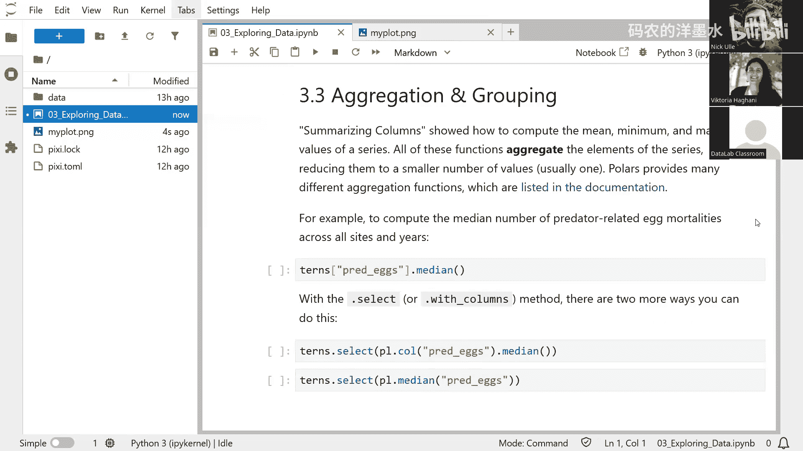
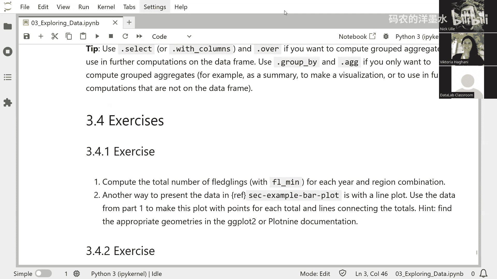

# Python数据分析入门：第3讲：pandas入门与表格数据处理 📊


在本节课中，我们将学习如何使用Python进行数据可视化，特别是通过`plotnine`库（一个`ggplot2`的Python克隆）来创建美观且信息丰富的图表。我们将从理解“图形语法”开始，逐步构建一个完整的图表，并学习如何调整其样式和保存结果。

---

## 概述 📋

数据可视化是数据分析中至关重要的一步，它能将复杂的数据转化为直观、易于理解的图形。在本节课程中，我们将重点介绍如何使用`plotnine`库，基于“图形语法”的概念来创建图表。我们将学习如何设置数据层、几何图形层和美学映射层，并最终生成可用于报告或发表的图表。

---

## 可视化包介绍 📦

在开始之前，我们先了解一些流行的Python可视化包。根据你的需求和偏好，有多种选择：

*   **Matplotlib**：一个非常流行且灵活的Python基础绘图库。它功能强大，但创建复杂图表可能需要更多代码。
*   **Plotnine**：这是我们将要使用的库。它是R语言中著名绘图库`ggplot2`的Python版本，语法几乎相同，非常适合熟悉`ggplot2`的用户。
*   **Seaborn**：基于Matplotlib，提供了更高级的接口和美观的默认样式，特别适合制作统计图表和热图。

选择哪个包取决于你的具体需求和个人习惯。今天，我们将专注于`plotnine`。

---

## 图形语法 🎨

`plotnine`（以及`ggplot2`）的核心思想是“图形语法”。它认为图表是由多个图层叠加构建而成的。每个图表至少包含三个基本图层：

1.  **数据层**：指定要绘制的数据集。
2.  **几何图形层**：决定数据的视觉表现形式，例如散点图、折线图或条形图。
3.  **美学映射层**：将数据中的变量映射到图形的视觉属性上，如颜色、形状、大小等。

此外，还可以添加坐标轴、标题、图例等可选图层来完善图表。

---

## 环境设置与导入 🔧

首先，我们需要导入必要的库并设置绘图环境。

```python
# 导入plotnine库，并允许使用类似ggplot2的语法
from plotnine import *
# 导入matplotlib用于调整图形显示
import matplotlib.pyplot as plt

# 设置Jupyter Notebook中图形的默认显示大小
plt.rcParams['figure.figsize'] = (10, 6)
```

---

## 数据准备与第一层：数据层 📁

在绘图前，确保你的数据是“整洁的”。整洁数据意味着：
*   每个变量占一列。
*   每个观测值占一行。
*   每个值占一个单元格。

这有助于代码的读取和索引。我们的示例数据已经处理为整洁格式。

现在，我们加载数据并创建图表的基础——数据层。

```python
# 假设我们已经有一个名为'turns'的DataFrame，包含了我们的数据
# 创建图表对象，仅指定数据层
ggplot(turns)
```

运行这行代码，你会得到一个空白的画布。这是因为我们只告诉了图表要使用什么数据，但还没有指定如何展示它。

---

## 第二层：几何图形层 🔵

接下来，我们添加几何图形层，告诉图表我们想要绘制哪种类型的图形。例如，要绘制散点图，我们使用`geom_point()`。

```python
ggplot(turns) + geom_point()
```

运行这段代码会报错，提示缺少`x`和`y`美学映射。这是合理的，因为我们还没有指定用数据中的哪些变量来分别代表x轴和y轴。

---

## 第三层：美学映射层 🎭

美学映射层连接了数据和几何图形。它定义了如何将数据变量映射到图形的视觉属性上。我们使用`aes()`函数来设置。

```python
ggplot(turns) + geom_point() + aes(x='bp_min', y='total_nests')
```

现在，图表成功绘制了`bp_min`和`total_nests`两个变量的散点图。每个点代表数据中的一行观测值。

---

## 添加更多美学属性与分组 🎨

我们可以通过美学映射，用颜色和形状来区分数据中的另一个变量，例如`event`（气候事件）。

```python
ggplot(turns) + geom_point() + aes(x='bp_min', y='total_nests', color='event', shape='event')
```

这样，不同`event`类别的点就会以不同的颜色和形状显示，图例也会自动生成。同时使用颜色和形状可以提高图表的可访问性。

---

## 调整图形细节与保存 📸

为了使图表更专业，我们可以添加轴标签、标题，并调整颜色。

```python
# 构建一个完整的图表对象
my_plot = (ggplot(turns)
           + geom_point()
           + aes(x='bp_min', y='total_nests', color='event', shape='event')
           + labs(x='Minimum Reported Breeding Pairs',
                  y='Total Nests',
                  color='Climate Event',
                  shape='Climate Event',
                  title='California Least Terns: Breeding Pairs vs. Nests')
           + theme_bw() # 使用黑白主题，更简洁
          )

# 显示图表
print(my_plot)

# 将图表保存为图片文件
my_plot.save('my_plot.png', dpi=300)
```



通过`labs()`函数，我们可以自定义所有标签。`theme_bw()`应用了一个更简洁的主题。最后，使用`save()`方法将图表保存为PNG格式的图片文件。


---

## 创建其他类型的图表：条形图 📊

图形语法同样适用于其他图表类型。例如，要创建堆叠条形图来展示不同区域每年雏鸟数量的总和：

```python
# 筛选我们关注的区域
regions_to_keep = ['SF Bay', 'Central', 'Southern']
turns_filtered = turns.filter(pl.col('region3').is_in(regions_to_keep))

# 创建堆叠条形图
bar_plot = (ggplot(turns_filtered)
            + aes(x='year', y='min_fledglings', fill='region3')
            + geom_bar(stat='identity') # 使用原始值而非计数
            + labs(x='Year',
                   y='Minimum Reported Fledglings',
                   fill='Region',
                   title='California Least Terns Fledglings by Region')
            + scale_fill_brewer(type='qual', palette='Set2') # 使用Set2调色板
           )
print(bar_plot)
```

这里，`aes()`中的`fill`参数指定了用于填充颜色的分组变量。`geom_bar(stat='identity')`表示直接使用`y`值（`min_fledglings`）作为条形高度，而不是对行进行计数。`scale_fill_brewer()`允许我们使用预设的、对色盲友好的调色板。

---

## 数据聚合与分组 📈

在可视化前后，经常需要对数据进行汇总分析。`polars`库提供了强大的聚合与分组功能。

**简单聚合**：计算整个数据集的统计量。
```python
# 计算捕食性鸟蛋死亡率的中位数
median_predation = turns['predatory_eggs'].median()
```

**分组聚合**：按类别计算统计量，信息更丰富。
```python
# 按区域（region3）分组，计算每个区域总巢数的中位数
median_nests_by_region = turns.group_by('region3').agg(pl.col('total_nests').median())
```

**复杂聚合**：同时对多列进行多种计算，并重命名输出列。
```python
# 按区域分组，同时计算总巢数和最大繁殖对数的中位数及最大值
summary_stats = (turns.group_by('region3')
                 .agg([
                     pl.col('total_nests').median().suffix('_median'),
                     pl.col('total_nests').max().suffix('_max'),
                     pl.col('bp_max').median().suffix('_median'),
                     pl.col('bp_max').max().suffix('_max')
                 ]))
```

**保留原始结构的计算**：使用`over()`函数可以在不改变数据形状（不聚合）的情况下为每一行添加分组计算结果。
```python
# 计算每年的平均总巢数，但结果添加到原始数据的每一行中
turns_with_avg = turns.select([
    '*', # 选择所有原有列
    pl.col('total_nests').mean().over('year').alias('yearly_avg_nests')
])
```

---

## 优秀可视化实践准则 ✅

在创建图表时，请遵循以下准则以确保其清晰有效：

*   **始终添加标题和轴标签**：使用描述性文字，并包含单位。
*   **考虑色盲用户**：使用区分度高的颜色，并辅以形状或纹理差异。
*   **包含图例**：清晰地解释图表中使用的所有颜色、形状和大小。
*   **撰写说明**：为图表配上一段简短的文字说明，解释其展示的内容。
*   **谨慎比较**：当并排展示多个图表时，确保它们使用相同的比例尺，以便进行公平比较。

记住，创建高质量的图表是一个迭代过程。从简单的草图开始，逐步添加和调整元素，直到得到清晰、美观且信息丰富的结果。

---

## 总结 🎉

本节课我们一起学习了数据可视化的核心概念和技能：

1.  **图形语法**：理解了图表是由数据层、几何图形层和美学映射层等叠加构建的。
2.  **使用Plotnine**：掌握了如何使用`plotnine`库，通过叠加图层（`+`）的方式来创建散点图和条形图。
3.  **美学映射**：学会了如何将数据变量映射到颜色、形状等视觉属性，并对图表进行标注和美化。
4.  **数据聚合**：了解了如何使用`polars`对数据进行分组和汇总计算，这是理解和准备可视化数据的关键步骤。
5.  **最佳实践**：认识到创建易于理解且专业的图表需要遵循一定的设计原则。



通过将数据操作与可视化相结合，你现在可以更有效地探索数据、发现模式，并向他人清晰地传达你的分析结果。