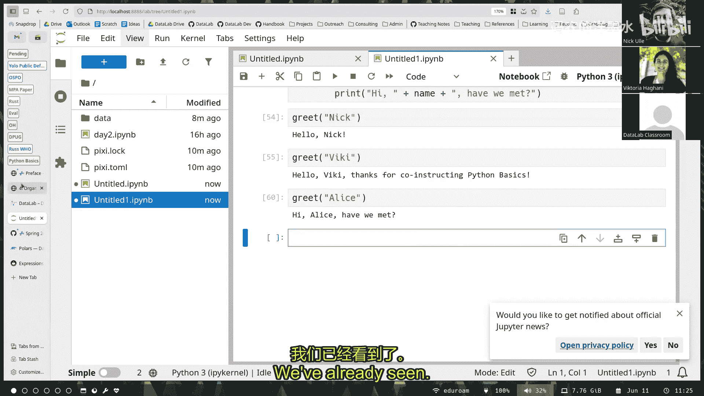
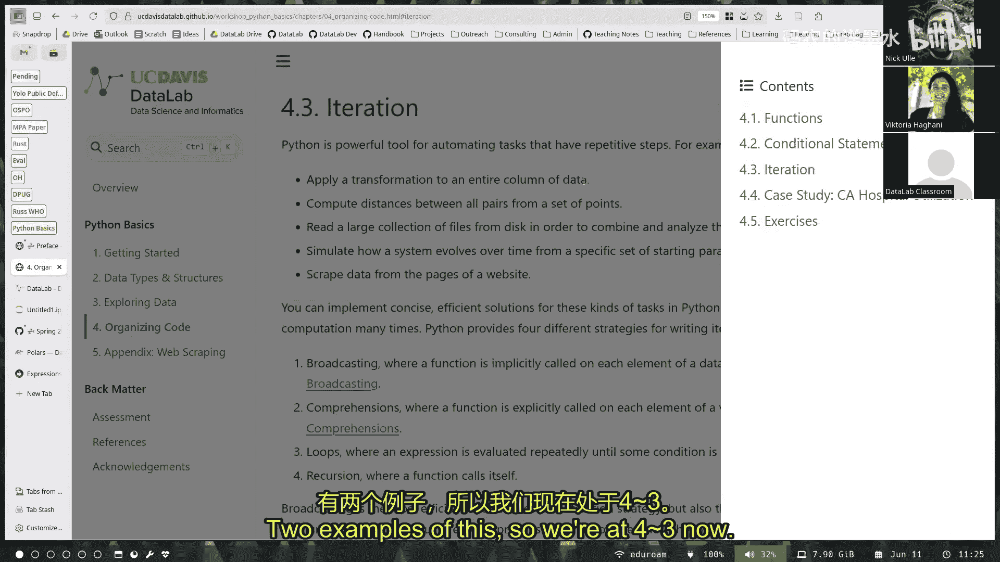
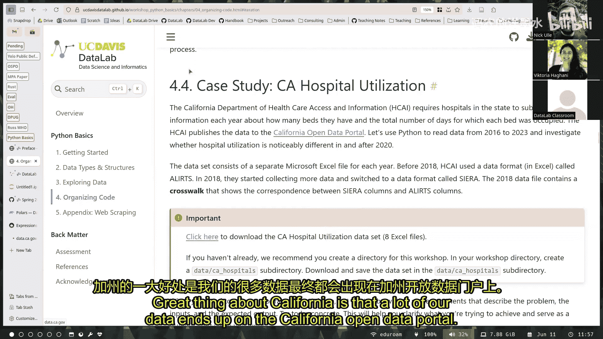
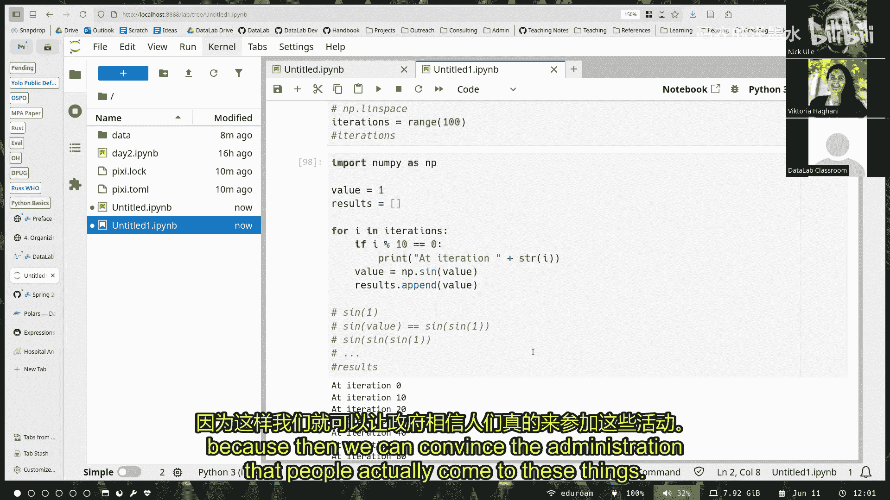

# 【全集】加州大学戴维斯分校 Python数据分析入门 中英字幕 1080P p04 Lecture 4 - 数据探索、可视化与简单分析 -BV1AK6vBqEei_p4-

Okay。All right， so I'm going to talk about a few different things that most of this we're going to spend talking about part4。

 but before I do that， I want to say a little bit more and let me make that larger。

I want to say a little bit more about some of the stuff we've seen with Polar。

 so Part4 is more about organizing your code， how to write your own functions。

 how to reuse your code， and we'll do a case study of actually putting a bunch of this stuff into practice。

But before I do that， a little bit more about polars。

 just because I want to address some things I've seen a few different people asking about。

That I think maybe we didn't explain as clearly as we could have。

Let me grab the turns data so that I'm at the same place as you all。Or pullers， you know。拜拜。嗯。Okay。

So one of the things that we've sort of seen and I think it's caused maybe a little bit of confusion is this P。

call function。Right， sometimes we use it， sometimes we don't we've seen stuff like you can do turns do select。

Of year。And let's just look at the beginning of that so that we don't have a huge printout。

 but we can also put a P。 call in there。Right。It needs do effectively the same thing。

People just give us that column。And so。What we tried to make clear。

 but I think maybe we got a dentist clear we could be is that。

What this is doing is what the field Paul is doing for you is it's it's saying that we're making an expression of something we're going to compute on the data frame and you can even do that outside of the context of the data frame。

 So what I mean is I could I could say something like。My。Call equals peel dot call of year。

And then I can go use that in other places so I can say turns。Do select select。Of my call。

Right and you could do this with a string， but then let's say I want to reuse the median of that column in a bunch of places or maybe maybe the nest column would make more sense so。

Right so I say peel。 call。Potal nests。啊命定。And then I can reuse that here。I want to。嗯。

I can also use this in expressions。With other columns。

 so if I wanted to say now take that median column again。Or that nest call them again。

And subtract in the median， they could do this。And that's。Okay。

 so this this is giving you a way to express something you're going to compute on the data frame without actually having to compute it right away。

嗯。So just doing like the language feels denied and putting that into the。

Work this one in9 isnt giving us some median giving us oh so what you have before we do this media terms so we could just so we could just compute the the median by itself if we actually look at what mediannesss is。

对是。ThisIt's not you might expect from looking at it this is going to be a number。

 but it's not it hasn't computed anything yet。And the computing doesn't happen until we actually write the about select。

So this field call is giving you a way to write all kinds of expressions。

 things that you might want to compute on a data frame without actually computing them until you use them somewhere in a select expression or a with columns expression。

Just that。Sort of makes sense。We'll see in a little bit another example that maybe an makes it。

More concrete why you wouldn have to do this because one of the things we can do we're going to learn how to write functions in humans and you could write a function where this is something that can be replaced with any column So if we have some kind of complicated operation that we want to do to a bunch of columns we don't have to write that operation out over and over again instead we just write a function that describes what that operation is。

and I'm going to make this concrete in a minute if it still seems kind of abstract and big Okay which one single select when call it doesn't return the value at all we're going to do so like if。

If we look at what is this thing？嗯。It's not a series or a data frame that's essentially an expert。

 which stands for expression， it's some code that hasn't been computed yet。喂。And so this is really。

 we're kind of getting deep into the model of how pull thinks about data or how the computational model for polars。

 but the idea is that you can express what you want to do and then you just put that in select and pullers will figure out the best way to do it。

And that's kind of the idea here numberumb seven among the Indian。Don's dogs left。

Following it and then the field of fall through that。We the the next， so you mean， if we do this。

But turns。The select of median nestsn。都东啲。OhSo we don't see。有那个セロ不啊。有有题装这个视频。

And then you here to of voice。我个月。装逼你了O。You do that？This will actually compute the value。

So if we wanted to confuse the value ahead of time， then we could do it this way。

I'm not going to overwrite that variable because I' get around。

 but this actually computes a series for you。对。Is it to late once。

So if we have the expression safe and then we are using it down space a there。

If the actual fuel data free has changed then it can compute the new part if you saved it as a variance and yes。

 exactly very good point。If if I compute if I compute this one。

 let's call this let's call this something different and we have a name for it。

 so we'll call this computed。Medium nests。So this actually gives us a result。喂。

You keep it displaying there right so if we compute this right？Those values are in it。

 those numbers are in it。Okay， maybe later on we decide to take a subset of our data。

 we do some filtering okay， this doesn't change because we took that subset。喂。It saves the city。

 so to really illustrate this， we've got these median values and there's 791 of them。Okay。

 now let's say I do turns that filter， and I actually only want to look at the year。20。20。

It will say a year。Yeah， the front switch。Yeahep。嗯嗯对。So if we say。

Pilter to get just year 2020 and now if we want the median of that， well， we can just say select。

Median。嗯。What did I call it？Median nest， yeah。Thank you don。Okay。So。Now we're getting。

Just the median for this particular result and I think we're we' missing here。呃。ItShould be fine。Oh。

 right， right， right， okay。Yeah， we were computing differences not。

So let me make this example a little bit clearer for them。Okay， so that is our medium for that。

 that's fine。But I'm a little surprised about is that we get the same medianically filter the years。

But let's。Turns。First， let's compute。Use means first just in case it's just because of what the median happens to be。

So we'll do turns， select。Pal。 call。Totalness。Buting。Right。We can see that。

For all of the turns need the mean totalness is 162。84 now we could also do turns do filter。Appeal。

 but call year equal to 2020。And then select。PL。cal。Total nests。白嗯。Yeah。Right。

Just to make this a little bit more readable， let's put some parentheses in here。Do some filtering。

And we'll do some selecting。And we get different results， right？Make sense to everybody so far。

 but if we take a subset， we get a different need。That makes sense to everybody why this happens。对。

So。If we know that we're interested in this mean total nest。And I could say something like P。ca。

Total nests。mean。Okay， and then I can just replace these。That you mean the same thing。

The mean same thing as before。喂。So I can write that expression ahead of time to say。

 this is what I'm going to be computing and then I can do filtering and I still I compute that same expression on both。

 whereas if I computed the mean ahead of time，Concretely， if I said。嗯。

It is it is kind of like creating a function yeah it it's code that we can reuse so if if I said ahead of time if I made this concrete if I said like let's let's actually get the means right so if I if I say mean equals kind of what we already have。

Ws this？I can't。Go and use me down here and put the filtering that I've already done。In fact。

 I think we would get an error if I tried to put that in there or maybe I just got the number， yeah。

 so if I plug that mean in down here， even though I've done some filtering。

 I get back the value I already computed。Because mean is a， a number in a series， but it's a number。

Mean expert is a description of what I want to compute。嗯。Was that。Makes sense to folks。

 I still see some puzzled expressions。Okay。We're saying here we're describing that we want a compute a me here we're actually computing。

Okay， and so after I've computed I've got this number and if I do some filtering later on。

 that number doesn't change it's still the same number because we already computed it it's still 162。

84。Right。So if I had some kind of like complicated operation that I want to do on my columns and I want to do it to several different subsets。

 I could describe that up front， I could write an expression to do that and then I can go take subsets wherever I want and I can just reuse that expression without having to worry that I'm actually going to add a typo or something as I reuse it。

Expression is a function。It's like a function， it's not a function， it's an expression。

 but it's kind of like a function in that you can it gives you a way to reuse code。

It's describing what we want to do rather than actually doing it。真系点错落佢啊。有点惨。哦，O， yes so嗯。你不是。嗯，嗯。

I was trying to see where you put new underscore for expression originally I had it in here。

And when we do that， then we get the correct mean right for this subset。

 whereas if if we just put the mean value in there're just the number 162 and you see that 162。

Which is not the correct mean for that subset。Great。Yes。

P leader in the about shouldn' not have a link to the folders。

Acumentation in the discussion section the beginning of that a really bit explanation why these questions are have。

Yeah， let's take a look at that wasn't it。Look。Somewhere towards the end of this section。嗯ello。

Or we also just go to the fuller' documentation。Yeah。I think this the page you're talking about？

YesYeah。Or even the previous the。Yeah。So that has made us right here。

 you can do more complicated things than weav've been computing than just a meme。

I mean this gives you a way to express what you're trying to compute and you can hold on to that computation and compute it later on subsets or whatever it is you want to compute it on。

It could even be different data sets that have the same columns in them。ButIt's a way to describe。

What you want to compute？But it's almost like a function or almost like code。Good。

Seeing back we all can into this type of excs。Only is a strong word。

You can do something kind of like this， I think， with the Duff Db package。

I don't know of a way to do this with Face。I don't know a way to do this with R。

There could be something but I'm not aware of them。Yeah。You can do things like this with Julia。嗯。

But yeah， this is。Somewhat unique to polars and。嗯。It's maybe not the only place you can do this。

 but it's one of a few。对。No。嗯。So if we go back to here so so that's like what i'm trying to do is hopefully demystifying what's happening here a little bit that that when we write things like。

Select with just the name of a column。It's because we're not doing any computation on that column。

We're just we're just grabbing the column right we're not computing anything on the column we're going to do computation。

 we need to use the field。t call。And describe our computation and then when we do that we can either evaluate it immediately one where we're still just not doing computation。

 but we can either evaluate it immediately like this one right or we do media that we immediatete but the result。

Or can we can delay the evaluation where we。here's what we're computing。

 but then maybe we're going to compute it later and we're going to compute it multiple times in different data sets。

Okay。So there's。Again， like a few reasons why you might want to do this it might be that you have multiple data sets and you want to compute this thing on all of them right so you define what you're computing first and then you do the computing and it could also just be that you have a really long computation that you're going to do something complicated and you want to set that up before you actually run the command right？

So that you know it's easier to read， it's easier to test it out， make sure it works。Okay。

 any questions about this？All right， so let's jump over to the chapter four stuff。So this section is。

Called organizing code， we're going to talk about a few different ways to reuse your code。

That'sThe first one。で。We're going to learn is how to make your own function right so maybe you want to make a function。

 make some code that you can reuse you've got some code that you are writing over and over and over again and you'd like to not be copying and pasting that all the time there's lots of reasons why you shouldn't copy and paste it over and over again One reason is that it's very easy to introduce a typo or a change in your result。

Right， when you copy and paste， you might。Change part of it and then suddenly you're computing something different for that particular instance and all the other ones are still what they were before。

So if you have an experiment， you need to compute the exact same thing on all of your data sets。

You don't want to be copying and pasting because then it's very easy to change one of them accidentally or unintentionally。

嗯。So writing functions gives us a way to reuse our code。嗯。And the way we can write a function。

 first of all， let's， let's say we have some code that we want to use。

 So we're going to make a very simple example， which is just。

 let's test if something is negative Okay， so I'm going to make。Seerries。One， negative one。

 two then zero。Okay。It's going to be our test data。When you're testing stuff。

 it's always good to use a small data set because then you can easily see what's working and what's not if you use。

Our 800 rows of turns data and it's going to be a lot harder to tell where this where our code is working and where it's not so test on small data sets。

The fight that my boss gave me was essentially anytime you're doing something use demo data because that's how you know so what it's doing so I can not stress how authority they able to see use this。

So we've got our tiny little data set， and if I want to see which of these are less than zero。

 how do I do that？But you're muttering。How do we check if these are less than zero。

 we've learned this already。Thanks， mar。Right。Okay， so it tells us true false， false。

 false right false true false false right， and that seems to match up with with our with our series that moved off。

 right？So that looks good。 So now maybe we want to you reuse this right this is very simple code so like。

I probably in reality I wouldn't write functions to reuse this because it's such a simple thing。

 but for our first function it's fine right we're going to keep it very simple okay so I want to reuse this I want to be able to use this on different pieces of data right different variables。

And so what I can do is I can say define。And then we're going to give a name to our function and so it's called it is negative。

喂。Thatft is short for defined， we may need a name for our home I going to call it even negative。

Generally， people recommend that when you name your functions。

 you include a verb somewhere in the name because functions do things。

 so you want to put a verb in the name。In this case， we're going to use is。

And then the input to our is negative function that's going to be something we'll sort out in a minute。

 we're going to put it in the parentheses I mean then we'll put a colon and then any code that goes inside the function。

 the code that we're going to reuse it has to be indented。You get tab on your keyboard。

So now we've got some code in the function， if we want to actually return the result。

 like get back a result from this function， we need to say return in front of whatever we're going to give back as the result。

so this is our new keyword。For when we're using a function and what this return is saying it's saying okay。

 the function is over at this point， anything after this is not going to run and we're going to return。

The thing on the right side of return as our result。对。😊，嗯。No。

The other thing we need to think about when we write our function is like， what's going to change？

In this case x has going to change right we're going to want to compute less than zero for a bunch of different values of x。

Right。So in this case， the thing that's going to change， that becomes your。Brandma， and you put it。

Up there and we can call this parameter anything we want so we could call this my data right。

 and this as long as it matcheshe up everywhere inside of the body of the function。And if I run it。

Looks like nothing happened， but something did happen okay we've now got a function that we can use called is negative。

If I just type the name of it， it tellss name and this is a function and look at the type of this and see what is the type it's like a new variable。

你。Thatlls me that this is a function。Okay， and if we try this out。Using the same。

Syntax for calling functions that we've already seen many times， right？

Is negative of x when we get back on result？Okay， but we can also use this now on other stuff so we can say is negative。

Of six。F。嗯。anything we can use less than zero on that apply as quickly。喂。

And so we can do more complicated stuff。In the function。

 but before we we try to write a slightly more complicated function。

 are there any questions about the syntax so far does it。

Makes answer about what what's happened here， yes。Okay make sure sure you've got my data in the parentheses and you've got my data here and not anywhere else。

嗯。Any other questions？Yes， so this function is a to the type of or operation Yeah as long as as long as the the less than zero operation works for that type。

 then yes， so like if we if we try to pass this something where it doesn't make sense to ask。

Less than zero， like a function。So is the rounding function negative， well tell me that， right？

Because that it doesn't know what that means。But yeah。

 as long as the type is compatible with all the things that we're doing inside of the function then。

It doesn't care what type of does。Thanks。😊，All right。

Let's look at a slightly more complicated example of a function。嗯。And。

Go and look at what the actual reader has because I don't know if I'm going to do that example or something else。

嗯。Yeah， okay， we'll do that。So the reader has an example of a function where we try to get the largest value。

In a series or。ADa frame so if we wanted to try to get the largest value in a series。

 let's look at our our x again， right？Say we want to get the largest value or the top largest value to maybe the top three or F five or something like that。

What can we do like how do we actually。Doesn't have to be in terms of functionsings because I know we're all still learning fully but like what process would we go through to get the largest value in this series or another series Can anybody suggest what we should do Okay plus Okay why are we comparing you see better Okay so we could like go through each one and like say is this one larger than this one and then gentle ones larger is that one we're to the next than guess so that is a good strategy that is one way we could do it。

Is there a get max value yes so we could we could try to get the max value Okay。

 so'm going i'm going to write some of these down so we could iterate I'm is how I'm going to describe it。

Through devout the elements。Track of the largest we could。Ask for the max value。Okay， anything else。

 what else do we do？Any any thoughts what what's a higher level thing we could do so like I think this is good this is a solution。

 but this is picking at a fairly low level of like this。

Think about the individual this is taking at a very high level。

 but this only gives us one max value so value what if I want like five or three or something like again what else can we do。

Sorry， the what function right so that' that's what we want to do。

 but I'm just thinking in terms of like what could we do to X to see which ones are the highest at the glance？

嗯。Order， yeah， so we could sort， right？Pro time family。Yeah。

 we could start on the unique values that could work as well。嗯。Anything else that we could do。

 I'm just trying to think of like what are all the ways we could do this？Okay。

 I think that's pretty good we we got three right so。

We'll look at a few of maybe and see how they differ， but let's i'm going to go backwards。

 so i'm going to start with the last one and go towards the first one。So for the last one。

 if we wanted to sort the unique values， if I take x， there's a dot sort。

Not that want to spent any series go。对。AndAnd it sorts by default it sorts so that we get the IS values at the bottom。

Right those from lowest highest， but we can turn that around， there's a parameter to this。

Called descending。If you said this to be true， you we get highest the lows。喂。So that sorts our data。

And then what if I want to get just the top three， how do I do that anybody remember there's there's a function to get just the beginning of something a method at yes。

 so we can say dot head。And three， right？So that's my top three。Okay。So。

We've got the code working for for example data but this is when you're writing a function。

 this is how you should do it like don't worry about writing death and return when you're trying to figure out the function just write the code for one base right get it working for one case on toy data preferably unless unless the data set you're working with is already very small。

Right get it working for one case we've got it working for one case now we're going to write the actual。

Stuff for the function。 So we'll say de pop。Values。

And we'll indent that and we'll put a return in front of it。And actually。

 rather than putting a return in front of it， I'm going to call this result。

 and then I'll put return results on the next line。Just in case we want to do other stuff for this。

Okay。So we've got the code in the body of the function。

 what's the next thing we do when we we're turning some code into a function？DoesAnybody remember？

We have parameters， and how do we decide what the parameters are？

Look for the things that change Okay， so what's going to change here if we wanted to use this on other do。

X， right， x is going to change。So we could just put X right there。 you don't have to change the name。

Let's just put X there， is there anything else we might want to change here？Okay， yeah， the head。

 how would we want to change that？What。How many we get， yeah， so let's let's say。

How many right and we'll put how many is here right and we we were using it with3 before and maybe it's kind of nice to just have a default to some number of values that we get back so let's just make the default three。

Okay， so we're saying。There's an x parameter for the data and then there's also about how many parameter how many parameter this default value is going to be three。

 so if we don't provide this value， it's going to be three。

 but if we do provide it we can be something else。Okay， so let's let's test this now。

Once you've got your function written out， the next thing to do is test it。So thought values。Of X。

Okay， and that gives us。Rvalue is back。It looks the same as before in top values of x and maybe1。

Is this just one value back？本来。So we could。If we wanted to make this even more general where we're instead of always getting the top values。

 we could also make this get the bottom values depending on what we want。

 we could parameterize that the7 equal plus three as well。You嗯。

But I'm just going to leave it as it is for now， this function is going to be a little bit more picky about the types。

 So if I do something like。Hot values。One， two， three。Doesn't like that。啊。

So the sort method or a list is different than the sort method for a series。

 so this doesn't quite work here。And there are ways if you needed to support both。

 that you could make this work。One thing we could do， we could say maybe x has to be a series。

 so PL dot series of X。Maybe we would somebody cast something through a series。

we can say whatever our input is， turn it in with series， if x is already a series。

 this just doesn't be anything。点 yeah喂。Yeah。😊，Is that better？对。

So now that we've sort of insisted that x has to be converted to a series， we can test it again。

 that still works， that still works， how that works。嗯。

So we can support more types if we do some testing right since we're assuming on this line。

 we're assuming that we've got a series we're using methods that only apply to a series of then data let say accessoriessities。

There's other ways you could do this if you wanted to support a bunch of different types。

 but this is one。Yes。要请面望下面呢个就。doesn't really like it's still just as how and just even you know't they do how many people have born for when you want exchange right whatever we put as the second argument。

It gets set， but yeah， we could if we wanted to， so we could say how many equal to one。

 that's also okay， but we don't have to。嗯。Any other questions about this？O。会不会一思。

Starting to make sense， like oh you would do this。And how you could use this。

 if you have some code that you're using over and over again。

In different cases than you instead of popping and pacing that chunk of the code。

 you provide a function and you just call the function。And has the benefit that now if you realize。

 oh， I did this wrong。Right I have a few times copy and pasted code over and over again like because I thought oh I'm only going to do this three times I'm not going to write a function I'll just copy and paste it three times and then I realized oh there's a bug in my code now I have to fix it in three different places。

Okay， really annoying， whereas if I do that here。Pickix it in one place。P it in the definition。

 and then I just run my open。Right， so it sort of。Centralizes the place where all your bugs could happen so that it's easy for you to fix。

 it also makes it a lot easier to test because to test it。

 all we do is use all the function and put some values in。Right。😊，So。

Hopefully I'm convincing you that this is a good way to write your code。

As you're as you're trying to do things， it's also really good if if you actually。

Have something that you think is useful to other people。

 you can build a little package for Python that has some functions in it。

 and then other people can use your code too。Okay。Okay。Any other questions about this？

This is like really foundational to programming and using Pyon effectively。All right。

A couple of other things I want to talk about。冇咩。呃。Let'll look at my notes for a second。Thats。

This is why I usually open up my notes before I start talking。O。So。

Another thing we can do with Python。Sometimes we might want to have this different piece of code run depending on some kind of condition。

Maybe we want to check and see is our data from 2017 or is it from 2018。

 and it's from 2017 we do one thing， if it's from 2018， we do a different thing。

we need a way to check the condition and do different things depending on what the result of the condition is。

And so the way that we do that in Python is with an if statement， they the keyword is if。

 and then we're going to put some kind of condition that evaluates the true or false after the if Okay。

 and so I'm just going to set up a really simple example of something that greets people so I'm going to put name as a variable up here and we're going to set the name to Vicki。

Thank for now。And it's going to say if name is equal to。佢啲。😊，Brilliant。Hello。再见。😊。

Thanks for coin instructing。Python basics， right？And so if I run this code。

Here's a kind bus Ri in Prince out。Statement right now， if I change this。Do something else。So great。

嗯。😊，So maybe I want to have a second case for B， right so I can say。

L if means this was short for else if。But they've shortened it down to just LF。

It this time we'll just say hello next。哎。So depending on what the value of name is。

We get the different results。Painted to that。Thank Tim。With results。在。

Maybe we want to print something else out for Tim。So else？

When the et case is sort of the case where if both of these are false。

 then we'll just do whatever is in the else case。And so in this case， we'll just say print。

I have we met？Right。喂。Now。Most of the time if you're doing something like this。

 this example is a bit silly right like we can see what the variables defined as right here。

So so most of the time if you're doing something like this you're probably going to be doing it in like script or load data and you don't necessarily know what the data in your file is going to look like ahead of time or maybe in a function。

 so like if we if we had a function if we wanted to make this into a function we could say。

Reef and maybe name is a input to this function。TheIndent， everything。对。So we can take away this。

Now we've got a greeting function that we can say greet。Of Nick。Good。

We give some parentheses right then it says hello Nick and we can say greet of。Viy。😊，嗯。Hello。

 Vicky thanks foring， blah， blah， blah。嗯。Alice。Okay。It says hi， have we？Okay。

So typically when you're using these statements， you're going to be using in a function or in a script where you don't necessarily know ahead of time what the input is going to look like。

 or there's several different options for the input。Okay。

That makes sense to say everybody you can also do other stuff so i'm like just printing here。

 but you can put any kind of code that we've seen before so you could you could be assigning variables in here。

You can have as many lines as you want as long as they're indented inside it。好。Yes。As many outs。

 as we all for specific needs you could， yes。And if if you really have a lot of values that you're just trying to match on like that。

 and there are other ways that are maybe a little bit cleaner to do this。

 like there's a thing called a match expression， which I'm not going to talk about today。

 but it's a little bit nicer if you just want to match on a bunch of different values。

Or also you could use one of the dictionaries that I briefly mentioned the other day。

 that's another way to that。Yes。title you mean in the print statement？Yeah， yeah。

 so we could do that so we could do something like。呃。Insert the name into gear。Right。

So if we do this， we're saying。Have I and then add whatever the name is and then type of be， right？

And so now if we try greet Alice， we getH Alice have we met， right？

Because we need another comma in there to be grammatical。So yes。

 you can use the parameters anywhere and there's nothing special about the code inside of wall。

Just so it was no be finished。Yes。对。Okay。Any questions about this？嗯。

When you hear something like a gift statement you're。

Often making your code a bit more complex because now there's different things that can happen depending on the inputs。

And so it's a good idea before you're using a statement to think about do I really need to use a statement。

Because if you can make your code more general without using a statement。

 that's almost always a better solution because then your code just runs straight through。

 it's easier for people to understand they don't have to follow like two or three different paths through your code to understand what's happening。

啊。So ifs not to say that thesis is a bad thing to do by all means。

 there are places where you have to do this， but you should just be sort of thoughtful about how you do it。

 that's all。No。Another question no。嗯。All right， so we've talked about if another thing that we might want to do。

Steve， make sure。Said everything I should be saying about if。

Another thing we might want to do is iterate over values。We've already seen。

An example of this。Two examples of this so we're at 4。

3 we might want to iterate over values in order to automate stuff so there's all kinds of things we can do with Python to automate we can say maybe apply transformation to entire calls data we've already done that a few times right maybe we have a bunch of data points and we want to compute distances between them and so on right there's a bunch of different things that we could do that we might want to automate repetitive tasks that are annoying these are the kinds of things that you this is why you would want to use Python right tasks that are easy for a computer to do but hard for a human to do or at least tedious for a human to do。

And so a lot of these involve doing something over and over and over again and that's where we use iteration we already saw two different varieties of iteration we learned about broadcasting a few days ago where we can just take a series and like write x plus whatever value or x minus whatever value so remember that was like PL do series。

And。1，2，7。Minus1 right and we can subtract that 10 from all of those values and usually we're working with a much longer series。

 but you get the idea right we're doing something to each element。One after the other and the other。

 if we had the right line of code for every single element。

 that would get really tedbious really fast okay。嗯。So this is our broadcasting example。

One way to do iteration。 We saw another way to do iteration。

 which is list comprehensions or just comprehensions generally。

Okay and this was sort of an equivalent thing， but for lists so my list is maybe again one two7 and I don't want to convert it to a series for some reason。

 then I could also do。Y minus10 for y in x。没。T good。Right， and then we give back thoughts。

 the result。Right。So effectively computing the same thing。

 a little bit different in terms of the resulting data type， but the same numbers。你开。

There's two more ways that we can do iteration。That are more flexible。

These two forms of iteration are。Fairly strict about what you're doing or going from like the least flexible to the most flexible。

Very。And say this is the least flexible for a few reasons。

 one is that whatever you're iterating over it has to fit into a series。

And remember series all the elements have to be the same type of data right so that's the first limitation right we have to have exactly the same type of data and then we have to whatever whatever it is we're going to do to the elements has to be simple enough that we can describe it in terms of operations we can actually do to a series so like arithmetic mathematical functions there's a few others that we can use from polars whereas in the list comprehensions case we can use anything in Python right we can define our own function and we could call our function on these values right？

So list comprehensions give us a bit more flexibility。

Okay we're going to see two more that give us even more flexibility。WellWe'll only see one of them。

 but there are two more that give us more flexibility。

 but we're going from less flexible to more flexible。对。Now thinking about it the other way。

This is the most concise so the broadcasting is the most concise right all we have to do is if right plus x minus 10 our series minus 10 okay we don't have to use this four syntax they don't have any extra syntax we just write the operation we want to do。

It's very concise， it's easy for us to write。And in general， as we go to more flexible。

 we get less conse。Okay， so that's one reason why there's a spectrum of different ways to iterate。

The other reason is。Things at the top， the things that are less flexible， they're more efficient。

 they're going to run faster， they're sometimes going to use less memory。对。So。

Roroadcasting is going the fastest way to do stuff。This comprehension is a little bit slower。

The next thing we're going to see a little bit slower。OkayDoes that make sense to everybody？

We've got these trade offs in terms of like strictness or lack of flexibility and we're succeeding。

Or I should just say flexibility versus speed。So if you can do whatever you're doing with broadcasting that's great。

 do it with broadcasting， you can do whatever you're doing boost comprehension， great。

 do it with list comprehenions， right？chooseose the one that makes the most sense。

 that's the first thing you should think about like whatever is the easiest for you to think about。对。

So I have seen people that say like like I don't like thinking like this。

 I don't like thinking in terms of vectors in terms of series。

 so I'm just going to do everything this way。And if your code runs fast enough for you， right。

 do that okay。The first thing you should always be thinking about is like what is easiest for me to understand。

Okay， if you then write the code that way and it works， but it's really slow。

 then you can start thinking about like， okay， how could I move to a less flexible thing that's more efficient？

Okay。Makes sense to everybody。Okay， so let's let's see the third one now because we've。

Talked about these two quite a bit。And the third one is loops。嗯。

There's a couple different kinds of loops in Python the word it' going or loops。I think。

Maybe I'll do the other kind of loop。A for loop looks a lot like list comprehension。

 the way we would write this， let's write a loop。That。Does this sub and print the values out。

 so we'll do four y in x。Print。Y minus 10？Yes。不是好。Sometimes it not really changed that much。

 right the big difference is that。Like an if statement or a function。

 we can put as many lines of code as wed like。We can create variables， we can call functions。

 we can do whatever we want in this thought。Yeah。So we we have more flexibility in terms of what we can be wear is here。

 we kind of just have one expression right you can't have multiple ways of code。You sort of。

Sort of have multiple lines of code if you like to find your own function and then call it in here。喂。

Here we just write the code right there。Okay， the other thing that's。

Maybe a little bit surprising about this if you haven't seen it for them before。

 like this doesn't return anything。There's no no result from this if I wanted to go and do some computations on these values。

 I need to save them somehow explicitly and manually。Okay， so like what I could do。

 I could say result equals。This。And then maybe I say。Result。

Let's call it results because they're going to be more than one。Results got append。And。Y minus10？

And instead of printing these out， I'm going to。Priinnt out results at the end or just display results。

对。You're not to get the same result as the list fund entry right and get the same thing at the list fund entry。

 but to do that I have to write the order lines code instead of do the one。Okay。Yes。

So Penn says sickness on the end of the list。Sorry。

 I should have should have demoed that so if my list is。Z。Then I look at Z。

 it's empty and then I can say Z ought of pen10。And look at Z again。

 now Z has 10 in it if I say Z dotta pen。12。again， I know it's got 12 minutes。

 so we're just adding things to the list。So。not seen English this one that results within an empty risk but we said it's an empty but on the slide。

Yes，ForWhat are maybe an empty set of language is yes。

' you're absolutely right so if you need to loop over like a thousand values or a million values this will be slower this pending strategy will be slower than if you ahead of time say make me a series with a thousand zeros and then i'm going to fill in those zeros using indexing right but for small examples this is usually less and when I say small that's anything up to thousands。

So。What I would suggest with in general just like when I was explaining the different ways you can iterate。

 do the simple thing first and then if you find that the simple thing is slow。

Chaangnge to something more complicated but more efficient。对吧。嗯。Yes。😊，还有分。

pivot first of the Act so you have or y and S I just not used that right also is it saying like。

Y signal not x values now say y minus it's so it's just saying give me each element of x so if I change this to just print y so that we can see what are the values of watch。

On the first the first time so what's happening is code is running one time for each element bes and so the first time it runs y is equal to one it's the first element thats the second time y is equal to two。

 the third time y is equal to seven these are the three elements to bets。Okay。

So so the value of y is changing each time we run this code。

And then we're computing libraries and and sitting that back in place and it's where we get these results。

Was that help or was that still， is it still not？哎。O有啊你问嘅啊。Any other questions？Okay。

So this is a for loop。This tends to be really useful if you need to do something。Where。

Each iteration depends on the previouseration previous iterations。

We haven't seen a lot of examples of where we beginning to do one example that I can think of but might apply to some of us as researchers is if you need to like write a simulation of something and you do a time step and then you look at what the status was in the previous time step and do another time step right that's a case where you might want to use a for loop okay because you need to look back in time。

But to show an example of that， to make it kind of concrete。Let's say we want to do something like。

Compute the value of a function if we repeatedly apply that function。

It's getting a little bit mathematical， but what we're going to do。I'm going to say。

I I want to do this， let's let's make some numbers， so we'll save。呃。Iterations。Equal to range of。100。

Let's start with Tan， just keep the small。And I just also want to show what is this iterations thing？

We haven't used the range function a whole lot yet it prints out as。Range zero to 10。

 This is a the range function gives us a sequence of numbers from so it's in this case。

 going us 10 numbers from zero to number。Okay， so 10 numbers starting at zero because it's a sequence of numbers。

 that many numbers that we put in parentheses starting at zero。The integer numbers。

 and if we look at these。You can see that's。It doesn't show us the numbers when people doesn't actually think them right away。

 but we turn it into the list when it can to place。Okay。

So you can see this is just the number zero through nine if we change this value to say 12。

Then we get the numbers  zero through 11。Okay， this is just a way to get a bunch of numbers in order。

嗯。So I'm going to go ahead and。And something here actually。

 so if we wanted to iterate like 10 times right， we can use this range function to do that question。

if you wanted others sort of brain that。It does only give you integers。 if you want decimal numbers。

 there are functions in numpy， So Ny has a has two functions called。Npe。t a range and。NP。minspace。

And these can give you equally safed numbers on the real number line。

 so like if you want 20 numbers between one and five， like you can do that with these functions。

R on with these integers it does not have to always start at zero if you want to start somewhere else like maybe two。

 you can you can provide two parameters to this thing。

And now you get the range starting at the first parameter and it goes to the second one。

That or just before the second break。对。But was there another part of your question。

 just making sure I didn't miss anything？Okay， so we're just going to iterate 10 times to start。

And we're going to say four。Ie in iterations。RightAnd what we're going to be doing here。

 I want to know what happens if I just keep computing the sign of something the mathematical sign of something if I just say like sign of five and they compute the sign of that and the sign of that and the sign of that and the sign of that and the sign of that do I ever get to anything does it converge this is interesting to me is a mathematician maybe it's not interesting to use but。

It's a good example of like something that depends on the previous iteration， right？U。So。

s that so what we're going to do， we're going to say result。

And we're going to we'll start with ones when we do this see if if if we start from one that birth anything and then we're going to say。

And actually， public is value。对。And will say value is NP。 sign of value。喂。最好。

You think about what this is doing？In the first iteration， we're computing sine of1。Right。

In the second iteration， we're computing sine of sine of1。

the third iteration sine of s of sine of one。Right。And so on。That makes sense， everybody。

Or just to make it explicit if we're doing s of value， which equal that。

number data so yeah notice that we're not even using high right it's really just just there for us to keep track of how many times we're going to iterate。

对。And so we could try running this。And I need to import on by， so let's do that。Okay。

 and then I should also maybe print out the value to see what we got。

more so that's not not that interesting on its own。

 but let's maybe save all the results along the way so we'll say results is this。

And we'll say results。Append。Value so that we can see what's happening。

As we sort of do this repeatedly。对。And now you can kind of see that it's getting smaller。

We applying sign。And maybe we instead of doing this 10 times， we do this。100 or1 thousand times。

 let's do 100 because I'm not sure how long this is going to take。

one I maybe don't want to print this out anymore。You're doing up 100 iterations。So be okay。

 and now we've got our results and maybe let's make a lot of it。See what it looks like？So。

I'm going to stick this into a data frame。N to say results。

And to remember how to do this I don't think I talked about how to make a data frame。

From scratch or from other data。So one way we can do this。

 we can make a dictionary and we can say what the column names are， so we're going to call。

The result column is going to be our results。喂。Let's give the sleep。

Nice total number results and i'd like to have have the iterations in there too so that we can make a plot with x is the number of iterations Y is the actual result that we got。

So if I want to do that。What we'll do we' save our number of iterations as well。

 so I'm going to make this a list so that I can use it in several places。And then I'm going to say。

Ittereration。And I will put the code back on the screen in a moment。Comment in那个。

So you can see the data frame that we're getting it just s this。Your refrieration yes refrieration。

So yeah。Now to get all of that code back on the screen for a moment。我谂不你。はいです。

So here's our code for the loop。嗯。Getting the range。

 the range value by default you can only use this once。

 it gives the values the once and then they're done with it and so the loop is already use it so you to make get the list that a sticker around the flag putting the list。

Not there。And then once we've computed it， we stick it all into a data frame。Okay。Questions so far。

I know I'm introducing a bunch of new stuff。嗯嗯。Yeah。

And just to show like what happens if we don't do this？Oh， okay， I stand correct that。

 I guess we can do it without doing that。哎 good。嗯对。Great。Yep。Yes， exactly。Okay。嗯そしじ子。那好。

So the output。Should the comment yes。没。And'm going to call this whole thing repeated sign。

We'll keep the output on there。What is the beginning of the output？

When putting all this into a data frame so that we can make apply。

 that's where we're trying to get to with this。That involves。With the end market finished。

 makes an empty list those of results but's not。Right。

IfIf we wanted to make a series we the belt series。

 you could do that and could make a series of the values in the series instead of using an and view it。

你明白这。We could make a series， so we could do something like PL。t series。Of。

See how would I do it we need we need。To have 100 values in it to begin with。

 So maybe I would say range of 100 and make a series of 100 values。 And then we would say。Results。

Square bracket I， equal to value。This should be saying。你。

Makega series it's got 100 slots to put stuff。And they just happened to even number zero zero through 99。

 it doesn't how a business changed like， and then this says。

In the I iteration iteration alone you take the first iteration zero and you take the zero position and signed down into that and then to iterationally sign them we also have to change。

This to be value I minus1。And I think we'd have to change some other things about the loop。

 it gets a bit more complicated if you do it this way。

 this is the more efficient way to do things that someone in the audience was asking about earlier。

 but you start having to deal with positions of things and it gets a lot more complicated。对嗯。

You could just make it a series after you're done yes。

 so that that is the easier thing to do and I think that was a simpler thing to here。Yeah。

 we could just say P。 series of results。嗯。The since we are going in a sequence。

 that's why it's 1 to1 correspondponing with the result and that question otherwise we had like we are going then we would probably have been use forward to associate the very we need to keep track of the value somehow like we could potentially sort in result so we could store most of the things and we going get have of the pair value additional right。

But here since iterations is in whether the one to one oral so the results。For reiteration。

 there's a value in results。So we can just do the simple thing and make a data frameangle on the two。

Okay， so now that we've got the data frame let's plot this。So from lot nine。Inport starve。And then。

We will dogg plot of beed。Sign。And we need to use AE to add the aesthetic layer。

 so we're going to say x is going to be our iteration。W is going to be our results？

And then get this out of the way。And then we'll just make a do plot， so G point。嗯。

Okay so that's our code and you can kind of see。I don't have a good way to have both of those things on the screen unless I zoom out a little bit。

 but you can see that it's it's rapidly。Going towards something maybe a little bit above zero。

 I'm not sure if that's zero or not。嗯。So repeated sign is like this。But this is like a very， very。呃。

Simple and kind of contrived thing to do repeatedly right。

 but you could have something like a much more complicated simulation happening here in the loop。

They you get a result for each time step a key thing is that。

Each iteration depends on the previous edition and this is where it For survey really called from there's not really an easy way to do this with broadcasting or loop or list comprehensions。

Because when we're broadcasting or doing a list comprehenion。

 we have no way to refer to the previous element。嗯。We never want to create a data from your。

we have already import it from a CSB where does you always use so that we can have columns and the there's a few different ways so the most common thing is like different from a file this S or Excel file or there's many different formats we've can make but if you need to create a from scratch you you can use the data frame function and then you can use a dictionary like this。

 I think you can also use a list and then you have to specify the column names as a separate argument there's many different ways you can use this function so like if you read the documentation for the data frame function it explains all the different phase that you can parameter the one that's easiest for me to remember if this one because I often often have the situation where I've got a couple of lists or a couple of series that you need to put them into a data frame。

Yes。No， that's a good question because that was something we did very quickly the other day。

Without a whole lot of detail。A dictionary， the way this works。

 the way you make a dictionary generally is with curly graces。

 and so that's why I got the curly makes well。And the way this works。

 its it's a thing for keys and values。 So you can imagine like an actual physical dictionary。

 like you've got a key， the word。 And then there's some kind of description of the word， right。

 key and a value。 Okay， in this case， are keys usually they'll be strings。

 they don't have to be strings， you could use numbers of something as the key if you want。

 But usually strings。 And so we could say for for the key pi。

 What is the value in redit pull to say what the value is gonna to be。

 And then maybe the value for high is going to be5， right， It doesn't have to be a number。

 It could be any object in Python。And then maybe we have another entry。Yay。

 which will be this could be something else it doesn't have to be the same data type even。

 so maybe this will be a list with the numbers one and two。对以。Okay， so this is our dictionary。

I'll just call this。Let's call it。8。Haven't used there yet。

Right to think of something that I haven't yet right we can add as many keys and values as we want in there。

And the nice thing about this is now if we want to look up a value indexing instead of using the position。

 we use the key so we can say get me the value at high。嗯。

So one way that this is useful if we want to look up using an arbitrary key。

 the other way this is useful is in things like the data frame function where we want to sort of attach a name to a button。

嗯。Yes。So like used when I was methods I used to where I by like， for example。

 printing out every1 where 100 yes like out something where I am I tried this by living a print function and it doesn't look let's try it so。

Like if we want to print， say every 10 iterations， yes okay， so let's do that so。

We're going to what's going to happen， we're going to just maybe print something like app iteration。

And then啊。I that's what we'll print， but we only want to do this every 10 iterations not every iteration because they wouldn't get so to figure out what iteration we're on。

Anybody think of how we would do that， how do we check what iteration we're on？

Get the value of I and what are we going to do to the value of I to see if it's the tenth0th iteration？

How don't we tell if we're on Ken， all right？Okay， yeah， so like the modulus so。

See if we divide it by 10， do we get zero， right？We can check that and then this is the conditional。

 so we put if in front of it。系。All running that hopefully we get。明白。Any other questions？嗯，不是。

So what is a given something？Wait yes。After the break I've got so I said there would be a case study and i've got case study where we're going to have to do some iteration that I think is a good example of this the example there is what we're going to do we I can give you a little bit of information about it now there's。

A data set， the California hospital utilization data set。

 so the state of California asks all the hospitals every year to say how many beds they have。

 how many people spent days in those beds they collect this every single year and then they put the data online great thing about California is that a lot of our data ends up on the California open data portal。

Where you can find all kinds of stuff from the state of California and if we look for hospital。

Utilization we can actually find this data set。I've got a nice。Link。

To download this in the reader it's a little bit cleaned up from what's actually on this website。

 but the point is they distribute this annually and they put the data in a separate file for each year so if we wanted to study like trends over time we have to read one file for every year we're interested in。

like if we want to do 10 years， we got to read 10 files and for the most part。

 the files are all the same format。But we do have to do a little bit of like cleaning to get the data out of the Excel file and into Python for each one。

And so what we can do is we can write a function that does the cleaning， what we will do。

 write a function that does the cleaning for one， and then we make a loop over the different files and we just call that function on each one and then we get back our 10 results。

So that's that's one example of how you might use a loop any anytime where you're having to do something over and over again that's a place where you might use a loop what what's what type of iteration you do whether it's a loop or a conrehenion or broadcasting it just depends again on。

嗯。喂。What kind of flexibility you need？If you're just doing prometic。

 broadcasting is often the easiest and fastest thing to do if。

If it's a little more complicated than that， you can't do it with broadcasting。

 maybe it's a function that pullers doesn't have or doesn't understand comprehensions。

 if it's more complicated than that， especially if the iterations depend on each other so like the sign example or like if you're running a simulation where each time step depends on the previous one or you need to read a file and then read another file but do something different depending on what was in the first file then you use a loop when there's a fourth name which I haven't really talked about recursion will just about as flexible as loops I'm not really going to get into the detail of it today。

你好。Any other？O。dent the at 1020 but it was printing everything else because result yes。

 indentation is critical。Yes。Okay， then I think we will take a break for lunch and then please。

the load back okay so the food is almost here it will be here soon and after lunch I will take a little bit of the remaining two hours to talk about this case study and we'll work through it potentially up to the whole hour first hour and then we'll have some time after that where we can just answer questions or you can try the exercises or you can leave if you're exhausted and want to go so whatever whatever works for you but Vicki and I will be here to help and answer questions if you want to try。

Coding stuff。No。Yeah。😊，Thank you for coming。对Yeah。😊，So会 no。Yeah。

 we really appreciate it if you sign in， but then we can convince the administration that people actually come to these things。

And that they should keep supporting us。