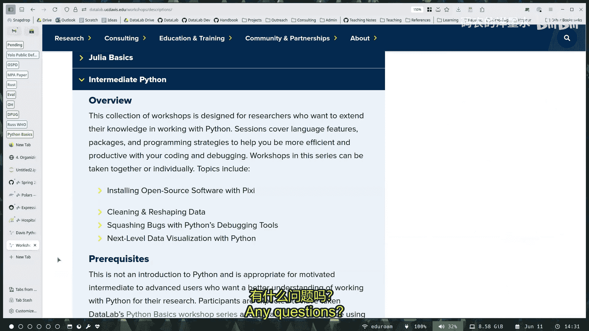

# 【全集】加州大学戴维斯分校 Python数据分析入门 中英字幕 1080P p05 Lecture 5 - 代码组织、可重复性与综合实践 -BV1AK6vBqEei_p5-

Thank you。Okay， so continuing on with this case study with the hospital data。嗯。

So we're going to try and take this 2023 hospitals data file and read it into quite while okay。

 we're going to do that with Polers so we'll go back to our notebook。

And I will just maybe I'll make a new notebook just to。Vs。嗯。

A little bit cleaner and actually I'm going to put it。

Let's do this and I want this new notebook to be at the top level， so let's not have it be here。

You can figure out。Y对 it。对。OkaySo we're going to go back up to the top level of our。

Project where we've got our pixie。tel， but now we'll make the new notebook。Okay。

 and this is where I'm going to do all of the work to load these things and in in general。

 when you're you're setting up a notebook， you should do something to sort of say what。

What this notebook is about so like。This is going to be our CA hospitals。

Case study it so I'm just going to put a mark dumping in there with a title。

put other stuff in there to a look at description and maybe the date and things like that when I get started on a programming task。

 especially if it's a difficult programming task like this one I like to do some like writing to figure out what it is i'm doing first before I actually write code so you can use comments for that you can use markdown cells for that most of the time I just poem so what are we trying to do here well we want to read。

All eight of the。Hospital Excel files。Right， so the input is the eight files。

This is a key thing to talk about is like what what are the inputs， what are the outputs， the input。

Are the eight files？Re the。The Excel files。The output， what is our output here？Is。

So eventually we want to do an analysis， but I'm going to try to break this down into smaller steps。

 so before we do the analysis our output is just like let's get one big data frame。

 that's all the big。Okay， so。A data frame。With all of the data。Or at least relevant columns。嗯。

Relevant。And all rows。Okay。😊，Makes sense to everybody is it just like planning for what we're going to do when we write our code this is a good good habit to get in the same way that if you're like writing writing the paper。

 then you probably do some outlining before you write the paper right because this is your outlining for your code。

嗯。Okay， so that's our goal。So we're going to raiate itself files we're going to start with。2023。对。

We need to read the Excel file first， like we need to use a reading function。

 so we know we're going to do stuff with data frames so I'm just going to import polar's SPL right。

That's our key to doing anything with data Bras。And then I know I need to read some data。

 so I'm going to PL。 read and then just hit tab。I don't know exactly what function do I use here we saw read CSVs before and conveniently they've named all the functions for reading data they start so when you type read hit tab you can see all the different functions you could also go look at the documentation that would be another way to figure this out or Google it or ask a chat bot and hopefully it does the truth like this。

all are find ways to figure it out， but you need to figure it out somehow and I know I've got Excel files so hey there's a read Excel let's try that。

嗯。你好。This is why at the very beginning of the day， if you had you install the package fast Excel。

 it turns out this function depends on FA Excel and we would learn that from an error message if you didn't have fast Excel installed。

But now that you all do， we should just be able to use this。

And so also it carry over so it should as long as you have it installed from and you're using this Jupiter session in the same environment that you should be by。

Okay， and if somebody gets the error that they're missing fast Excel then Vicki can come over and help help you get that installed so this is the function we're going to use。

We haven't really used this function before， how can we find out more about it？Help， okay， yeah。

 so help but ask for help。Okay， we can also go look at the documentation Polerss has pretty great documentation。

 but this is this is this is there's a good way to not have to go somewhere else so this tell us a little bit about the function there's a lot of parameters that this function but。

You can see most of these have default values and generally we're going to leave the defaults read CSV is the same way as like 10 or 20 different parameters。

The key things that we're going to keep to pay attention to source， it doesn't have a default。嗯。

Sos let's see what it says， sources the path to the file or viol outs。

 so this is a path to for cell file。And then right after that， it's a sheet ID， a sheet numbers。

An Excel file has multiple tables， multiple sheets， so we need to say which one we want。Okay。

 so those are going to be the two key things and if we。

Find that just setting those isn't enough then we could potentially set some other parameters。

 but let's start there lets let's just read the file and read one of the sheets So we're going to do PL do read Excel。

We need to put our path in here and again I'm going to use tab completion to help me with this so I'm going to hit tabs or I'm going to start typing I know it's in data so I'm going to hit press D and hit tab。

Then says okay， so thats that's good and then hit tab and then I can see CA hospitals。Okay。

 and then hit tab and now I want to find the one I want the the one for 2023 and they all have Ps and then the year digits on them。

 so H 23 is our。Our data set that we're going to start with。对。So that's the path。

And then the other thing that we need is the sheet number that it was called sheet ID。Right。

And let's just start with one and see what that does。没。Well even zero。

 knowing that Python knowing that Python darts things from zero generally， so we'll call the sheet。

We're going to want to hold on to this。明白了吗？And be able to do things with it。

And let's just see if we can get like the beginning of looking at cheat diet。对。

You get an ear which is interesting。So what is she？Oh okay。

So it actually gave us multiple data frames。But might wonder why。So let's go back to the help。Piel。

 B of Excel。Something we're not understanding here。That was the code and then the help says。

 let's look at sheet idea again。Sheheet number twoping set zero to go all sheets of data frames so if we just want one sheet。

 then we need to set something other than zero uses zero to mean everything so the sheets start counting from one in this function。

嗯。So we could just load all the sheets， but we don't really need all the sheets。

 we saw that when we were looking at this that the data is in this sheet。Right， the first。

 the first sheet is like a bunch of。Descriptions of stuff that is maybe useful to read but not useful to load into PH。

嗯。So we want this sheet， this is the second sheet。Okay the third sheet。

 I think has some other stuff hospitals that didn't respond to the questions。

But this is the one we want so we're going to get the second sheet。So we'll say let's get sheet too。

And now we actually get。A data frameing is bigger。Okay， and if we start looking at this。

 like it's always good to check like。saysys final 2023 and then page following line。

 let's go back to the。Data set and see if that's how it is see we've got final 2023 page called so it seems to match up right？

So we seem to be getting the same thing over here。And that first row。

 it's called description in the spreadsheet and it goes into the actual columnates。

 so the first first girl is getting treated as column names is then the rest for getting foot in the data frame。

Okay。😊，对。Any questions so far？Yes。Next， I for those three those and very。Po speech following9。

SoLike what do these mean without addressing？Yeah I guess my question is that they are not observations correct yes who they yes and that's going to be the next thing we do yes so we can see looking at this like these are not hospitals these are not observations they're telling us something else and if you actually go back to like the California data portal and look at the data you could figure out that like they've got a survey that they send each hospital it's like a form and they fill out things and the form has page numbers and column numbers and line numbers and so this is just telling you how each column matches up to that form that they send out。

They don't have like a nice documentation for this data。

 unfortunately instead what they have is a form， and then they tell you how these column match up to that form and so you can look at the form and say。

 oh this problem goes with that question。And I'm sort of saving you the time of doing that step by having already done it。

 but if you were doing this in practice， you would need to go look at the form。

 figure out like what are the questions I want answers to you or then what column do I need based on that。

好。But what we're going to do， we just want the hospitals right so we're going to get rid of these roads。

喂，有音的。Okay。So if we go back to our。对了。Sorry， what go back to this。Yeah， on the code， yes。

So what we're going to do and i'll keep this on the screen while we do it they'll just edit this cell what we're going to do we want to get rid of the first few rows and we've got to get rid of one。

 two， three， four right？Okay so we're going to get rid of the first four rows and there's a few different ways you could do this。

 but I think the simplest thing for me， I'm going to use swear we're going to do indexing。

And we're going to do indexing with something that I don't know that I've talked about yet。

 I probably should have talked about this earlier， but I don't think I did。

 which is we're going to take a slice and I'll give you an example of what this is。

In a toy example before we do the real thing。So if I've got a list。One， two， three， four， five。Right。

😊，We all saw earlier that if I do like square bracket zero， that gives me the first element， right？

But what I can also do is I can put a range in here separated by a colon。

 so I can say go from 0 to 3。对。And that says like the way I would read this is like starting at zero。

 go to the third hour， right？So we can also leave parts of this off if we want to just get all of them so like if I want to stop at three but start at the beginning。

 I can just leave off the zero if I want to start at the second ones and go all the way to the end。

That。哎。嗯。I can also use negative numbers in here and。When you use a negative index in Python。

 it's different from the negative indexing in R。So if you're an R user。

 this is going to be a little bit different than what you would expect for a negative index。

 if I put a negative index in here， let's just start without without the slice without the colon。

We get the last of。喂。If I do negative2。It the second to last cell。Okay， negative three。

 the third to last element， right， so it's counting backwards from the end。

Now that's how negative indexes work in Python。It's different from our R does something else， right。

 So we can also use this with our。Our slicing synax our poll syntax and say everything until the second to last hour。

 right？so now you know about slicing， I should have talked about this earlier when we talked about indexing。

 but now you know。So we're going to use this for our sheet we're going to say give me everything starting from the fourth row I think we'll have to test it to make sure I get it right。

 but we we want to start from this row the one with alga hospital so i'm going to say。

Everything starting from four and then going on to the end and I'm going to put a comma because when we're indexing a two- dimensionional object like a data frame first we give it an index on the rows then we can give it an index on the column and if we want to just keep all of the columns but we can use our slicing notation again and we just don't put anything on either side of the colon to just say keep everything in R this is like leaving at point。

大家可。是。So that says give me， give me the the。Data， but start at row4， and I'm going to just put。

Got had on theirs。对。And now you can see we've got Alameda Hospital in first row。Questionま。

So index the square bracketlets is colon use to Excel so you like the thatel I think so yes。

 I think so yes， it's kind of like Excel it's kind of like your R there's also a colon indexing in arm。

subtleubtle difference here is that in R you will leave the blank instead of putting the claim in。

other question嘅。When you say the header do you mean this worth so so yes this is not a row these are names of the columns in there so they're not treated as a rower and in fact these are the the names of these things like in in the original Excel spreadsheet they've they've given us like。

Nice column names I guess I think I find an apartment some of them are hard to figure out how they're abbreviating it。

 but but at least they're like all different names that we can use as column names。

the form call out of rule through the data frame yes， so let's let's do that now so we'll say。

I can get my cursor， that's a sheet equal to this and then I'll put a new line down the inner sheet button。

嗯。Yes， right。We're building up transformation to listen so we look at the beginning we saw that there was some junk there we got rid of it right now let's also check the end because that's a good idea sometimes people put put the junk at the end instead of the beginning of there。

对。So we look at the tail。Whats at the last row。That's not a hospital unit， right？

It looks like maybe a total of some kind or number of observations or something。

So we'll also drop that last row。Okay， and we can do that， we can just change。This line slightly。

 we're going to say go till everything except the last one， so we'll put a minus one here。

 remember minus one counts backwards。So we'll say everything except the last one。

And then now we end on an actual hospital。Okay。So now we got and we've got the right rows。

OkayWe're making some progress。Let's let's take a look at what。

What we're dealing with here in terms of how much data， so I'm going to look at dot shape。

And this tells us how many rows， how many columns， so we've got 506 rows。355 columns。没。

That's a lot of columns for us to do analysis with like we're probably not going to use all of those columns especially for like just doing a brief analysis of like how many how many beds do the hospitals have and in 2020 in the years around that time so let's just get rid of some of the columns we'll just choose a few columns that we think are interesting and get those and we'll ignore the rest that way we don't have to deal with them。

Ok。So。How are we going to do this， I think the the best thing we can do to figure this out。

 And I kind of got a。List of columns that I've already come up with。

 but we can start looking at the data and like exc or in polarers now that we've got the data at polars then figure out like what columns do we care about we could you that glimpse over in the notebook or we can just look right there and see like what do I want to。

RightAnd I think for what we're going to do if for where I'm trying to get us in terms of plotting。

Let's keep some information about the hospital itself。

So we know like what hospital is what so we'll keep the name of the hospital we can keep maybe some of the some of the location details that might be useful for grouping so like we've got the it looks like the city that the hospital is in that might be interesting to group on if we wanted to figure out like how many hospitals are there in different cities the zip code maybe is interesting and we can we can grab a few more okay and I've got an actual list of these in the reader that I'm going to maybe try to follow along with and might have some subtle differences。

嗯。So if we look at。The reader if I can find way。Wherever I put it。Well， let's just reopen it。是。

So I go。I thinkThat's weird。Wt。Was it maybe this one。没有吧。Oh it was this one yeah。

 I knew I headed it somewhere okay。So if we look in the reader。

 I've got a few columns that I've sort of just listed out based on doing some manual inspection of the data to figure out like what columns do we care about okay。

 and it's it's these these facility calls right here。Yeah。

 so I'm just going to kind of copy off of this list。嗯。

And I will explain what some of these are as I do it。

So we're going to go ahead and put this in a list， an actual list or in a column selector。

 so I'll say facility。Calls these are going to be our columns that tell us something about the facility。

Right， so I'll say P。com。And then we'll list out all the ones we want so first of all the name so that's fact name。

And then we'll get the city。Tuck City。And then we'll get the zip。Mar it。And then we'll get。

 there's there's one called operated this year that tells us whether or not the hospital is actually in operation for that year。

 which maybe we would want to know。Yeah。So fact operated。This。Y R？Right。

There's one called facility level that tells us something about whether this is a like main campus of the hospital or like a satellite campus of the hospital。

 and we might want that information， so facility level。

We there's one called T Hospital that tells us about whether this is a teaching hospital okay there's a county column。

 so we'll grab that。And then there's also one called print service type that tells us about what kind of hospital this is。

 so like if they have a specialization or not。I think these are all metadata categories that are potentially interesting to group on with these hospitals you could probably find more if you went back to the spreadheet and looked but these are the ones that I have pulled out for us to use。

and again， this I figured this out just by looking at the spreadsheet。

 I'm not like running any complicated code behind the scenes to figure this out， okay。嗯。

So those we're going to grab those columns， we also need to grab columns that tell us about the actual like numbers of beds。

Okay， and if we go back to the spreadsheet。And we just start looking through some of these columns。

You can scroll over until we find some numbers because the number of beds is going to have to be numbers right Okay and then you can see right away we run into homes like this me bed surge lick beds。

 and if we keep going down this， you can kind of see there's， there's a few different。

Kinds of of these like bad calls there's med surge。

 there's perinatal pediatric IC coronary acute respiratory right so these are different different things that a hospital might do different kinds of patients they might have and so。

Most of these if we're interested in in the pandemic in 2020 we might be interested in like acute respiratory right probably there's going to be an effect there and then also there's one called linked beds right and then the living part that's license that's what they' maybe by a licensed beds so this one this is our total right and if you weren't。

Sure about that or you don't believe me telling that telling you that you could look at the line number and the page number and go back to the form and see what are they asking at that spot but I'm just going to tell you like this is the total so we're going to keep this column In fact we'll keep all the total columns because there's a few other total columns later on if you keep scrolling there's other total columns that also start with TT。

Okay， and I don't know where the next one actually is， there's one okay， so there's this one。

Hope lick bed Dave， this is a number of like or every every day of the year， how many beds they had。

Available right， and you add all those up。That's what bed days are。Okay嗯。

But we'll keep all of these total calls right， and then we'll also keep。The respiratory column。

 because that's potentially interesting， in fact， we'll keep any column that mentions respiratory。

Okay。So let's go back to a notebook。And now we want to get all of those those quote columns and the way that they're going to。

We know what we know about them is they all start with the TT， right？

And then there could be anything after that， and so we saw a way to do this， right？

And say put the little parrot at the beginning， a dot star for wild card and then a dollar sign。喂。

Wild birds syntax from before。So we're going to use that。

And I'm going to start actually like putting all of this stuff into a select so that we can look at what we're getting back。

 so I'm going to do sheet。Select。And we want to get the facility columns， so we'll put that in here。

Ability calls， and then we'll also put our。Our total columns right there。Okay。

 and let's let's go ahead and look at the head of this。And'm also going to put sheet equals this。

AndIt tells me what am I to missing， missing a quote。

 that's an unterminated string literal at then your quote。不。

Now getting back you can see there's a facility columns and then at the very end of this you can see there's some of the total columns and it looks like there's a few more。

喂。因。So we got our total columns， I said， we'd also get all of the columns that mention respiratory。

 so let's do that as well。Right， and we need to again use wild card matching because there's going to be。

Potentially stuffed before after this。So we'll do a carrot and a dollar sign。

And if we go and look at our data。喂。You see this one starts with like acute respiratory care so there's stuff in the front end in the back of respiratory so we'll put a wild card on both sides。

That star。And end dot start。Right。Now we'll run this。Okay， and now we're getting back 21 columns。

Right。And if we just scroll over a little bit and I'll put the code back on the screen in a second。

 but if we scroll over， you can see we're getting restciery with also some total before that。Okay。😊。

We got we've gone from 350 columns or something like that to 21 this is a lot more manageable for us。

嗯。So now that we've got the columns we want。Are there any questions about this part before we do the next thing？

Yes， please。nice that back on the screen。Is it possibly use leg of filter command or something else that so it says that drop if drop the observation if it like a legal of value which is not yes so you could also have used filter and looked for specific values that you want to get rid of in this case because we know the row numbers I find this way a little bit like more concise but but yeah。

 you could use filter to do that too that would be especially helpful if like。

Sometimes they repeat the headers in the middle of the data or something。

 you could use filtering to do that and that would probably work a lot better than slicing。嗯。Okay。

 so we got our columns now what I want to do is like if we look at our data。

 let's let's look at it again， we're going to look at it in a different way again。

 we're going to glimpse the data this time。Okay。Weve got our list column that looks good we can see the values that looks pretty good right but look at some of these and see what values we're getting it seems to make sense like teaching hospital a bunch of nos maybe there's some yeses in there somewhere facility level parent facility consolidated facility so long right but these all seem to make sense but one thing that maybe isn't so good you've got STR all along here and if we keep going down all the way down everything is SD everything is straight even the numbers right so we need to at the least fix the columns with numbers we need to convert them to actual numbers。

And we got strings because this is just the way that read Excel works。

 it can't tell whether something is a string or a number most of the time it could also be because those first few rows that we have that have strings and columns that don't actually have string data。

So let's fix those columns and we're just going to go back to our。Or select and actually。

 if we look at what columns have the numbers in them。

 it's all of our oval columns and all of our respiratory thoughtss。喂。These are all numbers。

 this one has a lot of missing values， but these are all like counts of dads and other things。Okay。

 so they're all numbers， so let's convert them to numbers。All right。So what we'll do？PL。

col because now we're going to compute on this column so we need to use P。com。Okay。

And I'm going to put dot cast。EL got int 604， because we'll try that。

Lets do those first and we get an error message let's look at why。

It says inversion from string to I604 fail in column a loss C or 102 values and it shows examples of the value group。

We' were trying to convert to the inver and not building decim。So let's change it。

 let's convert to floating point numbers since now we know there's some things in there that are not integers。

 let's try that。now， no error。嗯。Is that great？We want to do the same thing with the respiratory columns。

 we could like write that out again or we could just grab this and put it in field。cal。

Let's just do that。嗯。Now if we go look at our columns in the glimpse and see F64 for all of our numeric columns。

不。So when we tried to do this within N64 pullers gave us an error and it told us that there's a few values that just don't look like integers right so it tells us if we look at the error message。

Inversion from string to I64 fail for 111 of 127 values and shows some of the values that failed you can so that's the float right right exactly so so we'll just use float because that's also a number type and you can hold the integers as well as the decimal mills。

This might be a point where you you want to investigate further like why are there decimal numbers in here if these are supposed to be counts。

Okay， I'm just going to accept that about this data set for now。

 I'm going to believe that there's a reason why they would look forward floating pointers。嗯。

Yes then I would say that some environmental your or which。

Of courseFor even facilities for like more facility policy people is differently。嗯对。

You can I sidewalk。Good。嗯。Yeah。Is there an extra fantasy at the end ofYes。

 so I think that's why is there' a fantasy at the end of the year。嗯， so this上告嗯。嗯。你人冇。

you're going to have it across multiple lines you need to put at beginning and end but you you can do something like bits right like where the parenthesesis that I'm breaking lines in the middle of the one after select rather than accepting fulfill。

So like you can write it like this or you could put parentheses around the whole thing。

 but the key thing is if you want to have something that's split across multiple lines。

 you have to have parentheses around so it's not quite like。in this case， we're only calling one。

Okay，Were there other questions while we're sort of at this point？Yes。

it doesnt matterll were telling those pieces of the names of the anything either of the this is saying all the columns that match these and then we're going to cast all are any of them that' if there's something that doesn't look like a number。

 it will give us an error message it'll say just like when we try to do the integer conversion。

 it'll say I can't do this conversion， something is wrong and figure out what's why there's something in there that's not a floating point number a binary you have to figure out how it isolated if it wast so if it was a binary。

Or it's not it's not really clear what that would mean because these are all screen columns。

 so like if you have like true in quotes， then yeah we would get an error。Because it would say like。

 I don't know how to turn that into a into it like a decimal number。Yes。好。

convertSo you could work with them as numbers， you could convert them to categorical。

 you could convert them to true and false。It really just depends whatever is easier for you I think you in some cases like having if it does yes and no or just zero and one having true and false is nice because now you can do stuff like。

She got filter of that column and you don't have to check like do any other conditions because they're true and false。

 you'll just get the ones where it's true。Right， but。It's it's a pretty minor。

 I think it's not not something where it's。It's going to ruin your day in terms of。

Computing on the data。If you don't have it as asolean， okay， so we've we've got。

A data set that looks pretty good。Okay I think this is as far as I want to go in terms of like cleaning this so now that it works on one data frame or one file。

 let's test it on another。OkayAnd to do that。We're going to make this a function。

RightJust like we saw before， so we're going to say。Deaf read， hospital data。

For emphases and then we're going to select。All of this in the Jupiter has this nice thing where if you select a whole bunch of lines and hit tab it indentense all of them。

All right， save you some typing。Clean it up a little bit bit of an extra white space。

If you just select all of the lines and hit tab， it will invent all of them for。

And then instead instead of getting back a glimpse at the end of this。

 what I'm actually going to do is I'm going to return on sheep。That's our result。诶。😊。

So that's the first part of trainings to a function what's the next part？我都听见了。Did you care the yeah。

 so the parameters of the things that change right what are we going to change here if we want to do a different file？

File name file path yeah， so what we'll do is we'll put half here that's what we'll call this。

And we'll just。I'm going to cut this and replace it with path。Okay。

And for now that's all will change and then I will put a new thing down here where I say read hospital。

Data and paste that path that we were using the form。对。We're going to test the function。

 make sure it still works。嗯。Rdent again。We're putting got there at the end so we don't get。500 lines。

Okay。So that seems to work。Right。So now moment of truth， like we'll read hospital data。

Data slash CA hospitals。This time we're going to choose a different one right。

 and so we'll do let's do 2022。嗯。😊，And I forgot。Closing quote。We've got cannabis。嗯。Yeah， plus。

 I think Davis and hass。 so great seems to work， right？At this point。

You could try it on more of the data sets tonight。嗯。

I happen to know from like reading through the stuff on the website about this data that they changed the format of these data sets。

In 2018。So we're working on the post 2018 format right that's what our function deals with there's a like 2017 and earlier the format is slightly different。

Okay so we'll just test this on 1018 and later stuff。Okay， so let's do that。

And we're going to do that， we're going to just call this function a bunch of times right。

 so we use a ho or iteration of some kind。So let's do that。嗯。Now to do this， the first thing we need。

 we're going to write a loop， so we're going to say something like for。

What are we iterating over well the thing that's changing the thing that's changing is the name of the file right so for half。

And then somehow we need to get all the paths to the files， right？

You need to know where all these Excel files are。So we're going to have Python help us do that and we're going to use a built in module called PathlibB and we're going to say from PathLB import。

path slide。是it。It's going to give us a new object that we haven't used the for called the path。

 it's like a representation of a file path on your computer。😡，Okay。

 and let me just demo this for a second， we will come back to that code in a moment， but。So what。完毕。

Run this so that we have Palib and then。If I look at my this path。

 what I can do is I can say path data CA。Hospitals。This just gives me a thing that represents a path。

My computer that says fics path it because I have a Linux computer users might say something differently than those path or something。

 but you have a path object and what this will let us do is stuff like search for files。Okay。

 so what we can do this has a really handy method called Gob。And this is a wild card match on files。

喂。And this is a slightly different syntax than the one that Polers uses， unfortunately。

 but what we're going to do is if we say star。The wild card in glove is just star， not dot star。

 Okay， and then we're going to say dot。XlSX because we're looking for all the Excel by Xls。

I'm saying any game and then the extension list that the Excells。没。We run this。

We suspect this some math， what is math， right， but what this is。It's saying I can compute。

These things for you， but I haven't actually done it yet。

 so if I want to actually get these in a list， let's just say naked a list。

Now we've got path of files， right？Questions about this part。那行。Yeah。嗯啊这哦。

No I mean well yes and no for this particular task no like if you if you've used OS there's functions in the OS module that can also do this if youre dealing with a lot of file paths the pathlet stuff is a little bit nicer because you can do stuff like ask for the name of the file so like let's call these。

Paaths。嗯。Okay， and then if I do something， I get the first one。

This is also a object and now if I wanted to say just get the file just just this part right。

 I can just say dot names。Or if I just want to get the part before the extension， I can say dot1。

Or if I want to just get the directory。I can say dot parent。That's just the directory for this right。

 so is this is why you might want to use this。Great question。Yes。Back to this code。

I'm going to copy and paste that code that we've got down below to get the paths I'm just going to move it up to our。

Our name code cell。Great。So we gone pass。Now we're going to say four path in paths。

Youed hospital data。还好。😊，对。And remember we're using a for loop。

 so if you're using a for loop you have to save the results explicitly yourself。

 so we're going to make a list for that。Let me call this。Hospitals。All this one hospital。

We don't need these lines anymore。Okay。没。And if we run this。

I think we should get an error message now。Because again， like I was saying before， there's a few。

Data sets in here that have a different format right we need to exclude those we need to figure out what the year is and exclude the ones that are from before 2018。

There。So for those ones that are from before 2018， we can go and we can look at the file path。

The here is right there in the file。Okay。Birthment it says。No。

The fifth and sixth sixth digit in the by the fifth and sixth character character， in fact。

 if I go back and look at。No of these paths。Just print these out again。

You can see for every single one， it's just the differences。对。😊，B 18， 2017。So let's just。Get that。

We saw that we can do half zero dots。Name。喂。😊，And a while back。

 I talked about strings or just like any other container you can use in mixing。

So if I want the fifth and sixth。Digit， I can do。4 two six， I think is what I want yeah。What的。

Recus me。If you， right？We want this to be like 2021。We need to do a little bit more。

 we need to turn this into a number， how do I turn this into a number？I seen it， y。

 so we'll cast it with int。Sak。And then if I want to make this 2020， I'll open it。Add 2000， yeah。哎。没。

That's great teams to work for this one right would would be nice if we can do it to all the other ones。

 right？So if we have some code we want to reuse， what do we do？

putut it in a function so let's do that so de get here maybe is the name for it。Okay。

 and what's going to change？And we do this？What are the parameters？没。

The right so we're going to change the path， so we'll just change this to be called path。晚上好。对。

I need to return that， so let's return that。Okay， let's test all of this so that year。Pass zero。

 does that work？It's good。By， read。Good。嗯。And then we have a way to get the gear。喂。

Any questions about this part？明。Yes， not good。If minorposition one in the state。

 I be fine from 16 and 2017， you're in position one two。I would change that yeah。

 so it's like in negative like right here be few but look at the top the top in the city。

I were talking。Yeah so why you're in there。一啊。Are you talking about the order of these the orderity so that doesn't matter if you get back a different order of these it doesn't matter for anyone in。

And in fact， I think Gu law does like return things in different orders depending on。

When you run a home so then what is the name that before so this is saying get characters for8 above。

嗯。PIn all of these， there' assurance positive either。Yes。WhatSo when we tried to run。

Our function or our read cost little data function on all of the data。

 we get an error message and it's because， well， according to the error。

 it's because it can't find a column it says column not found if no column about thats it。

And then I'm just like telling you， having done some investigation of this data that the data before 2018 has a different format。

 so it doesn't have this column so we want to filter out by year， we want to only get 2018 and later。

对。That is possible depending on like what order you put the code in， but。For the 202017 2016 data。

 you're not going to be able to load it with the function we've written so far function is not。

So that probably means that you have a function somewhere where you' written square brackets after the name of the function。

And maybe you meant to put parentheses， yeah。Yes。对对。Yes。This is in the reader too， so like if you're。

Yeah。It might be in a more complete state in the reader， but it is in there Okay。

 so we got our function to get the year I'm going to move that up to our our code as well。

A big block of code。And I'll just put that at the beginning out of the way。

And while we're doing this cleaning stuff up， I'm going to move all the imports up to the top。

It's good habits it what it imports near the top so that people can see right around what what they need to have to run your vote。

你在。I'll put the imports up at the top。So now we've got。

Some code now we can use our get gear function in the loop to figure out what gear we're looking at。

that's because when when we get the year from the name， it's just the last two digits。

 2324 or 16 and I want it to be the four digit year。So I'm adding 2000 so instead of 23。

 you would get point。あ。嗯。How does it what？don'tSo this part is 23 and then we have to。

Because this is this is coming from those。Those file names， right？9 please。name。Yes。

 because we're just saying get just the。That's the digits。What。嗯。So we've got our。Or year。

 and so let's let's actually get that in here， we'll say year is get。Yourear of path。And then。

If year is less than， or let's say greater than or equal to 2018。Then we can actually read the data。

It's not what we will not do either。Okay。😊，是。We kind probably students all alongside I feel that yes same。

 so like four hospital hospital equals within market。So that join。

 you're making people phone to a hospital they were the and that after the 2018 Cleveland versus hospitals equal。

So this is our assumptions to read the data so we read that data frame and then just put a million local hospital that we made the function read oh no what I mean right there in hospital。

Oh sorry， no that's un without use。怎么不了解。You can you can use like yeah。

 I can see how that could be like if you want to make it super clear。

 we could do something like this。So then may they up a little clearer than those the different things yeah。

You， we don't have to to hear before using。Well we're defining it right here oh if we're saying this is what this oh so you ever actually like try to get the values out of it before we declare it and let's declare it here yeah exactly。

Any other questions about this， I know this is a lot we've gone through a lot of stuff to get to this point so。

If you have questions。I'll be happy to answer them there's no question that's too basic or too simple。

 I think。Trying to put stuff that you've learned into practice like this is where you really start to realize what you feel like you understand and what you feel like you don't understand。

 at least I know that's my experience I can like read a textbook or a paper about something and think oh yeah I think I get it and then I try to do it and I'm like oh no I actually don't get all these parts of it。

嗯。So。That's part of why I'm doing this case study and trying to have you all follow along so tell me if there's something that you don't understand or it doesn't make sense even if it seems like something we've talked about before。

有了。嗯。All right， so we've got。All of the data from 2018 onward now， so let's run this again。

And then we should have in our all hospitals。Gst。Let's just see， first of all。

 how many entries does it have？Six so there's six years of data that we've got。In this。

 and if we look at what this looks like。Let's just grab one， the first one。

You can see it's a data frame。Second one， also a data frame right。

 so it's a bunch of data frames in a list。没。We'd like them to all just be one data frame it it's easier to do stuff like dot select if we just have one data frame and fortunately there's a nice function in pulls that can help us do that called con cap。

And this says， take a list of data frames and just sack them on top of each other。

This makes some assumptions like that they all have the same columns。But fortunately。

The way we wrote our。Our read hospital function， we said what columns we want。

 and so we should be getting the same columns in all of these。Okay。

But it's just going to take each of these data frames。

 these six different data frames for the different gear and stack them together。

let's try that and I'm going to put a thought head on here just to make sure that we。

Don't get overwhelmed so we we can run that with without an error or maybe。More。

 more useful to see what we're getting back。We're getting back a data frame with 2982 right when we were looking at just one of these in a somewhere like 500 or something。

Okay， so we're getting back a lot more data。嗯。Now， something else。

You might notice if you look at this thing。Is it？We didn't actually include a call up to tell us what gear we're looking。

喂。We stack together all the data。Probably have multiple entries for some of these hospitals that they operate for several years we didn't say what year the data is from so we need to go back and do that。

Okay so let's conveniently we now have a way to get me here right we already did that what i'm going to do is I'm like。

Go all the way back to our function that read the data， and I'm going to say。

 I want to have a year column in here。And so， I'm going to。The way I'm going to do this。

 I'm going to put year in here。搞啊。I'm going to put gear。Up here in the parameters。屌啲乱重佢。

And then I'm going to keep threading this through， I'm going to go down to my loop and I'm going to put year right here where we call the function。

Okay like we're threading this year three， we're passing it into the function and then it goes in as a parameter up here and then it ends up down here in our sheet where we're selecting column。

嗯。And now since this is going to be a number， right， 2018， 2019。

 we need to actually tell pullers that this is just a literal number and not like some kind of conation we're going them call。

The way you do that。EL dot lit lit is short for literal， it just means this is a literal number。

 like take the value of that and just repeat it as a column。嗯。嗯。

It's saying we're not doing any kind of computation on this value and we're just like take the literal value of year and put it in a call。

And it'll get repeated off quickly。For each rope。And then we should also give this column a name because we haven't said what this column is called。

 right， it's a new column we're creating out of this variable year。So one way we could do that。

 we could use the alias we saw earlier and we'll just call this here。这。

Literal value and stolen the European income color。你。And again。

 this year value to be every parameter， which we're setting in the loop。没没。能。

Any questions about this part？This is another I thinkSoend is for a list right all hospitals is a list and it's saying add something under the。

so maybe we already have a few values and we put another one in。What dotkinca is doing or P。 can cat。

 it's saying I've already got this list of data frames this is a polar ssheet。

 I've already got this list of data frames， stack them all together， concatenate them all together。对。

non data this function to data is data frame。But Data pan is putting that data frame inside of a list。

Yes，What if the are it does not well it depends Okay， so if if they're just in a different order。

Because of the way we selected the columns we've said what the ownership right first we got this year column right and then we said the facilities columns and they'll be in this order them and then these columns in these columns so because of this as long as all of the same columns are there somewhere they'll end up in the right order that's because we said it because we select them this way in we have do not do that like then like name these columns but they are then we would get an error message that says like hey this column is missing from one of the things you're concate like yeah go back and select the columns you want or figure out like why does one of my data frames have a different column than all the others like yes。

Any other questions？Let I didn't run this yet with the year in there so let's do that。

So now you can see。That we get a year column that tells us what year we're looking at as well。Okay。

对嗯。不懂。问题。都求嗯嗯。Is that far enough what you're going to be？

have it doesn't matter it doesn't have an so that' I think if we leave off the alias here。

 I think what it will do is it will call it lit or something like that。Yeah。

 it calls it literal wish。WellIt's just getting that from the peeled up lit。

 that's just what it calls a literal that people don't give it。

So I'd like it to have a name that I can actually make sense of rather than。Yes。

 it is kind of like like in fact， like the whole select function you to think of is kind of like a mutating yeah。

Okay， so we got to this point。Im going to jump to like actually visualizing some of this data now。

You want， I will show how we would also load those two other files that are in a different format at the end。

 but I also want to leave like time for people to just ask questions and like。

Talk about other stuff if they want so so first i'm going to show you the analysis part and then I will pause and we can decide what to do next。

So I'm going to say like。We've gotten to a point where we now have in all hospitals。

I'm going to save this back into all hospitals， it's a data frame that we can actually actually do analysis on。

And also， I'm going to put this in the same cell so that we don't accidentally。没。😔。

Overwrite or do something to us， but they'll get rid of these now they don't really need these use。O。

Run this again。The final data bringing that we got。嗯。

Okay so let' let's do the analysis and what we're going to do for the analysis we're going to do a very simple analysis you could do a lot more with just these 22 columns。

But I'm going to do something really simple， which is。I am going to look at a bar plot。

Over the years or the number of eventss。Okay， the total number of bids so we'll look at what we'll need plot9 for this so from。

Bt9 and port。Importantport。Sar。And then we'll say。Prirenheses because we're going to make a plot。

Inside the parenthesesis is G plot。Of our all hospitals data？

And we're going to make a bar plot so if you go on the bar。

And we're going to need to set the aesthetics。And I said， we'll put year on the X axis。

And on the Y axis， we will put something to do with the number of beds， so let's look at the data。

 let's scroll over around this one。We've got。What should we use here， let's see。Where we go。

Total license then we can do that we do total license dead we've also got total census days this is the number of like。

Every day they get a census of the number of people in beds and then they add that all up after our political census days so maybe that's the most interesting one here because then you'll know how many beds are actually filled up。

The totaltal license beds should beds regardless of whether's someone in them so like total let's look at total census space rather than total licensed beds because that'll give us a sense of like how many people are in the hospital so we'll say why or weights because we're doing a bar plot weight is going to be equal to total。

Sendday， I get that right， see send days。Yes。买 that。😊，we get a little bar plot。

And look at this and you can see。Not too much change for 21 because right， maybe kind of surprising。

 but like seems like。It's almost the same8 and went down a little bit compared to 2019。It。

So I was a little surprised when I saw this， I think what's happening here。

 my guess is that it's relatively hard for hospitals to change the number of beds they have like they have to buy the beds and they also have to have space for the beds if they want to have more beds。

And so if say the cost bubbles in California already operate at close to capacity。

 then we probably wouldn't see much change in。A different year and in fact。

Due to just like random variation， we might even see a lower amount。

In a year that we would think would be busy。Right if they're always operating close to capacity so that's my guess as to what's happening here and you could like go and investigate that you could look at the the bed count and see did the bed count change and like maybe that's something we look at right now。

Does the bed count change much， no not really？So like maybe they're just。

Operating close to capacity all the time in California which。Doesn't sound great to me。

 but maybe that's how our healthcare system is， okay。Sounds believable to me。

 they know what I am about the health system， right？Yeah。

 so so let's let's look at specifically a respiratory as well is maybe we'll see something different there right and so。

We'll look at the acute respiratory， they have a census days for this as well。

 so like acute respiratory care census days， let's look at that。嗯。Acutute。Respiratory。

 my tab complete it， no。7 days。I spelled it wrong， didn't I， It's see。嗯得得。There's a what？okay。

 thank you。Yes， better， okay， and now if we look at this。

This maybe looks more like what we would expect to see for the pandemic right you can also see if you're paying attention to the axis on the other on the other one。

 like talent census days which I think into 200，000 or two million here it's much smaller like they see less patients for respiratory problems that makes sense and then like you can see there definitely is as in 2020。

lookss like at least a few hundred more than previous。Yeah。

 and then interestingly it declines after that i'm not sure why it does that that might be something else to look into。

But yeah。Okay。Any questions about any of this， you could do a much more detailed investigation if you like really wanted to nail down what's going on with these variables。

 but this at least gives us a surface level of sense。嗯。Okay。

 so we have about half an hour left and I think we had promised that we would let you guys have some time to just like try stuff in Python and ask us questions so we can do that or I can also talk about how to get the other two files that have a different format。

 whatever people want to do。So how many people would like to just like be free and potentially leave or ask us questions or try stuff in Python？

Okay， how many people would like to see the example of the other two files？Okay。

 then we will just sort of end here and the details for the other two files are in the reader if you care to know it。

And Vicki and I will be here to float around and answer questions as our kind of closing I do want to say a couple of things。

 I want to mention again Pamela already mentioned this but the Python users group is a great way to get support for Python if you're trying to learn Python you can come to this group meet lots of people I'm there all the time Vicki has been there for a long time as a colea but I don't know that that will continue now that she's moved through a different position still has the old old title on our thing we need to update that we are going to be meeting over the summer for the summer there's typically like people travel and stuff and are busy so we don't meet as frequently in the summer but we're going to meet once a month and we are going to be meeting on zoom for the summer because again people travel and like we want to make it accessible during the regular academic year we also meet in person we do it hybrid so you can come in person or be on Zoom depending on what's easier for you。

There's about eight or1 people that come to the group regularly。

 including some people that have graduated and still come to the group so anybody is welcome if you have any kind of connection to Davis。

You don't have to be a student。嗯。So there's that another thing that you can do to get more resources if you want to learn more again check out the data lab workshops we have a lot of workshops on here there's a in particular for this group there is an intermediate python。

Workshop series and if they can find it， that's part of it intermediate Python。

It goes into a bunch more detail it also uses polars for a bunch of stuff and there's a whole two chapters about how to clean and reorganize your data it's like we just scratched the surface in this workshop this one goes into a lot more detail there's some stuff about debugging and stuff about visualization if you want to learn more about that。

And then。One other thing I will mention。There's a lot of stuff online。

We're learning about Python one thing that I really like is this Pcoders weekly if you're an our user and you've seen like our bloggers or stuff like that where you can just see things people are doing in R this is kind of similar where you can they just have a few posts with the newsletter you can sign up for the email or you can just read it online because like I don't like getting newsletter site if the website but they have different articles about different stuff that's happening in the Python community tutorials so I read this。

Maybe every couple of weeks and I learn a lot from it most of the time。

 so it's a good way to just learn stuff。嗯。And there's other stuff like this too if you Google for like Python Python mailing list。

 Python blogs， Python resources， but this is the one that I really like。Okay。

I think that's it like Pamelo again will send out a survey for feedback and we really appreciate any feedback you have positive or negative you won't hurt our feelings we hear all sorts of things in the feedback instructive feedback that was helpful if you can be specific and constructive like I wish it was this way instead of the way it was that's that's really helpful more than more than just general vague stuff。

Yeah， any question？

