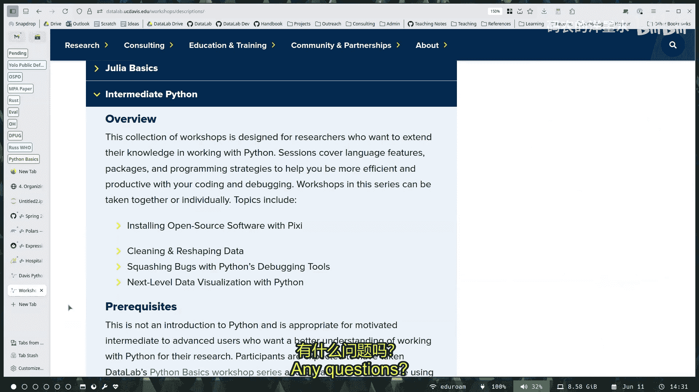

# Python数据分析入门：5：代码组织、可重复性与综合实践


在本节课中，我们将通过一个医院数据的案例研究，学习如何组织代码、确保分析的可重复性，并进行综合实践。我们将从读取原始数据开始，逐步进行数据清洗、转换，最终完成一个简单的可视化分析。

---

## 概述与目标

我们的目标是读取加州医院2023年的数据文件，并将其整理成一个可用于分析的数据框。输入是八个Excel文件，输出是一个包含所有相关列和行的统一数据框。

## 导入必要的库

首先，我们需要导入处理数据所需的库。我们将使用Polars进行数据操作。

```python
import polars as pl
from pathlib import Path
from plotnine import ggplot, aes, geom_bar
```

## 读取单个Excel文件

我们将从读取2023年的单个文件开始。Polars的`read_excel`函数可以读取Excel文件，但需要指定文件路径和工作表。

```python
# 尝试读取文件
path = "data/CA_hospitals/H_23.xlsx"
sheet = pl.read_excel(path, sheet_id=2)
```

上一节我们介绍了如何读取文件，本节中我们来看看读取后的数据结构。我们发现，数据的第一行是描述信息，并非实际的医院数据。因此，我们需要移除这些行。

## 清理数据行

数据的前四行和最后一行不是医院记录，我们需要将其删除。我们将使用Python的切片语法来选择所需的数据行。

```python
# 删除前四行和最后一行
sheet_clean = sheet[4:-1, :]
```

## 选择相关列

原始数据有355列，我们只需要其中一部分进行分析。以下是我们要保留的列：

*   **医院元数据列**：用于识别和分组医院信息。
    *   `fac_name`: 医院名称
    *   `fac_city`: 所在城市
    *   `fac_zip`: 邮政编码
    *   `fac_operated_this_yr`: 当年是否运营
    *   `facility_level`: 医院级别
    *   `t_hospital`: 是否为教学医院
    *   `county`: 所在县
    *   `prim_service_type`: 主要服务类型
*   **床位相关列**：包含以`tt_`开头的总计列。
*   **呼吸科相关列**：包含`respiratory`关键词的列。

我们将使用Polars的`select`方法和正则表达式来选择这些列。

```python
# 定义要选择的列
facility_cols = ["fac_name", "fac_city", "fac_zip", "fac_operated_this_yr",
                 "facility_level", "t_hospital", "county", "prim_service_type"]

# 选择列并转换数值列类型
sheet_selected = (sheet_clean
                  .select(
                      facility_cols,
                      pl.col("^tt_.*$"),  # 选择所有以tt_开头的总计列
                      pl.col(".*respiratory.*")  # 选择所有包含respiratory的列
                  )
                  .with_columns(
                      pl.col("^tt_.*$").cast(pl.Float64),  # 将总计列转换为浮点数
                      pl.col(".*respiratory.*").cast(pl.Float64)  # 将呼吸科列转换为浮点数
                  )
                 )
```

## 将清洗步骤封装为函数

为了使代码可重复用于其他年份的数据，我们将上述步骤封装成一个函数。

```python
def read_hospital_data(path, year):
    """
    读取并清洗单个年份的医院数据。
    参数:
        path: Excel文件路径
        year: 数据年份
    返回:
        清洗后的Polars数据框
    """
    # 读取指定工作表
    sheet = pl.read_excel(path, sheet_id=2)
    # 清理行
    sheet_clean = sheet[4:-1, :]
    # 选择并转换列
    facility_cols = ["fac_name", "fac_city", "fac_zip", "fac_operated_this_yr",
                     "facility_level", "t_hospital", "county", "prim_service_type"]
    result = (sheet_clean
              .select(
                  pl.lit(year).alias("year"),  # 添加年份列
                  facility_cols,
                  pl.col("^tt_.*$"),
                  pl.col(".*respiratory.*")
              )
              .with_columns(
                  pl.col("^tt_.*$").cast(pl.Float64),
                  pl.col(".*respiratory.*").cast(pl.Float64)
              )
             )
    return result

# 测试函数
df_2023 = read_hospital_data("data/CA_hospitals/H_23.xlsx", 2023)
print(df_2023.head())
```

## 批量处理多个文件

现在我们需要处理2018年及以后的所有文件。我们将使用`pathlib`模块来获取文件路径列表，并循环调用清洗函数。

首先，创建一个辅助函数从文件名中提取年份。

```python
def get_year_from_path(path):
    """从文件路径中提取四位数的年份。"""
    # 例如，从 'H_23.xlsx' 中提取 '23'
    year_short = path.name[2:4]
    # 转换为四位数年份，如 2023
    year = int(year_short) + 2000
    return year
```

然后，批量读取所有符合条件的数据文件。

```python
# 获取所有Excel文件路径
data_dir = Path("data/CA_hospitals")
paths = list(data_dir.glob("*.xlsx"))

# 循环读取2018年及以后的数据
all_hospitals_list = []
for p in paths:
    year = get_year_from_path(p)
    if year >= 2018:  # 只处理2018年及以后的格式
        df = read_hospital_data(p, year)
        all_hospitals_list.append(df)

# 将所有数据框合并为一个
all_hospitals = pl.concat(all_hospitals_list)
print(f"总数据行数: {all_hospitals.shape[0]}")
print(f"总列数: {all_hospitals.shape[1]}")
```

## 数据可视化分析

有了整理好的数据，我们可以进行简单的可视化分析。例如，我们可以查看不同年份医院总占用床日数的变化。

```python
# 绘制每年总占用床日数的条形图
plot_total = (ggplot(all_hospitals, aes(x='year', weight='tt_census_days'))
              + geom_bar()
             )
print(plot_total)
```

我们也可以专门查看急性呼吸科护理占用床日数的变化，这可能与特定事件（如疫情）相关。

```python
# 绘制每年急性呼吸科护理占用床日数的条形图
plot_resp = (ggplot(all_hospitals, aes(x='year', weight='acute_respiratory_care_census_days'))
             + geom_bar()
            )
print(plot_resp)
```

## 总结



本节课中我们一起学习了数据分析的完整流程。我们从读取杂乱的原始Excel数据开始，通过删除无关行、选择关键列、转换数据类型等步骤清洗数据。为了提高代码的复用性，我们将清洗逻辑封装成函数。接着，我们批量处理了多个年份的数据文件，并将结果合并。最后，我们利用整理好的数据进行了简单的可视化分析，观察了医院床位使用情况随时间的变化。这个过程涵盖了数据获取、清洗、整合和分析的核心步骤，是进行可重复数据分析的重要实践。