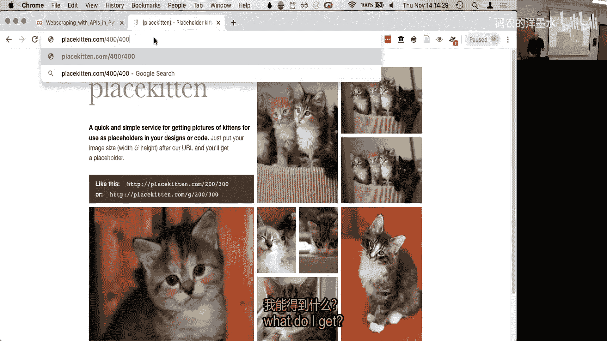
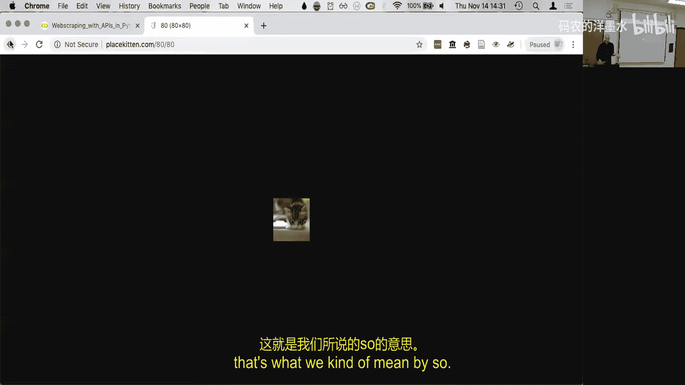
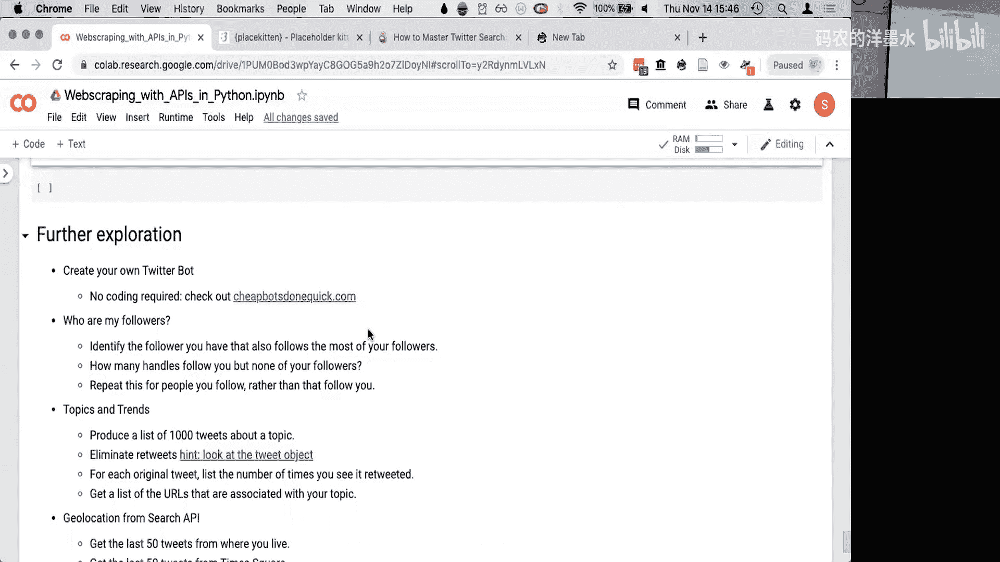

# 【全集】加州大学戴维斯分校 Python数据分析入门 中英字幕 1080P p06 Lecture 6 - 使用Python的API进行网络爬虫 -BV1AK6vBqEei_p6-

Welcome， welcome welcome I'm pretty excited to share this was I became more excited when I saw the list of disciplines of people in this room is completely wild。

 all the parts of the university represented right here just so you know who each other are we'll get to that start with me oh I borrow a lot of this the best part of this workshop honestly is already done you've downloaded a code notebook that you can run in your own world for no money and it has little snippets and where you see one hashtag sort of know results for some hashtag。

 you can just change your hashtag and run it and you'll get results for that where you see one username you can put in different username you'll get results for that so like without knowing any code without knowing any Python staying for the rest of this if you just sort of packed your bags and locked out you actually still have know 80% of the workshop so that's great I'll just really spend。

So there walking through that a couple little other work on kind of strategy other resources。

 the broader ecosystem and of course and like a little like what's an API talking about that。

 but in terms of the content and takeaway you've already taken it away。

I I'm a professor in the communication department， I'm part also a part of the computational communication sorry computational social science。

 a designated emphasis if you are a PhD student and you want to get a PhD minor you can get a minor in computational social science and that's great。

😊，I teach a grad course that goes that this is one kind of lecture from so if you want to go more into this kind of stuff。

 also scraping Instagram and scraping your own web history and making robo calls and like reading all you know Project Gutenberg。

 then you want to take communication to 12， if you're a gra student， if you're an undergrad。

 you want to take communication 152 v 153 and 151。F。Okay。

 that's enough about me Oh no a little bit more about me I like talking about me I really like studying like small scale democracy like online communities or people in co-ops and keeping the kitchen sink clean and or trying you know in futility to do that。

 I study self-governance computationally with big data and if that's really cool you can talk to me。

😊，You are from all over， most of you are grad students。

The next biggest chunk to you which I'm guessing like 10% is undergrads the next biggest chunk is staff and then some postdocs and I don't think am I right are there any faculty in the room I I was expecting some I'm super curious about this staff can I hear from some staff what brings you here and what your deal is and yeah。

what you're getting get out of this and Ill。Because I wanted to go back to school and get a master's of online I going to Georgia Tech。

O，Fantastic。😊，呃，邵言。So I guess like I was a microbiology major of undergrad and then I got like a job I haven't decided what grant program like for yet。

 but this is where I am now fantastic all right I saw there's got to be others because there's several on the sign up and we're full thats great。

Yeah。Information security office。Use this to啊。It data from various systems to。Oh great。

 maybe you're going to scrape maybe live stream some of these security accounts that are always saying this threat。

 this threat， this threat。いくらですで。应该啊。嗯啊后面。Wow， it actually sounds more useful than anything I've ever done so that makes me feel like I'm doing some good。

😊，And let's see， let's see。 oh yeah anything else No you guys are really from it seems like from every school every there's like food science in here and there's psych and there's a bunch there's some computer science but not too much know if it's too much and you feel like there's not diversity it's just all of it okay that's me that's you now we'll just I'm going tell you what As are then we're gonna walk through the code then we're gonna pull out of the code I'm gonna try to save actually if anyone's good at like watching the clock maybe because it's a bad habit and now always want to be somewhere else maybe you just interrupt me at 15 before this workshop end so I have time to go through the resources hopefully it won't come to that hopefully I'm gonna go pretty quick on everything to leave time at the very end for exercises actually just put a bunch of like stuff we can do hopefully we' get that's too unlikely we know I like realizing how much like talking that hopefully the last half hour。

😊，We can just like have a quiet time and meet up and like you can partner with a person next to you and just like do something one of these things and I'll walk around and help。

Okay， so we'll start with our working code so。So when I run an experiment。

 I have to get IRB approval， I have to get ethics approval to do experiments on people if you do a survey you have to get IRB to do empirical work on human beings you don't have to do an IRB to study the Internet to scrape the web why because the web is public you can go someone someone's own personal computer is serving content to the world。

 they're volunteering this information to the world and you can access them from anywhere。

 the web is public and so if something's on the what's special and interesting about that is the web is also text literally every web page that you're used to webage is being these interactive things with pictures and graphics and tiles and that's all a text file。

 your computer downloaded the textile had a bunch of instructions called HTML and it follows instructions to translate that text file into some interactive document。

But。At the end of the day it's textile， so anything you can learn by reading a text file is now data that's publicly available to you。

Because all of the web is text and all text on the web is public so what Skying is is just what I said instead of manually looking at the source code of 100 sites or one site 100 times and like reading it and then pulling out the little bit you like it's just telling Python to do that and you can teach Python where to look on the page to get just the little bar of that text file that you want let's say there's there's a data table like a table that you can put right into some data set that you're building well above and below that table is a bunch of HTML and so you can kind of skip to the parts you want。

I'll give you an example to do。So this is a website I built just sort of as a hobby fun thing。

 you can click anywhere and it'll say in Davis and it'll say what's growing there。Unless it's broken。

And okay， yeah， so walnuts some right behind my house is walnut， some flower seeds。

 strawberry and almonds and here's all the here's all the pesticides Hey that's neat let's let's look at the source code of that so view page I just right click view page source this is the text file of that web page it's a bunch of instructions and if we look in we can correspond bits of these instructions to what's going on So div map see OC sququiiggle。

😊，Squigggle is this sort of a squiggly header。 I can actually do something more interactive。

 I'm going to right click and hit inspect。I'm going to hit this little button here。

 You can do this front page and hover over parts and it'll zip me to the parts of the instruction that are relevant。

 So this is the header and here's the part of that page we are just looking at these instructions。

It just skips us right to squiggle and I can like change it and so if I looked up squiggle。

 I can get all the text， I could scrape all the titles of web pages that were written by me。系。

I can change things as well。 Okay， great， great。 So you can use your browser。

 mostly you use our browser to interact， but you can go use your browser to go a little bang under the hood and start to observe these text files。

 interact with them。 And that becomes necessary because you have to tell the computer which part of the website you want okay。

😊，now。Let's keep moving。So what's scraping scraping is that reading that text file。 What's an API。

 API is。A scraper， let's see， actually。Wait， did I lose this slide。There we are。 Okay， okay。

 I'm getting let。 So it stands for application program interface。 But who cares。

 That doesn't really matter。 just call an API。 That's like a word。 It just has all caps。

 A scraper is a programmer right that goes to a bunch of web pages and pulls out the text I want。

 And API is。😊，Sometimes that's like going through the back door kind of。

 that's taking something that was intended to be viewed by humans and making the computer read it。

However， sometimes people want you to look at their website。

 they want you to pull information from them so they want to make it easier。

 so instead of them writing a bunch of human readable stuff for you to translate back to computer in addition to providing their web page。

 they'll also provide a version of all those site content in a way that's computer readable from the beginning。

That's what an API is so as far as your computer is concerned scrape it we're writing a web scraper for web page is kind of going in through the back door and using the API for a web page is going in through the front door it's just using it how it's intended so it sounds like some messy jargon but a lot of computer science concepts there're just a bunch of awful acronyms that seem horrible but really is kind of a simple concept once you know it actually any questions there。

All right， yeah website。Okay， that's great。 I'm about to get to that。

 which means I'm structured well。 Okay， good。 so why do APIs exist。

 Most people don't know that the web is all text files of those who do there's three there's three types。

 There's the people who want to be scraped。 They're gonna be the ones who write APIs There's the people who don't。

😊，They're going to obfuscate， they're going to make it hard to scrape。

 and they're not going to provide an API。Then there's people who are particular about it。

 so I'll get to them。They sort of like being scraped but under their terms so most people who don't know the if youre if they're in this first category then they don't have an API because they don't what's that so it's just these categories that do。

So let's talk about each of these three categories of person first there's the don't scrape me who are they a lot of social media。

 anyone where data equals money， you can think what Bloomberg。

 you can think I dont know' who's a site that someone like realized they have to pay to get their data。

😊，Oh yeah， okay。😊，I dont know who's who counts。You know， I used to do nonprofit stuff。

 There's a company called Guidestar that like publishes a bunch of information about nonprofits。

 including all their all their like pounding docs。 you can do like a bunch of forensic stuff that they charge for that。

 just any company that like exists on the Internet to provide information。

 but they make money off of it they don't want to be scraped。

 I scraped guidestar and lost my account。 So they'll put up obstacles。

 one example is they'll kind of watch who's doing what to make sure no one's taking too much of their entire website。

 but with Twitter is actually a good example of putting up obstacles as is Google。

 I'm gonna give you a little example there。 So you notice when I said here。

 these are pretty descriptive。 I'm hovering over header here。 and this is the header of the site。

 I hover over siggle and there's something squiggly。

 I hover over map outer and like the whole map gets highlighted。 and then within that。😊，Map just map。

 you see like map outer covers everything， then map In just covers like the map。Okay。

So like these parts of the site are descriptive I wrote it so it's descriptive so that for me there's meaningful correspondence between what I see and what I'm writing that's not always the case。

 this is part of what I mean by obfuscation so let's just Google something and then we're gonna look at the site content of the first hit what's the first hit of this is right there the Wikipedia article on Pennnies look that's not very descriptive is it let's see they go。

You see that right there， S3 U UCC there's a code referring to that part of the page。

 the first hit and it's completely obfuscated it means nothing and it'll change tomorrow So if you want to write scrape Google by referring to this sort of address on the page you have to change your scraper every day or every hour every user or every refresh or something Twitter does the same thing they deliberately change the page structure and the names of things randomly to make it hard to scrape so this is called obfuscation sometimes they'll do it because they don't want to be scraped at all。

 sometimes they'll do it because they want you to use go the official way they say the humans stuff is for humans if you want the machine stuff go through our machine route either because it saves us a headache or because we make more money that way。

嗯。All right。Keep moving。Actually， questions about that don't scrape me is what what I mean by obfuscation I'm getting the idea across maybe okay。

 then there's people who do want to be scraped who wants to be scraped government sites， they like。

 yes， our responsibility is to provided information， does anyone scrape government data on anything？

😊，然我的。嗯。I' to say scrape， I mean use， do you use govern data on anything？Pubmeded， Okay， great。

 great。 You like you scan many papers on Pubmeded。嗯。Okay， great， great， great。

 So is P government No way， oh， that's fascinating。 Okay， so I'm like so they have a public mission。

 which is to provide information about articles。 So of course they're gonna be easy to access Anyone else uses like government data。

😊，Yeah。EPA， okay， great。 EPA， they must do all kinds of stuff。

What are what are some examples of the kind of data that's just for free。OAA provides。

 you know weather reports of the Earth for free。 So this is all stuff you can just get。

 And do you get it by scraping no because they want you to get it。

 they want anyone to be able to do cool stuff with it so they built an API to make it possible for your computer to get it easily Wikipedia is a great example。

 literally everything that's ever happened on Wikipedia， every edit。

 every user who joined every user who got kicked off every little tiny event is stored and you can go through the entire history of Wikipedia like a movie is's crazy。

 And then other programmers， programmers like people using stuff they built So programmers will nerd out and build an API for their little toys。

😊，When when you are a please scrape me you built something I'm going to distinguish between a public API and a private API a public API is one you can just sort of hop on a private API is one that you have to like register with Can anyone give me an example of a private API they might be about to interact with hey look at that you all had to register so you got the thing so we're gonna call Twitter a private API let's do let's look an example of a public API to kind of ground this out。

I built this into the notebook。 So let's load up the notebook。

 raise your hand if you have no idea what I mean by， can you see kittens。Okay1，2，3， Okay， great。

 higher， a little higher。 It's like a Okay， that's like 25%，30%。 Yeah， and then yeah。

 raise your hand， if you know what I'm talking about by kittens， Okay， great。

 So if you know what I'm talking about by kittens， you did some of the instructions。

 which you didn't have to do So no pressure if you didn't you got a certain amount far in the notebook。

 what we're gonna do right now is load up the code notebook。

 but there I started the code notebook off with some textual instructions that we're gonna kind of go through together。

 So what am I doing first I'm going to。😊，A website coab。rese。google。

com What you're going to get is the Python version of Google Docs or Google Sheets。

It'll open up very nicely and。嗯。Then I'm going to hit if I just escape this。

 I get this sort of interface that says， welcome to collaboratory blah， blah， blah。

 I'll close the table of contents and what's going to happen is this is like a document that's a mix of text。

😊，En code。Raise your hand if you've never encountered a code notebook before。

 you might be like Jupiter or something if Jupiter means nothing to you， raise your hand。

This isn't very good。 Okay， everyone put your hands up。Yeah。If Jupiter means something。

 you take your hand down。😊，Really。Okay wow so okay so only a couple of people don't know okay haven'tington encountered a code notebook before so this is so code notebook is this file that mixes text and code when I hit this play button I will run the code how many seconds out there in a day 24 times60 times 60 produces 86 86000。

😊，How many seconds in a week？A bunch more。 Okay， so we're gonna to。

 so that's the default notebook that just happened when we opened coab。 I'm going to go to file。

Upload notebook。Choose file。Then what I did earlier was I went to that link I sent around。

I downloaded that i P N B file with an awful ending of a file name。

And I'm just going to choose that file that I just downloaded wonderful， how nice。

It'll load up thish， seriously。Does this happen to other people？It's rude。What that's madness。

 What's going on。 Okay， I'll try Chrome。 actually， Oh， they might have killed。

 I think Google might have killed。Cipple chromium， let's see。Sorry， Chroie， I'm being in there。

 let me just figure something out。Test login I'm login。你看下。好。没。Everyone。

 you're not going to be able to see my password， but you can try。Yeah。Oh't know。Oh no。

My computer freaking out about something。Upload。嗯。没。

Research in between the Google and the rest of the stuff means that it changes without warning。

But mostly it'll be fine， yeah， question。Yeah， if think go to。Then， you can。Oh， yeah。Thank you。

 Thank you。 Anyone else crashing。 I love crashers， by the way。 So I'm like， you're my favorites。

 okay。😊，あかではいみ。Oh my bad， I'll reopen Zoom。钱完全。Okay， start no， not's our video。Oh， right， okay。

 thank you。Zoom master here。 Zoom link， Okay， the green outline。 Alright。

 so all that's telling us to do is we're gonna go to placekitten dot com。 This is gonna be adorable。

嗯。Placekiten。com。Okay， here's like the whole thing of placekiten。com， placekidten。

com says how to use itself。没有。Okay。Okay， placekitten。

 co has a bunch of kitten pictures now if I and it's telling me， okay。

 add to the end of the URL here， add two numbers separated by backslashes， Okay。

 so 400 and then 400 Okay， what do I get I get a kitten picture that's 400 by 400 pixels。😊。

If I change one of them I want I like I want give me more kitten。

 I want more kitten about twice as much kitten there now except tall that's ugly so I'm sort of putting together what this means if I switch the 400 and800。

Instead of getting something that's tall， I get something wide， what's going on。

 well I'm just going to guess the first number is the width and the second number is the height。

 I'm specifying kitten pictures and and if I put a slightly different number。😊。

I'll get a slightly different kitten picture， one that is one pixel wider。This is useful。

 The reason this was invented was there is some nerd on the Internet and he was trying to mock up websites and he just wants placeholder images。

 So he just threw something together real quick that gives him a placeholder image of any size for when he's mocking up websites to the public and now you have your first API Why is this an API because it's a this happens to be a special API It's kind of human readable right Like it's pretty clear where all these things do there's a third instruction I can add a G。

😊，As a first thing before the numbers， and I'll get a picture of that exact same size， but grayscale。

So we can do different colors， we can do grayscale or not。 Okay， let's do really tiny。

 let's do a tiny sweetie little thing little baby kidding。😊，I don't think it'll be a baby。

 It might just be small。 They're a really small kitten picture。

 Oh but I want color I want to look in these little eyes Oh or hers Okay there。😊，You get it。 So。

 so the this is a site I can interact with entirely through two numbers and like a little flag。

 the G or no G， right？ So that's， that's what we kind of mean by so。😊。

Two numbers in a flag like computers know how to talk numbers and flags， like so this site。

 even though it's human interact with a bull， it's also computer interact with a bull and because it's computer interact with a bull。

 we call it an API。Any questions？And so what we can do is so API can be a really complicated thing where you have this giant authentication process it's a total pan butt and all that stuff。

 but it can also be as simple as instead of you typing placekitten。

com slash400lash400 in your web browser you type placekiten。

com s400400 in this one line of code and instead of your browser going to that web address Python goes to that web address pulls down the text file remember it's a text file it's a bunch of ones and zeros and then does whatever you want with it because it's code and you can do whatever you want with code。

So let's do that， so here we have I'm scrolling down your first APIs Placekiten。com。😊。

We just did a bunch of playing around with PlaceKin。

com in your browser now we're going to scroll to and this is now we're going to do placeKitin。

com in code。So we'll just do what we did by the Python version instead of my browser going to place kitten。

com， Python is going to go to placekiten。com。So what I mean by boilerplate。

 I do boilerplate means you I look scary， but you don't have to know what I mean。

 you just have to run me， and maybe that's not always a good example to run random code by people on the internet but you can trust me。

So I'm going to hit the play button， there's a shortcut for play that I don't know， I like it。

 I do a shift return， maybe you can。Shift turn and what just happened when I ran that you see this empty square brackets here I keep pointing my screen you see that after I've run this that used to be empty square brackets now there's a two if I run it again it'll change to a three that says that A this code's been run and B it's the third thing that got run since you loaded the page if I do and then I'm going to run this and it'll say four。

😊，4， okay， great。 Now I'm gonna do runtime。 I don't really use a lot of these commands up here。

 So if this feels like a lot of stuff don't worry about there's one thing I kind of do sometimes which is reset all run times。

 This is a way of just wiping the memory just like starting from scratch。 Once I do that。

 this square brackets reappeared。 It's like it never happened。

 that's nice forgetting a kind of clean slate blank start。

 So I'm just gonna run my bullet plate having no idea how it works。 Okay。

 and having run my bullet plate， I've got two functions that work now。 One says URL to image。

 It's gonna take this literal text。 remember I said we typed it in we just typed it in。

 we typed it and then we got this picture。 and then I gave you the second function called print image that it takes a picture。

 this looks like a variable， but it's it's a picture assigned to this variable and we run it。

 We'll get the picture。😊，Great， and in this notebook you're going to see this little convention I have a rocket ship emoji it's hot code if you're not familiar with code you don't know what it does。

 I put a little rocket ship next to every line of code that goes to the Internet。😊。

So a lot of that code is just going to take something from before and do stuff to it all within the little world of the code notebook。

 but some lines of code go to the internet and pull stuff down from the internet so that the other code can play with it so this first line goes the internet This second line doesn't go to the internet it just takes something that came from the internet and a different line and images it so there's no rocket ship next to this line there is a rocket ship next to that line adorable or three kittens for the price of one API call that just makes us feel great and so on and then at last is a 75 by 75 will'll get a tiny little tiny little pillar。

😊，All right， isn't that sweet so all that to say， a web API is a vocabulary that makes it easier for code to talk to the internet any questions？

😊，Oh， yeah， any question。there something， know someone sort of wiping their nose， kind of a fake out。

I have a question， is anyone not see kittens right now？Does anyone not make it。We lose anybody。

Come on， someone didn't make it， but I don't want you to be left behind because you made it this far。

Okay， we're all here that's great i'm happy with that let me go back to my PowerPoint for like two slides there's a third category of person we have the don't please zone't scrape me we have the please scrape me now we have the scrape me on my term that's the most of social media that's all this is a little redundant with the please don't scrape me。

😊，When data equals money， when the resource is abuable， so Twitter is abuable。

 but when Twitter found out how much it was being used to influence elections。

 they added restrictions to their API， so by exercising that by making everybody register they have a lot more control over the manner in which their resources are used and so they can do they have they're less powerless to prevent like social media campaigns run by authoritarian to take grassroots support。

So you use an API private APIs are kind of a bummer。

 you have to do all this extra work you kind of have to know more code unless I give you code snippets that work and a lot of times they're lame。

 it's just the people trying to make a buck off their data but sometimes it's like reasonable like fine this could be used to abuse people and so they have to control who has access to it we accept we deal even though it's kind of a bummer Twitter is gonna be our main example of that scrap me of my terms so a private API demand something called an API key a key is not like a key in your pocket。

 it's actually a string of awful characters that look like they mean nothing that's the awful string characters you copied into your web authentication web science authentication that TxT those are your keys keep them secret they are passwords the reason I made you create that text file is I don't want you like you're totally welcome to be like hey Seth thanks for the workshop。

I played around a little bit more and almost got this working but couldn't could you take a look this sounds like like really bad boundaries and maybe it's an awful idea for my career or tenure but I'm totally willing to like do that for you but what I don't want you to do is when you do that is paste your password of your personal email or or and therefore I don't want you to paste your keys right I don't want to see that when you send me your notebook。

By putting your notebook putting your secret key into this little text file。

 you'll put yours up and then I'll put mine up when I after run your code and I never saw I protected your privacy。

 these are sensitive and secret so keep them secret your API key identifies you uniquely that's the point of it。

I'm gonna give a little bit of word about why Python do I actually say why Python's I mean it's sort of the best first language to learn Yeah question no。

 I'm like trigger happy fair people have questions it's really insanely versatile it's widely and respected。

 it's written to be readable as an awesome community you can put any question you have on the internet and random people on the internet want to help you you'll and you can learn how to write good questions to make it more like to help you and it kind of doesn't matter what first language you learn whatever language you learn if you get good at it。

 it becomes really easy to pick up another more than human language is。

Because code is all talking to the same thing at the end of the day。

 it's all translating between a human and ones and zeros。I said what that is。Okay， yeah。

 so we can get to our code now。That was all APIs， so now we can get into Twitter。

I'm going I'm just giving you， you know， if you came here and learn how to program。

 I've got bad news， but if you don't know how to program。

 what you do know how to do is hit the play button and so that's great because normally the way pedagogy works is we'll teach you all the boring stuff without telling you why you would ever want to learn it or what's neat about it。

And then we'll do about like three years or in the case of mathematics like 16 years of that and then the people who survive will show them a bunch of cool stuff that you can do with everything you spent 16 years learning I just want to skip to the good stuff。

 so you have code， you see it does something cool and interesting and maybe that now when you have to learn all the boring stuff like what a list comprehension is or what a for loop is or whatever you kind of see maybe where this is going and that motivates you and makes you all learn it。

Does anyone like literally just they they know they' first they have no idea what they really have no no no code。

 does anyone know no code that could happen this plan。How about Leono Python？Okay， yeah。

 but you know like what， what do you know instead？22O22。Okay， great， great， great， great， great。

 So you're already in a pretty good position。Honestly， you kind of know Python already。 I mean。

 you don't really。 and here's the best thing to Google when you're picking up a new language is just Google our guide to Python or Python guide。

 the ja。 Another great thing is Python gotchas for for our programmers or jascript gotchas or jascript gotchas for Python programmers or whatever like put the two languages together and and random people will write a blog like here's what destroyed my brain I'll save you a lot of time by just telling you what to expect in this transition。

😊，Okay， so let's run this code we're going to install so yeah I'm going to just show this snippets for the most common things people do on Twitter。

 they want to pull down everything by a user， they want to pull down a bunch of stuff on a hashtag or they want to pull down a bunch of stuff in a location。

So those are what I'm going to kind of focus on， we're going to get into some finer points。

 we're going to get most of working with the Twitter API is working around the very restrictive limits it imposes on you。

 for example， this notebook is less than hopefully no it might be more。

You can only so think of an API as a question you're allowed to ask。

 you're allowed to ask Twitter a question， and every time you see a rocket ship and you run that code。

 you just asked Twitter a question。Twitter， one of the the throttling mechanisms Twitters imposed on people who aren't paying is that。

You're only allowed to ask 15 questions in 15 minutes。

 Basically you're only allowed to ask an average of one question a minute。

 So if this notebook takes less than 15 minutes to run and makes more than 15 calls you'll get an error at the bottom saying that nothing happened because you exceeded your limit and you just have to sit on your hands for 15 minutes until your number of questions is back up So by me going into a fairly deliberate pace。

 we're gonna make sure that we don't exceed that 15 now that's super annoying and you can so this is so I'm going to repeat what I said before。

 most of learning the Twitter API is learning workarounds to all the arbitrary limits they impose on you getting anything useful out of it've almost taking it apart beyond the point of usefulness they've almost made it unusable It's more of a marketing thing that makes you want to pay However。

 I'm allergic to paying so there's lots and other people are too and there's lots of workarounds and I'm gonna give you pointers on the。

The more of a dramatic and impressive and fancy workaround use， the more Python you have to know。

 so some of these will either be motivation for you to learn Python or a chance for you to show off how much Python you already know。

But you know， we can actually get， I mean， think about it。

Let's say with the workarounds to build your data set， it would take two months。

And let's say that if you were better at Python， you know for a fact that it would only take 10 minutes to collect that same data set。

You have。Will I say five minutes？Yeah， you have two months minus five minutes to learn more Python。

And like and it was breakeven。But you never forget the Python afterwards。

 so like it's better to use these workarounds as a motivation to learn more stuff because you didn't like stop becoming good after that lab。

U it'll be these kinds of things that like you sort of realize I I have this would take six months to do manually so I have six months to learn those are great excuses to to force yourself to learn to code。

ough talking we're gonna run more boilerplate we're actually installing a package the collab notebook this notebook is not really actually running on your computer if you were to check your activity monitor and see like what your CPU is doing right now it's not doing anything really this notebooks being hosted by Google somewhere in the world probably Mountain View they're providing you a computer that's actually probably better than yours they're providing you two cores 25 gigs a Ram and 6 I'm sorry 25 gigs of space and 16 gigs of Ram it's pretty impressive computer downside is it stops existing after 12 hours so if you want to run this overnight then it'll break。

We're gonna run more bulletplate so and when we ran this Pi install which you don't have to understand we actually installed software on Google's computer over there。

 they give you a lot of control over the computer that you're playing around with you can even use this whole setup to code an R and set up Python it's very flexible and exciting Now we're going to authenticate this is probably where you made it now we're going go past where you made it I'm going to run this code and I'm going to get this little boxy here oh look at this little boxy I'm going choose file I'm going to run my website and authentication you'll run yours we're each going to register authenticate with Twitter with our own keys I run that and once you've run that then all the code below this block is going to run and do Twitter stuff some of it on your own personal Twitter account who had to create a Twitter account in order to participate123 oh bunch。

Wow， okay， wow， that's interesting。And and hopefully you like followed some people and maybe got some people to follow you。

No， or maybe you followed some people at least。This will be a lot more boring if you're not following anybody so maybe follow someone and if you want to follower。

 maybe I should have done this in the beginning， if you want a follower I could take people's handles and put them up there and you can like follow each other it'd be adorable oh yeah。

 you can tell oh my God， this is by the way the entire reason I'm doing this workshop is just to get more followers。

😊，That's not， I'm not really。This is me。 Does anyone want to say their own so they get a follower？

This is like bald self promotion。嗯你这边。Do you see Data data sign？U see， Davis。Data sign， no spaces。

Does someone else want to follow her？No， okay。 it was yeah。 okay with yours。Rogue。Undercor。

Rogue underscore PhD。 It's not case something they visit。 I don't think so。Alright， anyone else。

 So yeah， that's the idea。Then'll make some of these more interesting。We are okay， I've done that。

 so I'm just running more Broilerplate again， I don't know what this code does。

 I'm just running a question。Where we upload or privateYou've now upload your private API yeah to a computer owned by Google it's in a virtual machine that is private to your account so Google knows it but they already know everything and they'll forget it as soon as you refresh as literally if you do。

Remember runtime reset all runtime it'll forget what your API keys are you didn't upload it anywhere permanent。

 you uploaded the data from the text file into the notebook。

 but the text file itself is still on your machine and only on your machine。

Does that answer your question， Great， great did that how sketchy does that feel？Part for the course。

 Okay， it could be worse。 I'm trying I like came up with the least bad solution I could to this whole。

 How do I teach you guys something without sharing my keys。😊。

In a way that is usable and all that stuff， So I'm just running this code， don't know what it does。

 but it's going to create this little thing， this variable called API and API is going to be the basis of every other call we do Every rocket ship from now on is going to have API dot something。

😊，So let's just go through them。 We're going to start by pulling down one tweet this we're going to how do I know one it says。

There we're going to pull it from our own timeline。

 so this is home timeline the though the there's a lot of restrictions on Twitter。

 there's no restrictions on scraping yourself。呃。So nothing happened， but that's okay。

 we created a variable but there's no output because I didn't output any output this next code we're going to output the output we're going output the one tweet that I just pulled down I guess I follow Pro publicublica and they just tweeted what is Pro publicublica maybe they weren't sure。

Now that so that's that's a tweet as far as we understand what's a tweet oh a tweet is a user and some content right that's what a tweet is actually a tweets quite a bit more I'm going to print out a tweet remember a tweet this is literally the tweet we just download I'm going to print it out to the screen。

😊，Here's what a tweet really is。See all this， this is what a tweet is。Let's look at。

 let's look at what a tweet is。 I almost have to make this smaller now it've already produced small。

 a tweet is a bunch of information。😊，Let's see it was a tweet something that was created a certain time。

 it has a it can have a picture， it can have media。

 a whole lot of media that's a list of all the media on this tweet it's a thing that can mention other Twitter users。

😊，It's a thing that。It can be favoriteed。😡，It's a thing with text see but the text of the tweet is a very small fraction of what a tweet is this keeps going it's a thing that came from a place sometimes but not all times it's a place that can be in reply to things it's a thing with a unique identifier there's a number that identifies this tweet as opposed to all other tweets。

😊，That's handy。 Sometimes you're scraping a hashtag you'll get duplicates。

 you can check the ID to make sure that you're not getting duplicates to fill it out duplicates。

 It's a thing that was in a language。 This one happens to be in English。

 Twitter does its own language detection which is super handy if you only want tweets in some language or if you want to filter out tweets that aren't in English you can do that just by checking this。

 it's a thing that can be retweeted， It's a thing that might have sensitive material。

 It's a thing that might have sensitive material that's banable。

 It's a thing that was posted by a user， Here's all the information about this is what a user on Twitter is。

A user on Twitter is someone who has favoriteed it we're going nested。 This is a nested object。

 The tweet contains all information about the person who posted it。 that's what's that like。

 That's like。Carrying around， in addition to your own DNA， your parents's DNA。Which doesn't happen。

 Right， Yeah， doesnt that doesn't happen。 That would be gross。Yeah。

 so it' it's like so a tweet as a thing is a thing that carries all of the information about parents who in turn have all these attributes。

 a picture that describes them as a description of their header a number of things they favor。

 a number of things they follow， a number of things that follow them and so on and so on and so on and so on。

 Okay， that's what a tweet is。😊，That's as tweet really is， and as far as Python is concerned。

 I know what a Python dictionary is。Okay， yeah， this tweet is a Python dictionary and I can reference parts of it。

 so let's say I just want to reference the language of a tweet I'm going to hit code here and this is going to create a new code block Okay code so here I have a tweet。

😊，Tweet， and I'm just going to。Type L， and I'll just get the language of the tweet。

 or I'll type full text， full text。And I'll get that my text back okay， so we can query。

 we can pull out the parts of that giant object and just see what we want to see All right great so this is great suddenly we're like this is familiar Python idiom dictionaries like we're good with dictionaries if we know any Python we're good with dictionaries and now we can use Python right what we're familiar with to talk to Twitter all we have to do is know what what the structure and the names of the things in that dictionary and we're like we're in we're good。

😊，That's that that is an API that's what I mean by Twitter being able to talk directly to your computer。

 T Pi is the library we is installed to do all this。

 TI translates from the API to Python idiom specifically。Okay， so it's not。

 So how useful is that Now， you know how to pull one tweet from your own home page。

 Now let's pull something from let's pull more。 We can change the count to。😊，1en，m I'll just do。

 I'll just skip this。 You can't pull more than 200 at a time。So I just pulled down 200 tweets。

 All I did was I changed this number Max count， max count goes there， so I tried to pull 201 tweets。

 How many did I actually get。嗯。Here's all the tweets， here's 200 tweets from my home account。

That's a bunch。How many did I get， I printed out the number 196， so the number you ask for。

 you won't necessarily get that many， you'll get almost that many。

This is just weird limits of the Twitter API， I'm going to get rid of all that。Okay。

 so we now we know how to pull multiple tweets from one account。

 how do we pull from someone else's account where we use this This code is different than the previous code because instead of saying home timeline now it says user timeline and this function takes all the same arguments except it takes one more in the beginning the name of an account I love the Miriam webs to dictionaries Twitter account it's very hilarious and pedantic so we'll pull down 20 tweets from there and we're going print them out we're gonna print them out using a four loop so this is now a list of 20 tweets we're going go through every tweet in that and print it out print out the full text。

😊，Okay， I'm not teaching you Python， I'm like describing the code。Here's 20 tweets from up still。

 let's see what are they up to searches for bribe are up 28 times。Anyone know why bribe is up？

30 times。Impeachment Pelosi just used the word bribery to clarify the Democrats political message about the impeachment proceedings to transition people from talking aboutquid pro quo。

 so now she's talking about bribery and people are responding。And so on。 These are all tweets。

 That's great。 So we can also pull images down。 We've got kittens， right。

 So tweets are a thing that can contain media。 We can pull that media down itself rather than making you figure all that out。

 And like， what's pill。 What's Io by sayo。 I just wrote code that does it。😊。

That way if you want images from Twitter， you can just replace Lisa Daz。

 this is Lisa Hannneman who does Bojack， you can just replace that with some other account and you can get all the images from whatever account you want how do you do that you just run this nice code and then loop through all the images all the tweets that come back and print out the ones that had images。

All the the most recent 200 is what's going on， so we have in congruous else we have nothing else。

Anyway嗯。We can， okay， so that's one thing we can pull down is tweets。

 We can also put down followers and friends。 friendsend are the people who follow you on Twitter。

 I actually didn't know that。 I thought it was followers and followers。

 Why is it useful to pull down someone's followers。Why would we want to do that？我音婷。The course of。

That's great。 That's great。 How about follows。 How Why would I want to know who follows somebody。

Maybe you just want to count that number to see how popular they are know。

Maybe you want to see like reciprocal follows。 You want to see people who follow someone and are followed by that person。

 That might reflect like a reciprocated friendship or relationship。 It might be more meaningful。

 It might be worth comparing。 So here's code for that。

This is really fun to teach a notebook without feeling any obligation to teach code I can say this is what this does here's all the okay so magical realism bot is kind of a fun quirky bot it just posts randomly generated phrases I actually have a link if you want to write a Twitter bot you already have an API key go to cheap bots done quick do co and you can author a little bot that automatically generate sweets for you So magicreism bot basically does that magical realism bot is is very is kind of an aur and very fancy and high on the Twitter totem poll how do I know because they don't follow they have many followers。

😊，115，000， but they don't follow anybody， they didn't have to do any trading for follows。

Like the rest of us by follow me， okay， so so we now know how to scrape ourselves or pull down tweets on ourselves。

 we know how to pull down tweets from a user account。

 we know how to pull down different aspects of information from my user account。

 are we an hour we're an hour in。This isn't bad。What's going wrong because this is way too much content for two hours。

 I must talk too fast。Oh lucky you okay， so we can also so that was API what was that that was API a user sub timeline was the name of the function Now we're gonna to look at a different function called API do search API do search searches tweets for text so I want to see every tweet mentioning BBC documentaries and I'm just going to print out some information what I'm going to print out from the 20 tweets I get back I'm gonna to get a screen name。

😊，I'm going to get when it was created and I'll get the full text。All right。

 BBC itself is mentioning BBC documentaries and a bunch of random users。😊，This is interesting， look。

 this tweet doesn't mention documentaries， it just mentions BBC and there no that mentions BBC。😊。

SoWell're if we search long enough we're also going to find some tweets that mention documentaries but don't mention BBC。

 so that search capability is an or give me any this word or this if you put in several words it'll be give me this word or this word or this word or this word and you have to do some quality control to make sure you get both words if you do a search for houseboats。

 you might get a bunch of tweets about boat houses。啊嗯。嗯。

And using the search API is also how you'll search for hashtags hashtags are another thing you're going to want to search for。

 it's actually more likely you want to search for hashtags than for text。

 but we're actually using the same function because a hashtag is a type of text so you don't have to do anything fancy you put in the hashtag and for dad jokes we'll get 20 dad jokes。

Or 20 mentions of the idea of a dad joke。一样。you search example example uB。How can you specify it？

I' no。 let's find out。 Let's Google it。Let's see Twitter。Search。

I'm going to use the fancy word Boolean， that's how nerds say refer to logic。

 how to master Twitter search first hit basic Boolean operators。

And it looks like we're allowed to just do capital and put and in all caps and you'll get the and Okay great。

 what else can you do you can put a thing in quotation marks to get exactly that phrase。

 you can put or in all caps to make the or explicit you can search minus if you get if you search when and way I want to do this I want to find all documentaries that were not made by the BBC I would do the API do search and then my thing would be documentaries space minus BBC。

I can do I can use search actually search encapsulates kind of everything if I want to search only the hashtags only the tweets where one particular user used a specific words or all the tweets to a specific user but only the ones that use the specific word these are all keywords I can actually throw into the search API every mention of a user I can pull pin dates down actually I had no idea I have to put this in my lesson I didn't know it was this good look at that I can filter。

 I only the retweets， only the replies， I can throw geocodes in man you can just do everything I could just throw my whole notebook away and just reduce it to this page。

😊，Okay， great， so yeah， API does search super powerful。😊，And of course you can combine those。

 you can have an and and a minus and a geotag and only get the retweets， you can do all that。

 but only the ones that are to a certain person， it can be really complicated。That's nice。

As someone take you're stuck here？And so your obligation held me。

 would you tell me write me a note to include that in an update to the notebook。😊，Thank you。对。Okay。

 more questions that was a really good question yeah's no no。

 it's literally the text that you the way you would type it into Twitter so what do what do you want to do？

Well you want to search a set what set of hashtags do you have in mind？找这什么？Right， yeah。

 but but Twitters big， you know， Twitters big。 So maybe we'll find something。 Yeah， look， we found。

 I'm guess I don't have here。 I'm sorry， it's not clear what which of these lines is a tweet and which of these lines is several lines of a multiline tweet。

 So I'm gonna like just put a little flag that tells me when a tweet starting and we'll just do that again。

Okay， we found two tweets that mentioned both hashtag dog dad jokes and hashtag dogs。

 What do we have We've got。Something about Pomeranians and we've got。嗯。This was， oh wait。

 what did I do？你搞一对。Honestly， I get confused， I think if something intelligent。

So it's sort of a black box that sometimes it does and sometimes by default。

 it does what it thinks you want。But if what it thinks you want isnt what you want。

 that's when you start breaking down your capital and your capital or。嗯嗯。Oh， yeah， no， literally。

 Well， no， listen， we don't even have to do this in Python。 Let's just do it in Twitter。Here。

 I'll just， oh my god。No， just like this。Daad jokes and all caps， you know。

 puppies is better it would be really cute。So like this is explicitly both dad jokes appears and puppies plural appears。

 but I missed puppy， you see puppy didn't appear so I would have missed all those cute single puppies。

Did that answer the question and so literally no， this is what I mean by API search takes the string that you would have typed anyway and just automates that you put literally what you would have typed。

 put it in double quotes， put it in API。 search and you'll get that。That answered your question。

 Okay， good。 more questions。Before we mentioned that。

Before Twitter required a private API with your own key， you said like that。

Yeah that stuff came up in that tweet。How do they use that that。Or is it just in general that that？

Okay， well so I'm showing you the Twitter API for scientists。

Scientists aren't interested in doing anything to the world。 They just want to see。

 observe how the world is。 I'm being ridiculous。 But if this was Twitter API for marketers。Marketers。

 maybe they don't care， specifically advertisers， they don't care what's happening。

 they just want to get the message out so you can also use the Twitter API to post tweets。

To automatically follow people， to do everything that you can do by clicking on the web page and Twitter。

 you can make Python do automatically so is what this is what a bot is we're halfway to a bot we have the eyes of a bot now but you just learn a little bit more of the API and you'll get the fingers of a bot and you can automatically be on Twitter automatically be on Facebook on Instagram you can write Python interact with all social media that's what a bot is。

And it was probably written in Python， so nexts the awful bot that follows you or whatever in the back of your head。

 you know it was written in Python。Did that answer your question there was another。我这我这个。

Times that circuit or date to the circuit。 like will go。Yeah so I'll get it。

 Will you remember asking that in a little bit？We stage the API I would like to actually post some。

对这个。Can you do that just from your account or can you。可以。I mean， what's a fake account， right。

 a fake account is one that's not your personal account。

 but you can create lots you can create as many accounts as you have emails and you can create email there's certain email providers that make it really easy to create 20 accounts。

So a bonet。Yeah yeah， yeah yeah， yeah， you could create fake grassroots support for your candidacy for Davis City Council yeah。

Everyone thinks this guy is great。 They know suspiciously a lot about him。😊，Actually。

 I have a better answer to your question， one of the keywords that I just sort of really should have known this for the API。

 search lets you specify a date range from this to this。So if you want 200 tweets going back to 2004。

 but you keep getting them to 2016 because some user is really prolific。

 just add that as a search term that you only want them until 2006 or whatever。Oh。

To say had there were more than 200 for that time period， goal support more most recently。嗯哼。😊，Yeah。

 yeah that is a question you can ask me again later and also everything I just said about that I might be wrong it's really sometimes Twitter Twitter and everybody。

 they're not super transparent about the limits they imposed because if they told everybody。

 then the people abusing those limits would be faster at finding workarounds。

But it creates a giant headache for the rest of us。

 so it could be that they separate from just giving all the most recent tweets however far back。

 it might be separate from that they also don't let you search。Too far back in time unless you pay。

I don't know， so actually if anyone finds that， let tell me because I want to know。

The questions have been really good， so let's just keep going questions。Yeah。感谢新在过来。可以看到。

good question， I would guess that these people were very talented。

 they probably wrote their own stuff and since they're slavs， slavs love optimizing C。

Is is my stereotype， that's like a coder stereotype。So I bet you they wrote it all in see。

I'm just making stuff up out， I don't know the answer to your question。Yeah。

Im trying to think if that was super offensive。I don't think so， maybe though。😊，If so， tell me。Yes。

水先下。Returning the street。And I'm not a huge Twitter person。

 Yeah are there comments on the page or is it just a reer？That's a good question。

 there's such a thing as a reply to a tweet， you can reply to a tweet and you can retweet a tweet and you can retweet a tweet with commentary。

And those are different things and you can impose different filters on all of those things if you're just interested in the replies to maybe there's some famous tweet that's so important it deserves its own paper you can search Twitter just for the replies of that tweet you might be restricted to only 800 right now we're paying both the original tweet and any replies。

I think so， yeah， some of this is trial and error， unfortunately， in the metadata for the tweet。

 remember what a tweet is in that giant dictionary。

 there's flags for if it is a reply and there's flags for if it is a retweet。😊。

Is it in reply to something？True or false is it Was it retweeted？

And then is it a retweet is in there somewhere as well？Yeah， everything is a tweet。

 it replies a tweet， it retwes a tweet。 Yeah， exactly。Yeah， just replies。

 just retweets just yeah exactly and why would that be valuable or interesting to do？

Maybe if you want to see how some fake news got propagated through the internet。

 you would like follow， you could actually trace its trajectory through various influential actors and like do the forensics essentially to piece together who specifically hit the button that made this awful bit of fake news take off。

All of the examples are political now， I don't have any non politicalical examples of thingss a piece of information。

😊，To where it wased from yeah yeah yeah well so no that's not an obvious question actually I keep saying yes to things i'm pretty sure the answer is yes。

 but I don't actually know。Honestly。I only reason I know anything about Twitter is because students ask me they want to scrape Twitter。

 I don't like scraping Twitter。Yeah，There's too much twiology in science these days。

I have a whole separate lecture on that on how to ask questions on how to do research on Twitter in a way that helps you make generalizable claims。

 helps make sure you're studying humans and not Twitter users。

Which is its own challenge that you kind of start to get into and you get into all this question。

Yeah， so working with API。Would it be correct to say like few types of。对对在。Are there tweets。

That's fair。 There's other types of data you can get。 let me think。

You can get the images people post， right you can that's kind of like a that's part of a tweet。

 It's a component of a tweet。 Yeah， think within a tweet。What else is there？

I don't know there was like lists。Whatever like literally。

 if you can click on it in the on your browser， then there's some web access to it and you can click on more stuff than just tweets and users so therefore the API can access more stuff than just those two things I bet you can pull down your own account settings and change them programmatically。

Yeah。嗯。intoNo。啊，我的爸mer，那是才不高。No， that can't be。 I feel like I've gotten all tweets for fun。Okay。

 look at that that's search。 So yeah， this is where we're getting the workarounds soon。

 I have to add that as a limit my list of limits keeps going I'm going to add it right now I'm not I'm gonna add it shortly remind me now let's do geolocation so you can define either a box or a circle around any place on earth and get all the tweets from this coordinates so let's define what's more popular Pier 30 as a tourist destination for people with phones Pier 39 or the tea garden in SF。

Tea Garden， Pier 39。T garden。几。车间。Yeah ones weve got like two tea gardens and one switched that's bad news for Tea garden so I'm just going pull 50 tweets down I'll get 50 of each but here's what's gonna be different is the timestamps will differ and I'm going to see which here's my reasoning whichever。

😊，Whichever has more the okay， so what's the timestamp on the last tweet of Pier 39？

Is that the eighth， no， yeah， the eighth so six days ago it is 50 tweets hashtag tea garden？

Hashtag Pier 39 is the 11th， so there have been so to get the most 50 recent tweets on Teagarten I had to go back to the 8th。

 whereas to get the 50 most recent tweets on Pier 39 I only had to go back to the 11th that means there's a higher rate of tweets of Pier 39。

 so if Twitter users are a representative sample of human risk they're not。

 Pier 39 is a more popular tourist destination。😊，系。11。

Oh you're right right so yeah here's what's happening my call to the Tea garden pulled down the most recent tweet and then the one before that and then the one before that before that before that before that all the way back to the eighth。

Did that answer your question。No， in this case， I only ask for 50。

 you want to see how farRC goes back， let's let's do Ask our max。

 which is going to be 200 because of arbitrary API limits and we'll see what we get。There's 200。

I'm also going to print out the links。Lengths of。Tweets， S F 2。To see how many I actually get。

How many do I get， I get。Oh my god。Ug， seriously， oh， I didn't print Le。 I forget about it。

Look at that。 Yeah， we're not allowed to we go back to the sixth。 How many days ago is the sixth。

 that's eight days。 So they're giving us a little bit of flexibility。 It's more than7 but。

It's not much better。That answered your question。Great， more questions。

The circle is great I have an assignment where what are circular things that people are on I wanted to get I realized there's a couple lakes that are perfect circles because they're person made and so you'll see one of the assignments is to get all tweets from that lake you just to find a circle at the center of the lake you just have to go and find the coordinates and you can do that a couple gotchas does anyone do like GIS stuff。

Gs， okay yeah， so this is great for you。 Here's all I want to tell you is that it's not the the like E WNS coordinates it's the positive number comma negative number and this is literally a string So this is a string with。

😊，What's that one latitude then then like in the string。

 a comma then the string for longitude minus is everything west of GMT and then there's a comma and then there's your radius I did a radius here if you do a rectangle I think you define two of the corners of the rectangle and you'll get the whole thing。

You might have noticed every single call has this extra little thing called tweetweet mode extended that got added later because Twitter changed its limit to 280 characters and that matters for some reason。

Okay， that that was geolocation， here's code that does it。

 you just change the hashtag you're searching for， change the coordinates。

 you can search anywhere on Earth now， for people who have geolocation activated。

 which is who are not a representative sample of Twitter users who are not a representative sample of humans。

So now we'll go a little under the hood like what were all the things that a tweet is or what are all the attributes of a user DIR lets us introspect if you know STR from our DIR is STR So DR shows if you don't know STR in R is great so is DIR so this lets us introspect and look at all the things in a user these are all the things I can put in a dictionary as a key to get some value back this is a great exercise it's called introspection and it' sometimes my first strategy for finding out okay I just got this API what is it actually give me I'll do DIR from the object that I got back and I'll sort of look and guess what some of the things are that's pretty common because when you look getting an APIs means getting in an API documentation which is always bad unless you have to pay then it's good catch 22 so if someone's giving you a free API it's probably very poorly。

You probably have to figure it out yourself， which means using DIR a lot。

here's the other things we can pull， we can pull username。

 the screen name of a user is different than their username which is the text that appears。

 it's separate from their at code or is this a verified user yes or no these are this is all the introspection。

I can't get followers is a function so to get the followers actually go to the internet and here I got all the user objects of a large number but not all of the users that follow magical realism bot and I can loop through those to get all the screen names。

😊，Of those users。That just like before。Okay， so everything we're doing is historical data。

 what if I want some dashboard that's giving me live Twitter action？😊。

Then you'll do something called using the streaming API， streaming API doesn't limit you to 200。

It can just keep going as long as your computer's on， as long as your notebook's open， whatever。

 it'll stream tweets。What's the catch of course there a catch the catch in this case is you only get a 1% sample so to get all of Twitter you'd have to make about maybe hundreds for overlap hundreds of fake accounts and have them all streaming and then have constantly deleting doubles people have done this I'm actually going to show you one who does it and then posts everything from every verified account。

So it's a nice subsample， so like for your use case， I imagine you'll be using the streaming API。U。

 you'll be watching a couple security sites that are posting threats and you'll be able to kind of see it。

That's an that's an application。 What's another application streaming API。

You're monitoring some event live。Sister。So I have some bulletp code which I don't understand it either so you're good then we're going to I just copied it off the internet then I'm going to I don't want this code to run when I do run all so I'm just going to change this to true to turn this code on and now we're going to start streaming all the tweets that mention wonder in science or not all 1% of all tweets that I'm mentioning so that I'm mention wondernder in science so this should actually be going 100 times faster。

 that's Twitter is pretty active。 there's a lot going on。

 It's a big social system and you can get this little window into it。 How nice。😊，Okay。

 so I've talked a lot about。Stuff we can do on Twitter there's a lot of limits you can only get 200 tweets at a time you can only get a maximum of 3200 tweets if you do the 200 lots of times you can only do it so many times you can only go back 3200 sometimes 800 if you're interested in retweets。

 there's that  one% thing there's that one week back in time thing this is awful that's why I say so much of learning an API a private API is learning its limits and learning workarounds to its limits let's this should be moved down can you tell me to move the limits thing down a little bit。

Okay， let's say I want five tweets from Miriam Webster， here's a good way to do that。

It's just the code we did before got I got my five great here's a bad way to do it a bad way to do it would be to go five times to Twitter pulling down one tweet that would be bad for two reasons first it just took me five questions to ask something I could have asked in one question right I remember I can only ask  15 and 15 minutes I can only ask one minute so that was dumb also if I ask it for one tweet I'll get the same tweet five times。

😊，Right。Like it doesn't know that I didn't mean the most recent tweets。 So this is what paging is。

 We're going to this command is the same command as above except I have this extra argument page equals2。

 This is gonna get me the next five tweets Okay this is how I get 3200 tweets because I get my 200。

 Then I asked for 200 more page equals 2 then page equals 3 then page equals4 as far as it lets me go What's 32 216 the maximum effective is page equals 16 after 16 Twitter artificially shuts me down。

Now how far back to this 3200 go do they go back years， do they go back days。

 it depends how active a user is if we were doing keyword search。

 they would only go back a week but if you do a user search。

 you can go as far back in time as you want up to 3200 so if it's not a very active user you can get their entire history to whenever Twitter was founded 2000 and something。

Uh， and if they're a super prolific user， that 3200 might just take you back a day。

 like if some bots are super active。Is that clear any questions？We're getting in like the limits。

 little more nitty gritty。 we're getting into the worker grounds。

 which I just said the major part of doing useful stuff is learning all this crap。

Here's a snippet for getting the 3200 most recent tweets I just gave it to you。

 I'm not gonna make you figure it out this is a sort of more efficient workaround because it's a common thing just give me the max I can get with as few questions asked as possible This is how you do that this snippet right here will give me how many will give me it will give me five I think I did something wrong anyway don't worry about it It'll work。

😊，嗯嗯嗯。Boy， that was last stuff here's all the exercises。

I show you the houseboat boat house thing and I ask you a bunch of questions。

 I ask you to find out how many followers or mix a lot has。Um I ask you to find an account。

 just pick some account and find its reciprocal friends and followers。

 find the people it has reciprocated relationships with up to the limit allowed。

 which is going to be like less than 200。I ask you to find out what accounts are followed by both NASA and the CDC。

 any guesses？It's not reasonable there would me there's just one。And it's not the White House。

I know it's crazy。 It's Noah。佢好能啊。嗯。This is the circle find all the tweets actually I thought this was a really good assignment。

 but there's lots of really big people and really skimpy outfits。

 which is not super appropriate for like an undergraduate homework assignment。😊。

And then here's your little challenge is figure out all the languages。

 build like a histogram of all the languages of people who follow two famous football clubs。

And to get a representation of how international and in what way they have different international followings。

 it turns out one of these， I forget， is it real Royalal or Fora Barcelona has a really big Arabic following？

And then here's things you can do cheappots in quick to make a bot， it's fun。

 figure out your own followers， do a bunch of trend stuff and do a bunch of geolocation stuff。

I'm to go back to， I'm going to now talk about， I'll go fairly quickly through resources。

And then we'll have exercise time， which is， yeah， going to be about half hour but I can pause for questions。

Yeah样。That's for streaming。Our is。That's a pretty good metaphor， it's just faster。Yeah。

 it's just a lot faster than it Swer specific， yeah yeah。Any other questions？我看下。So resource leads。

Just like if you're thinking going into Python are you allowed to say you know Python now no if an employer asks you do you know Python and you have this notebook on your hard drive。

 what are you allowed to say you're allowed to say this you're allowed to say you know you give me code that works and I can tweak the parameters and like that's actually horribleable which is sort of sad but also great for you。

😊，Should you pay。To learn like if you want to take classes should you pay for class you don't have to if that motivates you great pay but here's here's the single best teaching yourself Python resource if you like the self-directed thing which is a very grad school thing to do anyway is have to teach yourself because your advisor is no idea and but expects you like just pick it up Runonestone Academy is really。

 really really really good like because nobody should ever have to pay again unless it motivates you Python org like the Python site has a getting started page that's also has lots of resources and some beginning resources and remember that thing I told you like this is gonna to take me six months to do manually thats it'll take three seconds in code that's six months to learn the six months is a lot of time to get pretty good is how good how many how long do you have to be doing it where I am potentially working with you and I'm like this is gonna to be great I'm just gonna tell this person to do something and will come back and it'll be done。

It's like， it's like four years that you've been doing it， that I'm like happy to see you。😊。

At two years I'm like， we can make this work， it is my obligation to teach as a professor。

 so whatever。Then less than two years is like， oh boy， you know。

 this is this is gonna be some work Of course that's a lot faster if you've already got to say two years of Python or I'm sorry two years of R or four years of MAlab on your belt like that moves a lot quicker。

😊，嗯。Okay， so here's our limits we're gonna to add the one week on users can't request more than 200 tweets per request or 100 retweets can't go further back than 3200 tweets on a user can't go further back than a week on a keyword can't go more than 800 tweets for a timeline or mention streaming only is  one% sample Max 15 requests and 50 minute window which is the worst if you can fit your question and all those constraints good onya that's awesome you are going to be successful despite everything Twitter is done to make you unsuccessful if you can't do what you want to do within those limits here's your strategy sheet and this goes beyond the notebook。

You can pay， you can get a friend who's been， maybe there's certain institutions。

 did you say you're partnering with Illinois， so there's some nerds in Illinois State？

University of who have been scraping Twitter or at least some subset of it。

 certain keywords or some users or all of it or what a lot of it， they wrote the bot。

 they wrote a bot that gets user accounts。And they did it before a bunch of Twitter shut a bunch of itself down and they're using that to just build rebuild a private version of all Twitter going about 2008 so you can make friends in high places is a great strategy but it'll also be a lot cleaner than coming straight from Twitter so you're in a sweet spot that you got them to be friends with you。

Um so that's the strategy， pay money is a strategy， plan aheads of strategy。

 you need a million tweets， but you have a year。So just start now getting your 3200 per user or getting your streaming going or whatever and then do other science for the rest of the year until you have your big data set the great thing about that honestly。

😊，You get to go to like， I like I like productivity。 I like， I like， you know。

 I like feeling like I'm getting stuff done。 imagine like going to bed， thinking not。

 that was a good day thinking I'm currently working really hard right now。😊，And while I'm sleeping。

 I'll have been working really hard overnight and when I wake up。

 I'll still be working really hard and any bad day you have where you didn't get anything done。

 you actually got in addition to getting nothing done， you got a million tweets that day。😊。

That feels great So yeah you could plan ahead and like work with the limits by using time instead of money and you can get lots of accounts and then start like stream in parallel or you searches in parallel Those are all workarounds Here's more workarounds remember I talked about front door backdoor APIs front door there's also backdos the Twitter those scrapers for Twitter In addition the APIs for Twitter these are unofficial if you tie them to your account。

 you might get your account banned or blocked if you do them from certain Is it won't work at all because other people from your IP have already tried and gotten banned or blocked you're are going to start with Twitter scraper is a Github project and Tt I think Twitter scrapers better I'm actually honestly not too clear on the differences but they are different。

😊，Okay， and then here's another strategy， this is also a really good one rather than having friends。

 there's some people who have too many friends already and so rather than making you be friends with them to share their data they just put their data set up。

😊，One in particular is push shift IO is some nerd who likes sharing and he'll let you download terabytes of data or gigabytes of data。

 even though he has to pay for your downloads， which you can donate if you do a lot and you should donate if you do a lot just search put shift is very badly documented so you have to do a Google site search to really find out what's there。

 this is the person who's publishing every tweet from every verified account every hour of every day going back forever So do a Google site search of push shift you can also do a Google site search of Gitthub with like Twitter scraper or Twitter politics or Twitter sentiment I think this search does Twitter sentiment。

Yeah， and okay， here's a bunch of GiHub projects that analyze sentiment on Twitter and some of them are going to work and a lot of them aren't so try to install 103 work and you didn't have to figure out sentiment analysis。

What else。If you do need to do language processing， IBM Watson also has a free tier。

 a lot of it it's like a sentiment analysis was trained on Twitter so it's like made for working with Twitter I the Indiana University observatory and social media has a huge suite of tools analyzing tweets including a lot of things that can tell if something's a bot if something is fake news and all this stuff they have lots of。

😊，High level stuff they got they were on the fake news thing like five years before anyone had ever heard of fake news。

 they were developing all this technology， they were really there first。Finding hashtags on a topic。

 it's common to look into a topic on Twitter， but maybe there's a lot of hashtags for that topic and you don't want to search just one hashtag you want to search them all how do you find the most popular hashtags for a topic？

Does anyone know the answer to this， because you might have just found this on your own？

I'm actually kind of hoping someone does because I don't， but I know there's the right answer。

 I just have to ask my grad students， I'm no exception。

 my grad students know more about this than me。😊，I tried to invite them so you could get really useful advice。

 but you're stuck with me。Yeah， that's exercise time so we've got yeah， 25 minutes， not bad。

 let's do a couple more questions and questions。no because I gave give you a bunch of resources。

 I gave you all these workarounds， let's go again through the workarounds and I'll solicit questions。

 you can pay， you can have fancy friends， you can plan ahead， you can get lots of accounts。

 which is pretty tedious， but you know， you can scrape Twitter unofficially。

 and you can use someone else's archive。Any questions about the workarounds。

 there's a very good chance that your project does not fit within Twitter API constraints and you have to use a workaround using a workaround means having to know more Python which is a good excuselermo Python on the one hand that prohibitive on the other possibly but these are your options and you can get past that 3200 you can get past the one week you can get past the  one% limit on streaming。

 you can get around all those limits by going to scrapers or doing other things。

Dwight can I get arrested for saying any of this the answer is no。

 it is a violation in terms of service and if I if one were to encourage you to do any of that they would be。

Some people， like I guess it's supposed to be unethical， but I don't feel bad。If you did it。

 you'd be violating in terms of service， which I don't know。

 do you maybe you feel bad about that if so that's admirable I think。Oh。

 you might think about it because there is a paid option。When you apply for a grant。

Put that in your budget if you know what's going requires like plan ahead that way for your project。

 it'll ensure that you're good access， if you get what you need。

 most folks don't think about the fact。Data is costing what they about putting in stress time or maybe beginning to buy a new computer。

 but change out that any research projects are going to have to be acquiring your data and that's going to cost。

😊，And these companies love it when people want to pay for their data so you can find the sales rep who will quote you。

Hey， I need all tweets on this subject this about this many from this time span and they'll give you a price and you can plug that right in your grant and they'll respond super quick because they're salespeople and they get commissions and they that。

Questions。呀，你在里面说了。Like are you or groupive and how you are？😊，Yeah， that's， let's see。

 A student wants to。We want to correlate， so planet。com has a really cool API。

 they have satellite pictures of the Earth every day。

To 2016 and we wanted to see this has used a lot for agricultural and like weather and climate change purposes。

 we wanted to use it for can we see how long this or that protest went on and can we correlate that with social media activity around that protest to answer the question does protest caused social media activity or does social media activity cause protest or both in what and so on blah。

 blah， blah so we can get the historical data from plants co but to get the historical data on the protest is hard because of the onewe limit so if we want to examine any protest that didn't happen a week ago and we're not on top of it to just track protest as they happen。

 then we have to scrape Twitter to get historical hashtags。That's one。

 does anyone actually have a project in mind that they already realize with all limits I shared they're going to have to work around？

You might security。You might need more than 1% sample to really like know that you didn't miss any threats。

 right？Yeah啊。去。I think maybe if you stream a user you get the whole sample。

 maybe it's only if you stream a keyword that you're throttled to 1%。嗯，还行， ok ok。😊，就边这个方式。

Yeah I know people who do need a complete sample so they'll build like you don't get so sampling with replacement means that you can't create 100 accounts because 100 times1% equals 100% you have to get more than 100 accounts because of the sampling with replacement to get everything on a subject。

嗯。讲晚。that that answer your question， I would love to give more examples someone like out of the 40 people in the room someone oh yeah。

 I'll get one so we had a team of researchers come to us here for help they were interested in。

A few years ago and they had the conference proceeding， all the talks。

 they had transcriptions of all the talks， and they wanted to know。

What was going in in the digital space because these talks were being broadcast all over the world who was watching it and no data on how far the broadcast is reaching and how many conversations were surrounding this conference about。

Genetic engineering。And so Twitter they thought was a good place to go to so they mean every tweet that focused or at all and it was historical and that's why you had to you do work work so they had been doing of time like just plain going back and they to do it they had a little bit I think they paid for some and then they scraped Okay they scraped what against your application that you had to find fancy people that you couldn't just use the API。

Just yeah， what about your project made you have to do a workaround？My God， you worked this。

Cl I need geolocated data， and I need a lot of。WaiOver time。对。

And maybe you needed it fast so you didn't want to write a scraper and then wait a year for data you wanted it now。

系啊。Okay， all right， oh， you can also just find someone fancy and skip all having to know any of the limits。

All right that's pretty good so let's dive in the exercises this will be break time I'll circulate once again all the exercises are at the bottom of your notebook if you want to do these on your own time and you want to show off I love it when people show off things they built so if you build something and you want to brag but no one cares I care so these are exercises you can do an exercise or there's less structured stuff you want to build a bot that's all the further exploration so read it and pick something you can say work with the person next to you or just do your own thing and tick a tickka silently。

And obcurity because this is the time when we're responsible people usually start trickling out。

 even though we all know that。This is the best way to actually learn something if you are going to。

we kindly you get us。Be back， youll get。And the further larger to feedback back assessment。😊。

It tell what you like and。There responses for that， this is really useful for us。😊。

Be able to continue to add value and offer workshop and we have opportunities for other topicss who might be interested in。

 but for today to give us some immediate feedback， we have some sticking。😊。

As a pe tool you can tell us how things are going during your workshop。

 this is really happy there's a lot of heavy coding is going on we didn't have to do much that today。

 so we gave them to you for feedback。😊，Please。Actually， you do have to do it right now。Okay。

 on the blue one， if you could talk about something to if you do another workshop。

 having you learn something you like。😊，That's really helpful called。 and then on the pink one I have。

If remember to the pink one is a place to write things that you would change or drop about today's workshop。

 So what should we do differently next？things you wish we talk。

And so feedback super important to me get it's how I get paid for doing this is by getting your responses。

 so if you think I deserve any payment， you can just give me comments to said。Praise。Yeah， all that。

好呀。Thank you。😊，Can I ask question Yeah， perfect， so I really't interacting with this cool。Right。

