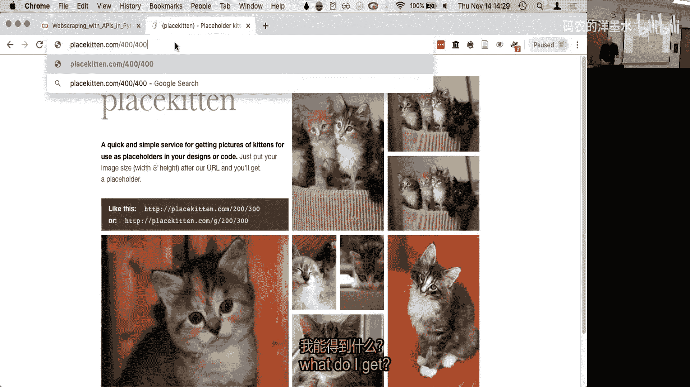
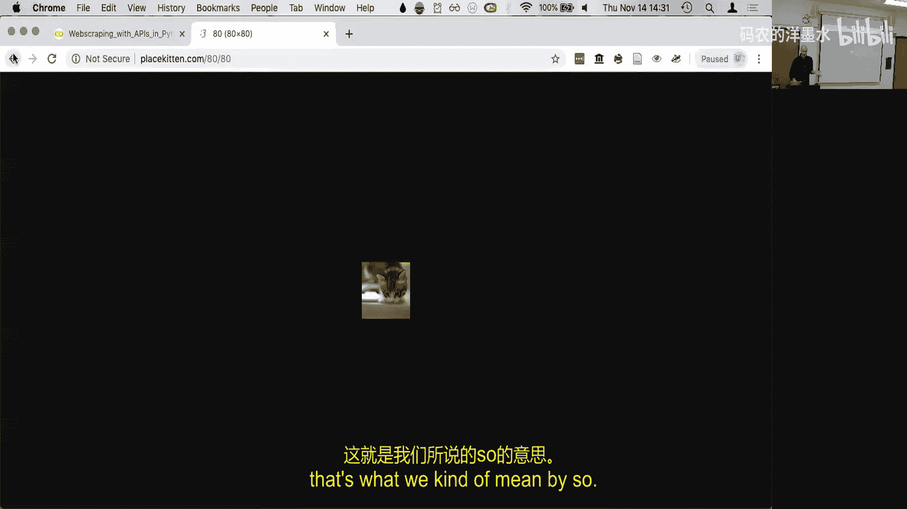
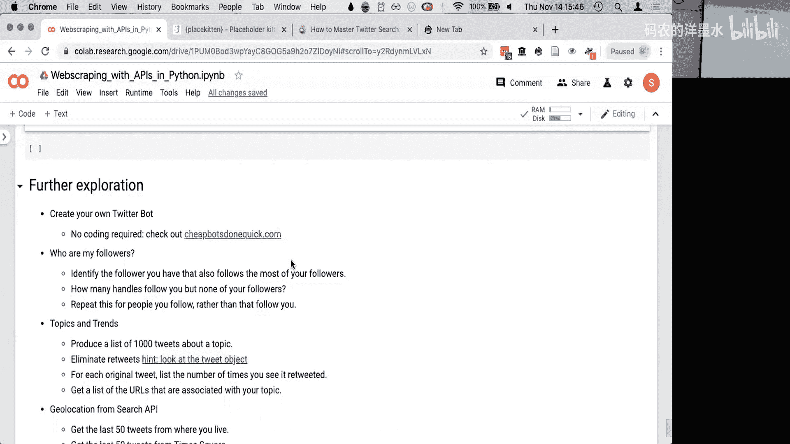

# Python数据分析入门：6：使用Python的API进行网络爬虫 🕸️


在本节课中，我们将要学习什么是网络爬虫和API，以及如何使用Python与网络服务（特别是Twitter）进行交互，从而获取和分析公开的网络数据。

## 概述：网络、文本与数据

互联网上的所有网页本质上都是文本文件。你的浏览器下载这些包含HTML指令的文本文件，并将其渲染成你看到的交互式页面。因为网络是公开的，所以这些文本文件中的数据也是公开可用的。网络爬虫就是让计算机自动读取这些文本文件，并从中提取我们感兴趣的部分。

## 什么是API？🚪

API（应用程序编程接口）可以看作是网站为计算机程序准备的“前门”。与爬虫（通过解析人类可读的网页来获取数据，有时像是“走后门”）不同，API直接提供计算机可读格式的数据，使得数据获取更加规范和高效。

例如，一个提供随机猫咪图片的网站 `placekitten.com` 就是一个简单的API。你可以通过改变URL中的数字（如 `/400/400`）来请求特定尺寸的图片。这种通过参数与服务器交互的方式，就是API的核心。



**代码示例：请求猫咪图片**
```python
# 这是一个伪代码示例，展示API调用的概念
image_url = "https://placekitten.com/400/400"
# 程序会访问这个URL并获取图片数据
```



## 为什么API存在？三种网站态度

网站对数据抓取的态度大致分为三类：
1.  **请勿抓取我**：数据等于金钱的公司（如某些社交媒体、金融数据提供商）。它们会设置障碍，如混淆网页结构，防止自动化抓取。
2.  **请抓取我**：具有公共使命的机构（如政府网站、维基百科）。它们通常会提供友好的公共API，方便人们获取数据。
3.  **按我的规则抓取我**：大多数社交媒体平台（如Twitter）。它们提供API，但会施加严格限制（如调用频率、数据量），并要求注册获取密钥（API Key），以便管理和控制数据的使用。

## 实战：使用Python与Twitter API交互 🐦

上一节我们介绍了API的基本概念，本节中我们来看看如何具体使用Python来调用一个真实的API——Twitter API。

### 准备工作：认证与密钥

要与Twitter这类私有API交互，你需要注册开发者账号并获取API密钥。这个密钥是一串独特的字符，相当于你的密码，用于标识你的身份。**务必妥善保管，不要公开分享。**

**代码示例：设置认证（概念性）**
```python
# 导入必要的库
import tweepy

# 使用你的密钥进行认证
auth = tweepy.OAuthHandler(consumer_key, consumer_secret)
auth.set_access_token(access_token, access_token_secret)

# 创建API对象
api = tweepy.API(auth)
# 现在可以使用 `api` 对象调用各种功能了
```

### 获取数据：从推文到用户信息

通过认证后的 `api` 对象，我们可以轻松获取各种数据。

**获取用户时间线推文：**
```python
# 获取某个用户最近的20条推文
tweets = api.user_timeline(screen_name='username', count=20)
for tweet in tweets:
    print(tweet.text)
```

**搜索特定关键词或话题标签：**
```python
# 搜索包含特定关键词的推文
search_results = api.search(q='#datascience', count=10)
for tweet in search_results:
    print(f"{tweet.user.screen_name}: {tweet.text}")
```

**获取用户的关注者列表：**
```python
# 获取某个用户的关注者（有限数量）
followers = api.followers(screen_name='username')
for follower in followers:
    print(follower.screen_name)
```

### 理解数据结构：推文对象

从API返回的推文（Tweet）不仅仅是一段文字。它是一个包含丰富信息的对象（在Python中通常表现为字典或具有属性的对象）。

一个推文对象可能包含以下信息：
*   `id`: 推文的唯一标识符。
*   `text` / `full_text`: 推文内容。
*   `created_at`: 创建时间。
*   `user`: 发布者信息（本身又是一个包含 `screen_name`, `followers_count` 等字段的对象）。
*   `retweet_count`: 转发数。
*   `favorite_count`: 点赞数。
*   `entities`: 包含提到的用户、话题标签、链接等。

你可以像操作字典一样访问这些属性：
```python
tweet = api.home_timeline(count=1)[0] # 获取一条最新推文
print(f"语言: {tweet.lang}")
print(f"发布者: {tweet.user.screen_name}")
print(f"粉丝数: {tweet.user.followers_count}")
```

## 重要限制与应对策略 🚧

使用Twitter API（尤其是免费层）时，你会遇到诸多限制，这是学习过程中的主要挑战之一。

以下是核心限制：
*   **频率限制**：每15分钟窗口内只能进行有限次API调用（例如15次）。
*   **数量限制**：单次请求最多获取200条推文；通过时间线最多能回溯获取3200条推文；搜索功能通常只能回溯约一周的数据。
*   **流式API限制**：流式传输（实时获取）通常只提供1%的随机样本。

**应对策略：**
1.  **遵守规则，耐心规划**：对于长期项目，提前开始缓慢收集数据。
2.  **使用分页（Pagination）**：通过 `page` 参数分批获取数据，以突破单次请求的数量限制。
3.  **寻找替代数据源**：使用如 `pushshift.io` 等第三方存档数据。
4.  **考虑非官方库**：在了解风险（可能违反服务条款）后，使用如 `twint` 等非官方抓取工具。
5.  **付费获取**：对于研究项目，可以将商业API费用纳入预算。

## 总结与练习 💻

本节课中我们一起学习了网络爬虫和API的核心概念，并重点演练了如何使用Python通过Twitter API获取社交数据。我们了解了API的便利性，也认识了其种种限制以及可能的应对方法。

现在，你可以尝试以下练习来巩固所学：

*   **修改参数**：在提供的代码笔记本中，尝试更改用户名、搜索关键词或地理位置坐标，观察不同的结果。
*   **数据提取**：写一段代码，从你获取的推文列表中，提取出所有用户的屏幕名称（screen name）并计算唯一数量。
*   **简单分析**：获取某个话题标签下的推文，尝试统计这些推文中最常出现的三个单词（需简单处理文本，如转为小写、去除常见停用词）。
*   **探索限制**：尝试连续快速运行多个API调用，观察触犯频率限制时返回的错误信息。



记住，熟练使用API的关键在于阅读文档、大胆尝试并妥善处理错误和限制。祝你探索愉快！