# 【全集】加州大学戴维斯分校 Python数据分析入门 中英字幕 1080P p07 Lecture 7 - Juypter与AWS入门 -BV1AK6vBqEei_p7-

All right well welcome to Intro to AWS the Jupiter Notes， my name is Pamela Reynolds。

 I'm associate director of the UC Davis Data Lab for Data Science and Informatics。😊。

DaLb facilitates application of data science methods。

 technologies and best practices that enhance research and learning across UC Davis and beyond we support research services。

 trading events such as this workshop today and community efforts to build and grow our capacity in the data sciences Today's workshop is going to provide an introduction to cloud computing with Amazon web solutions and specifically we're going to learn about AWS infrastructure and services as well as identifying good use cases for research on this platform。

😊，In the hands on lab portion that'll be woven throughout today。

 well launch a Jupyter notebook on SageMaker and APIs to launch an application。😊。

I're also going to discuss where you can go to learn more and I'm going to put in a quick plug that Data Labs has drop in Office hours health every Monday afternoon I'll post the link direct link in the chat and our the instructor today Kevin has graciously offered to show up for our next office hours this coming Monday on 824 in case you were phone with us after today or you have any follow questions that you forgot to ask。

😊，So with that I'd like to introduce our instructors。

 Kevin Merrkohi is a seniornior Solutions architect at AWS working with the Northern California UC School specifically prior to joining AWS so Kevin worked at UC Davis and IET where he supported a wide range of tools from critical campus infrastructure to research IT so he's very familiar with the space that many of you are coming from he's joined today by his collea Cladu who previously worked in supercomputing as a research scientist that UC San Diego and Danielle who specializes in working with the UC academic and medical centers so if you have medical focused questions or medical data that you're working with。

 he'd be a great one also to read out and you'll see that both of them are on the chat today so if you have a question that you want to direct to someone specifically in the chat you can go ahead and tag them with their name otherwise all of us that are hosting will try see our best to answer and just as a note because there are a lot more view than us on there our lead instructor Kevin probably won't be able to see all the questions on chat that we may occasionally。

Inest him and help field some of those questions if they're consistently coming up over time so don't don't worry if we don't get you right away sometimes gets being infl of questions and takes us a little while to get to them all right so with that I'll kick it over to Kevin and thank you again so much for coming to share with our communities how they might be able to hop on and use your platform。

😊，Cool hi everybody， it's always awesome to come back to David since I still live in town and with all the fire outside it this is a nice escape。

😊，Onlyna get。Quly started here so we're going kind of do this in a couple parts we're going to start with kind of a talk about AWS in general and security in particular in AWS and then we're going to jump into this the lab the lab is a couple different parts and it's going to kind of go through most of what we call the core services so identity compute storage and networking after that's over we're going to look at some kind of research use cases for AWS when you might use it how it might be used and then it'll end with a bunch of stuff on resources for UC Davis researchers。

😊，So all the labs are going to be in your browser， you'll find the temporary account credential today。

 please let us know if you have questions or there's issues with that。😊，So。So AWS。😊。

NO is a platform that lets you do lots of things right and it's I mean nice to reach for a number of places right first it lets you kind of not deal with managing servers or boxes or machines in your office a lot of researchers have compute clusters on their offices or they've kind of have to cobble stuff together out of parts I knew a guy in chemists where you actually had two HPC clusters in separate fume hoods we with data cables running between them so this gets you out of having to manage that kind of stuff you can collaborate across the platform lots will use it they can share data and share infrastructure you can this lets you reproduce use automation to reproduce your research or we' just the workflow that you used to build things and then we've got lots of really kind of advanced analytics and machine learning tools that you can take advantage of。

And finally。嗯。AWS can offer higher security than most campuses can provide， and for example。

 Davis runs a NIST 8171 compliant environment that's a federal CUI data area in AWS and UCSF has a HIPAA environment in AWS because they allow their places that they can put higher security controls in some cases。

So AWS is kind of a we've got a global network， right？😊，嗯。You know。

 we've got this huge reach and we've got 24 availability zones， regions around the world。

 which lets you really kind of use compute any words， it's available in way you need it。

Within this idea， we have this idea of regions and a region is a group of local data centers or availability zones that。

😊，Oh， kind of in the same general place。 But E J Z is。

Separate from the others usually separated by disaster zones or other like different power grids。

 that kind of stuff so that you're not sitting on one particular location。

HAZ is made up of more data centers。😊，Which within that area。

 so if an AZ or if you would to lose an AZ， you wouldn't lose the whole region and this gives us a way to have high strong gum。

😊，Oh。Sorry I to not look at the chat i'm sorry I'm going to close that gives you a way to have to make sure that your data never gets lost right this is there's always redundancy and there's redundancy across lots of areas。

We also have。😊，A large really large and broad functionality ranging from everything from like infrastructure services to machine learninging tools and media tools。

 we have a satellite operations tool for。😊，The complete edge cases that are there。

 but there's lots of stuff and AWS can be very intimidating to get started with and that's kind of what the role of the essays are。

 the student architects are kind of roles to help guide you through that process and make this giant picture look a little less scary。

So。😊，AWS security， we talked about security， I want to kind of make sure we talk about how security works in AWS。

So in a general sense， AWS also for the security of the cloud。

 that's the kind of the physical locations， the underlying compute storage networking that the cloud provides。

 but customers or users are responsible for the kind of their data， how they access it。

 oftens they install on it， and the encryptions they put on there。😊。

Just because you use AWS doesn't mean you're secured by default。

 doesn mean you have a responsibility here to work to retain your data。😡。

That's why campusvas have built security research environments or S environments so they can provide that extra layer of security for campus users。

It's also important as we kind of look at this， we want to think about this in terms of kind of services so AWs offers service at multiple levels we offer pretty like basic infrastructure service tools right just the computer at which point we're going to manage the physical equipment and the software the not working the hardware。

 all of that kind of stuff but as a customer you sponsor for the application code。

 the scaling all of the configuration all of that stuff。😊。

But we also provide services like container orchestration， where we manage a little bit more。

 the train and control playlists than we manage。😊，To kind of a managed container service。

 Will we have。You know we offer we control more of the scaling of other things and then a kind of a fully serverless service where we manage pretty much everything and you only have to deal with code one of the really big advantage of using AWS is to get into the space of using these serverless components。

😊，They get you out of having to maintain and manage software hardware that you don't have to so much research kind of ends up being。

😡，I've got you cobble this thing together and you hope it works and then when it breaks you spend a lot of time fixing it this takes you out of that job you just have to deal with the code or the tools that youre responsible for and not like hacking together a bunch of servers doesn to make sure they all talk。

This is a kind of a big picture compliance space， were comp with a lot of different federal and nonfe compliance standards。

 so if you have users that requires something like FedWb or NIS CUI or PII。

 we've got a lot of backing to kind of manage how that security works in our cloud and Paul we have approval for that data。

😊，If you do have workloads at that please reach out to us。

 it's one of Daniel special in medical centers for PI and HIPAA。

 but there's a bunch of stuff there where we can offer to help those things。😊。

So one kind of important thing though it's still always your data right because you choose where your data goes。

 each region is geographically isolated so data doesn't move around the world right so there's no if you put AWS it doesn't mean that your data is suddenly going to China。

Your data will stay in that region that you put it in unless you tell us to move it somewhere else。

You're going to own your data， you can encrypt it， you can move it。

 you can delete it if you really this is it's we treat that as your data and even essays like us don't have access to that stuff we have no idea what's inside your account or what the data is。

I think that this is an important kind of talking point。

 we put disabilityibility as a big issue in research right now。😊，You know。😊。

Without looking at kind of this is a crisis and not。

 it's really important we provide a lot of tools to automate infrastructure to make it easier to deploy。

And when we think about this you know code is more reliable and audible than people are and so by generating code instead of doing things by hand that lets you repeat it。

 it also lets you share it so you can share the entire infrastructure you used to do your research with someone else and they can repeat the same calculations where they can run the same model。

And that makes to be really valuable as you work with these kinds of tools。

 you don't have to kind of walk the next grad student through the process of setting up what you set up because you're about to。

 you can have this written out as code in some way and they can deploy it and they can delete it when it's done so you don't have to worry about it not being there as long as it can be recreated you can destroy it and not pay for it and only pay for it when you to use it。

Oh。But。🤢，So with that said， we're going to kind of get started with a lab here。

In this lab we're going to do kind of five things really and the six is optional。

 we're going to create a IM well we're going to launch a notebook， a Jupyter notebook。

 we're going to create a bucket and copy a file to it。

 we're going to create a networking environment and launch in launch an instance。😊，So before that。

 I have to show you this is the unfortunately manual step here。

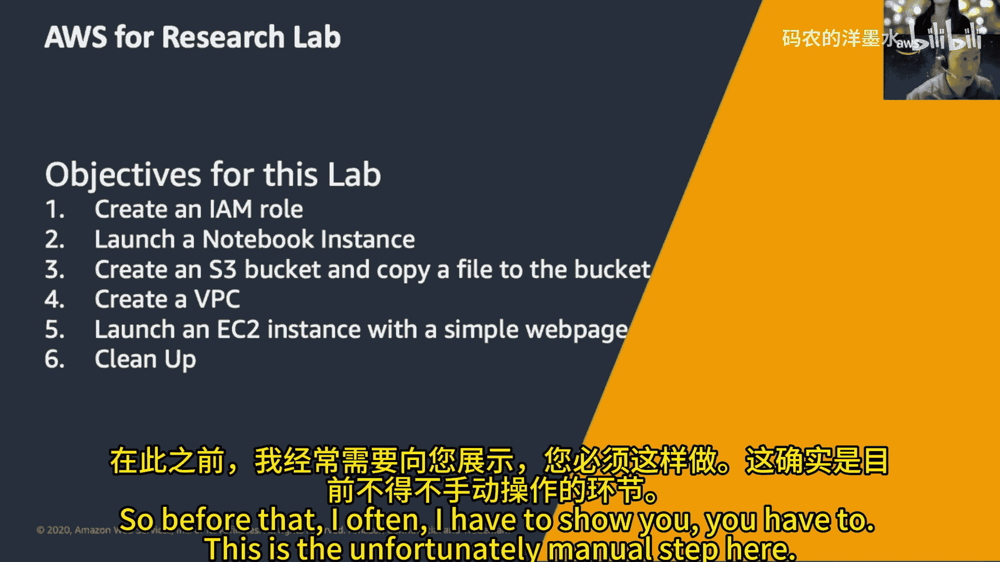

I'm going to put this on the screen。Here。不有。😔，Okay。

 I need everyone to on this list find their name and copy down the rather annoyingly long hash number。

Actually wait， we'll stop， let's do this a different order。😊，We'll do this this way。

Okay。So I want everyone to go to this U dashboard。evenengine。or and you'll see this。😊。

Kind of black page when you do。I'm going to wait a couple minutes of one to get there if you could。

In your status。嗯。P type hit yes on the participants window when you're hear。

I will also paste it into chat can someone paste that into chat as a reminder for these quick yeses or no。

 please use the action items that's the yes， the green check box and don't type it in the chat。😊，对。啊。

So where are the action items y， so if you go to the participants down at the bottom of zoom。

 there'll be those two little people symbol， if you click that。

 it'll pop up on for me it pops up on the top right， you'll see yes， no， go slower， go faster。

 that's where you can click the yes button。😊，啊。Toと突。Great， it looks like about half of you。

 over half of you were there。Okay， Kevin， I think we're starting to get questions about the hashes。

 so I think this is time we're going to get through。😊。

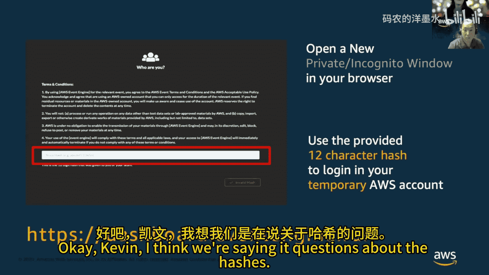

Alright。

Okay。So another UL， you have to。😊，Get。So you're going to see this little screen with the console login。

 click on the open console to open access your temporary AWS account。😊。

And then please download the lab guide here。Tinny of the complex data Lab Jupiter。

And if someone can paste that in chat as well， that'd be helpful。Thank you。😊，错。

Just add once you get to your console， this is what you're going to generally see， right？😊。

You're going to see kind of there's it's a web called so there's a GuUI， but your user is up here。

 your Norwegian is here。😊，And that's kind of all we need to start with。Services there's services。

 and there's your service list。So the first part is an creating an IM role and I think before we get started。

 I'd like to at least we'll talk about what IAM is and what it does。😊，I am， miss。

Those systems that kind of lets you control the access control within your environment。

It gets to who can do what with your account from where。

you've get fine gain control with youre too fat to earth。

 you can integrateerate single sign lots of this stuff。😊，In IM， there's IM users。

 which is an individual system of application that has to access it。

 but it's got a unique name of credentials and it's a password or key IN uses only to pass to the access to the management console usually they get access keys。

😊，I have asked key make programmatic calls to AWS they look like this if maybe can get we don't going to need them today。

 but you'll see these if you start using ABS APIs a lot。😊。

And then there's policies and policies effectively say， what do you allowed to do。

 allow a deny what on what action can you do and then on what object can you do it？😊。

And that's a general idea。And IM roles are really important， IM roles of it's kind of like a user。

 but it's an I that you give to some AWS service。😊。

To do something on your behalf and we're going to do that a lot today so we're going to use our Jupyter notebook is going to be able to issue AWS calls or API calls on our behalf。

And so we have to grant a role to our notebook to allow it to do that。

And so let's go take a look at our console here。😊。

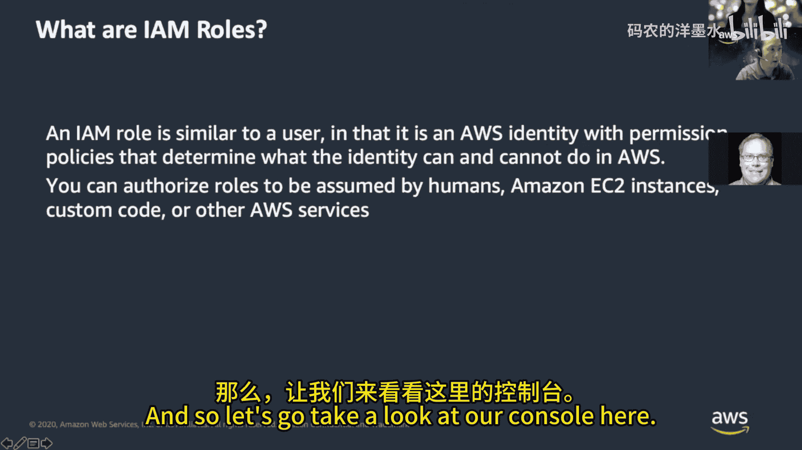

While opening just to clarify。You have to give permission to any entity could be a user or a piece of code。

 version machine， Lambda function to be able to do any kind of action on your behalf in your account。

 otherwise it doesn't work。

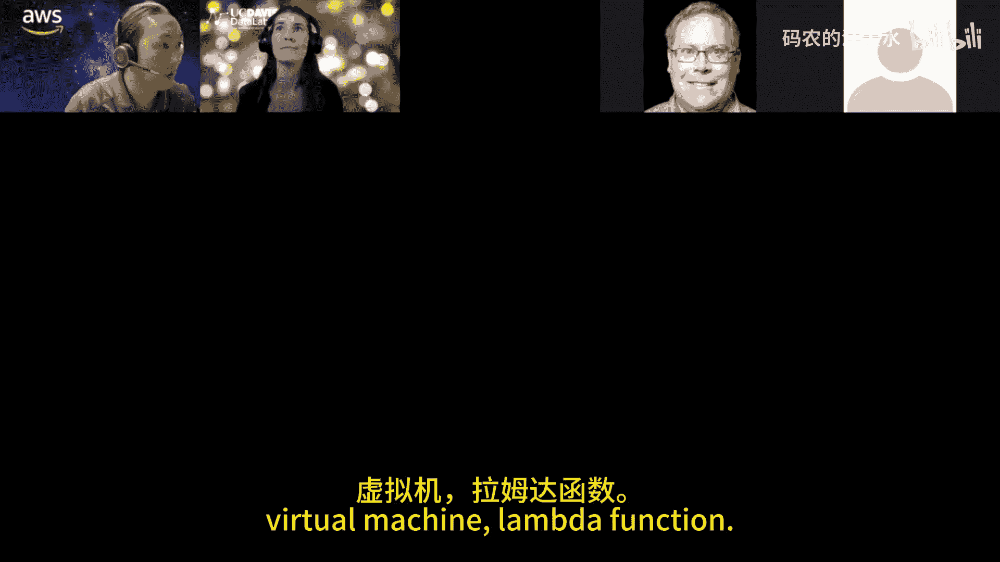

So up。If you sign that screen， there were secret keys that those are used as alternative presidential general programming against the APIs that AWS offers。

Oh。So here's our console。Does everyone have and we have a lab we have the lab guide right everyone found the lab guide。

😊，So I want to start with creating this rule， so we're going to go here type in IAM or go to the link。

啊。I want to go to wallss。It's like create role。And we would go look in this list。

 so this is this screen has kind of the what， you know what kind of ending AWS service and the AWS account。

 some federation。😊，And then what use case do you have so we're going to go down here and find SageMake。

Just over here。And Kevin， really quickly for those who aren't familiar with SageMake what is it we'll talk about so SageMaker is our machine loading service。

 but we're to we're going to get into that a little bit in a little bit just for right now as assume that there's a thing here that you're going to click on。

😊，Take permissions。And there we go。We're going to accept all that。View it and we'll give it a name。

Let's see here。I'll do。Something like that。And。Greatre。But as a very quick show of hands。😊。

Has everyone most people gotten there。Click check if you do。But。

So the cp may have had some trouble here。好。So in this case， you when we give you this account。

 you're the administrative you have a full you're a full user。

 you can do anything in the account so you can create roles when you。😊，As soon as you get there。Yeah。

See here。So what step are you in the guide？I am on step seven in the guide we we have a couple or sewward。

Our stucks I'm trying to figure out where they made it to in the guide so maybe I could get some。

Guidance。Oh okay， in the upper left corner， click on the services。😊，系。

And then click on and then type IAM or find IAM or type IAM here。

And then you'll get to the IM main page do it again， just create another role yeah。

 let's just I second we'll start over。Yep， so I clicked on that。

 I got the IAM console that's this thing， I click on roles on the left。😊，I'm going to create a wall。

And I'll find the sageMake， I'll find in the little list， I'll look till I find SageMake。😊。

Look on Sagebar。Click next。Click next。Next， then I'll give it a name。And I will create that。😔，Yeah。

And then I'll search for。On this list， and it will show up my two rules。Yeah。

Just is a quick note for those of you as you're following along with this we know these are impressive in times so we may lose power。

 you may lose power internet connectivity may go down we are recording so this will be posted later and also the lab guide does have step bystep through what Kevin is going to go through today so if we're going too slow for you feel free to just go on on your own pace and then pop back in when we have questions otherwise we're going to walk through those different steps today。

😊，啊。Okay， cool， so now we have to give that our some amin rights。

 so we'rell click on the wall andll attach a policy。😊，And we're going to go look here。

 if we're going to find the administrative access。😊，Now wasn't going to attach this。

So this means that anything with this role can do basically anything on the account。😊。

In a fully production web， this may not be the best thing because you now you're letting something be you。

 you might want to scope that more granly， but for these labs。

 since we want to play with a lot of different services。

 we want to just we use the administrative access role。😊，And there we go。

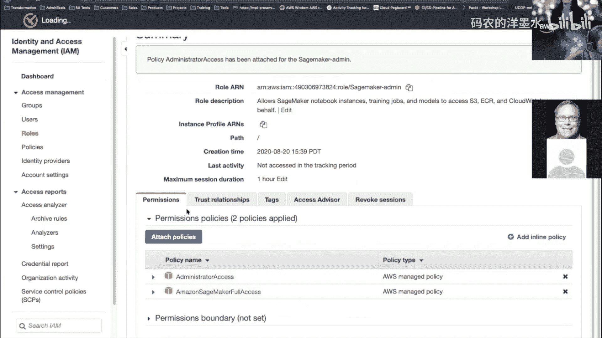

So okay， now we're going to launch to SageMake instance， so let's talk about SageMake。😊。

So AWS has a pretty broad machine learning stack and it covers everything from kind of。😊。

We build like prebuil models to building models to kind of the underlying frameworks。

We're going to be focusing onageMaker， which is this piece here。😡。

And SageMaker is kind of our machine loading service， it can do a lot of stuff。😊。

Everything from kind of managing data sets。And workflows to having notebooks to doing training。

 debugging， you can run experiments and training runs and do all sorts of other stuff as well。

But for what we want to do is it comes the service that lets us run to Pnos。

And so we're going to use the StatesMake notebook service。😊。

To kind of to run on notebook and right it's easy to sign on， it's a managed service。

 it upsets it really quickly and you can share across AWC accounts very easily。😊，So。That。

Let's go do that piece now。

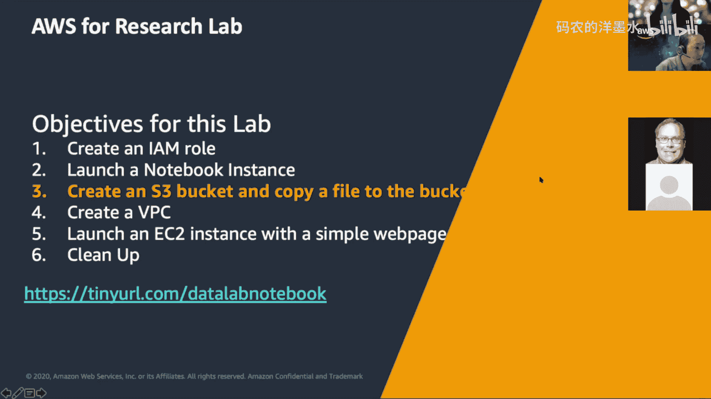

Rather doing that again， Stmaker it's a much larger platform。

 it has lots of features for the interest of time and just to get things example。

 we are only using the built in notebooks， which are Jupyter notebooks。

All the other features can be subject of another workshop if you want machine learning and AI。

 but for now just speaking to how do we get really quickly a Jupyter notebookbook in AWS with minimal fast and you know stageageMake is a friend here。

Alright， stove services。Find the type search for stageageMake。😊，好。

And then we're going to go find on the left。Nobook instances。啊。Okay。

I want to see a quick checking in most people kind of around this place。😊，Yes， no。Yeah， I see。啊。

You can click the yes or the no button。If you think we're going to slow too fast， again。

 there are other buttons as well。The answers。Just let us know your feedback。 how are we doing so far？

O。😊，So I want to go back a couple steps here。😔，So we should have been here at the end of the last step。

 we have a role and we gave it some lights。So we're going to click on the upper left as a little finish of services and it'll bring up this screen and we can type SageMaker。

😊，Into that。I want through that this will pop up and we can click on that。😊。

That'll get us to the SageMaker console。From here on the left there's a bunch of different services。

 the one we want here is the notebook instances one。And we'll click。There。Okay。😊，And I think。

I think most people are here now， we're going to click on create notebook instance。😊。

And we're going to give a notebook instance a name。😊，Say， you know。嗯。

You can take us this is a leave the default， but you can pick any number of things here。

And then the wool， we're going to pick this sageMaker admin wall that we had created before。😊。

And this is the piece where we need to have a wall created。😊。

So I'll dooo in a little bit let's just see。And once we have that， we will just create。😊。

And then this will take a little bit。So。While that's happening。

I'd like everyone to go to this UOL and download the Jupyter notebookpe that we're going to use。

I will paste that in the chat as well。Some will paste the chat。啊。

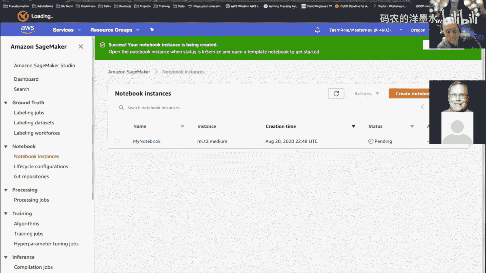

OhI think I'm showing the wrong screen though。

对。Who it is this UL。H youl。com with Datalab notebook。And while Kevin is orienting for this next part。

 just is a reminder to go ahead and hit the no button if you need help and then we're responding to questions in chat and there is the breakout room if you're really。

 really stuck and you need to just chat one on with somebody。

 but let us know before you go there so that we can make sure there's someone there to chat with you。

😊，好。So。This section， so let's go we're going to hit cut back to our console here。

I can't that tiny URLs not working for me， Kevin， I having instances that me yeah。

Probably because it's， while I'm using Firefox， it might work in other browseres。 which well let's。

 let me double check here。It's entirely possible that I typed it wrong。

I just pasted the non tiny URL link that's working for me。Okay。Thank you。な我は。对。是。Cool， thank you oh。

 that's also it's a different sorry we go。😊，There's a notebook UOL。

So we want to wait till this is running， it's still taking its sweet time here。

So I think quick questions。Which plastic implant should we choose。

I don't you shouldn't be have to choose that。See here。Yeah。

 you just all you want to do is on the notebook， just pick a role and don't change anything else。

Okay。There were lots of other things you can set up here。I don't know what you get out here。Yeah。

 you can like there's a lots of stuff you can set up and add to this but。Still not working。

sortWhat not the word king about me？I'm not able to open this link， there's something wrong。

Which one the Python， the one just Kevin pasted？So that link you have to save。Yeah。

 I did say but when I try to open what is the application to open there you don't open with an application you actually will you will upload it right now into image making in the next steps Oh okay okay thank you。

😊，So there is no need to open it on your actual machine。

 its primarily text file contains Python code and some descriptions looks like adjacent。Yep。Okay。

 so once you you're going to see your status go to green and see in service。

 and then we'll open Jupiter。😊，And this will pop up。And you can upload that file you just downloaded。

I don' like go you're not sharing that we see the PowerPoint with the ice screen so go back there Thank you。

 Do you。Yeah。

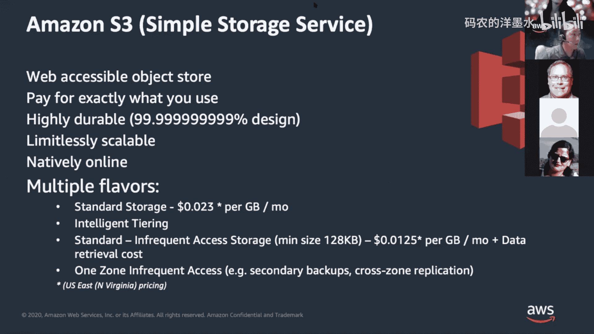

等一下。😔，So here we go， the kind of open Jupiter。You have to have the the Jupiter showed as insert with the if not in this。

 you can open it。Or just wait until everybody's at this page， so yeah。Yep。If you get you。

 please click guess。It takes about a minute to create a notebook for you。Afterwards。

 you shouldn't be able to use it， it should show in service。So。And then。While we wait。

 I think to let's talk a little bit about the， the first service we're going to play with you。嗯。要。

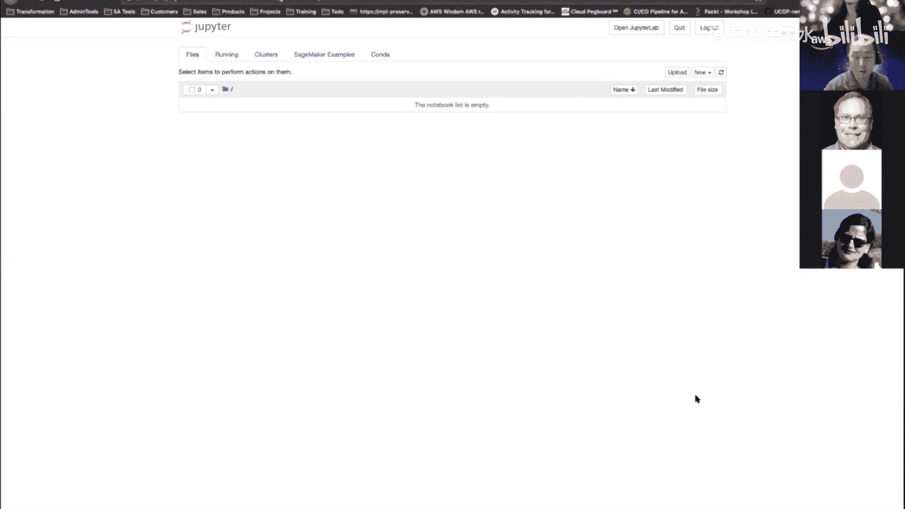

So the first thing we're going to do is create an S3 bucket and Amazon S3 is our simple storage service。

😊，It's a web accessible object store in fact it's where we store the lab guides it's got 11 nines of durability。

 which means those。😊，In the nine with 99。999 it will always be a chance that an object will be lost。

 but it scales infinitely， but it comes with lots of different flavors。

You can choose kind of the storage your storage class。

 which kind of talks about it you can start with our basic storage which is frequently accessed data and move as you exit last all the way down to something like Data Glaciier Deep archiveive。

 which costs about a dollar a teride。😊，But might take4 12 to 40 to recover the data back。

This is really good for data that's archival， you finished all your work and you need to put it somewhere。

 you don't want to lose it， but you don't really need it very often if at all。😊。

And you can use kind of these tiers to handle where you put stuff。So S is， it's parallel IO。

 it can work very quickly， you can have level permissions in IM at down to the resource level so you can say this thing。

😊，You who has access to it。You can also use policies to control who has access to objects within the bucket and you can access directly APIs。

 you can encrypt the data， you can host a website on it。

 and you can use rules to move data different into archival things as as it gets unused so you say after 30 days I don't care anymore。

 move it somewhere else。😊，And finally， you use a service called Amazon Athena。

 which lets you query data that's in S3 in certain formats as standard SQL。

 so if you have a bunch of CSV files，😊，You can go query those CSV files as if they were a database。

And this is really useful where you have lots of semi structured data that's sitting around。😊。

And you want to be able to make it's too big to really handle an Excel。

 but probably're too small to pay for running a database all the time on。

 and then this makes it very easy you only pay for the data you read and you pay by the gigabte by the terabyte。

 the gigabyte you read out of it。They also have things like Glaacier Glaciier deep Arch。

 these are the kind of low cost archival storage options right they're designed for Le and durability and they're designed for archival solutions so therefore you have to pull them in back and might take hours to get data back。

😊，But it can be very， very cheap。

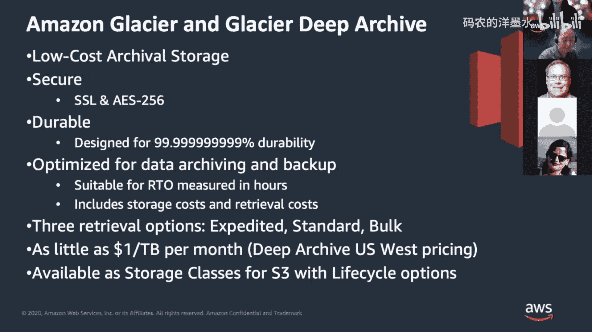

And heres so this is more for afters， this is kind of a big thing about all the different features to the different classes。

😊。

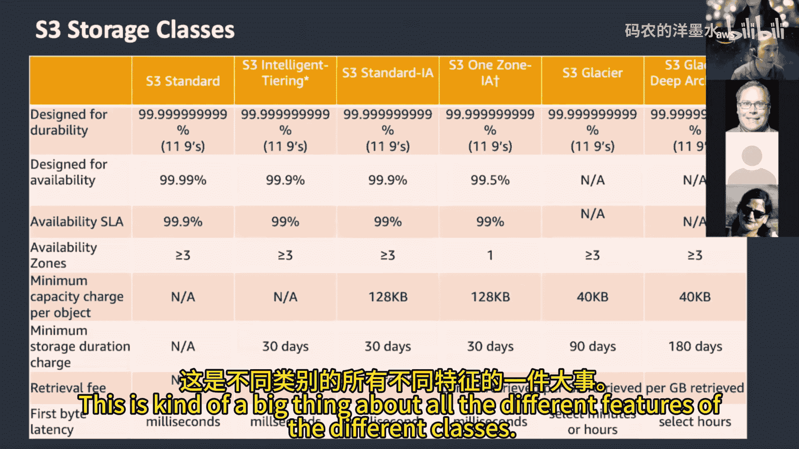

All right， so I'm going to go most people should be at the notebook step。

 so let's go back to our console here。

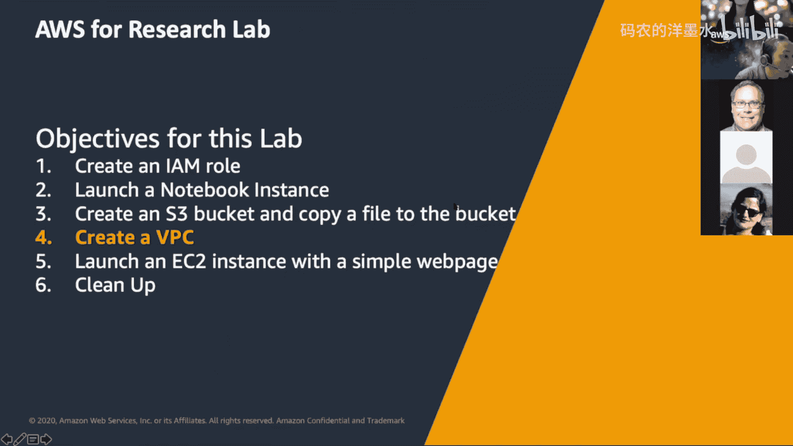

嗯。Al right， and now that we're here， we're going to have， click on the open Jupiter。And upload。

We're going to upload all of the file we downloaded here。好。And then we can launch our notebook。

And we have a notebook。Okay。嗯。Yeah。Al right， so if you， let's see here。

 I think I'm going to keep should I I'm going to keep going here。

So this is generic pretty normal geopolidsical let's run that。Although this is a little。

And the next command is going to use the S3 bucket API so I want to be。😊。

Cl I want to talk about kind of what the goal of this notebook is。啊。The goal of this notebook is。

Not specifically to do a bunch of compute on the notebook we're using this notebook as a way to explore using AWS APIs to launch AW like talk of AWS core infrastructure so what we're going to do with this is create a bunch of AWS resources。

And then the first one we can create is that S3 bucket and this is a relatively of a simple API call。

 but you can create this bucket。😊，And。It'll create a bucket it's going to give you a toward the bucket name now AWS bucket names need to be globally unique they have to be unique across all S3 buckets in all of AWS so we have to the first piece kind of generates so uses a random your UI。

😊，To generate a unique swing for your bucket name。Yeah。啊。是。Okay。呵。Yeah。好。So。

Quick switch back here to talk a little about VPCs。So VPC is a virtual private cloud。

 it's kind of oh。😊。

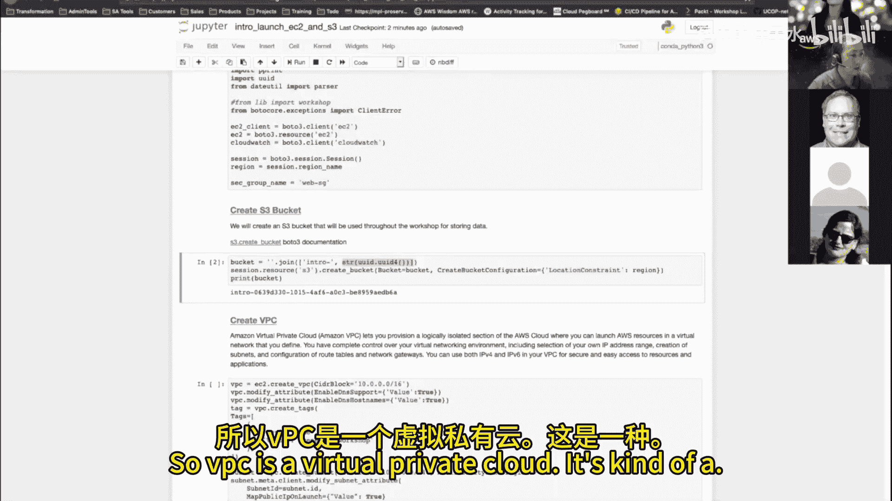

Our networking abstract concept in AWS， right a VPC has subnets and the subnet feel tied to an availability so of the availability that we talked about in the beginning。

😊，WeWe deploy instances or things in those sumnets。So when we want a so on AWS。

 it has to live in a subnet in a VPC， which in some availability zone。😊。

This is especially important when you do things like HPCs so where you're building kind of machine loading。

 you're using like underlying hardware， building clusters and stuff like that。

 you have kind of some concept of where the stuff is actually sitting and where it needs to be talking to。

😊，그。So going back to a。

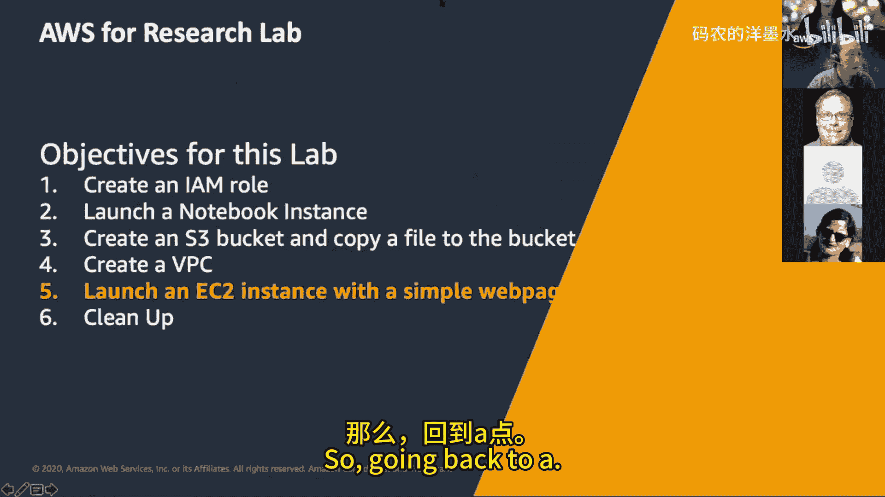

Thank you。This this kind of block of code， which is a little bit long， is going to create a VPC。

 create some subnets。😊，And then quit some route tables to route the traffic properly。😊。

And then which runs back to VPC and the sums that we have。So networking might not be a strong point。

 but this is really one way to we actually have code written that creates pretty much a data center。

 a virtual data center for you in AWS with the respective networking settings that you want and this is portable because you can give it to another research and they can get the exact same setup and you can have you know one more 100 machines in this virtual data center that you create and they can replicate the exact same setup virtually of course in their own account with just a couple of lines of code。

So what Kevin is showing here you can also do from the console but just takes a lot more time and more errorprone because you can click here click there and you can actually see right now in this virtual seminar know how long it takes to get it the same page and walk through click here click there so again assuming you're doing this via email and you tell your cohort and now go there do this it's going to be a lot more errorprome than just writing that code and then giving them the code and they can run and see the exact results。

You canm you don't have to go to this， but you can go see that it created these things and if you go look at your VP in the console。

 we can see that it creates stuff。😊，It creates a route table and a bunch of other resources here。

As well， Okay， so now we're going to do going going to create a web page。

This is just going to write a file that says hellello world。

 we're going to then copy that file to S3。😊，And if we go look at S3V。😊，Yeah。Can see a bucket？

And we can see the file that we created here。And if we really wanted。

 we could download a copy of that file。😊，y Kevin， do you want people to be following along with what you're doing right now ideally yes this part no don't follow this part don't follow this part around you can if you really want to go digging but I wanted to show this is there I don't I don't want I don't think you have to go and try to navigate everything really fast this is just a way to kind of see that it did something else。

😊，呃。So then the next piece is the security group， I'mre going to quit a when sciums are like virtual firewalls。

 they sit around as a computer in AWS， a server。😊，And prevent act like a file and prevent allow they deny all traffic and then you have to explicitly allow certain kinds of traffic in this is a web page we have to allow the web traffic through the filewall so we're going to create that rule。

😊，And then we're going to allow。These ports 80 and 443。 and you don't have to know this。

 This is just。If you want to see it， but it's going to allow HtPO web browser to reach that server。

Co。So now we got know we to talk about the。Isy too。

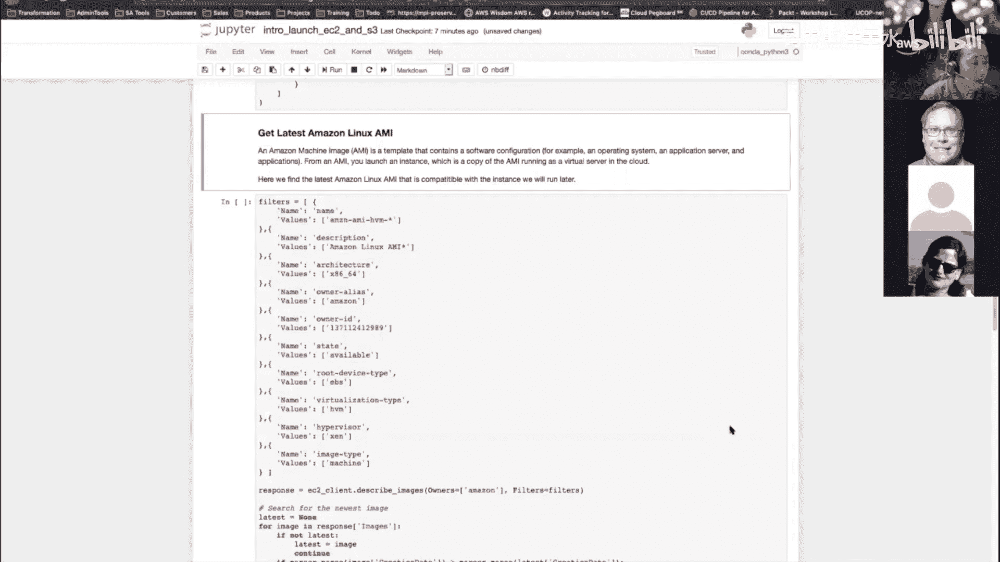

So。😊，AWS is a number of compute services and we're starting with EC2 which is the basic one we have which providess virtual servers。

 we also have services that offer containers and serverless computing as well。😊，EC2 is。😊，You know。

 come one Linux Windows。 You can run Rx and he says， it's got lots of different options。 You can do。

😊，Everything from kind of general purpose to like especially optimized from you know high throughput or GPUs。

 you can use images， AMIs， which we'll talk about a little bit to kind of package software。

 for example， for those you who like who need our studio there is an AMI package just for our studio you can deploy that and you get our studio running without having to do all this setup installation。

😊，It also lets you share artifact if you have a researcher you want。

 you want to share something with， you can build a machine image。

 share it with them but they can deploy exactly the same machine。

 the same OS as what you were running with all the software already installed。😊。

This is particularly valuable when you've got stuff like， you know。

 you've got a lot of different packages and a lot of research components that you have to get just working just right and then you have this would share a fully working model with someone else and not a list of instructions on how to build it。

So we have lots of instance types that co range for kind of general service。

 general purpose instances that we're using now to kind of you know optimize some with lots of compute。

 lots of memory with GPUs or FPGAs， and then for Ohio for high IO use。

 if you've got a OhioI workload。😊，We also offer both Intel AMD and arm processors。

 AMD and AM are generally much cheaper than the Intel processors， so if you have a workload。

 they can be very be you can want to look there and see if you can get a cheaper processor for the same kind of system。

😊，We have a number of ways you can pay for it， and this is pretty important if you're trying to save money。

😊，You can pay on demand， which is what we're doing now。

 you pay for capacity by the second and you can to them off when you don't use it。

That's great but it's it can be a little expensive you can to save money。

 you can either commit to a large amount of to a whole year this machine is going to run a whole year and you get a up to 73% discount on that system or one to three years I should say you also have S and Ss is the spare capacity in our environment that we have so we have we build capacity to always be there enough best fuel to use it and there's always some spare capacity sitting there usually。

😊，And so you can use spot to pay up to 90% less on。

For that those compute resources with the idea that we might say oh we need that service back so we might give you a warning and say hey this box is going away so if you've got a system that's easily reproducible or where you can kind of stop and start it a lot。

 spot's great so it tends to be with use for HPC type workloads where you have truly truly paralyzable jobs and you can just do a little bit at a time。

😊，And if a box goes away， you can run another one and rerun that compute and then you're done。

So yeah spot is really nice， it's fast， you you can kind of these are the kinds of things。

 you know big data simulations， you know HPC we've got cases where the job the machine doesn't matter as long as there's enough there to kind of meet your needs。

😊，Here's a list of the OSs we support Windows， Linux and a bunch of different Linux explosions。

And there's a whole list of these。😊，ok。Let's go back to all。😔，Yes。

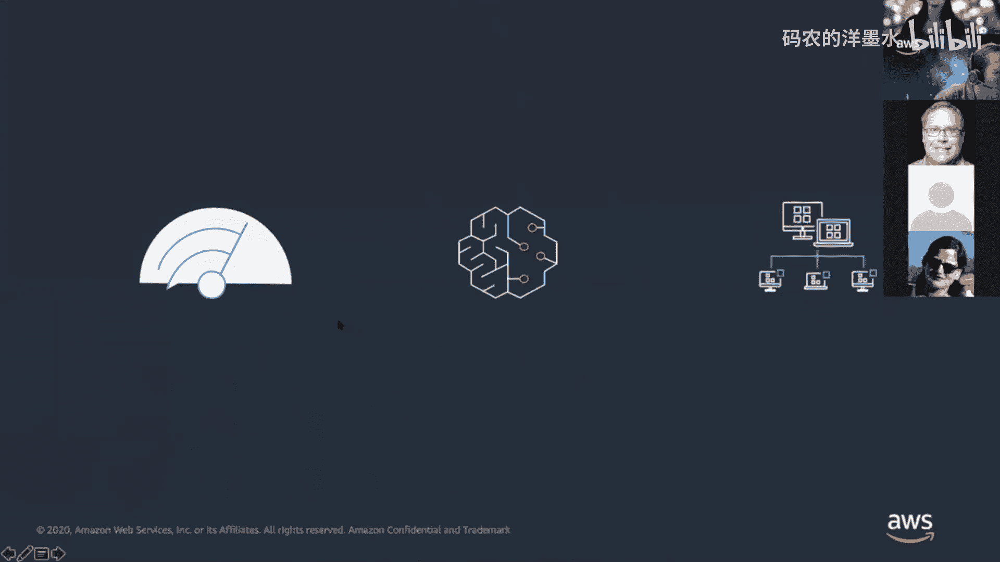

Yeah。Okay so at this point， we're going to the first thing we need to do if we want to launch is just figure out what machine image we were going to log。

And this code here searches for the most coded basic Amazon Linux AMI。So。

We're going we want to install a web server， so we've got to write some code for a script to do that。

 and we're going to save that here。And then we're going to because the way that we pull the APIs work。

 we want to basically 64 encode that file， so we're going to base 64 encode that chunk that file that we just created。

Then want to lot of instance。😊，And this。Peace is relatively straightforward。

 but what it's going to do is it's going to launch the AMI we asked for' to launch one of them if I wasn in launch 20 I could just change this number。

Of a certain size， this is the L5 load instance type。😊。

We're to have advanced modeling so we get more data about what it's doing。

We're going to supply our user data that this script that we provided above and then we want to get it set up its networking。

And we're going to give it a name as well right in this case we're trying to tell we wanted to get a public IP address and we wanted to put it in we're going to tell what network it should be on what security group should have attached to it。

Cool， now it's been launched， so don't have to follow me here， but if you really want to look。

We can see that something has happened， but it takes a little while for them instance to spin up。😊，啊。

啊。是。And you can see that it's kind of running， but it's still kind of getting ready if you hit the next command。

 this command waits till the instance is fully running。😊，And mine is already up and running。

 but it will wait you until that instance comes fully online so now it's my instance is online。😊。

It's mostly ready。Yeah。Hey， Kevin， where do you check all these？

Like where do you go to this page like oh so if you want to go here。

 this is called a services called EC2， so you go to services and find the EC2 service。😊。

For right now because when you with Jupiter you don't necessarily have to go look at it。

 but that's where you would go to look at what the instances you're running at any given time so these services EC2 and then then you want to look at there's lots of stuff here but you want to look instance to see the kind of。

😊，空。Alsoll of kind of sitting there getting ready we go it's running it looks like it's up it also has a public we can kind of find out information about it。

😊，And then its the next one you can kind of print this。

 this will actually give you a link to go look at you if it's in the console and if you click on this it will pop up a web page that says I can talk to the machine there is a bug in this lab where the file that we created to put in S3 doesn't get copied properly I'm sorry we're going to fix it。

😊，So you just get this kind of generic page。And that's it。So now you've launched。

 you've built a network， you've built a bucket and you've launched a server。

 you could replace so that server with anything I know there's a lot of cases where people might want to launch something like our studio or you want to run a number of other kinds of compute jobs off of it。

😊，There is a section here about how to clean everything up。😊，I'm not going to。

Run through it right now because I think that way people can kind of see it。

Can have a chance to play with what they've got afterwards we're going to leave the labs open for a couple hours after this session ends so if you want to keep playing you can keep playing with those resources and they'll be tune off automatically when the time expires。

😊，So you don't have to worry too much but of sitting there。

But this will remove all the things we just built。And I'll jump on and say that's important because。

Depending on your service model you could be racking up some cost if you forget to shut it down when you're done This is another very important thing of AWS do not you do not want to keep it running if you're not using it turn it off when you're done and you won't get charged for it because you only get charged when it's turned on in this case we're gonna delete everything so not only going stop it we're going like delete everything。

😊，You can just stop the instance。And then you don't charge you still pay for storage and other things。

 So this will delete all the resources that we created today。Yeah。Yeah。

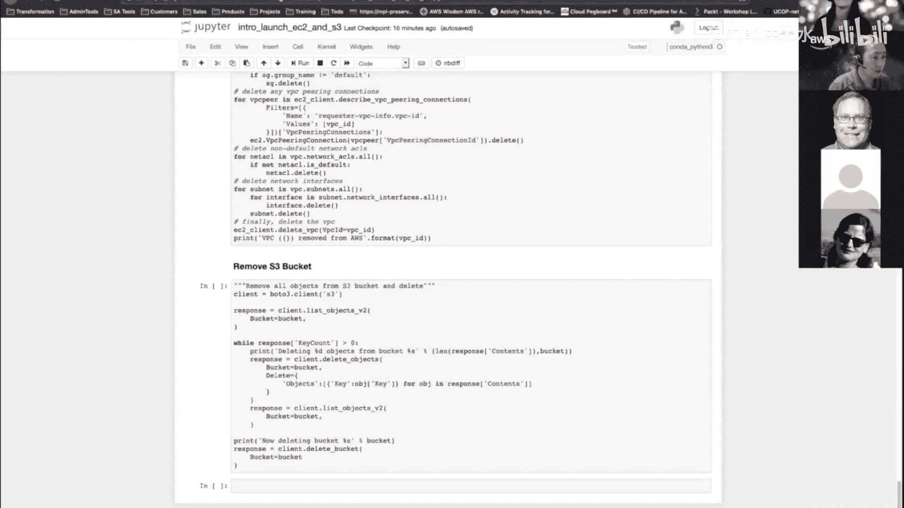

And the previous what we did we were actually running some of these to the console now for those that attended the you can see you can achieve the same objective just by writing P code and using the Bodo3 Library so if all you know its Python and Jupyter you can still come in and write a couple of lines and you create entire data centers and web servers and you know everything in the sun with just code。

Yeah， so this is one of the really powerful parts within ofS。😊。

We can do things the way we did in the beginning， everything by hand。

 you've got to go find the right screen you to click on the right buttons。

It's relatively easy if you just click around to five things eventually。

 but' you can't reproduce it twice I'm just trying everyone here to go on the same time and the same things is tough。

 it'sarrow pro， it takes a long time。😊，Right and then we can do what we just did here。

 we scripted everything using Python so everything is run this is everything is created as a script the makes API calls and you can do it really quickly and it's much easier than the second half of that lab when we were working in the Jupyter notebook was way simpler than trying to do it all by hand in the beginning。

😊，But we've got some more kind of options on top of that， we can use declarative languages。

 Cloudform and  Terraform and these are languages where you basically have a file that describes all the things you might not might you want to have happen and then you let an engine generate those resources。

😊，It's a little more shareable， it's a little simpler than having to fill out all those APIs。😊。

And it can be very powerful when you want to share easily because you don't have to have permissions you can everybody can take and go and run that same piece of code right however it's easy to auto to be po as well but the syntax is a little ugly and there's no abstraction so there you have a lot of details so just creating that VPC we did today is probably a couple hundred hundred lines or so a couple hundred lines。

😊，There's some people who worked on this to make this better the problem with declarative language is you can't there's no logic you can't make a choice at all basically。

 so we have some documentck object models which put code on top of。😡，The kind of the API。

 the cloud formation and stuff like that， that means if statements full loops， you can use an IDE。😊。

But there's no abstraction and so if you want to just create that VPC we did before。

 which was a few funny lines， it's like 200 lines of code。

And the last one that's come about recently is CDK and CDK allows you to kind of has built in abstractions。

 so it's wheel code like the document and stuff but。😊，So you use all the normal things。

 but it also has constructs that lets you kind of have takes normal defaults so this one here。

 this whole piece builds a EPC。And it basically has there's a standard VpC and then we modify certain things in it。

😊，And that's kind of the power here is it's easier to script whatever and you have a number of language you could do this in Java。

 Python， CS， JavaScript or Tyscript。😊，嗯。All of these are options and it comes down to what you feel more comfortable with right for a lot of time scripting is the scripted solution is great it's simple if you understand Python already you don't have to load anything new just do stuff that way if you want to try one of the other layers you can go up the layer and try harder to try to kind of more abstracted solutions if you're building very large things often you want the more abstracted。

😊，Models because it's harder to script out all the commands you're going to run。

 you want to be able to describe them all and gets you get lost trying to script everything。

So with that。Pamela ask kind of when should you use AWS。

 what are the kinds of use cases that would make you think about using it？

So we kind have three basic ones。😊，We've got。I need more capacity than I have and that can mean I need I have a laptop but the big box under my desk of the office I can't get to because we're all remote right now and we can't go to the office and I need a bigger computer to do some some simple computer jobs a compute job although that can mean I have an HPC but I need even more HPC。

You also have place to want to use kind of R analytics or machine loading tools that are built on top that are prebuilt。

 so you don't have to manage machine loading models， building models building clusters yourself。

 and then also occasionally you want to work in A because the data is already there you don't have to spend time moving data back and forth。

😊，so you can kind of take change your compute resources to match your workload so you don't have to play the game of trying to figure out。

 well， I've got this computer， how can I do this computation with this computer I have， say， well。

 I have this data， I need this kind of computer find a computer like that and use it。😊。

We have a number of HPBC specific tools so you can kind of boast out and you can take your machine learninging model。

 I need more capacity， I can use AWS and we can talk to things like SloM other HBC tools to boast out more capacity that is currently available in your existing environment into AWS and get it just where you need and then turn off when it's not being used。

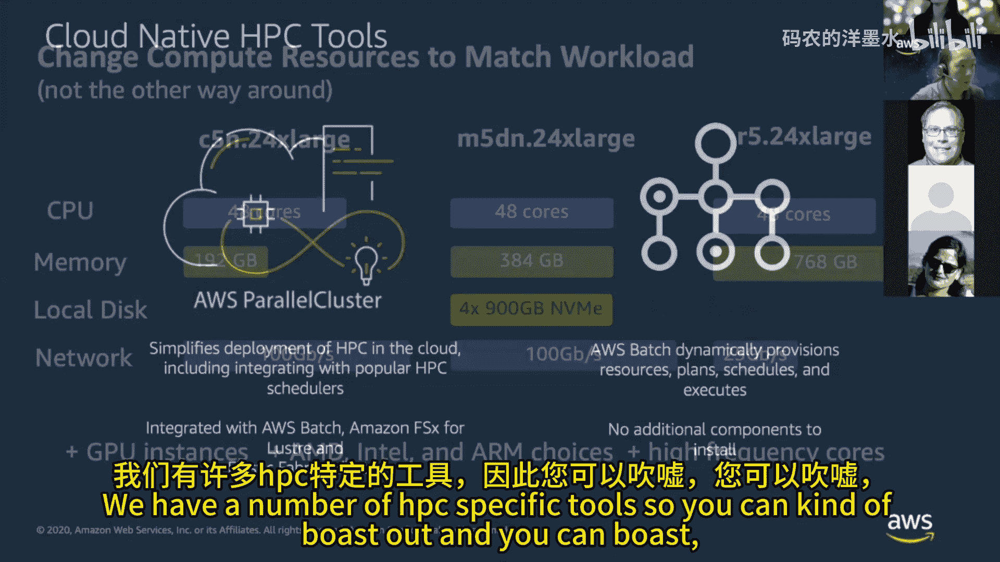

。

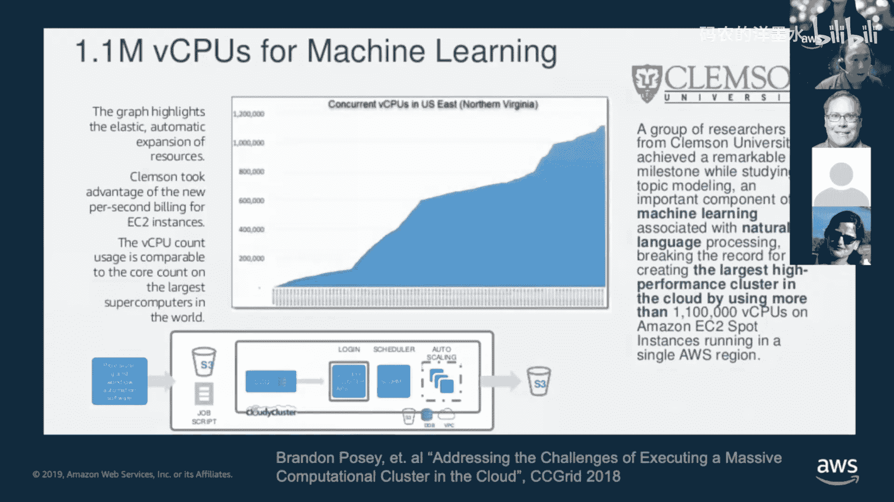

。The other use case that I think comes up pretty often here is these kind of machine AI services on top here。

this middle of this kind of machine loading AI services right so if you don't want to get into the kind of nuts and bolts of building clusters by hand。

 no intensiveorflow building up hooking everything together， building clusters out of servers。

 you can use SageMaker which lets you kind of extract that out and you can use our tool to help set up your clusters to help manage that even has tools to kind of debug machine loading models or compare different algorithms to see which one works better but even then if you say you don't want to deal with machine learninging。

 but you've got some work to do， we have a number of AI services that are useful they range some things like recognition which is computer vision models so let's say you've got a bunch of pictures you want to see all the ones where someone's got there's a car in that picture you've got a big pile of things that were taken over a number of years in some research site you can use recognition to go analyze those images。

You can look at do facial recognition， look for the same faces。

 you can look at stuff like expressions， those kinds of things if you've got a bunch of audio you can do stuff well it's say you have a number of years of archived video that has audio interviews with someone and you're an anthropology image with someone that the law space。

😊，And you need to kind of。You've got this in there normally you have to pay find some undergrad to sit there and transcribe all this video and so it's too expensive to ever work with we have a tool called transcribe。

Wwhich can transcribe that audio in video the audio part of that video into text it's not gonna be perfect if you with machine transcription it can be a little rough but it will get you to a place where then you can do work on it and you can actually search it and things like that even on 100% right that will give you a whole lot more than you would have before which was effectively nothing or pay someone to transcribe it for you similarly stuff like we have text and we also things like text text draft which lets you take documents and PDFs or images and transcribe them and get text out of them you can search so if you've got a bunch of old forms that were filled out in the 50s that were type written somewhere but you don't have a way to search those you can use text recognition service to do that and you don't have to build any machine learning to do that。

是。Testla does not currently support Arabic， unfortunately。Let's see here。Similarly。

 we have a bunch of analytics tools， we kind of mentioned this kind of stuff。

 but if you have things like EMO Spk and Hadoop kinds of jobs that you're doing on data already。

 you can use our tooling to not have to deal with managing Sp clusters Hadoop clusters and all that stuff。

 you can use tools like Athena to query CSV your kind of semistructured text like Jason in as if it was SQL so it gives you more analytics more power to analyze the data that you've already collected。

😊，And then finally， when you work in the cloud， the traditionalal model is you have some data sets that are available somewhere and you spend a lot of time moving data。

 moving large chunks of data from the person that had it before to your environment so you can work on it and then moving it back when you something you've got some new data you've got some new artifact thatt。

😊，With the cloud， you can move your computing resources to your data。

 you can put all your data in AWS and find new then get compute resources whether it's machine learning or EMO。

 other kinds of things directly to work on that data set without having to kind of spend a bunch of time engineering how you move data around to different tools。

😊，Yeah。So last section here， and we went a little little bit it's okay， so where to go from here。😊。

First off， UC Davis， UC Stevens has a product called Aggie Cloud which is running out of central IT。

That kind of has centralized billed authentication model so you can log in using your UC Davis CAsID it also offers an 11% discount on all services in the account。

 which has be pretty valuable if you're trying to use AWS and you can send an email to IET to get information about it。

😊，For people who use NIH， there's a program called Sides。

 which is available for NIH funded faculty that gives a 9% discount AWS services。

 but one of the goals is to really to create large data sets that can be used across researchers and there are some eligibility requirements。

 but if you have NIH data it's worth looking into for working on your research。😊，嗯。

people who have NSF based funding。Of。People that receive their cloud allocations who can'll get their money through CloudBank。

 they'll also receive additional services as well， and this can help get out of having to pay indirect costs on the cloud service for those grants。

😊，We have a research web page that's on the bottom here that is specifically focused on research workloads so if you have kind of if you want to go look at look and find resources about that are research specific。

 this is where you go to look for them， we have a number of quick starts。😊。

which are kind of these are sample environments that you can spin up using Cloudform templates that will spin up an existing work resource environment or kind of thing for you right we also training pathways and kind of blog articles for things if you're interested in looking at using research training WS。

😊，There's an open data registertry at AWS that has a number of very commonly used data sets and we're always open to people adding more so if you work with a data that is not pretty wide availability please talk to us we can look at hosting it if it's hosting AWS you don't have to pay for storing it nor do you have to pay the cost of people downloading that data。

This is particularly useful as if you're interested in getting used to AWS。😊。

se kind of a training pathway that covers a lot of the services that researchers might use。

And that is all free， so this gives you kind of a set of common research focused services that you can go take training on and learn about。

😊，Without having to then' trying to figure out the things you need to you like find all these offs and that's available at this link here。

So as UC Davis students and faculty and staff， UC Davis is part of the AWS Educ Program。

 which provides kind of self paced learning， AWs credit and then some other job linked stuff for you。

 it's about credits so you get $100。😊，You get $100 of credits every year as being part of age of educate and you can go look for it and that gives you a place to start so if you think of starting out you want to try it up but you don't want to pay a bunch of money。

😊，You can go use educ and get some credits and then try and stuff out if you're faculty。

 you get a larger number of credits。😊，And so you can do other things that load you do a little bit more work with it。

And we're going to end with some links to kind of this kind of stuff so some other programs here we have it was cloud credits for research so if you have a research project that you think you might use AWS on。

😊，You can reach out to us through this process and apply for credits and we can give you credits to offset some of all of the AWS spend of your project there's the global data EgressS waiver which is less critical but AWS generally charges for EG for data that leaves AWS under this program we waive most of those charges for people。

😊，If you do machine loading specifically， there are specific research awards just for machine loading。

😊，And there's open data and then there's some additional notebooks。😊，That's it， so before I end here。

There's this link on the bottom here GitHub the samples if you're interested in doing another kind of something else with your Juter notebook。

 these are more workshops。😊，That are similar to the workshop we just did。Oh。

In they're delivered as Jupiter notebooks。See here。

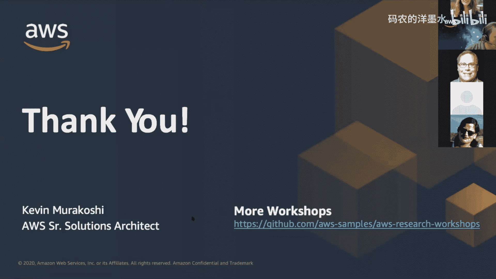

嗯。So there's on a number of different topics， we did that most of the basics workshop today。

 but if you're looking at de datata Lakes or Tensorflowlow or batch， which kind of HPC。

 you can try one of these other workshops here and you can do that within the account you just used today。

😊，And。

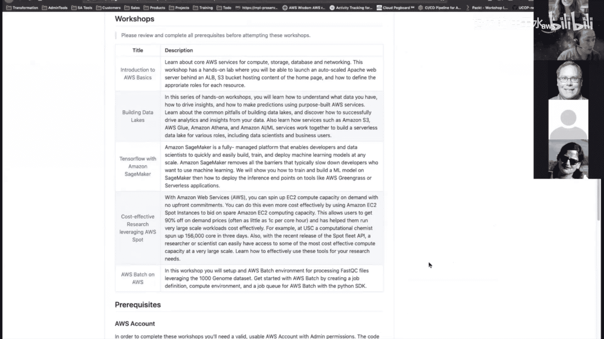

With that I think that's the end of this content so I think time to open it up for questions I know that there have been a lot of questions in the chat。

😊，嗯。And I'll be at office hours on Monday。And before we kick into questions because I know something you might start dropping off I'm gonna to paste the link here into the chat for a brief survey there will be some fabulous virtual prizes that we will share for those of you to complete this we'll also circulate this or email but it really helps us improve your programming especially as you're transitioning online I read everything that you guys so you don't have anything else to say put a funny joke in there for me it'll bright my day but please do complete those and we really appreciate your time and thank you for joining us and thank you Kevin and your team also really appreciate you coming in to share share your offerings and I also want to put in the plug too that they are really great people so if you go to them with a question their answer may actually be hey our service isn't perfect for you。

 but thanks I us know we should work on next but you know maybe consider local option or maybe there are others so while yes they do work for AWS their goal is to help researchers and I do firmly believe that at least from Kevin。

😊，And and the team that are here at this has， they genuinely want to help the research。

 not just sell their products。

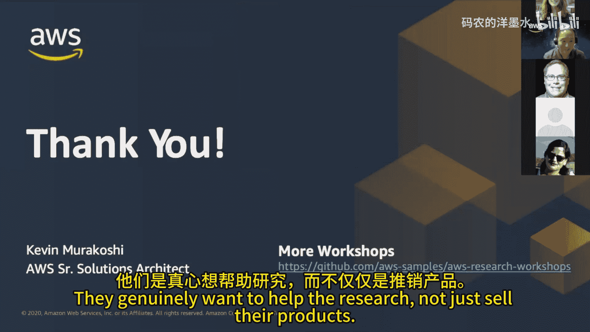