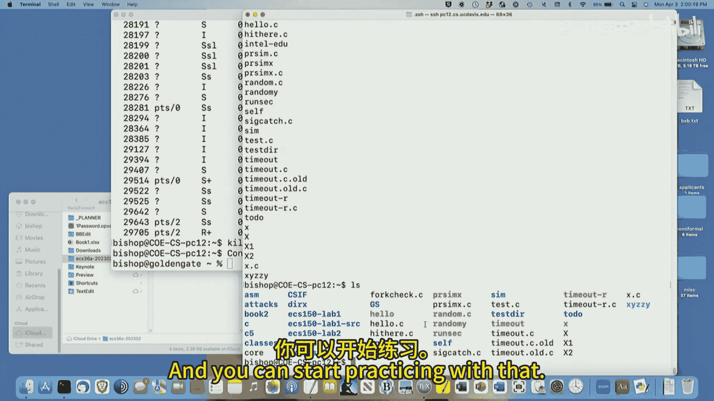

# 001：Unix进程创建基础 🖥️

在本节课中，我们将学习Unix/Linux系统的基础知识，包括文件操作、进程管理以及一些核心的Shell命令。这些知识是后续学习C语言底层编程的重要基础。

## 概述

本节课程将介绍Unix系统的基本操作单元——进程，并讲解如何在Shell环境中进行文件管理、查看进程状态以及控制进程的执行。

## 文件与目录操作

上一节我们介绍了课程的整体框架，本节中我们来看看如何在Unix系统中操作文件和目录。

### 删除文件与目录

使用 `rm` 命令可以删除文件。如果系统询问是否删除常规文件，例如“core”，用户可以选择确认或取消操作。

**取消命令执行**：如果误操作，可以按下 `Control + C` 来终止当前命令。

**删除目录**：使用 `rm -r` 命令可以递归删除目录及其内容。使用此命令需要非常小心。

### 目录权限

使用 `ls -l` 命令可以列出目录内容及其权限。权限分为三组：用户（user）、组（group）和其他人（others）。

对于目录，权限的含义如下：
*   **r（读取）**：允许列出目录内容。
*   **w（写入）**：允许在目录中创建或删除文件。
*   **x（执行）**：允许搜索目录，即进入目录或查找特定文件。

例如，权限 `drwxr-xr-x` 表示：
*   所有者可以读、写、执行（进入）该目录。
*   组用户和其他用户可以读和执行（进入）该目录，但不能写入。

这意味着，即使其他用户不能列出你的目录内容或创建文件，但如果他们有执行（x）权限，他们仍然可以通过指定完整路径进入该目录。

在大多数CSIF账户设置中，其他用户通常没有对个人主目录的搜索（执行）权限。但 `/tmp` 目录是一个临时区域，通常所有人都可以写入。

### 移动与复制文件

以下是文件操作的基本命令：

**移动/重命名文件**：使用 `mv` 命令。
```bash
mv randomX randomY
```
此命令将文件 `randomX` 重命名为 `randomY`。执行后，`randomX` 将不再存在，只有 `randomY`。

**复制文件**：使用 `cp` 命令。
```bash
cp hello.c hi_there.c
```
此命令创建 `hello.c` 的一个副本，名为 `hi_there.c`。使用 `cat` 命令查看两个文件，可以确认它们内容相同。

### 查看文件内容

`cat` 命令用于显示文件内容，其名称来源于“concatenate”（连接）。

直接使用 `cat` 查看长文件时，内容可能会快速滚过屏幕。为了解决这个问题，可以使用以下命令：

**分页查看**：使用 `more` 命令。
```bash
more filename
```
`more` 会一次显示一页内容，按空格键可以继续翻页。

**更灵活的分页查看**：使用 `less` 命令。
```bash
less filename
```
`less` 的功能与 `more` 类似，但提供了更多导航功能（如上下滚动）。要退出 `less`，只需按 `q` 键。

用户可以根据习惯选择使用 `more` 或 `less`。

## 进程管理

在了解了文件操作后，我们来看看Unix系统的核心——进程。

### 什么是进程

进程是系统的基本执行单元，简单来说，就是一个正在运行的程序。

例如，当你输入 `date` 命令时，系统会创建一个进程来执行该程序，然后输出当前的日期和时间。有些程序（如 `date`）非交互式地运行并立即结束；而有些程序（如文本编辑器或计算器）则是交互式的，会等待用户输入。

### 查看进程

要查看当前系统中正在运行的进程，可以使用 `ps` 命令。

**基本查看**：输入 `ps` 会列出与你当前终端会话相关的进程。
```bash
ps
```
输出通常包括进程ID（PID）、终端标识（如 `pts/0`）和命令名称（如 `bash`）。PID是进程的唯一编号，非常重要。

**查看所有进程**：使用 `ps aux` 或 `ps -ef` 可以列出系统上运行的所有进程。
```bash
ps aux
```

### 控制进程

进程ID（PID）在控制进程时非常有用。例如，当你需要终止一个长时间运行或失去响应的程序时。

**终止进程**：使用 `kill` 命令。
```bash
kill PID
```
此命令会向指定PID的进程发送一个终止信号（默认是 `SIGTERM`），请求其正常退出。

**强制终止进程**：如果进程不响应普通的 `kill` 命令（例如，Shell程序通常会忽略某些信号以防止误操作），可以使用 `kill -9` 命令。
```bash
kill -9 PID
```
`-9` 参数发送的是 `SIGKILL` 信号，该信号不可被进程捕获或忽略，会立即强制终止进程。**请注意**，强制终止Shell进程可能会导致你被登出系统，请谨慎使用。

### 输出重定向

Shell的一个强大功能是输出重定向，它允许你将命令的输出保存到文件中，而不是显示在屏幕上。

**重定向输出**：使用 `>` 符号。
```bash
ls > filelist.txt
```
此命令将 `ls` 命令的输出（当前目录的文件列表）写入到 `filelist.txt` 文件中。如果文件已存在，其原有内容将被覆盖。

默认情况下，重定向到文件的输出是单列显示的。这与直接在终端中显示的多列格式有所不同。

## 总结

本节课我们一起学习了Unix/Linux系统编程的基础知识。我们介绍了文件和目录的基本操作命令（`rm`, `mv`, `cp`, `cat`, `more`, `less`），理解了目录权限的含义。我们深入探讨了进程的概念，学习了如何查看（`ps`）和控制（`kill`）进程。最后，我们还了解了输出重定向（`>`）这一实用功能。




这些Shell操作是进行C语言编程，特别是系统级编程的必备技能。在下一节课中，我们将开始学习如何编译和运行C语言程序。