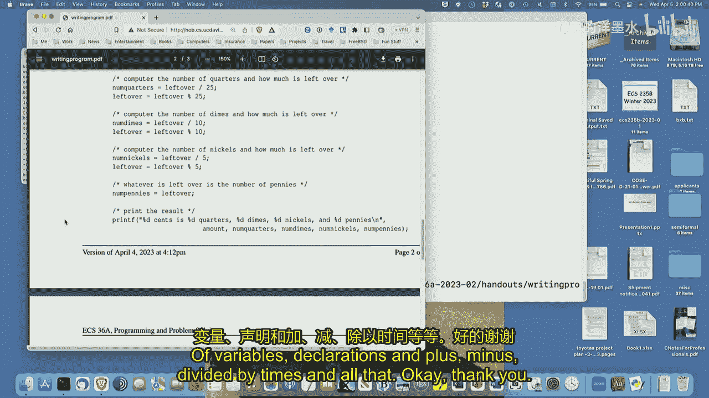

# 002：C程序基础与编译 🖥️


在本节课中，我们将学习C语言程序的基本结构，了解如何编写、编译和运行一个简单的C程序。我们还将通过一个“找零钱”的例子，学习如何将解决问题的思路转化为C语言代码。

## 概述

上一节我们介绍了Linux系统的基本操作。本节中，我们来看看C语言编程的基础。我们将从一个经典的“Hello World”程序开始，学习C程序的基本框架、编译过程，并通过一个实际例子理解如何设计算法并将其转化为C代码。

## C程序的基本结构

一个最简单的C程序是打印“Hello World”。以下是其基本结构：

```c
#include <stdio.h>

int main(void) {
    printf("Hello World\n");
    return 0;
}
```

*   **`#include <stdio.h>`**：这是一个头文件。它包含了标准输入输出函数的声明，例如我们使用的 `printf`。几乎每个进行输入输出的C程序都需要包含它。
*   **`int main(void)`**：这是每个C程序的入口点。程序从这里开始执行。`int` 表示这个函数会返回一个整数。
*   **`{ }`**：花括号 `{ }` 定义了 `main` 函数的代码块。所有要执行的语句都写在这对花括号内部。
*   **`printf("Hello World\n");`**：这是一个函数调用，用于在屏幕上打印文本。`\n` 表示换行。在C语言中，**每条语句必须以分号 `;` 结尾**。
*   **`return 0;`**：这表示程序正常结束。在C语言惯例中，返回 `0` 通常表示程序成功运行。

## 编译与运行C程序

C语言是一种**编译型语言**。这意味着你不能直接运行 `.c` 源代码文件。你必须先用**编译器**将其翻译成计算机能理解的机器语言，生成一个可执行文件。

以下是编译和运行的基本步骤：

1.  **编译**：使用 `gcc` 编译器。假设你的源代码文件名为 `hello.c`。
    ```bash
    gcc hello.c
    ```
    如果代码没有错误，这个命令会生成一个名为 `a.out` 的可执行文件。

2.  **运行**：执行生成的可执行文件。
    ```bash
    ./a.out
    ```
    程序将运行并输出 `Hello World`。

3.  **指定输出文件名**：你可以使用 `-o` 选项为生成的可执行文件指定一个不同的名字。
    ```bash
    gcc hello.c -o hello
    ./hello
    ```

**重要提示**：如果编译时出现 **`error`**，说明代码有致命错误，编译器无法生成可执行文件。如果出现 **`warning`**，虽然可能生成文件，但你也应该仔细检查代码，因为警告可能预示着潜在的问题。

## 一个更复杂的例子：温度转换表

为了更深入地了解C语言，我们来看一个将华氏温度转换为摄氏温度并打印表格的程序。这个例子展示了变量、循环和算术运算。

```c
#include <stdio.h>
#include <stdlib.h>

/* 程序：fahr2cel
 * 功能：打印华氏温度到摄氏温度的转换表
 * 用法：./fahr2cel
 */

int main(void) {
    int fahr, celsius;
    int lower = 0;   /* 温度表下限 */
    int upper = 300; /* 温度表上限 */
    int step = 20;   /* 步长 */

    printf("Degrees F\tDegrees C\n"); // \t 是制表符，用于对齐

    fahr = lower;
    while (fahr <= upper) {
        celsius = 5 * (fahr - 32) / 9;
        printf("%d\t\t%d\n", fahr, celsius);
        fahr = fahr + step; // 等价于 fahr += step;
    }
    exit(0);
}
```

*   **变量声明**：在C语言中，使用变量前必须声明其类型（如 `int` 表示整数）。这通常在函数开头完成。
*   **`while` 循环**：循环执行花括号 `{ }` 内的代码，直到条件 `(fahr <= upper)` 为假。
*   **`printf` 格式化**：`%d` 是一个占位符，表示在此处打印一个整数。第一个 `%d` 对应第一个参数 `fahr`，第二个对应 `celsius`。
*   **算术运算**：注意表达式 `5 * (fahr - 32) / 9`。在C语言中，**如果除号 `/` 两边的操作数都是整数，则执行整数除法，结果会舍弃小数部分**。

## 如何设计一个程序：找零钱示例

上一节我们介绍了C语言的语法基础。本节中，我们来看看如何将解决实际问题的思路转化为程序。我们将以“计算找零所需的硬币数量”为例，演示从问题分析到代码实现的完整过程。

设计程序的关键在于先理清思路，再编写代码。以下是核心步骤：

1.  **明确目标**：编写一个程序，计算给定金额（美分）需要多少个25美分（quarters）、10美分（dimes）、5美分（nickels）和1美分（pennies）。
2.  **定义输入输出**：
    *   输入：一个整数（例如 `99`，代表99美分）。
    *   输出：四个整数，分别代表25美分、10美分、5美分和1美分硬币的数量。
3.  **设计算法（用自然语言描述）**：思考如果是你手动计算会怎么做。
    *   读入总金额 `amount`。
    *   计算 `quarters = amount / 25`。
    *   计算剩余金额 `leftover = amount % 25`。
    *   计算 `dimes = leftover / 10`。
    *   更新 `leftover = leftover % 10`。
    *   计算 `nickels = leftover / 5`。
    *   更新 `leftover = leftover % 5`，此时的 `leftover` 就是 `pennies` 的数量。
    *   打印结果。
4.  **转化为C语言代码**：将上述步骤逐句翻译成C语句。

以下是实现该算法的C程序代码：

```c
#include <stdio.h>
#include <stdlib.h>

int main(void) {
    int amount;      // 总金额
    int leftover;    // 剩余金额
    int quarters, dimes, nickels, pennies; // 各种硬币数量

    // 1. 读取输入
    printf("Enter amount in cents: ");
    scanf("%d", &amount);

    // 2. 计算硬币数量
    leftover = amount;
    quarters = leftover / 25;
    leftover = leftover % 25;

    dimes = leftover / 10;
    leftover = leftover % 10;

    nickels = leftover / 5;
    leftover = leftover % 5;

    pennies = leftover;

    // 3. 打印结果
    printf("For %d cents, you need:\n", amount);
    printf("  Quarters: %d\n", quarters);
    printf("  Dimes:    %d\n", dimes);
    printf("  Nickels:  %d\n", nickels);
    printf("  Pennies:  %d\n", pennies);

    return 0;
}
```

*   **`scanf(“%d”, &amount)`**：这是用于从用户输入读取数据的函数。`%d` 表示读取一个整数，`&amount` 表示将读取的值存入变量 `amount` 中（`&` 是取地址运算符，后续课程会详细讲解）。
*   **`/` 和 `%`**：`/` 用于整数除法得到商，`%` 用于求余数得到模。它们是解决此类问题的关键运算符。

## 总结




本节课中我们一起学习了C语言编程的入门知识。我们首先了解了C程序的基本结构，包括 `main` 函数、头文件和语句格式。然后，我们掌握了使用 `gcc` 编译器将源代码转换为可执行文件的过程。最后，我们通过“找零钱”这个实例，完整地演练了从问题分析、算法设计到代码实现的编程思维流程。记住，编程的关键在于清晰地定义问题并一步步地将其转化为计算机能执行的指令。