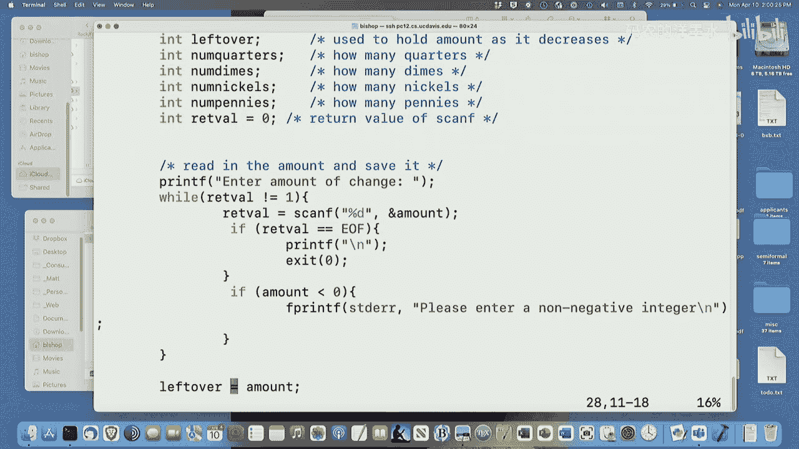

# 004：条件语句与输入错误处理 🧠


在本节课中，我们将要学习C语言中的逻辑关系、运算符以及条件语句。我们还将探讨如何处理用户输入中的错误，确保程序的健壮性。课程内容从逻辑运算的基础开始，逐步深入到`if`、`else if`、`switch`等条件控制结构，最后讲解如何利用循环和错误检查来构建一个可靠的用户输入处理流程。

## 逻辑运算符与关系运算符 🔍

在C语言中，逻辑运算的处理方式有些特殊，因为C语言没有内置的布尔类型。其核心规则是：**零（0）代表假（false），任何非零值都代表真（true）**。

逻辑运算符主要分为两类：关系运算符和逻辑连接运算符。

### 关系运算符
关系运算符用于比较两个值。以下是基本的关系运算符：
*   `>`：大于
*   `>=`：大于或等于
*   `<`：小于
*   `<=`：小于或等于
*   `==`：等于
*   `!=`：不等于

当进行关系运算赋值时，结果为`0`（假）或`1`（真）。例如：
```c
int x = 7, y = 19, z;
z = (x > y);   // z 被赋值为 0，因为 7 > 19 为假
z = (x != y);  // z 被赋值为 1，因为 7 != 19 为真
```

### 逻辑连接运算符
逻辑连接运算符用于组合多个逻辑条件。
*   `&&`：逻辑与（AND）。两个操作数都必须为非零，结果才为真。
*   `||`：逻辑或（OR）。至少一个操作数为非零，结果就为真。
*   `!`：逻辑非（NOT）。对操作数的真假值取反。

**注意**：单个`&`和单个`|`是按位运算符，与逻辑运算含义不同，切勿混淆。

### 运算符优先级与“短路求值”
运算符的优先级从高到低为：`!`（非） > `&&`（与） > `||`（或）。关系运算符的优先级高于`&&`和`||`，但低于`!`。

C语言采用“短路求值”（Lazy Evaluation）。这意味着，在计算逻辑表达式时，一旦能确定整个表达式的结果，就会立即停止计算。例如，在`(条件A && 条件B)`中，如果`条件A`为假，则整个表达式必为假，`条件B`将不会被计算。

---

上一节我们介绍了逻辑运算的基础，本节中我们来看看如何利用这些逻辑表达式来控制程序流程。

## 条件语句：`if` 与 `else` 🚦

`if`语句用于根据条件决定是否执行某段代码。其基本语法如下：
```c
if (表达式) {
    // 如果表达式的结果为非零（真），则执行这里的语句
}
```
如果`表达式`的结果为`0`（假），则跳过花括号内的语句。如果只有一条语句，花括号可以省略。

### 使用 `else` 处理相反情况
当条件为假时，如果需要执行另一段代码，可以使用`else`语句。
```c
if (表达式) {
    // 条件为真时执行
} else {
    // 条件为假时执行
}
```

### 处理多个条件：`else if`
在Python中，有`elif`关键字。在C语言中，我们使用`else if`来实现多重条件判断。这是一种比嵌套`if`语句更清晰、更易读的方式。
```c
if (条件1) {
    // 语句1
} else if (条件2) {
    // 语句2
} else if (条件3) {
    // 语句3
} else {
    // 默认语句
}
```
这种方式避免了代码因多层缩进而向右移动，使逻辑结构一目了然。

---

除了`if-else`链，C语言还提供了`switch`语句来处理基于单个变量或表达式与多个常量比较的情况。

## 多路选择：`switch` 语句 🔀

`switch`语句提供了一种更清晰的方式来处理多个离散值的分支。其语法结构如下：
```c
switch (表达式) {
    case 常量1:
        // 语句1
        break;
    case 常量2:
        // 语句2
        break;
    ...
    default:
        // 默认语句
        break;
}
```
*   `表达式`的结果必须是一个整型值。
*   `case`后面的必须是常量（如`1`、`‘A’`）。
*   `break`语句至关重要，它用于退出整个`switch`块。如果省略`break`，程序会继续执行下一个`case`中的语句，直到遇到`break`或`switch`结束。这种“贯穿”特性有时会被特意利用。
*   `default`分支是可选的，用于处理所有`case`都不匹配的情况。

**防御性编程提示**：即使在`default`分支或最后一个`case`后，也建议写上`break`。这可以防止未来其他开发者添加新的`case`时，因疏忽而引发意外的“贯穿”错误。

---

掌握了条件判断，我们就可以开始构建更健壮的程序。接下来，我们将学习如何处理用户输入，特别是如何检测和应对错误输入。

## 输入处理与错误检测 🛡️

一个友好的程序应该引导用户并提供清晰的错误提示。我们使用`printf`进行提示，使用`scanf`读取输入。

### 基本输入与`scanf`的返回值
`scanf`函数用于读取格式化输入。**关键点**：在变量前必须加上`&`（取地址符），因为`scanf`需要知道数据存储的内存地址。
```c
int amount;
printf(“请输入金额：”);
scanf(“%d”, &amount); // 注意 & 符号
```
`scanf`会返回一个整数，表示成功读取并赋值的变量个数。例如，`scanf(“%d”, &amount)`成功读取一个整数时返回`1`。

### 检测文件结束（EOF）
当输入源没有更多数据时（例如用户在键盘输入时按下`Ctrl+D`（Linux/Mac）或`Ctrl+Z`（Windows）），`scanf`会返回一个特殊值`EOF`（通常定义为`-1`）。我们应该检查这种情况。
```c
if (scanf(“%d”, &amount) == EOF) {
    printf(“输入结束。\n”);
    return 1; // 通常非零返回值表示异常退出
}
```

### 验证输入有效性
仅仅读取输入还不够，我们还需要验证输入是否符合预期（例如，金额不能为负数）。这正`if`语句的用武之地。
```c
if (amount < 0) {
    // 处理错误：金额不能为负数
}
```

### 向标准错误流输出错误信息
为了将正常的程序输出和错误信息分开，我们可以使用`fprintf`函数将错误信息输出到`stderr`（标准错误流）。这样即使用户将程序输出重定向到文件，错误信息仍会显示在屏幕上。
```c
if (amount < 0) {
    fprintf(stderr, “错误：请输入一个非负整数。\n”);
    // 后续处理，如退出或要求重新输入
}
```

---

当用户输入错误时，我们通常不希望程序直接崩溃退出，而是应该给用户重新输入的机会。这就需要用到循环。

## 使用循环实现健壮的输入 🔄

由于我们无法预知用户需要多少次尝试才能输入正确，因此适合使用`while`循环（一种不定次循环）来实现重复提示输入，直到获得有效值为止。

以下是一个结合了错误检查、EOF处理和循环的健壮输入示例框架：
```c
#include <stdio.h>

int main() {
    int amount;
    int leftover;

    while (1) { // 构建一个“无限”循环，在内部条件满足时跳出
        printf(“请输入找零金额（美分）：”);

        if (scanf(“%d”, &amount) == EOF) {
            printf(“\n”); // 为了输出美观
            return 0; // 遇到EOF，正常退出
        }

        if (amount < 0) {
            fprintf(stderr, “错误：金额不能为负数，请重新输入。\n”);
            continue; // 跳过本次循环剩余部分，重新开始提示输入
        }

        // 输入有效，跳出循环进行处理
        break;
    }

    leftover = amount; // 初始化剩余金额
    // ... 后续计算硬币数量的逻辑 ...
    printf(“处理完成。\n”);
    return 0;
}
```
在这个结构中：
1.  `while(1)`创建了一个循环。
2.  首先检查`EOF`，如果用户表示结束输入，则程序退出。
3.  然后检查输入有效性（如是否为负数）。如果无效，使用`fprintf(stderr, …)`打印错误信息，并用`continue`语句跳回循环开头，让用户再次输入。
4.  只有输入有效时，才执行`break`跳出循环，继续执行后面的业务逻辑。

---




本节课中我们一起学习了C语言中逻辑运算的真值规则、`if`/`else if`/`else`条件分支语句、用于多路选择的`switch`语句，以及如何利用`scanf`的返回值和`while`循环来构建一个能够有效处理用户输入（包括错误输入和正常结束）的健壮程序。理解并运用这些概念，是编写可靠、用户友好的命令行程序的基础。