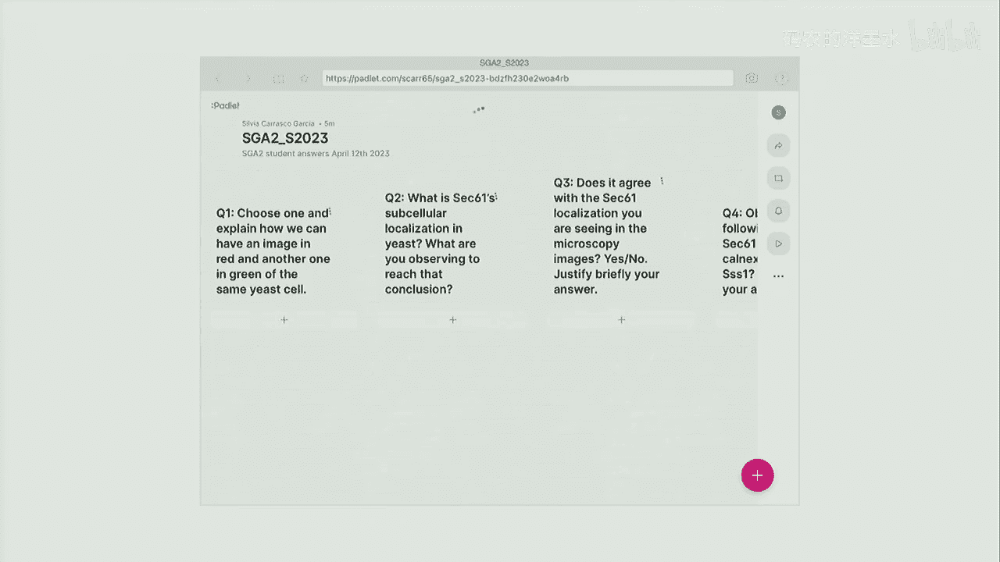
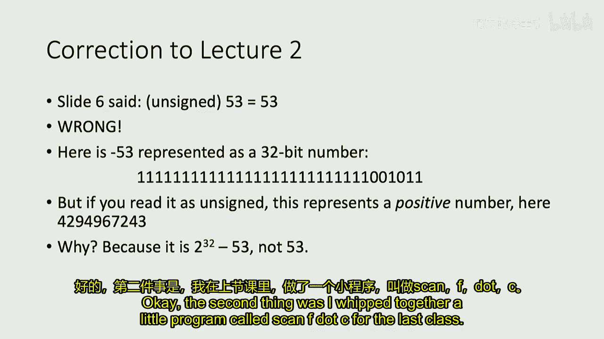
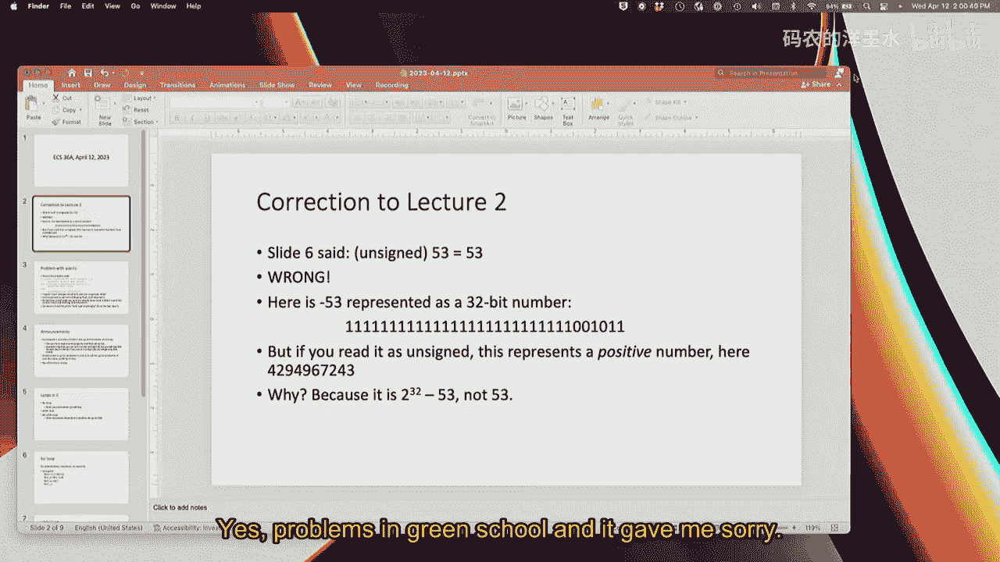

# 005：循环结构 🔄




在本节课中，我们将要学习C语言中用于重复执行代码块的三种循环结构：`for`循环、`while`循环和`do-while`循环。理解这些循环是编写高效程序的关键。

## 课程概述与回顾

上一节我们介绍了条件判断语句。本节中我们来看看如何让计算机重复执行某些任务，即循环结构。

首先，有几个课程相关的通知。作业一的附加学分部分已在Canvas平台发布。作业的前两个问题评分标准已设定，第三个问题和附加学分部分预计明天完成。作业截止日期是4月24日。作业中的问题需要使用一些程序，特别是第二个问题，要求你在现有代码中插入循环。代码中会明确标注“在此插入你的for循环”等位置，因此你无需担心编写函数，只需专注于编写循环本身。




此外，今天的办公时间因故取消，将在下周安排补课，可能在周二，以便大家都有机会查看作业。

## 关于之前内容的修正

在继续之前，需要修正之前讲座中提到的一个概念。在第二讲的第6张幻灯片中，关于`unsigned -53`的表述有误。它不应该是53。这是因为计算机以二进制表示数字。在32位系统中，`-53`的二进制表示中，最高位是符号位。对于`unsigned`（无符号）类型，这个最高位不被解释为负号，而是作为数值的一部分（2^31）。因此，`unsigned -53`的实际值是2^32 - 53，而不是53。

如果你需要确保得到一个正数，可以使用数学库中的`abs`函数（取绝对值），或者手动检查并取负。无符号类型在处理永远不会是负数的数据时很方便，在系统编程中更为常见，例如指定硬盘位置时就没有负值区域的概念。不过在本课程中，我们大部分时间将使用有符号类型。

另一个需要说明的是上节课演示的`scanf.c`程序。该程序旨在演示`scanf`函数如何读取两种输入模式：一个整数后跟一个浮点数，或者一个整数后跟“Xxx”。程序在读取“3 Xxx”（3和Xxx之间有空格）时，并未按预期返回1并存储整数，而是返回了0。这是因为`scanf`将输入视为字符流。当它读取了整数`3`后，遇到空格，这与格式字符串中的“Xxx”不匹配，因此停止读取，只返回了匹配成功的整数个数（1）。当程序流再次执行`scanf`时，输入缓冲区中只剩下“Xxx”，无法匹配整数格式，因此返回0。这个例子说明了`scanf`的使用需要格外小心，后续我们会介绍更好的处理方法。

## 循环结构介绍

条件语句（如`if`和`switch`）只应用条件一次。但有时我们需要重复执行某段代码，例如将数字从1加到10，这就需要循环。C语言提供了三种循环结构。

### for循环

`for`循环是一种确定性循环，通常在你明确知道循环次数或范围时使用。

`for`循环包含三个部分：
1.  **初始化**：在循环开始前执行一次。
2.  **条件测试**：在每次循环迭代前检查。如果为真，则执行循环体；如果为假，则退出循环。
3.  **增量/更新**：在每次循环体执行完毕后执行。

其基本语法如下：
```c
for (初始化; 条件; 增量) {
    // 循环体
}
```

以下是几个例子：
*   `for (i = 1; i < 10; i++)`：`i`从1开始，每次循环后加1，直到`i`不小于10时停止。
*   `for ( ; j < 10; j = j + 3)`：省略了初始化（假设`j`已提前定义），每次循环`j`增加3。
*   `for ( ; x < 10; )`：省略了初始化和增量，这通常不是`for`循环的最佳用法，`while`循环更合适。
*   `for ( ; ; )`：省略了所有三个部分，这将创建一个无限循环，因为条件默认为真。

`i++`是C语言中常见的自增运算符，等同于`i = i + 1`。`j = j + 3`也是常见的更新方式。

### while循环

`while`循环是一种条件不确定的循环，适用于你不知道具体循环次数，但知道循环终止条件的情况。

`while`循环在每次迭代**之前**检查条件。如果条件为真，则执行循环体；如果为假，则跳过整个循环。执行完循环体后，程序流返回`while`语句再次检查条件。

其基本语法如下：
```c
while (条件) {
    // 循环体
}
```

例子：
*   `while (i < 10)`：当`i`小于10时，持续循环。
*   `while (j != 13)`：当`j`不等于13时，持续循环。
*   `while (1)`：条件永远为真，这是一个无限循环。如果循环体为空（只有一个分号），则是一个空循环，有时用于实现特定延时。

### do-while循环

`do-while`循环与`while`循环类似，但关键区别在于其条件测试在循环体**之后**进行。

这意味着`do-while`循环的循环体**至少会执行一次**。执行完循环体后，检查条件。如果条件为真，则返回`do`处再次执行循环体；如果为假，则退出循环。

其基本语法如下：
```c
do {
    // 循环体
} while (条件);
```
通常，即使循环体只有一条语句，也建议使用花括号`{}`。

## 循环控制语句

在循环中，有两个重要的控制语句：`break`和`continue`（本节课主要演示`break`）。

`break`语句用于立即**跳出**当前所在的**最内层**循环（对于`for`、`while`、`do-while`都有效），并继续执行循环之后的代码。

以下是一个使用`break`在无限循环中控制退出的例子：
```c
int i = 0;
for ( ; ; ) { // 无限循环
    i++;
    if (i >= 5) {
        break; // 当 i 大于等于 5 时跳出循环
    }
    printf(“for the %d time\n”, i);
}
printf(“Bye\n”);
```
这段代码会打印4次信息（i从1到4），当`i`变为5时，`break`执行，跳出循环并打印“Bye”。如果去掉`break`，循环将无限进行，在终端中可以使用`Ctrl+C`来强制终止程序。

**关于格式的注意事项**：C语言编译器**不关心**代码的缩进。缩进只是为了人类阅读方便。因此，在编写`if`、`else`或循环时，务必使用花括号`{}`来明确界定代码块的范围，避免逻辑错误。例如，`else`总是与它前面最近的`if`配对。

## 循环结构的选择与实践

那么，如何选择使用哪种循环呢？这里有一个一般性的指导原则：

*   当你**明确知道**循环需要执行的次数，或者有一个清晰的计数器时，使用`for`循环。
*   当你**不确定**循环次数，循环的终止依赖于循环体内发生的事件（例如用户输入、文件结束标志、某个条件被满足）时，使用`while`循环。
*   当你需要确保循环体**至少执行一次**，然后再根据条件决定是否继续时，使用`do-while`循环。

让我们通过一个读取用户输入的例子来实践`while`循环的用法：
```c
#include <stdio.h>
int main(void) {
    int c;
    printf(“Type an ‘A’ to quit:\n”);
    while ((c = getchar()) != ‘A’) {
        // 循环体，这里可以处理输入的字符
        // 注意：getchar()也会读取用户按下的回车键‘\n’
    }
    printf(“Goodbye!\n”);
    return 0;
}
```
这个程序会持续等待用户输入，直到用户输入字符‘A’并按回车。这是一个典型的`while`循环应用，因为程序无法预知用户何时会输入‘A’。`getchar()`函数返回一个`int`类型，这是为了能够表示文件结束符`EOF`（通常是-1），这个值超出了字符0-127的范围。

## 总结

本节课中我们一起学习了C语言的三种循环结构：
1.  **`for`循环**：适用于循环次数确定的场景，结构清晰，包含初始化、条件和更新。
2.  **`while`循环**：适用于循环次数不确定，但终止条件明确的场景，条件在循环前检查。
3.  **`do-while`循环**：适用于需要至少执行一次循环体的场景，条件在循环后检查。




我们还学习了`break`语句，用于在满足特定条件时提前跳出循环。记住，在C语言中，代码块必须用花括号`{}`明确界定，缩进仅为了可读性。合理选择循环结构，并正确使用控制语句，是编写清晰、高效C程序的基础。