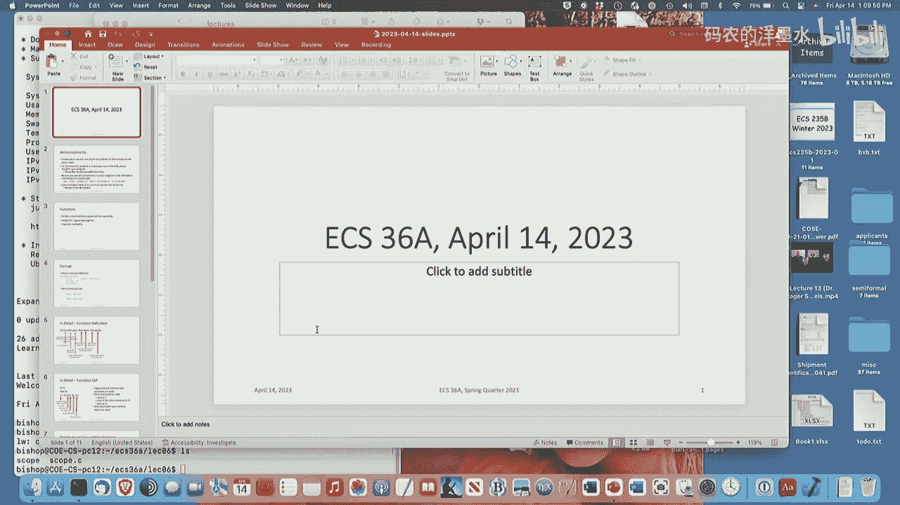
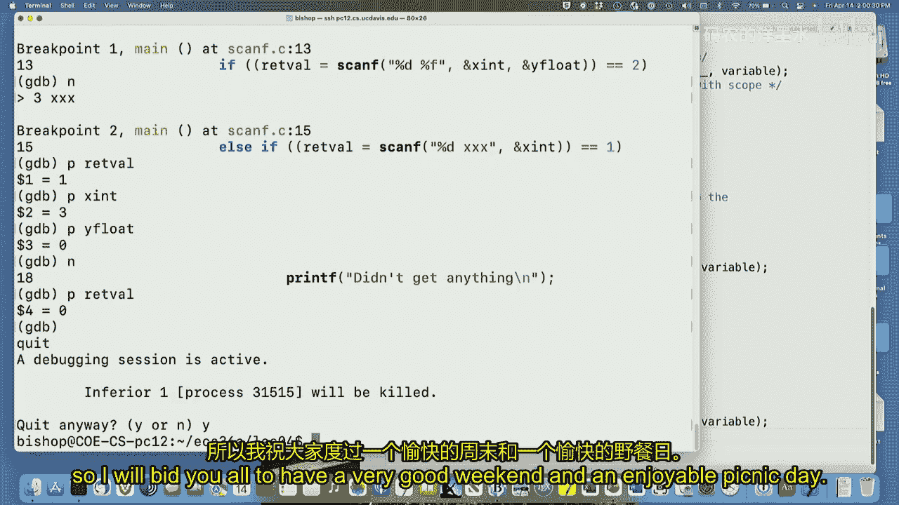

# 006：函数 🧩





在本节课中，我们将学习C语言中一个核心概念：函数。函数是封装代码块、提高代码复用性和可读性的重要工具。我们将从函数的基本语法开始，逐步深入到参数传递、作用域以及调试技巧。

## 函数概述与定义

上一节我们讨论了程序的基本结构，本节中我们来看看如何将代码组织成独立的模块——函数。

函数是一段执行特定任务的代码块，可以被多次调用。定义函数时，需要指定其返回类型、名称和参数列表。

一个函数定义的通用格式如下：
```c
返回类型 函数名(参数类型1 参数名1, 参数类型2 参数名2, ...) {
    // 函数体：执行操作的代码
    return 返回值; // 如果返回类型不是void
}
```
例如，一个将输入值加17的函数可以这样定义：
```c
int addSeventeen(int par) {
    int result;
    result = par + 17;
    return result;
}
```
调用这个函数时，可以这样写：
```c
int some1 = addSeventeen(53);
int some2 = addSeventeen(-12);
```

## 函数原型与参数传递

理解了基本定义后，我们来看看如何提前声明函数，以及参数是如何传递给函数的。

如果函数定义出现在其调用之后，编译器可能无法正确检查参数类型和数量。为了解决这个问题，C语言引入了**函数原型**（或称前向声明）。函数原型是函数定义的第一行，但用分号代替了花括号。

函数原型示例：
```c
int funky(int par1, float par2, char par3); // 函数原型
```
在函数调用中，参数是通过**传值**的方式传递的。这意味着函数内部接收到的是外部变量值的副本。因此，在函数内部修改参数的值，不会影响函数外部原始变量的值。

以下是调用`funky`函数的示例：
```c
int x = 7;
float fx = 3.14;
int result = funky(x, fx, 'a');
```
在这个例子中，变量`x`和`fx`的值被复制给了函数`funky`的参数`par1`和`par2`。

## 变量作用域

上一节我们介绍了参数传递是“传值”的，本节中我们来探讨变量的可见性范围，即**作用域**。

作用域决定了程序中哪个部分可以访问某个变量。基本原则是：在代码块（由花括号`{}`界定）内部定义的变量，其作用域仅限于该块内部。如果内部块和外部块有同名变量，则内部块的变量会“遮蔽”外部块的变量。

考虑以下示例程序：
```c
#include <stdio.h>
int variable = 1; // 全局变量

void g(int variable) {
    printf("Inside g: %d\n", variable);
}

void h(void) {
    printf("Inside h: %d\n", variable);
}

int main(void) {
    int variable = 2; // 遮蔽了全局变量
    printf("In main (outer): %d\n", variable);
    {
        int variable = 3; // 遮蔽了main中的variable
        printf("In main (inner block): %d\n", variable);
    }
    printf("In main (after block): %d\n", variable);
    g(variable); // 传递的是main中的variable，值为2
    h(); // 内部无定义，使用全局变量，值为1
    return 0;
}
```
程序输出将清晰地展示不同作用域下同名变量的值。

## 使用GDB进行调试

编写程序时难免会遇到错误。本节我们将学习使用GNU调试器（GDB）来查找和诊断程序中的问题。

GDB允许你逐行执行程序、设置断点、检查变量值，是强大的调试工具。以下是一些基本命令：
*   `gcc -g program.c -o program`：编译时加入调试信息。
*   `gdb ./program`：启动GDB并加载程序。
*   `break line_number` 或 `b line_number`：在指定行设置断点。
*   `run`：开始运行程序。
*   `next` 或 `n`：执行下一行代码（不进入函数内部）。
*   `step` 或 `s`：执行下一行代码（会进入函数内部）。
*   `print variable_name` 或 `p variable_name`：打印变量的值。
*   `continue` 或 `c`：继续运行直到下一个断点或程序结束。
*   `list` 或 `l`：列出源代码。

例如，要调试一个`scanf`读取输入有误的程序，可以在GDB中运行程序，在关键的`scanf`调用前后设置断点，然后使用`print`命令检查`scanf`的返回值和相关变量的值，从而定位逻辑错误。

## 总结




本节课中我们一起学习了C语言的函数。我们了解了如何定义和调用函数，理解了“传值”参数传递机制意味着函数内部操作的是参数的副本。我们还探讨了变量的作用域规则，知道了局部变量如何遮蔽全局变量。最后，我们介绍了使用GDB进行程序调试的基本方法，这是定位和修复代码错误的重要技能。掌握这些概念是构建模块化、可维护C程序的基础。