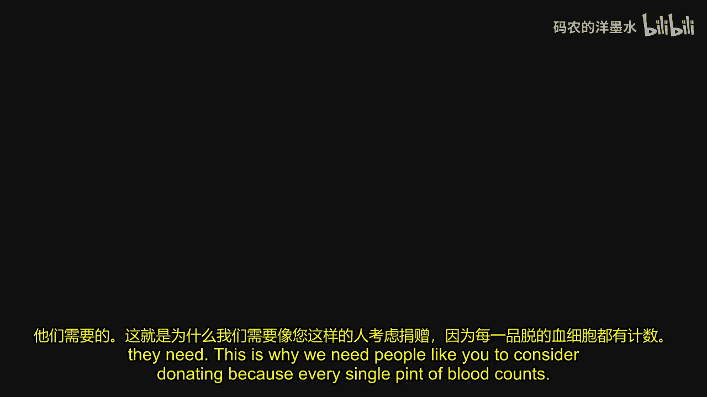
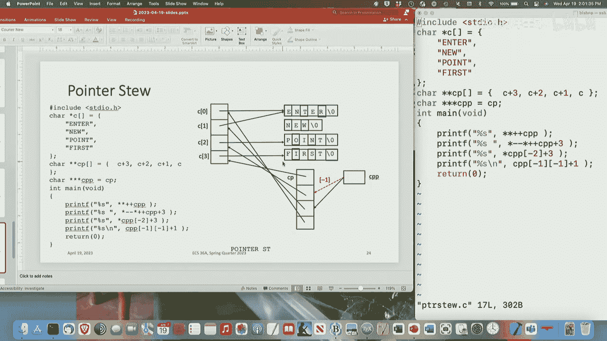

# 008：数组与字符串



在本节课中，我们将要学习C语言中数组和字符串的核心概念。数组是存储相同类型数据的集合，而字符串本质上是以空字符结尾的字符数组。理解它们对于进行底层编程至关重要。

## 数组基础

上一节我们介绍了指针，本节中我们来看看数组。数组是存储相同类型数据的连续内存空间。

在C语言中，数组的声明和初始化方式如下：
```c
int iarr[5] = {1, 2, 3, 4, 5};
```
或者，你可以让编译器自动计算数组大小：
```c
int iarr[] = {1, 2, 3, 4, 5}; // 编译器会分配5个整数的空间
```
数组名本身是一个指向数组首元素的指针常量。这意味着 `iarr[0]` 和 `*iarr` 访问的是同一个元素。当使用下标访问时，如 `iarr[12]`，编译器会自动进行地址计算：`iarr` 的地址 + 12 * `sizeof(int)`。

## 指针初始化

指针变量必须初始化为一个有效的地址。以下是初始化指针的方法：
```c
int ivar = 10;
int *pvar = &ivar; // pvar 指向 ivar
```
一个特殊的指针值是 `NULL`（通常定义为0），它表示指针不指向任何有效地址。尝试解引用一个 `NULL` 指针会导致程序崩溃，但这有助于快速发现错误。

## 字符串入门

字符串是C语言编程的核心。一个字符串就是一个以空字符（`\0`）结尾的字符数组。

以下是定义字符串的两种方式：
```c
char ca[6] = {'H', 'e', 'l', 'l', 'o', '\0'};
char *cstr = "Hello"; // 编译器会自动添加 '\0'
```
需要注意的是，像 `char *cstr = "Hello";` 这样的字符串字面量通常存储在只读内存区域，不能修改。如果需要修改字符串，必须将其复制到可写的字符数组中。

## 字符串操作与安全

以下是处理字符串时需要特别注意的操作。

### 字符串复制
不要使用赋值运算符来“复制”字符串，因为这只会复制指针（地址），而不是字符串内容本身。
```c
char *cstr = "Hello";
char *cdup_str = cstr; // 错误！这只是让两个指针指向同一个地址。
```
要复制字符串内容，应使用 `strcpy` 函数。但更安全的是使用 `strncpy`，它可以指定最大复制字符数，防止缓冲区溢出。
```c
char dest[100];
strncpy(dest, cstr, sizeof(dest) - 1); // 安全复制
dest[sizeof(dest) - 1] = '\0'; // 确保以空字符结尾
```

### 安全的输入读取
使用 `scanf` 读取字符串有时会很麻烦。更安全、更常用的方法是 `fgets`。
```c
char buff[100];
fgets(buff, sizeof(buff), stdin); // 从标准输入读取，最多99个字符+'\0'
```
**绝对不要使用 `gets` 函数**，因为它不检查缓冲区边界，极易导致“缓冲区溢出”或“栈粉碎”攻击，这是严重的安全漏洞。`fgets` 会限制读取的字符数，因此安全得多。

## 指针与多维数组

理解指针对于处理复杂的数组结构（如字符串数组）非常重要。

考虑以下声明：
```c
char *c[] = {"enter", "new", "point", "first"};
char **cp[] = {c+3, c+2, c+1, c};
char ***cpp = cp;
```
这里：
*   `c` 是一个指针数组，每个元素指向一个字符串。
*   `cp` 是一个指针的指针数组，每个元素指向 `c` 中的某个元素。
*   `cpp` 是一个指向 `cp` 的指针。

通过操作符（`*` 解引用，`++`/`--` 增减）来遍历这些结构，可以访问到不同的字符串或字符。例如，`*(*cpp)` 会先解引用 `cpp` 得到 `cp` 中的一个元素，再解引用该元素得到 `c` 中的一个字符串指针。手动画图跟踪指针的指向变化是理解这类代码的最佳方式。

---




本节课中我们一起学习了C语言中数组和字符串的基础知识。我们了解了如何声明和初始化数组与字符串，掌握了使用 `strncpy` 和 `fgets` 进行安全字符串操作的重要性，并初步探讨了指针与多维数组之间的关系。理解这些概念是进行有效且安全的C语言编程的基石。