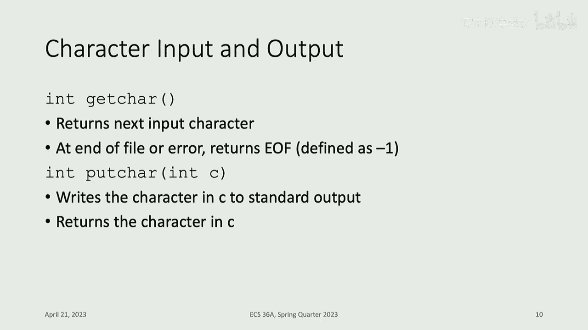

# 009：字符串处理进阶 🧵

在本节课中，我们将深入学习C语言中字符串处理的进阶技巧，包括字符串的表示、通过指针操作字符串、以及一些常见的字符串处理习惯用法。我们还将探讨如何通过命令行参数向程序传递字符串。

---

## 概述

在上一节中，我们介绍了指针的基本概念。本节中，我们将看看如何将指针应用于字符串处理。C语言中没有内置的字符串类型，字符串通常通过字符指针或字符数组来表示。理解如何高效地操作这些结构是编写健壮C程序的关键。

---

## 命令行参数

在C语言中，`main`函数可以接收来自命令行的参数。这是通过两个标准参数实现的：`argc`和`argv`。

以下是`main`函数的标准形式：
```c
int main(int argc, char *argv[])
```
*   `argc`（参数计数）是一个整数，表示命令行参数的数量，包括程序名本身。
*   `argv`（参数向量）是一个指向字符指针数组的指针。每个指针指向一个以空字符（`\0`）结尾的字符串，代表一个命令行参数。

例如，执行命令 `./loopy 5 9` 时：
*   `argc` 的值为 3。
*   `argv[0]` 指向字符串 `"./loopy"`。
*   `argv[1]` 指向字符串 `"5"`。
*   `argv[2]` 指向字符串 `"9"`。
*   `argv[3]` 是一个空指针（`NULL`），用于标记参数列表的结束。

`main`函数就像一个普通函数一样被调用，其参数由系统启动代码设置。你可以为这些参数使用任何你喜欢的名称。

---

## 字符串作为函数参数

当我们将字符串传递给函数时，实际上传递的是指向该字符串第一个字符的指针。

以下是函数原型和定义的示例：
```c
// 函数原型（前向声明）
void strfunc(char *, char *);

// 函数定义
void strfunc(char *first, char *second) {
    // 函数体
}
```
在调用时，例如 `strfunc(x, y)`，编译器会检查 `x` 和 `y` 是否为字符指针。函数内部通过指针来访问和操作原始字符串。

---

## 字符串操作习惯用法

由于字符串在C中被广泛使用，因此形成了一些常见的操作习惯用法。

### 遍历字符串

以下是一个使用指针遍历并打印字符串的经典例子：
```c
char *cp = "Hello";
while (*cp != '\0') {
    printf("%c", *cp);
    cp++;
}
printf("\n");
```
**工作原理**：
1.  `cp` 初始指向字符串 `"Hello"` 的首地址。
2.  循环条件 `*cp != '\0'` 检查 `cp` 当前指向的字符是否为空字符（字符串结束标志）。
3.  如果不是空字符，则打印该字符。
4.  `cp++` 将指针移动到下一个字符的地址。
5.  重复此过程，直到遇到空字符，循环结束。

后缀递增运算符 `cp++` 表示“先使用 `cp` 的当前值，然后再将其加1”。这与前缀递增 `++cp` 不同，后者是“先将 `cp` 加1，然后使用新值”。

---

### 复制字符串

让我们看看几种复制字符串的方法，从最清晰的方法到更简洁（有时更晦涩）的方法。

**方法一：使用数组索引**
这是最直观的方法。
```c
void strcopy1(char new[], char old[]) {
    int i = 0;
    while (old[i] != '\0') {
        new[i] = old[i];
        i++;
    }
    new[i] = '\0'; // 确保新字符串以空字符结尾
}
```

**方法二：简化条件判断**
因为空字符的值为0，而C语言中0代表假，非0代表真，所以可以简化循环条件。
```c
void strcopy2(char new[], char old[]) {
    int i = 0;
    while (old[i]) { // 等价于 while (old[i] != '\0')
        new[i] = old[i];
        i++;
    }
    new[i] = '\0';
}
```

**方法三：利用赋值表达式的值**
在C语言中，赋值表达式本身也有一个值，即被赋的值。我们可以利用这一点将赋值和条件检查合并。
```c
void strcopy3(char new[], char old[]) {
    int i = 0;
    while ((new[i] = old[i]) != '\0') {
        i++;
    }
}
```
甚至可以进一步简化，因为当 `old[i]` 是空字符时，赋值表达式 `new[i] = old[i]` 的值就是0（假）。
```c
void strcopy3_compact(char new[], char old[]) {
    int i = 0;
    while (new[i] = old[i]) {
        i++;
    }
}
```

**方法四：使用指针**
直接操作指针通常更高效，代码也更紧凑。
```c
void strcopy4(char *new, char *old) {
    while ((*new = *old) != '\0') {
        new++;
        old++;
    }
}
```
同样可以简化为：
```c
void strcopy4_compact(char *new, char *old) {
    while (*new++ = *old++) {
        ; // 空循环体
    }
}
```
**注意**：循环结束后，`new` 和 `old` 指针都指向了各自字符串末尾的空字符之后的位置。此时不应再使用它们进行写入操作，否则可能导致程序崩溃或数据损坏。

---

## 重要注意事项

1.  **字符串字面量 vs. 字符数组**：像 `char *p = "Hello";` 这样的字符串字面量通常存储在只读内存区。而像 `char s[] = "Hello";` 这样的字符数组则存储在可读写内存区。试图修改字符串字面量的内容会导致未定义行为。
2.  **初始化指针**：声明一个字符指针（如 `char *cp;`）后，必须将其初始化为指向有效的内存地址（例如一个数组或动态分配的内存），然后才能使用它来操作字符串。
3.  **使用标准库函数**：在实际编程中，应优先使用标准库函数（如 `strcpy`, `strncpy`）来复制字符串。这些函数通常经过高度优化，并且使代码意图更清晰。

---

## 总结




本节课中我们一起学习了C语言字符串处理的进阶知识。我们了解了如何通过 `argc` 和 `argv` 处理命令行参数，掌握了字符串作为函数参数传递的本质（传递指针）。我们重点探讨了遍历和复制字符串的多种习惯用法，从清晰的数组索引法到高效的指针操作法。记住，在操作字符串时，始终要留意空字符的终止作用，并谨慎处理指针，避免越界访问。对于常见的字符串操作，积极利用标准库函数是编写安全、高效代码的最佳实践。