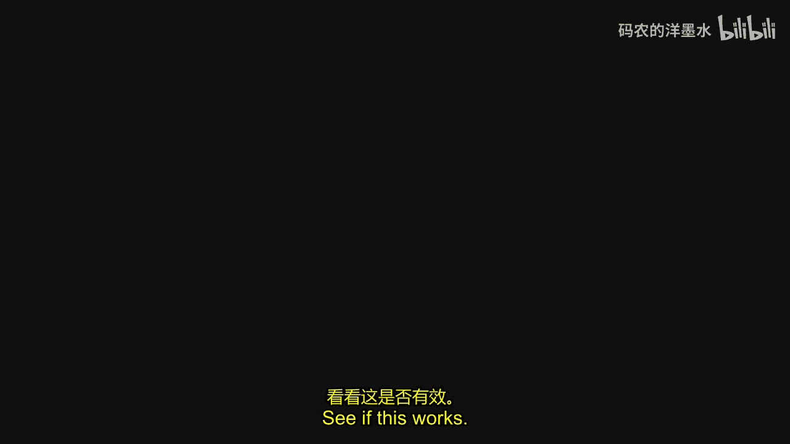
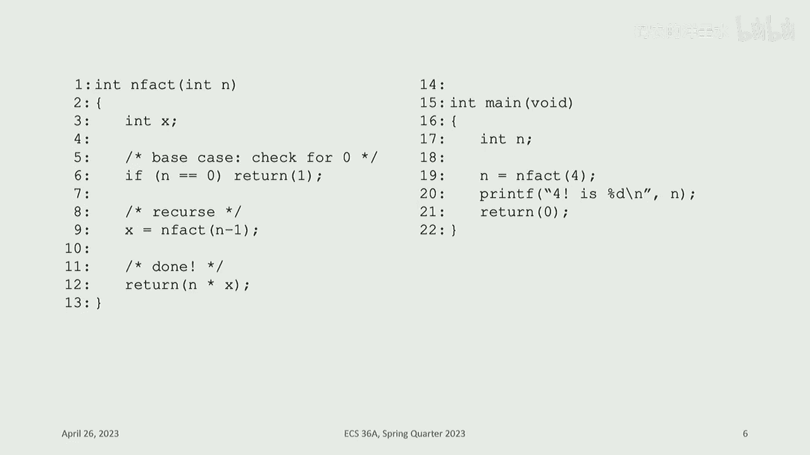
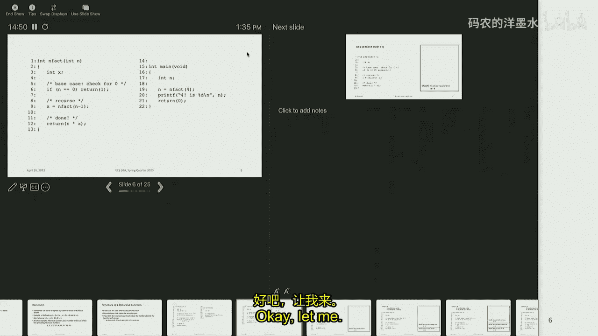
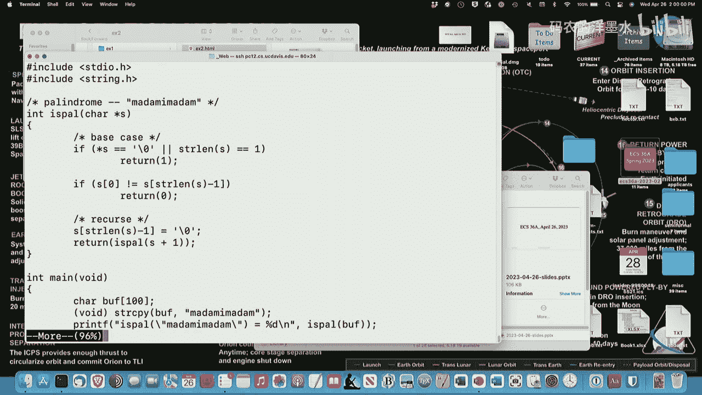

# 011：递归

在本节课中，我们将要学习一种非常强大且广泛使用的编程技术——递归。递归的核心思想是将一个复杂问题表达为更简单或更小版本的自身，这常常能极大地简化编程工作并减少代码量。

## 课程概述与公告

在开始之前，有几个公告需要说明。作业二已发布在网站上，和之前一样，请将你的程序上传到GradeScope。助教Chris的答疑时间从周五的11-12点调整到了12-1点，地点不变。此外，计算机科学辅导俱乐部已开放，可以为包括ECS 36A在内的多门课程提供帮助，详细信息请查看公告。



关于作业，有一个问题要求计算幂次，你需要使用名为`pow`的库函数。为此，你需要在程序中包含头文件`math.h`，并且在编译命令的末尾加上`-lm`来链接数学库。

## 什么是递归？🧠

递归是一种编程技术，其核心在于**一个函数直接或间接地调用自身**。它通常用于解决可以分解为相似但规模更小的子问题的问题。

递归函数通常包含两个关键部分：
1.  **基准情形**：这是递归停止的条件。它不包含任何递归调用，直接返回一个结果。
2.  **递归情形**：这是函数调用自身的部分。**每一次递归调用都必须使问题规模更接近基准情形**，否则递归将无限进行下去，导致栈内存溢出。

## 递归示例：阶乘函数

阶乘是一个经典的递归例子。n的阶乘（记作 `n!`）定义为所有小于等于n的正整数的乘积，并且 `0! = 1`。

### 迭代实现
首先，我们看看熟悉的迭代（循环）实现方式：
```c
int factorial_iterative(int n) {
    if (n == 0) return 1;
    int product = 1;
    for (int i = 1; i <= n; i++) {
        product *= i;
    }
    return product;
}
```

### 递归实现
现在，我们来看看如何用递归定义阶乘。其数学关系（递推关系）是：
`n! = n * (n-1)!`，且 `0! = 1`。

根据这个关系，我们可以写出递归函数：
```c
int factorial_recursive(int n) {
    // 基准情形
    if (n == 0) {
        return 1;
    }
    // 递归情形：问题规模从 n 减小为 n-1
    return n * factorial_recursive(n - 1);
}
```
在这个函数中，`if (n == 0) return 1;` 是基准情形。当 `n` 不为0时，函数通过调用 `factorial_recursive(n - 1)` 来计算 `(n-1)!` 的值，然后将结果与 `n` 相乘并返回。每次递归调用，`n` 的值都减小1，最终会达到基准情形 `n == 0`。

## 理解递归调用栈 🥞

为了深入理解递归的执行过程，我们需要了解程序调用栈。每当一个函数被调用时，系统都会在栈上为其分配一块内存空间（称为栈帧），用于存储局部变量、参数和返回地址等信息。





让我们以计算 `factorial_recursive(4)` 为例，一步步跟踪栈的变化：

1.  `main` 函数调用 `factorial_recursive(4)`。栈上压入一个帧，其中 `n = 4`。
2.  由于 `n != 0`，函数执行 `return 4 * factorial_recursive(3)`。为了计算这个表达式，它必须先调用 `factorial_recursive(3)`。
3.  栈上压入新的帧，`n = 3`。它需要计算 `return 3 * factorial_recursive(2)`，于是调用 `factorial_recursive(2)`。
4.  栈上压入新的帧，`n = 2`。它调用 `factorial_recursive(1)`。
5.  栈上压入新的帧，`n = 1`。它调用 `factorial_recursive(0)`。
6.  栈上压入新的帧，`n = 0`。此时触发基准情形，函数直接返回 `1`。
7.  `n = 0` 的帧从栈中弹出（销毁）。返回值 `1` 传递给 `n = 1` 的帧，该帧计算 `return 1 * 1`，得到结果 `1`。
8.  `n = 1` 的帧弹出，返回值 `1` 传递给 `n = 2` 的帧，计算 `return 2 * 1`，得到 `2`。
9.  `n = 2` 的帧弹出，返回值 `2` 传递给 `n = 3` 的帧，计算 `return 3 * 2`，得到 `6`。
10. `n = 3` 的帧弹出，返回值 `6` 传递给 `n = 4` 的帧，计算 `return 4 * 6`，得到最终结果 `24`，并返回给 `main` 函数。

这个过程清晰地展示了递归如何通过栈来管理多次函数调用，以及每次调用如何拥有自己独立的变量空间。

## 递归示例：判断回文串

上一节我们介绍了阶乘这个数学概念的递归实现，本节中我们来看看一个更贴近文本处理的例子——判断一个字符串是否是回文。回文是指正读和反读都一样的字符串，例如 “madam”。

迭代方法可能需要复制或反转字符串进行比较。递归方法则更加优雅：比较字符串的首尾字符，如果相同，则递归判断去掉首尾字符后的子串。

以下是递归实现的思路和代码：

1.  **基准情形**：
    *   如果字符串长度为0（空串）或1（单个字符），那么它自然是回文。
2.  **递归情形**：
    *   比较字符串的第一个字符（`s[0]`）和最后一个字符（`s[strlen(s)-1]`）。
    *   如果它们不相等，则不是回文，立即返回 `0`（假）。
    *   如果相等，则问题转化为判断去掉首尾字符后的中间子串是否是回文。我们通过递归调用自身来实现。

```c
#include <string.h>

int is_palindrome(char *s) {
    int len = strlen(s);
    // 基准情形：空串或单字符是回文
    if (len == 0 || len == 1) {
        return 1;
    }
    // 检查首尾字符
    if (s[0] != s[len - 1]) {
        return 0; // 首尾不同，不是回文
    }
    // 递归情形：去掉首尾字符，检查剩余子串
    // 将末尾字符临时替换为字符串结束符 ‘\0‘，以缩短字符串
    char temp = s[len - 1];
    s[len - 1] = ‘\0‘;
    // 递归调用，传入字符串指针指向下一个字符（即去掉首字符）
    int result = is_palindrome(s + 1);
    // 恢复原字符串的末尾字符（可选，取决于是否需要保持原字符串不变）
    s[len - 1] = temp;
    return result;
}
```

**一个重要注意事项**：上面的代码尝试修改输入字符串 `s`（将末尾字符置为 `‘\0‘`）。如果 `s` 是一个字符串字面量（例如 `is_palindrome(“madam”)`），它通常存储在只读内存区，修改会导致程序崩溃。安全的做法是先将字符串复制到可写的数组（如 `char buffer[]`）中，再对 `buffer` 进行操作。

## 递归的注意事项与总结

本节课中我们一起学习了递归编程的核心概念。我们来总结一下要点：

*   **核心思想**：将问题分解为规模更小的同类子问题。
*   **两个必备部分**：**基准情形**用于终止递归，**递归情形**用于向基准情形推进。
*   **执行机制**：依赖**程序调用栈**来管理每次函数调用的上下文。每次递归调用都会创建新的栈帧，拥有独立的局部变量。
*   **关键要求**：递归调用必须使问题规模**不断减小**，确保最终能到达基准情形，否则会导致无限递归和栈溢出。
*   **应用**：递归非常适合解决具有自相似结构的问题，如树/图的遍历、分治算法（如快速排序、归并排序）、以及某些数学计算和字符串处理。




递归是一种强大的思维和编程工具。初学时，通过画调用栈图来跟踪执行流程会非常有帮助。随着练习的深入，你会更加熟练地识别哪些问题适合用递归优雅地解决。