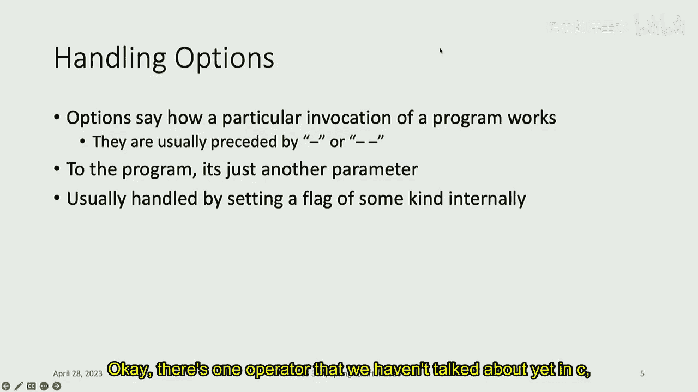
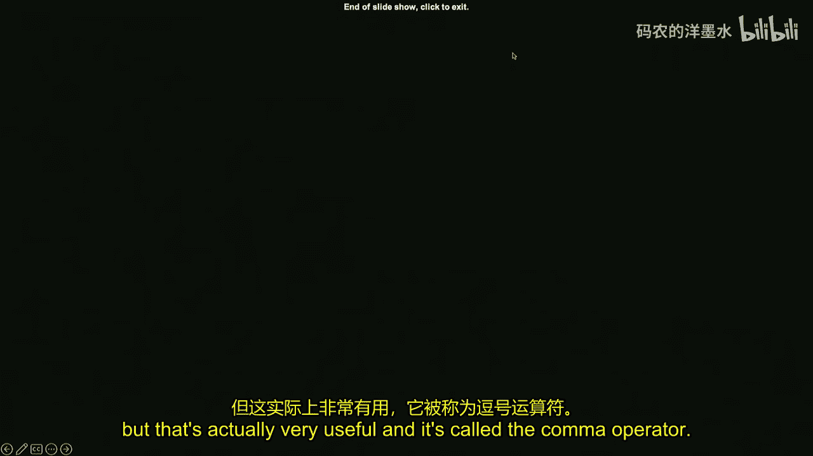
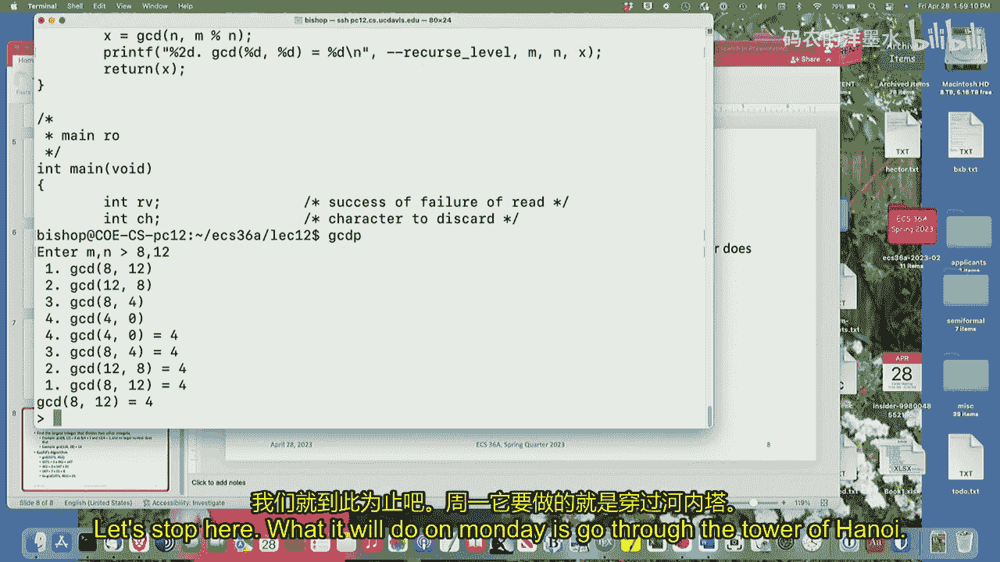

# 012：字符串数组与逗号运算符 📚


在本节课中，我们将学习如何处理命令行参数，了解逗号运算符的用法，并深入探讨字符串操作函数。最后，我们将通过一个递归求最大公约数的例子来巩固递归概念。

---

## 命令行参数处理 🖥️

上一节我们介绍了函数的基本概念，本节中我们来看看如何让程序接收来自命令行的输入。在C语言中，`main`函数可以接收两个参数：`argc`（参数数量）和`argv`（参数向量，即字符串数组）。

`argv`是一个指向字符串数组的指针。其中，`argv[0]`是程序名本身，`argv[1]`是第一个真正的参数，依此类推。

以下是一个简单的“echo”程序示例，它打印出除程序名外的所有参数：

```c
#include <stdio.h>

int main(int argc, char *argv[]) {
    for (int i = 1; i < argc; i++) {
        printf("%s ", argv[i]);
    }
    printf("\n");
    return 0;
}
```

### 命令行选项

有时，参数是用于控制程序行为的“选项”，通常以短横线（`-`）或双短横线（`--`）开头。程序需要自己解析这些选项。

以下是处理 `-n` 选项（抑制末尾换行符）的 `echo` 程序变体：

```c
#include <stdio.h>
#include <string.h>

int main(int argc, char *argv[]) {
    int print_newline = 1; // 默认打印换行符
    int start_index = 1;   // 默认从第一个参数开始打印

    // 检查第一个参数是否是选项“-n”
    if (argc > 1 && strcmp(argv[1], "-n") == 0) {
        print_newline = 0; // 不打印换行符
        start_index = 2;   // 跳过选项参数
    }

    for (int i = start_index; i < argc; i++) {
        printf("%s ", argv[i]);
    }

    if (print_newline) {
        printf("\n");
    }
    return 0;
}
```

程序通过设置标志变量（如 `print_newline`）来记录选项状态，并根据此状态改变行为。





---

## 逗号运算符 `,` ➕

逗号运算符允许我们在一个表达式内顺序执行多个子表达式。其求值规则是：**从左到右依次求值每个子表达式，整个逗号表达式的值是最后一个子表达式的值**。

其语法形式为：
```
表达式1, 表达式2
```

**注意**：逗号运算符的优先级是所有运算符中最低的。为了避免与函数参数分隔符混淆，通常用括号将整个逗号表达式括起来。

### 示例与用途

以下是一个演示逗号运算符的示例：

```c
int a = 5, b = 2, x;
x = (a = a + 5, b++);
// 执行后：a = 10, b = 3, x = 2
```
解释：
1.  先求值 `a = a + 5`，`a` 变为 10。
2.  再求值 `b++`，该表达式的值为 `b` 的原始值 2，然后 `b` 自增为 3。
3.  整个逗号表达式的值是第二个子表达式的值，即 2，然后赋值给 `x`。

逗号运算符的一个常见用途是在 `for` 循环的“增量”部分同时更新多个变量：
```c
for (i = 0, j = 10; i < j; i++, j--) {
    // 循环体
}
```

另一个实用场景是将提示输入和读取输入组合在循环条件中，使代码更紧凑：
```c
while (printf("Enter a number: "), scanf("%d", &x) != EOF) {
    // 处理 x
}
```
`printf` 会先执行并打印提示，然后 `scanf` 执行并读取输入。循环条件取决于 `scanf` 的返回值。

---

## 字符串操作函数 📝

C标准库 `<string.h>` 提供了一系列用于处理字符串的函数。以下是几个核心函数：

以下是常用字符串函数的简要说明：

*   **`strlen`**：计算字符串长度（不包括结尾的空字符 `\0`）。
*   **`strcpy`**：将源字符串复制到目标字符数组。
*   **`strncpy`**：安全版本的 `strcpy`，可指定最大复制字符数，防止目标数组溢出。
*   **`strcat`**：将源字符串追加到目标字符串末尾。
*   **`strncat`**：安全版本的 `strcat`，可指定最大追加字符数。
*   **`strcmp`**：比较两个字符串。返回值为：
    *   `0`：字符串相等。
    *   `正数`：第一个字符串大于第二个（按字典序）。
    *   `负数`：第一个字符串小于第二个。
*   **`strncmp`**：比较两个字符串的前 `n` 个字符。

**重要提示**：使用 `strcpy` 和 `strcat` 时必须确保目标数组有足够空间，否则会导致缓冲区溢出。`strncpy` 和 `strncat` 更安全，但需注意它们可能不会自动添加字符串终止符 `\0`，需要手动处理。

---

## 递归示例：最大公约数 (GCD) 🔄

递归是函数调用自身的一种技术。我们之前介绍了递归的基本原理，现在来看一个经典例子：使用欧几里得算法计算两个整数的最大公约数 (GCD)。

欧几里得算法基于一个原理：`gcd(a, b) = gcd(b, a % b)`，直到 `b` 为 0 时，`gcd(a, 0) = a`。

### 递归实现

递归实现非常简洁，直接反映了算法定义：

```c
int gcd(int m, int n) {
    if (n == 0) {
        return m; // 基本情况
    } else {
        return gcd(n, m % n); // 递归步骤
    }
}
```

### 迭代实现

同一算法也可以用循环（迭代）来实现：

```c
int gcd_iterative(int m, int n) {
    int remainder;
    while (n != 0) {
        remainder = m % n;
        m = n;
        n = remainder;
    }
    return m;
}
```

### 递归调用过程分析

为了理解递归如何工作，我们可以在函数中添加打印语句来跟踪调用栈的深度和参数变化。

以计算 `gcd(8, 12)` 为例，递归调用过程如下：
1.  `gcd(8, 12)` 调用 `gcd(12, 8 % 12)` 即 `gcd(12, 8)`
2.  `gcd(12, 8)` 调用 `gcd(8, 12 % 8)` 即 `gcd(8, 4)`
3.  `gcd(8, 4)` 调用 `gcd(4, 8 % 4)` 即 `gcd(4, 0)`
4.  `gcd(4, 0)` 满足基本情况 `n == 0`，返回 `4`
5.  返回值沿调用链向上传递，最终 `gcd(8, 12)` 也返回 `4`

每次递归调用都会在内存栈上创建一个新的帧。当达到基本情况开始返回时，栈帧被依次弹出。递归的优雅之处在于它用简洁的代码清晰地表达了问题的递归结构。

---




本节课中我们一起学习了如何处理命令行参数和选项，掌握了逗号运算符的求值规则和实用场景，回顾了关键的字符串操作函数及其安全注意事项，并通过最大公约数的例子深入理解了递归的工作原理和调用过程。掌握这些概念对于编写健壮、灵活的C程序至关重要。