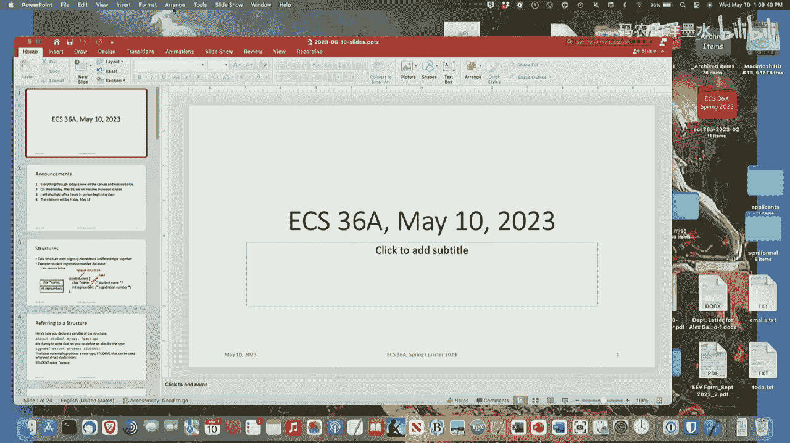
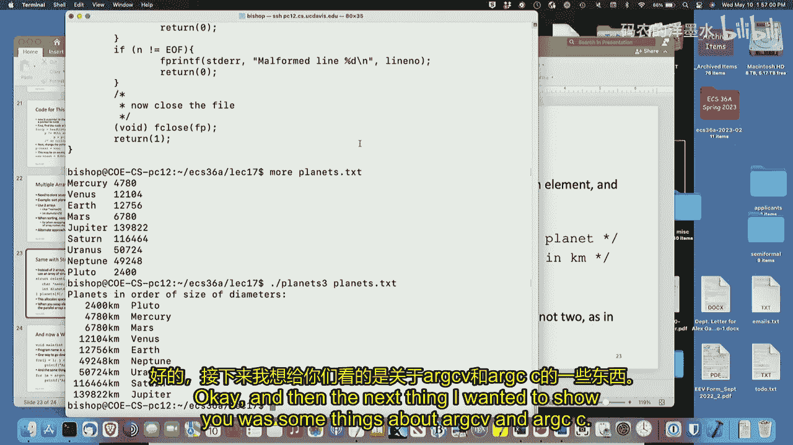

# 014：结构体与文件I/O





在本节课中，我们将学习C语言中两个重要的概念：结构体（`struct`）和文件输入/输出（I/O）。结构体允许我们将不同类型的数据组合成一个单一的单元，而文件I/O则使我们能够从文件中读取数据或将数据写入文件。掌握这两个概念对于处理复杂数据和持久化存储至关重要。

## 结构体基础

上一节我们讨论了指针和内存管理，本节中我们来看看如何将不同类型的数据组织在一起。结构体是C语言中用于将多个变量（可以是不同类型）组合成一个单一类型的方法。它类似于其他语言中的“记录”。

### 结构体的声明与定义

声明一个结构体需要使用 `struct` 关键字，后跟一个可选的标签名和一对花括号 `{}`，花括号内是成员变量的列表。

```c
struct student {
    char *name;
    int id;
};
```

上面的代码定义了一个名为 `student` 的结构体类型，它包含两个成员：一个指向字符的指针 `name` 和一个整数 `id`。编译器会为这个结构体分配足够的内存来存放这两个成员，但请注意，结构体的总大小不一定等于各成员大小之和，因为编译器可能会为了内存对齐而插入填充字节。

### 使用 `typedef` 简化

反复书写 `struct student` 可能很繁琐。我们可以使用 `typedef` 关键字为结构体类型创建一个别名。

```c
typedef struct student {
    char *name;
    int id;
} Student;
```

现在，`Student` 就成为了 `struct student` 类型的别名，我们可以像使用 `int` 或 `char` 一样使用它来声明变量。

```c
Student s1; // 声明一个 Student 类型的变量
Student *ps; // 声明一个指向 Student 的指针
```

### 访问结构体成员

要访问结构体变量的成员，我们使用点运算符 `.`。如果要通过指针访问，则使用箭头运算符 `->`。

```c
Student s1;
s1.id = 12345; // 使用 . 访问成员

Student *ps = &s1;
ps->id = 67890; // 使用 -> 通过指针访问成员
```

## 链表：结构体的一个应用

结构体一个非常强大的应用是构建动态数据结构，例如链表。链表由一系列节点组成，每个节点包含数据和指向下一个节点的指针。

### 链表节点的定义

一个简单的链表节点可以这样定义：

```c
typedef struct node {
    int data;
    struct node *next;
} Node;
```

这里，`next` 是一个指向 `struct node` 类型（即它自身类型）的指针。这种自引用的特性是构建链表的基础。

### 链表的操作：插入节点

以下是向一个已排序的链表中插入新节点的三种情况：

1.  **在链表头部插入**：新节点成为新的头节点。
2.  **在链表中间插入**：新节点插入到两个现有节点之间。
3.  **在链表尾部插入**：新节点成为最后一个节点。

以下是插入操作的逻辑和代码示例：

**在头部插入**
首先让新节点的 `next` 指向当前头节点，然后更新头指针指向新节点。
```c
new_node->next = head;
head = new_node;
```

**在中间或尾部插入**
需要遍历链表找到正确的插入位置（`prev` 和 `temp` 指针），然后调整指针。
```c
// 假设已找到插入点，prev 是前一个节点，temp 是后一个节点（可能为NULL）
new_node->next = temp; // 新节点指向后一个节点
prev->next = new_node; // 前一个节点指向新节点
```
如果 `temp` 为 `NULL`，则表示插入到尾部，上述代码同样适用。

## 结构体数组与排序

当我们需要管理一组相关的数据时（例如行星及其直径），可以使用多个平行的数组，但这容易导致数据不同步。更好的方法是使用结构体数组。

### 使用平行数组的问题

假设我们有两个数组：
```c
char *planet_names[] = {"Mercury", "Venus", ...};
int planet_diameters[] = {4878, 12104, ...};
```
对行星按直径排序时，必须同时交换两个数组中对应位置的元素，操作繁琐且易错。

### 使用结构体数组的优势

定义一个行星结构体，并将数据存入结构体数组：
```c
typedef struct {
    char *name;
    int diameter;
} Planet;

Planet planets[] = {
    {"Mercury", 4878},
    {"Venus", 12104},
    // ...
};
```
现在，排序时只需交换整个结构体，所有数据（名称和直径）会自动一起移动，保证了数据的一致性。

## 文件输入/输出

上一节我们使用硬编码的数据，本节中我们来看看如何从文件中读取数据来填充我们的结构体数组。这使程序更加灵活。

### 打开与读取文件

使用 `fopen` 函数打开文件，使用 `fscanf` 读取格式化数据。

```c
FILE *file = fopen(filename, "r"); // “r” 表示读取模式
if (file == NULL) {
    perror(filename); // 打印错误信息
    return 1;
}

char name[100];
int diameter;
while (fscanf(file, "%s %d", name, &diameter) == 2) {
    // 成功读取到名称和直径，进行处理
    // 例如，存入结构体数组
}
fclose(file); // 关闭文件
```

### 动态内存分配与结构体

从文件读取时，我们通常不知道会有多少数据。因此，需要动态地为每个行星的结构体及其名称分配内存。

```c
// 为结构体本身分配内存
Planet *p = (Planet*)malloc(sizeof(Planet));
if (p == NULL) { /* 处理错误 */ }

// 为名称字符串分配内存（+1 用于存放字符串结束符 ‘\0’）
p->name = (char*)malloc((strlen(name_read_from_file) + 1) * sizeof(char));
if (p->name == NULL) { /* 处理错误，并记得释放 p */ }
strcpy(p->name, name_read_from_file);

p->diameter = diameter_read_from_file;
// 将 p 加入数组或链表
```
**重要**：使用 `malloc` 分配的内存，在程序结束或不再需要时必须使用 `free` 函数释放，以防止内存泄漏。

### 命令行参数

为了让用户指定输入文件，我们可以使用 `main` 函数的参数 `argc` 和 `argv`。



```c
int main(int argc, char *argv[]) {
    if (argc != 2) {
        fprintf(stderr, "用法: %s <文件名>\n", argv[0]);
        return 1;
    }
    char *filename = argv[1];
    // ... 使用 filename 打开文件 ...
}
```
`argc` 是参数个数，`argv[0]` 是程序名，`argv[1]` 是第一个用户提供的参数（此处应为文件名）。

## 总结


本节课中我们一起学习了C语言中结构体和文件I/O的核心知识。我们了解了如何定义和使用结构体来组织复杂数据，并探索了链表这一动态数据结构的实现。接着，我们比较了使用平行数组和结构体数组管理数据的优劣，认识到结构体在保持数据一致性方面的优势。最后，我们学习了如何从文件中读取数据并动态地构建结构体数组，以及如何通过命令行参数使程序更交互。这些概念是进行底层系统编程和构建复杂应用程序的基石。