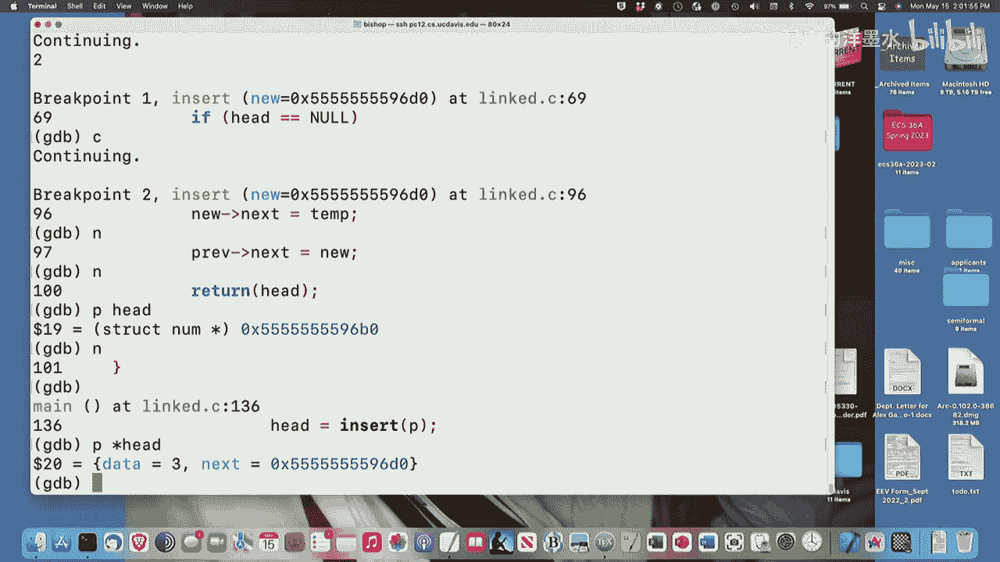

# 015：C程序调试 🐛


在本节课中，我们将学习C程序调试的两种主要方法：静态调试和动态调试。我们将通过分析几个包含错误的示例程序，一步步学习如何定位和修复这些错误。

---

## 静态调试 🖨️

静态调试是指在代码中插入打印语句（如`printf`），通过分析程序运行时的输出来定位错误。这种方法不依赖于外部工具，直接修改和编译代码即可。

上一节我们介绍了调试的概念，本节中我们来看看静态调试的具体实践。

### 示例一：循环累加错误

以下程序的目标是将变量`j`累加100次，每次加2，最终应输出200，但实际只输出2。

```c
#include <stdio.h>

int main() {
    int j = 0;
    for (int i = 0; i < 100; i++);
        j += 2;
    printf("%d\n", j);
    return 0;
}
```

首先，我们编译并运行程序，确认输出错误。

为了找出问题，我们在关键位置插入打印语句，观察程序执行流程。

以下是插入调试代码的步骤：

1.  在`for`循环前打印`i`和`j`的初始值。
2.  在`j += 2;`语句前打印`i`和`j`的值。

修改后的代码如下：

```c
#include <stdio.h>

int main() {
    int j = 0;
    printf("Before for loop: i=0, j=%d\n", j);
    for (int i = 0; i < 100; i++);
        printf("Inside loop? i=%d, j=%d\n", i, j);
        j += 2;
    printf("%d\n", j);
    return 0;
}
```

重新编译运行后，我们发现`for`循环内的打印语句从未执行。这表明`for`循环体没有按预期执行。

检查`for`循环语句，发现行尾有一个多余的分号`;`。在C语言中，`for (int i = 0; i < 100; i++);`意味着循环体是一个空语句，其后的`j += 2;`只会在循环结束后执行一次。

修复方法是删除多余的分号。

```c
for (int i = 0; i < 100; i++) // 分号已删除
    j += 2;
```

### 管理调试代码 🏷️

在大型项目中，我们可能希望保留调试代码以备后用，但又不希望它影响最终版本的输出。这时可以使用宏定义来条件编译调试代码。

以下是具体做法：

```c
#include <stdio.h>
#define DEBUG 1 // 设置为1启用调试，0则禁用

int main() {
    int j = 0;
    #if DEBUG
    printf("Debug: Starting, j=%d\n", j);
    #endif

    for (int i = 0; i < 100; i++)
        j += 2;

    #if DEBUG
    printf("Debug: After loop, j=%d\n", j);
    #endif

    printf("%d\n", j);
    return 0;
}
```

`#if DEBUG`和`#endif`之间的代码只有在`DEBUG`宏定义为非零值时才会被编译。这样，我们可以轻松地开启或关闭调试输出。

---

## 更多静态调试示例 🔍

上一节我们修复了一个简单的循环错误，本节中我们来看看更复杂的情况。

### 示例二：无限循环与赋值错误

这个程序意图是不断将`s`加到自身，直到总和超过100时停止。

```c
#include <stdio.h>

int main() {
    int i = 1;
    int s = 3;
    while (i) {
        s += s;
        if (s > 100)
            i = 0; // 意图：当s>100时，使循环条件为假
    }
    printf("Final s: %d\n", s);
    return 0;
}
```

程序运行后陷入无限循环。我们插入打印语句来观察`s`和`i`的变化。

```c
while (i) {
    printf("Loop: s=%d, i=%d\n", s, i);
    s += s;
    if (s > 100) {
        printf("s > 100 is true, setting i=0\n");
        i = 0;
    }
}
```

从输出发现，`s`的值不断翻倍增长（3, 6, 12, 24...），远远超过了100，但循环并未停止。打印语句显示`if (s > 100)`条件为真，也执行了`i = 0;`，但下一次循环`i`又变成了1。

问题出在`while (i)`的判断条件上。在C语言中，`while(i)`检查`i`是否为非零值。我们的本意是检查`i`是否等于1，但错误地写成了赋值语句`i = 0`，这会将`i`设置为0，而赋值表达式的结果就是0。因此，`while(i)`检查的是赋值结果`0`，循环本应结束。然而，由于`while`循环体外的`i`初始化为1，且没有改变，所以循环条件一直为真。

正确的写法应该是使用比较运算符`==`：

```c
int i = 1;
while (i == 1) { // 使用 == 进行比较
    s += s;
    if (s > 100)
        i = 0;
}
```

或者，更清晰的方式是使用一个布尔标志：

```c
int done = 0; // 0表示未完成
while (!done) {
    s += s;
    if (s > 100)
        done = 1; // 1表示完成
}
```

修复后，程序能在`s`超过100时正确停止。

**关于整数溢出**：在最初的无限循环中，`s`的值会变得非常大，最终超出`int`类型（32位）能表示的范围，发生整数溢出，导致值回绕到0或其他不可预测的值。这并非程序逻辑错误，而是数据类型的限制。

---

### 示例三：递归函数错误

这个程序计算阶乘（n!），但存在递归逻辑错误。

```c
#include <stdio.h>

int fact(int n) {
    int x;
    x = n * fact(n + 1); // 错误：递归方向错误，且缺少终止条件
    return x;
}

int main() {
    int result = fact(10);
    printf("10! = %d\n", result);
    return 0;
}
```

运行程序会导致栈溢出或段错误。我们插入打印来观察递归调用。

```c
int fact(int n) {
    printf("Calling fact with n=%d\n", n);
    int x;
    x = n * fact(n + 1);
    printf("Returning x=%d for n=%d\n", x, n);
    return x;
}
```

输出显示`n`的值在不断增加（10, 11, 12...），这导致了无限递归。递归函数必须有一个**基准情形**（base case）来终止递归。

我们发现了两个错误：
1.  递归调用方向错误：`fact(n + 1)` 应该向 `fact(n - 1)` 方向进行。
2.  缺少基准情形：当 `n` 为 0 或 1 时，应直接返回值 1。

修复后的函数如下：

```c
int fact(int n) {
    // 基准情形
    if (n <= 1) {
        return 1;
    }
    // 递归情形
    return n * fact(n - 1);
}
```

现在，`fact(10)` 能正确计算并返回结果 3628800。

---

## 动态调试 🎯

动态调试使用专门的调试器工具（如GDB）来运行程序。它允许你暂停程序执行、检查变量状态、单步执行代码，而无需修改源代码。

上一节我们使用打印语句进行调试，本节中我们来看看如何使用GDB进行更强大的动态调试。

### 使用GDB调试阶乘程序

首先，我们需要在编译时加入调试信息，使用 `-g` 标志。

```bash
gcc -g -o nfact_bug nfact_bug.c
```

然后，在GDB中启动程序：

```bash
gdb ./nfact_bug
```

GDB加载后，我们首先运行程序以重现崩溃：

```bash
(gdb) run
```

程序会因段错误（Segmentation fault）而崩溃。GDB会指出错误发生在`fact`函数的某一行（例如第12行）。

我们在可能出错的递归调用行设置一个断点：

```bash
(gdb) break 12 # 在源文件第12行设置断点
```

重新运行程序：

```bash
(gdb) run
```

程序会在断点处暂停。此时，我们可以检查变量`n`的值：

```bash
(gdb) print n
```

使用 `step` (或 `s`) 命令可以进入被调用的函数（如`fact`），使用 `next` (或 `n`) 命令则执行下一行但不进入函数内部。通过单步执行和检查变量，我们可以观察到`n`在错误地增加，从而定位到`fact(n + 1)`这个错误。

退出GDB，修复源代码，将`n + 1`改为`n - 1`，并添加基准情形。

重新编译并用GDB测试，使用断点和`print`命令验证递归调用正确递减，并在`n<=1`时正确返回。这样，我们就用动态调试的方式修复了程序。

### 调试链表插入程序 🧩

最后，我们看一个链表插入的调试例子。程序本应按顺序插入节点，但输出顺序错误。

```c
// ... 链表结构和插入函数 ...
void insert(struct node** head, int data) {
    // ... 插入逻辑可能存在错误 ...
}
```

编译时带上`-g`标志，然后用GDB启动：

```bash
gdb ./linked_list
```

在`insert`函数的关键位置设置断点：

```bash
(gdb) break insert
```

运行程序并传入测试数据：

```bash
(gdb) run
```

当程序在断点处暂停时，我们可以检查链表头指针`head`和待插入节点`new_node`的状态：

```bash
(gdb) print *head   # 查看头节点内容
(gdb) print new_node->data # 查看新节点的数据
```

使用 `continue` (或 `c`) 让程序继续执行直到下一个断点或结束。通过反复检查插入后链表的连接状态（例如`head->next`是否正确指向下一个节点），我们可以发现是插入到链表头部时的指针操作有误，例如没有正确更新`head`指针或某个节点的`next`指针。

通过GDB的实时观察，我们可以精确地定位到是哪个指针赋值语句出了问题，并进行修正。

---

## 总结 📝

本节课中我们一起学习了C程序调试的两种核心方法：

1.  **静态调试**：通过向代码中插入条件编译的打印语句，分析输出结果来推断程序状态和逻辑错误。这种方法简单直接，适用于逻辑相对清晰的场景。
2.  **动态调试**：利用GDB等调试器，在程序运行时设置断点、单步执行、实时查看和修改变量值。这种方法功能强大，可以深入跟踪复杂的执行流程和内存状态，是解决棘手Bug的利器。

关键要点：
*   **调试的核心是观察**：无论是打印输出还是调试器，目的都是获取程序运行时的内部信息。
*   **从简单案例开始**：先在小规模或简化的问题上验证调试思路。
*   **理解程序意图**：清楚代码应该做什么，才能判断它实际做错了什么。
*   **善用工具**：`-g`编译选项、GDB的`break`、`run`、`print`、`step`、`next`、`continue`等命令是动态调试的基础。



掌握这些调试技能，将能有效帮助你定位和修复C语言程序中的各种错误。