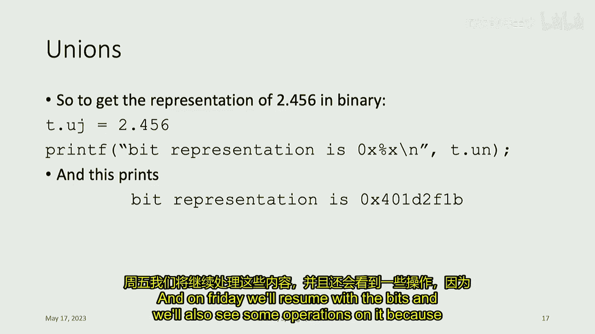

# 016：Unions与gdb高级调试


## 概述

在本节课中，我们将学习两个核心主题：如何使用GDB（GNU调试器）进行高级调试，以及C语言中Union（联合体）的概念和用法。我们将从GDB的基本命令开始，逐步深入到条件断点、观察点等高级功能，然后探讨Union如何允许不同类型的数据共享同一块内存空间。

## GDB高级调试技巧

上一节我们介绍了程序调试的基本概念，本节中我们来看看如何使用GDB这一强大工具来更高效地定位和解决程序中的问题。

### 启动与基本命令

要使用GDB调试程序，首先需要使用 `-g` 选项编译程序以包含调试信息。
```bash
gcc -g -o myprogram myprogram.c
```
然后，在终端中启动GDB并加载可执行文件。
```bash
gdb myprogram
```
在GDB中，`help` 命令非常重要，它可以提供关于各种命令的详细信息。

### 运行程序与处理错误

在GDB中，使用 `run` 命令执行程序。如果程序需要命令行参数，可以在 `run` 后面加上。
```bash
run arg1 arg2
```
如果程序运行出错，例如发生段错误（Segmentation Fault），GDB会停止执行并显示错误发生的具体位置，例如函数名和行号。

### 设置断点

为了在程序执行过程中暂停以检查状态，可以设置断点（Breakpoint）。使用 `break` 命令（可简写为 `b`）后跟行号或函数名。
```bash
break 15
break main
break nfact
```
设置断点后，使用 `run` 命令重新启动程序，程序会在到达断点时暂停。

### 条件断点

有时，我们只希望在特定条件满足时才暂停程序，这时可以使用条件断点。
```bash
break 15 if n >= 20
```
这条命令会在程序执行到第15行且变量 `n` 的值大于或等于20时才触发断点。

### 单步执行与继续执行

当程序在断点处暂停后，有几个命令可以控制执行流程：
*   `step` （或 `s`）：执行下一行代码。如果下一行是函数调用，会进入该函数内部。
*   `next` （或 `n`）：执行下一行代码。如果下一行是函数调用，会将该函数作为一个整体执行，不会进入其内部。
*   `continue` （或 `c`）：从当前暂停处继续执行程序，直到遇到下一个断点或程序结束。

### 检查变量值

在程序暂停时，可以使用 `print` 命令（可简写为 `p`）来检查变量的值。
```bash
print n
print/x n  # 以十六进制格式显示
```

### 观察点

观察点（Watchpoint）用于监控变量的变化。当被监视的变量值发生改变时，程序会自动暂停。
```bash
watch x
```
需要注意的是，观察点遵循变量的作用域。在函数外部设置的观察点，进入函数内部后可能失效。

### 查看调用栈

当程序崩溃或暂停在深层调用中时，`backtrace` （或 `bt`，或 `where`）命令非常有用。它能显示当前的函数调用栈，帮助你理解程序的执行路径。
```bash
backtrace
```

### 其他实用命令

以下是其他一些有用的GDB命令：
*   `info breakpoints`：列出所有已设置的断点和观察点。
*   `delete <breakpoint-number>`：删除指定编号的断点。
*   `list`：显示源代码。可以指定行号范围，例如 `list 10, 20`。

## 理解Union（联合体）

在掌握了调试工具后，我们来看看C语言中一个独特的数据结构——Union。它允许我们在同一块内存位置存储不同的数据类型。

### Union的基本概念

Union的语法与结构体（struct）非常相似，关键区别在于关键字 `union`。在Union中，所有成员共享同一段内存空间，其大小由最大的成员决定。
```c
union Data {
    int i;
    float f;
    char str[20];
};
```
这段代码定义了一个名为 `Data` 的Union，它包含一个整数、一个浮点数和一个字符数组。这三个变量占用同一块内存。

### Union的用途

Union的主要用途之一是查看同一段内存的不同解释。例如，我们可以检查一个浮点数在内存中的二进制表示。
```c
union intFloat {
    int i;
    float f;
} u;

u.f = 2.456; // 将浮点数存入union
printf("Float: %f\n", u.f);
printf("As integer (hex): 0x%x\n", u.i); // 以整数形式（十六进制）解释同一段内存
printf("As integer (dec): %d\n", u.i);   // 以整数形式（十进制）解释同一段内存
```
通过将浮点数赋值给 `u.f`，然后以整数格式打印 `u.i`，我们可以看到构成浮点数 `2.456` 的底层比特位。

另一个例子是拆分一个整数的各个字节：
```c
union splitInt {
    int x;
    unsigned char bytes[sizeof(int)];
} s;

s.x = 1234567;
for (int i = 0; i < sizeof(int); i++) {
    printf("Byte %d: 0x%02x\n", i, s.bytes[i]);
}
```

### 命令行参数处理的两种方式

在讲解Union之前，课程回顾了处理命令行参数的两种常见循环方式。

以下是第一种方式，使用索引和 `argc`：
```c
for (int j = 1; j < argc; j++) {
    printf("Argument %d: %s\n", j, argv[j]);
}
```

以下是第二种方式，直接遍历 `argv` 指针数组直到遇到 `NULL` 指针：
```c
char **a = argv + 1; // 跳过程序名
while (*a != NULL) {
    printf("Argument: %s\n", *a);
    a++;
}
```
这两种方式是等价的。第二种方式利用了 `argv` 数组最后一个元素之后是一个 `NULL` 指针这一事实。

## 总结




本节课中我们一起学习了GDB调试器的高级功能，包括设置条件断点、使用观察点监控变量以及查看调用栈。这些技巧能极大地提升调试复杂程序的效率。同时，我们也介绍了C语言中的Union（联合体），它允许不同的数据类型共享同一块内存，常用于类型转换、节省内存或直接操作数据的底层表示。理解这些概念对于进行底层编程和系统级开发至关重要。