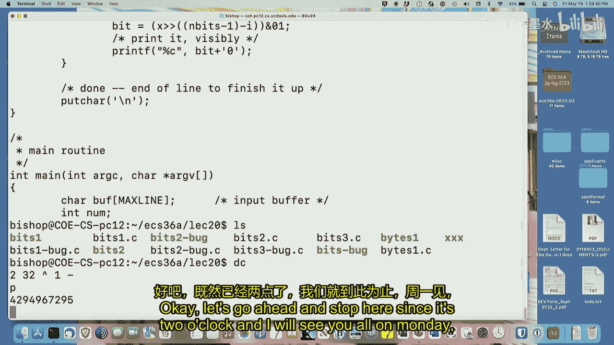

# 017：位运算符与基数


## 概述
在本节课中，我们将要学习计算机中数据的二进制表示，以及如何使用C语言提供的位运算符直接操作这些二进制位。我们将从不同进制（如二进制、十进制、十六进制）之间的转换开始，然后深入探讨位运算（如与、或、非、异或）和移位操作，最后学习如何利用这些操作来提取和检查整数的特定位。

## 进制转换

上一节我们介绍了课程安排，本节中我们来看看数据在计算机中的基础表示——进制。

### 十六进制与二进制转换
十六进制与二进制之间的转换非常直接，因为每四位二进制数恰好对应一位十六进制数。

以下是十六进制与二进制对应表：
*   `0000` -> `0`
*   `0001` -> `1`
*   `0010` -> `2`
*   `0011` -> `3`
*   `0100` -> `4`
*   `0101` -> `5`
*   `0110` -> `6`
*   `0111` -> `7`
*   `1000` -> `8`
*   `1001` -> `9`
*   `1010` -> `A` 或 `a`
*   `1011` -> `B` 或 `b`
*   `1100` -> `C` 或 `c`
*   `1101` -> `D` 或 `d`
*   `1110` -> `E` 或 `e`
*   `1111` -> `F` 或 `f`

**示例**：十六进制数 `0x401D2F1B` 转换为二进制，只需将每位十六进制数替换为对应的四位二进制数即可。

反之，将二进制转换为十六进制，只需从右向左每四位一组，查表转换为对应的十六进制数字。

### 十进制与二进制转换
十进制转二进制相对复杂，需要使用“除2取余，逆序排列”的方法。

**方法**：将十进制数反复除以2，记录每次的余数（0或1），直到商为0。最后，将所有余数从最后一个到第一个逆序排列，即得到二进制表示。

**示例**：将十进制数345转换为二进制。
```
345 / 2 = 172 ... 余 1
172 / 2 = 86  ... 余 0
86  / 2 = 43  ... 余 0
43  / 2 = 21  ... 余 1
21  / 2 = 10  ... 余 1
10  / 2 = 5   ... 余 0
5   / 2 = 2   ... 余 1
2   / 2 = 1   ... 余 0
1   / 2 = 0   ... 余 1
```
逆序读取余数：`101011001`，所以 `345`(十进制) = `101011001`(二进制)。

二进制转十进制则使用按权展开求和的方法。

**公式**：对于一个n位的二进制数 `b_{n-1}b_{n-2}...b_1b_0`，其对应的十进制值为：
`值 = b_{n-1} * 2^{n-1} + b_{n-2} * 2^{n-2} + ... + b_1 * 2^1 + b_0 * 2^0`

**示例**：二进制 `101011001` 转换为十进制。
`1*2^8 + 0*2^7 + 1*2^6 + 0*2^5 + 1*2^4 + 1*2^3 + 0*2^2 + 0*2^1 + 1*2^0 = 256 + 0 + 64 + 0 + 16 + 8 + 0 + 0 + 1 = 345`

### 八进制
八进制（基数为8）现在不常用，但其与二进制的转换也很简单，因为每三位二进制数对应一位八进制数。方法与十六进制转换类似，只是使用三位分组。

## 位运算符

理解了二进制表示后，我们来看看C语言中用于直接操作这些位的运算符。

C语言之所以流行，一个重要原因是它能够方便地访问和操作机器的底层架构（位和字节）。以下是基本的位运算符：

*   **按位与 (`&`)**：两个操作数对应的位都为1时，结果位才为1。
    *   `0 & 0 = 0`
    *   `0 & 1 = 0`
    *   `1 & 0 = 0`
    *   `1 & 1 = 1`
*   **按位或 (`|`)**：两个操作数对应的位有一个为1时，结果位就为1。
    *   `0 | 0 = 0`
    *   `0 | 1 = 1`
    *   `1 | 0 = 1`
    *   `1 | 1 = 1`
*   **按位异或 (`^`)**：两个操作数对应的位不同时，结果位为1。
    *   `0 ^ 0 = 0`
    *   `0 ^ 1 = 1`
    *   `1 ^ 0 = 1`
    *   `1 ^ 1 = 0`
*   **按位取反 (`~`)**：将操作数的每一位取反（0变1，1变0）。
    *   `~0 = 1`
    *   `~1 = 0`

**注意**：`&`、`|` 与逻辑运算符 `&&`、`||` 不同。位运算符对整数的每一位进行操作，而逻辑运算符将整个值视为真（非零）或假（零）进行判断。

## 移位运算符

有时我们只关心整数中的某一位或某几位，这时就需要移位操作。

*   **左移 (`<<`)**：将操作数的所有位向左移动指定的位数，右侧空出的位用0填充，左侧移出的位被丢弃。
    *   示例：`x << n` 将 `x` 的位左移 `n` 位。
*   **右移 (`>>`)**：将操作数的所有位向右移动指定的位数，但左侧空出的位填充规则取决于操作数的类型：
    *   对于**无符号 (`unsigned`)** 整数，左侧空位用0填充。
    *   对于**有符号 (`signed`)** 整数，行为是实现定义的。常见做法是进行**算术右移**：如果数是正数，左侧补0；如果数是负数，左侧补1（即复制符号位）。这保证了右移操作在数学上相当于除以2的幂（向下取整）。

**声明说明**：默认的 `int` 是 `signed`（有符号）。使用 `unsigned int` 声明无符号整数，通常用于处理不会出现负值的大数或进行位级操作。

## 位操作实践：提取特定位

了解了运算符后，我们来看看如何实际应用它们。一个常见任务是提取整数中的特定位。

假设我们有一个32位整数，最高位（最左边）是第31位，最低位（最右边）是第0位。我们想提取第 `i` 位（例如第8位）。

**方法**：
1.  将整数左移 `i` 位，使目标位移动到最低位（第0位）的位置。
2.  将结果与数字 `1`（二进制 `...0001`）进行按位与 (`&`) 操作。这样，除了最低位，其他所有位都会被屏蔽为0。
3.  最终结果就是目标位的值（0或1）。

**代码描述**：
```c
int bit_value = (number >> i) & 1;
// 或者先左移再与，但右移更常见且直观
// int bit_value = (number << (31 - i)) >> 31; // 另一种方法，将目标位移到最高位再右移回来
```

**示例**：提取十进制数345（二进制`...0001 0101 1001`）的第8位。
1.  `345 >> 8` 得到 `...0000 0000 0001`（二进制）。
2.  `(...0000 0000 0001) & 1` 得到 `1`。
所以第8位是1。

## 编写程序打印二进制位

理论结合实践，让我们编写一个程序来打印任意整数的二进制表示。

**思路**：从最高位（第31位）开始，依次右移并将该位移动到最低位，用 `& 1` 提取，然后打印。

**初始有bug的代码示例**：
```c
void print_bits(unsigned int x) {
    int nbits = sizeof(x) * 8; // 计算总位数
    for (int i = nbits - 1; i >= 0; i--) {
        int bit = (x >> i) & 1;
        printf("%d", bit); // 打印数字0或1
    }
    printf("\n");
}
```
**注意**：早期尝试中，曾错误地使用 `printf("%c", bit)` 来打印，这会将bit的整数值(0/1)当作ASCII码打印，导致输出不可见字符（如NULL或SOH）。正确做法是打印为数字 (`%d`) 或转换为字符 `'0' + bit`。

**另一个版本**：从最低位打印到最高位（顺序相反），只需改变循环方向：
```c
for (int i = 0; i < nbits; i++) {
    int bit = (x >> i) & 1;
    // 或者使用字符转换：putchar('0' + ((x >> i) & 1));
}
```

## 提取一组位（位域）

有时我们需要提取连续的多位（一个位域），例如第 `i` 位到第 `j` 位（假设 `i > j`）。

**方法**：
1.  将整数右移 `j` 位，使目标位域的最低位移到第0位。
2.  创建一个**掩码（mask）**，这个掩码的低 `(i - j + 1)` 位全是1，高位全是0。掩码可以通过 `(1 << (i - j + 1)) - 1` 计算得到。
3.  将右移后的结果与这个掩码进行按位与 (`&`) 操作，即可提取出目标位域。

**示例**：提取二进制数 `...0101 0110 01...` 中第8位到第5位（共4位：`0101`）。
1.  右移5位：得到 `...0000 0101 0...`。
2.  创建掩码：需要提取4位，所以掩码是低4位为1，即 `0xF`（十六进制）或 `(1 << 4) - 1 = 15`（十进制）。
3.  `(...0000 0101 0...) & 0xF` 得到 `0101`（二进制），即十进制5。

**代码描述**：
```c
int extract_bitfield(unsigned int number, int high, int low) {
    int width = high - low + 1;
    unsigned int mask = (1u << width) - 1; // 创建掩码
    return (number >> low) & mask;
}
```

## 负数的表示（补码）

计算机中，有符号整数通常采用**二进制补码**形式表示。

**规则**：
1.  正数的补码是其二进制本身。
2.  负数的补码是其对应正数**按位取反后加1**。

**示例**：用8位表示 -5。
1.  `+5` 的二进制：`0000 0101`
2.  按位取反：`1111 1010`
3.  加1：`1111 1011` 这就是 `-5` 的补码表示。

这种表示法的好处是：
*   只有一个零（`0000 0000`），没有`+0`和`-0`之分。
*   加减法运算可以使用同一套电路。
*   最高位（符号位）为1表示负数，为0表示正数或零。

## 总结




本节课中我们一起学习了C语言底层编程的核心——位操作。
我们首先回顾了二进制、十六进制和十进制之间的转换方法。
然后，我们详细介绍了C语言的位运算符：与(`&`)、或(`|`)、异或(`^`)、取反(`~`)以及移位运算符(`<<`, `>>`)，并特别强调了有符号数右移的符号位扩展行为。
接着，我们通过编写打印整数二进制表示的程序，实践了提取单个位的方法。
最后，我们探讨了如何提取一组连续的位（位域），并简要介绍了负数在计算机中的补码表示。
这些知识是理解计算机如何存储数据、进行底层硬件交互（如设备驱动、网络协议）以及编写高效算法的基础。下节课，我们将开始学习如何将大型程序组织到多个文件中。