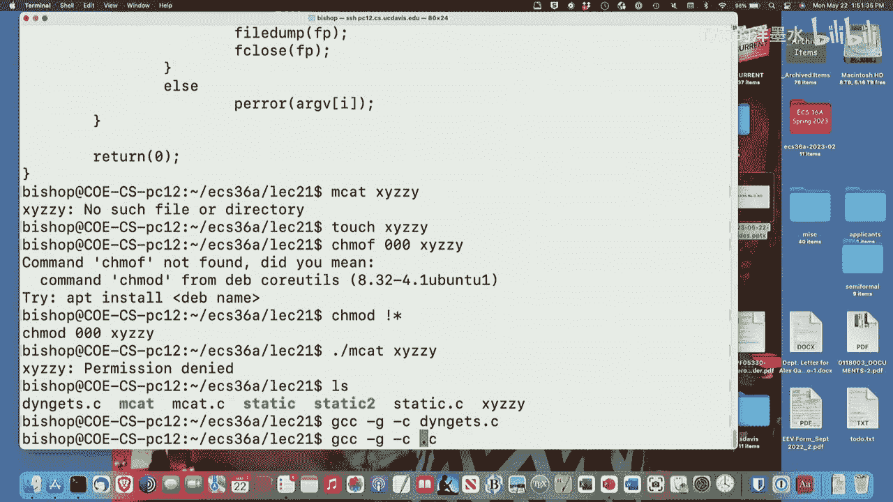

# 018：动态字符串输入与多文件编译 📚


在本节课中，我们将学习如何创建一个更灵活的字符串输入函数，以解决标准库函数`fgets`在处理未知长度输入时的限制。我们还将探讨如何将程序分解为多个源文件进行编译和链接，这是构建大型、可维护软件项目的基础。

## 概述

`fgets`函数要求调用者预先分配一个固定大小的缓冲区。如果输入行的长度超过了缓冲区大小，`fgets`会截断输入，并且不会在缓冲区末尾添加换行符，这给按行处理输入带来了复杂性。本节课的目标是设计并实现一个名为`dgets`（动态获取字符串）的函数，它能够动态分配内存来读取任意长度的行，同时保持与`fgets`相似的接口。此外，我们将学习如何将`dgets`函数和调用它的主程序分别放在不同的文件中，并通过编译和链接将它们组合成一个可执行程序。

## 动态字符串输入函数的设计

上一节我们介绍了`fgets`的局限性。本节中，我们来看看如何设计一个更强大的替代函数。

### 函数接口设计

为了保持接口清晰并减少使用错误，`dgets`函数应尽可能模仿`fgets`的参数列表。其原型设计如下：
```c
char *dgets(char *buff, int n, FILE *fp);
```
参数`buff`和`n`的含义与`fgets`相同：`buff`是用于存储输入的缓冲区指针，`n`是该缓冲区的大小。然而，为了实现动态分配，我们引入一个特殊规则：**如果`buff`是`NULL`，则函数会自己分配内存来存储整行输入，并忽略参数`n`**。

### 核心实现思路

函数的核心逻辑是逐个读取字符，并根据需要动态扩展内部缓冲区。为了在多次函数调用之间保持这个内部缓冲区的状态（如它的地址和已分配大小），我们需要使用`static`关键字来声明这些变量。

以下是`static`关键字的简要说明：
```c
int count_calls() {
    static int call_count = 0; // 静态变量，在函数调用间保持值
    call_count++;
    return call_count;
}
```
在这个例子中，`call_count`在函数返回后不会被销毁，下次调用时其值会保留，从而实现跨调用的状态记录。

### 字符插入与缓冲区管理

`dgets`函数的主体会循环读取字符。对于每个字符，它调用一个辅助函数`ch_ins`（字符插入）来将其放入缓冲区。`ch_ins`函数负责检查缓冲区剩余空间，并在空间不足时进行内存分配。

`ch_ins`函数需要处理两种分配情况：
1.  **首次分配**：当缓冲区指针为`NULL`时，使用`malloc`分配初始空间。
2.  **重新分配**：当缓冲区已满需要扩容时，使用`realloc`分配更大的空间。`realloc`可能会在原地扩展，也可能会在内存的新位置分配一块空间并复制原有数据。

由于`realloc`可能返回一个新的地址，因此传递给`ch_ins`的缓冲区指针必须是一个**双重指针（`char **`）**，以便在函数内部更新主函数中指向缓冲区的指针。

以下是`ch_ins`函数的基本逻辑结构：
```c
int ch_ins(int c, int pos, char **space, int *nspace) {
    // 检查是否需要更多空间
    if (pos >= *nspace) {
        // 增加所需空间大小，例如增加 INCREMENT 个字节
        *nspace += INCREMENT;
        if (*space == NULL) {
            // 首次分配
            *space = malloc(*nspace * sizeof(char));
        } else {
            // 重新分配
            *space = realloc(*space, *nspace * sizeof(char));
        }
        if (*space == NULL) return 0; // 分配失败
    }
    // 将字符c放入缓冲区*space的位置pos
    (*space)[pos] = c;
    return 1; // 成功
}
```

### 完整的`dgets`函数流程

1.  如果`buff`不为`NULL`，直接调用`fgets`并返回。
2.  如果`buff`为`NULL`，进入动态分配模式。
3.  使用`static`变量维护内部缓冲区指针和大小。
4.  循环从文件指针`fp`读取字符：
    *   对每个字符调用`ch_ins`插入缓冲区。
    *   如果`ch_ins`返回0（分配失败），则打印错误信息并返回`NULL`。
5.  遇到文件结束符（EOF）时：
    *   如果这是该行的第一个字符，则返回`NULL`表示没有更多输入。
    *   否则，调用`ch_ins`插入一个换行符`\n`。
6.  在行末尾，调用`ch_ins`插入字符串终止符`\0`。
7.  函数成功完成后，返回指向内部缓冲区的指针。

## 多文件编译与链接 🧩

上一节我们实现了`dgets`函数。本节中，我们来看看如何将它用于实际程序，并组织多个源文件。

### 示例程序：`mcat`

假设我们有一个程序`mcat`（简易版`cat`），它使用`dgets`来读取并显示文件内容。我们将把程序分成两个源文件：
*   `mcat.c`：包含`main`函数，调用`dgets`。
*   `dgets.c`：包含`dgets`函数及其辅助函数`ch_ins`的实现。

在`mcat.c`中，我们需要声明`dgets`的函数原型，以便编译器知道它的存在：
```c
char *dgets(char *buff, int n, FILE *fp);
```

### 编译过程

我们可以使用`gcc`分别编译每个源文件为目标文件（`.o`文件），然后将它们链接在一起：

```bash
# 编译 mcat.c 为目标文件 mcat.o
gcc -g -c mcat.c -o mcat.o

# 编译 dgets.c 为目标文件 dgets.o
gcc -g -c dgets.c -o dgets.o

# 将两个目标文件链接成可执行程序 mcat
gcc -g mcat.o dgets.o -o mcat
```
*   `-c` 选项告诉编译器只进行编译和汇编，不进行链接，生成目标文件。
*   `-g` 选项添加调试信息。
*   `-o` 选项指定输出文件名。

### 链接器的作用

链接器（linking loader）负责将多个目标文件合并成一个可执行文件。它主要完成两项工作：
1.  **符号解析**：每个目标文件都有一个符号表，记录了它定义的函数和变量（如`dgets`），以及它引用但未定义的符号（如`mcat.o`中引用的`dgets`）。链接器会匹配这些引用和定义。
2.  **地址重定位**：将各个目标文件中的代码和数据段组合起来，并为其分配最终的内存地址。

如果链接器找不到某个被引用的符号的定义（例如，编译时忘了链接`dgets.o`），就会报告“未定义的引用”错误。

### 使用`make`自动化构建

对于多文件项目，手动输入编译命令很繁琐。我们可以使用`make`工具和`Makefile`文件来管理构建过程。一个简单的`Makefile`可能如下所示：

```makefile
CC = gcc
CFLAGS = -g

mcat: mcat.o dgets.o
	$(CC) $(CFLAGS) -o mcat mcat.o dgets.o



mcat.o: mcat.c
	$(CC) $(CFLAGS) -c mcat.c

dgets.o: dgets.c
	$(CC) $(CFLAGS) -c dgets.c

clean:
	rm -f mcat *.o
```
之后，只需在终端输入`make`命令，它就会根据文件依赖关系自动执行必要的编译和链接步骤。如果只修改了`dgets.c`，`make`会智能地只重新编译`dgets.o`并重新链接，从而节省时间。

## 错误处理：`perror`函数

在文件操作（如`fopen`）失败时，系统会将一个错误代码存入全局变量`errno`中。`perror`函数可以方便地打印出对应的可读错误信息。它的用法是：
```c
FILE *fp = fopen("somefile.txt", "r");
if (fp == NULL) {
    perror("Error opening file");
    // 输出类似：Error opening file: No such file or directory
}
```
`perror`会将其参数字符串与系统根据`errno`查到的错误描述一起打印到标准错误输出。

## 总结


本节课中我们一起学习了两个重要的主题。首先，我们设计并实现了`dgets`函数，它通过动态内存分配解决了`fgets`对输入行长度的限制，并利用`static`变量在函数调用间保持状态。其次，我们探讨了多文件编程，学习了如何将程序拆分为逻辑独立的模块（如`mcat.c`和`dgets.c`），并通过编译、链接步骤将它们组合成最终的可执行程序。我们还简要介绍了使用`make`工具自动化构建过程以及使用`perror`进行错误报告的方法。这些是构建结构化、可维护的C语言程序的基础技能。