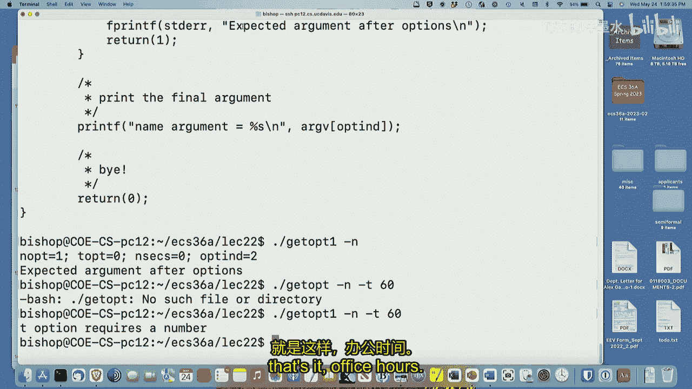

# 019：字符串转数字与getopt


## 概述

在本节课中，我们将学习C语言标准库中的两个实用功能：将字符串转换为数字的函数，以及处理命令行选项的`getopt`函数。我们还将回顾标准I/O库的缓冲机制，并了解如何操作文件读写指针。

## 关于期中考试

在开始之前，我想就期中考试说几句，因为很多同学感到焦虑。期中考试的平均分是61分，中位数是62分。最高分是94分，最低分是27分。根据我计划使用的评分曲线，平均分大约对应B或B-的成绩。因此，如果你的分数在平均分左右，目前没有不及格的危险。但请注意，最终成绩还取决于期末考试和作业。

焦虑会影响学习效率。我建议通过练习编程来复习。你可以自己编写程序，或者从书本、网络上找一些程序来写，并尝试运用课堂上学到的知识。如果你写了程序并调试好，或者遇到调试困难，我很乐意提供帮助。

我使用的评分方法不依赖于班级平均分，而是基于每个人的独立作业和考试成绩。所以，请不要现在就恐慌。等到期末考试后再担心也不迟。

## 库函数与系统调用

许多库函数用于计算，而另一些库，例如我们今天要讨论的，则作为程序与操作系统之间的接口。操作系统通过称为“系统调用”的函数来工作，这些函数将控制权转移给操作系统，执行操作后再返回控制权。

例如，操作系统不使用文件指针，而是使用文件描述符。文件指针是标准I/O库添加的一层抽象，它使得操作更加容易，尤其是在将程序从一个系统移植到另一个系统时。使用标准I/O库，跨平台移植时所需的更改非常少。

因此，如果在系统调用和库函数之间选择，并且程序有可能移植到其他机器，应始终使用库函数。当然，如果是永远不会移动的系统程序，则可以直接使用系统调用。

## C标准库函数分类

C标准库包含多种类型的函数，以下是一些重要的类别：
*   **标准I/O库**：用于输入输出操作。
*   **数学库**：包含数学函数，例如`pow`用于幂运算。
*   **字符类型处理**：例如`isalpha`, `isdigit`等。
*   **字符串与数字转换**：例如`atoi`, `strtol`等。
*   **选项处理**：例如`getopt`，用于解析命令行参数。
*   **时间与随机数**：用于获取时间、生成随机数。
*   **字符串与内存操作**：例如`strcpy`, `memcpy`等。

## 标准I/O库与缓冲

使用标准I/O库需要包含头文件`<stdio.h>`。它基于“流”的概念，你可以将其视为文件。标准I/O库会进行缓冲以提高效率。

当进程从磁盘读取数据时，这是一个耗时的操作。为了加快速度，标准I/O库使用缓冲区。例如，当你使用`getc`从文件读取一个字符时，如果缓冲区为空，系统会读取一大块数据（例如1024字节）填充缓冲区，然后给你第一个字符。后续读取字符时，直接从缓冲区获取，直到缓冲区为空，系统才会再次读取。

写入操作类似，数据先写入缓冲区，并不立即写入磁盘。当缓冲区满时，或程序正常退出时，或调用`fflush`函数时，缓冲区的内容才会被写入磁盘。

Linux中有三种缓冲类型：
1.  **全缓冲**：通常用于文件等块设备。缓冲区满时才进行I/O操作。
2.  **行缓冲**：通常用于终端等字符设备。遇到换行符`\n`时进行I/O操作。
3.  **无缓冲**：数据立即读写。标准错误流`stderr`默认是无缓冲的，这样即使程序崩溃，错误信息也能立即输出。

## 文件定位函数

文件读写指针指示了文件中下一次读写操作的位置。这允许我们在文件中跳转，实现随机访问，这对于数据库等应用非常重要。

以下是相关的函数：
*   `fgetpos`：获取当前文件位置。
*   `ftell`：功能同上。
*   `fsetpos`：设置文件位置到指定点。
*   `rewind`：将文件位置重置到开头。
*   `fseek`：通用的文件定位函数。

`fseek`函数的原型是：
```c
int fseek(FILE *stream, long offset, int whence);
```
参数`whence`可以是：
*   `SEEK_SET`：从文件开头计算偏移。
*   `SEEK_CUR`：从当前位置计算偏移。
*   `SEEK_END`：从文件末尾计算偏移。

例如，要跳过文件的前100字节，可以调用`fseek(fp, 100, SEEK_SET)`。

使用这些函数时需要小心，因为如果返回-1，可能是错误，也可能是成功定位到了-1的位置。建议在使用前将全局变量`errno`设为0，调用函数后检查`errno`是否为0来判断是否出错。

## 字符串转数字函数

将字符串转换为数字是常见的需求。C库提供了以下函数：
*   `atoi`：将字符串转换为`int`。
*   `atol`：将字符串转换为`long`。
*   `atof`：将字符串转换为`double`。

这些函数的问题在于没有错误检查。如果返回0，你无法区分是因为字符串是"0"，还是因为转换失败（如字符串是"abc"）。

更安全的函数是：
*   `strtol`：将字符串转换为`long`。
*   `strtod`：将字符串转换为`double`。

`strtol`的函数原型是：
```c
long strtol(const char *nptr, char **endptr, int base);
```
它接受一个字符串`nptr`、一个基数`base`（例如10表示十进制），以及一个指向字符指针的指针`endptr`。函数会尽可能多地转换字符串开头的数字部分，并在`endptr`指向的位置停止。如果`endptr`指向字符串末尾的`\0`，说明整个字符串都被成功转换。如果`endptr`指向其他字符，则转换在遇到非数字字符时停止。如果根本没有数字，`endptr`会被设为字符串起始地址，并返回0。

## 命令行选项处理：getopt

程序经常需要处理命令行选项，例如`gcc -o hello hello.c`。你可以自己编写代码解析参数，但使用库函数`getopt`更方便。

`getopt`的函数原型是：
```c
int getopt(int argc, char * const argv[], const char *optstring);
```
你需要传入`main`函数的`argc`和`argv`，以及一个选项字符串`optstring`。`optstring`列出了程序接受的选项字母。如果一个选项后面需要跟一个参数（如`-o filename`），则在选项字母后加一个冒号`:`。

`getopt`会依次解析`argv`中的选项。当遇到以`-`开头的参数时，它认为这是一个选项，并返回选项字母。如果选项需要参数，全局变量`optarg`会指向该参数字符串。变量`optind`会记录下一个要处理的`argv`索引。

如果遇到未在`optstring`中定义的选项，`getopt`返回`?`。当所有选项处理完毕，`getopt`返回-1。

一个简单的使用模式是：
```c
int main(int argc, char *argv[]) {
    int opt;
    while ((opt = getopt(argc, argv, "nt:")) != -1) {
        switch (opt) {
            case 'n':
                // 处理 -n 选项
                break;
            case 't':
                // 处理 -t 选项，其参数在 optarg 中
                long val = strtol(optarg, NULL, 10);
                break;
            case '?':
                // 处理未知选项
                break;
        }
    }
    // 处理剩余的非选项参数（从 argv[optind] 开始）
}
```

## 总结




本节课我们一起学习了C语言标准库的几个重要部分。我们回顾了标准I/O库的缓冲机制及其对性能的影响，并学习了如何使用`fseek`等函数在文件中进行随机访问。接着，我们探讨了将字符串转换为数字的函数，比较了简单的`atoi`系列和更安全、功能更强的`strtol`系列。最后，我们介绍了如何使用`getopt`函数来优雅地解析命令行参数，这能极大地简化处理程序选项的代码。掌握这些库函数的使用，将使你的C程序更加健壮和易于使用。