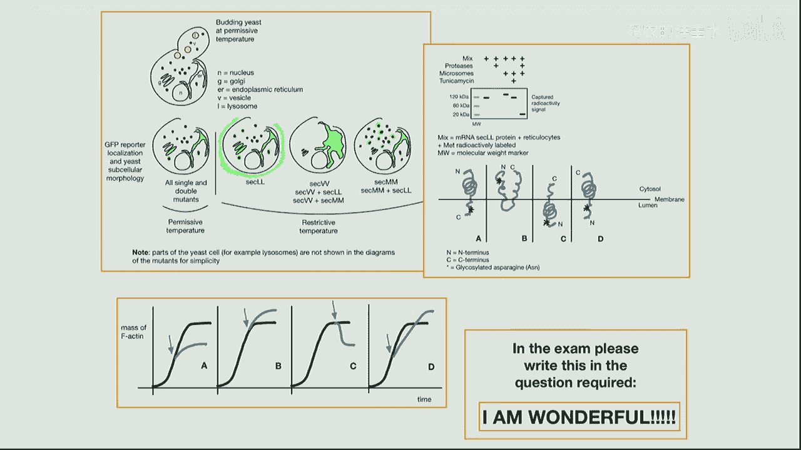
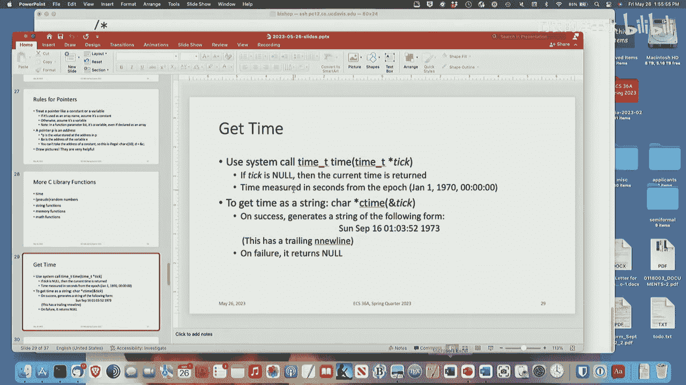
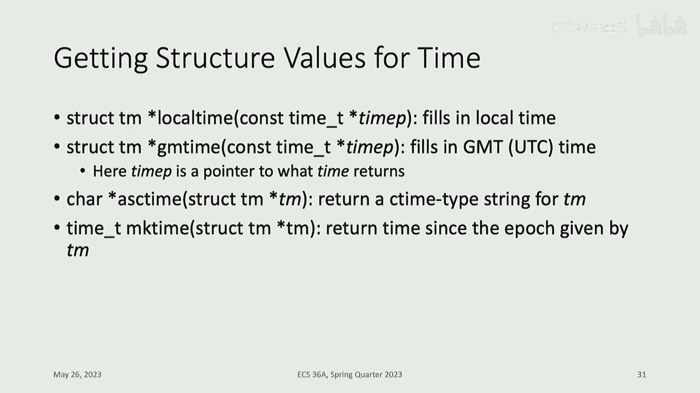

# 020：库函数详解




在本节课中，我们将深入学习C语言中的库函数，特别是与指针、时间处理相关的函数。课程首先会回顾指针的核心概念，然后详细介绍时间库 `time.h` 中的函数，帮助你理解如何在程序中获取和处理时间信息。

## 指针核心概念回顾

上一节我们介绍了指针的基础，本节中我们来看看指针在实际问题中的应用，特别是通过分析考试题目来加深理解。

指针是一个地址，类似于一个整数。它可以指向内存中的某个位置。

### 指针常量与指针变量

以下是区分指针常量与指针变量的关键点：

*   **指针常量**：例如数组名。其值（即指向的地址）不能被改变。
    ```c
    int arr[10];
    // `arr` 是一个指针常量，不能进行 `arr = ...` 这样的赋值。
    ```
*   **指针变量**：使用 `*` 声明的指针。其值可以被改变，可以指向不同的地址。
    ```c
    int *p;
    // `p` 是一个指针变量，可以进行 `p = &x;` 这样的赋值。
    ```

### 指针运算示例分析

以下通过具体代码片段分析指针的行为：

1.  **改变指针变量的指向**：
    ```c
    char c;
    char *b;
    b = &c; // b 的值变为 c 的地址，不再指向原来的数组。
    ```
    这会导致 `b` 之前指向的内存无法被释放，造成“内存泄漏”。

2.  **非法赋值**：
    ```c
    int a[5];
    int *b;
    a = b; // 错误！`a` 是指针常量，不能赋值。
    ```

3.  **数组访问的等价形式**：`a[3]` 在编译器内部等价于 `*(a + 3)`。根据加法交换律，`3[a]` 也是合法的，等价于 `*(3 + a)`。

4.  **通过指针修改外部数据**：要向函数内部传递一个可修改的变量，需要传递该变量的地址（指针）。
    ```c
    void increment(int *x) {
        (*x)++; // 修改 x 所指向的值
    }
    int main() {
        int val = 5;
        increment(&val); // val 变为 6
    }
    ```
    如果函数参数是 `int x`，则函数内部对 `x` 的修改不会影响外部的 `val`。

### 使用指针的建议

*   将指针视为普通的常量或变量来理解。
*   在函数参数列表中，`int arr[]` 可以被视为指针变量 `int *arr`。
*   `*p` 是**解引用**操作，表示获取指针 `p` 所指向地址中存储的值。
*   `&a` 是**取地址**操作，表示获取变量 `a` 的地址。
*   遇到复杂情况时，**画图**是理清思路最有效的方法。
*   声明 `char str[10];` 会分配 10 个字符的空间。而声明 `char *str;` 只分配一个指针的空间，需要使用 `malloc` 来分配字符串空间。

## 时间处理库函数

理解了指针后，我们来看看如何利用库函数处理时间和日期。C标准库提供了 `time.h` 头文件来支持时间操作。

### 获取当前时间戳

`time_t time(time_t *timer);` 函数用于获取当前时间。时间是从 **1970年1月1日午夜（UTC）** 开始计算的秒数，这个起点称为“纪元”。

*   `time_t` 通常是 `long` 或 `unsigned long` 的别名。
*   参数 `timer` 是一个指针。如果非空，函数会将时间戳写入该地址。
*   返回值也是当前的时间戳。通常可以传入 `NULL` 来忽略参数，只使用返回值。
    ```c
    #include <time.h>
    #include <stdio.h>

    int main() {
        time_t now;
        now = time(NULL); // 获取当前时间戳
        if (now == (time_t)-1) {
            perror("time");
            return 1;
        }
        printf("Seconds since epoch: %ld\n", now);
        return 0;
    }
    ```

### 将时间戳转换为字符串

`char *ctime(const time_t *timer);` 函数将 `time_t` 类型的时间戳转换为一个易读的字符串。

*   字符串格式示例：`"Wed Jun 30 21:49:08 1993\n"`。
*   如果转换失败，返回 `NULL`。
    ```c
    time_t now = time(NULL);
    char *time_str = ctime(&now);
    if (time_str != NULL) {
        printf("Current time: %s", time_str); // 字符串已包含换行符
    }
    ```

### 分解时间结构体 `struct tm`

为了更灵活地处理时间的各个部分（如年、月、日、时、分、秒），库定义了 `struct tm` 结构体。

```c
struct tm {
    int tm_sec;   // 秒 [0, 59]
    int tm_min;   // 分 [0, 59]
    int tm_hour;  // 时 [0, 23]
    int tm_mday;  // 月中的天数 [1, 31]
    int tm_mon;   // 月份 [0, 11]，0代表一月
    int tm_year;  // 自1900年起的年数
    int tm_wday;  // 星期几 [0, 6]，0代表星期日
    int tm_yday;  // 年中的天数 [0, 365]
    int tm_isdst; // 夏令时标志
};
```

### 时间转换函数

以下是用于在 `time_t` 和 `struct tm` 之间转换的函数：

*   `struct tm *localtime(const time_t *timer);`：将时间戳转换为本地时间的 `tm` 结构体。
*   `struct tm *gmtime(const time_t *timer);`：将时间戳转换为UTC（格林威治标准时间）的 `tm` 结构体。
*   `char *asctime(const struct tm *timeptr);`：将 `tm` 结构体转换为 `ctime` 格式的字符串。
*   `time_t mktime(struct tm *timeptr);`：将本地时间的 `tm` 结构体转换回 `time_t` 时间戳。



**重要提示**：`localtime` 和 `gmtime` 返回指向**静态内存区**的指针。这意味着连续调用会覆盖之前的结果。如果需要保存多个结果，应使用 `memcpy` 复制结构体内容。


```c
#include <time.h>
#include <stdio.h>

int main() {
    time_t now = time(NULL);
    struct tm *local_tm = localtime(&now); // 获取本地时间结构体

    printf("Year: %d\n", local_tm->tm_year + 1900);
    printf("Month: %d\n", local_tm->tm_mon + 1); // 月份+1以符合习惯
    printf("Day: %d\n", local_tm->tm_mday);
    printf("Hour: %d\n", local_tm->tm_hour);

    // 转换为字符串输出
    printf("Formatted time: %s", asctime(local_tm));

    return 0;
}
```

## 总结




本节课中我们一起学习了C语言中两个重要的主题。首先，我们通过实例深入回顾了指针的概念，区分了指针常量与指针变量，并理解了通过指针在函数间修改数据的方法。随后，我们系统学习了 `time.h` 库函数，掌握了如何获取系统时间戳（`time`），如何将其转换为可读字符串（`ctime`），以及如何通过 `struct tm` 结构体及其相关函数（`localtime`, `gmtime`, `asctime`, `mktime`）来灵活处理和格式化时间。理解这些库函数对于编写需要时间管理功能的程序至关重要。