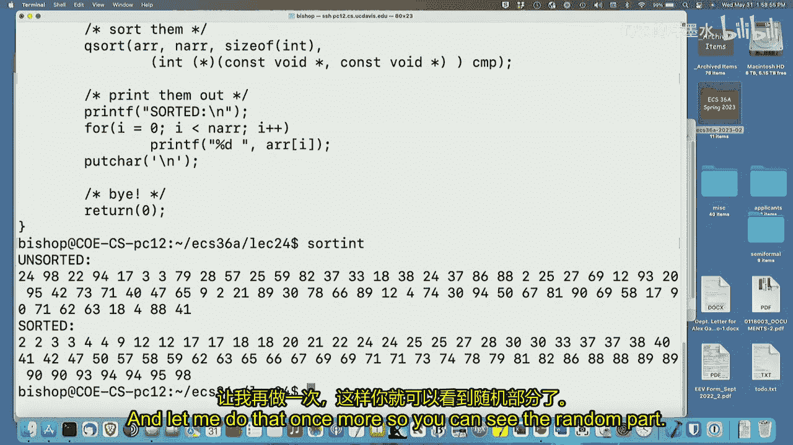

# 021：标准库函数 📚


在本节课中，我们将学习标准库函数的使用，特别是如何利用`qsort`函数对数组进行排序，并回顾与作业相关的链表操作和字符串处理技巧。

---

## 课程概述与公告 📢

首先是一些课程公告。作业4已发布，评分系统已就绪。本周五的课程将通过录像形式发布。关于作业3，许多同学的问题集中在两点：如何将一行文本拆分为字母数字单词，以及如何构建和操作链表。我们将详细探讨这些问题。

---

## 字符串分割技术 🔪

上一节我们介绍了课程安排，本节中我们来看看如何从一行输入中提取出由字母数字字符组成的“单词”。这里的关键是识别并分离出连续的字母数字序列。

以下是两种常见但可能存在问题的方法：

*   **使用`strtok`函数**：此函数通过指定分隔符来分割字符串。但问题在于，你需要将**所有**非字母数字字符都列为分隔符，这通常需要遍历ASCII字符集来构建分隔符字符串，过程较为繁琐。
*   **使用`fscanf`与模式匹配**：例如使用`%[^...]`格式来读取非指定字符。但这种方法要求你列出所有需要排除的非字母数字字符，如果不全，会遇到问题。例如，如果遇到未列出的字符（如`&`），读取会停止，导致后续处理被阻塞。

一个更可靠的方法是手动遍历输入缓冲区。其核心思路如下：

1.  将一行文本读入缓冲区。
2.  使用一个指针从头开始遍历缓冲区。
3.  当指针指向字母数字字符时，开始将其复制到一个临时数组中。
4.  当遇到非字母数字字符时，在临时数组末尾添加空字符（`\0`），形成一个完整的“单词”，然后将其插入链表或其他数据结构。
5.  跳过所有非字母数字字符，重复步骤3-4，直到指针指向行尾的空字符。

以下是该算法的伪代码描述：
```c
while (获取下一行到缓冲区) {
    p = 缓冲区起始地址;
    while (*p != '\0') {
        // 跳过非字母数字字符
        while (*p != '\0' && !isalnum(*p)) {
            p++;
        }
        if (*p == '\0') break; // 行已结束

        // 开始复制字母数字字符到临时数组 temp
        char temp[MAX_WORD_LEN];
        int i = 0;
        while (isalnum(*p)) {
            temp[i++] = *p;
            p++;
        }
        temp[i] = '\0'; // 终止字符串

        // 将 temp 中的单词插入链表
        insert_word_into_list(temp);
    }
}
```
**重要提示**：切勿简单地将链表节点中的字符串指针直接指向临时数组`temp`。因为`temp`的内容会被下一次单词覆盖，导致链表中所有节点都指向相同的、最后被读取的单词。必须使用`strdup`或`malloc`+`strcpy`为每个单词分配独立的内存空间。

---

## 链表构建与排序插入 ⛓️

在成功分割出单词后，我们需要将其存储并排序。链表是完成此任务的理想数据结构。本节我们将学习如何构建一个有序链表。

链表节点结构体通常包含以下字段：
*   一个字符串指针（`char *word`），指向存储的单词。
*   一个整型计数（`int count`），记录该单词出现的次数。
*   一个指向下一个节点的指针（`struct node *next`）。

插入新节点的核心在于维护链表的有序性。这被称为**插入排序**。插入位置分为三种情况：

1.  **插入到链表头部**：当新单词按顺序应排在第一个节点之前时。
    *   操作：令新节点的`next`指针指向当前头节点，然后更新链表头指针指向新节点。
    ```c
    new_node->next = head;
    head = new_node;
    ```

2.  **插入到链表中间**：当新单词位于两个现有节点之间时。
    *   操作：需要两个指针`prev`和`curr`遍历链表，找到插入位置（`prev->next`应指向比新单词大的节点）。将新节点的`next`指向`curr`，再将`prev->next`指向新节点。
    ```c
    new_node->next = curr;
    prev->next = new_node;
    ```
    **关键**：务必先设置新节点的`next`指针，再修改前驱节点的`next`指针，否则会丢失对后续节点的引用。

3.  **插入到链表尾部**：当新单词比所有现有单词都大时。
    *   操作：遍历到链表末尾，将最后一个节点的`next`指针指向新节点，并将新节点的`next`指针置为`NULL`。
    ```c
    last_node->next = new_node;
    new_node->next = NULL;
    ```

**字符串比较**：使用`strcmp`进行区分大小写的比较。对于不区分大小写的比较，可以使用`strcasecmp`函数。

---

## 使用qsort进行数组排序 🚀

对于作业4，我们需要对结构体数组进行排序，而不是链表。C标准库提供了高效的`qsort`函数。

`qsort`函数原型如下：
```c
void qsort(void *base, size_t nmemb, size_t size,
           int (*compar)(const void *, const void *));
```
*   `base`：指向待排序数组起始位置的指针。
*   `nmemb`：数组中元素的数量。
*   `size`：每个元素的大小（字节数），可使用`sizeof`运算符获得。
*   `compar`：指向比较函数的指针。

**比较函数**是`qsort`的核心。它接收两个指向数组元素的`const void *`类型指针。在函数内部，你需要先将它们转换为实际的数据类型指针，然后定义比较规则：
*   如果第一个元素应排在第二个之前，返回负整数。
*   如果两个元素相等，返回0。
*   如果第一个元素应排在第二个之后，返回正整数。

例如，对整数数组进行升序排序的比较函数如下：
```c
int compare_ints(const void *a, const void *b) {
    const int *pa = (const int *)a;
    const int *pb = (const int *)b;
    return (*pa > *pb) - (*pa < *pb); // 简洁的返回方式
    // 或 return *pa - *pb; (注意溢出风险)
}
```
调用`qsort`对整数数组`arr`（包含`n`个元素）进行排序：
```c
qsort(arr, n, sizeof(int), compare_ints);
```
对于结构体数组，你需要在比较函数中根据具体的字段（如原子量、元素名）进行比较。作业4中，你需要根据命令行参数决定按哪个字段排序。

---

## 随机数生成示例 🎲

在演示`qsort`的示例中，我们使用了随机数来填充数组。以下是相关代码片段：
```c
#include <stdlib.h>
#include <time.h>

srand(time(NULL)); // 用当前时间初始化随机数种子，确保每次运行结果不同

int num_elements = (rand() % 90) + 11; // 生成11到100之间的随机数作为数组元素个数

for (int i = 0; i < num_elements; i++) {
    array[i] = rand() % 100; // 生成0到99之间的随机整数
}
```
*   `srand(time(NULL))`：基于当前时间设置随机种子，使每次程序运行时生成的随机数序列不同。
*   `rand()`：返回一个伪随机整数。
*   通过取模运算（`%`）可以将`rand()`的返回值限制在特定范围内。

---

## 总结与作业提示 📝



本节课中我们一起学习了：
1.  **字符串分割**：通过手动遍历缓冲区来稳健地提取字母数字单词，并注意为每个单词分配独立内存。
2.  **链表操作**：实现了有序链表的插入排序，涵盖了头部、中间和尾部插入三种情况。
3.  **数组排序**：掌握了使用标准库函数`qsort`对数组（包括结构体数组）进行排序的方法，重点是编写正确的比较函数。
4.  **辅助工具**：简要了解了使用`srand`和`rand`生成随机数的方法。

**关于作业的最终提示**：
*   **作业3**：最终截止日期已延长。请确保程序在成功时返回0，失败时返回1（通过`main`函数的`return`或`exit()`函数）。
*   **作业4**：你将处理一个结构体数组。使用`qsort`并根据命令行参数（如`-dN`， `-dS`， `-dW`）决定按哪个字段（原子序数、符号、原子量）排序。记得检查`argv[1]`是否以`-`开头来判断是否为选项。
*   **通用建议**：采用增量开发方式。先让程序处理标准输入或单个文件的核心逻辑（如排序），再逐步添加文件读取、参数解析等功能。这样更容易定位和修复错误。

祝大家编程顺利！