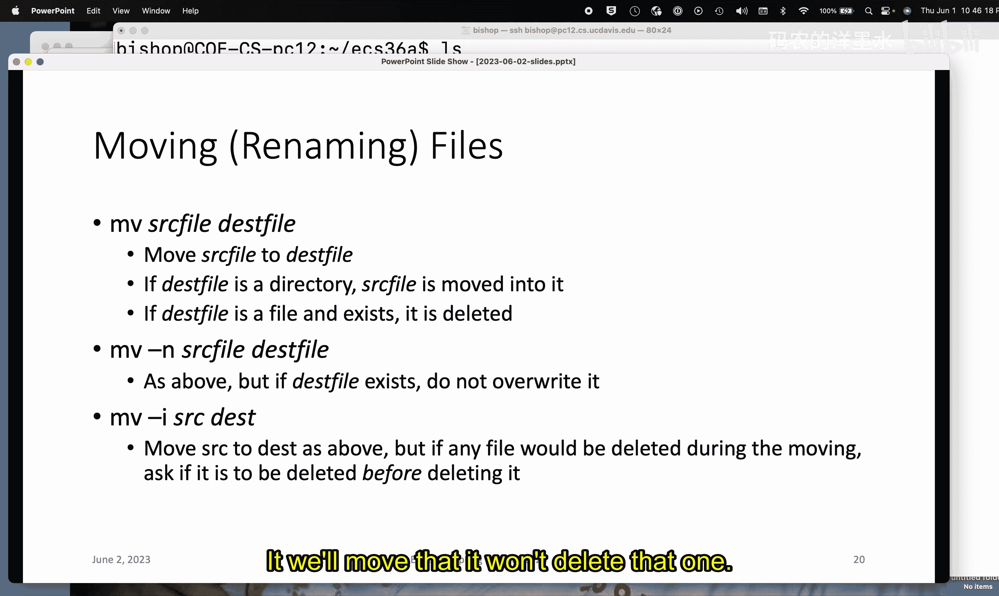
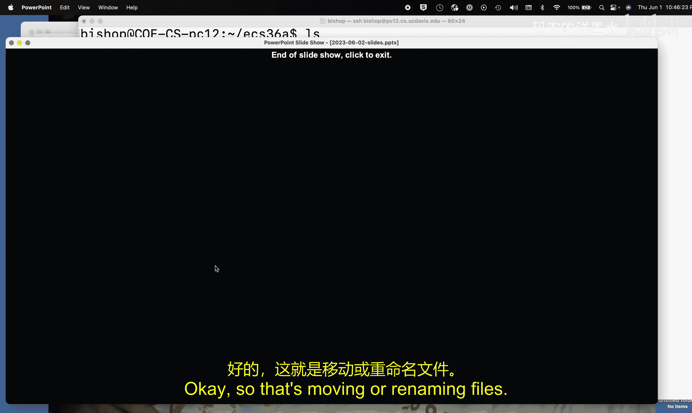
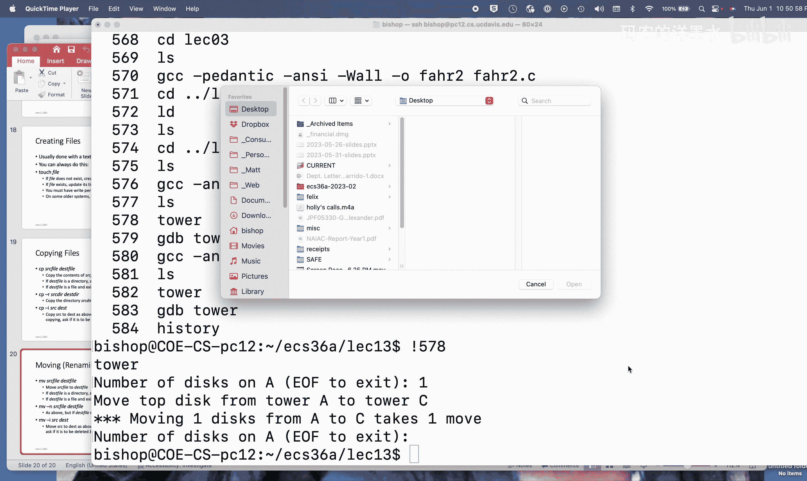

# 022：Linux与CSIF系统入门教程 🐧

在本节课中，我们将学习如何连接和使用加州大学戴维斯分校的CSIF（计算机科学教学设施）Linux系统。课程将涵盖从登录系统、浏览文件系统、到执行基本命令和文件操作的完整流程。内容专为初学者设计，力求简单明了。

## 概述 📋

本节教程将引导你完成在CSIF Linux环境下的基本操作。我们将从如何通过SSH安全登录开始，然后学习如何在文件系统中导航、查看文件内容、管理目录与文件，最后介绍一些编译和调试C程序的技巧。

## 登录CSIF系统 🔐

上一节我们介绍了课程目标，本节中我们来看看如何连接到CSIF系统。

要登录CSIF，你需要使用SSH（Secure Shell）命令。基本格式如下：
```bash
ssh [你的Kerberos用户名]@pc[数字].csif.ucdavis.edu
```
例如，连接到pc12主机：
```bash
ssh studentname@pc12.csif.ucdavis.edu
```
连接时，系统可能会询问你是否信任该主机，输入`yes`。接着会提示你输入密码。

**重要前提**：你必须先连接到校园VPN（如图书馆VPN或工程学院VPN）。学生通常使用图书馆VPN。未安装VPN将无法连接。

**主机选择**：`pc`后面的数字可以是01到43之间的任意两位数。建议选择11到30之间的主机，因为01到10号主机通常用于图形计算，可能不是你的常用环境。

如果连接某台主机遇到问题，可以查看CSIF状态页面。页面上会用红点表示主机宕机，绿点表示运行正常。

## 在本地与CSIF间传输文件 📁

成功登录后，你经常需要在本地电脑和CSIF之间传输文件。这需要使用`scp`（secure copy）命令，它基于SSH协议，能安全地复制文件。

**从本地复制文件到CSIF**：
命令格式为 `scp [本地文件路径] [目标地址]`。
```bash
scp myfile.c studentname@pc14.csif.ucdavis.edu:.
```
这个命令将本地的`myfile.c`文件复制到CSIF上`pc14`主机你的家目录（`:`后面的`.`代表当前目录，即你的家目录）。`:`符号是关键，它告诉`scp`后面是远程主机名。

**从CSIF复制文件到本地**：
只需将源和目标参数对调。
```bash
scp studentname@pc14.csif.ucdavis.edu:wordsort1.c .
```
这个命令将CSIF上`pc14`主机家目录中的`wordsort1.c`文件复制到你本地机器的当前目录。

**关键点**：`scp`命令需要在你自己的电脑终端（如Mac的Terminal或Windows的PowerShell）中执行，而不是在已经登录的CSIF终端里执行。

## 浏览文件系统与查看文件 👀

登录系统后，你需要知道如何查看当前有哪些文件和目录。

**列出文件**：使用`ls`命令可以列出当前目录下的文件和目录。
```bash
ls
```
要查看指定目录的内容，可以在`ls`后加上目录名。
```bash
ls old
```

**获取详细信息**：使用`ls -l`命令可以获取文件的详细信息列表。
```bash
ls -l
```
以下是`ls -l`输出中一行信息的解读：
`-rwxr-xr-x 1 bishop student 2048 Jun 2 2023 filename.c`
*   第一个字符：文件类型（`-`普通文件，`d`目录，`l`符号链接）。
*   接下来9个字符：权限位，分为三组。
    *   前三位`rwx`：文件所有者（owner）的读（r）、写（w）、执行（x）权限。
    *   中间三位`r-x`：文件所属用户组（group）的权限。
    *   后三位`r-x`：其他所有用户（others）的权限。
    *   `-`表示无相应权限。
*   数字`1`：指向此文件的链接数（可理解为有多少个别名指向它）。
*   `bishop`：文件所有者。
*   `student`：文件所属用户组。
*   `2048`：文件大小（字节）。
*   `Jun 2 2023`：最后修改日期。
*   `filename.c`：文件名。

权限检查顺序是：先检查你是否是所有者，如果是则应用所有者权限；如果不是，则检查你是否在所属用户组中，是则应用组权限；否则应用其他人权限。

**查看隐藏文件**：以点`.`开头的文件是隐藏文件（通常是配置文件）。使用`ls -a`可以显示所有文件，包括隐藏文件。
```bash
ls -a
```
常见的隐藏文件有：
*   `.login`：登录时执行的脚本。
*   `.forward`：邮件转发配置。
*   `.viminfo`：Vim编辑器的历史信息。
*   `.filename.swp`：Vim编辑器崩溃时生成的交换文件，用于恢复未保存的工作。可以使用`vim -r filename.c`来恢复。

**递归列出目录内容**：使用`ls -R`可以递归地列出当前目录及其所有子目录下的内容。
```bash
ls -R
```
可以组合选项，例如`ls -laR`可以以长格式递归列出所有文件（包括隐藏文件）。

## 查看文件内容 📄

知道文件在哪之后，接下来学习如何查看文件内容。

**直接显示全部内容**：使用`cat`命令。
```bash
cat filename.c
```
如果文件很长，内容会快速滚过屏幕。

**分页查看**：使用`more`命令可以一屏一屏地查看文件。
```bash
more filename.c
```
在`more`的浏览界面中：
*   按**空格键**：向下翻一屏。
*   按**回车键**：向下翻一行。
*   按 **`Ctrl+B`** 或 **`b`**：向上翻一屏。
*   按 **`Ctrl+F`** 或 **`f`**：向下翻一屏。
*   按 **`q`**：退出。

**查看文件首尾**：使用`head`和`tail`命令。
```bash
head -20 filename.c  # 查看文件前20行
tail -15 filename.c  # 查看文件最后15行
```
`tail`还有一个实用选项`-f`（follow），可以实时监控文件尾部新增的内容，常用于查看日志。
```bash
tail -f server.log
```
使用 **`Ctrl+C`** 可以终止`tail -f`命令。

## 理解Linux目录结构 🌳

Linux文件系统是一个树形结构，根目录（`/`）位于最顶端。

以下是部分重要目录：
*   `/`：根目录，一切目录的起点。
*   `/bin`：存放基本命令二进制文件，如`bash`。
*   `/home`：存放所有普通用户的家目录，例如你的目录可能是`/home/studentname`。
*   `/lib`：存放系统库文件。
*   `/usr/bin`：存放用户安装的大多数程序。
*   `/usr/local`：存放本地安装的软件。

**路径表示方法**：
*   **绝对路径**：从根目录`/`开始的完整路径，如`/home/bishop/ecs36a/hw1.c`。
*   **相对路径**：相对于你当前所在目录的路径。
    *   `.`：代表当前目录。
    *   `..`：代表上级目录（父目录）。
    *   `~`：代表当前用户的家目录。
    *   例如，当前在`/home/bishop`，想访问`/home/psared`，相对路径可以是`../psared`。

## 在文件系统中导航 🧭

**查看当前目录**：使用`pwd`（Print Working Directory）命令。
```bash
pwd
```

**切换目录**：使用`cd`（Change Directory）命令。
```bash
cd /home/bishop/ecs36a  # 使用绝对路径
cd ../lec17             # 使用相对路径，先返回上级目录再进入lec17
cd ~                    # 切换到家目录
cd                      # 不加参数，同样切换到家目录
```

## 创建与删除目录 📂

**创建目录**：使用`mkdir`命令。
```bash
mkdir new_folder
```
如果目录已存在，会报错。

**删除目录**：使用`rmdir`命令。**注意**：`rmdir`只能删除空目录。
```bash
rmdir empty_folder
```
如果目录非空，需要先删除其中的所有文件，再删除目录本身。

## 管理文件：创建、复制、移动与删除 ⚙️

**创建空文件或更新文件时间戳**：使用`touch`命令。如果文件不存在则创建；如果存在，则更新其访问和修改时间。
```bash
touch newfile.txt
```

**复制文件**：使用`cp`命令。
```bash
cp source.c destination.c  # 复制文件
cp -r sourcedir/ destdir/  # 递归复制整个目录
```
**警告**：如果目标文件已存在，`cp`会直接覆盖它。安全起见，可以使用`-i`（interactive）选项，覆盖前会询问确认。
```bash
cp -i source.c destination.c
```

**移动或重命名文件**：使用`mv`命令。它同时具备移动和重命名功能。
```bash
mv oldname.c newname.c  # 重命名
mv file.c ../otherdir/  # 移动到其他目录
```
与`cp`类似，`mv`也会静默覆盖已存在的目标文件。使用`mv -i`可以在覆盖前询问。

**删除文件**：使用`rm`命令。**这是非常危险的命令，删除后通常无法恢复。**
```bash
rm unwanted_file.c
rm *.tmp              # 删除所有.tmp结尾的文件
```
**极度重要的安全建议**：
*   始终使用`rm -i`命令，它会在删除每个文件前询问你。
*   在输入通配符（如`*`）时要格外小心。错误的空格可能导致灾难性后果，例如`rm abc *`本意是删除`abc`开头的文件，但空格导致它试图删除`abc`和当前目录所有文件（`*`）。
```bash
rm -i abc*  # 正确的安全做法
```

## 编译与调试C程序 🛠️

最后，我们来看看如何在CSIF上编译和调试C程序。





**基本编译**：使用`gcc`编译器。
```bash
gcc -pedantic -Wall -o myprogram myprogram.c
```
*   `-pedantic`：严格遵循ANSI C标准。
*   `-Wall`：启用所有常用警告信息。
*   `-o myprogram`：指定输出的可执行文件名为`myprogram`。如果不加`-o`选项，默认生成名为`a.out`的可执行文件。

**为调试做准备**：要使用GDB调试器，必须在编译时加上`-g`选项，以便在可执行文件中包含调试符号信息。
```bash
gcc -pedantic -Wall -g -o myprogram myprogram.c
```

**启动调试器**：
```bash
gdb myprogram
```

**使用命令历史**：在终端中，可以使用上下箭头键翻阅之前执行过的命令。`history`命令可以列出所有历史命令。`!`加命令开头可以执行最近一条以该字符串开头的命令，例如`!gcc`会重新执行上一次的gcc命令。

## 总结 🎯



本节课中我们一起学习了在CSIF Linux环境下进行编程工作的完整基础流程。我们从SSH登录和文件传输开始，掌握了使用`ls`、`cat`、`more`、`head`、`tail`等命令查看文件和目录。我们理解了Linux的树形目录结构，并学会了使用`cd`、`pwd`、`mkdir`、`rmdir`进行导航和管理。在文件操作方面，我们学习了`touch`、`cp`、`mv`以及需要格外谨慎使用的`rm`命令。最后，我们回顾了使用`gcc`编译C程序并添加`-g`选项为调试做准备的基本步骤。牢记`-i`交互选项在`cp`、`mv`、`rm`命令中的使用，是保护你工作成果的关键安全习惯。