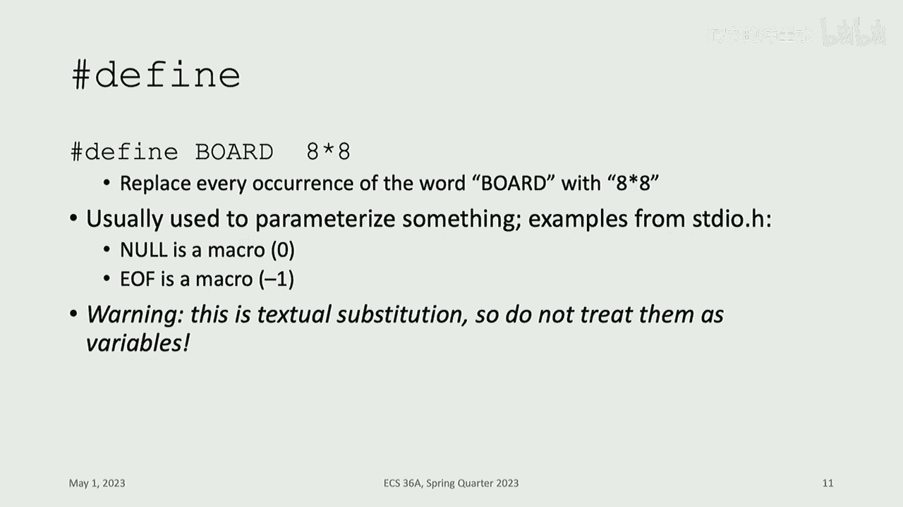
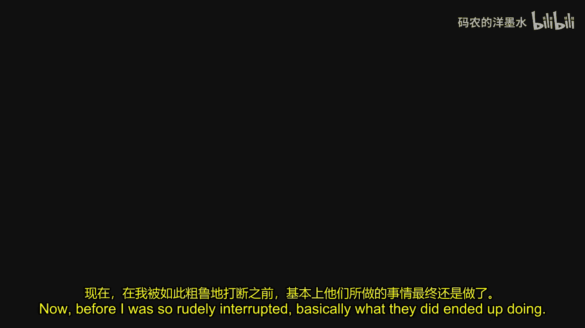
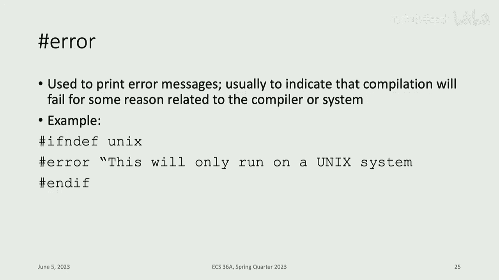

# 023：总结与C预处理器详解 🎓


在本节课中，我们将回顾课程公告，分析一个常见的编程错误，并深入探讨C语言预处理器的工作原理。这是本课程的最后一节新内容讲解，之后我们将进入复习阶段。

## 课程公告与安排 📢

首先，关于课程安排有几个重要通知。1月2日的讲座录像链接已发布在Canvas页面。5月31日的视频之前不可见，现已开放。

以下是具体安排：
*   期末考试学习指南和一份模拟试卷已发布。模拟试卷的答案可在Canvas上找到。
*   将增加两次额外的办公时间：周二11:00-11:50和周四11:00-14:00。周三的办公时间可能会调整至10:00-11:00，具体信息会发布在Canvas。
*   周三的课程将作为复习课，欢迎大家带着问题前来。
*   关于成绩：目前Canvas上显示的成绩仅包含前两次作业和期中考试。请记住，还有作业3、4和期末考试未计入。最终成绩会进行曲线调整，目前计划采用平方根曲线（例如，64分将调整为80分）。
*   关于作业：作业4（生日悖论模拟）是额外学分作业，由于涉及随机数，无法通过GradeScope自动评分，请通过Canvas提交，我会手动运行检查。
*   额外学分的作用是：在最终评定等级时，如果你处于边界线附近，额外学分将帮助我决定是否将你的等级提升一档。

## 一个常见的排序错误分析 ⚠️

上一节我们介绍了`qsort`函数，本节中我们来看看一个在使用`qsort`对`double`类型数组排序时容易犯的错误。

错误代码如下，其本意是比较两个`double`值：
```c
int cmp(const void *x, const void *y) {
    const double *px = x;
    const double *py = y;
    return *px - *py; // 错误做法
}
```
问题在于，`qsort`的比较函数要求返回`int`类型，而两个`double`值相减的结果（如2.3 - 2.1 = 0.2）被截断为整数0，导致本应有序的元素被判定为相等。

正确的做法是使用显式的比较：
```c
int cmp(const void *x, const void *y) {
    const double *px = x;
    const double *py = y;
    if (*px > *py) return 1;
    if (*px < *py) return -1;
    return 0;
}
```
**核心要点**：当混合使用`double`和`int`类型时需格外小心。对于指针参数，应在函数内部进行类型转换（`const double *px = x;`），虽然直接使用`double*`参数编译器可能只给出警告，但遵循标准做法更清晰安全。

## 条件运算符（三元运算符） ?

C语言中还有一个我们未讨论的运算符：条件运算符（`? :`）。

其语法为：
```
A ? B : C
```
**运算规则**：首先计算表达式A。如果A为真（非零），则计算表达式B并以其结果作为整个表达式的结果；如果A为假（零），则计算表达式C并以其结果作为整个表达式的结果。**关键点在于，B和C只有一个会被求值**。

这本质上是`if-else`语句的表达式形式，允许在赋值等场景中更简洁地使用。例如：
```c
x = (a != 0) ? b++ : c--;
```
等效于：
```c
if (a != 0) {
    x = b;
    b++;
} else {
    x = c;
    c--;
}
```
**记住**：条件运算符中，`B`和`C`只有一个会被执行，永远不会两者都执行。

## C预处理器深度解析 🔧

现在，我们来深入回顾C预处理器，这是C编程中非常基础且重要的部分。预处理器（`cpp`）在编译器之前运行，执行纯粹的**文本替换**，它并不理解C语言的语法。

### 宏定义（#define）

最基本的用途是定义常量或简化代码。

**定义常量**：
```c
#define PI 3.14159265
```
预处理器会将代码中所有独立的`PI`替换为`3.14159265`。这样做的好处是：一，避免重复输入；二，需要修改值时只需改动一处。





**增加代码可读性**：
```c
#define EOS '\0'   // 字符串结束符
#define NULL ((void*)0) // 空指针
```
这样，代码中的`EOS`和`NULL`就有了明确的语义，而不是令人困惑的`0`。

**必须注意的陷阱**：
考虑以下宏定义：
```c
#define SIDE 8+2
#define BOARD SIDE * SIDE
```
我们的本意是`BOARD`代表`(8+2)*(8+2)=100`。但预处理器进行文本替换后，代码变为：
```c
8+2 * 8+2
```
根据C运算符优先级，这实际计算为`8 + (2*8) + 2 = 26`。

**解决方案**：为宏定义中的表达式加上括号。
```c
#define SIDE (8+2)
#define BOARD (SIDE * SIDE)
```
**通用规则**：除非宏是简单的单个数字或标识符，否则应该用括号将整个定义体括起来。

### 带参数的宏

宏可以像函数一样接受参数。
```c
#define BETWEEN(X, LO, HI) ((X) >= (LO) && (X) <= (HI))
```
使用示例：`BETWEEN(4, 0, 9)` 会被替换为 `((4) >= (0) && (4) <= (9))`，结果为真。

**重要警告**：参数`X`在宏中每次出现都会被替换和求值。如果这样调用：
```c
x = 9;
if (BETWEEN(x++, 0, 9)) { ... }
```
替换后变为：
```c
if (((x++) >= (0) && (x++) <= (9))) { ... }
```
`x++`会被求值两次，导致逻辑错误和`x`的意外递增。因此，**在带参数的宏中，每个参数本身也应该用括号括起来**。

### 取消宏定义（#undef）

用于移除一个已定义的宏，通常在需要重新定义同名宏时使用。
```c
#undef XYZ
#define XYZ 100
```

### 文件包含（#include）

用于将其他文件的内容插入当前位置。
*   `#include <file.h>`：在**系统标准目录**中查找`file.h`。
*   `#include "file.h"`：**首先在当前文件所在目录查找**，如果没找到，再去系统标准目录查找（GCC的行为）。
*   可以使用`-I`编译器选项添加额外的头文件搜索目录：`gcc -I/my/include/dir ...`。

### 条件编译

这是预处理器最强大的功能之一，允许根据条件决定编译哪些代码。

**基本形式**：
```c
#ifdef MACRO_NAME
    // 如果MACRO_NAME已定义，则编译此部分代码
#else
    // 如果MACRO_NAME未定义，则编译此部分代码
#endif
```
变体包括`#ifndef`（如果未定义）、`#if defined(MACRO)`（等价于`#ifdef`）以及`#elif`。

**条件编译的常见用途**：

1.  **调试代码**：
    ```c
    #define DEBUG 1 // 调试时启用
    // ...
    #if DEBUG
        printf("调试信息: x = %d\n", x);
    #endif
    ```
    更灵活的方法是通过编译器选项定义宏：`gcc -DDEBUG ...`。发布时去掉`-DDEBUG`选项，所有调试代码就不会被编译进最终程序，节省空间。

2.  **代码注释（临时禁用大段代码）**：
    ```c
    #if 0
        // 被注释掉的大段代码
        // 编译器会忽略这部分
    #endif
    ```
    这比用`/* ... */`注释多行代码更安全，因为它可以嵌套。

3.  **平台/系统适配**：
    ```c
    #ifdef __linux__
        // Linux系统专用代码
    #elif defined(_WIN32)
        // Windows系统专用代码
    #else
        #error "本程序仅支持Linux或Windows系统"
    #endif
    ```
    编译器通常会预定义一些标识系统或环境的宏，利用它们可以编写可移植的代码。

## 总结 📝

本节课中我们一起学习了以下内容：
*   了解了期末阶段的课程安排和注意事项。
*   分析了一个在使用`qsort`比较`double`值时因类型转换导致的常见错误，并掌握了正确的比较方法。
*   学习了C语言的条件运算符（`? :`）及其求值规则（只执行一个分支）。
*   深入探讨了C预处理器，理解了其**文本替换**的本质。
*   掌握了`#define`定义常量和带参数宏的方法及**加括号**的重要原则。
*   了解了`#include`的两种形式及其查找路径的差异。
*   学习了条件编译（`#ifdef`, `#ifndef`, `#if`等）的语法及其在**调试**、**代码管理**和**跨平台开发**中的强大用途。




预处理器是C语言工具链中不可或缺的一部分，熟练使用它能极大提高代码的灵活性、可读性和可维护性。