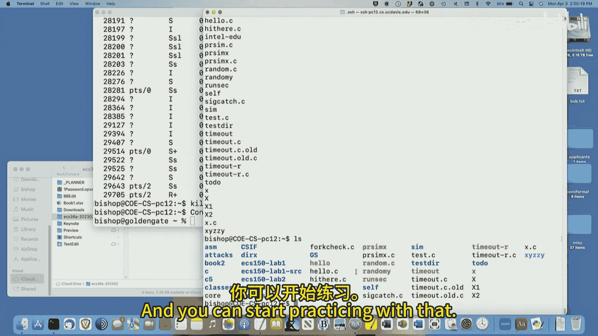
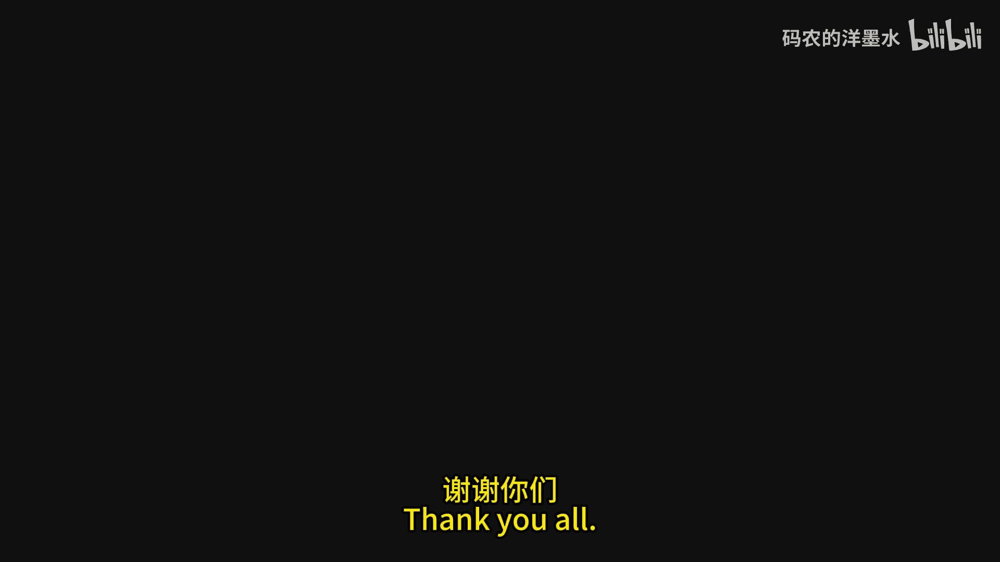

# 【全集】加州大学戴维斯分校 C语言底层编程 中英字幕 完整课程 p01 Lecture 1 - Unix进程创建基础 -BV15C6FBsE3L_p1-

Command for that， but then it says， should I remove regular file core， I go。

 I didn't mean to do that。So what I simply do is。Control C。That stops the command。

Now I can also do this。And it removes the directory。Be very， very careful。Because the shell， yes。Oh。

 I'm sorry。 thank you， yes。So like when you're listing。It's showing directories that work。No。

 it will。 nor It will。 if someone created a directory in that。In my area。是我讲的。Oh， my home directory。

 home， my home directory， home bishop。3 sets of。Yes。Offhand， I don't know， hang on。Okay。Other people。

 what this is saying。Right here， actually let me go over here。

What this is saying is it's a directory。 and I can read， write and execute。 Now， with the directory。

 permissions are a little bit strange。Arm means I can list the contents of。

W means I can create or delete files in it。😡，And X means I can search in it that is look for a particular file。

Now， notice these two。They're not allowed to read， to create or delete files。

Or list the contents of the directory。But they are allowed to look for a particular file。

So what that means is I can tell you， go to slash home slash Bishop slash ECS 36A。

And you can do that。Because the X here says you can go ahead and look at my directory and find that and then see the into it。

Now， if anyone else tried to create a file or anything in the directory。

They couldn't do it because they don't have permission。In most of the CSIF accounts are set up。

 I don't believe most of the accounts even have search permission on it。But here's one that does。

Yops。Slash temp is a temporary area。 It's used when you compile among other things。Basically。

 anybody can write to that one。Other questions？These are good questions， by the way。Okay。

Let's see what else？Oh， yes。 If you want to move files or rename files， the command is M V。

We have random X here。 And then I say。Move random X to random Y。 This is rename random X to random Y。

 And if you look down here， there's no random X。 now there's a random Y。Let's see what else。

 there's also copy。So now I've got Hello dot C and hi there dot C。 So I'm going to display them。

Your motive is they're identical。Cat， the command， cat here。Is used to display files。

It stands for Caate， which just means print， a shell。However。

 sometimes you run into problems like that。Notice how that one would right off the page。By the way。

 don't worry about the content of any of these andm just trying to show you some of the basic commands。

Now， if I don't want it to go off the page like that， I can either type， I can type more。

That was timeout。And now it goes up， prints a page， and then stops。And to continue。

 I just type space。Be to get that。Space none get down。 I can also type less。嗯。

Which does basically the same thing， except when you want to get out of it， just have to type of cu。

You can use either。I' let's see what else。Okay， let's talk a little bit about the processes。

 the basic unit of a system is the process。 that simply means it's a program that's running。

So when you type， for example， date。Which prints out the date and time， that date。Produces a process。

And the system executes that process。嗯。Sometimes。When you run the date doesn't run interactively。

 you just just prints out the date。But another program may run interactively。

 so notice this one has stopped。That's a calculator that does what's called reverse Polish。

If you don't know order Poes， don't worry about it。

 I just wanted to show you that when programs act interactively。That's a kind of。

 I would call that a rather obnoxious program。Because it just sits there and doesn't say， hey。

 I'm ready for input。Here's another one。 is a text editor that exists on every Linux and Uni system。

Uix is essentially the same as Linux， but Linux came much later。

What happened was Lius Torravalds wanted to develop a free unit like system。And so he built Linux。

Thats his name from him。 At the same time， Berkeley。

 people at the University of California at Berkeley， were developing their own versions called。

 which are called BSD。Ber Berkeley standard distribution。And so the two are slightly different， but。

The basic stuff like this is identical。Okay。LetSee。Ne。Okay。

 if you want to see what processes are running on the system。

The command P S will give you a listening。Of what you're running。So when I typed PS， the shell bash。

Is simply a process。Sos P。Now you can ignore to this。 This simply tells you where you're running。

 and it will look like something like this。 PTs 0，1，2 or whatever。PTS， by the way。

 stands for pseudo terminalminal System。ThePID is simply the number。Of the process。嗯。

And you can use that in a couple of commands that are turned out to be extremely useful。 For example。

 let's say I run a long program。See， that's a good one。Okay， let's say I'm running more。

And I suddenly realized he needed to kill it or stop it。So what it can do is。I can do the control C。

 but I'm going to do it another way just to demonstrate how， how this works。Yeah。

 I'll bigger and bigger。Better。All right。So first thing I do is a type whoops。PS。嗯。See。

 what's the option。A X， which will list all。Everything。

So those are all the processes that are running。Now， if you look down here。

I typed the command more time out。And there it is。So what I do next is kill。

And then I type in the process number，29，5，1，4。And notice what happens here。It terminates。

Kill simply sends us command to the process saying， hey， go away。And it goes away。Now。

 if one type didn't work。Because there's a way to prevent that from the process may say， well。

 if I get。A kill can， if I get a kill。I need to keep going， but do some extra processing。

If I do this。Where's the other one？See， okay， this is see， I'm coming in on number two。

 so that's bash。If I do this。嗯。Notice I tried to kill this process and nothing happened。

That's because the shells are designed to stop。Vi from accidentally typing their number。

And logging out。If I really want to make sure you go， do this。And notice what happened。

It immediately stop the shelf from running。And when the shell stops， you get logged out。

The nine dash9 here。Means， hey， I don't care what that program is doing。 Stop it now。😡。

The one actually is called。The， the one it normally sends is called an interrupt。8 H U P U H U P。

 yeah。And various programs are designed to ignore it， the shell's one of them。

The D 9 is you cannot ignore。Even if you build a program so that it should prevent a dash9 from working。

 it will not。Okay， let's see what what other commands are there。 Oh， yes。This one， you will find。

 probably the most valuable。Notice I type thearrowOX。

 what this means is take the output of LS and stick it in the fileile X。And it shows me that。Notice。

 by the way， it was in a single column。Whereas if I did this。It would be in multiple columns。嗯。Okay。

 let's stop here。And what it will do on Wednesday is show you how to compile things in C。

 We'll start on C then。 This has giving you enough of， I think。

 of a reference point so that you can look in the shell book， which is available online free。

And you can start practicing with that。 As I say， the website。

 including books and everything like that， will be up later tonight or at the latest tomorrow morning。

Thank you all。

