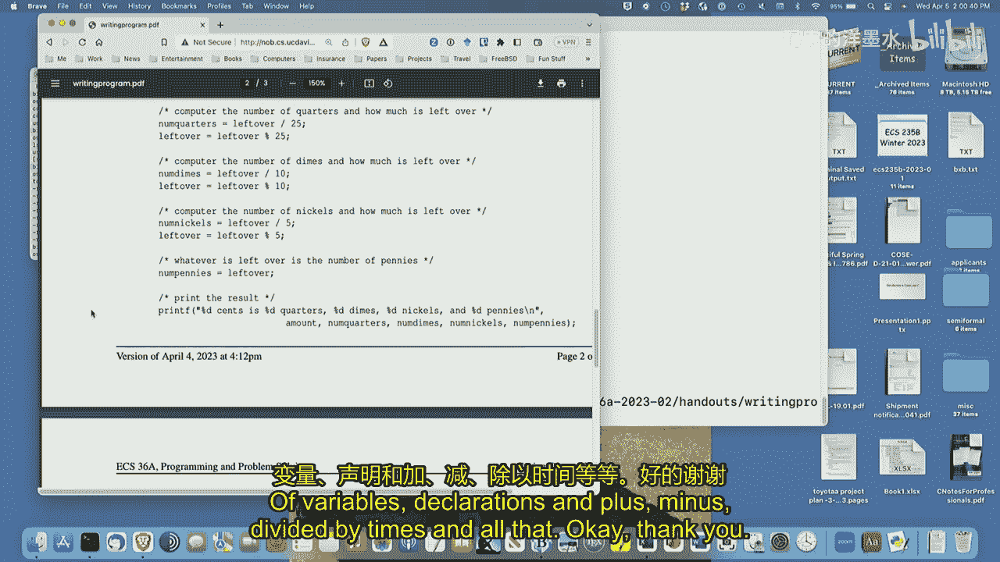

# 【全集】加州大学戴维斯分校 C语言底层编程 中英字幕 完整课程 p02 Lecture 2 - C程序基础 - 编译 -BV15C6FBsE3L_p2-

Can folks hear me now？It really helps with batteries in these things， you know。Okay。

 a couple of announcements。First of all， the web pages are up and running。

And you'll find a number of handouts there that will probably prove very useful to you。Including。

I second。Including a couple on UniX and a couple on the editors and so forth。

 I'll put one up there about SSH in a bit。There it is。 It's the right one。Okay， now。

Yesterday we looked into， we plumbed the depths， so to speak of Linux。We'll be doing more Linux。

 but it will be more or less incidental。What we're going to do today is look at C。

The programming language。And the way I'm going to do this is introduce you to a couple of programs that show the basic structure that you'll need for every C program。

And I'll also show you a couple of useful things。And then I'll show you how to compile the program and to execute it。

There is a handout calledil compiling。On the， on canvas。And。You can ignore the last section。

 which talks about make and make files。 We'll get to that later on in the quarter。But for now。

 the first part of that the rest of it should prove extremely helpful。Okay。Okay， what I did there。

 notice the star。What that means is ECS 36A。Followed by anything，0 or more characters。

And in this case， the directory is named EC S 36 A 2023 0，2。And so this first part， match that part。

And the star match the rest of it。That's a linism。And this is what I mean by going through things as they occur。

Okay， any questions about that。 The star is extremely useful， except with RM。 Don't use it with RM。

 It's too easy to make a mistake。As an example。This means delete， by the way。

 can everyone see this okay？This means delete all files whose names begin with Laura KX。

This means delete the file X and everything else。So like I say。

 it's a good idea not to use star with RM or if you do。And it'll give the dash eye option。

 It will ask you about each file。 And within about 30 seconds， you'll realize your mistake。Okay。

 let's get on to see now， here is a typical C program。

And it's the traditional one you start with in most programming languages。You can ignore it。U。

You can ignore these things for now。 I'll get to them in a minute。

But the basic program simply prints out the message hellello world。Now in C， every program starts。😡。

At main。So you can hit this anywhere in the file。But wherever that is。

 that's where you're going to start。And this is what's called function。

 and we'll talk about functions extensively later on， but think of it as your main program。

The curly braces delimmit。What it's to do。So in this case。

 it's going to start off with main and go here to print F。

Print F means essentially print print to the output。

And it's going to print the message hellello world。And that s N means put a new line out afterwards。

Is everyone clear on what this does？You can get very fancy with printf。

 but this is the simplest one where you just put what you wanted to print in double quotes。

For those of you who are familiar with Python， do not use single quotes。It typically won't work。

You have to use doubles。Okay， so。See。Let's。Now。Let me put together a small program first。

 and then I will show you exactly why you need all this stuff。For now。

 just think of this in main void as a template。I'm sorry。VI。

 that's the text editor that I mentioned yesterday for editing files on Linux。Okay。

 should have gone into it a little bit。 Okay， what it did， first of all， was I typed oh。

Which means it， then I can type things。Okay， and then if I hit escape， I stop。To delete align DD。嗯。

Let me do this， and then I'll go through it in more detail，Okay， this is a program。

Now we want to compile it。Compile it means， okay， how many here use Python or learn Python。

 pretty much everybody。Okay， Python is what's called an interpreted language。What that means is。

When you run a Python program， the the Python tool looks at the first line of your program and executes it。

 Then it looks at the second line of your program and executes it。 Then the third line and so forth。

 There's actually a little bit more going on。 But that's the basic idea。

That's why you can have type Python in three space X， Y， Z dot P， Y， and it will run。

C is what's called a compiled language。What that means is。When you execute。

 what that means is you can't execute the file directly。

You have to turn it into some into a language that the computer will understand assembly language or machine language。

 Well， machine language， actually。In order to do that， you have to use a tool called compiler。

The compiler will take your C program。Here。It will take this。And assuming I didn't make any mistakes。

The compiler will translate that into what's called an object file or an executable file。

Which I can then execute。So let's go ahead and do that。Okay， moment for the moment， ignore those。Now。

 notice you have this A dot out file。That's the executable。 That's the thing you execute。So。

 if I say。A dot out。 I'm executing A do out。It simply prints hello world。See how that works？

You run GCC on the source file。Assuming you don't get any fatal errors。You go。

 It will go ahead and create an eight do out file for you。 Here's an example of a fatal error。

 by the way。O， by the way， my V I is alias to V I M。 So I'm really using V I M。Okay。

 what I want to do now is make it so this program will not work。

So I type capital L to get it to the bottom and then two small ks to get it to the this。

I'm deleting the X。believing the semi colon， you do that by typical lowercase X。Now。

 watch what humanss when they try to compile this one。It says air。Actually， let me do that again。

Get rid of E down out。嗯。Notice there is no way that out file。 I deleted the original one。

 and then I did the compile。But notice here， it says error。If it says that。

 that's what's called the fatal error， meaning， hey， I'm not going to compile this thing。And。

 I'll teach you how to interpret these error messages。 But what this one basically means is in C。

 every statement has to end in a semicolon。It's not like Python。

New lines to see are exactly the same as the blank。That's it。So when you want the statement。

 when you're saying I'm done with this statement and move on to the next one。

 you need to have a semicolon。 So what happened here was it Red print F。 Okay。

 didn't see the semicolon says， okay， I'm expecting more in this statement。

And then he hit the return and said， well， wait a minute。That's a separate statement。So you need the。

 you need a to terminate this one with the semicolon。Are there any questions about that？Okay。

 let's go back in。嗯。And add the semicolon。Okay， and let's do it。Now。

 let me go ahead and delete this ST TDIO do H。That's what's called an include file or a header file。

Now watch what happens。Okay， what it's saying is。In C， every function， including printf。

 needs to be declared。This is saying you didn't declare it。

That's because it's declared in the header file。 S T D I O dot H。 That's header file， by the way。

 you include on almost every program you write。And so what happens here is， it's assuming。

That printf is going to return。 is's going to give you something back。And here it's saying， no。

 it's not going to give you back what I thought。 So you're really in trouble。However， okay。

 so in order to fix it。I had the semicolon back。Oops what happened there？Stupid me。

Let's go ahead and。Y means yank， capital Y means yank and capital P means put。All of this。

 by the way， is documented in the VIM handout。So we put that back。 Now， let's do it again。

And the AR file is back。And a Prince hello world。So these， the moral is that this headerophile。

If you're doing any input or output。In almost all cases， you need that header。 Otherwise。

 you will get warnings of things not of things not being correct。You can't ignore the warnings。

 by the way， because none of them were fatal。 All of them were warnings。

It is extremely dangerous to do so。If the compiler is worry you about something。

 that means there may be a problem there。😡，And so then you have to go in would what you do is you go in and look at the code and see whether or not the compiler。

Comprs warning is actually something you need to worry about。

And youve had a lot of practice with this as we go along。Okay。

The other main thing that I wanted to be sure of is you have this int main。

And then you have this open brackets。Put in all your C statements here and then close bracket to end it。

Questions on this。Yes。Okay， when you use GCC and when do you use A dot out。GCC compiles it。

 It generates the A dot out file。So you have to do GCC before you do before you run A do out。

By the way， you do have to be a little careful because if your program does not compile and you get an error。

It won't produce an AO out file。But if there's already one there， it won't delete it either。Now。

 there is a way to change the name of the file。 So it's not a dot out。Like this。

Dashhow means the output executable。😡，Is to be named。 And what follows it is the name。

So if I do this。Notice there is this file called hellello。😡，And if I run hello。

 it does the same thing， notice it did not delete the A dot out file。So when you compile it。

 if you don't give it an explicit name for the file you you're generating。

It assumes that' they got out。If you do give it an explicit name。

And we'll go ahead and use that name。😡，And ignore the A that out completely。

Are there any questions about this？I'm curious how many of you when you were learning Python had to write the Hello World program in Python。

 anybody。Yeah， it's sort of a tradition among programming languages。Okay， now I mentioned print F。

And the hello world。The return， by the way， does exactly what does in Python。

 It simply returns of value。For now， you can ignore it。 You don't have to put it in。m，Okay。

Here's another one。This program changes Fahrenheit， and dis centtegrate。

And I'm going to go through this to show you some things about C。

You'll learn them as we go on in much more detail。 But again。

 this will give you a pretty good flavor。 And by the way， all of this。

 both these programs are up on canvas。So you can download them and play with them as much as you like。

Okay， so here we have again， the in main。And the open bracket。And down here is the clothes bracket。

So what we're going to do is by the table。That has the mapping between Fahrenheit and centigrades。

 So let me go ahead and run it first。 So you know what it does。See。

 it prints off a little table saying zero degrees is Fahrenheit as negative 17 and so forth。

200 is 93， 220 is 104。I hang that， by the way， does anyone know the temperature that's the same in Fahrenheit and centtegrate？

Negative 40， right？Okay。That's a bit of trivia。 It's not integral a row to see。Okay。

 let me explain this part， this is what's called a comment。😡，It's completely ignored by the compiler。

This is， this is one of the forms of a comment。 It starts with the backslash star and ends with the back slash。

 ends with the star back slash。L。Stars here are not necessary。

I just got into the habit of putting them in。 so it shows， so it lines up nicely。

And you can put whatever you want in here， what I usually put in here is the name of the program and then what it does。

😡，And then how to run it。And if there are any inputs and outputs。Okay， then we have STDIO dot H。

 which I showed you before and STD Lib， which is another header file that contains a lot of commonly used C functions and such。

Al right， so let's enlarge in this just a little bit so you can。Okay。Now what happens here。

 first of all？Why are you。啊，这个。Is I print out the header， degrees F and this。Backlash T is a tab。Now。

 for those of you who aren't familiar with， everybody here know what a tab is， horizontal tab is。

Okay， basically， what it does is it advances the printing。To the next column。

That is one more than the nearest multiple of 8。So in other words， it gives you space。

 and it will line things up quite nicely。So I want these lined up。

 And if you'll notice down here where I print it， I have the。Tea。

 back slash tea here separating a couple of things。So let's look at this print a little bit。

Notice the percent D。When you're printing things， percent D means print an integer。

And the way the way。Python， nope， the way print F figures out what to print is the first percent D。

Corresponds to the argument directly after the string。

The second Per D corresponds to the second argument after the string and so forth。So in other words。

 it'll first print the temperature in Fahrenheit。And then it'll print a temperature in Celsius。

Or centade。Are there any questions about this。What how this print works。Again， as we go on。

 you'll learn that you can put other things in here instead of D。 For example。

 percent S prints a string。Percent， E， F， And G。Well print floating point numbers。Okay。Now。

 up here are what are called variables。These are the declarations。And what this is saying is， okay。

 I'm going to have an integer。Stored in the variable FHR。

You've all had Python or the equivalent or some programming language。

 So you all know what a variable is， correct。Does anybody you not know？Okay， if you don't know。

Please come by my office hours， or send me email。And here is Celsius。

 which is going to be the equivalent of， of Fahrenheit temperature。Now， these three are integers。😡。

Register is simply a signal to the compiler that I'm going to be using this a lot。

You don't have to put it in。 and in most cases， the compiler and certainly GCC and LCCC。

 which are the two main C compilers， are smart enough to figure out what you go。

 what you're going to be referencing a lot and what you're not going to be referencing much。

So the idea is we're going to start at a lower value， which is 0。 That'll be the low value。I'm sorry。

 in computers， there are several different types of memory。You have main memory， well you have disks。

 you have main memory。And then you have very fast memory called registers。And the register。

 you typically have 16 to 64 registers， varies from computer from type of computer to type of computer。

The advantage to the registers is you can access information。

 the computer can access information that are much more quickly than it can in main memory。So。

By by putting those things in registers。The system doesn't have to go out to memory we in fetch it each time。

 it just goes to the register， which is on the same chip as the CPU。Does that clarify it？Yes。

 it will be a little bit if these are stored in main memory。

 it will be slower to read them than these。That's okay in this case。

 because I'm not using these too much。But I'm using these quite a bit。But again。

 you can leave off the register。All outre is just saying to the compiler。

I think I'm going to use this one a lot， yes。I'm sorry， a little bit louder。If I didnt it for Cinti。

It would output put anything。嗯。Python is very smart。You can say print and then give a list of things。

 and it'll print them。C is essentially the little child that will do exactly what you tell it and nothing more。

So。If you leave the string off。You may get something out， but it's not going to be what you want。

If you leave the percentees off。You will not get anything out。 You will not get anything out。

 except youve get a tab and a new line。 That's it。嗯。I did I tell you the poem last time。

 I really hate the star machine。 I wish that they would sell it。 It never does quite what I want。

 but only what I tell it。That's pretty much pro this sort of language。 Okay。

 so what we're going to do now。Is build a table。By going through。Temperatures from 0 to 300。

 Lower is 0， upper is 300。And we're going to do it in increments of 20。 So we'll do 0， first。

 then 20， then 40 and so forth。Is it clear where we're going with this？😡，Okay。

Now we started off by saying， all right， we're going to the first Fahrenheit will be the lower bound。

 which is 0。It then goes into a while loop， which is like the one Python has， again。

 done somewhat differently， though。What this says is if fair， if the number in fair。

Is greater than the number and upper。Ski it。If it's less than or equal to， then do what's between。

 do what's under the while loop and。The curly braces are what the limit thinks。In Python。

 you have the indent that tells you where things are。Right。In C， indentation doesn't matter。

It's useful for the user， for the reader， but that's it。

So these curly braces are what tell are the things delimiting the wow。

 So if I left off the curly braces， which I'll， in fact， show you in a minute。It'll do the while。

 and do this。Then do the while and do that and so forth。

And so what I get will be very different than what I want。again。

 we're going to go through all of this in a lot more detail。 Right now。

 I'm just trying to give you the flavor of things。And then I will actually go ahead and write a small program。

So it will first convert it to Celsiusius。 and I think everyone here knows the formula。 It's9。

 five9th Fahrenit sorry， Fahrenheit plus Fahrenit minus-32 divide times five9th。

Which is exactly what this is。5 times phrenheim-32， divided by 9。Notice， by the way that。

Sed does not have the double slash for division。See only has the single slash。 In this case。

 it's fine because the single slash in Python would be what we'd want anyway since we're dealing with floating points。

 since we're dealing with。Oh actually， no， I'm sorry。 The double slash would be O Duan and Python。

Because we're dealing with integers。And see the way it determines whether or not to give you a remainder。

 like decimal fraction。Is it looks at the two things that are where the division is going。

If the numerator and denominator are both integers， then the result will be an integer。

If either is a floating point number。Then the result will be floating point。

And this is true for an awful lot of languages。It infers the output of a function， of a division。

By looking at what you're giving it。And again， you have to declare things in Python。

 you wouldn't bother doing any of this。And lower when you started off and assign it 0。

Would be an inger。Could you then assign， for example， a string like hello to lower in Python。是。

Python will change the type of lower to string。 No problem。And C， that doesn't work。

You have to say before you use the variable， what type it is。😡，And that's why。

I know that's why it's traditional to put all of these up at the top of the of is。

At the top of the function， at the top of name。Okay， so anyway。

 I do the comparison and I compute the Celsius。And then I print it。Now， this thing， again。

 we'll go and into this in more detail。 But what that thing it says is。

Add step to FAAHR and store the result in FAHR。It is exactly equivalent to this。That。And。

Are exactly the same。Questions。This shorthand in C is extremely common。By the way。

I think Python has this， too。 I'm a little bit rusty on my Python， but it does good， okay。All right。

 and then I continue this while loop。Until FAHR is 320。Because when it's 300， this is true。

When it's 320， this is false。 So it drops out of the while loop。And then here。

 exit simply means terminate the program。😡，Stop it。And in C， when a program stops。

 you return what's known as a status code。It's traditional。 This is a little bit weird。

 but it's traditional。 If the program worked and there were no problems， you return to 0。

If the program didn't work or something went wrong， you return something nonze。

There is a reason for this。Which we'll get to later。So anyway， that's the idea behind this program。

Again， I don't expect you to be able to write a program like this。 Now。

 you will be able to do so quite easily later on。But are there any questions here about how things are put together and sea。

Let me get。Okay， let's see what else。Okay。What I'd like to do now is run through the method for writing a program。

 And Python， did they teach you actually how to put together programs。Okay， let me。

 let me go through it again just so everyone's familiar。 So we're talking the same language。With。

Programming。The hard part， really， is figuring out exactly what you want。

So let's do a program where you're going to make change for something。Now。The easiest way to do this。

 I think， is just go to the whip。go to a web page。Let's go to Canvas。Okay， if we don't go to Cans。

 I will。嗯。There we are。I'm 36， and I'm going to go to useful stuff。And on that web page。

 here is something called writing a program。There are P D F versions of this as well that you can download。

 Okay， so what we want to do is， first of all， someone will give us some amount of。Will ask us for。

 say 85 cents and change， yes。You don't have access to Canvas。Okay， give me a second。 I'll fix that。

Think I know what's going on。嗯。Okay。Okay， I'm not sure why you're having trouble accessing it。嗯。

Can you access other things like Can you access the CSIF。嗯。Can I me join one more thing。

I'm not sure what's going on there。嗯。Let me， let me go ahead and look into that， okay。Try this。

Try that。That should get you to another， to the version of it。

Was anyone else having the problem with getting to that。Did the rest of you get to it。No， okay。

Try this。And then go tos see。Try that， let me know if it works， yes。That's on me， yes， there is。

And I'm going to try to finish it up this week。what's going on is the network protocol that talk to a web page is H TTP for hypertext transport protocol。

That's。Theres， that's non secure。There's another version of it that encrypts messages going back and forth。

 and that's called H TTPS for hypertext transport protocols securely。And in order to do that。

 you to do， you have to set up cryptographic keys and such， which I haven't done yet。Yes。

On your website。Yeah， okay， thank you。 I will。 I'm not sure what's going on with Canvas。

 but I'll check and make sure it gets fixed。In fact， I'll do it as soon after class。Okay。

 other questions？Alright， anyway， first of all， since we want to make change。

We're going to be given some set amount。And then we have to break it down into nickels。

 sorry into quarters， dims， nickels， and pennies。And we're assuming you're not going to get。

 you're not going to get $3。87 in change。Although this would work anyway。

So the first thing we do is we figure out what we want to do。So we set a goal。

 which is write a program to determine how many quarters， dims。

 nickels and pennies make up some amount of change。Now， notice we've moved away from the idea of。

 well， we're making change。To here is what we want specifically in order to give you the change。

And so now that we know that， we have to， first of all。

 figure out what the inputs are and what the outputs are。So we're going to be given a number like。

 I don't know， like， say， 76。And the output is going to be three/4 and one penny。

If we're given the number 99。It's going to be three/ quarters。嗯。Two dimes。And four pennies。

So what we have， So that's the idea。 we take in some integer。

And we give out an integer number of quarters， dines， nickels and pennies。And so the way to do this。

When you start a program， don't think of the computer。

 Think of how would you do this if you were asked to do it manually。the way you do it is， well。

 it about 99 cents。 Okay， how many quarters is that。Well。

 that's three because 25 goes into 993 times。That leaves 24 cents left over。We're done with quarters。

 So now let's look at dimes。 How many times will 10 the dime value go into 24 twice。 Okay。

 so now we have two dimmees and  four left over。How many nickels will go。

 How many nickels will we need。 Well，5 doesn't go into 4。 if you divide 5。

 divide 5 into 4 and look at the integer， it'll be 0。 so we don't need any nickels。

And whatever is left over is the number of pennies。Which is four。So that's how you would do it。

If you were， if you wanted to make change without a computer。You'd mentally go through that process。

So now we just write it down， read in the amount and figure out how many quarters are in the amount。

How much is left over。Figure out how many dimes are in what's left over。

Figure out how much is left over after that。 after you take out the dimes。Then the nickels。

And what left over after you pull out then nis is the pennies。

Do you see how the way I did it mentally， way the way I would do it if I were a human is exactly the way I told I laid out the algorithm here。

Question三 this。Okay， now that I've got the algorithm down。 I have to figure out。

How to put it into into the language for a computer。

And the best way to do this again is not worry yet about the details of the language。Figure out what。

 how are you going to store your information。So this is the data representation。

 When we read it in amount。It's going to be an integer。Right。

We're not assuming mills or anything like that of a dollar。 We're just assuming integers。

So we'll need an integer to store the amount。What else will we need？Well。

 we're going to have to remember how many quarters are left over。Or how many quarters there are。

 So we'll need an integer for quarters， number of quarters。

And then an integer for the number of dimes， and integer for the number of nickels。

 and then integer for the number of pennies。So that basically tells us。We need to have five integers。

 at least。we're actually going need a 6 for a reason I'll get to in a minute。

And so now given those things。We can work out。 We can make it a little bit more concrete。

 instead of saying。啊。How many quarters are in there？We can actually say， divide by 25 and so forth。

So read the input and save it somewhere。 If I buy 25 and save that， that's the number of quarters。

And then take the remainder。So notice now we're getting more into the language of the computer。

 but it's not a programming language yet。And so then we keep on going to get the remainder。

 and then you print the original amount and then the number of quarterss， nickels， dims， and pennies。

Now what we do is， okay， we've got this。 So let's figure out how to find it a little bit farther。

Okay， how do we get， how do we read in the， How do we get the input？ Well。

 you can read from file or you can ask a user。 And for this， we're going to ask the user。

And then we going to store it in an integer variable amount。

And leftover is going to be the remainder。Which initially is0， of course。Or sorry。

 which initially is the same as amount。Amount is what we're going to print at the end。

 telling you how much money you needed to give change for。Leftover。

Is going to tell you how many quarters， dis and nickels and so forth。So first。

 we divide leftover by5 in the number of quarters。Goes into a variable。

Then we take the remainder of leftover and store it in leftover。Divide left over by 10。

 we get the number of dims and so forth。And then we print this out。mm。Now， given this。

 you can translate it into Python or almost any high level language you like。

 You can even translate it into low level languages like assembly。 if you one or。

 if you're really crazy machine language。Anyway。What we can do is translate all this into C statements。

 which basically looks like this。Scan in some read an amount。

 And we'll talk about Scanf in a little bit。And then assign that value of that variable amount to leftover。

And then slash and C is division。And we then we save the amount left over and so forth。

 And so we keep going down。 And so we keep going down。Okay。

 and then we go ahead and print out the number of quarters， niels， dims， and so forth。By the way。

 my text editor here messed up。Yeah， that's better。We take leftover。And find the remainder by 25。

 The percent means remainder。And if both numbers for the remainder are positive。

 the result is well defined。 if they're not positive。Watch out， we'll get to that later again。

Then we have the leftover divided by 10 and so forth。 so that's exactly what we had before。

So now we can actually turn these statements into a program。And as before。

 we have standard I O and standard Lib。We have the integers all defined。

And then here we literally do exactly what the program。

 exactly what you said we would do with the program。Each statement in this。

It's translated into a statement in here。Okay， let's go ahead and stop here。

What we're going to do tomorrow。 Sorry， what we're going to do on Friday。

Is start looking at arithmetic operators and other things。

 So you'll learn a lot about the ins and outs of。OfV， declarations。

 and plus minus divided by times and all that。Okay， thank you。

