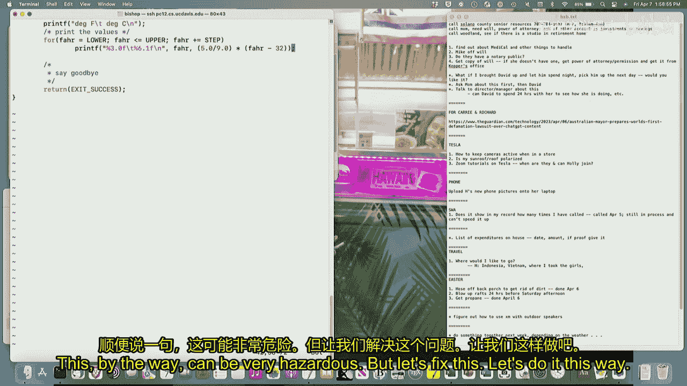

# 【全集】加州大学戴维斯分校 C语言底层编程 中英字幕 完整课程 p03 Lecture 3 - 输入处理 -BV15C6FBsE3L_p3-

Yeah， there's a reason for that。 Did everyone hear what they said or should they repeated。Okay。

 I'm in the back。Did have people hearing？Okay， let me just repeat it anyway。

If you can't get to the CSIF from EU Rome。Download the library VPN and get on that。

And try connecting。You should， I'm told you can do it from that， definitely。

If you're using the library off campus， I think you already may already have that VPN。Anyway。

 when you go to log in。Give the name you use when you connect to UC Davis resources called the central authentication System of the CAS。

 a page that comes up and says name and password。That's the one you would give then。

AndN can be anything from 0，1 to 4，3。And if you want to know which of the CSF systems are up or down。

Go to this page and it'll tell you which ones are working。Okay questions？Okay。

 if you're still having trouble。Send me email and I'll forward it to the support people。

 but what they'll want to know is first of all are you coming from on campus or off campus and secondly do you have the are you using the library VPN or something else？

Okay。Let's finish up something from yesterday。This may take a yeah， there it is。I will enlarge in it。

Can everyone see that？Can anyone not see it？O。嗯。We were looking at this。

And it was just back printed out the table。All right。

 let's oh we were looking at the make change program， see if that's there。Where it go。All right。

 let's skip that then what I was going to show you was not that important yet。Okay。

 so a couple of things now。Just go back to the slide。Okay。

 what I want to do now is talk about arithmetic operators and types。Unlike Python。

 as they said last time， types are static。When you create a variable。

 you declare it to be of particular type。And that type does not change。

So if you declare something to be an integer， it's always going to be an integer。Now。

There are several different types of things。And let's go through variable names first。In C。

 a variable name is composed of letters and digits in the underscore character。Example。

 amount of money there and amount of money there， and hello to， and underscore XY，ZZY are all valid。

Names。For whatever it's worth， don't do this， don't put the ashes。

 the underscore is the first character。It's not forbidden。

It's just that a lot of the dot H files use that。So it's always best to avoid that。Questions on that。

Problem is you might accidentally conflict with something and it will come up and give you an error。

 The compiler will give you an error。Okay。Now notice these。They're not valid。 That's not valid。

 because that's a hyphen。And the system will interpret that as a minus sign。

This slashes and those would be interpreted as division。And dollar sign amount。

The dollar sign isn't allowed at the beginning。And amount space of space money is also not a valid variable name because it's got blanks in there。

You can only have letters， digits， and the underscore。Also， you can't begin with the digit。So。

This is completely valid。This is not because you have two at the beginning。If you deleted the two。

 it would work， but since you have the two at the beginning， you can't do that。

And the other thing is in some programming languages， case doesn't matter。So， for example。

 amount with the capital A and amount with the small A at the beginning are the same。Not in sea。

Those two would be different。Capitalization matters。So amount here and amount here。Is the separate。

 they're separate variables， I mean they refer to different areas of memory。

One other term that one other thing you should do with variable little names。

Pick ones that are mnemonic or that at least will clue you into what you were doing。So， for example。

 if you're dealing with financial matters。You might use listening name， amount of money。Or this one。

By the way， if you ever hear the termcal case， it's referring to where you have a variable name。

 the first one word is lowercase， and then the beginning of each word following of his uppercase。

That's just a little addition that you might want to know about。See。The phrase。

 if you're dealing with。啊。Reading reading and some number of characters。

 the number of characters you read。Put in a variable called Nread or numbum red or something like that。

The worst thing you can do is put an X there。Because then people have to go in and figure out what you're doing。

And by the way， I I guarantee you that after a week of not seeing a program。

It'll take you a little bit of time to remember exactly what you are doing all the time。

That's why it's important to do comments and things like that。Okay， next。啊，没。A little story。

 somebody， a friend of a friend， got really ticked off at his boss in a computer company。

And so he had finished a rather major program for the company。

 and the boss started taking full credit for writing it。So the guy found another job。

 And before he left he changed all the names。All variable names in the program to X 1， X 2， X 3。

 and so forth。And since， of course， the boss had nothing to do with writing it。

They had no clue what the how to fix the program if it broke。So that's why you don't do that。Am。

Especially in the program you wrote。Okay， so that's variable names。嗯。Wops。Now types。

C a of C is what's called basic types。And then it's also got what are called scalar types。

 which we're not going to deal with yet。The basic types of these。Integer。

 characters and floating point numbers。Now an integer is just what you think，5， negative 3。

 28 like that。However。You came to clear something to be an unsigned integer。Which basically means。

It won't take any numbers that are negative。Now， sometimes that's an advantage， sometimes it's not。

So for example， if you sayW to have something that's signed， if you just say int short int。

 then it's going to be signed。But if you say unsigned in。

Then what happens is instead of going from minus2 to the 63rd， minus1 to 2 to the 63rd。

You go from 0 to 2 to the 64th minus-1。Or however many bits your system has。The point is。

 with unsigned， you have slightly more positive numbers than you do with signed。So， for example。

 on the 64 B system， the assigned integers are between 2 negative 2 to the 63rd and。Sorry，2， yeah。

 negative to the 63rd， and the positive numbers are are 2 to the 63rd-1。

The minus one is0 because zero is neither positive or negative。But if it's unsigned。

 you go from 0 to 2 to the 64th。inus1， because you can use all of the bits。

Everyone here knows that variables are represented by a set of bits in a system in a memory location。

Have you all heard about that sort of thing？I'm seeing some go like this。

 I'm seeing no one shake their head， and I'm seeing a lot of。So if you haven't。

 don't feel embarrassed。But just let me know。Okay， we'll roll with it。

The other thing with C is there are three or four different lengths of integers。

Short is the shortest one。 Then you have in， which is an ordinary integer， and then you have long。

 which in theory allocates more space for the integer。 And you can also do long， long in some cases。

However， those are very， what I said is just very deceiving。Notice I didn't say that。

Itt always gives you more bigger numbers than short。Because all you're guaranteed is that。

Int an integer。嗯。Will be no longer than short or sorry。 We'll be no shorter than the short is。

And the long will be no longer will be no shorter than an int is。So in other words。

Short Indians may have represent the same length。And long and short may represent the same length。

But what you're doing there is you're challenging the compiler look， if you say something as long。嗯。

What the compiler， what you' telling the compiler is， look， these numbers are going to be big。

And if the compiler can give more space for an integer it will。USee。Oh， yes。 technically。

 short is short int and long is long int。I think I've seen three programs in my life that actually had that second that int。

 It's usually just short long。Okay， questions on this。We'll be dealing with integers quite a bit， oh。

 yes。I'm sorry。Okay， integers that have a certain size。

Short means you're not going to have the integers you have are going to be fairly small。

Long means they're going to be big。And means they're going to be in the middle。However。

 there's a trick there because。Int in short may be the same。And in and long may be the same。

You don't know。 All this does is it guarantees you that if the compiler can allocate less space for an integer。

It will do so when you declare short。And if we're going to allocate more space。

 then it will do so when you declare it long， but they all may be the same。That， by the way。

 is a little bit different than in Python and a lot of other languages which are which are what's called portable or system independent。

C is very dependent。 C is quite dependent on systems， your system architecture， in certain places。

 and this is one of them。Now， a character is just what you think， a letter。

And it holds one of these characters。As you will see later on， though， you can treat a care。

 a variable that's declared care as a very short integer。But cares are useful， for example。

 when you're reading things or somebody type something or whatever。

 then you can store it in you can store each character in a care variable。

And then there's floating point， float and double。Float is a floating point number and double is one that's bigger。

U。So double can hold more than float。 So here' are some examples。These are all end integers。

Presumably， these these can be unsigned。 That one would definitely have to be signed。

But you don't have to declare it。 You don't have to say something is signed or unsigned。 Sorry。

 You don't have to say something is signed。You do have to say something is unsigned。That， by the way。

 can cause interesting problems， which we'll talk about in a little bit。This number is long。

 Not the L at the end。It's long because it's too big to fit into。On。

The system I was working with to fit into a single integer。And these are characters。

 Notice the single quotes Do not use double quotes。 That means something entirely different。Again。

 a difference from Python and other languages。So this is the character5。The character X。

And C has what are called a number of escapes。 This is a tab back slash followed by T。

 The back slash says to the compiler， look， what comes next is special。

And so the back slash T is a tab。The ones that people use the most often， by the way。

 are backslash key for horizontal tab。And backslash and for new line。

And the compiler will translate the backslash T and backslash n into the appropriate characters for whatever computer you're working on。

So for example， on some computers， it's simply a control J， which the system interprets as。

 go to the beginning of the next line。On others， it the control J is interpreted as go to the next line。

 Don't go to the backup to the beginning。 So in that case。

 you have to use what's called a carriage return。 The system translates all this automatically for you。

These are floats。You can express them either as 34。2 with a decimal point。Or you can use this form。

 99 times 10 to the 12th。And you can say 9。9 times 10 to the 12th。 I meant to put that there。

 but mistypeped it。嗯。To the negative 12， sorry， each of the negative10 to the negative 12。

The 3E to the 50 is three times 10 to the 50th。That generally is too big a number for a float to to be represented as a float。

 So it would probably be represented as the W who put it into a relocation that was declared double。

As。Okay， now。Let's say you want to convert from one type to another。 You'll see this a lot， but。

It's called type casting。And the way you dispose you have a。

A floating point number that you want to turn into an integer。You say oh sorry。

 a floating point integer， you want to turn into a floating point number。

You would say floating parentheses followed by the three。

And what that will do is take the three and turn it into a floating point number。

If you want to change a floating point number into an int。You would say into parentheses。

 and this energy just truncates。So that's three。It's not rounded。 It's truncated。

 meaning you cut off all the decimal point， everything after the decimal point。

So it's tempting to think that when you do this， you're going to get four。But you're not。

 you're only get three。Because everything after the decimal is simply deleted。Signed of -53。7。

 This is a floating point number is， again， just get rid of all that。 and it's -53。Unsigned of -53。

7 is 53。Because you also get rid of the sign。Questions on this。

We won't be seeing much of this for a few class periods。

 but I do didn't want you to be aware of it so that when you do see it。

 something will click in memory and I'll go through it again， yes。No， they're integers。 I sorry。

 they're types。By the way。These parentheses don't mean function。

 and it's a very common misconception。 and thank you for bringinging it up。

This assembly means a typeg。Now if it hits something out here like an F or some string。

Then it would mean a function。And that will cause all sorts of problems。

Because sign is a keyword in C and you can't use variables with the same name as keywords。

In one language， 4 Trans 66， which was the first one I learned。

You could use keywords as variable names。So for example， you could change the value of pi。😡。

And all sorts of interests， all sorts of really strange things。 You generally did it once for last。

 And then you realized the laugh was on。 the computer was laughing at you。Okay， now on to arithmetic。

It's plus minus and star。There is no exponiation， by the way， and Python。

 you know how you can do star star？Not in C， there's a library function that will do this。

 but we'll get to that later。😡，And the rule for all three of these is the following。

If both operarans are integers， the result will be an integer。

If either operaand is if one operaand is an integer and the other is a float， it'll be a float。

If one of the opera ends is double。It's going to be a double。So time an in plus a double is a double。

 a float plus a double is a double。Subtraction， this is the same obvious thing。Mulipplication， now。

 if you multiply two numbers， they may be too large to fit into an integer。In that case。

 the system does not tell you that it's an over that this is a problem， which is called overflow。

 by the way。It very goes does the multiplication and then just ignores everything that's beyond the end of the integer。

 So， for example， if I multiply 2 to the 3 second。Times 2 to the 32 on a 64 bit machine。

The correct answer is2 to the 64th， but you can't represent that。So it would chop off。

The part that was greater than 2 to 63rd minus-1。Which means the result would be zero。

Now it varies depending on the size of the word。So， for example， third on a 128 bit machine。

 if there is such such a thing and I'm sure there will be soon， that would work。

But on a 64 bit machine， no， on a 32 bit machine， no weight。But what's really annoying about this is。

The only indication you get is that the product is wrong。And one way to detect that incidentally。

 which is kind of cheating。Is to compare the result to the two operaans。And if you're multiplying it。

 the result is smaller than either operator anated overflow。If it's greater than both operas。

 that may may or may not mean sorry if。Great than。The two operaans。

You may or may not have had overflow。So you have to be a little bit careful and again。

 I'll show you some tricks to do this sort of thing later on。Okay。

 now here's where it gets a little weird。Division。With division。The same rules is for plus。

 if either is it if both are integers， then you get an integer。If either is floating point。

 an inju and floating point。You got to float。And if one of them is a double。

 you always get to double。However。If you divide by zero。Things don't work out。You get an error。

And you know how in Python， by the way， Does everyone here no Python。

I've been assuming most of you have either learned Python in high school or 32A。If you haven't。

 don't worry about it， but if if people here aren't comfortable with Python。

 I'll shut up about the Python references。Okay， in Python。

 you know how you get the message saying like division by zero？And see， you don't。

Your program simply crashes， stops。😡，And that's it。

 We'll look at some techniques for figuring out why it's stopped in a bit。Also， if you， for example。

 divide1 by e to the2E to the 50th。And the result is too small to represent on the system。

 It will be treated as 0。That's called underflow and again， you don't get a warning。😡，And let's see。

 Now the remainder is the tricky one。 By the way， I'm going to use the term remainder because modulus means something in math means something a little different。

You want both numbers。To be positive。Except that the thing before the percent sign can be zero。

 you don't want to put a negative number in there。And here's why this is the formal definition that the C standard has for the remainder。

A。N remainder P equals R。 That implies that n equals sum multiple of p plus R。

If they're both positive， that's well defined， there's only one way to do it。But if they're negative。

 for example，5 negative2。This is often called mod， by the way，5 mod negative2。

 there can be two possible results。It can equal minus2 times minus2 plus1。

 in which case the result is one。Or it can be minus3 times minus2 plus a minus1。

In which case the result is minus1。Which one is it？The standard doesn't say。

So what that means is it depends on your machine。In some cases it'll be positive and some it'll be negative。

So you want to avoid negative numbers and of course。If p is 0， you're going to get a crash。

Because again。What's a remainder， What's the remainder of 10 divided by 0。 Well。

 how can you divide 10 by 0。You can't。So that's the error。Yes。Yeah。

 if you make this positive or yeah， if you make this positive， it'll work。

 then what you'll do is you'll get five mod two， which will be one。So that will work。Yes。

The only thing you can't do it with is here， you can't do it with any non positive number。Okay。Okay。

 now。There's on the Internet in meme， which basically says， hey， no， if you look at this。It says。

 hey， nobody can figure out what this expression means。And the reason is， you multiply or add first。

In C， and in programming languages， there's something called Order of precedence。

 which dictates the order in which operations are performed。

And the order of precedence here is the multiplicate of operators， the times divided by in mod。

Come first。Then comes the plus in the minus。So eight times five divided by four。

Is eight times 5 first。Oh no， actuallys hang on。This is the one I meant。

8 times 5 plus three is the eight， you multiply the  eight by the 5， you have 40。

And then you add three， which is 43。You don't put these two together。

 getting eight and multiply that by eight。😡，If you want to do that， you have to use parentheses。

Prenheses alter the order of precedence， so you do what's in the parentheses first。😡。

And if you have nested parentheses， you start from the inside and work out。So here。

 when the system sees this， it's going to add five and three together first。

And then multiply that by8。Questions。So。Okay， the other thing with precedence is look at the top line。

 eight times 5 divided by4。Which comes first， the star or the division？That's called associivity。

And in this case。All of these operators， the bthmetic operators always associate left to right。

 So you start to do the leftmost one first。So 8 times 5 is 40， divided by4 is 10。

If you went the other way， five divided by four。😡，What what type of five would four there？Anytegers。

 floating points， characters， anybody？They're not floating because they don't have a decimal point after them。

C is again， really tricky。They're integers。 So when you do two integers here。

 you do an integer divide。And so this would be a one。Because you ignore the remainder。

So one times8 is8。So the rule in C is for arithmetic operators。

 the multiplicative ones comes first than the additive ones。And within both。

You always go left to right。Question， questions on that。The other thing is， in Python 3。

 you have two ways to do division， single slash， double slash。Anybody tell me the difference？Yes。

I'm sorry。It'll go to the nearest integer。 Yeah， that's right。 Double slash is an integer divide。

 Basically， the result will be an integer。 Single slash is a floating point divide。

That doesn't exist in C。And see whether or not that slash is an integer divide or a floating point divide depends on the types of the operators。

 and neither of them is float， then the result is going to be float。

Unless the other one is doubled in which case the result will be double。

So that can get a little bit tricky at times， and in fact。

 I'll show you an example of that in a minute。I fact I'll show you it right now。Okay。

Let's take a look at the program here。Yeah。This will show you what the program is supposed to do。

Again， it's the conversion。Fair nightight disintegrate。

But it's done more in the way you would normally program this and see。

The first thing is I have the two file I include the two files。

 these are literally those are what are called header files， as they mentioned earlier。

 they're literally just copied right in there by the compiler。Many of these。Notice the sharp defines。

These are constants。They can't be changed。And so wherever the system sees lower。

 it's going to replace the word lower with zero。Wherever it sees upper it's going to replace the word upper with 300。

 and wherever it sees step， it's going to replace it by 20。

The advantage to this is I've defined those in one place。So if， for example， I have to use。

Upper several places in the program。I don't have to put 300 in each one of them。

 And then if I want to change it to 400， find all those 300s。So that's one advantage I here。

 The other is， it tells me what what 300 means。 It's an upper bound。Sometimes those。

 those have the same value。 So you might have， for example。Geebers， I don't know。And being 0， and。

Max， men care being zero。And that's fine because it tells me when I read the program。

 it will tell me。What's there， It'll tell me what that means。 Whereas if I just see two zeros。

 I might get confused。Okay， so now。Here we go。First thing we do is print the header。And then。

 we print the values。And this is like a for loop， this is like the loop I showed you earlier。

 except you give it the starting point。The ending point， the ending condition。

And what you do each time through。And again， we'll go through this in much more detail in I think。

 two lectures。But anyway， what this will do is it will start off with lower， which is zero。

Come down here and do zero is 5。0 times divided by 9。0 times that。And print that out。

Then it will add step to the current value of FAHR， which is 20。 step is 20， So FAHR will become 20。

That's less than upper， so we'll do it again with this one being 20 and that being 20。

Come back up here， add 2 to that， so now this is 40。40 is less than 300。

 and so you continue to repeat。So here's what it looks like。See， I think it did yeah。Actually。

 I recompile it。And it worked。These two flags by these are flags to the compiler。

The first two basically say， make sure it's property。The third one says， if there are any errors。

 give me an informative error message。So it will， for example。

 point things out to me instead of just saying。嗯。Something like missing semicolon。Okay。

 the problem with that is the missing semicolon maybe a couple of lines back。With W all。

 it will show you the actual line。Okay， so if I run it now。I got my cable。

Notice that I'm printing this out as an integer。Yeah， this out is afloat and that out is afloat。

The 0。0 means don't print any decimals， the 0。1 means print1 decimal。Okay。

Questions about how that works。Notice in this thing。Go back down。I declared FAHR to be float。

Everybody see that？All right， now I'm going to run a different version of it。Call bug。

What's wrong with this？Same program， I think。What happened。First， what's the indication of a problem？

How many here actually believe that 100 degrees Fahrenheit is  zero degrees centigrade？120 is zero。

So notice all of these are zeros。So something is wrong with the program。

So let's go take a look at it。Okay， first thing I do is I check up here。

To make sure I didn't set step to zero and I didn't。This is as it was before。And that's float。Oh。3。

I should warn you， I am typing challenged。By the way， notice here I didn't type my name。I just said。

PC 12， that's because my name in the cast is the same as my name on this particular system。Okay。

 so we were in before we were so untimely interrupted。Okay。Now。

I look at the next line and that loop is right， and then I look。

 I'm printing things as floating point。Does anyone see the problem？Remember with division。

If either number， if both numbers are integers， you get an integer。

If either number is float or double， you'll get a float or a double。

What will I get when I do that5 divided by9？Right， it's integer。So when me divide5 by9。

 which energy do I get？Zero， exactly。So the problem here was that I did an integer division。

And then he multiplied it by。A floating point number because your forests float， 32 is an in。

 so the difference is going to be a floatloat。And the result zero times whatever。

It's now floating point number， but when you multiply anything by zero， it's  zero。

So now we have a floating point0。So that's the problem to demonstrate this。 Let's change it to。

All right， first of all， we're going to try something rather naive， it's not going to work。

So now I'm converting the five divided by 9 to a floating point number。

Anybody care to guess what's going to happen？I'm sorry。Yeah。

What's going to happen is it'll do the division first， which is zero and then turn that into a float。

So that won't work， so let's do this。😡，Now， notice what I've done here。

I'm changing five into a floating point number。Then I'm dividing it by nine。

 so let's see if that works。And there we go。收。Here， this changed five into a float because this。

 by the way， is higher precedence than any arithmetic operator。So it applies to the five。

 not the result， applies to the five。And that turns it into a 5。0。Which makes。

Floating point divided by integer gives you a floating point。

So there another way I could have done the same thing， by the way， anybody this。

Anybody care taking a guess？Yes。Exactly。Okay， notice here I've turned five into a float， 5。0。

This is exactly the same as I did with that timecast。

The only difference is that I put it in as a number。So let's be sure that works。And it still works。

The moral of the story here。Check something。Yeah， the moral of this story here is pay attention to types。

It's very， very easy to think well the type will change。Or to forget that。

Division integer divided by integer gives you an integer。

 It's all too easy to think it'll give you the floating point result。So that's a very common error。

Because， and especially if you know other programming languages。That's not necessarily true for them。

嗯。The other thing is this。Actually， let me show you one more thing。Okay。

 is I made a deliberate error in that program now。Notice now it gives me fairly complete error messages。

It shows me， first of all， it's saying at line 42， character 72， there's an error。

They expected a semicolon。Before the return， there's no return in this line， but there is down here。

And so it highlights it。And that shows me I need to put a semico in here。

Now let's try it a slightly different way。I know what went wrong。This is an error。

 so it's going to show up no matter what。But if it's a warning。嗯。tryingrying to make it a warning。

Then it usually won't say anything。Because C in both C and UniX。

Take the attitude that the programmer knows what they're doing and if they do something that looks stupid。

 well， they know what they're doing。This， by the way， can be very hazardous， but let's fix this。

 let's do it this way。

All right， now。It's giving me a warning。Oh， wait a minute。还有人。嗯。😊，Okay， well， GCC is pretty good。

And anyway， what it's doing here is it's saying。Look， this is the floating point number。

But you declared this to be an end。So what you really want to write is this。And of course。

 wanted to I could have done it either way， but I was treating that as a floating point number。

The reason the right answers would come out。Is because integer by integer gives you an integer。

Float divided by float gives you a float。Float times integer gives you a float。

 so that's why that second one worked。Questions about that？Yes。😊，Okay。In detail。 and again。

 we'll go into this in more detail later。 But the general idea is this。啊。

Percent D tells print F that， hey， look， you're going to print something as an integer。Okay。

Three means it's going to occupy three spaces。And point zero means don't put anything after the decimal point。

 which is completely irrelevant here。Word of warning， this three is a suggestion。

If the integer is less than 999。It will use three spaces。If it's a 10，000。

 it's going to use five spaces。So be aware of that。Okay， let's stop here。

 we'll go into some a little bit more detail about loops and things like that and assignment statements on Monday。

Today's Friday， right。嗯，慢点。Thank叫我。

