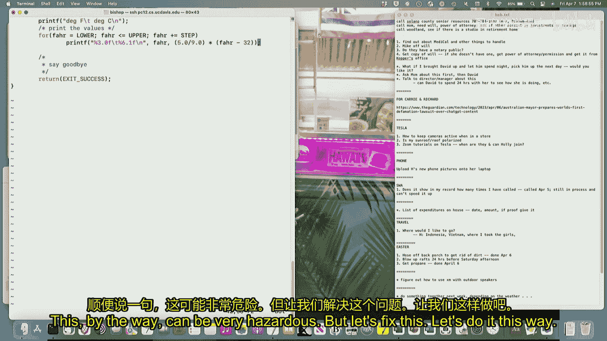
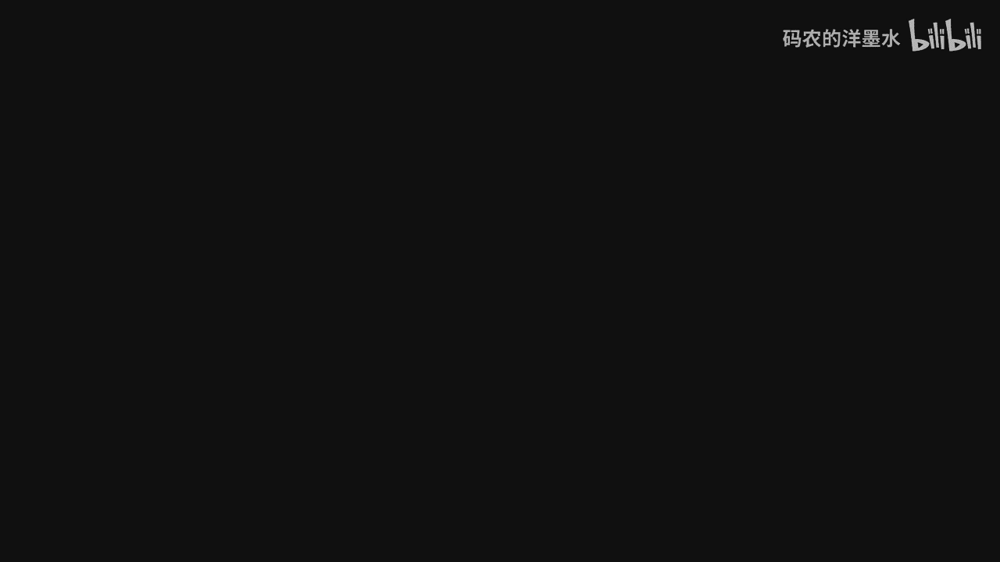

# C语言底层编程：第3讲：输入处理


## 概述

在本节课中，我们将学习C语言中的变量命名规则、基本数据类型、算术运算符以及类型转换。这些是编写C程序的基础，理解它们对于后续学习至关重要。

---

## 变量命名规则

在C语言中，变量名由字母、数字和下划线字符组成。以下是有效的变量名示例：`amount_of_money`、`hello2`、`_XYZZY`。

需要注意的是，变量名不能以数字开头，例如`2amount`是无效的。此外，C语言区分大小写，因此`Amount`和`amount`是两个不同的变量。

选择有意义的变量名非常重要，这有助于理解代码的功能。例如，在处理财务问题时，使用`amount_of_money`比使用`x`更清晰。

---

## 基本数据类型

C语言有几种基本数据类型：整数、字符和浮点数。

### 整数类型

整数类型包括`short`、`int`和`long`。这些类型的大小取决于系统架构，但保证`short`的长度不超过`int`，`int`的长度不超过`long`。

整数可以是带符号的（`signed`）或不带符号的（`unsigned`）。带符号整数可以表示正数和负数，而不带符号整数只能表示非负数。

### 字符类型

字符类型（`char`）用于存储单个字符，例如字母或数字。字符用单引号表示，例如`'5'`或`'x'`。

### 浮点数类型

浮点数类型包括`float`和`double`。`double`类型可以表示更大范围的数字，精度也更高。

---

## 类型转换

在C语言中，可以使用类型转换将一种类型转换为另一种类型。例如，将整数转换为浮点数：

```c
float f = (float)3;
```

将浮点数转换为整数时，小数部分会被截断，而不是四舍五入：

```c
int i = (int)3.7; // i的值为3
```

---

## 算术运算符

C语言支持基本的算术运算符：加法（`+`）、减法（`-`）、乘法（`*`）和除法（`/`）。需要注意的是，C语言没有幂运算符（`**`）。

### 运算符优先级

算术运算符的优先级遵循数学规则：乘法和除法优先于加法和减法。例如：

```c
int result = 8 * 5 + 3; // 结果为43，而不是64
```

如果需要改变运算顺序，可以使用括号：

```c
int result = 8 * (5 + 3); // 结果为64
```

### 整数除法

当两个整数相除时，结果也是整数，小数部分会被忽略。例如：

```c
int result = 5 / 2; // 结果为2，而不是2.5
```

如果需要得到浮点数结果，至少其中一个操作数必须是浮点数：

```c
float result = 5.0 / 2; // 结果为2.5
```

---

## 示例程序

以下是一个将华氏温度转换为摄氏温度的程序示例：

```c
#include <stdio.h>

#define LOWER 0
#define UPPER 300
#define STEP 20

int main() {
    float fahr, celsius;

    printf("华氏温度  摄氏温度\n");
    for (fahr = LOWER; fahr <= UPPER; fahr += STEP) {
        celsius = (5.0 / 9.0) * (fahr - 32.0);
        printf("%3.0f %6.1f\n", fahr, celsius);
    }
    return 0;
}
```

在这个程序中，我们使用了`#define`定义常量，并通过循环计算并输出温度转换结果。需要注意的是，`5.0 / 9.0`确保了浮点数除法，避免了整数除法导致的错误。



---

## 总结



本节课中，我们一起学习了C语言中的变量命名规则、基本数据类型、类型转换和算术运算符。理解这些基础知识是编写正确且高效C程序的关键。在后续课程中，我们将进一步学习循环、条件语句和其他高级主题。