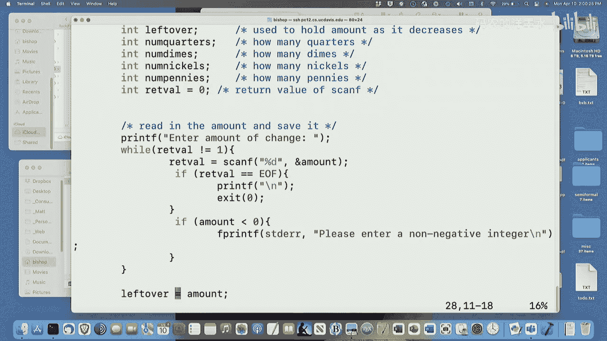

# 【全集】加州大学戴维斯分校 C语言底层编程 中英字幕 完整课程 p04 Lecture 4 - 条件语句与输入错误处理 -BV15C6FBsE3L_p4-

Okay， can everyone hear me all right？Okay， good what it wanted to do today。Is talk about。

Logic relations and operators and seek questions。Before we begin。Okay。

 the homework isn' not out yet when it'll be out tonight， I'll post an announcement about it。

It will be in the assignments area。So stay tuned。You'll have about 10 to 12 days to do it。Okay。

 anyway， I want to talk about logical operators in C。Which are handled in a slightly unusual way。

Because there's no notion of Boolean。 There's no Boolean type in C。

So here's what it looks like in sea。The way it works is zero is false。And anything else is true。

So true can be represented as 1，2，15，3，000， minus26， whatever， but false is always zero。

And there are two kinds of logical operators， the first or the relational set， which compare things。

So， for example， you've got greater than， greater than or equal to the colons， by the way。

 in the statement， they're now part of the relational operator。Equal less than。

 less than or equal and not equal。So for example， if x is 7 and y is 19， then and z is。

X is greater than y， greater than or equal to y。Then z will get zero。Because it's false。

If x is unequal to y。 that's true。 So Z will get one。

So when you're doing assignments for relations and logic。

The result is either going to be a zero or a1。It's when you do the testing of expressions。

Whether they're true or false。That zero was false， and anything else is true。Now。

 these all have the same precedents， by the way， theyre all evaluated left to right。

Now you can combine these by using and or you can also use a knot。But it's done again。

 uses different characters to symbolize that。W， where is it？Two ampers sands in a row。Is and。

Do not put one ampersand there， it has to be two。One amberand means something very different。

Specifically， you represent the numbers as sequence of bits。

Single and means and each bit with its corresponding other one。Two amber sands mean true or false。

 so that's why you want to do true or false again， I'll post these slides after class。

Logical or are the vertical bars， they're the thing above the backslash on most keyboards。

You have two of them。And that means either X or Y。😡，So in the first one。

 if X and Y both must be true， i。e。 non zero。For the end to be true。For the or。

 either of them has to be nonze。And the not， if x is0， then x become not x is1。If x is anything else。

 not x is0。The knot is an exclamation point， by the way。So you don't use the words and or a not。

 you use double 8 percent， double vertical bars and the not。

And how many of you remember truth tables？Okay， good。 here's here's basic， here's the truth table。

I use T and F， F is zero。But T can be anything other than0。 That's why I use T and F。So for and。

Both have to be true。Or and beyond end is false。For the or， one， at least one has to be true。

And then you get the faults。 and for not。It's just the opposite。 if true， if one is true。

 then the not X is false。 if x is false， then the not X is true。Are there any questions about this？

Okay。Now， one question is how do you go about evaluating these， in other words。

 what's the precedence and what's the associivity？Well， not has the highest precedence。

Not as what's called the unary operator， meaning that it only applies to the thing following it。😡。

And unerary operators typically have very high precedentnce。Then comes and。

Which are the two ampers sands。And then comes or。So what you would do first is evaluate all the knots。

Whoops， I I get up there。Yeah， that's what I wanted。All the knots， then all the ans。

 and then all the os。And by the way， if you're interested。

 the multiplication and addition operators and so forth。They go after not， but before and。

 and I'm going to post a table of this， Ill put up a table of it。In a bit。Now。

The other thing with C is you can think of it as a lazy language。

When it evaluates logical things and relations， it only does the minimum it has to do。

That's known as lazy evaluation。So what it does is it starts evaluating the operators in order of precedence and then left to right。

As soon as it can determine the truth of the statement of the expression， it stops。So here。

 for example， x is 12， and y is 29， and z is -1。And is higher precedent， so it does this part first。

W is less than Z， Y is not less than Z。 So this is false。

So it immediately says this whole part is false。And then does this one to see if it's true。

Because it has to be true。 in order for this to be true， it has to be true。

If this were true and that were true， it would not bother evaluating that。Down on here。And yeah。

 this is true。 So it turns out to be one。Down here， you start evaluating Y is greater than Z。

 which is true。So you go on over to here and look at x is greater than Z。Which is also true。

I don't know why I said zero there， that that should be one。Okay， now it's got these two evaluated。

 so it knows this side is true。And with either side has to be true。For it to be one。

So it doesn't even look at this。It just says， okay。

 I have enough information and it turns that into a one。And yes， I'll fix that before I post it。

Any questions on this？Okay， next question， how the heck do we use these？

And the answer is we use them in condition， well， we can use them directly。

 but we can also use them in conditional statements。Like if。So for a new statement。

 you have some sort of an expression there， typically it's a logical one。

If whatever is in there evaluates to zero。😡，You skip B F。If whatever in there evaluates to nonzero。

 then you execute statements。And it can be multiple statements。If it's a single statement。

 by the way， you don't need those curly braces。Technically。

 something within curly braces is called a block。And wherever you can put a statement。

You can generally put a block。Now notice there's no then。Questions on this。It's straightforward。

 but the notation is a little bit odd。Now let's say you want a test condition and if it's false。

 you want to do something else。Oh， your examples， if X is equal to 12， you'd print x is 12。

 Otherwise you'd print x is less than 12 if it's less than 12， you'd print x is less than 12。

If x is 15， you do nothing。Because x is not 12 and x is not less than 12， so you skip the F's。Clear。

Now， if you want to do something when x is not 12 in general。

 you can always put another if after it saying if x is unequal to 12， but that's a bit of a hassle。

So C provides you with an else statement。If the condition is true。

 you're going to execute the if statements。If the condition is false， you're going execute。

 sorry if the condition is true， you're going to execute the if statements， not the else ones。

 the if ones。And if the condition is false， you go down to the Elt and execute theEt statements。

And again， you can o the curly braces if there's only one。One statement。

So it' a couple of examples here， let's say x is 12。If x is 12。Well， that the equals is true。

 so we print X is 12， and then we skip over the elses。Here x is negative 3。 That's not 12。

 So we skip over the if and go directly to the elsets and print X is not 12。See how it works？

Very similar Python。Just the notation is very different。Okay， now in Python。

 you have this really cool construct called LF。Which basically means elseif。And see you do not。

So there are a couple of ways to handle it， the first one you come up with when you're looking at this is called nested ifs。

If condition one is true， you'll do the if1 statements and then drop out of the whole thing。

If condition1 is false， you go to the elsets and then look at condition2。If condition 2 is true。

 you'll do the if two statements and then drop out。 If it's false。

 you'll then do the else statements and drop out。So it's basically an if embedded within an if。😡。

Does anyone see a problem with this and it works fine in C， but from the human point of view。

 anybody care to guess what the problem is？Yes， sometimes it gets very confusing because you have to track things。

😡，The other thing is， notice the indentation for the under the Elts。

You technically don't need to do it， but it's good form because it makes it clear that。

This is a block。Under that。So by glancing at it， I can tell you'll only do this if you do the else。

But suppose you have three or four levels。It's going to start marching across the page and it's sometimes then very hard to follow。

So the right way to do things in C。Is the following。Instead of L if you use else if。

Means exactly the same thing。But notice here I don't go all the way across the page。😡。

And notice here， it's very clear which statements I'm going to execute。

So that solves a lot of confusion， makes things much clearer。

So please don't nest ifs unless you have a very， very good reason in general。

 this is the right way to do， the best way to do things。And again。

 notice I'm harping a lot on the visual aspects of C。With Python， you don't have to worry so much。

Because the indentation is not only visual， but it tells the interpreter how to do things。In C。

 you don't need the interpreter will basically ignore white sorry the compiler treats all white spaces a single blank。

So you can have programs that are incredibly complex and hard to read， and in fact。

 there is a contest， I don't know if it's still running。

 but it ran for at least 25 years called the International Obfuscated Sea code Contest。

The object was to write a program。That was almost impossible to understand。

 but that did something useful。And it was deliberately designed because a lot of people thought C was very hard to read。

 very hard to work with。So that was their way of getting some of their energy out。

It was a fun contest。Okay。Next one。Here's an example。😡，I don't know why I keep skipping。

Wait a minute。Yeah， that's right， okay。那です。Yeah， that's right。

 here's another way to do the if else thing。But there's a little trick to it。With a switch statement。

 you evaluate the expression。It must resolve to a constant。And then。If the constant equals the case1。

 the thing in italics there， which also must be a constant。Then you do the statement one。Otherwise。

 you look at case two and do statement two and so forth。And at the end， you put a default。

 If none of the cases are matched， you'll do what's in the default。

Now the difference between that and this。Is simply that here the conditions。

Don't have to be single variables。They can be expressions and such。Here。

 the cases have to be constants。😡，You can't say， for example， KX。

The expression can be whatever you like， but when it's evaluated， the result has to be a constant。

Questions on this？The switch is actually extremely powerful， by the way。

 notice the brakes at the end。When you hit the brake， it means leave the switch immediately。

And if you omit them， anyone care to guess what happens？And guesses？Right， what happens is。

If I left this break statement off。And it matchs case1。It would do statements 1。

 and then fall down and do statements 2。So in other words， the break says a stop here。

If the break isn't there， it just keeps going until it hits a break。And。

There are times when you really want to do this， for example， if two things are the same。

 two different things are the same。You have the you evaluate expression。

And you don't care whether it's zero or1。Then you can put a case zero and then a case1 and then your statements。

So it just falls through on K zero。And you don't have to have a statement under occasion。

 just put a break。Which basically means just do nothing， it's a do nothing statement。All right。

 here's an example。Evaluating x， if it's 12， I print x is 12 and drop out。If it's 11。

 I print x is 11 and drop out。 If it's 10， I print x is 10 and drop out。 and if it's anything else。

 I go to the default。Print X is not 1011 or 12， and drop out。By the way。

 do you think this is necessary？The brake at the bottom of the default just before the end of the switch。

Technically， you can leave it off。Because the last thing in the switch will always， after that。

 you'll always leave the switch statement。However。Don't do that。Here's why。

Let's say I have this and someone decides they had a case for nine， and they put it right in here。

What happens if they don't notice that they did never break？If it's 9， it will print X is not 10。

11 or 12， and then x， it will print X is 9。It will fall through。By the way。

 the cases and defaults don't have to be in order， they can be arranged however you like。

Putting a break in here is what's known as defensive programming。

 It basically assumes something's going to go wrong。And so you protect against that。

And how many of you have， many here have how many here drive， anybody。When you took driving lessons。

 did they teach you about defensive driving？You alwaysway assume the other person is going to do something crazy。

It's exactly the same with programming。Always assume the person who's going to modify the code after you will make a mistake。

 And so you try to minimize the effects of that。 If you don't have a break in here。

Any mistakes they make will carry out any mistake they make down here。We'll carry over to you。

If you have a break in here， when they put something beneath you， you're fine。

So that's an example of defensive programming。Any questions on this？Okay。

 before we go back on with the slides， let me go to the CSIF and。By the way。

 has everyone been able to log into the CSIF？Has anyone not been able to log in。

What you have to do is make sure you get the library。VPN。Install that， turn that on。

 and then you can go ahead and do the login。Can everyone read this？Okay。U。

Everyone remember the make change program。Okay。There's one part which he didn't talk about。

Which is right here。🤧。This intermount of change is what's called prompt。

 and it's telling the user what you expect。The reason this is important is user may not know what to expect。

And in early Uni systems， it was assumed that the person who was running the program knew how it worked。

 and so no prompting was necessary。That's not true anymore。So you always want to tell the user。

What to use or rather， what you expect。By the way， usability is a huge problem with computers。

How many of you have occasionally pulled on the drop down menu。

 moved your cursor down and accidentally gone too far and clicked the wrong thing？

Anyone ever done that。Yeah， it's actually fairly common。

 Did you all hear about the nuclear missile alert in Hawaii a few years back？

There was an alert which went out saying nuclear missiles are heading for Hawaii。

And 20 minutes later was canceled。We're not sure what happened。

But what we think happened was we saw the menu。And the menu consisted of a couple of things and one of them was test alerter。

And then right under it was real alert。And so the suspicion was whoever was doing。

 it had the mouth slip。That's exactly the sort of thing you want to avoid。True。

 the amount of change is not going to destroy a state， but it's good。 still。

 it's good to let people know。And then comes this scan。This says read an integer。

And stored in amount， which is defined up there。You need this ampersand。If you omit it。

 strange things happen。The reason you need it is balance is a location and memory。Okay。

But if you simply say amount， that is saying what's in that location。

 it's not saying where that location is。If you put the empers sand in front。

 the compiler will read this as。Store whatever you read here in the variable amount。

Technical term for this whole thing is a pointer and we'll talk about pointers and that nauseum later on。

Yes。I'm sorry。Let me try it again。That better？Is this better？Thank you。

 please speak up if you can't read what you have on the screens or if you have a question or whatever。

 because it will help me pace things and also help me make sure you can read it。Okay， so as I said。

 you need the ampers sand here for any variable。And so what this will do is read in the amount。

Let me add one more line。Can anyone tell me why I need that line？Okay， let's say I left this off。

What's the value of left over here？I don't know。It's just whatever junk happens to be in memory at that particular location。

So I have no idea what this is， but it almost certainly is not going to be what I typed in。

So I need to make sure I do the assignment because I'm going to do the divisions for leftover。

And by the way， as you can tell， I probably tell I copy this pretty much from the。Handout。

Let's see if that's true on the others。有。When I do the handouts， I use a text processor。

And the percent。Is a comment？O。Okay， let's go ahead and compile and run this。

And I'm just going right。Okay， so now it's asking me how much change， let's say  96 cents。

And it comes back and tells me it's three quarters， two dis and a penny。Okay。

Now let's try something a little bit strange。I'm giving you a negative number this time。

Does that make any sense， by the way？No。And notice now it' put a bunch of negative numbers down there。

This would be considered in an error。So part of the problem here is I'm not checking that this number is valid。

And for zero， it works。Basically， anything negative， I should catch and stop。

This is where the if statement comes in handy。So let me go back into the editor。

 whoops actually hang on。Okay。This will catch an error。Hopefully， I don't know what happened。

A working version a better version of this one than actually worked。好。This part comes later。Okay。

 one more change。Okay。Here's what's going on first I'm reading in the amount。

And then I'm using the if statement。This relational operator says if amount。

 the value of amount is less than 0。Then I do this part。 if it's zero or more， I just skip that。

Now here's the idiom for giving error messages。😡，The first thing you do is you use a function called F print F that actually writes to a file。

Which we'll talk about later。 The next one is ST TD， E， R， R。 that stands for standard Air。

Just use that now。And later on， I'll explain exactly how it works。Real quick， if you're interested。

 STDERR is what's called file pointer。And what it says is it's a special file which basically bypasses your output and prints things on the screen。

And then I put in the error message saying， hey， how about a nonne integer。And then， I quit。

But I quit with a nonze number there to indicate that something went wrong。

So let's go ahead and do this and see if。Oh。Wait， what？😮，A。Forgo my semicolons。By the way。

 does everyone know what the exclamation GC means？The bash。

The show in the CSIF keeps track of previous commands。

The exclamation point means go back and look up the command。

 the last command I type that begins with GC。So instead of typing this whole thing。

Number C's command， where wheres my mail？So instead of having this whole thing。

I just type exclamation point GC。And it works。 Yep， and of course， I forgot to initialize leftover。

Here we are。Okay， now it asks for the amount of change。 so let's try what we did before， first， 96。

I got the right answer。Now。Let's try negative 96。Oops。Gives me an error report。Now watch this。

What does this aerosi mean？Yes。Perfect file。 if this is going to put the output into file name out。

So if we do this。Notice the prompt， which is being written on the regular output。

 doesn't show on screen。😡，But I know what it is， so I type 96。And I get that。Now， let's do it again。

Into a different file。But we're going to enter-96。Notice the error message got printed on the screen。

😡，And， in fact。There's nothing Theres only thing in that file out too is the prompt。So what STVER is。

 it bypasses the regular output。And tries to write directly to the terminal screen。

There are ways around that， but that's the intent， and that's how it's used 99% of the time。

Questions on this？Okay， now there's another special character that I wanted to show you。

 warn you about。It's called End of file。😡，What in file means is undone。

I'm not going to give you any more input。 It's over。

You can think of it if you like as the program reaching the end of a file at its reading。😡。

And the way you do it from the keyboard varies from system to system on Max and Linux。

 it's always control D。 Hol down the control key and hit D on Windows， I believe it's the same。

 It may be control Z。 I don't know。 I've seen them both used。

So here what I'm doing is I'm running the program。And it says， may change。嗯。

So let's do I'm holding down controlr D。And notice it gives me an error。

So basically I'm telling you it， hey， I don't want to give you any input and you're saying。

 please enter a non negative integer。It's a little bit uncool， should simply exit。

So let's go in and fix that up。All right now。ScanIn order to fix this， we have to look at ScF。

Scanf returns。The number of things it read successfully。So if it write an amount。It would return one。

If it couldn't read the amount。It would return zero。Now end file is a special symbol。

And so scanf will return minus1。However， no one writes minus1。You're write。E， O，F。

 which is a constant included up here in this SD I O dot H library。

The reason is -1 is a number of different meaning。 and for an end of five。

 you want to make it clear that， hey， this is what what it means。 So I would do something like this。

So what this says is execute this， do the scan F。If it equals。And a file。 In other words， I type C D。

 then just quit。Actually， that's bad， which should be done like this。Well。

 let's go ahead and run this and then I'll show you how to fix the problem。It's a human problem。Oh。

By the way， what he just did was they push an up arrow， up arrow takes you to the previous command。

Alright， so now let's do control D。Notice it just quit， it didn't print the error message。

But this is rather uncouth。It just printed the prompt afterwards。

 didn't print a new line or anything。So let's go in and change that。All right。

 so what will happen now is if I type into file。It'll go into here， print a new line， and then exit。

And the result will be。So we will see in a moment。And now that's much more intelligible。

This is the prompt I typed Control D in the end of file， and it gave me the Bton shellll prompt。

On a different line， it exited the program and did that and printed that out as usual。So again， yes。

The default value is -1。No， my insulin。Here's the thing。When you type a 1。

It's right is two characters， minus and1。The symbol minus and the symbol， the digit one。

For end of file。What happens is the system itself will read the control D and then translate that into an integer of negative 1。

If you entered a negative one there for the scanf。It would simply record it as a minus1。However。

 you can do this and don't， please don't。 But this will， I think， demonstrate something。

I idea what that was。Let's see if this works。This may or may not work。No I can just do that yeah。

 I need to introduce succeed。有。So what happens is in general。

 minus the EOF symbol is defined as minus1。You're not guaranteed that。😡，I mean， it's supposed to be。

 that's what the standard says。But it's much better to use the E OF。Other questions。Okay。Now。

Notice this program quit， oh yes， I'm sorry。You read my mind。

Let's say we want to keep asking this question。And we want to keep going until the user enters a proper number。

Now， there are three ways to repeat things in C。You have the wild loop。

 which is called an indefinite loop。The reason is the while loop continues looping until some condition is met。

And the condition may depend upon variables that are set within the loop。Hence， the word indefinite。

A definite loop would be like a force statement。Because you know the starting point。

 you know the ending point， and you know the increments。

How much you're going to advance the counter by？So you know when it will stop。Hence。

 it's a definite loop。In this case， which one would we have to use？Yes。Wow。

 because we don't know how many tries it'll take the user to type a valid input。

So let's go ahead and do that。Al right， let me clean up the code now so it's actually readable。

Close enough， I'll clean this up before I actually put it on the CSIF。All right。

 so what's going to happen here？Once they fix this。It's going to read some value。

If the value is end of file， it will quit。If the value was not end of file。I。

 I'm assuming it was it read correctly。Then it'll check to see whether or not the amount is less than zero。

If so， it will print an error and then loop。

