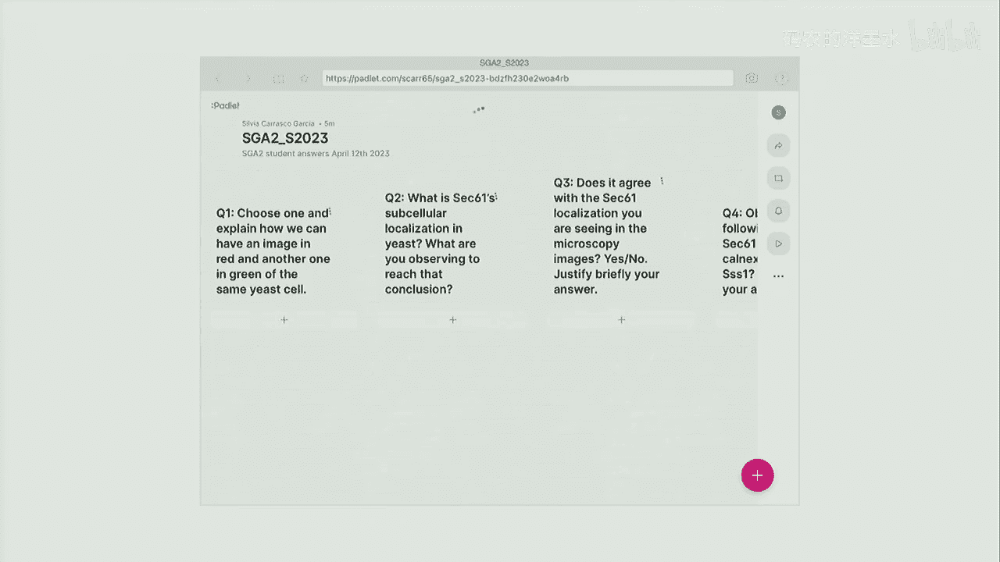
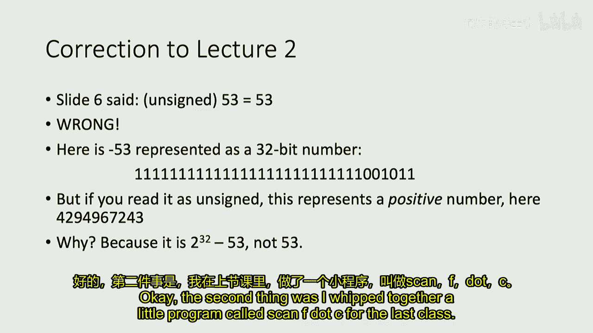
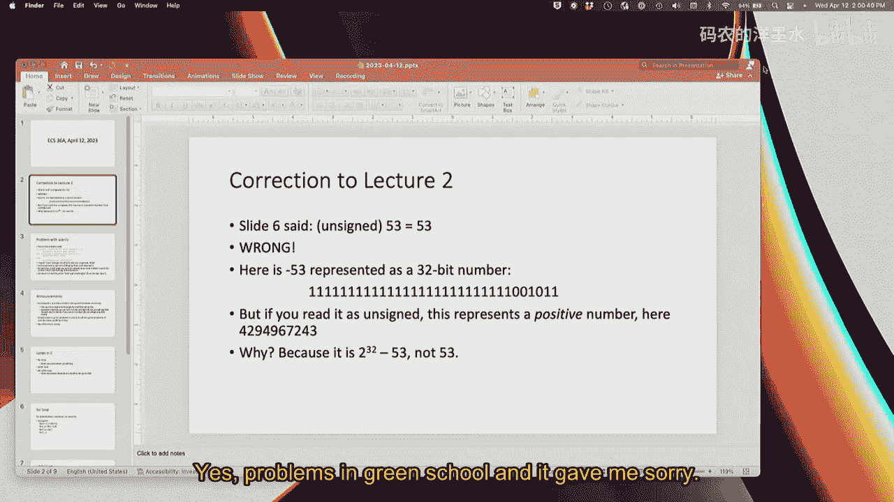

# 【全集】加州大学戴维斯分校 C语言底层编程 中英字幕 完整课程 p05 Lecture 5 - 循环结构 -BV15C6FBsE3L_p5-

Can people hear me now？Okay， good they replace the batteries。Okay， a couple of things。First。

 a couple of announcements。Whoops。There we are。Okay。Come on， just give me to the right page， please。

Let's stay there， okay， homework one extra credit winter up on canvas。

You can go ahead and start them， the great scope for problems one and two of the homework is set up。

Problem three and the extra credit， I will probably get those done sometime tomorrow。

Let's see what else due date is April 24th。And the questions require you use some programs。

In particular， the second question first on the homework。

Basically as you do some loops and insert them into the body of an existing piece of code。

So what you should do when you're doing that one is。

Look in the code and it'll say insert your for loop here， insert your Y loop here and so forth。

So you don't have to worry about writing functions or anything like that。

 you just have to write the loops。U see what else Okay， yes。

 today I can't have office hours I'm afraid something came up at the last minute。

 I'll hold a makeup office hour or sometime next week， probably on Tuesday。That way。

 everyone will have had a chance to look at the homework as well。Are there any questions？ok。Okay。

 there were a couple of things that I wanted to correct that I said earlier。 Actually。

 one thing I wanted to correct。 and then another I figured out。The first one was in lecture2。

 slide6 said unsigned negative 53。It should have been a -53。 Its really 53， which is wrong。

And the reason is that's because of the way computers represent numbers。

 You all know they represent numbers as a binary， correct？Is everyone here familiar with binary？

If not， don't worry about it， I can explain it easily。Dead silence。Okay。Basically。The system。

 the CSAF， which I was working on is a 32 bit machine based on a 32 bit machine。

And when you say minus 53。In 32 bits， this is the representation。

The technical term for this is called two's complementment， but this is what it is。Now。

 the one here is the sign。So this would be red， if it's an int， this would be red as minus。And then。

All of those ones would go away and you change this slightly， and you' get 53。

Unsigned means there's no minus。So this one is interpreted as 2 to the 31st。Not a negative number。

And so if you do that。The number you get is this。Effectively， it's 2 to the 32nd minus 53。

So the correct answer， if you say unsigned minus-53， you will get this。Not 53。

If you want to be sure you're getting a positive number。

 there is a function in the math library called ABS for absolutes。Value。

 or you can simply check and if it's less than zero。Nigated。Yes。

Sometimes they're handy when you're dealing with things that you know are never going to be negative。

The other time， which is probably the more common is when you're working doing systems programming。

And you need to control whether or not this is right as a negative number or not。And for example。

 if you're doing writing， telling the system to look at a particular location on the hard drive。

There's no such thing as a negative area on the hard drive。So you would use unsigned。Good question。

 other questions。Okay， for the most part， we'll be using signed。Okay， the second thing was。

I whip together a little program called scanf。c for the last class。

let me fact， bring it up。And it didn't work out exactly as I had planned。

 I'll expand this in a minute。Can everyone see that？That better？What。😮，Oh， okay。It's weird。H。

Wonder what's going on。 Give me one second if we can't pull it up， I'll。Just go through to the slide。

For somebody， it's not。Can meism。Okay。Okay， let me get pull the slides back up。

Let's try the hard way。

嗯。Well into every life， I guess a little glitch must fall。I was trying to mirror it。Actually。

 that's a good idea， let me check that。昨天晚上。Oh， okay， good。All right， thank you very much。

Lets see let's get back to that。To PC 12 then。And。Just thing。嗯。Okay， let me。Can everyone see that？

All right， this is going to be a little weird because I'm ping over here。

 but the screen is over here so。Lets see。Okay， here's a little program which I put together last time。

It printed a prompt。And then you could enter either and enter in a floating point number that percent D and percent F。

And the integer would be stored in accentant， notice the amberand， you need that in this case。

It'll become clear why later on， but。And the embererson in front of the why。

 the float would go there。Since Scner read two things。It should return till。If it doesn't return to。

Then I went down to this line。Where it would read an integer and then look for Xxx。And it matched。

 if that was an integer and it matched the tripleX。

It would store the endtegerent accent and return a one。If it didn't， it would return to zero。Well。

 what happened was when he typed in three spaced Xxx。I got zero and it said didn't get anything。

And that surprised me because。I thought it would match this。It turns out it doesn't。

 Is there right of subtle air going on。 Do folks， Any folks see it。Okay。The issue here is。

In C is in most haian languages。When you read from the input。

 you think of the input as a stream of characters。Or whatever。So when you read from it。

 you essentially are taking the characters off the beginning。So what it type was three space Xxx。

So it came down to here。Got the percent D right， which is the three。And then X， X， X， well。

 that doesn't match this。So scananf at that point doesn't read it。

And it returns a one because they only matched accent。So let it comes this down here。Now。

 matched since the threes been used， it's gone。😡，So when this tries to read from the input。

 it will read Xxx。Which doesn't match anything here， doesn't match an integer。

 And so that's going to return to 0。 So you'll get down here。That was the problem。

ScanNF is tricky to use， as you can tell from this example。

 and there are somewhat better ways to do it things。Which we'll get to probably Friday。

Any questions about this？Oh yeah， I should show you one thing。Okay， good。Let's go up to here。

This is my home directory， tillil the bishop。And you'll notice I have the。X is here。

Those mean execute for file。 Any yes。Sure， I'm sorry。

The goal of the program was to read in one of two things。

Either an integer followed by a floating point number。Or any in followed by tripleX。That's all。

wasI intended it to demonstrate how scanF worked。Turns out he demonstrated a little bit more than I thought I was demonstrating。

Anyway， anybody remember what these are？For a directory。Okay。

 their execute a for a directory means you can search。😡。

So what that means is you cannot look and see what's in that directory。

But if you know the name of a file in Act directory， you can get to it。

And so if you look at ECS 36A down there， where are you？S to small。Anyway， if you look at 36A here。

You'll notice that it allows you to read and execute。 In other words。

 you can list the contents of the directory and you can search it to find things。So if you do that。

You will see it contains4，4 things as of now， and itll contain the fifth thing in a little bit。嗯。

So if you want to see the programs for number  two， lecture number 2。哦。U see the intoECS 36A。

And you can。Look at lecture2。And you all remember the hello， and then we did the hellello bad。

And then we did the start the Fahrenheit， the temperature thing。You can also look in03。

And we did the second version， including the one with the bug where everything printed out zeros。

In number three。Number four， actually。We did the Mink change program and I showed you the ScanF program。

And M。Simply contains other things that。Might be of interest。As an example， at one point in C。

 you can write negative 3。But I couldn't remember whether you could write plus three。

Some older versions of C wouldn't accept it。 The new one does。 So anyway， this little program。Oh。

It simply sets x to plus three。 Now， if this were illegal。

 I would have gotten an error and it wouldn't compile， but it did。So it accepts plus。Plus and minus。

 by the way， in front of a number。Are called unary operators。They're like not。

 They affect only the thing that follows it， which is three here。

And they have higher precedentnce than any of the arithmetical relational operators we talked about。

Questions on that。😮，Yes。It's completely redundant。It's just that。Ion。

It's sometimes used in math and in other places as well。

 so I was curious to see whether or not it worked here。

 here it is completely redundant because I'm not adding things。Other questions？Okay。

What you want to do now。can now to see if I can get the other thing。

Problem is that the cursor is not showing up。 if you must know。A there we are。Okay， there we go。

And it's。The presentation mode。We'll go with that， okay。

So I mentioned this and mentioned the problem with scanf。

 I'll post these slides into the slides from Monday。Today， want to get back to my office。

And I already did the announcements。All right， now we talked about if statements and such switches and the like。

Those。Apply a condition once。 And if the condition is true， they'll do one thing。

 if the condition is false， they'll do something else。But sometimes you want to iterate。

 You want to go through several times。 For example。

 if you want to write a loop that adds that counts from 1 to 10。

You're going to need to go through a loop nine times。C is three different types of loops。

 the four loop， which is definitive in the sense that you know， at least。

You generally know where you're going to end。A while loop where the condition is indefinite， that is。

 you don't know where it will end， but you no wonder what condition it will end。

And the do while loop， which is basically a while loop， but the test is at the bottom。

So let's take a look at these。嗯。The for loop takes three arguments。😡，First is an initialization。

 then a condition that is tested。If the condition is true。

 you go in and execute the body of the forlo。When you are gone。

You'll go up and execute the increment statement and then retest the condition。

 and you continue to do this。Until the。Condition becomes false。So for example， here。For this one。

 I'm starting with I equal to one。1 is less than 10。

 So I'm going to go into the body of the for loop。 and I'll do something。 I didn't。

 I didn't list anything in particular here。But when I'm done， I'll then add one to I。

 This plus plus means add means increment the target， this thing by one。It's a very common sea idiom。

And then you'll test again。 So I is now 2。2 is less than 10。 And you go through the loop again。

 Finally， when I is 9 and it comes up here。It'll become 10 because 10 is 9 plus 1。This is false。

 and then you go beyond the for loop， you pass out of it。Here。

I I'm initializing J somewhere before the for loops。 So I'm leaving the initialization blank。

 You can do that。This will immediately test whether or not J is less than 10。

If it is indeed less than 10， it goes into the body。 and then when it comes out， it will take。

It will add3 to J。Again， this is another common idiom， it means J equals J plus 3。Yes。Yes。

At the end of the for loop， yes。Now， this one is not really a good way to use a for loop。

 a Y loop would be much better here， but what this says is test that x is less than 10。

 then go ahead through the loop。And there's no increments。 So then you， after that。

 you'd come back and test whether or not x is 10。So you could easily do this in a slightly different way that I'll show you。

Anybody care to guess what this does？It's another idiom。Yes。Infin infinitefinite loop， exactly。

What happens is it comes here。There's no initialization。There's no test。

 so it assumes true and goes into the for loop。When it's done， it comes up here and sees， oh， jpers。

 no increment， so I'll test this again and go in。So it is， in fact， an infinite loop。Now。

 if you want I'll give you an example of how to handle that sort of thing。

The wild loop is probably much better to use in this case。

Because it doesn't have increments or initializations。You simply have a condition。

The condition is tested before you go into the loop， if it's true， you go into the loop。

 if it's fault， you skip the loop。At the end of the loop。

 you go back up till the while and you continue doing that test the condition， and again。

 if it's true， you go in， if it's false， you bypass it。

 and you continue doing this until that condition becomes false。

So here's one that will simply start adding ones to 10 or one to I。 And when I exceed。

 when I becomes 10， it'll drop out。This one does while J is not 13。You droprop out。

Anybody care to guess what that one does？I could have put any number。

 any number except  zero in there。That's a hint。Yes。Yep。So what does loop do？Yep。

 it's an infinite loop。Because this is always true， so you keep。And。

 this is actually a do nothing loop。Because you start with when you go into the loop。There's no body。

 The body is simply a blank statement。And so you just loop around here。

That is sometimes useful when you need timings of a certain sort， and again。

 towards the end of the quarter， I'll explain that in much more detail。

 I'll give you a couple of examples。Andm。The key thing here is that the condition is tested before the loop is executed。

So in other words， you may never enter that loop。It depends entirely on how things。

 how things are going。And here's the other one， the do while loop。

You have do notice the curly braces。I suspect you can omit them if there's only one statement。

 but everybody， I've， whenever I've seen this， it's always been with curly braces。

 even when there's only one word over one line。One statement， I'm sorry。

So it executes what's in that loop and then tests the condition。If the condition is false。

 it keeps on going。 If the condition is true， it goes back up to the do loop。

 to the de and re executes the body of the loop。And then test the condition again。

So the difference between this and a while loop is while loop the while loop may never execute。

Because the condition can be false and if it's false， you skip it。However。Do while loop。

Well always execute the body of the loop at least once。😡，And that's typically when you use it。

When you want the body of the loop to be checked first。And then， sorry。

 you want the body of the loop done first， and then you check the condition。Questions on this。Okay。

 let's just look at it。Let's put together a very short program。Now what we want to do is。嗯。Print。

 what we want to do is print a message， say， five times。So。So again， we start off。With include。

And we do it in Maine and voidd because we're not worried about arguments or anything。Os。Yeah。

 that should work。All right， let's try compiling this thing now。see pedantic。They call it。まし。

First time。Andm there。We me put the program up。We wish said thing wouldn't keep appearing。啊。

A little dot up there I'm trying to get to。Yeah。Okay。This prints for the。

 and then the number of times is printed。And then prints high。 So you'll see it there' 5。

 Then when I is equal to 5， because it goes to 4。You add one to4 to get 5。 This becomes false。

And so you drop out， print buy and quit。See how it works？Now。

There's something a very handy construct that will get you out of infinite loops。

So let's try modifying this program another way。You。This time I'm going to initialize I up here。

And get rid of that in。Okay。Now we're going to make it an infinite loop。And let's do a curly brace。

Now what we want to do is do the same thing。But we want to break out after it's printed things five times。

So what we do is we do this。Oh， it could be easy to get rid of yeah。Okay， what？Ohoops。Okay。

 what I've done here is that said， we'll start with I being zero。Then we're going to an infant loop。

Each time through the loop， notice， we're adding one， but we're doing it at the bottom。

And then what we're doing each time through the loop is testing whether or not I is greater than or equal to5 because remember。

 we wanted to print out five times and you've got zero，1，2，3， and four。If so。

 then we execute a break statement。The break says， get me out of this。

So it's associated with the innermost4 loop， which shares that infinite loop。And so after this。

 it's going to drop out of the loop and execute the by。Same result。Now。

 watch what happens when we leave off the by。Or the break。Okay。

 what do these back slash stars do and front slash stars do？Anybody remember？Comment， correct。

There are a number of different ways to do comments， by the way。

 C+ plus introduce one where you put two spec slashes。At the beginning of the line。

 and that comments out the entire line。This comments out， however。

 many lines are between the beginning and of comments。By the way， commons do not nest。

So if I tried to put a comment in there。At the first backsllash startup would stop reading it as a comment。

So anyway now I've deleted this。 So watch what happens。And yes， this does happen in real life。

When you see this， you do a control C on the CSIF。It may take a minute， but it will stop。So。

For the time I started it to the time I ended it， it looped 2265546 times。So be aware of that。

 sometimes the program can go dead too， it'll just stop。But it won't exit。

 it'll just be sitting there while you're going through one of these loops。😡，If that happens。

 control C is the best way to regain control， yes。I'm sorry。It's much faster than Python。

 The specific reason is that Python' is an interpreted language。 So when you run a Python program。

 it takes your line。Then has to translate it into the machine language。And then execute that line。

 and then it repeats that for the next line。 Actually。

 what it does is compiles it to an intermediate form， but it has to do the translation。

 every line you execute， every statement。With C， when you compile it and get that output file。

That's machine language。So。The usual rule is interpreters are quicker to write programs on。

 but slower to run。Comparitives。If you're using a compiler， a it's slower to write programs on。

 but much faster to run。😡，And C designed one of the considerations for C was they wanted to make it as efficient as possible。

 because at the time you would languages that were similar to Python。Okay。By the way。

 the break also works for the quaw and。Do wild statements。

There's another one that I want to show you。啊，对。We hate this thing。Alright。

 let's restore this one first to all its glory。So to speak。By the way， this is perfectly proper。

 indentation plays no role in C。So that break is associated with the if statement。However。

 here here's the common error。So just warn you about it。Okay。嗯。If I。Oh， come on。Let's say。

 is that print F associated with the F statement。 So if I is less than 5。

 will that print statement execute。Any thoughts。All right。

 if this language rep Python it would and see it will not。Again。

 the reason is the compiler pays absolutely no attention to indentation。

Couldn't care less how you're indenting it。Since there's no curly brace there。The。

 there's only one statement associated with the if， and that comes immediately afterwards。

 So it's the break。But if I had an open curly brace after the five parentheesis and a closed curly brace before the eyeicle's I plus1。

Then printf would never be executed。The reason is if I were， say two。

The if condition is false so it's skip down and execute I equals I plus 1。Finally。

 when I reaches five。The condition is true。 So it goes into the if statement。But it hits the brake。

 and that takes me out before the print statement。So be careful when you're dealing with things like this。

Also with else， this is the same as Python， but the else is always associated with the closest if before it。

So for example， if you do if a。If B else， the else belongs to the FB， not the if A。😡。

If you want to belong to the FAA， then you have to put curly brackets around the FB statement， yes。

If I switched。Oh， I see。 No。 if I well， I would have to put wild one。To get do the infinite loop。

 but otherwise they're identical。I'm sorry， Which bracket gets to the curly ones afterwards。Its。

That gives you an error， The question was what happens if you have this？

Notice there's nothing between the brackets。 That gives you a syntax error。By the way。

 what does this statement do？And then there's a loop following it。Right。It says， hi。

 I'm a law statement。I'm always false。 Just skip over whatevers under me。

And it will just skip over the loop， needless to say you don't see that。嗯。Okay， now the do well。

Get rid of this one。Anybody know why I line them up the way I do。

 since it really doesn't matter to the compiler？Yes。一。If I'm just glancing go over a program。

 I may get confused and not see that there aren't brackets。Around the breakagan if。

And so I might think that's the body。Of the if statement。

It's just easier if the indentation is proper， yes。嗯。Leaving off the semicolon will produce an error。

However。The Gnu compiler was very helpful。 It actually tells you， by the way。

 you're missing a semicolon， here's the line and it may be on the previous line。

Because it doesn't notice that some colon is missing until you finds another statement。

Some compilers will simply say missing semicolon。And then they will continue to try to compile the program and give you all sorts of errors。

So you might get 40 years on a program， the first one says missing semicolon。

 fix that and everything works。So the GCC compiler， also called the GU compiler， is very。

 very helpful。Okay， let's do this as a dowhile loop now。And not as an infinite one。

So we can get rid of this， replace it with a dow。We don't need this if statement because we're going to test for a condition。

And then the wow goes right here。And it produces exactly the same result as was earlier。

Let me put up the program。Okay， so what happens here is it produces the same result but in a different way。

Notice there's no initialization， I have to set it up at the first line。

Then it goes ahead and prints something and then adds one to I。So the first time through this loop。

 I is one when you get here。Okay， now one is less than 5。 So you go back to the de。Print one for the。

 for the one time。Add one to it and it becomes two faults。

 And you keep going round until I equals I plus1 makes I 5。Then you hit this fault。 you drop out。Yes。

U。Specifically， you use the for loop。When you have a definite ending point。

You use the while loop when you don't， these are examples。😡，But another， another way is I have time。

 Yeah， I may have time， I may have time to do this。 Me not。Lets see。

What we're going to do is make it depend upon a user typing something。He so。Again， please remember。

The only one who types worse than I do is my cat。So。I'll explain this because。啊呀。Pive that a second。

Okay， let me explain you a couple of things， get care reads the next character of input， that's it。

Because of the way the system works though， you have to type a return。哎。

And I need a close parentheses here。Now， on Friday。

 we'll talk about some character representation and such。

 but the single quotes mean that A is a single character， so it's going to look for me typing an A。

So let's go ahead and compile it and see how I did。But it is in like CN。I'm sorry。Yes。

And there's a very subtle reason for that。Get care returns a character。He。😊。

And characters are  zero to 127。How do you indicate which one of those should indicate end of file。

 you may have a reason for all of those。So you have to have something that's not in that range。

 which is minus1。And in order to get -1。Get care will return to -1 into file。

That's why you need the C to be an integer。Because otherwise。

 you couldn't represent end file except by using one of the characters that you may need later on。

Good question。Oh， some I'll get this right。Here we are。I'm just going to let it go to Adot out。Okay。

You're there。Oh， I have a somebody calling after Maine。Okay。All right， now not's waiting for input。

So I type a three， and then it reads the three in the new line。But when you type in A。In exits。

And that's an indefinite loop because the wild condition is no way of knowing when I will type the A。

And this， by the way， is most often used when you're reading file or input。

Because you'll get an end to file to indicate there's no more input。

But you don't know when you'll get that。 So you we would use a wild statement。

The two can be coerced to act like one another， but in general the rule is， if it's definitive。

 in other words， you know how many times you're going to go through the loop， use a force statement。

If you don't know how many times you're going through the loop。

 because it depends on the condition within the loop or a statement within the loop。Use the wow。Okay。

 I think， yep。Bell has told。I'll comment these programs。 They're in the Le05。

 You should be able to see them。Yes。

クウ原作。And it gave me， sorry。It gave me these as the error。

 It was running when I did it through terminal。 it satisfied all the cases。发这。Do I loop。

But when I upload it what's the name of your program？Don't see。It's the same that day。How bizarre。

Okay， let me see what's going on， thanks。

