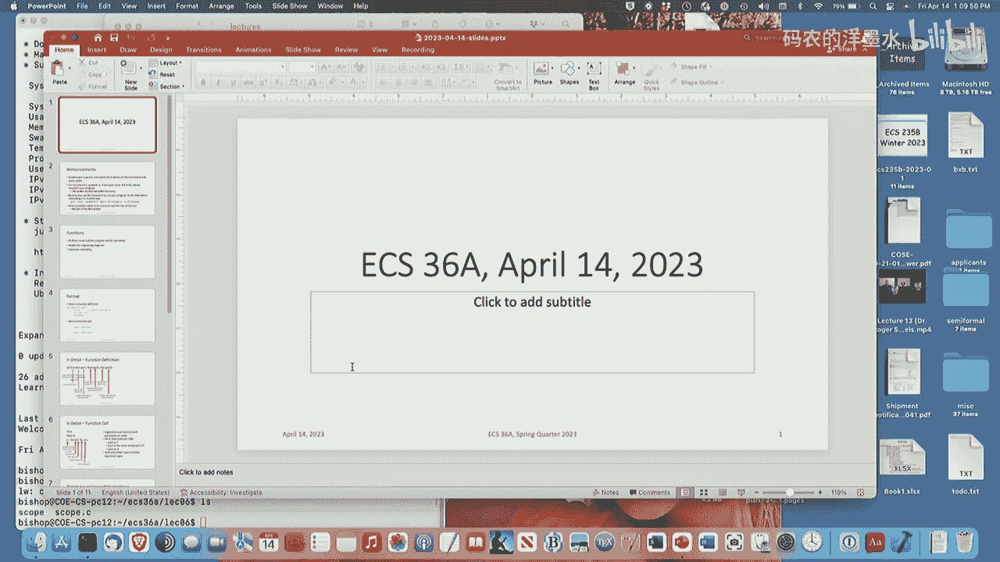
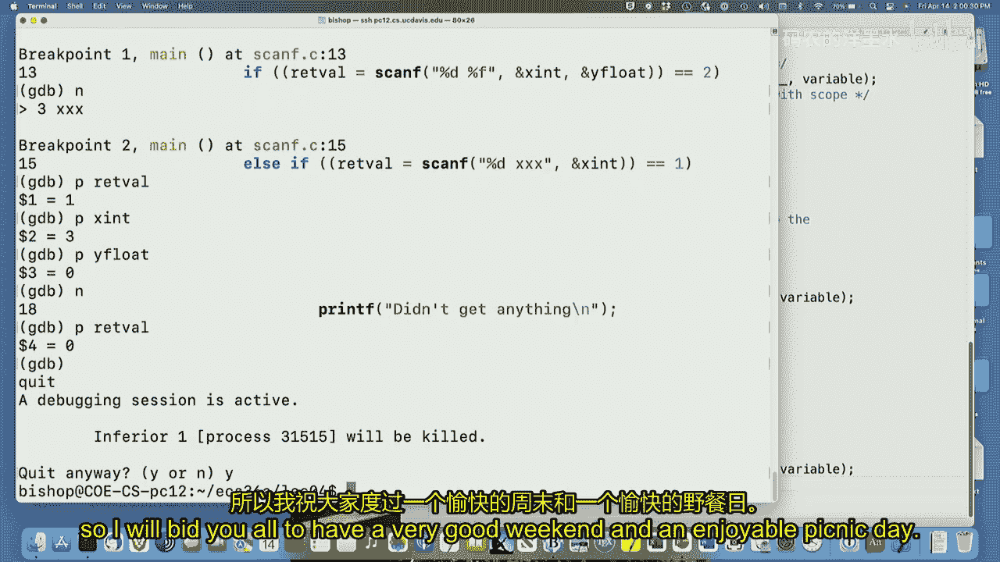
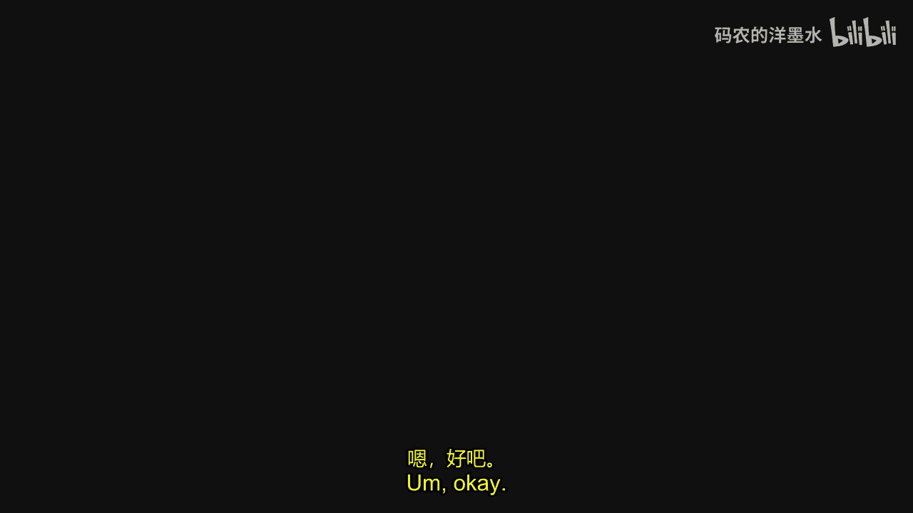

# 【全集】加州大学戴维斯分校 C语言底层编程 中英字幕 完整课程 p06 Lecture 6 - 函数 -BV15C6FBsE3L_p6-

Hi， are there any questions？About things we've done so far in the homework。

One thing about the homework， if you do it on another system。

 sometimes gradecope will flag errors that your system won't。

And the reason is that your system may be using a slightly different version of C。If。嗯。

The version that we're doing here will run on pretty much anything。And various parts。

 various languages and implementations have some extensions which may confuse the systems。So。

If you're having problems。Run it on the CSs。Download it to the CIIF and run it there。

The compilers should be。Exec it with。What is going on， Why is it going forward？Okay。

If you execute it with。OhB， anyway， if you executed with this antipoantic command， that one。

Then you will be able to。Brun it the same way that it's right on grade scope。Okay。あし？

I's tried this way。And。嗯。For some reason it insists on running forward。And they don't want it to。

There， that should fix it。It's always interesting when you discover things about a program。

 when you didn't intend to。Anyway， a couple of things。

 gradecope is up and running on all of the programs。

Here's the command you would use on the CSIF with file name being， whatever the file was named。嗯。

If you did homework one problem， two， check that you got and you got it right。

Check that you got 60 points instead of 55 points。There was a typo in the scoring file。

That if you got it All right， would only give you 55。I fixed it yesterday。

But I wanted to warn people to look for that。Let see what else。 Oh yes。

 some compilers allowed double slash to comment out lines。That's from C++。

And while it is fairly widely used， it's not part of the standard 9 C 99 standard。

So at least one person hadd their program rejected by grade scope。

Because they commented a couple of lines like that。

And once they use the slash star and star slash comeing， it worked fine。Any questions？Okay。

What we wanted to talk about today were functions。Now。

 functions are simply ways to encapsulate parts of the program。

 and it can be done for one or more of three reasons。

The first one is you're going to be doing a certain complex operation repeatedly。

And you don't want to type the code for that or put the code for that in the main program repeatedly。

So what you do is you create a function and put the code in the function。

And then you have the main program called that function。In addition to simplifying the programming。

This also makes it much more readable。Because with an appropriate name， it'll be very。

 very clear what that function does。And。It's also very helpful to organize your program when someone's going through it。

Because if they see the same segment of code repeated multiple times。

They have to check or they think they see that。 They have to be sure that it's actually repeated and that there aren't small changes。

On the other hand， with a function， if you call the same function at three different places。

 it's the same computation。goeses through the same function。 So you don't have to worry about， well。

Is this segment of code the same as that， it looks similar but？It's very。

 very easy to miss a minus sign or a plus sign or a semicolon or a comma or things like that。Okay。

 so。In C， let me explain how functions are presented。The top one is a function definition。

 It adds 17 to whatever parameter you give it。So。You call。

 So this is a function that returns an integer。And it's called with an integer parameter。

It defines a variable， and this is called a local variable because it's within a block。

 within the curly braces。Adds one to it and then returns the value。Now。

Here's what calling a function looks like。 In this case， I made the parameter 53。

 and then the second one，-12。And stored the stored the results in two integers， some1 and some2。

So that's what it looks， that's the overview。Here it is in much more detail。嗯。F missing a neuro。

 The int is the type of the function， which is really the type of what the function returns。

Some functions don't return anything， in other languages they are often called procedures。

 but C still calls them functions。In that case， instead of the inch， you would put void VOID。

And that's a signal to the compiler that this function doesn't return anything。So if later on。

 the compile see you signing the return value of that function to a variable。

It's going to complain that， hey， this is not returning anything。

 Why are you assigning it to the variable。Then comes the name of the function。

 which I very creatively named fununk。And then the list of parameters。 This is three parameters。

 The first one is an integer。And in the function， we'll refer to it as pair1 par1。

The second is a floating float。Referred to as power 2。

And the third is a character referred to as par 3。嗯。You must have variable names in there。

 You cannot put numbers。Okay， or constants。One thing I should warn you about in older versions of C。

 you would leave off the types。Within the parameter list。And the compiler would have to infer them。

What this sometimes did was， for example， you would pass in a floating point number。

And the procedure， the function would read it as an integer。

And so the results you'll get would be wildly inaccurate。 This solves the problem。

 because if you try to pass into a floating point number is the first argument。The compile will flag。

 Well， wait a minute。 There's a tight mismatch。 That's a float。 This is an int。Anna will warn you。

Questions on this。Yes。Is character a string。 No， it's a single letter。

 We will be getting to character strings next week。可意。

Because it turns out the mechanism used to store characters is also used to pass in parameters of a slightly different kind。

By the way， the technical term for this is called call by value or pass by value or reference by value。

Because what's being passed in is a reference。 or sorry， is the value。Of the arguments。And。

Here's an example call。Int X float F X。 I'm assigning the return value of function to an integer because it returns an integer。

 said so on the previous slide。The integer it's being called with is 7。

 That's going to be matched up to par 1。That's the first parameter。

The second one is the floating point number。 So whatever value is contained in the variable Fx。

Will be paired with part 2。 So all references to part 2 will have that。

 at least the initial references to part 2 will have that value。And the character there is a。

And that will be mapped into par 3。And then par 3， and then you can use those variables in the function。

 just like anywhere else。The important thing to note is that if you change the value of Fx。

 you do not change it in the program where fununkk is called from。With this type of parameter list。

 you cannot change the value of the parameters in such a way that the。That outside the function。

 they will have to change values。We'll talk about how to do that next week。嗯。Now， one thing。

 one thing is that。Where you put these functions， Because the declaration here。

 this is the beginning of a definition。But that also declares the function。

It advises the compiler what the function is returning and what type of parameters it will accept。

And。I think I hoped that was me。And。How many parameters does it have？

But sometimes you'll call the function before you define it。

That's perfectly fair because if you haven't defined it and it's defined later on。

The compiler is smart enough to figure out that's the one you're calling。

But the problem there is it doesn't really do any checking of the types of the arguments or the number。

Because the definition。Follows。Where it's first called。So to get around that problem。

Cs introduced what's called a function prototype。Or a forward declaration。In general。

 it's good to declare functions before you use them。And if the declaration is in the definition。

 that's fine。嗯。The problem here is， as it says， if it's defined after use。

 the compiler is going to assume a lot。And if the parameters it's being called with demat' assumptions。

 basically it assumes things are integers。Then it warns you。

 But if you put the prototype in at the top of the file。

And I'll show you an example in a few minutes。Then there's not a problem。

 The compiler will understand these are the types。 And when it， when it encounters a call。

 it will just verify the types are correct。And the function prototype， as I said， is basically。

The function， first line of the function definition。In this context， it would be。That thing。

 except with the open curly brace replaced with the semicolon。Like this。Down here。And。Quite frankly。

 you can leave off the parameter names there， by the way， in the forward declaration。

Does't hurt to put them in。 And it doesn't matter whether or not they match the actual definition。

But if you are going to put them in， it's a good idea to copy the first line of the definition and add a semicolon or change the curly brace to a semicolon or how you're doing it。

Okay， now let me give you an example of a little function。

 and we'll be talking about this one next week as well。This program is。

 this function is supposed to exchange two values。And so the way it does it is it creates what's called a local variable called temp。

And I misspell that。 It should be T， E， MP。 Anyway， it stores the value of a in temp。

 then stores the value of B and A。And then stores the old value of a， which is in temp in B。

There are a number of ways to swap numbers， but this is。The， this is the most common。Okay。

 so how does this work， Let's take a look in some detail。Okay。When it starts。Well， if 13 is B。

 A and 5 is B。So the variables， for example， X and Y， X would contain 13， and y would contain 5。

And since swap what we call swap X comma Y。A A becomes 13， and B becomes 5。Now。

 this function is no idea。Of the one that called it。

 It doesn't know anything about variable names and such with one exception that I'll show you。

So it relies entirely on its own naming scheme。Temp here is empty because it's just been allocated。

But so of spaces for in A and in B。And those are set by the call。The first line， temp equals a。

Takes the value of a and sticks it in temp。The second line。Takes the value of B and copies it into A。

And then the fourth line here。嗯。Takes the value of temp and copies it to be。

So that's how the swap works。 What's important to understand about this whole thing is first space for a variable called temp is allocated。

But also spaces for int A and in B are allocated as well。They do not。You don't get the address。

Of the variable from the call， you get the actual value in there。On the calling end。

 this is what that call particular call would look like。A is set to 13 and B is set to5。

 and I call swap A And B。 These two happen to have the same names， but that's purely coincide。

 They're completely different than the A and B and the function。Now。On the calling end。

Here's what happens。Okay， so A and B are 13 and5。So the first line is going to print A is 13。 B is 5。

It then goes through swap。At the end， since swap can't change anything in the collar。A is still 13。

 and B is 5， even though they were exchanged within that function。More of the story。

 if you're passing parameters to a function。The value of the parameters does not change on the outside。

You can change the model you want within the function。

But that's not going to affect what the caller sees。Again， there is a way to do this。

To do that and I'll go into it next week， basically it involves the data structure called pointers。

Okay， now one question also is。How are these variables actually stored in memory？

And it turns out to be an interesting and important question for reasons that we'll become clear in a little bit。

But you'll often hear the term the stack。When you hear people talking about programs。

The stack is basically how the variables are stored。And that's true for all parts of the program。

And when we get into recursion， you'll see why that's so important。 Anyway。

 here's what the stack looks like。Okay， when you start off。Here。X is x is 3 and y is 13。 So these。

 this space has been allocated on the stack already。You then call swap X， Y。I'll fix that。

And what happens is when you call swap， it has to remember a number of things。

 including where was it call from。So it knows so the system knows when a return is given。

 where to go back to。And so。Some information is pushed onto the stack in order to let the function。

Return to where it's where it was called from。 It will return right afterwards。

And then it does the parameter matching。 Int A matches X and in B matches Y。

 pretend there's a tail there。And so it allocates space for those two variables on the stack。

It then allocates space for temp。On the sack。And now， here's what happens。When the first line occurs。

 temp is a。Temp gets free。Just as before。When the next line is hit， a equals B， A gets copied into B。

Notice， by the way， nothing is changing down here。It's changing is only up here。

 only in the function。And there B is equal to1。Now， one of the things that's kept here。

Is a reference to how much space this function had on the stack。So went on the return。

It takes the return address out of here。And sticks it in the program counter of the system。

 which makes the system begin execution at that point。And before doing that。

 it essentially releases all this space。 Space is unchanged。

 but if someone tries to refer to be here。嗯。The， the system will have no idea what they're talking about。

Because all of the parameters and the local variables， they all go away。

So if you think of each function as an island undo itself。And the only things you will see are。

Calling her or going to the island。 And then the result are coming back from the island。 That's fine。

 You have no idea what's going on within the island。Now， in practice， if you write it， of course。

 you'll know what's going on。But programs are typically written by teams of people because there are many thousands of lines。

And so one team may be responsible for one part of the code。

 another team responsible for another part of the code。And they have to interact with each other。

So what happens is the teams define functions。And they tell the other teams what the prototype is。

Then the， they don't tell the team they don't have to tell the team anything about what's in there。

Because the team that's going to be referencing it just needs to know what to get， what to pass it。

And what it's going to give back。And that's it。It's a good idea to have these functions as self contained as possible。

There are cases in which you won't be able to do that， but in general， you want that。The principle。

 by the way， is called modularity。And it helped simplify things greatly。Now at the end， on return。

This is what what what the system sees。Like I said， everything above here is lost。

And so since these two never changed。Since X and Y didn't change。

 they have the same value as they started off with。Questions on this？Yes。Okay。

 on the print statement。The system begins reading this string， and printing things out。

When it sees a percent， it knows the next character is going to be special。

Percent D means print is a decimal integer。 So what it does is since this is the first percent D。

 it goes to the next argument。And prints the value of x。And then it prints semicolon space y。

 space equals space， and then it sees this again。Going to print something as a decimal integer。

 Well X has already been printed because it match that。So why we'll get printed？One question is。

 what happens if you have fewer arguments here than you have the percents？

The compiler we're using will catch that and it will warn you。Other compilers won't。And so。

 what happens is。There will be some number there。That just happened to be lying around。

And it gets printed。So you'll see junk。嗯。In some cases。

 you can actually use that to compromise a program to make a program do things it shouldn't do。

But that's another subject。Okay， now。I said that this function is self contained and won't change anything。

And then I said， in some cases， you do。For this one， you don't。

 everything here is defined within the function。 So that's what it's going to use。

Even if there were a variable named A in this program。ep in this part， if a was set to 25。

When swap was called。It's called with X， which is 3。 So the a there would refer to 3， not 25。

That notion is called scope。Basically， when you refer to a variable。

 which variable are you referring to？How many here were told when you were learning Python or whatever language？

Try not to give variables to the same name。Has anyone taught that？Okay， this is why。

 because if you don't give them the same name。It will be very clear which one you're referencing。And。

 you know， it'll do the reference if it can。 And if not， it will give you an error。

And name that variable。So that the way it's fairly easy to see what's going on。

If you have the same name。Things can get extremely confusing。So basically， what happens is。

If two variables have the same name。And then and you use one of them。

 either for assigning to or reading from。The one that's closest to the line using the。啊。

Using the variable。That's the one it's going to use。That's what you up by mirror。 By the way。

 you can't have two variables with the same name in the same in the same function。

 actually technically in the same block。So let me give you an example of this。Can everyone read this？

O。Here is a program called Scope。And it's not a particularly good well written program for reasons you'll see in about 30 seconds。

No， no less on it。嗯。I'll expand this one too。Can people read that？Let's try a little bigger。

How about that？Okay， good。Anyway， here's what scope looks like。The these two， the Voy G and Voy H。

 are examples of forward declarations。Because the program willll call G And H。

And they're both defined at the end of the file。Down here。So the compiler has to know whether or not。

TheAny parameters are being called correctly。Are being used correctly。

 And then return values are being used correctly。This program。

Up there says G is going to be past an integer， but it's not going to return anything。

And H is not going to be past anything。 That's the void， and it's not going to return anything。

The return any not going to return to anything or because both functions are declared void。

So if you try to assign from them， like x equals G5。The compiler is going to complain。

In older versions of C， the compiler would not complain。

And you would get whatever happened to be lying around。Some if you were really， really lucky。

It would be what you expect。But most of the time you weren't that lucky。Okay， now。

 underneath the void， the four declarations， I've declared a variable with the surprising name a variable。

 and it's an integer ofm sending it to one。This is a top level definition。

 or more commonly it's called global。Because it's accessible to anything that follows。Now。

 now we start with Maine。Here， I'm not passing。 I'm not going to deal with the parameters of main at all。

 So I'll just say， boy。Here， notice I'm declaring a variable with the same name。

But I'm sending it to two。So when you do the print here， oh， print here。Which one does it use。

 This one or that one。That's the question。This， by the way， is very handy。

It simply means the current line number。😡，So for this line， it number line it would be 38。

And this is a standard variable， standard， well， it's technically a macro。

 but it's defined in all versions of C。And remember， I told you。

 it's not a good idea to begin a variable name with an underscore。 It's legal。

 but it's not a good idea。Many of the header files have variables or constants。 is this is variables。

 constants or macros that begin with an underscore。

And so you don't want to collide with them because then your definition， one of two things happens。

The preprocessor， which handles things like this。Does not do variables。 It does textual substitution。

So in other words， if I had this is a variable。You know， he declare it is an int or whatever。

This would be replaced by the current line number。 Maybe， for example， I would be saying in 29。

And the system would go，29 is not a variable。 It's a constant。 It's an integer。That's illegal。

So if you don't start with underscoreco， most of the time you're safe。

There are library functions which we'll get to in a bit that you can call。Okay。

 so anyone care to guess what what would be printed here。 Let me move it over a bit so you can see。

WhichWhat's the value of variable that's closest to this line？2。And in fact， it will print two。Now。

One thing which I didn't talk about much。 I mentioned it， but I'm not sure how many people caught it。

This open curly brace and that open closed curly brace match。 So what's inside is called a block。

And basically， a function is a block with a prototype on top of it。

But you can nest blocks and have blocks to find variables within blocks。

So I have this open curly brace。And then close， then this， sorry up there， the open curly brace。

 and then this closed curly brace。I defined variable equals3 in here。

So which what value variable would be printed here。Three， exactly。Because that's closest。Now。

 what's going on？Remember the stack I showed you？Every time a block starts。

There's their new allocation。 variabless are allocateator are created on the stack。

And when the block leaves， they're all removed。So what's happening is。The global variable well， is。

 actually， let's just do the ones in the block。 variableable equals 2 is stored on the stack。

Variable equals 3 is also stored on the stack。And the system will go for the one that's at the top of the stack。

Which in this case would be three。Now， this is tricky。It doesn't define variable here。

And it says invariable and that's where is external， for external。

What that means is it's not defined within this block or this file。😡，If it's not defined in the file。

 you have to define it elsewhere。When we talk about programs in multiple files。

That's where you'd have to define it。But if it's used like this。Where variable is defined elsewhere。

It means go to the global one。So you have extra in variable， variable here will be one。

If the word Xt were left off。And I initialized this variable to say 10， it would print 10。

If I left this line off。It would inherit that value， three。Use that。Okay， so。

When we come to the inner， we come here to the innermost block， now， remember， we printed out one。

Here。Variable。But this block goes away because we're done with it。

So it will print out here the value， the closest value or variable。Which if you start here and go up。

It's going to be that one。Because that's defined within that block。😡，Once you exit the block。

 that goes away。😡，Completely。And so in Maine here。It's going to print。Go all the way up。

 skip this block and go up and do two， use two。Okay， now。Notice we call G here。With with variable。

 what do you think variable value is， is is being passed in。Two， I see a number of people doing this。

 too， you're right。Now here variable is a parameter。😡，And it， it's printed out。

 value that's passed in is printed out。 So that's going to print 2。And then it calls age。Now。

 H simply prints variable。What do you think it prints？Let's find out。It prints a one。The reason is。

There's no definition of variable within this scope， within this block。So it looks outside the block。

And the only definition of variable that's outside a block is this。If this were not here。

 you would get in error。So in fact， let me show that。

I'm just going to comment it out because I want to put it back in。

And the compiler immediately complains。That is because。When it gets the ear。

 it says sees variable and says， OK， variable is not defined here。I'm at the top level。

 rather my function is defined at the top level， so let me go to the top level and get that variable。

But。We commented the variable out。So it basically says， I have no idea what this refers to。

And that's the error， it said， it's undeclared。First， use the function。Let me fix it back up。Okay。

 any questions on this？Okay， scope takes a little bit of getting used to。 So if you make a mistake。

 don't feel bad。 Everyone does。 Well， I don't know。 There may be one person who didn't。

But most people do。Okay， now what I wanted to do next。

Was show you a little bit something that may help with debugging， this works on the CSIF。

It may or may not work on your system， which has a different。

 which will have a different one of these。But if it's visual。

 you'll typically use the visual aspect to it， but it's very helpful。Notice this G。When you compile。

 if you don't put in the G。嗯。The system will simply append。The location of certain definitions。

 like functions。In a table at the end。If you put in the dashG。

 it also adds a lot of debugging information。Now， you can't see that directly。

But you can use a program called GDP。Now GDPB stands for Ganu debugger。

 you have the Gnu compiler and the Gnu debugger。And when you have a problem， it's very。

 sometimes very useful to use this because there are a lot of things you can do。For example。

 I can list the program。By typing an L， and it starts somewhere， usually around line 23 or 30。

But if I want to specify where to start， I can do this。That says print lines 1 to 20。Now。

Just type L to keep going。Okay， now what I want to do is I want the program to run。Until it reaches。

The line 37， the in variableable。Equals 2。So in order to get it to stop at that line。

 I answered what's called a break point。A breakpoint basically allows me to stop the program and inspect variable values。

38， yes。Okay。Now， if I want to run it， I still be type runn。

 And if there were any arguments to the program when I ran it on the outside of G B。

 I'd add them after this。Okay， now this stopped， it says， hey， look。line 38 in filecope。

 see there was a break point， so I'm stopping。By the way。

 if you want to look in the executable to see where I stopped， it's at location 1，1，5 c。

 which is a exadecimal number。If you're really into system programming， assembly language。

 machine language and things like this， this is useful。For 99% of the time， ignored。Oh。

 and this is grade point number one。You can have multiple break points within a file。

So now I can print， for example。And there it tells me the variable is two。

W's what happens when we try to do this， though？What's happening is when you type P。

It goes looking for a variable with that name， in this case， variable。But the line is not a variable。

 it's a macro。So the compiler。Makes what first pass through your program。

And wherever it sees something you've defined or that is defined elsewhere。

It simply replaces it with whatever you said lying is always replaced by the current line number。

So when you get here。This is line 38。 so this becomes the constant 38。

And that would be similar to typing this。No， that worked no， anyway。

 here it can't figure out what line means。Because it doesn't exist in the compile。

 It doesn't exist in the compiled file。Okay， so anyway。

 now what I can do is look ahead and see what's coming。

And what I like to do is put a break point and stop just before this is executed。

So I add a second break point at line 43。So 43， yeah。嗯。And then。I go ahead and run the program。

But since it's already started， I simply type Kant for continue。 I can also just type a C。

And it continues and then it stops there。Now， notice here it printed out the line， M。It line。

 this is line 38。And variable is two。So the reason I did this was so that you could see that at line 38。

 when you printed the value variable， you printed a two。Now here。The value will be three。Now。

 continue goes to the next break point。Question。Okay， continue goes to the next break point。

Or till the programs end。So if I typed C now， it would go to the end。If I want to only。

 I can add another break point， or if I want to see what the next statement will do。

 I type N for next。And it prints out main variable equals3。And stops。

There's a variant of this called S， which stands for single step。Don't use it。

Because what it does is it takes you inside the library and starts showing you assembly language instructions。

So unless you know X86 asssembler， it's pretty useless。Okay， and this one。Pris。1。

And then if I type C。It goes on to the end。And it says what this means is that the process terminated normally。

Now， let me do this with another program to give you an example of how you can use it。

On a program to find a bug。嗯。嗯。不 no位置。H on second。There it is。

We'll cut and paste to see if I'm typing here。嗯。Okay， first， I'm going to run scanf。

Just to remind everyone of what the problem is。 And so I want to enter3。Followed by X X X。

 because remember， first it looks for an in in the floating point。If it doesn't find that。

 I want it to look for an integer followed by tripleX。And if it doesn't find that。

 it should print a message。But when I do this。It says， didn't match anything。However。

If you look at the source of this。It did the first if。And that's wrong because while D matches a3。

 F doesn't match triple X。So then it comes down to here。And what I expected it to do was read three。

 and then it would match the X Xx and print out got three。But it didn't。

So let's try to figure out what's going on here。We'll run GDP on it。Now， the problem arose。嗯。Oh。

Now the problem arose。嗯。Right at these two lines， something's going wrong here。

So let's go ahead and list it and put break points there。Breakpoint at line3 at line 13。

And at line 15。Okay， so now let's go ahead and run it。Whoops。Okay so now it stopped。If I type n。

 it asks me to enter something， I enter 3 xxx。Okay。

 now what they want to do is see what the value of X and y float are。

Because neither of them should be set。 Actually， first， I want to see what the value of。

 what red value is， the return value。Okay， so it found one thing。

Which matches what I thought because the percent D should have matched the three。

So we print accentcent。And yes， that got three。And we can then print why float just for grins。

And we got zero。Okay， so now we're down to this altif because that's is altF。

Because the two didn't match the one。 Red vow was one。Not equivalent one。 So I go here。Now。I do this。

 I do。 I'm going to go ahead and continue。Os。And all of a sudden， it goes to didn't。

 didn't get anything。So redfo， I thought， should have returned one because it would match the three。

So let's print out red vow。0。That means this didn't match anything。

And the obvious question is why not， Because they had a three followed by tripleX。

So it should have returned to one because it read one thing。嗯。So what that means is。

The scanf here up on the top， read the three。Out， tookook it out of the input。And then this one。

Read the rest of the input， which was X X X and couldn't match it here because the three was already gone。

So that's how he figured out what the bug was。GDB can be incredibly helpful and there's a lot more features to it。

 in fact I'll post a handout this weekend about some commands you can use and so forth。Okay。

 so anyway， I'm done with this， so I want to end the pro。 I want to end it。

 So I do control the for end of file。 and it says， hey， wait a minute。Your program is still running。

 Are you sure you want me to stop it。Since I figured out what was wrong， I can say yes。

And then it just terminates the process if I say no， it dumps me back into GDP。Questions on this？

This is just a very quick overview of it。 I'll be using it a lot more in class so you'll see how to use it in other ways as well as having this reinforced yes。

You can't fix it within GDP。 It will only show you where the errors are。

 Then you go into an editor and fix it， and that saves it。Other questions， good question， by the way。

Other questions？Well， it's two o'clock， so I will bid you all to have a very good weekend and an enjoyable picnic day。

好嗯。責明。And I need to sell that。Okay， can we do this on Monday morning？That's fine。 Yeah， Ra。

Because we need to have a meeting today。All right， why don't we go with the mean today？

I don't my name。Okay， let's start at the meeting today and the meeting is at free。

Do you want me to come to come to yeah， 20 Oh come to the conference room where I hold off shower？

Thection。And I know I'm not typing right。Right。Is is。Luth， whichhi virtual network do you want？Okay。

Is your login name on the cast？