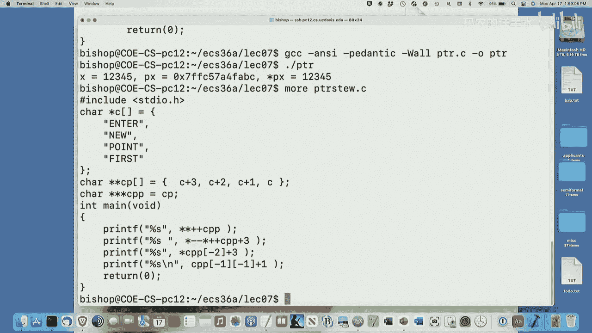

# 【全集】加州大学戴维斯分校 C语言底层编程 中英字幕 完整课程 p07 Lecture 7 - 指针与间接引用 -BV15C6FBsE3L_p7-

All right， are any questions about what we've been doing？Okay。

 I have gotten a couple and there was a couple of things they I wanted to show you。Oh。

 TA's office hours are 10 to 11， Monday， Wednesday Friday in camper。

And will probably shift my office hours slightly。As far as。Whatai a meant。好。I yes。

 a couple of things。Here's the command you use。On CSIF before you submit the grade scope。

I mentioned that the double ses at the beginning of the line weren't recognized。

 here's another thing that won't be recognized。Some versions of C。

The standards that I don't know of any standards that allow it。At least not since。If they do。

 it would have to be after 2020。But。This is not standard C。What you need to do is define X。

Index at the top of your block or of your function。And then you just say x equals zero。

If you do this， it's going to be rejected by the compiler。So I want to warn people about that。Yes。

Correct。Double slash is not in the is not in the version of NCC we're using。

 I believe it was added later。But I don't know if it's still standard。Other questions？Okay。

I've also gotten some questions about how you copy things to and from the C SI F。

Here's how you do it。 You've just completed writing a C program， put it in a file called F。First。

 activate the VPN， whichever one you're using to connect you to the CSIF。Then use this command。

 SCP space F， which is your file name， space PC， I'm using PC 12。

 You can use any of the CSAF systems。 They all have the same file system。

And don't forget the colon at the end。That will put it in your home directory in the CSIF。

So you then run a bunch of it， run it a bunch of times， fix it up and so forth。

 and now you have something you want to submit to grade scope。

The way you do it is be sure that the VPN is working， still connecting。

And then you give the following command， SCP， and then again， a CSIF system。Co and F。

 if that file is still in your home directory。And if you put a dot that copies it to the directory that you director of folder youre in。

In the in your own system。And now you can just go ahead and upload F to GreatScope。If you want。

Excuse me， if you want more detail。There is a handout on SSH， SCP is at the end of it。

Because SCP basically uses SSH。You may get asked for your password， but you may not。

 depending on how you set it up。Questions on this， yes。I would not make that assumption。

I would actually download it and try to run it。 The question was。

 if I run it on another type of Linux system。Can you assume that it would work on greatcope？

And the answer is gradeadecope is running Uuntu 22。4。

And I'm not sure that that version of GCC is resident on all types of Linux systems。So it may work。

 it may not work。Not very satisfying， I know， but that's the best answer I can give you。

Other questions？They will be as soon as will be right after office hours。

Which are two to three today。Any other questions？Okay， now。

 do you all remember that I told you a function could not change its parameters values in such a way that the outside of the function。

 they would be recognized is changed。Do you all remember that？Okay。

That would make functions somewhat useless， useless。However， there is a way to get around it in C。

 and it's the one that's very， very widely used。It depends on the type of structure that we haven't talked about。

Called a pointer。And a pointer is simply a variable。

 just like an integer or a floating point number or whatever。Except that instead of containing data。

 it contains the addresses the data you're interested in。So for example。

 if x is an integer set to zero。This says。PX is a pointer to an integer。

The easiest way to read declarations is go right to left。Now this。

 the star means pointer in this context。Now， this Ampersand means take the address where variable x is located。

 so take the address of the variable X。Where it is it in memory and store that in PX。

So in other words， the Amerson says， giveive me the address。And the star means go to the address。😡。

And let's see。So， here you print。X is an integer。And here you print what Px points do。

